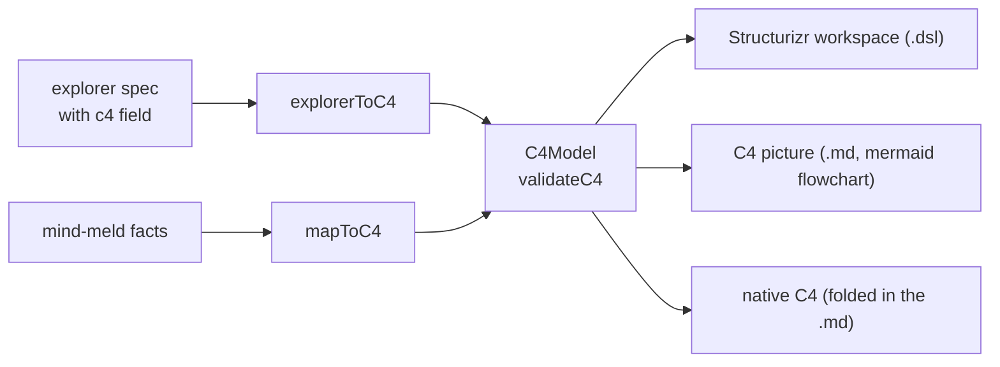

# Design: C4 and Structurizr output

## Outcome
- Owner problem and desired observable change: enterprise clients name C4 and Structurizr as their standard
  for architecture diagrams. Scaffold's diagrams are mermaid flowcharts and explorer pages. After this change
  a repo can produce a Structurizr workspace and C4 views from two sources it already has: an explorer spec
  and the mind-meld repo map.
- Constraints and failure consequences: no model call, no Java, no Docker, no new dependency. The same input
  gives the same bytes. A generated workspace that Structurizr rejects is worse than none, so every construct
  emitted is one the language reference states (see Assumptions for what could not be run locally).
- Outcome evidence: unknown until observed. Intended check: the owner compares the generated views with a
  hand conversion of two real system diagrams and one scaffold design, on one page, and approves or corrects.
- Architectural contribution: model-led. Owner words: "lets add support for them all"; "c4 sounds more like
  a systems design methodology for deployed software, and might be more relevant to the pngs"; "build the
  generator and compare, maybe something I can visually approve would be helpful" (2026-11-24).

## Preservation obligations
- Existing flowcharts, explorer pages and mind-meld map pages are unchanged; C4 is a second output.
- An explorer spec without the new `c4` field renders exactly as before and produces no C4 files.
- Authoritative contracts: `scripts/explorer-spec.ts` (`ExplorerSpec`, `validateSpec`),
  `scripts/mind-meld-langs.ts` (`ModuleFacts`), `scripts/c4-model.ts` (`C4Model`, `validateC4`).
- Observation entry points: `node scripts/render-c4.ts` and `node scripts/mind-meld.ts c4 <repo> <out>`.

## Assumptions
| Consequential assumption | Disconfirming probe | Evidence / unknown | Revision if wrong |
|---|---|---|---|
| The emitted DSL parses in Structurizr | Load a generated file in Structurizr Lite or `structurizr-cli validate` | unknown: no Java or running Docker on the build host; syntax taken from docs.structurizr.com/dsl/language | Fix the emitter; add the failing construct to the tests |
| Mermaid's native C4 layout is readable enough to be the picture people look at | Render a real 8-container system | observed false: labels overlap and lines cross boxes on both concierge diagrams | Done: the default picture is a flowchart drawn in C4 notation; native C4 syntax is a second file |
| Only diagrams of running software belong in C4 | Owner review | owner statement (above) | Opt in per spec, so any page can be added or removed |
| Mermaid wraps SVG label text at about 22 characters | Render a view locally | observed: a 30-character wrap was re-broken mid-phrase | Done: descriptions and arrow labels wrap at 22 |
| A top-level folder is a fair first guess at a container | Owner or client review of a mind-meld export | unknown | The generated workspace is meant to be extended (`workspace extends`), not edited |

## Canonical Vocabulary
| Term | Definition |
|------|-----------|
| C4 model | The neutral description both emitters read: one described system, its elements, relationships and dynamic views (`C4Model`). |
| Described system | The software system the model is about. Containers belong to it. |
| Person | Someone who uses the described system. |
| External system | A software system outside the described one. |
| Container | A separately running part of the described system (C4's meaning, not Docker's). |
| Component | A part inside one container. Only the mind-meld export produces components. |
| Group | A named cluster of containers or components; carries no meaning beyond the name. |
| Relationship | One element uses or sends data to another, with a description. |
| Dynamic view | A numbered sequence of relationships that tells one story. |
| Workspace | Structurizr's file: a model plus its views (`.dsl`). |
| C4 picture | A mermaid flowchart drawn in C4 notation (boundary, typed labels); the default rendered view. |
| Native C4 | Mermaid's own `C4Container` / `C4Dynamic` syntax. |
| Opt-in | An explorer spec carries a `c4` field; without it nothing C4 is generated. |

## Decisions
### One neutral model, three emitters
**Decision:** converters produce a `C4Model`; emitters turn it into a Structurizr workspace, a C4 picture and
native C4. Converters: explorer spec to model, mind-meld facts to model.
**Rationale:** two sources and three outputs would otherwise be six translations that drift apart.
**Alternatives considered:** emit DSL directly from each source (duplicated escaping and id rules); depend on
`structurizr-cli` to export mermaid from the DSL (needs Java).

### Explorer specs opt in and say what each node is
**Decision:** `spec.c4 = { system, description? }` opts a page in. A node is a container unless
`node.c4.as` says `person`, `external`, `database` or `queue`; `node.c4.technology` is optional. Lanes become
groups. Each distinct flow step becomes a relationship; each flow becomes a dynamic view.
**Rationale:** most scaffold pages are process flows whose stages are not running parts; converting them all
would produce C4 that means nothing.
**Alternatives considered:** parse the mermaid flowcharts (decisions and end states are not C4 elements);
convert every page with defaults.

### Mind-meld export
**Decision:** `mind-meld.ts c4 <repo-root> <out-dir>` writes a workspace and a C4 picture. The repo is the
described system, each top-level folder a container, each source file a component (grouped as the map
groups them), each declared import a relationship. No dynamic views: the map records imports, not calls.
**Rationale:** these are the facts the map already has, each traceable to a line of source.
**Alternatives considered:** a flag on `map` (two unrelated outputs in one directory).

### Generated identifiers
**Decision:** every identifier is generated with a kind prefix (`p_`, `s_`, `c_`, `m_`) from the source id,
restricted to `A-Za-z0-9_`, made unique by a numeric suffix.
**Rationale:** the DSL allows only those characters, identifiers are global, and a prefix keeps a folder
named `model` or `views` from colliding with a keyword.

### Text in quotes
**Decision:** a double quote in a name or description is written as a single quote and a line break as a
space, in both DSL and mermaid.
**Rationale:** neither reference documents an escape for a double quote inside a string.

### Callable unit
- Home: `scripts/` (repo-local, run by a person or the diagram and mind-meld skills).
- `scripts/render-c4.ts`: no arguments converts every opted-in spec under `docs/diagrams/explorer/` into
  `docs/diagrams/c4/<slug>.dsl` and `<slug>.md` (each view as a C4 picture, with native C4 folded under it).
  `--check` writes nothing and exits 1 when a file is missing or stale. `--specs <dir> --out <dir>` converts
  another folder. Exit 1 on an invalid spec or model, with one line per problem. Idempotent.
- `scripts/mind-meld.ts c4 <repo-root> <out-dir>`: writes `workspace.dsl` and `c4.md`; exit 1 when the repo
  has no source in a supported language.
- Tests: `scripts/c4.test.ts`, `scripts/mind-meld-c4.test.ts`, in `npm test`.

## Visualizations

## Edge Cases & Scenarios
- Scenario: a flow step from a node to itself → left out of relationships and dynamic views (the DSL
  reference does not say a self-relationship is allowed).
- Scenario: two steps between the same pair with different text → one relationship carrying the first text;
  each dynamic view keeps its own text.
- Scenario: a spec marks every node as person or external → invalid: the described system has no container.
- Scenario: two source ids that clean to the same identifier (`a-b`, `a_b`) → the second gets `_2`.
- Scenario: a mind-meld area with one file → a container with one component.
- Scenario: an import between two files of the same area → a component relationship only; the picture's
  container view shows relationships between different containers only.

## Q&A Summary
**Q:** Which outputs? **A:** All three: mind-meld export, explorer export, mermaid C4.
**Q:** Which scaffold pages? **A:** Only those that describe running software; the task queue design is the
first.
**Q:** How is it accepted? **A:** A page comparing generator output with a hand conversion, for visual
approval.
