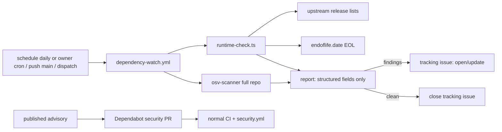

# Design: dependency-watch

## Outcome
- Owner problem and desired observable change: a newly disclosed vulnerability in a dependency or
  runtime a repo already ships (example: Ruby2Shell, GHSA-34m4-m9fh-gqp5, a heap overflow in the Ruby
  interpreter, fixed in 3.3.14 / 3.4.13 / 4.0.10) is noticed within hours, with no PR needed to trigger
  it, and package fixes arrive as a PR. Any scaffold consumer repo can set this up with one skill.
- Constraints and failure consequences: matching is deterministic (version comparison, advisory ranges),
  never model judgment. Advisory prose is untrusted and never reaches the tracking issue or an agent
  prompt. The PR-scoped `.github/workflows/security.yml` stays unchanged. A missed finding means a known
  hole stays open. A noisy finding trains people to ignore the issue.
- Outcome evidence: unknown until observed. Intended check: the runtime check, run against fixtures for
  `.ruby-version = 3.4.12` with an upstream list containing 3.4.13, reports a finding; the scheduled
  workflow on this repo opens and closes its tracking issue.
- Architectural contribution: collaborative (no queue mode given). Owner chose the patch bot and PR volume;
  the model owns the technical design below.

## Preservation obligations
- `.github/workflows/security.yml` and its suppression formats (`osv-scanner.toml`, `gitleaks:allow`,
  `# zizmor: ignore[...]`) keep working unchanged. The scheduled scan reuses `osv-scanner.toml`.
- Consumer files are written through the clobber-safe contract in `tools/lib/safe-write.ts`
  (`.scaffold-keep`, `*.scaffold-new` sidecars). An existing `dependabot.yml` is never overwritten.
- Pattern to mirror: `tools/linter-setup/` (detect/emit, marker + template hash for staleness) and
  `skills/add-linter.md` (detect, ask once, emit).

## Assumptions
| Consequential assumption | Disconfirming probe | Evidence / unknown | Revision if wrong |
|---|---|---|---|
| endoflife.date "latest" is current enough to detect a missing patch | Compare its Ruby `latest` to ruby-lang's index on disclosure day | **Disproved 2026-11-19**: endoflife.date listed 4.0.9 / 3.4.12; `cache.ruby-lang.org/pub/ruby/index.txt` already listed 4.0.10 / 3.4.13 [verified: curl] | Latest-patch comes from each runtime's upstream release list; endoflife.date is used only for EOL |
| OSV/GHSA carry runtime advisories on day 0 | `api.osv.dev/v1/vulns/GHSA-34m4-m9fh-gqp5`, `api.github.com/advisories/...` | **Disproved**: both 404 on disclosure day [verified: curl] | Runtime check does not depend on advisory feeds; "behind latest patch" is the signal |
| Dependabot security updates honor `dependabot.yml` with `open-pull-requests-limit: 0` (version updates off, security updates on) | GitHub docs; observe a security PR on a test repo | documented behavior, unobserved here | Fall back to no `dependabot.yml`, settings-only |
| PRs created with the workflow `GITHUB_TOKEN` do not trigger CI | GitHub docs | documented | (drives the "issue, not PR" decision) |

## Canonical Vocabulary
| Term | Definition |
|------|-----------|
| Dependency watch | The scheduled workflow + runtime check + Dependabot config set up by `/dependency-watch`. |
| Runtime pin | A version of a language runtime declared in a repo file: `.ruby-version`, `.node-version`, `.nvmrc`, `.python-version`, `.tool-versions`, or a Dockerfile `FROM` of an official runtime image. |
| Release line | A runtime's major.minor series (Ruby `3.4`, Node `26`, Python `3.13`, Go `1.27`). Node lines are the major. |
| Upstream release list | The runtime's own published version list (ruby-lang index, nodejs.org `dist/index.json`, python.org, go.dev `?mode=json`). Source of truth for "latest patch". |
| Runtime finding | A pin that is behind the latest patch of its release line (`behind`), or whose line is past EOL per endoflife.date (`eol`). |
| Floating pin | A pin without a full patch version (`ruby:3.4-slim`, `.nvmrc = 26`). Not a finding: a rebuild picks up the patch. Reported as info. |
| Unchecked pin | A pin the check cannot evaluate (unsupported runtime, digest-pinned image, `lts/*`). Reported, never silently dropped, never a finding. |
| Package finding | An osv-scanner result from the full-repo scan. |
| Tracking issue | One open issue per repo, label `dependency-watch`, whose body is regenerated each run; closed when a run is clean. |

## Decisions
### Patch bot: Dependabot, security updates only
**Decision:** emit `.github/dependabot.yml` with one entry per detected ecosystem and
`open-pull-requests-limit: 0` (disables version updates; security updates still use the config). The
skill offers to enable the repo settings (`vulnerability-alerts`, `automated-security-fixes`) via
`gh api`, and asks first because it is an outward change.
**Rationale:** owner choice (native, no app install, lowest PR volume).
**Alternatives considered:** Renovate (bumps runtime files, needs app install); weekly grouped version
updates (more PRs). Consequence accepted by the owner: runtime pins and Docker base images get no bot
PR; the tracking issue is their only signal.

### Runtime findings go to the tracking issue, not a PR
**Decision:** the scheduled workflow writes runtime and package findings into one tracking issue.
**Rationale:** a PR opened with `GITHUB_TOKEN` would not run CI; an unchecked bot PR is worse than an
issue. The fix for a runtime pin is a normal human/agent PR.

### Latest patch from upstream, EOL from endoflife.date
**Decision:** v1 supports Ruby, Node, Python and Go, each with an upstream release-list adapter.
endoflife.date supplies only the EOL date per line.
**Rationale:** see Assumptions (endoflife.date lagged on Ruby2Shell day).
**Alternatives considered:** endoflife.date only (one adapter, misses day 0).

### Cadence
**Decision:** daily cron by default (`17 6 * * *`, off the hour to avoid GitHub's top-of-hour queue), plus
push to the default branch and `workflow_dispatch`. The owner overrides it with the tool's
`--schedule "<cron>"` input (the skill asks, default shown); the value is validated as a 5-field cron.
**Rationale:** owner direction 2026-11-19: "we should default to daily vs every 6hours and let the user
customize/specify their own rate if they want to".

### Runtime check ships as a reviewed copy, not fetched at run time
**Decision:** the check's source is copied into the consumer at `.github/dependency-watch/` with a
marker + template hash (same staleness model as linter-setup). The workflow runs it with Node from a
pinned `actions/setup-node`.
**Alternatives considered:** `npx github:victusfate/scaffold@<sha>` at run time (no copy, but fetches
code into a job that holds `issues: write`).

### Bounded noise: one issue, never a flood
**Decision:** at most one open tracking issue per repo, found by its `dependency-watch` label. Each run
rewrites that issue's body in place (no new issue, no comment per run or per finding) and closes it
when clean. A failed check (exit 2) fails the workflow and leaves the issue as it was; it never opens a
second one. If more than one labeled issue is open, the run updates the oldest and lists the rest
in its output. It does not close them itself. Dependabot security PRs are bounded by GitHub's
own cap on open security-update PRs per repo.
**Rationale:** owner direction 2026-11-19: "I don't wanna come back to a project and see hundreds of
issues...".

### Untrusted advisory text stays out
**Decision:** the issue body is built only from structured fields: advisory id, package, ecosystem,
installed version, fixed version(s), source file, and a link to `osv.dev/<id>`. No summaries or details.
**Rationale:** the issue is read by agents; AGENTS.md "Security checks" forbids untrusted text becoming
instructions.

## Callable unit
- **Home:** `tools/dependency-watch/` (tool: `tool.yaml`, `run`, `test`, `README.md`), templates in
  `lib/dependency-watch/`, skill `skills/dependency-watch.md` (registered in RESOLVER).
- **Tool contract:** `run --detect-only --into <repo>` → JSON `{ ecosystems[], runtimePins[], files[{path,state}] }`
  (`state`: `none | foreign | scaffold | stale`). `run --into <repo> [--schedule "<cron>"]` emits the workflow, runtime check and
  `dependabot.yml` through safe-write; JSON result on stdout; idempotent; no network.
- **Runtime check contract** (`runtime-check.ts`, also run by this repo's own workflow):
  `node runtime-check.ts [--root <dir>] [--releases <fixture-dir>]` → JSON
  `{ findings[], info[], unchecked[] }` on stdout. Exit 0 clean, 1 findings, 2 error (network/parse).
  Network only for fetching release lists; `--releases` makes it offline for tests. A fetch error is
  exit 2 and the issue says "check failed", never "clean".
  Finding shape: `{ runtime, file, line, pinned, kind: 'behind' | 'eol', latest?, eol? }`; info and
  unchecked entries carry `{ runtime?, file, line, raw, reason }`.
- **Report contract** (`report.ts`, pure core + thin CLI, same template dir):
  `node report.ts --runtime <json> --osv <json> --body-out <md>` → stdout `clean | findings`, and the
  issue markdown in `--body-out` (no jq needed in the workflow), built from
  structured fields only. The workflow's one shell step owns the `gh issue` find/edit/create/close; the
  report owns content. Splitting them keeps the content testable offline.
- **Skill:** triggers "dependency watch", "scan dependencies on a schedule", "auto patch vulnerabilities",
  "set up dependabot". Calls the tool; asks once which files to write; offers the `gh api` settings step.
  Does not reimplement detection or emission.

## Visualizations

## Edge Cases & Scenarios
- `.ruby-version = 3.4.12`, upstream lists 3.4.13 → finding `behind` (3.4.12 → 3.4.13).
- `.ruby-version = ruby-3.4.12` (rbenv prefix) → parsed as 3.4.12.
- Dockerfile `FROM ruby:3.4.12-slim AS build` → ruby 3.4.12; `FROM ruby:3.4-slim` → floating (info);
  `FROM ruby@sha256:...` → unchecked; `FROM ${BASE}` → unchecked; non-runtime image (`alpine:3.20`) → ignored in v1.
- `.nvmrc = lts/*` → unchecked. `.nvmrc = v26.1.0` → node 26.1.0.
- Pin newer than every upstream release (pre-release, typo) → unchecked, not clean.
- Release line past EOL with no patch pending → finding `eol`.
- Upstream fetch fails → exit 2; workflow fails and the issue (if any) is not closed.
- Repo with no lockfiles → osv exit 128 treated as "no packages", not an error.
- Existing `dependabot.yml` → `foreign`, sidecar `dependabot.yml.scaffold-new`; skill proposes a merge.
- Consumer previously ran the skill and the template changed → `stale`, re-emit via sidecar.

## Q&A Summary
**Q:** Renovate or Dependabot? **A:** Dependabot.
**Q:** Which Dependabot PRs? **A:** Security only.
**Q:** Cadence? **A:** Daily by default, owner-configurable.
**Q:** Issue volume? **A:** One tracking issue per repo, updated in place.
