# Skill and process diagrams

How scaffold's agents, skills and processes fit together, one flow per image. Each diagram reads left to
right in numbered stages, and its legend spells out every acronym and term it uses.

**These images are generated.** The mermaid sources in [`src/`](src/) are what you edit; everything in
[`generated/`](generated/) is rebuilt from them. To refresh every image (after editing a source, or any time):

```bash
npm run diagrams                 # all diagrams
npm run diagrams -- tdd qa       # only these
```

## How work flows

### Tasks, orchestrator and subagents
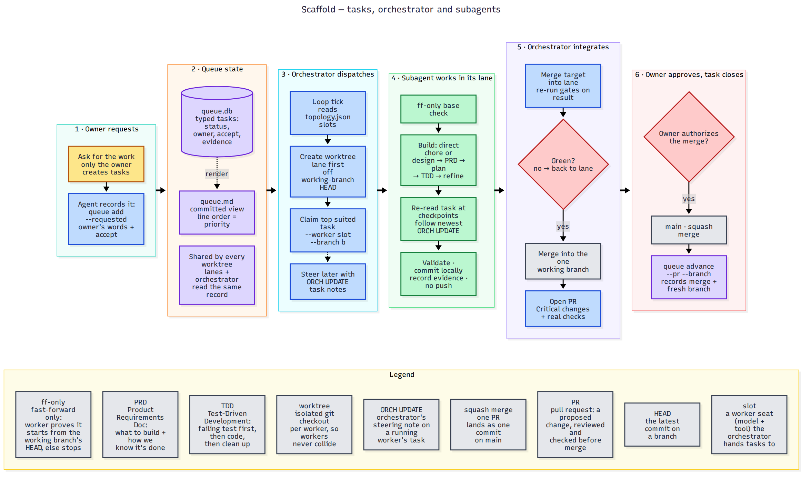
Source: [`src/orchestration.mmd`](src/orchestration.mmd) · Rules: [`AGENTS.md`](../../AGENTS.md)

### Queue task lifecycle
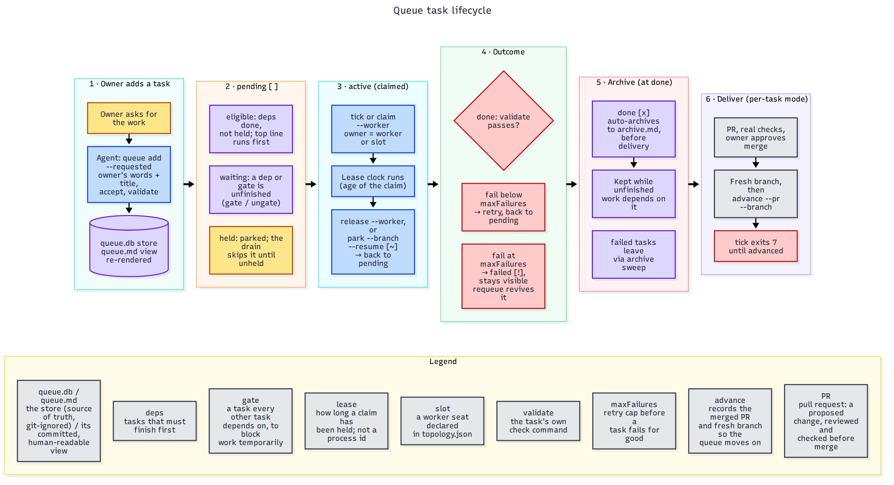
Source: [`src/queue-lifecycle.mmd`](src/queue-lifecycle.mmd) · Skill: [`/queue`](../../skills/queue.md)

### One loop tick
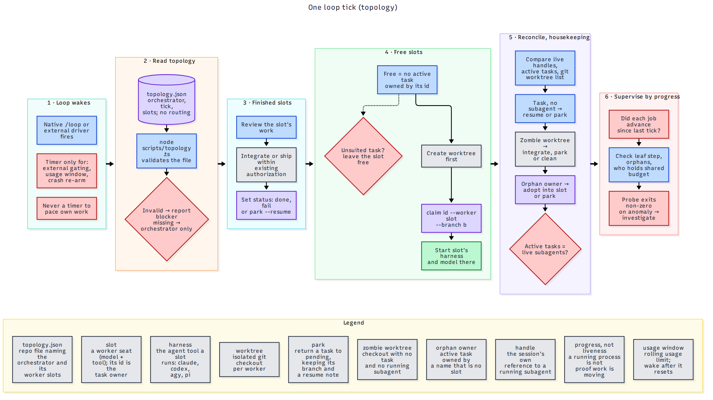
Source: [`src/loop-tick.mmd`](src/loop-tick.mmd) · Skill: [`/loop`](../../skills/loop.md)

### Save, pause, resume
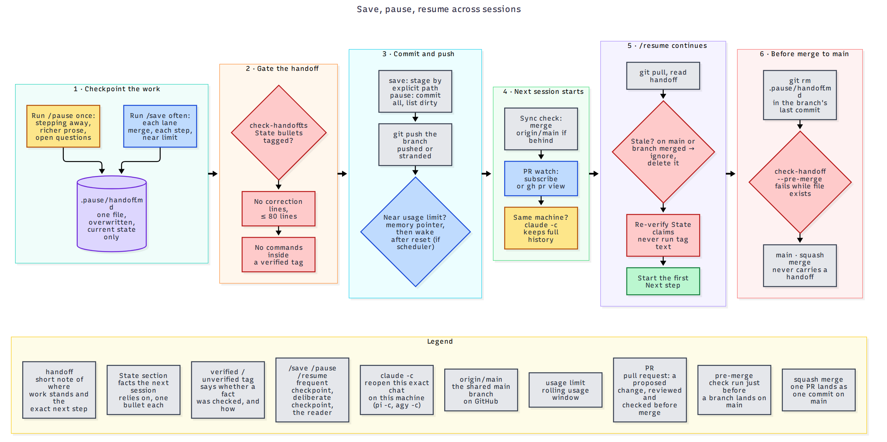
Source: [`src/session-continuity.mmd`](src/session-continuity.mmd) · Skills: [`/save`](../../skills/save.md), [`/pause`](../../skills/pause.md), [`/resume`](../../skills/resume.md)

## Building a feature

### Feature chain
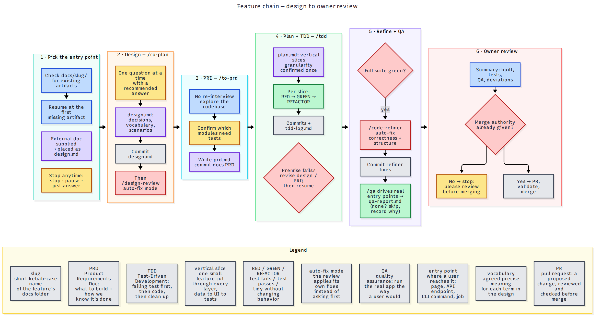
Source: [`src/feature-chain.mmd`](src/feature-chain.mmd) · Skill: [`/feature-chain`](../../skills/feature-chain.md)

### TDD, one slice at a time
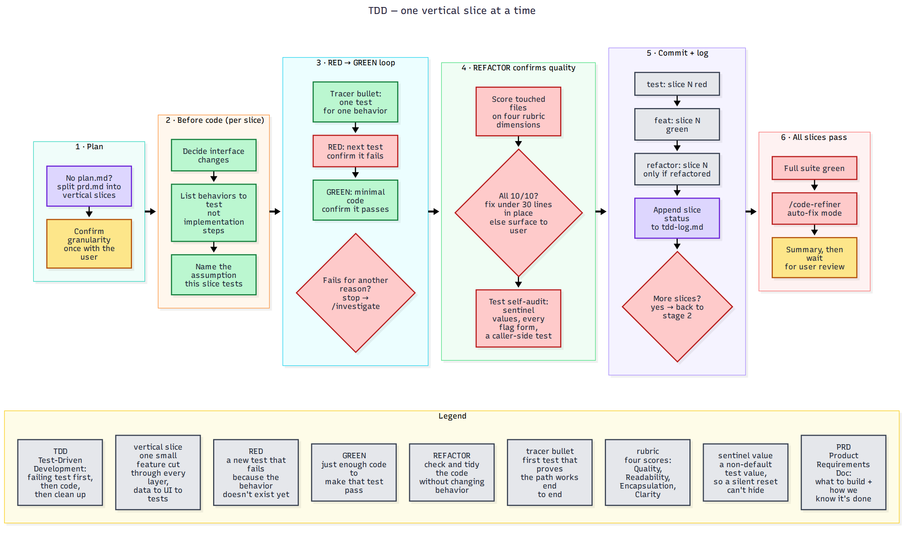
Source: [`src/tdd.mmd`](src/tdd.mmd) · Skill: [`/tdd`](../../skills/tdd.md)

### Investigate a bug
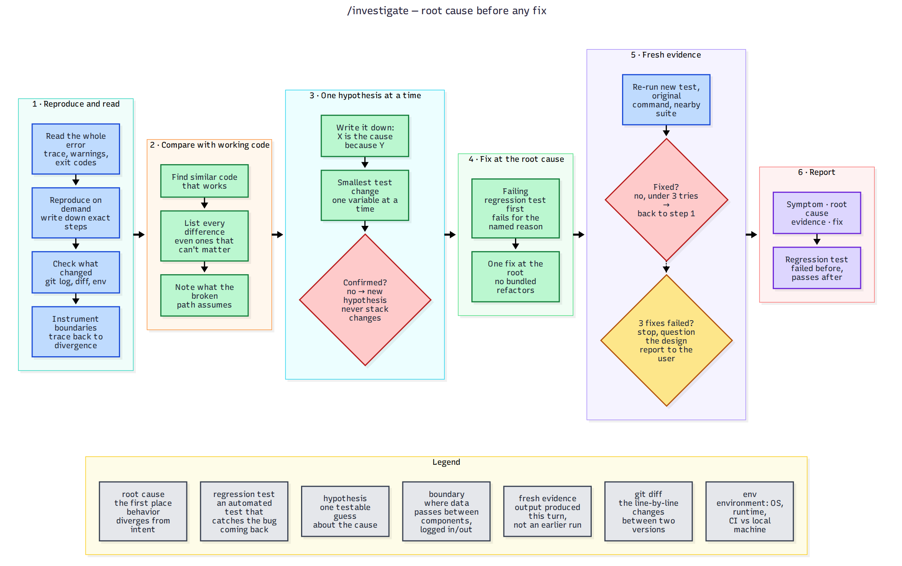
Source: [`src/investigate.mmd`](src/investigate.mmd) · Skill: [`/investigate`](../../skills/investigate.md)

### QA the real app
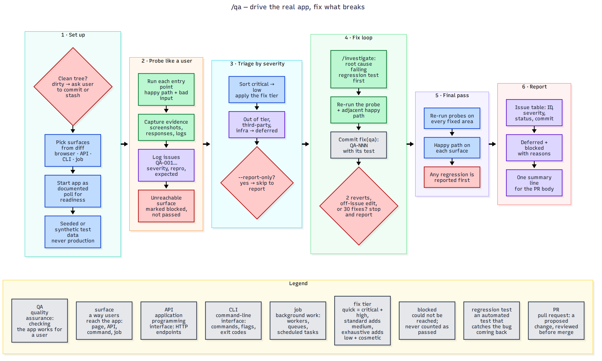
Source: [`src/qa.mmd`](src/qa.mmd) · Skill: [`/qa`](../../skills/qa.md)

## Review and shipping

### Review gates
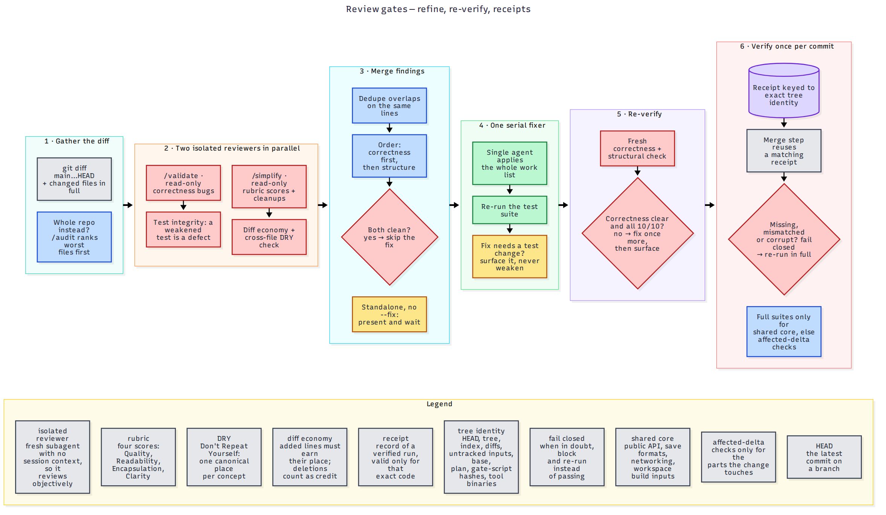
Source: [`src/review-gates.mmd`](src/review-gates.mmd) · Skills: [`/code-refiner`](../../skills/code-refiner.md), [`/validate`](../../skills/validate.md), [`/simplify`](../../skills/simplify.md), [`/audit`](../../skills/audit.md)

### PR workflow
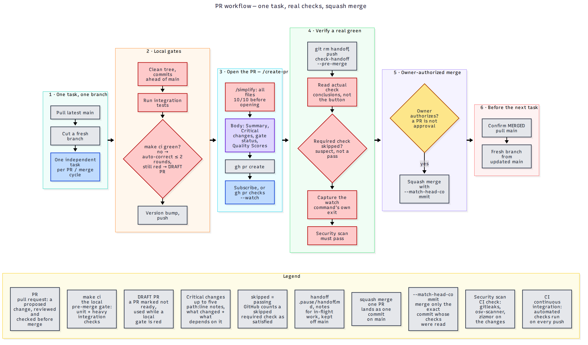
Source: [`src/pr-workflow.mmd`](src/pr-workflow.mmd) · Skill: [`/create-pr`](../../skills/create-pr.md)

### Prune
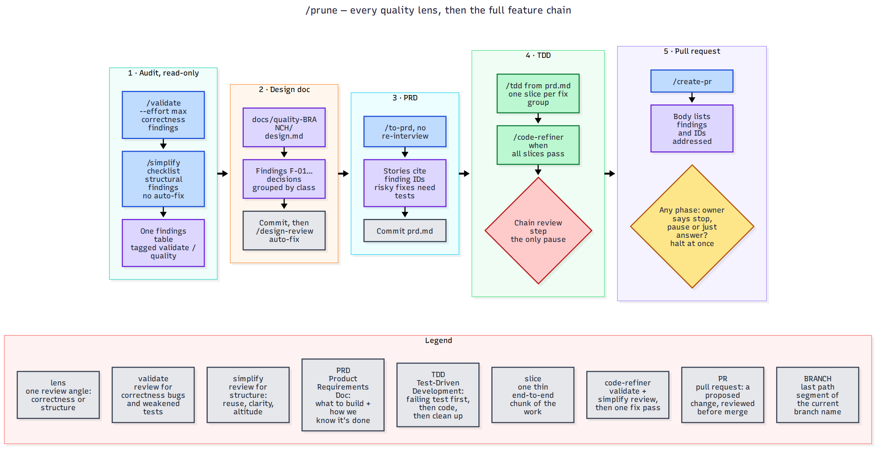
Source: [`src/prune.mmd`](src/prune.mmd) · Skill: [`/prune`](../../skills/prune.md)

## Improving the process

### Retro
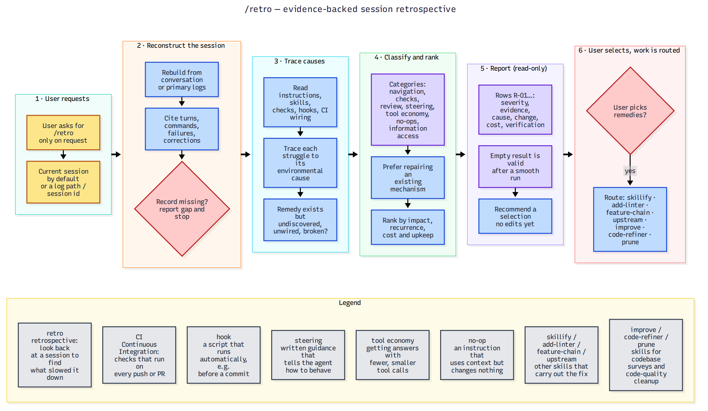
Source: [`src/retro.mmd`](src/retro.mmd) · Skill: [`/retro`](../../skills/retro.md)

### Skillify
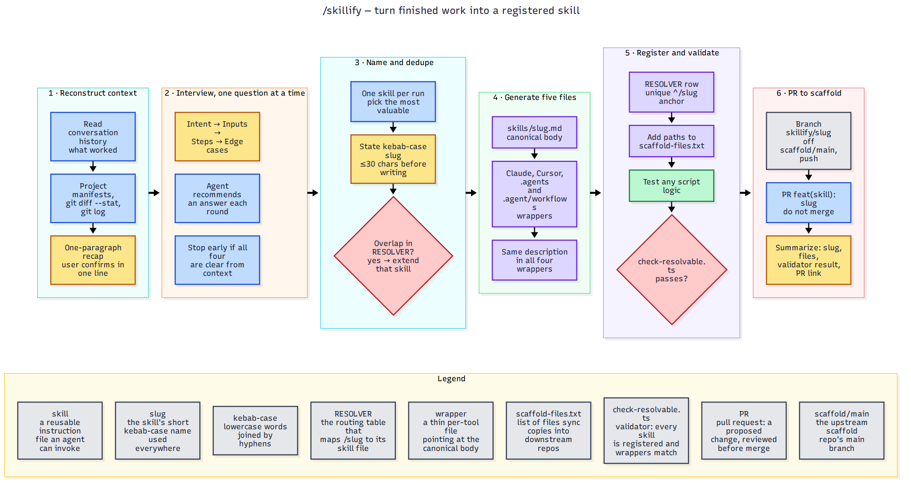
Source: [`src/skillify.mmd`](src/skillify.mmd) · Skill: [`/skillify`](../../skills/skillify.md)

### Council
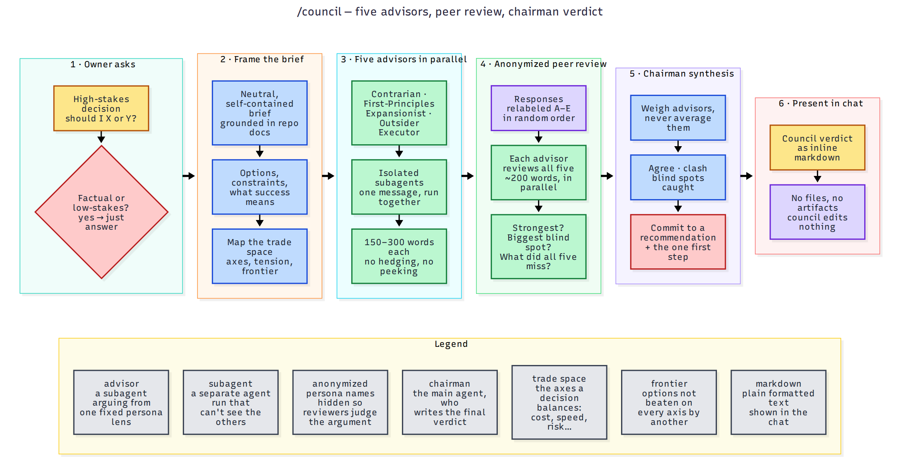
Source: [`src/council.mmd`](src/council.mmd) · Skill: [`/council`](../../skills/council.md)

## Scaffold across repos

### Sync down, upstream up, hoist out
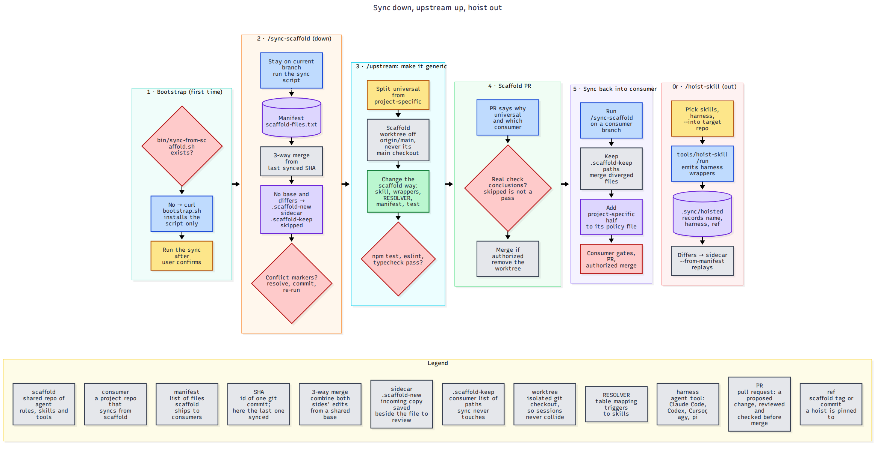
Source: [`src/scaffold-sync.mmd`](src/scaffold-sync.mmd) · Skills: [`/sync-scaffold`](../../skills/sync-scaffold.md), [`/upstream`](../../skills/upstream.md), [`/hoist-skill`](../../skills/hoist-skill.md)

### Add linters
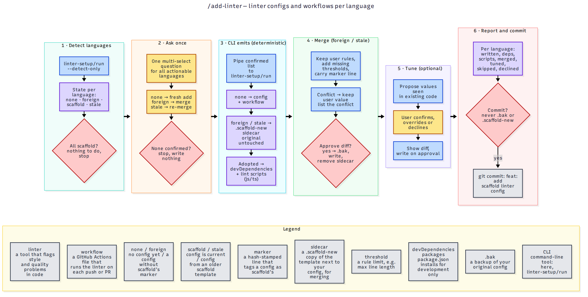
Source: [`src/add-linter.mmd`](src/add-linter.mmd) · Skill: [`/add-linter`](../../skills/add-linter.md)

## Tools

### Mind-meld learning IDE
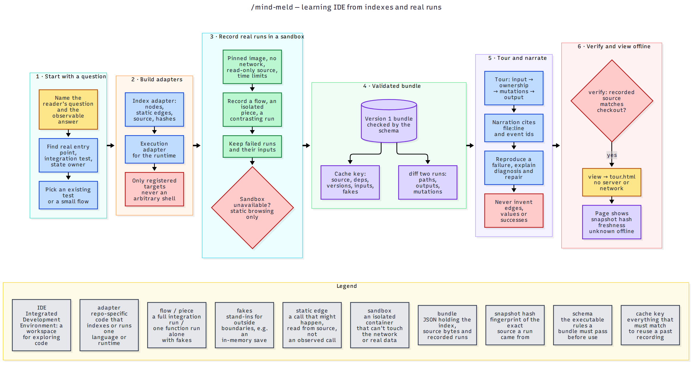
Source: [`src/mind-meld.mmd`](src/mind-meld.mmd) · Skill: [`/mind-meld`](../../skills/mind-meld.md)

### Voice chat
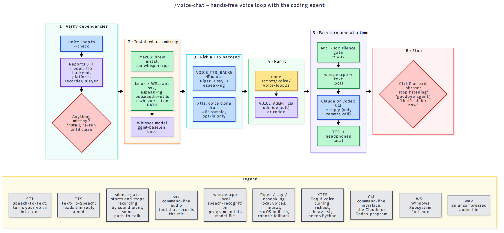
Source: [`src/voice-chat.mmd`](src/voice-chat.mmd) · Skill: [`/voice-chat`](../../skills/voice-chat.md)

## Adding a diagram

1. Copy a source in `src/` as a starting point. Keep stage-to-stage arrows between the stage boxes
   (subgraphs), not between nodes inside them, so the image stays landscape.
2. Define every acronym in the legend.
3. Run `npm run diagrams -- <slug>`, look at `generated/<slug>.png`, and add a section above.
