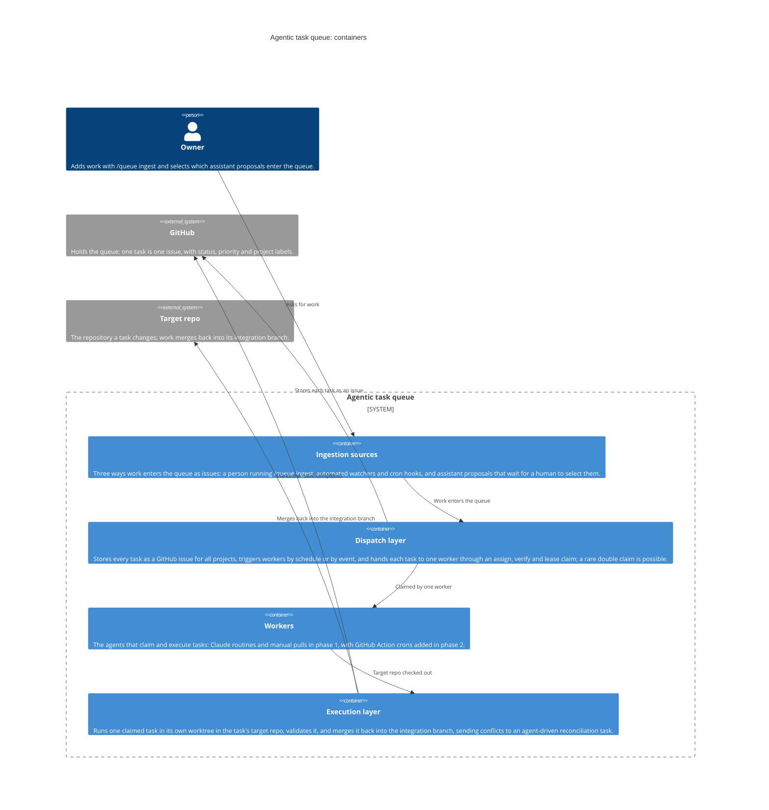

<!-- Generated by scripts/render-c4.ts from ../explorer/agentic-task-queue.explorer.json. Edit the spec, then run it again. -->
# Agentic task queue: C4

Takes work from several sources and has one worker run each task in isolation. A design: not every part is built.

Generated from [`agentic-task-queue.explorer.json`](../explorer/agentic-task-queue.explorer.json) by `scripts/render-c4.ts`; edit that, not this page. The same model as a Structurizr workspace: [`agentic-task-queue.dsl`](agentic-task-queue.dsl).

## Containers

```mermaid
%%{init: {"flowchart": {"wrappingWidth": 400, "nodeSpacing": 45, "rankSpacing": 90}, "themeCSS": ".edgeLabel rect, .edgeLabel .labelBkg { fill: none !important; background: none !important; } .edgeLabel p, .edgeLabel span { background: none !important; }"}}%%
flowchart LR
    p_owner(["Owner<br/>[Person]<br/>Adds work with /queue<br/>ingest and selects<br/>which assistant<br/>proposals enter the<br/>queue."])
    s_github["GitHub<br/>[Software system]<br/>Holds the queue: one<br/>task is one issue,<br/>with status, priority<br/>and project labels."]
    s_target["Target repo<br/>[Software system]<br/>The repository a task<br/>changes; work merges<br/>back into its<br/>integration branch."]
    subgraph sys["Agentic task queue [Software system]"]
        subgraph g_1["Dispatch"]
            c_ING["Ingestion sources<br/>[Container]<br/>Three ways work enters<br/>the queue as issues: a<br/>person running /queue<br/>ingest, automated<br/>watchers and cron<br/>hooks, and assistant<br/>proposals that wait<br/>for a human to select<br/>them."]
            c_DISP["Dispatch layer<br/>[Container]<br/>Stores every task as a<br/>GitHub issue for all<br/>projects, triggers<br/>workers by schedule or<br/>by event, and hands<br/>each task to one<br/>worker through an<br/>assign, verify and<br/>lease claim; a rare<br/>double claim is<br/>possible."]
        end
        subgraph g_2["Execution"]
            c_WORK["Workers<br/>[Container]<br/>The agents that claim<br/>and execute tasks:<br/>Claude routines and<br/>manual pulls in phase<br/>1, with GitHub Action<br/>crons added in phase<br/>2."]
            c_EXEC["Execution layer<br/>[Container]<br/>Runs one claimed task<br/>in its own worktree in<br/>the task's target<br/>repo, validates it,<br/>and merges it back<br/>into the integration<br/>branch, sending<br/>conflicts to an<br/>agent-driven<br/>reconciliation task."]
        end
    end
    style sys fill:none,stroke:#8a8f98,stroke-width:1px,stroke-dasharray:6 4
    style g_1 fill:none,stroke:#b4b9c2,stroke-width:1px
    style g_2 fill:none,stroke:#b4b9c2,stroke-width:1px
    p_owner -->|"Asks for work<br/>⠀"| c_ING
    c_ING -->|"Work enters the queue<br/>⠀"| c_DISP
    c_DISP -->|"Stores each task as an<br/>issue<br/>⠀<br/>⠀"| s_github
    c_DISP -->|"Claimed by one worker<br/>⠀"| c_WORK
    c_WORK -->|"Target repo checked<br/>out<br/>⠀<br/>⠀"| c_EXEC
    c_EXEC -->|"Merges back into the<br/>integration branch<br/>⠀<br/>⠀"| s_target
    c_EXEC -->|"Marks the issue<br/>completed<br/>⠀<br/>⠀"| s_github
    classDef person fill:#08427b,stroke:#052e56,color:#ffffff;
    class p_owner person;
    classDef external fill:#999999,stroke:#6b6b6b,color:#ffffff;
    class s_github,s_target external;
    classDef container fill:#438dd5,stroke:#2e6295,color:#ffffff;
    class c_ING,c_DISP,c_WORK,c_EXEC container;
```

Mermaid's native C4 syntax

## Ingestion to merge-back

```mermaid
%%{init: {"flowchart": {"wrappingWidth": 400, "nodeSpacing": 45, "rankSpacing": 90}, "themeCSS": ".edgeLabel rect, .edgeLabel .labelBkg { fill: none !important; background: none !important; } .edgeLabel p, .edgeLabel span { background: none !important; }"}}%%
flowchart LR
    p_owner(["Owner<br/>[Person]<br/>Adds work with /queue<br/>ingest and selects<br/>which assistant<br/>proposals enter the<br/>queue."])
    s_github["GitHub<br/>[Software system]<br/>Holds the queue: one<br/>task is one issue,<br/>with status, priority<br/>and project labels."]
    s_target["Target repo<br/>[Software system]<br/>The repository a task<br/>changes; work merges<br/>back into its<br/>integration branch."]
    subgraph sys["Agentic task queue [Software system]"]
        c_ING["Ingestion sources<br/>[Container]<br/>Three ways work enters<br/>the queue as issues: a<br/>person running /queue<br/>ingest, automated<br/>watchers and cron<br/>hooks, and assistant<br/>proposals that wait<br/>for a human to select<br/>them."]
        c_DISP["Dispatch layer<br/>[Container]<br/>Stores every task as a<br/>GitHub issue for all<br/>projects, triggers<br/>workers by schedule or<br/>by event, and hands<br/>each task to one<br/>worker through an<br/>assign, verify and<br/>lease claim; a rare<br/>double claim is<br/>possible."]
        c_WORK["Workers<br/>[Container]<br/>The agents that claim<br/>and execute tasks:<br/>Claude routines and<br/>manual pulls in phase<br/>1, with GitHub Action<br/>crons added in phase<br/>2."]
        c_EXEC["Execution layer<br/>[Container]<br/>Runs one claimed task<br/>in its own worktree in<br/>the task's target<br/>repo, validates it,<br/>and merges it back<br/>into the integration<br/>branch, sending<br/>conflicts to an<br/>agent-driven<br/>reconciliation task."]
    end
    style sys fill:none,stroke:#8a8f98,stroke-width:1px,stroke-dasharray:6 4
    p_owner -->|"1. Asks for work<br/>⠀"| c_ING
    c_ING -->|"2. Work enters the<br/>queue<br/>⠀<br/>⠀"| c_DISP
    c_DISP -->|"3. Stores each task as<br/>an issue<br/>⠀<br/>⠀"| s_github
    c_DISP -->|"4. Claimed by one<br/>worker<br/>⠀<br/>⠀"| c_WORK
    c_WORK -->|"5. Target repo checked<br/>out<br/>⠀<br/>⠀"| c_EXEC
    c_EXEC -->|"6. Merges back into<br/>the integration branch<br/>⠀<br/>⠀"| s_target
    c_EXEC -->|"7. Marks the issue<br/>completed<br/>⠀<br/>⠀"| s_github
    classDef person fill:#08427b,stroke:#052e56,color:#ffffff;
    class p_owner person;
    classDef external fill:#999999,stroke:#6b6b6b,color:#ffffff;
    class s_github,s_target external;
    classDef container fill:#438dd5,stroke:#2e6295,color:#ffffff;
    class c_ING,c_DISP,c_WORK,c_EXEC container;
```

Mermaid's native C4 syntax

