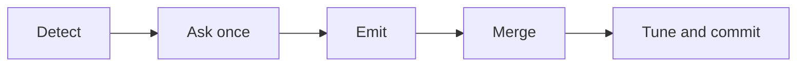

[← Scaffold at a glance](system-map.md)

# Add linter

How /add-linter adds linter configs and CI workflows for the languages in a repo, without changing a config you already have until you approve a merge.



- [Detect](#detect): Find each language in the repo and whether it already has a linter config.
- [Ask once](#ask-once): One multi-select question covers every language that needs action.
- [Emit](#emit): A deterministic CLI writes new configs and workflows, and never edits an existing config.
- [Merge](#merge): The agent merges the sidecar into your config, keeping your rules, and writes only on approval.
- [Tune and commit](#tune-and-commit): Optionally match settings to your existing code, report per language, and offer to commit.

## Detect

Find each language in the repo and whether it already has a linter config.

- Runs node tools/linter-setup/run --detect-only.
- If every language is already current, it stops: nothing to do.

**Config states**

| State | Meaning | Offer |
|---|---|---|
| none | No config yet | Fresh add |
| foreign | A config without scaffold's marker | Merge |
| stale | From an older scaffold template | Re-merge |
| scaffold | Current | Skip |

## Ask once

One multi-select question covers every language that needs action.

- If the user confirms none, nothing is written.

## Emit

A deterministic CLI writes new configs and workflows, and never edits an existing config.

- For an existing config
  - It writes the template beside it as a .scaffold-new sidecar.
  - The original is left untouched.
- Adopted configs (fresh or already current) add the linter's missing npm packages to package.json devDependencies; sidecars don't. js/ts also get lint and lint:fix scripts.

## Merge

The agent merges the sidecar into your config, keeping your rules, and writes only on approval.

- Missing scaffold thresholds are added and the marker line is carried over.
- On approval the original is backed up to .bak (an existing .bak is never overwritten) and the sidecar removed.

**Where it breaks**

- On a conflict your value is kept and the conflict is listed, so you see what scaffold would have changed.

## Tune and commit

Optionally match settings to your existing code, report per language, and offer to commit.

- Tuning proposes values seen in your code, for example line length; you confirm, override or decline.
- The commit never includes .bak or .scaffold-new files.

## Detailed flow



## Glossary

- **Sidecar**: A .scaffold-new copy saved beside your file for you to review and merge; your file is never overwritten.
- **Marker**: A hash-stamped line that tags a config as scaffold's.
- **Threshold**: A rule limit, such as max line length.

## Ask your LLM

Copy this block into your own assistant to ask about anything on this page.

```text
The reader wants to understand how scaffold's /add-linter skill sets up linting for a repo without clobbering existing configs.

Add linter: How /add-linter adds linter configs and CI workflows for the languages in a repo, without changing a config you already have until you approve a merge.
- Detect: Find each language in the repo and whether it already has a linter config.
- Ask once: One multi-select question covers every language that needs action.
- Emit: A deterministic CLI writes new configs and workflows, and never edits an existing config.
- Merge: The agent merges the sidecar into your config, keeping your rules, and writes only on approval.
- Tune and commit: Optionally match settings to your existing code, report per language, and offer to commit.

Questions worth asking:
- Why does the CLI write a sidecar instead of editing my config?

Scaffold: https://github.com/victusfate/scaffold
This page: https://github.com/victusfate/scaffold/blob/main/docs/diagrams/pages/add-linter.md
```
