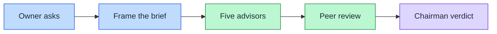

[← Scaffold at a glance](system-map.md)

# Council

How a hard decision gets pressure-tested by five advisors with clashing views, then turned into one clear recommendation.



- [Owner asks](#owner-asks): The owner brings a high-stakes decision with real tradeoffs.
- [Frame the brief](#frame-the-brief): The main agent writes a neutral, self-contained brief grounded in the repo.
- [Five advisors](#five-advisors): Five isolated subagents each argue from one fixed lens, all at once.
- [Peer review](#peer-review): Each advisor reviews all five answers with the authors hidden.
- [Chairman verdict](#chairman-verdict): The main agent weighs the advisors and commits to one recommendation and a first step.

## Owner asks

The owner brings a high-stakes decision with real tradeoffs.

Details: [/council skill](../../../skills/council.md)

- Triggers include "council this", "pressure-test this" or a real "should I X or Y" with stakes.
- Not for every question
  - Factual lookups, yes/no questions, summaries and low-stakes advice skip the council.
  - If the question has a correct answer, the agent just answers it.

## Frame the brief

The main agent writes a neutral, self-contained brief grounded in the repo.

- States the decision, the options, the constraints and what success means.
- Maps the trade space
  - Names the axes the decision balances, such as cost, speed, risk and reversibility.
  - Marks which options are beaten on every axis and which are genuine tradeoffs.

**Where it breaks**

- A brief that tips toward one answer makes every advisor argue from the same slant.

## Five advisors

Five isolated subagents each argue from one fixed lens, all at once.

- 150 to 300 words each, no hedging, and no advisor sees another's answer.
- They inherit the session's model; diversity comes from the persona, not the vendor.

**Where it breaks**

- If isolated subagents are unavailable, the agent must say so and give a clearly labeled single-agent analysis instead.

**The five lenses**

| Lens | Stance |
|---|---|
| Contrarian | Assumes the plan breaks, and asks where and why. |
| First-Principles | Strips assumptions and asks whether this is even the right question. |
| Expansionist | Hunts hidden upside: what if this works better than expected? |
| Outsider | Brings zero domain context and names what is confusing. |
| Executor | Cares only about implementation: what do you do Monday morning? |

## Peer review

Each advisor reviews all five answers with the authors hidden.

- Answers are relabeled A to E in random order so reviewers judge the argument, not the persona.
- Three questions, in about 200 words per review
  - Which response is strongest, and why?
  - Which has the biggest blind spot?
  - What did all five miss?

## Chairman verdict

The main agent weighs the advisors and commits to one recommendation and a first step.

- Weighs the advisors and never averages them.
- Names real disagreement instead of papering it into false consensus.
- Shown in chat as markdown
  - Sections: where the council agrees, where it clashes, blind spots caught, the recommendation, the one thing to do first.
  - No files and no artifacts; the council edits nothing.

**Where it breaks**

- "It depends" is not a verdict; the chairman has to commit.

## Detailed flow



## Code walkthrough

The council runs entirely as agent-followed prose: framing the brief, spawning the five advisors, anonymizing for peer review and writing the verdict have no code behind them, and the optional Jev mode has no script in this repo either. The only council-specific code is scripts/test-council-skill.sh, which greps skills/council.md so the key instructions cannot be deleted unnoticed, plus the thin wrapper that carries the trigger description. That test runs through npm test (test:shell) in CI; it checks the wording of the skill, not how a council actually behaves.

Each excerpt is read from the repo when this page is built. The explanations were written by an agent; `npm test` fails when the lines they explain change.

### Owner asks: code

#### Claude wrapper: the trigger description

*Carries out the step.* The frontmatter holds one description line that names the five advisors, the three rounds, and the trigger phrases 'council this', 'pressure-test this' and 'should I X or Y'. It also says not to use it for factual or low-stakes questions. The last line includes the canonical body skills/council.md.

```markdown
---
description: Run a high-stakes decision through a council of five persona-diverse advisors (Contrarian, First-Principles, Expansionist, Outsider, Executor) in parallel, then anonymized peer review, then a chairman synthesis of where they agree, clash, and what to do. Use for real tradeoffs ("council this", "pressure-test this", "should I X or Y"), not factual or low-stakes questions.
---

@../../../skills/council.md
```

[`.claude/skills/council/SKILL.md:1-5`](https://github.com/victusfate/scaffold/blob/main/.claude/skills/council/SKILL.md#L1-L5)

**Why it matters.** This description is what the harness reads to decide whether an owner's question should start a council. The decision itself is the model's judgement; there is no code that classifies the question.

#### test: the when-not-to-use guard stays in the skill

*Test that pins it.* It greps skills/council.md, ignoring case, for 'not use', 'do not use', 'factual' or 'low-stakes'. A match counts as a pass and no match counts as a failure.

```bash

# When NOT to use guard (avoid ceremony on factual/low-stakes)
grep -qiE 'not use|do not use|factual|low.?stakes' "$SKILL" \
  && ok "when-not-to-use guard present" || fail "when-not-to-use guard missing"
```

[`scripts/test-council-skill.sh:44-47`](https://github.com/victusfate/scaffold/blob/main/scripts/test-council-skill.sh#L44-L47)

**Why it matters.** The first stage says factual and low-stakes questions skip the council. This test only pins that the skill still says so; it would pass if any one of those words remained.

**Methods and helpers used here**

<details>
<summary><code>fail</code> · shell function · scripts/test-council-skill.sh:5</summary>

Takes a description, prints it to stdout prefixed with a cross mark, and increments the script's global FAIL counter. It does not exit the script.

```bash
fail(){ echo "  ✗ $1"; FAIL=$((FAIL + 1)); }
```

[`scripts/test-council-skill.sh:5`](https://github.com/victusfate/scaffold/blob/main/scripts/test-council-skill.sh#L5)

</details>

#### test: council is wired into wrapper, manifest and RESOLVER

*Test that pins it.* It checks that the Claude wrapper includes skills/council.md. It checks that each of the five council files is listed in .github/scaffold-files.txt. It checks that RESOLVER.md has a row for council.

```bash
# Wrapper + manifest + resolver wiring
grep -q '@../../../skills/council.md' "$CLAUDE_WRAPPER" \
  && ok "Claude wrapper @-includes skill body" || fail "Claude wrapper missing @-include"

for path in 'skills/council.md' '.claude/skills/council/SKILL.md' '.cursor/rules/council.mdc' '.agents/skills/council/SKILL.md' '.agent/workflows/council.md'; do
  grep -qF "$path" "$MANIFEST" \
    && ok "manifest lists $path" || fail "manifest missing $path"
done

grep -q '| council |' .claude/skills/RESOLVER.md \
  && ok "RESOLVER.md has council entry" || fail "RESOLVER.md missing council entry"
```

[`scripts/test-council-skill.sh:49-59`](https://github.com/victusfate/scaffold/blob/main/scripts/test-council-skill.sh#L49-L59)

**Why it matters.** An owner can only reach the council if the skill is routed and shipped. Without the RESOLVER row or manifest entries the trigger phrases would lead nowhere in a consumer repo.

**Methods and helpers used here**

<details>
<summary><code>fail</code> · shell function · scripts/test-council-skill.sh:5</summary>

Takes a description, prints it to stdout prefixed with a cross mark, and increments the script's global FAIL counter. It does not exit the script.

```bash
fail(){ echo "  ✗ $1"; FAIL=$((FAIL + 1)); }
```

[`scripts/test-council-skill.sh:5`](https://github.com/victusfate/scaffold/blob/main/scripts/test-council-skill.sh#L5)

</details>

### Frame the brief: code

No code here: The main agent scans the repo for context and writes a neutral brief with the decision, options, constraints, success criteria and the trade space; nothing checks the brief.

### Five advisors: code

#### test: all five advisor lenses are named

*Test that pins it.* It loops over the five persona names and greps skills/council.md for each one. Each name found is a pass; a missing name is a failure.

```bash
# The five advisor personas must all be present
for persona in Contrarian 'First-Principles' Expansionist Outsider Executor; do
  grep -q "$persona" "$SKILL" \
    && ok "advisor persona present: $persona" || fail "advisor persona missing: $persona"
done
```

[`scripts/test-council-skill.sh:18-22`](https://github.com/victusfate/scaffold/blob/main/scripts/test-council-skill.sh#L18-L22)

**Why it matters.** The Five advisors stage depends on five fixed lenses that are built to disagree. This stops an edit from dropping one of them from the skill text.

**Methods and helpers used here**

<details>
<summary><code>fail</code> · shell function · scripts/test-council-skill.sh:5</summary>

Takes a description, prints it to stdout prefixed with a cross mark, and increments the script's global FAIL counter. It does not exit the script.

```bash
fail(){ echo "  ✗ $1"; FAIL=$((FAIL + 1)); }
```

[`scripts/test-council-skill.sh:5`](https://github.com/victusfate/scaffold/blob/main/scripts/test-council-skill.sh#L5)

</details>

#### test: parallel, isolated, peer-reviewed, chaired

*Test that pins it.* Four greps over skills/council.md, in order: 'parallel' or 'concurrent'; 'peer review' or 'anonymize'; 'chairman'; and 'isolated subagent' or 'isolated context'. Each is counted as a pass or a failure.

```bash
# Core mechanics
grep -qiE 'parallel|concurrent' "$SKILL" \
  && ok "advisors run in parallel" || fail "parallel advisor execution not described"

grep -qiE 'peer review|anonymize|anonymized' "$SKILL" \
  && ok "anonymized peer review described" || fail "peer review round not described"

grep -qi 'chairman' "$SKILL" \
  && ok "chairman synthesis described" || fail "chairman synthesis not described"

grep -qiE 'isolated subagent|isolated context' "$SKILL" \
  && ok "isolated-subagent execution described" || fail "isolated-subagent model not described"
```

[`scripts/test-council-skill.sh:24-35`](https://github.com/victusfate/scaffold/blob/main/scripts/test-council-skill.sh#L24-L35)

**Why it matters.** These are the mechanics of the advisors, peer review and chairman stages. The test proves the instructions exist in the skill; it cannot check that a real run spawned isolated subagents or shuffled the labels.

**Methods and helpers used here**

<details>
<summary><code>fail</code> · shell function · scripts/test-council-skill.sh:5</summary>

Takes a description, prints it to stdout prefixed with a cross mark, and increments the script's global FAIL counter. It does not exit the script.

```bash
fail(){ echo "  ✗ $1"; FAIL=$((FAIL + 1)); }
```

[`scripts/test-council-skill.sh:5`](https://github.com/victusfate/scaffold/blob/main/scripts/test-council-skill.sh#L5)

</details>

### Peer review: code

No code here: The agent relabels the five answers A to E in random order and gives them to five reviewers with three questions; no code does the shuffle or the dispatch, and the test only checks that the skill text mentions peer review.

### Chairman verdict: code

#### test: the verdict keeps its required sections

*Test that pins it.* It greps skills/council.md for 'Where the council agrees', then 'Where the council clashes', then 'one thing to do first' or 'do first'. Each is a pass or a failure.

```bash
# Chairman output structure
grep -qi 'Where the council agrees' "$SKILL" \
  && ok "output: agreements section" || fail "output missing agreements section"
grep -qi 'Where the council clashes' "$SKILL" \
  && ok "output: clashes section" || fail "output missing clashes section"
grep -qiE 'one thing to do first|do first' "$SKILL" \
  && ok "output: concrete next step" || fail "output missing concrete next step"
```

[`scripts/test-council-skill.sh:37-43`](https://github.com/victusfate/scaffold/blob/main/scripts/test-council-skill.sh#L37-L43)

**Why it matters.** The chairman must show agreement, real disagreement and a single first step. This pins those headings in the output template so the verdict format is not thinned out by an edit.

**Methods and helpers used here**

<details>
<summary><code>fail</code> · shell function · scripts/test-council-skill.sh:5</summary>

Takes a description, prints it to stdout prefixed with a cross mark, and increments the script's global FAIL counter. It does not exit the script.

```bash
fail(){ echo "  ✗ $1"; FAIL=$((FAIL + 1)); }
```

[`scripts/test-council-skill.sh:5`](https://github.com/victusfate/scaffold/blob/main/scripts/test-council-skill.sh#L5)

</details>

## Checked against the source

The council flow tracks skills/council.md almost line for line: phases, lenses, review questions, verdict sections and rules all have source text. Two wording issues remain: 'Three questions, about 200 words each' misreads a per-review limit as per-question, and the brief's risk states a consequence the source does not. The optional Jev-accelerated mode and the batching rule for fewer than five slots are not shown.

| Confirmed | Partly | Not found | Contradicted | In the source, not shown in the flow | Code excerpts |
|---:|---:|---:|---:|---:|---:|
| 43 | 1 | 0 | 0 | 4 | 6 |

An agent judged each claim against the source; each quote is found in its file when this page is built.

### Owner asks: checks

<details>
<summary>5 confirmed, with the supporting line</summary>

- **Confirmed**: The owner brings a high-stakes decision with real tradeoffs.
  > \*\*Use it for\*\* decisions with genuine uncertainty and real tradeoffs: a pivot,
  >
  > [`skills/council.md:10`](https://github.com/victusfate/scaffold/blob/main/skills/council.md#L10)

- **Confirmed**: Triggers include "council this", "pressure-test this" or a real "should I X or Y" with stakes.
  > this", "pressure-test this", "stress-test this", "debate this", or a real
  >
  > [`skills/council.md:13`](https://github.com/victusfate/scaffold/blob/main/skills/council.md#L13)

- **Confirmed**: Factual lookups, yes/no questions, summaries and low-stakes advice skip the council.
  > \*\*Do NOT use it for\*\* factual lookups, simple yes/no questions, creative
  >
  > [`skills/council.md:16`](https://github.com/victusfate/scaffold/blob/main/skills/council.md#L16)

- **Confirmed**: If the question has a correct answer, the agent just answers it.
  > there. If the question has a correct answer, answer it.
  >
  > [`skills/council.md:18`](https://github.com/victusfate/scaffold/blob/main/skills/council.md#L18)

- **Confirmed**: ask → brief: Decision is worth a council (the question)
  > \- If the question is factual or low-stakes, skip the council and answer.
  >
  > [`skills/council.md:126`](https://github.com/victusfate/scaffold/blob/main/skills/council.md#L126)

</details>

### Frame the brief: checks

- **Partly**: A brief that tips toward one answer makes every advisor argue from the same slant.
  > even-handed; do not tip the advisors toward an answer.
  >
  > [`skills/council.md:34`](https://github.com/victusfate/scaffold/blob/main/skills/council.md#L34)

  The source gives the rule (keep it even-handed, do not tip the advisors) but not this consequence; the consequence is the page's own rationale.

<details>
<summary>8 confirmed, with the supporting line</summary>

- **Confirmed**: The main agent writes a neutral, self-contained brief grounded in the repo.
  > Turn the user's question into a neutral, self-contained brief. Scan the workspace
  >
  > [`skills/council.md:30`](https://github.com/victusfate/scaffold/blob/main/skills/council.md#L30)

- **Confirmed**: States the decision, the options, the constraints and what success means.
  > the options on the table, the constraints, and what "success" means. Keep it
  >
  > [`skills/council.md:33`](https://github.com/victusfate/scaffold/blob/main/skills/council.md#L33)

- **Confirmed**: Names the axes the decision balances, such as cost, speed, risk and reversibility.
  > dimensions the decision balances (cost vs speed vs risk vs reversibility vs …),
  >
  > [`skills/council.md:37`](https://github.com/victusfate/scaffold/blob/main/skills/council.md#L37)

- **Confirmed**: Marks which options are beaten on every axis and which are genuine tradeoffs.
  > are Pareto-dominated and which are genuine tradeoffs. Include this in the brief so
  >
  > [`skills/council.md:39`](https://github.com/victusfate/scaffold/blob/main/skills/council.md#L39)

- **Confirmed**: brief → advisors: Brief sent to all five (brief + trade space)
  > its lens definition (below) + the framed brief, and is told: respond
  >
  > [`skills/council.md:44`](https://github.com/victusfate/scaffold/blob/main/skills/council.md#L44)

- **Confirmed**: Trade space: The axes a decision balances, such as cost, speed and risk.
  > \*\*Map the shape of the trade space.\*\* Before the advisors weigh in, name the
  >
  > [`skills/council.md:36`](https://github.com/victusfate/scaffold/blob/main/skills/council.md#L36)

- **Confirmed** (from the diagram): Map the trade space: axes, tension, frontier
  > where the real tension lives, and roughly where the frontier sits: which options
  >
  > [`skills/council.md:38`](https://github.com/victusfate/scaffold/blob/main/skills/council.md#L38)

- **Confirmed** (from the diagram): Neutral, self-contained brief grounded in repo docs
  > for grounding context (\`CLAUDE.md\`/\`AGENTS.md\`, \`docs/\*\*\`, relevant source) and
  >
  > [`skills/council.md:31`](https://github.com/victusfate/scaffold/blob/main/skills/council.md#L31)

</details>

### Five advisors: checks

<details>
<summary>12 confirmed, with the supporting line</summary>

- **Confirmed**: Five isolated subagents each argue from one fixed lens, all at once.
  > \*\*Phase 2 — Advisors (5 isolated subagents, parallel).\*\*
  >
  > [`skills/council.md:42`](https://github.com/victusfate/scaffold/blob/main/skills/council.md#L42)

- **Confirmed**: 150 to 300 words each, no hedging, and no advisor sees another's answer.
  > each.\*\* No advisor sees another's response in this phase.
  >
  > [`skills/council.md:46`](https://github.com/victusfate/scaffold/blob/main/skills/council.md#L46)

- **Confirmed**: They inherit the session's model; diversity comes from the persona, not the vendor.
  > clearly labeled single-agent analysis. Advisors inherit the session's model;
  >
  > [`skills/council.md:26`](https://github.com/victusfate/scaffold/blob/main/skills/council.md#L26)

- **Confirmed**: If isolated subagents are unavailable, the agent must say so and give a clearly labeled single-agent analysis instead.
  > unavailable, disclose that the council cannot run independently and provide a
  >
  > [`skills/council.md:25`](https://github.com/victusfate/scaffold/blob/main/skills/council.md#L25)

- **Confirmed**: Contrarian: Assumes the plan breaks, and asks where and why.
  > \| \*\*The Contrarian\*\* \| Hunts for what's wrong, missing, or will fail. Assumes the plan breaks — where and why? \|
  >
  > [`skills/council.md:69`](https://github.com/victusfate/scaffold/blob/main/skills/council.md#L69)

- **Confirmed**: First-Principles: Strips assumptions and asks whether this is even the right question.
  > \| \*\*The First-Principles Thinker\*\* \| Strips assumptions and rebuilds from the ground up. Challenges whether this is even the right question. \|
  >
  > [`skills/council.md:70`](https://github.com/victusfate/scaffold/blob/main/skills/council.md#L70)

- **Confirmed**: Expansionist: Hunts hidden upside: what if this works better than expected?
  > \| \*\*The Expansionist\*\* \| Hunts hidden upside and adjacent opportunity. "What if this works better than expected?" \|
  >
  > [`skills/council.md:71`](https://github.com/victusfate/scaffold/blob/main/skills/council.md#L71)

- **Confirmed**: Outsider: Brings zero domain context and names what is confusing.
  > \| \*\*The Outsider\*\* \| Brings zero domain context. Catches what experts have stopped seeing; names what's confusing. \|
  >
  > [`skills/council.md:72`](https://github.com/victusfate/scaffold/blob/main/skills/council.md#L72)

- **Confirmed**: Executor: Cares only about implementation: what do you do Monday morning?
  > \| \*\*The Executor\*\* \| Cares only about implementation. "What do you actually do Monday morning?" \|
  >
  > [`skills/council.md:73`](https://github.com/victusfate/scaffold/blob/main/skills/council.md#L73)

- **Confirmed**: advisors → review: Five answers collected (anonymized A to E)
  > Collect the five responses and \*\*anonymize them A–E in randomized order\*\* (so
  >
  > [`skills/council.md:49`](https://github.com/victusfate/scaffold/blob/main/skills/council.md#L49)

- **Confirmed**: Subagent: A separate agent run that cannot see the others.
  > The advisors are \*\*isolated subagents\*\* run in parallel, so each leans fully into
  >
  > [`skills/council.md:22`](https://github.com/victusfate/scaffold/blob/main/skills/council.md#L22)

- **Confirmed** (from the diagram): Isolated subagents: one message, run together
  > Spawn all five \*\*in a single message\*\* so they run concurrently. Each receives
  >
  > [`skills/council.md:43`](https://github.com/victusfate/scaffold/blob/main/skills/council.md#L43)

</details>

### Peer review: checks

<details>
<summary>9 confirmed, with the supporting line</summary>

- **Confirmed**: Each advisor reviews all five answers with the authors hidden.
  > review judges the argument, not the persona). Give every advisor all five and ask:
  >
  > [`skills/council.md:50`](https://github.com/victusfate/scaffold/blob/main/skills/council.md#L50)

- **Confirmed**: Answers are relabeled A to E in random order so reviewers judge the argument, not the persona.
  > Collect the five responses and \*\*anonymize them A–E in randomized order\*\* (so
  >
  > [`skills/council.md:49`](https://github.com/victusfate/scaffold/blob/main/skills/council.md#L49)

- **Confirmed**: Three questions, in about 200 words per review
  > \*\*\~200 words each.\*\* Run concurrently.
  >
  > [`skills/council.md:55`](https://github.com/victusfate/scaffold/blob/main/skills/council.md#L55)

- **Confirmed**: Which response is strongest, and why?
  > \- Which response is strongest, and why?
  >
  > [`skills/council.md:51`](https://github.com/victusfate/scaffold/blob/main/skills/council.md#L51)

- **Confirmed**: Which has the biggest blind spot?
  > \- Which has the biggest blind spot?
  >
  > [`skills/council.md:52`](https://github.com/victusfate/scaffold/blob/main/skills/council.md#L52)

- **Confirmed**: What did all five miss?
  > \- What did all five collectively miss?
  >
  > [`skills/council.md:53`](https://github.com/victusfate/scaffold/blob/main/skills/council.md#L53)

- **Confirmed**: review → chair: Reviews collected (peer reviews)
  > Consolidate everything into a verdict in the exact structure below. Weigh the
  >
  > [`skills/council.md:58`](https://github.com/victusfate/scaffold/blob/main/skills/council.md#L58)

- **Confirmed** (from the diagram): Each advisor reviews all five, ~200 words, in parallel
  > \*\*Phase 3 — Peer review (5 isolated subagents, parallel).\*\*
  >
  > [`skills/council.md:48`](https://github.com/victusfate/scaffold/blob/main/skills/council.md#L48)

- **Confirmed** (from the diagram): Legend: anonymized — persona names hidden so reviewers judge the argument
  > \- Anonymize before peer review; reviewers must not know which persona wrote what.
  >
  > [`skills/council.md:124`](https://github.com/victusfate/scaffold/blob/main/skills/council.md#L124)

</details>

### Chairman verdict: checks

<details>
<summary>9 confirmed, with the supporting line</summary>

- **Confirmed**: The main agent weighs the advisors and commits to one recommendation and a first step.
  > \- The chairman commits to a recommendation; "it depends" is not a verdict.
  >
  > [`skills/council.md:125`](https://github.com/victusfate/scaffold/blob/main/skills/council.md#L125)

- **Confirmed**: Weighs the advisors and never averages them.
  > Consolidate everything into a verdict in the exact structure below. Weigh the
  >
  > [`skills/council.md:58`](https://github.com/victusfate/scaffold/blob/main/skills/council.md#L58)

- **Confirmed**: Names real disagreement instead of papering it into false consensus.
  > advisors; do not average them. Name real disagreement rather than papering it into
  >
  > [`skills/council.md:59`](https://github.com/victusfate/scaffold/blob/main/skills/council.md#L59)

- **Confirmed**: Shown in chat as markdown
  > Render the chairman synthesis as scannable markdown inline. No HTML files, no artifacts.
  >
  > [`skills/council.md:63`](https://github.com/victusfate/scaffold/blob/main/skills/council.md#L63)

- **Confirmed**: Sections: where the council agrees, where it clashes, blind spots caught, the recommendation, the one thing to do first.
  > \#\#\# Blind spots the council caught
  >
  > [`skills/council.md:110`](https://github.com/victusfate/scaffold/blob/main/skills/council.md#L110)

- **Confirmed**: No files and no artifacts; the council edits nothing.
  > \- Phases 2 and 3 are read-only analysis; the council never modifies files.
  >
  > [`skills/council.md:122`](https://github.com/victusfate/scaffold/blob/main/skills/council.md#L122)

- **Confirmed**: "It depends" is not a verdict; the chairman has to commit.
  > \- The chairman commits to a recommendation; "it depends" is not a verdict.
  >
  > [`skills/council.md:125`](https://github.com/victusfate/scaffold/blob/main/skills/council.md#L125)

- **Confirmed**: Chairman: The main agent, who writes the final verdict.
  > \*\*Phase 4 — Chairman synthesis (main agent).\*\*
  >
  > [`skills/council.md:57`](https://github.com/victusfate/scaffold/blob/main/skills/council.md#L57)

- **Confirmed** (from the diagram): Present in chat: Council verdict as inline markdown
  > \#\# Council verdict — &lt;one-line decision&gt;
  >
  > [`skills/council.md:102`](https://github.com/victusfate/scaffold/blob/main/skills/council.md#L102)

</details>

## In the source, not shown in the flow

- The optional Jev-accelerated mode (batched judgment calls replacing the generative peer review and stress-testing the synthesis, with fallback when no endpoint is reachable) appears in neither the spec nor the diagram.
  > skill), Phases 3 and 4 get faster \*and\* better calibrated. The rule: \*\*Jev
  >
  > [`skills/council.md:82`](https://github.com/victusfate/scaffold/blob/main/skills/council.md#L82)

- When the client has fewer than five subagent slots the advisors are batched within the concurrency limit, still isolated; the flow says only 'all at once'.
  > \- Run advisors concurrently within the client's available slots; batch when fewer than five slots are available. Keep every advisor isolated.
  >
  > [`skills/council.md:123`](https://github.com/victusfate/scaffold/blob/main/skills/council.md#L123)

- The lenses are deliberately paired to collide (Contrarian vs Expansionist, First-Principles vs Executor) and that tension must not be sanded down.
  > The lenses are built to collide: Contrarian vs Expansionist (downside vs
  >
  > [`skills/council.md:75`](https://github.com/victusfate/scaffold/blob/main/skills/council.md#L75)

- Creative generation is also on the do-not-use list; the spec lists the other four exclusions only.
  > generation, summarization, or low-stakes advice; a council is wasted ceremony
  >
  > [`skills/council.md:17`](https://github.com/victusfate/scaffold/blob/main/skills/council.md#L17)

## Glossary

- **Subagent**: A separate agent run that cannot see the others.
- **Trade space**: The axes a decision balances, such as cost, speed and risk.
- **Chairman**: The main agent, who writes the final verdict.

## Ask your LLM

Copy this block into your own assistant to ask about anything on this page.

```text
The reader wants to understand scaffold's /council skill: how an AI agent
pressure-tests a hard decision with five persona advisors.
Read this page:
https://github.com/victusfate/scaffold/blob/main/docs/diagrams/pages/council.md
Scaffold: https://github.com/victusfate/scaffold

Questions worth asking:
- When is a council worth the cost instead of just asking the agent once?
- How does the chairman decide between two advisors who flatly disagree?
```
