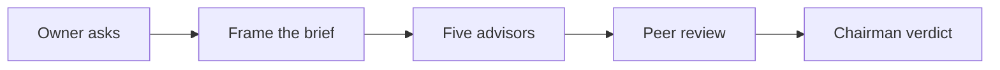

[← Scaffold at a glance](system-map.md)

# Council

How a hard decision gets pressure-tested by five advisors with clashing views, then turned into one clear recommendation.



- [Owner asks](#owner-asks): The owner brings a high-stakes decision with real tradeoffs.
- [Frame the brief](#frame-the-brief): The main agent writes a neutral, self-contained brief grounded in the repo.
- [Five advisors](#five-advisors): Five isolated subagents each argue from one fixed lens, all at once.
- [Peer review](#peer-review): Each advisor reviews all five answers with the authors hidden.
- [Chairman verdict](#chairman-verdict): The main agent weighs the advisors and commits to one recommendation and a first step.

## Owner asks

The owner brings a high-stakes decision with real tradeoffs.

Details: [/council skill](../../../skills/council.md)

- Triggers include "council this", "pressure-test this" or a real "should I X or Y" with stakes.
- Not for every question
  - Factual lookups, yes/no questions, summaries and low-stakes advice skip the council.
  - If the question has a correct answer, the agent just answers it.

## Frame the brief

The main agent writes a neutral, self-contained brief grounded in the repo.

- States the decision, the options, the constraints and what success means.
- Maps the trade space
  - Names the axes the decision balances, such as cost, speed, risk and reversibility.
  - Marks which options are beaten on every axis and which are genuine tradeoffs.

**Where it breaks**

- A brief that tips toward one answer makes every advisor argue from the same slant.

## Five advisors

Five isolated subagents each argue from one fixed lens, all at once.

- 150 to 300 words each, no hedging, and no advisor sees another's answer.
- They inherit the session's model; diversity comes from the persona, not the vendor.

**Where it breaks**

- If isolated subagents are unavailable, the agent must say so and give a clearly labeled single-agent analysis instead.

**The five lenses**

| Lens | Stance |
|---|---|
| Contrarian | Assumes the plan breaks, and asks where and why. |
| First-Principles | Strips assumptions and asks whether this is even the right question. |
| Expansionist | Hunts hidden upside: what if this works better than expected? |
| Outsider | Brings zero domain context and names what is confusing. |
| Executor | Cares only about implementation: what do you do Monday morning? |

## Peer review

Each advisor reviews all five answers with the authors hidden.

- Answers are relabeled A to E in random order so reviewers judge the argument, not the persona.
- Three questions, about 200 words each
  - Which response is strongest, and why?
  - Which has the biggest blind spot?
  - What did all five miss?

## Chairman verdict

The main agent weighs the advisors and commits to one recommendation and a first step.

- Weighs the advisors and never averages them.
- Names real disagreement instead of papering it into false consensus.
- Shown in chat as markdown
  - Sections: where the council agrees, where it clashes, blind spots caught, the recommendation, the one thing to do first.
  - No files and no artifacts; the council edits nothing.

**Where it breaks**

- "It depends" is not a verdict; the chairman has to commit.

<details>
<summary>Detailed flow</summary>


</details>

## Glossary

- **Subagent**: A separate agent run that cannot see the others.
- **Trade space**: The axes a decision balances, such as cost, speed and risk.
- **Chairman**: The main agent, who writes the final verdict.

## Ask your LLM

Copy this block into your own assistant to ask about anything on this page.

```text
The reader wants to understand scaffold's /council skill: how an AI agent pressure-tests a hard decision with five persona advisors.

Council: How a hard decision gets pressure-tested by five advisors with clashing views, then turned into one clear recommendation.
- Owner asks: The owner brings a high-stakes decision with real tradeoffs.
- Frame the brief: The main agent writes a neutral, self-contained brief grounded in the repo.
- Five advisors: Five isolated subagents each argue from one fixed lens, all at once.
- Peer review: Each advisor reviews all five answers with the authors hidden.
- Chairman verdict: The main agent weighs the advisors and commits to one recommendation and a first step.

Questions worth asking:
- When is a council worth the cost instead of just asking the agent once?
- How does the chairman decide between two advisors who flatly disagree?

Scaffold: https://github.com/victusfate/scaffold
This page: https://github.com/victusfate/scaffold/blob/main/docs/diagrams/pages/council.md
```
