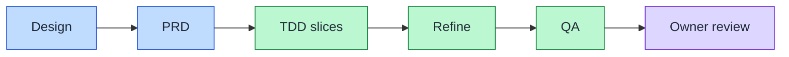

[← Scaffold at a glance](system-map.md)

# Feature chain

How a feature idea becomes a reviewed, tested PR. The owner decides intent and authorizes merges; the agent does the rest.



- [Design](#design): Agree on what to build and why, one question at a time.
- [PRD](#prd): Turn the design into user stories and testing decisions, without re-interviewing.
- [TDD slices](#tdd-slices): Build in thin vertical slices: failing test, minimal code, refactor, commit.
- [Refine](#refine): Two independent reviewers (correctness, structure) report; one pass applies every fix.
- [QA](#qa): Run the real app and drive the changed entry points the way a user would.
- [Owner review](#owner-review): A summary for the owner. Without merge authority the agent stops for review; with it, the agent opens the PR, validates and merges.

## Design

Agree on what to build and why, one question at a time.

Details: [/co-plan skill](../../../skills/co-plan.md)

- The agent explores the code first and only asks what the code can't answer, each time with a recommended answer.
- Resumes at the first missing artifact in `docs/<slug>/`; a supplied document is placed as design.md.
- Output: design.md
  - Decisions with rationale, canonical vocabulary, edge cases.
  - Then /design-review patches structural gaps.

## PRD

Turn the design into user stories and testing decisions, without re-interviewing.

- Cross-checks the design against the codebase and confirms with the owner which modules need tests.

## TDD slices

Build in thin vertical slices: failing test, minimal code, refactor, commit.

Details: [TDD](tdd.md)

- Granularity is confirmed once with the owner; after that, slices run without pausing unless an interface change departs from plan.md or a large fix must be surfaced.

**Where it breaks**

- Writing all tests first verifies imagined behavior; one test at a time keeps them honest.

## Refine

Two independent reviewers (correctness, structure) report; one pass applies every fix.

Details: [Review gates](review-gates.md)

- A test weakened to pass counts as a defect, not a fix.

## QA

Run the real app and drive the changed entry points the way a user would.

Details: [QA](qa.md)

- Skipped, with the reason recorded, when the change has no runtime entry point.

## Owner review

A summary for the owner. Without merge authority the agent stops for review; with it, the agent opens the PR, validates and merges.

Details: [PR workflow](pr-workflow.md)

- Merging needs explicit owner authorization; a PR is not approval.

## Detailed flow


## Glossary

- **PRD**: Product requirements document: the problem, the solution and the user stories.
- **Vertical slice**: A thin piece of a feature that cuts through every layer and works on its own.

## Ask your LLM

Copy this block into your own assistant to ask about anything on this page.

```text
The reader wants to understand scaffold's feature chain: how an AI agent takes a
feature from idea to reviewed PR.
Read this page:
https://github.com/victusfate/scaffold/blob/main/docs/diagrams/pages/feature-chain.md
Scaffold: https://github.com/victusfate/scaffold

Questions worth asking:
- What makes a design question worth asking the owner instead of deciding?
```
