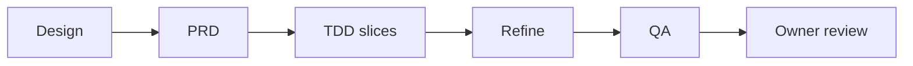

# Feature chain

How a feature idea becomes a reviewed, tested PR. The owner decides intent and merges; the agent does the rest.



- [Design](#design): Agree on what to build and why, one question at a time.
- [PRD](#prd): Turn the design into user stories and testing decisions, without re-interviewing.
- [TDD slices](#tdd-slices): Build in thin vertical slices: failing test, minimal code, refactor, commit.
- [Refine](#refine): Two independent reviewers (correctness, structure) report; one pass applies every fix.
- [QA](#qa): Run the real app and drive the changed entry points the way a user would.
- [Owner review](#owner-review): A summary and a PR; the owner reviews and merges.

## Design

Agree on what to build and why, one question at a time.

Goes deeper: [../../../skills/co-plan.md](../../../skills/co-plan.md)

- The agent explores the code first and only asks what the code can't answer, each time with a recommended answer.
- Output: design.md
  - Decisions with rationale, canonical vocabulary, edge cases.
  - Then /design-review patches structural gaps.

## PRD

Turn the design into user stories and testing decisions, without re-interviewing.

- Cross-checks the design against the codebase and names which modules need tests.

## TDD slices

Build in thin vertical slices: failing test, minimal code, refactor, commit.

Goes deeper: [tdd.md](tdd.md)

- Granularity is confirmed once with the owner; after that, slices run without pausing.

**Where it breaks**

- Writing all tests first verifies imagined behavior; one test at a time keeps them honest.

## Refine

Two independent reviewers (correctness, structure) report; one pass applies every fix.

Goes deeper: [review-gates.md](review-gates.md)

- A test weakened to pass counts as a defect, not a fix.

## QA

Run the real app and drive the changed entry points the way a user would.

Goes deeper: [qa.md](qa.md)

## Owner review

A summary and a PR; the owner reviews and merges.

Goes deeper: [pr-workflow.md](pr-workflow.md)

- Merging needs explicit owner authorization; a PR is not approval.

<details>
<summary>Detailed flow</summary>



</details>

## Glossary

- **PRD**: Product requirements document: the problem, solution and user stories.
- **Vertical slice**: A thin piece of a feature that cuts through every layer and ships working on its own.

## Ask your LLM

Copy this block into your own assistant to ask about anything on this page.

```text
The reader wants to understand scaffold's feature chain: how an AI agent takes a feature from idea to reviewed PR.

Feature chain: How a feature idea becomes a reviewed, tested PR. The owner decides intent and merges; the agent does the rest.
- Design: Agree on what to build and why, one question at a time.
- PRD: Turn the design into user stories and testing decisions, without re-interviewing.
- TDD slices: Build in thin vertical slices: failing test, minimal code, refactor, commit.
- Refine: Two independent reviewers (correctness, structure) report; one pass applies every fix.
- QA: Run the real app and drive the changed entry points the way a user would.
- Owner review: A summary and a PR; the owner reviews and merges.

Questions worth asking:
- What makes a design question worth asking the owner instead of deciding?
```
