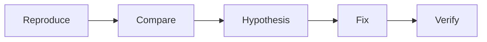

# Investigate

How /investigate finds the root cause of a bug before changing any code, then proves the fix with fresh evidence.



- [Reproduce](#reproduce): Read the whole error, reproduce it on demand, and trace back to where it first goes wrong.
- [Compare](#compare): Find similar code that works and list every difference.
- [Hypothesis](#hypothesis): Write down one guess about the cause and test it with the smallest change.
- [Fix](#fix): Write a failing regression test, then make one fix at the root cause.
- [Verify](#verify): Re-run the new test, the original command and nearby tests, then report.

## Reproduce

Read the whole error, reproduce it on demand, and trace back to where it first goes wrong.

- Until this step is done, only logging and probes are allowed, not behavior changes.
- Steps
  - Read the full trace, warnings and exit codes.
  - Write down the exact steps that reproduce it.
  - Check what changed: git log, diff, environment.
  - Log what crosses each boundary and trace back to the divergence.

## Compare

Find similar code that works and list every difference.

- Include differences that seem like they can't matter.
- Note what the broken path assumes: config, env vars, ordering, file layout.

## Hypothesis

Write down one guess about the cause and test it with the smallest change.

- Form: X is the root cause because Y.
- Change one variable at a time.

**Where it breaks**

- Stacking a second change on an unconfirmed first one hides which change mattered.

## Fix

Write a failing regression test, then make one fix at the root cause.

Goes deeper: [tdd.md](tdd.md)

- The test must fail for the named reason, not a bad fixture or import.
- No bundled refactors or unrelated edits.

## Verify

Re-run the new test, the original command and nearby tests, then report.

- Never say fixed or passing without output produced in this turn.
- Not fixed, and under three tries: go back to Reproduce with the new information.
- Report
  - Symptom, root cause, evidence, fix, regression test, commands re-run.

**Where it breaks**

- After three failed fixes, stop and question the design with the user before a fourth.

<details>
<summary>Detailed flow</summary>



</details>

## Glossary

- **Root cause**: The first place behavior diverges from intent.
- **Regression test**: An automated test that catches the bug if it comes back.
- **Fresh evidence**: Output produced this turn, not an earlier run.

## Ask your LLM

Copy this block into your own assistant to ask about anything on this page.

```text
The reader wants to understand how scaffold's /investigate skill debugs a failure before fixing it.

Investigate: How /investigate finds the root cause of a bug before changing any code, then proves the fix with fresh evidence.
- Reproduce: Read the whole error, reproduce it on demand, and trace back to where it first goes wrong.
- Compare: Find similar code that works and list every difference.
- Hypothesis: Write down one guess about the cause and test it with the smallest change.
- Fix: Write a failing regression test, then make one fix at the root cause.
- Verify: Re-run the new test, the original command and nearby tests, then report.

Questions worth asking:
- Why stop after three failed fixes instead of trying a fourth?
- What counts as fresh evidence?
```
