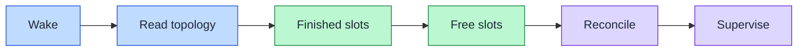

[← Scaffold at a glance](system-map.md)

# One loop tick

What the orchestrator does each time its loop wakes: handle finished work, fill free slots, and make sure work is moving.



- [Wake](#wake): A native /loop or an external driver fires the tick.
- [Read topology](#read-topology): The orchestrator reads which worker slots exist from topology.json.
- [Finished slots](#finished-slots): Review each finished slot's work, integrate or ship it, and set the task status.
- [Free slots](#free-slots): Give each free slot a suited task in a new worktree.
- [Reconcile](#reconcile): Make active tasks match live subagents, then clean up leftovers.
- [Supervise](#supervise): Check that each job advanced since the last tick, not just that it is running.

## Wake

A native /loop or an external driver fires the tick.

Details: [/loop skill](../../../skills/loop.md)

- Timers are only for external gating, a usage-limit window or a crash re-arm.

**Where it breaks**

- A timer is never used to pace the agent's own work; that work runs continuously.

## Read topology

The orchestrator reads which worker slots exist from topology.json.

- node scripts/topology.ts validates the file.
- An invalid file is a blocker to report. No file means the orchestrator works alone.

## Finished slots

Review each finished slot's work, integrate or ship it, and set the task status.

Details: [Orchestration](orchestration.md)

- Integration and shipping stay within existing authorization.
- Status becomes done, fail, or park --resume.

## Free slots

Give each free slot a suited task in a new worktree.

Details: [Queue task lifecycle](queue-lifecycle.md)

- A slot is free when no active task is owned by its id.
- Order: create the worktree, claim the task for the slot, then start the slot's harness and model there.
- No suited task? Leave the slot free.

## Reconcile

Make active tasks match live subagents, then clean up leftovers.

- Compare live handles, active tasks and the git worktree list
  - Task with no subagent: resume or park.
  - Zombie worktree: integrate, park or clean.
  - Orphan owner: adopt into a slot or park.

## Supervise

Check that each job advanced since the last tick, not just that it is running.

- Check the leaf step, orphans, and who holds a shared budget.
- A probe exits non-zero on an anomaly, which starts an investigation.

**Where it breaks**

- A running process is not proof that work is moving.

## Detailed flow


## Glossary

- **Slot**: A worker seat (a model plus a tool) that the orchestrator hands tasks to; its id names the task owner.
- **Harness**: The agent tool a slot runs: claude, codex, agy or pi.
- **Zombie worktree**: A checkout with no task and no running subagent.
- **Park**: Return a task to pending, keeping its branch and a resume note.

## Ask your LLM

Copy this block into your own assistant to ask about anything on this page.

```text
The reader wants to understand what scaffold's orchestrator does on each tick of its autonomous loop.
Read this page: https://github.com/victusfate/scaffold/blob/main/docs/diagrams/pages/loop-tick.md
Scaffold: https://github.com/victusfate/scaffold

Questions worth asking:
- How does the orchestrator tell a stuck subagent from a slow one?
```
