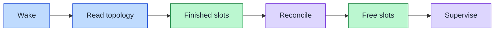

[← Scaffold at a glance](system-map.md)

# One loop tick

What the orchestrator does each time its loop wakes: handle finished work, reconcile, fill free slots, and make sure work is moving.



- [Wake](#wake): A native /loop or an external driver fires the tick.
- [Read topology](#read-topology): The orchestrator reads which worker slots exist from topology.json.
- [Finished slots](#finished-slots): Review each finished slot's work, integrate or ship it, and set the task status.
- [Reconcile](#reconcile): Make active tasks match live subagents and resolve leftover worktrees.
- [Free slots](#free-slots): Give each free slot the highest-priority task it suits, in a new worktree.
- [Supervise](#supervise): Check that each job advanced since the last tick, not just that it is running.

## Wake

A native /loop or an external driver fires the tick.

Details: [/loop skill](../../../skills/loop.md)

- Timers are only for external gating, a usage-limit window or a crash re-arm.

**Where it breaks**

- A timer is never used to pace the agent's own work; that work runs continuously.

## Read topology

The orchestrator reads which worker slots exist from topology.json.

- node scripts/topology.ts validates the file.
- An invalid file is a blocker to report. No file means the orchestrator works alone.

## Finished slots

Review each finished slot's work, integrate or ship it, and set the task status.

Details: [Orchestration](orchestration.md)

- Integration and shipping stay within existing authorization.
- Status becomes done, fail, or park --resume.

## Reconcile

Make active tasks match live subagents and resolve leftover worktrees.

- Compare live handles, active tasks and the git worktree list
  - Task with no subagent: resume or park.
  - Zombie worktree: integrate, park or clean.
  - Orphan owner: adopt into a slot or park.

## Free slots

Give each free slot the highest-priority task it suits, in a new worktree.

Details: [Queue task lifecycle](queue-lifecycle.md)

- A slot is free when no active task is owned by its id.
- Order: create the worktree, claim the task for the slot, then start the slot's harness and model there.
- No suited task? Leave the slot free.

## Supervise

Check that each job advanced since the last tick, not just that it is running.

- Check the leaf step, orphans, and who holds a shared budget.
- A probe exits non-zero on an anomaly, which starts an investigation.

**Where it breaks**

- A running process is not proof that work is moving.

## Detailed flow



## Code walkthrough

The tick itself is a list of steps the orchestrator follows from skills/loop.md; no script runs the six stages in order. Code supplies the pieces each step calls: scripts/agent-loop-*.ts is the external driver that fires runs, scripts/topology.ts validates the slot file, and the queue CLI (scripts/queue.ts, queue-claim.ts, queue-worktrees.ts, queue-model.ts, queue-links.ts, queue-lanes.ts) records claims, results, parks and heartbeats. Choosing a task for a slot, reviewing work, comparing live subagents with tasks and the per-tick probe are agent judgment; the repo ships no probe script.

Each excerpt is read from the repo when this page is built. The explanations were written by an agent; `npm test` fails when the lines they explain change.

### Wake: code

#### supervise: the external driver's run loop

*Carries out the step.* The detached supervisor loops while no stop was requested, the lifetime has not expired and failures are under the limit. Each pass it marks a run as started, calls execute to run the configured command, then records the outcome and resets or raises the failure count. A result of complete or blocked ends the loop; otherwise the next run is set one interval after this run finished.

```ts
    while (!stopRequest(dir, generation) && Date.now() < config.expiresAt && progress.failures < config.maxFailures) {
      if (Date.now() < next) { await delay(Math.min(HEARTBEAT_MS, next - Date.now())); continue; }
      progress.running = true;
      progress.startedAt = Date.now();
      progress.runs++;
      publish();
      const result = await execute(config, dir, progress.runs, session);
      if (result.directive?.resume) {
        session = result.directive.resume;
        config.session = session;
        save(dir, 'config.json', config);
      }
      progress.outcome = result.outcome;
      progress.directive = result.directive;
      progress.finishedAt = Date.now();
      progress.running = false;
      progress.failures = progress.outcome === 'exit 0' ? 0 : progress.failures + 1;
      publish();
      if (config.requireResult && !result.directive) { terminalReason = result.outcome; break; }
      if (result.directive?.status === 'complete') { terminalReason = 'completed'; break; }
      if (result.directive?.status === 'blocked') {
        progress.failures++;
        terminalReason = 'blocked';
        break;
      }
      next = Date.now() + config.interval;
    }
```

[`scripts/agent-loop-runner.ts:30-56`](https://github.com/victusfate/scaffold/blob/main/scripts/agent-loop-runner.ts#L30-L56)

**Why it matters.** This is the external driver that fires a tick when no native /loop is available. The interval is counted from the end of a run, so it restarts ended work and never overlaps or paces a run that is still going.

**Methods and helpers used here**

<details>
<summary><code>HEARTBEAT_MS</code> · const · scripts/agent-loop-runner.ts:9</summary>

The number 250, in milliseconds. The supervisor uses it as the interval at which it rewrites progress.json with a fresh heartbeat timestamp, and as the longest single sleep while waiting for the next run.

```ts
const HEARTBEAT_MS = 250;
```

[`scripts/agent-loop-runner.ts:9`](https://github.com/victusfate/scaffold/blob/main/scripts/agent-loop-runner.ts#L9)

</details>

<details>
<summary><code>execute</code> · function · scripts/agent-loop-process.ts:71</summary>

Runs one loop iteration: it deletes run-result.json in the state directory, renames any existing output.log to previous.log, and spawns the configured command without a shell (the warm argv on runs after the first when one is set, with {{SESSION}} replaced by the session id) in config.cwd, with stdout and stderr written to output.log and SCAFFOLD_AGENT and SCAFFOLD_AGENT_LOOP_RESULT set in its environment. It polls about every 100 ms and, if a cancelling stop request for this generation appears or config.timeout elapses, kills the child's process tree and resolves with outcome 'cancelled' or 'timeout'. Otherwise it resolves with the outcome 'exit N', 'signal X' or 'spawn error: ...'; when the exit is 0 and config.requireResult is set it also returns the directive read from run-result.json, or the outcome 'missing or invalid required result' if that file is absent or malformed.

```ts
export async function execute(config: Config, dir: string, run = 1, sessionOverride?: string): Promise<ExecutionResult> {
  const log = join(dir, 'output.log');
  const resultPath = join(dir, RESULT_FILE);
  rmSync(resultPath, { force: true });
  if (existsSync(log)) renameSync(log, join(dir, 'previous.log'));
  const fd = openSync(log, 'w', 0o600);
  const argv = runArgv(config, run, sessionOverride);
  const child = spawn(argv[0], argv.slice(1), {
    cwd: config.cwd, stdio: ['ignore', fd, fd], detached: process.platform !== 'win32', windowsHide: true,
    env: { ...process.env, SCAFFOLD_AGENT: '1', SCAFFOLD_AGENT_LOOP_RESULT: resultPath },
  });
  let done = false;
  let outcome = '';
  child.once('error', error => { done = true; outcome = `spawn error: ${error.message}`; });
  child.once('exit', (code, signal) => { done = true; outcome = signal ? `signal ${signal}` : `exit ${code}`; });
  const deadline = Date.now() + config.timeout;
  try {
    while (!done) {
      const cancelled = stopRequest(dir, config.generation)?.cancel;
      if (cancelled || Date.now() >= deadline) {
        await terminate(child);
        return { outcome: cancelled ? 'cancelled' : 'timeout' };
      }
      await delay(Math.min(POLL_MS, Math.max(1, deadline - Date.now())));
```

[`scripts/agent-loop-process.ts:71-94`](https://github.com/victusfate/scaffold/blob/main/scripts/agent-loop-process.ts#L71-L94) (first 24 lines shown)

</details>

<details>
<summary><code>save</code> · function · scripts/agent-loop-state.ts:97</summary>

Writes the value as pretty-printed JSON to the file `name` inside `dir` by first writing a uniquely named temp file with mode 0600 and then renaming it over the target, so readers never see a partial file. A rename that fails with EPERM, EBUSY or EACCES is retried up to 40 times with a short blocking sleep between attempts; any other error, or the last failed attempt, is thrown. The temp file is always removed.

```ts
export function save(dir: string, name: string, value: unknown): void {
  const temp = join(dir, `${name}.${randomUUID()}.tmp`);
  try {
    writeFileSync(temp, JSON.stringify(value, null, 2) + '\n', { mode: 0o600, flag: 'wx' });
    for (let attempt = 1; ; attempt++) {
      try {
        renameSync(temp, join(dir, name));
        break;
      } catch (error) {
        const code = (error as NodeJS.ErrnoException).code ?? '';
        if (!RENAME_RETRY_CODES.has(code) || attempt >= RENAME_ATTEMPTS) throw error;
        sleepSync(RENAME_BACKOFF_MS * attempt);
      }
    }
  } finally { rmSync(temp, { force: true }); }
}
```

[`scripts/agent-loop-state.ts:97-112`](https://github.com/victusfate/scaffold/blob/main/scripts/agent-loop-state.ts#L97-L112)

</details>

<details>
<summary><code>stopRequest</code> · function · scripts/agent-loop-state.ts:173</summary>

Reads stopped.json in the state directory and returns its { generation, cancel } contents when its generation equals the one passed in. Returns undefined when the file does not exist or names a different generation, and throws if the file is not valid JSON.

```ts
export function stopRequest(dir: string, generation: string): { cancel: boolean } | undefined {
  const path = join(dir, 'stopped.json');
  if (!existsSync(path)) return;
  const request = JSON.parse(readFileSync(path, 'utf8')) as { generation: string; cancel: boolean };
  if (request.generation === generation) return request;
}
```

[`scripts/agent-loop-state.ts:173-178`](https://github.com/victusfate/scaffold/blob/main/scripts/agent-loop-state.ts#L173-L178)

</details>

<details>
<summary><code>status</code> · function · scripts/agent-loop-state.ts:187</summary>

Takes a loop state directory and returns one object that merges config.json and progress.json with derived fields: driver 'node', armed, supervisor ('active', 'stopped' or 'stale'), running, interrupted, stopRequested, the count of unacknowledged steering messages, and the path to output.log. It only reads files and probes the supervisor PID with signal 0; it throws if config.json is missing or unparseable.

Comment in the source: The single source of truth for loop status, shared by the CLI, the supervise loop, and test fixtures (which poll this directly instead of spawning a CLI process per poll).

```ts
export function status(dir: string): object {
  const config = readConfig(dir);
  const progress = readProgress(dir);
  const live = alive(progress);
  const stopped = stopRequest(dir, config.generation);
  const pending = pendingSteering(dir, config.generation).length;
  return { ...config, ...progress, driver: 'node', armed: live && !stopped && Date.now() < config.expiresAt,
    supervisor: live ? 'active' : progress.ended ? 'stopped' : 'stale',
    running: live && progress.running, interrupted: !live && progress.running,
    stopRequested: !!stopped, pendingSteering: pending, log: join(dir, 'output.log') };
}
```

[`scripts/agent-loop-state.ts:187-197`](https://github.com/victusfate/scaffold/blob/main/scripts/agent-loop-state.ts#L187-L197)

</details>

### Read topology: code

#### parseTopology: validate the topology object

*Enforces the rule.* It rejects anything that is not a JSON object and any key outside orchestrator, tick_minutes and slots. It parses the orchestrator, defaults the tick to 10 minutes and requires a positive number. It then parses the slot list, which defaults to empty.

```ts
/** Validate a parsed JSON value. Throws TopologyError naming the first problem. */
export function parseTopology(raw: unknown): Topology {
  if (!isObject(raw)) throw new TopologyError('topology must be a JSON object');
  rejectUnknown(raw, TOP_KEYS, 'topology');
  const orchestrator = parseOrchestrator(raw.orchestrator);
  const tick = raw.tick_minutes ?? DEFAULT_TICK_MINUTES;
  if (typeof tick !== 'number' || !Number.isFinite(tick) || tick <= 0) {
    throw new TopologyError('tick_minutes must be a positive number');
  }
  return { orchestrator, tickMinutes: tick, slots: parseSlots(raw.slots ?? []) };
}
```

[`scripts/topology.ts:89-99`](https://github.com/victusfate/scaffold/blob/main/scripts/topology.ts#L89-L99)

**Why it matters.** Step 1 of the tick: an invalid topology must be reported as a blocker. Without this a typo in the file would silently change which slots exist.

**Methods and helpers used here**

<details>
<summary><code>Topology</code> · interface · scripts/topology.ts:25</summary>

The validated topology shape: an orchestrator object with a model string, tickMinutes as a number, and an array of slots (each with id, harness, model and optional effort). It is what parseTopology, loadTopology and defaultTopology return.

```ts
export interface Topology {
  orchestrator: { model: string };
  tickMinutes: number;
  slots: Slot[];
}
```

[`scripts/topology.ts:25-29`](https://github.com/victusfate/scaffold/blob/main/scripts/topology.ts#L25-L29)

</details>

<details>
<summary><code>TopologyError</code> · class · scripts/topology.ts:31</summary>

An Error subclass with no added fields, thrown by the topology parsing and loading functions for any invalid topology file. The script's main catches this class to print the message and exit 1, and rethrows any other error.

```ts
export class TopologyError extends Error {}
```

[`scripts/topology.ts:31`](https://github.com/victusfate/scaffold/blob/main/scripts/topology.ts#L31)

</details>

<details>
<summary><code>DEFAULT_TICK_MINUTES</code> · const · scripts/topology.ts:34</summary>

The number 10, the tick interval in minutes used when a topology file is absent or does not set tick_minutes.

Comment in the source: quality-ok: magic-number — the loop skill's documented default tick cadence

```ts
export const DEFAULT_TICK_MINUTES = 10;
```

[`scripts/topology.ts:34`](https://github.com/victusfate/scaffold/blob/main/scripts/topology.ts#L34)

</details>

<details>
<summary><code>TOP_KEYS</code> · const · scripts/topology.ts:37</summary>

The list of key names allowed at the top level of a topology JSON object: orchestrator, tick_minutes and slots. parseTopology passes it to rejectUnknown so any other top-level key is an error.

```ts
const TOP_KEYS = ['orchestrator', 'tick_minutes', 'slots'];
```

[`scripts/topology.ts:37`](https://github.com/victusfate/scaffold/blob/main/scripts/topology.ts#L37)

</details>

<details>
<summary><code>isObject</code> · function · scripts/topology.ts:45</summary>

Takes any value and returns true only when it is a non-null object that is not an array, narrowing its type to a string-keyed record.

```ts
function isObject(v: unknown): v is Record<string, unknown> {
  return typeof v === 'object' && v !== null && !Array.isArray(v);
}
```

[`scripts/topology.ts:45-47`](https://github.com/victusfate/scaffold/blob/main/scripts/topology.ts#L45-L47)

</details>

<details>
<summary><code>rejectUnknown</code> · function · scripts/topology.ts:49</summary>

Takes an object, a list of allowed key names and a location label, and throws TopologyError naming the first key of the object that is not in the list, prefixed with the label. Returns nothing when every key is allowed.

```ts
function rejectUnknown(obj: Record<string, unknown>, allowed: string[], where: string): void {
  const extra = Object.keys(obj).find(k => !allowed.includes(k));
  if (extra) throw new TopologyError(`${where}: unknown key "${extra}"`);
}
```

[`scripts/topology.ts:49-52`](https://github.com/victusfate/scaffold/blob/main/scripts/topology.ts#L49-L52)

</details>

<details>
<summary><code>parseOrchestrator</code> · function · scripts/topology.ts:72</summary>

Takes the raw orchestrator value from the topology JSON and returns { model } with the model string. Throws TopologyError if the value is not an object, has any key other than model, or model is not a non-empty string.

```ts
function parseOrchestrator(raw: unknown): { model: string } {
  if (!isObject(raw)) throw new TopologyError('orchestrator must be an object');
  rejectUnknown(raw, ['model'], 'orchestrator');
  return { model: nonEmptyString(raw.model, 'orchestrator.model') };
}
```

[`scripts/topology.ts:72-76`](https://github.com/victusfate/scaffold/blob/main/scripts/topology.ts#L72-L76)

</details>

<details>
<summary><code>parseSlots</code> · function · scripts/topology.ts:78</summary>

Takes the raw slots value from the topology JSON, validates each element as a slot, and returns the resulting Slot array. Throws TopologyError if the value is not an array, any slot is invalid, or two slots share the same id.

```ts
function parseSlots(raw: unknown): Slot[] {
  if (!Array.isArray(raw)) throw new TopologyError('slots must be an array');
  const slots = raw.map(parseSlot);
  const seen = new Set<string>();
  for (const s of slots) {
    if (seen.has(s.id)) throw new TopologyError(`duplicate slot id "${s.id}"`);
    seen.add(s.id);
  }
  return slots;
}
```

[`scripts/topology.ts:78-87`](https://github.com/victusfate/scaffold/blob/main/scripts/topology.ts#L78-L87)

</details>

#### loadTopology and CLI: read the file, exit 1 on error

*Carries out the step.* loadTopology returns the default (an orchestrator and no slots) when the file is missing. Otherwise it parses the JSON and validates it, turning a parse failure into a TopologyError. The CLI entry prints the topology as JSON, or prints the error and exits 1.

```ts
/** Read and validate the topology file; a missing file is the default (orchestrator only). */
export function loadTopology(path: string = process.env.TOPOLOGY_FILE ?? TOPOLOGY_PATH): Topology {
  if (!existsSync(path)) return defaultTopology();
  let raw: unknown;
  try { raw = JSON.parse(readFileSync(path, 'utf8')); }
  catch (error) { throw new TopologyError(`${path}: invalid JSON (${(error as Error).message})`); }
  return parseTopology(raw);
}

function main(argv: string[]): void {
  try { process.stdout.write(`${JSON.stringify(loadTopology(argv[0]), null, 2)}\n`); }
  catch (error) {
    if (!(error instanceof TopologyError)) throw error;
    process.stderr.write(`topology: ${error.message}\n`);
    process.exit(1);
  }
}
```

[`scripts/topology.ts:101-117`](https://github.com/victusfate/scaffold/blob/main/scripts/topology.ts#L101-L117)

**Why it matters.** This is the `node scripts/topology.ts` command the tick runs. It carries both branches of the stage: no file means the orchestrator works alone, a bad file stops with a named error.

**Methods and helpers used here**

<details>
<summary><code>Topology</code> · interface · scripts/topology.ts:25</summary>

The validated topology shape: an orchestrator object with a model string, tickMinutes as a number, and an array of slots (each with id, harness, model and optional effort). It is what parseTopology, loadTopology and defaultTopology return.

```ts
export interface Topology {
  orchestrator: { model: string };
  tickMinutes: number;
  slots: Slot[];
}
```

[`scripts/topology.ts:25-29`](https://github.com/victusfate/scaffold/blob/main/scripts/topology.ts#L25-L29)

</details>

<details>
<summary><code>TopologyError</code> · class · scripts/topology.ts:31</summary>

An Error subclass with no added fields, thrown by the topology parsing and loading functions for any invalid topology file. The script's main catches this class to print the message and exit 1, and rethrows any other error.

```ts
export class TopologyError extends Error {}
```

[`scripts/topology.ts:31`](https://github.com/victusfate/scaffold/blob/main/scripts/topology.ts#L31)

</details>

<details>
<summary><code>TOPOLOGY_PATH</code> · const · scripts/topology.ts:35</summary>

The absolute path of .agent/topology.json in the repo that contains this script, computed from the script's own location. loadTopology reads this path when neither an argument nor the TOPOLOGY_FILE environment variable is given.

```ts
export const TOPOLOGY_PATH = join(dirname(fileURLToPath(import.meta.url)), '..', '.agent', 'topology.json');
```

[`scripts/topology.ts:35`](https://github.com/victusfate/scaffold/blob/main/scripts/topology.ts#L35)

</details>

<details>
<summary><code>defaultTopology</code> · function · scripts/topology.ts:41</summary>

Takes nothing and returns a new Topology with orchestrator model 'default', tickMinutes set to DEFAULT_TICK_MINUTES (10) and an empty slots array. loadTopology returns it when the topology file does not exist.

Comment in the source: No file: just the orchestrator, no slots.

```ts
export function defaultTopology(): Topology {
  return { orchestrator: { model: 'default' }, tickMinutes: DEFAULT_TICK_MINUTES, slots: [] };
}
```

[`scripts/topology.ts:41-43`](https://github.com/victusfate/scaffold/blob/main/scripts/topology.ts#L41-L43)

</details>

<details>
<summary><code>parseTopology</code> · function · scripts/topology.ts:90</summary>

Takes an already-parsed JSON value and returns a validated Topology, using DEFAULT_TICK_MINUTES when tick_minutes is absent and an empty list when slots is absent. Throws TopologyError naming the first problem: not an object, an unknown key, an invalid orchestrator or slot, or a tick_minutes that is not a positive finite number.

Comment in the source: Validate a parsed JSON value. Throws TopologyError naming the first problem.

```ts
export function parseTopology(raw: unknown): Topology {
  if (!isObject(raw)) throw new TopologyError('topology must be a JSON object');
  rejectUnknown(raw, TOP_KEYS, 'topology');
  const orchestrator = parseOrchestrator(raw.orchestrator);
  const tick = raw.tick_minutes ?? DEFAULT_TICK_MINUTES;
  if (typeof tick !== 'number' || !Number.isFinite(tick) || tick <= 0) {
    throw new TopologyError('tick_minutes must be a positive number');
  }
  return { orchestrator, tickMinutes: tick, slots: parseSlots(raw.slots ?? []) };
}
```

[`scripts/topology.ts:90-99`](https://github.com/victusfate/scaffold/blob/main/scripts/topology.ts#L90-L99)

</details>

### Finished slots: code

#### lane finish: worker reports done, claim stays

*Enforces the rule.* It requires the task to be active and owned by the worker named in --worker. It then writes the lane sidecar with state awaiting-review and logs that root review is required. The task status and owner are not changed.

```ts
  if (sub === 'finish') {
    const task = q.tasks.find(t => t.id === id)!;
    const worker = f.flags.get('worker');
    if (task.status !== 'active' || !worker || task.owner !== worker) {
      console.error('lane finish: active task and matching --worker required');
      return 1;
    }
    beatLane(id, { worker, state: 'awaiting-review', step: 'worker finished', tail: f.flags.get('tail') });
    log(`lane finish ${id} by ${worker}; root review required`);
    console.log(`worker finished ${id}; claim retained for root review`);
    return 0;
  }
```

[`scripts/queue-lanes.ts:122-133`](https://github.com/victusfate/scaffold/blob/main/scripts/queue-lanes.ts#L122-L133)

**Why it matters.** A finished slot does not close its own task; the orchestrator reviews it first. Without this a worker could mark its own work done and skip review.

**Methods and helpers used here**

<details>
<summary><code>beatLane</code> · function · scripts/queue-lanes.ts:56</summary>

Takes a task id and an optional patch of worker, model, step, state and tail, and writes the lane's JSON file with those fields merged over the existing record and updatedAt set to the current time, creating the lanes directory if needed. When there is no readable existing record it starts from a blank one with startedAt set to now. Returns the record it wrote.

Comment in the source: Record a heartbeat for a lane: merge the patch over the existing sidecar (or a blank), stamp updatedAt. First beat also stamps startedAt.

```ts
export function beatLane(id: string, patch: LanePatch = {}): LaneState {
  mkdirSync(laneDir(), { recursive: true });
  const prev = existsSync(lanePath(id)) ? readOne(lanePath(id)) : null;
  const base = prev ?? { ...blank(id), startedAt: now() };
  const next: LaneState = {
    ...base,
    worker: patch.worker ?? base.worker,
    model: patch.model ?? base.model,
    step: patch.step ?? base.step,
    state: patch.state ?? base.state,
    tail: patch.tail ?? base.tail,
    updatedAt: now(),
  };
  writeFileSync(lanePath(id), JSON.stringify(next, null, 2) + '\n');
  return next;
}
```

[`scripts/queue-lanes.ts:56-71`](https://github.com/victusfate/scaffold/blob/main/scripts/queue-lanes.ts#L56-L71)

</details>

<details>
<summary><code>log</code> · function · scripts/queue-io.ts:377</summary>

Appends one line, '- &lt;ISO timestamp&gt; &lt;message&gt;', to log.md beside the queue file. Returns nothing.

```ts
export function log(msg: string): void {
  appendFileSync(sidecar('log.md'), `- ${now()} ${msg}\n`);
}
```

[`scripts/queue-io.ts:377-379`](https://github.com/victusfate/scaffold/blob/main/scripts/queue-io.ts#L377-L379)

</details>

#### done: validate, mark done, archive

*Carries out the step.* If the task has a validate command it runs it outside the queue lock, reloads the queue and refuses if the task changed meanwhile. A failed validation is recorded as a failure and the command exits 1. Otherwise the task is marked done, and it and any done task it just freed are moved to the archive.

```ts
function cmdDone(q: Queue, id: string, skip: boolean): number {
  const t = q.tasks.find(x => x.id === id);
  if (!t) { console.error(`done: unknown task id ${id}`); return 1; }
  if (t.validate && !skip) {
    const r = unlocked(() => runValidate(t));
    q = load();
    const refreshed = q.tasks.find(task => task.id === id);
    if (!refreshed || !isDeepStrictEqual(t, refreshed)) {
      console.error(`done: ${id} changed during validation; inspect and retry`);
      return 1;
    }
    if (!r.ok) {
      const res = recordFailure(q, id, `validation failed: ${r.tail}`, q.config.maxFailures, now());
      save(res.queue);
      log(`validate-fail ${id} (${res.failures}/${q.config.maxFailures})`);
      console.log(`✗ validation failed for ${id} → ${res.terminal ? 'failed' : 'retry'} (${r.tail})`);
      return 1;
    }
  }
  // Complete the task, then archive it out of the live queue right away — plus any
  // earlier done task this completion just freed (one whose last unfinished
  // dependent was this one). A done task still depended on by unfinished work is
  // kept until that work finishes, so dependency resolution never breaks.
  let dq = markDone(selectDelivery(q, id), id, now());
  const sweep = archivableDone(dq);
  for (const s of sweep) dq = removeTask(dq, s.id);
  save(dq);
  if (sweep.length) appendArchive(sweep);
  const archivedSelf = sweep.some(s => s.id === id);
  log(`done ${id}${sweep.length ? ` → archived ${sweep.map(s => s.id).join(', ')}` : ''}`);
  console.log(`✓ ${id} done${t.validate && !skip ? ' (validation passed)' : ''}`
    + (archivedSelf ? ' → archived' : ' (kept: still a dependency)'));
  return 0;
}
```

[`scripts/queue.ts:165-198`](https://github.com/victusfate/scaffold/blob/main/scripts/queue.ts#L165-L198)

**Why it matters.** This sets the `done` status after review. The validate run means a task cannot be closed while its own check fails.

**Methods and helpers used here**

<details>
<summary><code>runValidate</code> · function · scripts/queue.ts:83</summary>

Takes a task and runs its validate command in a shell, in the task's worktree if it has one and otherwise in the current directory. It returns { ok: true, tail: '' } when there is no command or the command exits 0, and { ok: false, tail } with the last three lines of the command's error output joined by ' | ' when it fails. It does not throw.

Comment in the source: Run a task's validation command; the worktree (if any) is the working dir.

```ts
function runValidate(task: Task): { ok: boolean; tail: string } {
  const cmd = task.validate;
  if (!cmd) return { ok: true, tail: '' };
  const cwd = task.worktree ? join(ROOT, task.worktree) : process.cwd();
  try {
    execSync(cmd, { cwd, stdio: 'pipe', encoding: 'utf8' });
    return { ok: true, tail: '' };
  } catch (e) {
    const out = String((e as { stdout?: string; stderr?: string }).stderr
      || (e as { stdout?: string }).stdout || (e as Error).message);
    return { ok: false, tail: out.trim().split('\n').slice(-3).join(' | ') };
  }
}
```

[`scripts/queue.ts:83-95`](https://github.com/victusfate/scaffold/blob/main/scripts/queue.ts#L83-L95)

</details>

<details>
<summary><code>now</code> · function · scripts/queue-io.ts:67</summary>

Returns the current time as an ISO 8601 string.

```ts
export function now(): string { return new Date().toISOString(); }
```

[`scripts/queue-io.ts:67`](https://github.com/victusfate/scaffold/blob/main/scripts/queue-io.ts#L67)

</details>

<details>
<summary><code>unlocked</code> · function · scripts/queue-io.ts:192</summary>

Takes a function and returns its result; if this process holds the queue lock, it releases the lock (closing and deleting the lock file) before running the function and re-acquires it afterwards, even if the function throws. If no lock is held it just runs the function. Re-acquiring can throw if another process keeps the lock for 60 seconds, and the caller has to reload the queue afterwards because other processes may have changed it.

Comment in the source: Release a held queue lock around unbounded work, then retake it. Callers must reload after this returns because another process may have committed changes.

```ts
export function unlocked<T>(fn: () => T): T {
  if (!held) return fn();
  release();
  try { return fn(); } finally { acquire(); }
}
```

[`scripts/queue-io.ts:192-196`](https://github.com/victusfate/scaffold/blob/main/scripts/queue-io.ts#L192-L196)

</details>

<details>
<summary><code>load</code> · function · scripts/queue-io.ts:291</summary>

Opens the SQLite store in one transaction and returns the queue read from it. The first open of a new store also imports an existing queue.md into it, rewrites that file, and may add the store to .gitignore.

```ts
export function load(): Queue {
  return openStore(db => readStore(db));
}
```

[`scripts/queue-io.ts:291-293`](https://github.com/victusfate/scaffold/blob/main/scripts/queue-io.ts#L291-L293)

</details>

<details>
<summary><code>save</code> · function · scripts/queue-io.ts:296</summary>

Takes a queue and, under the queue lock, writes it to the SQLite store and rewrites the queue.md view in one transaction; lane files of tasks that ended or were removed are deleted after the commit. Throws a QueueIntegrityError and saves nothing if queue.md was edited since the store last rendered it, and throws if the lock stays held for 60 seconds.

Comment in the source: Persist `q` to the store, then re-render the view — one transaction.

```ts
export function save(q: Queue): void {
  withLock(() => openStore((db, defer) => renderView(db, defer, persistQueue(db, defer, q))));
}
```

[`scripts/queue-io.ts:296-298`](https://github.com/victusfate/scaffold/blob/main/scripts/queue-io.ts#L296-L298)

</details>

<details>
<summary><code>log</code> · function · scripts/queue-io.ts:377</summary>

Appends one line, '- &lt;ISO timestamp&gt; &lt;message&gt;', to log.md beside the queue file. Returns nothing.

```ts
export function log(msg: string): void {
  appendFileSync(sidecar('log.md'), `- ${now()} ${msg}\n`);
}
```

[`scripts/queue-io.ts:377-379`](https://github.com/victusfate/scaffold/blob/main/scripts/queue-io.ts#L377-L379)

</details>

<details>
<summary><code>appendArchive</code> · function · scripts/queue-io.ts:382</summary>

Takes a list of tasks and appends a dated '## Archived' section to archive.md beside the queue file, one line per task with a done or failed marker, id, title and elapsed time when it is set. Returns nothing.

Comment in the source: Append a batch of finished tasks to the git-ignored archive.md audit log.

```ts
export function appendArchive(tasks: Task[]): void {
  const block = `\n## Archived ${now()}\n\n`
    + tasks.map(t => `- [${t.status === 'done' ? 'x' : '!'}] ${t.id} — ${t.title}`
      + (t.elapsedSecs ? ` · ⏱${formatDurationSecs(t.elapsedSecs)}` : '')).join('\n') + '\n';
  appendFileSync(sidecar('archive.md'), block);
}
```

[`scripts/queue-io.ts:382-387`](https://github.com/victusfate/scaffold/blob/main/scripts/queue-io.ts#L382-L387)

</details>

<details>
<summary><code>Queue</code> · interface · scripts/queue-model.ts:121</summary>

The whole work queue in memory: a config object (run status, intervals, failure and lease limits, parallelism, delivery state, the next id counter) plus the ordered list of tasks, where list order is priority. It is what load returns, what save persists, and what every queue operation takes and returns.

```ts
export interface Queue {
  config: QueueConfig;
  tasks: Task[];
}
```

[`scripts/queue-model.ts:121-124`](https://github.com/victusfate/scaffold/blob/main/scripts/queue-model.ts#L121-L124)

</details>

<details>
<summary><code>removeTask</code> · function · scripts/queue-model.ts:493</summary>

Takes a queue and a task id and returns a new queue without that task. If the task was active and no delivery task is recorded (per-task mode), its id is first recorded as the current delivery task. Nothing is saved.

```ts
export function removeTask(q: Queue, id: string): Queue {
  if (q.tasks.some(t => t.id === id && t.status === 'active')) q = selectDelivery(q, id);
  return withTasks(q, q.tasks.filter(t => t.id !== id));
}
```

[`scripts/queue-model.ts:493-496`](https://github.com/victusfate/scaffold/blob/main/scripts/queue-model.ts#L493-L496)

</details>

<details>
<summary><code>markDone</code> · function · scripts/queue-model.ts:509</summary>

Takes a queue, a task id and a current ISO time, and returns a new queue in which that task is done, with owner, worktree and startedAt cleared and the session time since startedAt added to its elapsed seconds. If the task was active and no delivery task is recorded (per-task mode) it becomes the delivery task, and if it is the delivery task the delivery-accepted flag is set to true. Nothing is saved.

```ts
export function markDone(q: Queue, id: string, nowIso: string): Queue {
  if (q.tasks.some(t => t.id === id && t.status === 'active')) q = selectDelivery(q, id);
  if (q.config.deliveryTask === id) q = setConfig(q, { deliveryAccepted: true });
  return mapTask(q, id, t => ({
    ...t, status: 'done', owner: null, worktree: null, startedAt: null,
    elapsedSecs: bankSession(t, nowIso),
  }));
}
```

[`scripts/queue-model.ts:509-516`](https://github.com/victusfate/scaffold/blob/main/scripts/queue-model.ts#L509-L516)

</details>

<details>
<summary><code>recordFailure</code> · function · scripts/queue-model.ts:524</summary>

Takes a queue, a task id, an optional reason, a failure limit and a current ISO time, and returns the new queue together with the task's new failure count and whether it reached the limit. The task's count goes up by one, its owner, worktree and startedAt are cleared, its session time is banked and the reason replaces its note; below the limit it becomes pending and moves to the end of the list, at the limit it becomes failed and keeps its position. It also updates the delivery task and clears the delivery-accepted flag as beginTask does, and an unknown id returns the queue unchanged with a count of 0.

Comment in the source: Record a failure. The task retries (moved to the back of the line, still pending) until it reaches maxFailures, then goes terminal `failed`. Either way its worktree/owner are released. Returns the new queue plus whether it went terminal and the running failure count.

```ts
export function recordFailure(
  q: Queue, id: string, reason: string | null, maxFailures: number, nowIso: string,
): { queue: Queue; terminal: boolean; failures: number } {
  const task = q.tasks.find(t => t.id === id);
  if (!task) return { queue: q, terminal: false, failures: 0 };
  q = selectDelivery(q, id);
  if (q.config.deliveryTask === id) q = setConfig(q, { deliveryAccepted: false });
  const failures = task.failures + 1;
  const terminal = failures >= maxFailures;
  const updated: Task = {
    ...task, failures, note: reason ?? task.note,
    status: terminal ? 'failed' : 'pending', owner: null, worktree: null, startedAt: null,
    elapsedSecs: bankSession(task, nowIso),
  };
  const rest = q.tasks.filter(t => t.id !== id);
  // terminal keeps position; a retry drops to the back so other work proceeds first.
  const tasks = terminal ? q.tasks.map(t => (t.id === id ? updated : t)) : [...rest, updated];
  return { queue: withTasks(q, tasks), terminal, failures };
}
```

[`scripts/queue-model.ts:524-542`](https://github.com/victusfate/scaffold/blob/main/scripts/queue-model.ts#L524-L542)

</details>

<details>
<summary><code>selectDelivery</code> · function · scripts/queue-model.ts:751</summary>

Takes a queue and a task id and returns a queue whose config records that id as the current delivery task, with the delivery-accepted flag set to false. It returns the queue unchanged in batch delivery mode or when a delivery task is already recorded.

Comment in the source: Persist the current cycle independently of task status and archive lifetime.

```ts
export function selectDelivery(q: Queue, id: string): Queue {
  return q.config.deliveryMode === 'batch' || q.config.deliveryTask ? q
    : setConfig(q, { deliveryTask: id, deliveryAccepted: false });
}
```

[`scripts/queue-model.ts:751-754`](https://github.com/victusfate/scaffold/blob/main/scripts/queue-model.ts#L751-L754)

</details>

#### parkTask: back to pending, branch and resume note kept

*Carries out the step.* It does nothing without a branch. For the task it banks the elapsed time if it was active, builds a dated `parked` line from the resume text, and returns the task as pending with owner and start time cleared. The branch is kept and the line is appended to the note.

```ts
/**
 * Park a task whose lane stopped with work in hand: it returns to pending (owner and lease cleared,
 * elapsed time banked) but keeps the BRANCH the work lives on, plus a dated resume line in the note,
 * so it renders `[~]` and the next lane resumes there instead of starting over.
 */
export function parkTask(q: Queue, id: string, branch: string, resume: string, nowIso: string): Queue {
  if (!branch) return q;
  return mapTask(q, id, t => {
    const banked = t.status === 'active' ? bankSession(t, nowIso) : t.elapsedSecs;
    const line = `parked ${nowIso.slice(0, ISO_DATE_LEN)}: ${resume || 'resume on ' + branch}`;
    return {
      ...t, status: t.status === 'active' || t.status === 'pending' ? 'pending' : t.status,
      owner: null, startedAt: null, elapsedSecs: banked, branch,
      note: t.note ? `${t.note} | ${line}` : line,
    };
  });
}
```

[`scripts/queue-model.ts:572-588`](https://github.com/victusfate/scaffold/blob/main/scripts/queue-model.ts#L572-L588)

**Why it matters.** This is `park --resume`: the slot is released but the work and the next step survive. Without it a stopped lane would either stay falsely active or lose its branch.

**Methods and helpers used here**

<details>
<summary><code>Queue</code> · interface · scripts/queue-model.ts:121</summary>

The whole work queue in memory: a config object (run status, intervals, failure and lease limits, parallelism, delivery state, the next id counter) plus the ordered list of tasks, where list order is priority. It is what load returns, what save persists, and what every queue operation takes and returns.

```ts
export interface Queue {
  config: QueueConfig;
  tasks: Task[];
}
```

[`scripts/queue-model.ts:121-124`](https://github.com/victusfate/scaffold/blob/main/scripts/queue-model.ts#L121-L124)

</details>

<details>
<summary><code>ISO_DATE_LEN</code> · const · scripts/queue-model.ts:144</summary>

The number 10, the length of a 'YYYY-MM-DD' date. parkTask uses it to cut the date part off an ISO timestamp for the 'parked &lt;date&gt;' line it adds to a task's note.

```ts
const ISO_DATE_LEN = 'YYYY-MM-DD'.length;
```

[`scripts/queue-model.ts:144`](https://github.com/victusfate/scaffold/blob/main/scripts/queue-model.ts#L144)

</details>

<details>
<summary><code>bankSession</code> · function · scripts/queue-model.ts:240</summary>

Takes a task and a current time as an ISO string and returns the task's elapsed seconds plus the whole seconds since its startedAt. If the task has no startedAt, or the difference is negative, it returns the existing elapsed total unchanged. It does not modify the task.

Comment in the source: The banking rule, one home: ending a session adds now−startedAt (floored at zero for missing leases and clock skew) to the running total.

```ts
export function bankSession(t: Task, nowIso: string): number {
  if (!t.startedAt) return t.elapsedSecs;
  const delta = Math.floor((Date.parse(nowIso) - Date.parse(t.startedAt)) / MS_PER_SEC);
  return t.elapsedSecs + Math.max(0, delta);
}
```

[`scripts/queue-model.ts:240-244`](https://github.com/victusfate/scaffold/blob/main/scripts/queue-model.ts#L240-L244)

</details>

<details>
<summary><code>mapTask</code> · function · scripts/queue-model.ts:447</summary>

Takes a queue, a task id and a function, and returns a new queue in which the task with that id is replaced by the function's result; all other tasks and the config are kept. If no task has that id the returned queue has the same tasks.

```ts
function mapTask(q: Queue, id: string, fn: (t: Task) => Task): Queue {
  return withTasks(q, q.tasks.map(t => (t.id === id ? fn(t) : t)));
}
```

[`scripts/queue-model.ts:447-449`](https://github.com/victusfate/scaffold/blob/main/scripts/queue-model.ts#L447-L449)

</details>

### Reconcile: code

#### slotViews: find orphan owners

*Carries out the step.* It builds the set of slot ids. When the topology has slots, every active task with no owner, or an owner that is not a slot id, is listed as an orphan. The slots and orphans are returned together.

```ts
  const ids = new Set(topology.slots.map(s => s.id));
  const orphans = topology.slots.length === 0 ? [] : active.filter(t => !t.owner || !ids.has(t.owner))
    .map(t => ({ id: t.id, title: t.title, owner: t.owner }));
  return { slots, orphans };
}
```

[`scripts/queue-console-slots.ts:33-37`](https://github.com/victusfate/scaffold/blob/main/scripts/queue-console-slots.ts#L33-L37)

**Why it matters.** Reconcile says an active task whose owner is not a slot must be adopted or parked. This surfaces those tasks; the agent still does the adopting or parking.

#### dispatchGate: stop dispatch on pause or expired lease

*Enforces the rule.* It first resumes a usage pause whose time has passed. If the queue is stopped or paused it returns a blocking exit code. If any active task has been held longer than the lease it prints OWNERSHIP CONFLICT and blocks. It also blocks while a delivery cycle is unfinished.

```ts
function dispatchGate(q: Queue): { queue: Queue; blocked: number | null } {
  const due = resumeIfDue(q, now());
  if (due.resumed) { q = due.queue; save(q); log('auto-resumed (usage window reopened)'); }
  if (q.config.status === 'stopped') {
    if (q.config.resumeAt) {
      console.log(`queue: PAUSED until ${q.config.resumeAt} (usage window) — auto-resumes after`);
      return { queue: q, blocked: EXIT.PAUSED };
    }
    console.log('queue: STOPPED — run `queue start` to resume');
    return { queue: q, blocked: EXIT.STOPPED };
  }
  const expired = staleLeases(q, now(), q.config.leaseMinutes);
  if (expired.length) {
    console.log(`queue: OWNERSHIP CONFLICT — expired lease(s) remain active: ${expired
      .map(t => t.id).join(', ')}. Do not reclaim or dispatch; resolve ownership explicitly.`);
    return { queue: q, blocked: EXIT.CONFLICT };
  }
  if (q.config.deliveryMode !== 'batch' && q.config.deliveryTask && !nextActionable(q)) {
    console.log(`queue: DELIVERY PENDING — ${q.config.deliveryTask}; finish its PR/merge cycle and fresh branch, then advance`);
    return { queue: q, blocked: EXIT.DELIVERY };
  }
  return { queue: q, blocked: null };
}
```

[`scripts/queue.ts:103-125`](https://github.com/victusfate/scaffold/blob/main/scripts/queue.ts#L103-L125)

**Why it matters.** An active task with no live owner is a mismatch the tick must resolve before starting more work. The gate blocks `tick` and `ready` instead of reclaiming the task, so ambiguous ownership is never taken over by code.

**Methods and helpers used here**

<details>
<summary><code>EXIT</code> · const · scripts/queue.ts:78</summary>

The exit codes the queue's loop commands return so a driver can decide what to do next: DISPATCHED 0, IDLE 3, PAUSED 4 (usage window), STOPPED 5, CONFLICT 6 (expired lease still active) and DELIVERY 7 (a delivery cycle is pending).

Comment in the source: Exit codes for the loop entry points (tick, ready, signal) so a driver can branch its next cadence without parsing text: 0 = work dispatched/wanted → continue; 3 = idle → back off to a long fallback; 4 = paused for a usage window → slow-poll; 5 = stopped → halt; 6 = ownership conflict → stop and report. A bare `return 1` stays the usage/error code.

```ts
const EXIT = { DISPATCHED: 0, IDLE: 3, PAUSED: 4, STOPPED: 5, CONFLICT: 6, DELIVERY: 7 } as const;
```

[`scripts/queue.ts:78`](https://github.com/victusfate/scaffold/blob/main/scripts/queue.ts#L78)

</details>

<details>
<summary><code>dispatch</code> · function · scripts/queue.ts:304</summary>

Takes the CLI arguments (and, for add-many, lines read from stdin), loads the queue, and runs the one subcommand named by the first argument, defaulting to `list`. Depending on the subcommand it saves the queue, appends to the queue log, writes lane or archive files, or runs git, and it prints the result to the console. It returns the process exit code: 0 on success, 1 or 2 for usage and input errors or an unknown command, and the EXIT codes for tick, ready and signal.

```ts
function dispatch(argv: string[], stdinItems?: string[]): number {
  const [cmd = 'list', ...rest] = argv;
  const f = parse(rest);
  const id = f.positionals[0];
  let q = load();
  const needId = (): boolean => Boolean(id && q.tasks.some(t => t.id === id));

  switch (cmd) {
    case 'list': case 'status': {
      const tag = f.flags.get('tag');
      if (tag === '') { console.error('queue: list --tag needs a tag name'); return 2; }
      console.log(renderModel(tag ? { ...q, tasks: q.tasks.filter(t => t.tags.includes(tag)) } : q));
      return 0;
    }
    case 'show':
      if (!needId()) { console.error('show: unknown task id'); return 1; }
      console.log(showTask(q.tasks.find(t => t.id === id)!)); return 0;

    case 'add': {
      const title = f.positionals.join(' ').trim();
      if (!title) { console.error('usage: queue add "<title>" [--parent <id> | --requested "<human words>"] [flags]'); return 1; }
      const origin = taskOrigin(q, f);
      if (!origin.ok) { console.error(origin.error); return 2; }
      q = addTask(q, title, { top: f.bools.has('top'), ...withOrigin(taskOverrides(f), origin.patch) });
```

[`scripts/queue.ts:304-327`](https://github.com/victusfate/scaffold/blob/main/scripts/queue.ts#L304-L327) (first 24 lines shown)

</details>

<details>
<summary><code>now</code> · function · scripts/queue-io.ts:67</summary>

Returns the current time as an ISO 8601 string.

```ts
export function now(): string { return new Date().toISOString(); }
```

[`scripts/queue-io.ts:67`](https://github.com/victusfate/scaffold/blob/main/scripts/queue-io.ts#L67)

</details>

<details>
<summary><code>save</code> · function · scripts/queue-io.ts:296</summary>

Takes a queue and, under the queue lock, writes it to the SQLite store and rewrites the queue.md view in one transaction; lane files of tasks that ended or were removed are deleted after the commit. Throws a QueueIntegrityError and saves nothing if queue.md was edited since the store last rendered it, and throws if the lock stays held for 60 seconds.

Comment in the source: Persist `q` to the store, then re-render the view — one transaction.

```ts
export function save(q: Queue): void {
  withLock(() => openStore((db, defer) => renderView(db, defer, persistQueue(db, defer, q))));
}
```

[`scripts/queue-io.ts:296-298`](https://github.com/victusfate/scaffold/blob/main/scripts/queue-io.ts#L296-L298)

</details>

<details>
<summary><code>log</code> · function · scripts/queue-io.ts:377</summary>

Appends one line, '- &lt;ISO timestamp&gt; &lt;message&gt;', to log.md beside the queue file. Returns nothing.

```ts
export function log(msg: string): void {
  appendFileSync(sidecar('log.md'), `- ${now()} ${msg}\n`);
}
```

[`scripts/queue-io.ts:377-379`](https://github.com/victusfate/scaffold/blob/main/scripts/queue-io.ts#L377-L379)

</details>

<details>
<summary><code>Queue</code> · interface · scripts/queue-model.ts:121</summary>

The whole work queue in memory: a config object (run status, intervals, failure and lease limits, parallelism, delivery state, the next id counter) plus the ordered list of tasks, where list order is priority. It is what load returns, what save persists, and what every queue operation takes and returns.

```ts
export interface Queue {
  config: QueueConfig;
  tasks: Task[];
}
```

[`scripts/queue-model.ts:121-124`](https://github.com/victusfate/scaffold/blob/main/scripts/queue-model.ts#L121-L124)

</details>

<details>
<summary><code>resumeIfDue</code> · function · scripts/queue-model.ts:634</summary>

Takes a queue and a current ISO time and returns { queue, resumed }. If the queue is stopped with a resumeAt time that has been reached, the returned queue is set to running with resumeAt cleared and resumed is true; otherwise the queue is returned unchanged with resumed false, including for a stop that has no resumeAt.

Comment in the source: If the queue is paused-until and that time has arrived, resume it (clearing resumeAt). A plain manual stop (no resumeAt) is left untouched.

```ts
export function resumeIfDue(q: Queue, nowIso: string): { queue: Queue; resumed: boolean } {
  const { status, resumeAt } = q.config;
  if (status === 'stopped' && resumeAt && Date.parse(nowIso) >= Date.parse(resumeAt)) {
    return { queue: setConfig(q, { status: 'running', resumeAt: '' }), resumed: true };
  }
  return { queue: q, resumed: false };
}
```

[`scripts/queue-model.ts:634-640`](https://github.com/victusfate/scaffold/blob/main/scripts/queue-model.ts#L634-L640)

</details>

<details>
<summary><code>staleLeases</code> · function · scripts/queue-model.ts:648</summary>

Takes a queue, a current ISO time and a lease length in minutes, and returns the active tasks whose startedAt is at least that many minutes old. An active task with no startedAt counts as age zero. Nothing is changed or released.

Comment in the source: Expired leases identify ownership conflicts; they never authorize releasing claims.

```ts
export function staleLeases(
  q: Queue, nowIso: string, leaseMinutes: number,
): Task[] {
  return q.tasks.filter(t => t.status === 'active' && ageMinutes(t.startedAt, nowIso) >= leaseMinutes);
}
```

[`scripts/queue-model.ts:648-652`](https://github.com/victusfate/scaffold/blob/main/scripts/queue-model.ts#L648-L652)

</details>

<details>
<summary><code>nextActionable</code> · function · scripts/queue-model.ts:817</summary>

Takes a queue and returns the one task to work on now: the first active task the delivery cycle permits, otherwise the first eligible pending task in list order. Returns null when the queue is stopped or no such task exists.

Comment in the source: The single task a serial worker should act on now: resume an active task if one exists, else the topmost eligible pending task. Null if stopped or drained.

```ts
export function nextActionable(q: Queue): Task | null {
  if (q.config.status === 'stopped') return null;
  return q.tasks.find(t => t.status === 'active' && deliveryAllows(q, t.id))
    ?? q.tasks.find(t => isEligible(t, q))
    ?? null;
}
```

[`scripts/queue-model.ts:817-822`](https://github.com/victusfate/scaffold/blob/main/scripts/queue-model.ts#L817-L822)

</details>

#### queue links: report or clear links to deleted branches

*Enforces the rule.* It lists unfinished tasks whose linked branch is not a local branch. With none it prints OK and exits 0. Otherwise it prints each dangling link and exits 1, or with --fix clears the branch field and saves.

```ts
export function cmdLinks(q: Queue, fix: boolean, branches: ReadonlySet<string> = localBranches()): number {
  const stale = danglingLinks(q, branches);
  if (stale.length === 0) { console.log('queue links: every task branch link names a live branch'); return 0; }
  for (const s of stale) console.log(`${fix ? 'cleared' : 'DANGLING'} ${s.id} -> ${s.branch} (branch gone)`);
  if (!fix) { console.log('queue links: run `queue links --fix` to clear them (tasks keep their status)'); return 1; }
  let next = q;
  for (const s of stale) next = setField(next, s.id, { branch: '' });
  save(next); log(`links: cleared ${stale.length} dangling branch link(s)`);
  return 0;
}
```

[`scripts/queue-links.ts:20-29`](https://github.com/victusfate/scaffold/blob/main/scripts/queue-links.ts#L20-L29)

**Why it matters.** Housekeeping after reconcile: a task must link only a live branch. A stale link would mislead the next dispatch and the branch count.

**Methods and helpers used here**

<details>
<summary><code>danglingLinks</code> · function · scripts/queue-links.ts:10</summary>

Takes a queue and the set of branch names that exist, and returns an { id, branch } pair for every task that is not done and whose branch field names a branch outside that set. Tasks with an empty branch are not reported; nothing is changed.

```ts
export function danglingLinks(q: Queue, liveBranches: ReadonlySet<string>): { id: string; branch: string }[] {
  return q.tasks.flatMap(t =>
    t.status !== 'done' && t.branch && !liveBranches.has(t.branch) ? [{ id: t.id, branch: t.branch }] : []);
}
```

[`scripts/queue-links.ts:10-13`](https://github.com/victusfate/scaffold/blob/main/scripts/queue-links.ts#L10-L13)

</details>

<details>
<summary><code>localBranches</code> · function · scripts/queue-links.ts:15</summary>

Runs `git for-each-ref` on refs/heads in the repo root and returns the set of local branch names. It throws if the git command fails.

```ts
function localBranches(): Set<string> {
  const out = execSync("git for-each-ref --format='%(refname:short)' refs/heads", { cwd: ROOT, encoding: 'utf8', stdio: 'pipe' });
  return new Set(out.split('\n').map(s => s.trim()).filter(Boolean));
}
```

[`scripts/queue-links.ts:15-18`](https://github.com/victusfate/scaffold/blob/main/scripts/queue-links.ts#L15-L18)

</details>

<details>
<summary><code>save</code> · function · scripts/queue-io.ts:296</summary>

Takes a queue and, under the queue lock, writes it to the SQLite store and rewrites the queue.md view in one transaction; lane files of tasks that ended or were removed are deleted after the commit. Throws a QueueIntegrityError and saves nothing if queue.md was edited since the store last rendered it, and throws if the lock stays held for 60 seconds.

Comment in the source: Persist `q` to the store, then re-render the view — one transaction.

```ts
export function save(q: Queue): void {
  withLock(() => openStore((db, defer) => renderView(db, defer, persistQueue(db, defer, q))));
}
```

[`scripts/queue-io.ts:296-298`](https://github.com/victusfate/scaffold/blob/main/scripts/queue-io.ts#L296-L298)

</details>

<details>
<summary><code>log</code> · function · scripts/queue-io.ts:377</summary>

Appends one line, '- &lt;ISO timestamp&gt; &lt;message&gt;', to log.md beside the queue file. Returns nothing.

```ts
export function log(msg: string): void {
  appendFileSync(sidecar('log.md'), `- ${now()} ${msg}\n`);
}
```

[`scripts/queue-io.ts:377-379`](https://github.com/victusfate/scaffold/blob/main/scripts/queue-io.ts#L377-L379)

</details>

<details>
<summary><code>Queue</code> · interface · scripts/queue-model.ts:121</summary>

The whole work queue in memory: a config object (run status, intervals, failure and lease limits, parallelism, delivery state, the next id counter) plus the ordered list of tasks, where list order is priority. It is what load returns, what save persists, and what every queue operation takes and returns.

```ts
export interface Queue {
  config: QueueConfig;
  tasks: Task[];
}
```

[`scripts/queue-model.ts:121-124`](https://github.com/victusfate/scaffold/blob/main/scripts/queue-model.ts#L121-L124)

</details>

<details>
<summary><code>setField</code> · function · scripts/queue-model.ts:472</summary>

Takes a queue, a task id and a partial task, and returns a new queue in which that task has the given fields overwritten. An unknown id leaves the tasks unchanged, and nothing is saved.

```ts
export function setField(q: Queue, id: string, patch: Partial<Task>): Queue {
  return mapTask(q, id, t => ({ ...t, ...patch }));
}
```

[`scripts/queue-model.ts:472-474`](https://github.com/victusfate/scaffold/blob/main/scripts/queue-model.ts#L472-L474)

</details>

### Free slots: code

#### slotViews: a slot is busy when an active task is owned by its id

*Carries out the step.* It takes the active tasks and, for each topology slot, picks those whose owner equals the slot id. The slot is busy if there is at least one and overbooked if there is more than one. The matching lane heartbeat, if any, is attached as detail.

```ts
export function slotViews(q: Queue, topology: Topology, lanes: LaneView[] = []): { slots: SlotView[]; orphans: ConsoleOrphan[] } {
  const active = q.tasks.filter(t => t.status === 'active');
  const slots = topology.slots.map(slot => {
    const mine = active.filter(t => t.owner === slot.id);
    const lane = lanes.find(l => mine.some(t => t.id === l.id)) ?? null;
    return {
      ...slot, busy: mine.length > 0, overbooked: mine.length > 1, lane,
      tasks: mine.map(t => ({ id: t.id, title: t.title, startedAt: t.startedAt })),
    };
  });
```

[`scripts/queue-console-slots.ts:23-32`](https://github.com/victusfate/scaffold/blob/main/scripts/queue-console-slots.ts#L23-L32)

**Why it matters.** This is the rule 'free = no active task owned by its id', as the console's Slots panel computes it. The agent applies the same rule by reading the queue; the panel is only as true as the claims.

**Methods and helpers used here**

<details>
<summary><code>SlotView</code> · interface · scripts/queue-console-slots.ts:10</summary>

One topology slot as the queue console shows it: the slot's own fields plus busy (it owns at least one active task), overbooked (it owns more than one), the active tasks it owns, and the matching lane record or null.

Comment in the source: One topology slot: busy iff an active task is owned by the slot id. Lane heartbeat is optional detail.

```ts
export interface SlotView extends Slot {
  busy: boolean;
  /** More than one active task owned by this slot: a dispatch bug worth flagging. */
  overbooked: boolean;
  tasks: SlotTask[];
  lane: LaneView | null;
}
```

[`scripts/queue-console-slots.ts:10-16`](https://github.com/victusfate/scaffold/blob/main/scripts/queue-console-slots.ts#L10-L16)

</details>

<details>
<summary><code>ConsoleOrphan</code> · interface · scripts/queue-console-slots.ts:17</summary>

An active task whose owner is not a declared topology slot, as shown by the queue console: the task id, title and owner (or null).

```ts
export interface ConsoleOrphan { id: string; title: string; owner: string | null }
```

[`scripts/queue-console-slots.ts:17`](https://github.com/victusfate/scaffold/blob/main/scripts/queue-console-slots.ts#L17)

</details>

<details>
<summary><code>Topology</code> · interface · scripts/topology.ts:25</summary>

The validated topology shape: an orchestrator object with a model string, tickMinutes as a number, and an array of slots (each with id, harness, model and optional effort). It is what parseTopology, loadTopology and defaultTopology return.

```ts
export interface Topology {
  orchestrator: { model: string };
  tickMinutes: number;
  slots: Slot[];
}
```

[`scripts/topology.ts:25-29`](https://github.com/victusfate/scaffold/blob/main/scripts/topology.ts#L25-L29)

</details>

<details>
<summary><code>Queue</code> · interface · scripts/queue-model.ts:121</summary>

The whole work queue in memory: a config object (run status, intervals, failure and lease limits, parallelism, delivery state, the next id counter) plus the ordered list of tasks, where list order is priority. It is what load returns, what save persists, and what every queue operation takes and returns.

```ts
export interface Queue {
  config: QueueConfig;
  tasks: Task[];
}
```

[`scripts/queue-model.ts:121-124`](https://github.com/victusfate/scaffold/blob/main/scripts/queue-model.ts#L121-L124)

</details>

<details>
<summary><code>LaneView</code> · interface · scripts/queue-console.ts:80</summary>

A lane's heartbeat record (LaneState) plus two derived flags: stale, whether the heartbeat is older than the queue's lease allows, and stop, whether a stop has been requested for that lane.

```ts
export interface LaneView extends LaneState { stale: boolean; stop: boolean }
```

[`scripts/queue-console.ts:80`](https://github.com/victusfate/scaffold/blob/main/scripts/queue-console.ts#L80)

</details>

#### worktree add: isolated checkout on queue/&lt;id&gt;

*Carries out the step.* It finds the task, picks the base branch from config or the current branch, and runs `git worktree add` on a new branch queue/&lt;id&gt;, reusing the branch if it exists. It records the branch and worktree path on the task. It prints the first steps for the lane, including a fast-forward-only merge of the base.

```ts
function cmdWorktreeAdd(q: Queue, id: string): number {
  const t = q.tasks.find(x => x.id === id);
  if (!t) { console.error(`worktree add: unknown task id ${id}`); return 1; }
  const base = q.config.integrationBranch || currentBranch();
  const branch = `queue/${id}`;
  const rel = wtRel(id);
  const abs = join(ROOT, rel);
  let baseSha: string;
  try {
    try { git(`worktree add ${abs} -b ${branch} ${base}`); }
    catch { git(`worktree add ${abs} ${branch}`); } // branch already exists
    baseSha = git(`rev-parse ${base}`);
  } catch (e) { console.error(`worktree add failed: ${(e as Error).message}`); return 1; }
  save(setField(q, id, { branch, worktree: rel }));
  log(`worktree add ${id} → ${rel} (${branch} off ${base} @ ${baseSha})`);
  console.log(`worktree ready: ${rel}  on ${branch}  (base ${base} @ ${baseSha})\n`
    + `First step in the lane: \`git merge --ff-only ${base}\` (a reused branch may be stale); stop if it cannot fast-forward. `
    + `cd ${rel} to work in isolation; commit locally and report the tip. `
    + `The root reviews, integrates into ${base}, finalizes the claim and removes the worktree.`);
  return 0;
}
```

[`scripts/queue-worktrees.ts:24-44`](https://github.com/victusfate/scaffold/blob/main/scripts/queue-worktrees.ts#L24-L44)

**Why it matters.** The worktree is created before the claim so the slot has an isolated checkout and a branch to link. The CLI never merges back; the orchestrator integrates.

**Methods and helpers used here**

<details>
<summary><code>git</code> · function · scripts/queue-worktrees.ts:10</summary>

Takes a git argument string and an optional working directory (default the repo root), runs `git <args>` through the shell and returns its trimmed standard output. It throws if the command exits non-zero.

```ts
function git(args: string, cwd = ROOT): string {
  return execSync(`git ${args}`, { cwd, encoding: 'utf8', stdio: 'pipe' }).trim();
}
```

[`scripts/queue-worktrees.ts:10-12`](https://github.com/victusfate/scaffold/blob/main/scripts/queue-worktrees.ts#L10-L12)

</details>

<details>
<summary><code>currentBranch</code> · function · scripts/queue-worktrees.ts:13</summary>

Returns the name of the branch checked out in the repo root, from `git rev-parse --abbrev-ref HEAD`. If that git command fails it returns 'main'.

```ts
function currentBranch(): string {
  try { return git('rev-parse --abbrev-ref HEAD'); } catch { return 'main'; }
}
```

[`scripts/queue-worktrees.ts:13-15`](https://github.com/victusfate/scaffold/blob/main/scripts/queue-worktrees.ts#L13-L15)

</details>

<details>
<summary><code>wtRel</code> · function · scripts/queue-worktrees.ts:16</summary>

Takes a task id and returns the repo-relative path of that task's worktree, .agent/queue/wt/&lt;id&gt;. It does not create or check anything.

```ts
function wtRel(id: string): string { return join('.agent', 'queue', 'wt', id); }
```

[`scripts/queue-worktrees.ts:16`](https://github.com/victusfate/scaffold/blob/main/scripts/queue-worktrees.ts#L16)

</details>

<details>
<summary><code>ROOT</code> · const · scripts/queue-io.ts:20</summary>

The absolute path of the checkout root, computed as the parent of the directory containing this script. The default queue directory and git lookups are resolved from it.

```ts
export const ROOT = join(dirname(fileURLToPath(import.meta.url)), '..');
```

[`scripts/queue-io.ts:20`](https://github.com/victusfate/scaffold/blob/main/scripts/queue-io.ts#L20)

</details>

<details>
<summary><code>save</code> · function · scripts/queue-io.ts:296</summary>

Takes a queue and, under the queue lock, writes it to the SQLite store and rewrites the queue.md view in one transaction; lane files of tasks that ended or were removed are deleted after the commit. Throws a QueueIntegrityError and saves nothing if queue.md was edited since the store last rendered it, and throws if the lock stays held for 60 seconds.

Comment in the source: Persist `q` to the store, then re-render the view — one transaction.

```ts
export function save(q: Queue): void {
  withLock(() => openStore((db, defer) => renderView(db, defer, persistQueue(db, defer, q))));
}
```

[`scripts/queue-io.ts:296-298`](https://github.com/victusfate/scaffold/blob/main/scripts/queue-io.ts#L296-L298)

</details>

<details>
<summary><code>log</code> · function · scripts/queue-io.ts:377</summary>

Appends one line, '- &lt;ISO timestamp&gt; &lt;message&gt;', to log.md beside the queue file. Returns nothing.

```ts
export function log(msg: string): void {
  appendFileSync(sidecar('log.md'), `- ${now()} ${msg}\n`);
}
```

[`scripts/queue-io.ts:377-379`](https://github.com/victusfate/scaffold/blob/main/scripts/queue-io.ts#L377-L379)

</details>

<details>
<summary><code>Queue</code> · interface · scripts/queue-model.ts:121</summary>

The whole work queue in memory: a config object (run status, intervals, failure and lease limits, parallelism, delivery state, the next id counter) plus the ordered list of tasks, where list order is priority. It is what load returns, what save persists, and what every queue operation takes and returns.

```ts
export interface Queue {
  config: QueueConfig;
  tasks: Task[];
}
```

[`scripts/queue-model.ts:121-124`](https://github.com/victusfate/scaffold/blob/main/scripts/queue-model.ts#L121-L124)

</details>

<details>
<summary><code>setField</code> · function · scripts/queue-model.ts:472</summary>

Takes a queue, a task id and a partial task, and returns a new queue in which that task has the given fields overwritten. An unknown id leaves the tasks unchanged, and nothing is saved.

```ts
export function setField(q: Queue, id: string, patch: Partial<Task>): Queue {
  return mapTask(q, id, t => ({ ...t, ...patch }));
}
```

[`scripts/queue-model.ts:472-474`](https://github.com/victusfate/scaffold/blob/main/scripts/queue-model.ts#L472-L474)

</details>

#### claim: give a pending task to a slot and link its branch

*Carries out the step.* It refuses unless the task is pending, not held, and allowed by the current delivery cycle. It checks that --branch is a single name. It then saves one write that marks the task active, sets the owner to the --worker value and stores the branch.

```ts
export function cmdClaim(q: Queue, id: string, flags: Map<string, string>, taskBlock: (t: Task) => string): number {
  const t = q.tasks.find(x => x.id === id)!;
  const refused = refusal(q, t);
  if (refused) { (refused.stderr ? console.error : console.log)(refused.message); return 1; }
  const branch = branchFlag(flags);
  if (branch === null) { console.error('claim: --branch needs one branch name'); return 1; }
  const worker = flags.get('worker') ?? `worker-${process.pid}`;
  const on = branch ? ` on ${branch}` : '';
  save(branch ? setField(beginTask(q, id, now(), worker), id, { branch }) : beginTask(q, id, now(), worker));
  log(`claim ${id} by ${worker}${on}`);
  console.log(`claimed ${id} for ${worker}${on}\n${taskBlock({ ...t, owner: worker, branch: branch || t.branch })}`);
  return 0;
}
```

[`scripts/queue-claim.ts:26-38`](https://github.com/victusfate/scaffold/blob/main/scripts/queue-claim.ts#L26-L38)

**Why it matters.** This is `claim <id> --worker <slot> --branch <b>`. Owner and branch land in the same write, so a slot's task is never active with an unlinked branch.

**Methods and helpers used here**

<details>
<summary><code>refusal</code> · function · scripts/queue-claim.ts:8</summary>

Takes the queue and a task and returns null when the task can be claimed. Otherwise it returns a message and whether to print it to stderr: the task is not pending, the current delivery cycle has not finished, or the task is held.

Comment in the source: Why `t` can't be claimed now, or null when it can (printed to stdout, as before the split).

```ts
function refusal(q: Queue, t: Task): { message: string; stderr: boolean } | null {
  if (t.status !== 'pending') return { message: `claim: ${t.id} is ${t.status}, not claimable`, stderr: false };
  if (!deliveryAllows(q, t.id)) return { message: 'claim: current delivery cycle must finish first', stderr: true };
  if (t.held) return { message: `claim: ${t.id} is held — unhold it first`, stderr: false };
  return null;
}
```

[`scripts/queue-claim.ts:8-13`](https://github.com/victusfate/scaffold/blob/main/scripts/queue-claim.ts#L8-L13)

</details>

<details>
<summary><code>branchFlag</code> · function · scripts/queue-claim.ts:16</summary>

Reads the --branch flag from the parsed flags: returns '' when the flag is absent, the trimmed name when it is a non-empty value without whitespace, and null when it was given but is empty or contains whitespace.

Comment in the source: The --branch value: '' when absent, null when given but not one branch name.

```ts
function branchFlag(flags: Map<string, string>): string | null {
  if (!flags.has('branch')) return '';
  const branch = flags.get('branch')?.trim() ?? '';
  return branch && !/\s/.test(branch) ? branch : null;
}
```

[`scripts/queue-claim.ts:16-20`](https://github.com/victusfate/scaffold/blob/main/scripts/queue-claim.ts#L16-L20)

</details>

<details>
<summary><code>now</code> · function · scripts/queue-io.ts:67</summary>

Returns the current time as an ISO 8601 string.

```ts
export function now(): string { return new Date().toISOString(); }
```

[`scripts/queue-io.ts:67`](https://github.com/victusfate/scaffold/blob/main/scripts/queue-io.ts#L67)

</details>

<details>
<summary><code>save</code> · function · scripts/queue-io.ts:296</summary>

Takes a queue and, under the queue lock, writes it to the SQLite store and rewrites the queue.md view in one transaction; lane files of tasks that ended or were removed are deleted after the commit. Throws a QueueIntegrityError and saves nothing if queue.md was edited since the store last rendered it, and throws if the lock stays held for 60 seconds.

Comment in the source: Persist `q` to the store, then re-render the view — one transaction.

```ts
export function save(q: Queue): void {
  withLock(() => openStore((db, defer) => renderView(db, defer, persistQueue(db, defer, q))));
}
```

[`scripts/queue-io.ts:296-298`](https://github.com/victusfate/scaffold/blob/main/scripts/queue-io.ts#L296-L298)

</details>

<details>
<summary><code>log</code> · function · scripts/queue-io.ts:377</summary>

Appends one line, '- &lt;ISO timestamp&gt; &lt;message&gt;', to log.md beside the queue file. Returns nothing.

```ts
export function log(msg: string): void {
  appendFileSync(sidecar('log.md'), `- ${now()} ${msg}\n`);
}
```

[`scripts/queue-io.ts:377-379`](https://github.com/victusfate/scaffold/blob/main/scripts/queue-io.ts#L377-L379)

</details>

<details>
<summary><code>Task</code> · interface · scripts/queue-model.ts:67</summary>

One queue task: its id, title, status (pending, active, done or failed), mode, architecture setting, held flag, banked elapsed seconds, slug, dependency ids, files, contracts, tags, validate command, acceptance text, note, failure count, and the claim fields owner, branch, worktree and startedAt. It is the record stored in the queue and passed to every task operation.

```ts
export interface Task {
  id: string;
  title: string;
  status: TaskStatus;
  mode: TaskMode;
  architecture: ArchitectureMode;
  held: boolean;
  /** Cumulative agent seconds banked across all work sessions on this task. */
  elapsedSecs: number;
  slug: string | null;
  dependsOn: string[];
  files: string[];
  /** Authoritative executable schemas, migrations and tests. References, never a prose classification. */
  contracts: string[];
  /** Free-form labels for grouping and filtering (`group:speed`, `owner-report`); `list --tag` filters on them. */
  tags: string[];
  validate: string | null;
  accept: string | null;
  note: string | null;
  failures: number;
  owner: string | null;
  branch: string | null;
  worktree: string | null;
  startedAt: string | null;
```

[`scripts/queue-model.ts:67-90`](https://github.com/victusfate/scaffold/blob/main/scripts/queue-model.ts#L67-L90) (first 24 lines shown)

</details>

<details>
<summary><code>Queue</code> · interface · scripts/queue-model.ts:121</summary>

The whole work queue in memory: a config object (run status, intervals, failure and lease limits, parallelism, delivery state, the next id counter) plus the ordered list of tasks, where list order is priority. It is what load returns, what save persists, and what every queue operation takes and returns.

```ts
export interface Queue {
  config: QueueConfig;
  tasks: Task[];
}
```

[`scripts/queue-model.ts:121-124`](https://github.com/victusfate/scaffold/blob/main/scripts/queue-model.ts#L121-L124)

</details>

<details>
<summary><code>setField</code> · function · scripts/queue-model.ts:472</summary>

Takes a queue, a task id and a partial task, and returns a new queue in which that task has the given fields overwritten. An unknown id leaves the tasks unchanged, and nothing is saved.

```ts
export function setField(q: Queue, id: string, patch: Partial<Task>): Queue {
  return mapTask(q, id, t => ({ ...t, ...patch }));
}
```

[`scripts/queue-model.ts:472-474`](https://github.com/victusfate/scaffold/blob/main/scripts/queue-model.ts#L472-L474)

</details>

<details>
<summary><code>beginTask</code> · function · scripts/queue-model.ts:503</summary>

Takes a queue, a task id, a current ISO time and an optional owner, and returns a new queue in which that task is active with that owner and startedAt set to the given time. In per-task delivery mode it also records the task as the current delivery task if none is recorded, and clears the delivery-accepted flag when this task is the delivery task. Nothing is saved, and an unknown id leaves the task list unchanged.

Comment in the source: Mark a task active and claim it for a worker, stamping the lease clock.

```ts
export function beginTask(q: Queue, id: string, nowIso: string, owner: string | null = null): Queue {
  q = selectDelivery(q, id);
  if (q.config.deliveryTask === id) q = setConfig(q, { deliveryAccepted: false });
  return mapTask(q, id, t => ({ ...t, status: 'active', owner, startedAt: nowIso }));
}
```

[`scripts/queue-model.ts:503-507`](https://github.com/victusfate/scaffold/blob/main/scripts/queue-model.ts#L503-L507)

</details>

<details>
<summary><code>taskBlock</code> · function · scripts/queue-model.ts:864</summary>

Takes a task and returns the text block handed to a worker: a &lt;queue_task id="..."&gt; element containing the title, the mode, the architecture setting with its guidance text, and the slug, accept, files, contracts and validate lines for whichever of those the task has.

Comment in the source: The prompt block a worker receives for a task (tick/claim).

```ts
export function taskBlock(t: Task): string {
  const spec = [
    t.mode === 'chain' ? 'mode: chain (design→prd→plan→tdd→refine, autonomous, no questions)' : 'mode: direct',
    `architecture: ${t.architecture}`,
    architectureGuidance(t.architecture),
    t.slug ? `slug: docs/${t.slug}/` : '',
    t.accept ? `accept: ${t.accept}` : '',
    t.files.length ? `files: ${t.files.join(', ')}` : '',
    t.contracts.length ? `contracts: ${t.contracts.join(', ')}` : '',
    t.validate ? `validate: ${t.validate}` : '',
  ].filter(Boolean).join('\n');
  return `<queue_task id="${t.id}">\n${t.title}\n${spec}\n</queue_task>`;
}
```

[`scripts/queue-model.ts:864-876`](https://github.com/victusfate/scaffold/blob/main/scripts/queue-model.ts#L864-L876)

</details>

### Supervise: code

#### beatLane: heartbeat with the current step

*Carries out the step.* It reads the lane's sidecar file or starts a blank one stamped with a start time. It merges in the worker, model, step, state and output tail it was given. It stamps updatedAt and writes the file.

```ts
/**
 * Record a heartbeat for a lane: merge the patch over the existing sidecar
 * (or a blank), stamp updatedAt. First beat also stamps startedAt.
 */
export function beatLane(id: string, patch: LanePatch = {}): LaneState {
  mkdirSync(laneDir(), { recursive: true });
  const prev = existsSync(lanePath(id)) ? readOne(lanePath(id)) : null;
  const base = prev ?? { ...blank(id), startedAt: now() };
  const next: LaneState = {
    ...base,
    worker: patch.worker ?? base.worker,
    model: patch.model ?? base.model,
    step: patch.step ?? base.step,
    state: patch.state ?? base.state,
    tail: patch.tail ?? base.tail,
    updatedAt: now(),
  };
  writeFileSync(lanePath(id), JSON.stringify(next, null, 2) + '\n');
  return next;
}
```

[`scripts/queue-lanes.ts:52-71`](https://github.com/victusfate/scaffold/blob/main/scripts/queue-lanes.ts#L52-L71)

**Why it matters.** The heartbeat carries the step and a tail of output, not just a timestamp. That is what lets the orchestrator ask whether a job advanced since the last tick; the comparison itself is done by the agent.

**Methods and helpers used here**

<details>
<summary><code>LaneState</code> · interface · scripts/queue-lanes.ts:18</summary>

The contents of one lane heartbeat file (.agent/queue/lanes/&lt;task-id&gt;.json): the task id, the worker, model and step (each may be null), a state string, the startedAt and updatedAt ISO times, and a tail string or null. It is what beatLane writes and readLanes returns for the live board.

```ts
export interface LaneState {
  id: string;
  worker: string | null;
  model: string | null;
  step: string | null;
  state: string;
  startedAt: string | null;
  updatedAt: string;
  tail: string | null;
}
```

[`scripts/queue-lanes.ts:18-27`](https://github.com/victusfate/scaffold/blob/main/scripts/queue-lanes.ts#L18-L27)

</details>

<details>
<summary><code>LanePatch</code> · interface · scripts/queue-lanes.ts:29</summary>

The optional fields a heartbeat may set on a lane record: worker, model, step, state and tail, all strings. It is the argument beatLane merges over the existing lane file; fields left out keep their previous value.

```ts
export interface LanePatch {
  worker?: string; model?: string; step?: string; state?: string; tail?: string;
}
```

[`scripts/queue-lanes.ts:29-31`](https://github.com/victusfate/scaffold/blob/main/scripts/queue-lanes.ts#L29-L31)

</details>

<details>
<summary><code>laneDir</code> · function · scripts/queue-lanes.ts:33</summary>

Returns the path of the 'lanes' directory that sits next to the queue file (whose location comes from QUEUE_FILE or the shared queue directory). It does not create the directory.

```ts
export function laneDir(): string { return join(dirname(queueFile()), 'lanes'); }
```

[`scripts/queue-lanes.ts:33`](https://github.com/victusfate/scaffold/blob/main/scripts/queue-lanes.ts#L33)

</details>

<details>
<summary><code>lanePath</code> · function · scripts/queue-lanes.ts:34</summary>

Takes a task id and returns the path of its lane heartbeat file, &lt;lanes directory&gt;/&lt;id&gt;.json. It does not check that the file exists.

```ts
function lanePath(id: string): string { return join(laneDir(), `${id}.json`); }
```

[`scripts/queue-lanes.ts:34`](https://github.com/victusfate/scaffold/blob/main/scripts/queue-lanes.ts#L34)

</details>

<details>
<summary><code>blank</code> · function · scripts/queue-lanes.ts:37</summary>

Takes a task id and returns a new lane record for it with state 'running', updatedAt set to the current time, and worker, model, step, startedAt and tail all null. It writes nothing.

```ts
function blank(id: string): LaneState {
  return {
    id, worker: null, model: null, step: null, state: 'running',
    startedAt: null, updatedAt: now(), tail: null,
  };
}
```

[`scripts/queue-lanes.ts:37-42`](https://github.com/victusfate/scaffold/blob/main/scripts/queue-lanes.ts#L37-L42)

</details>

<details>
<summary><code>readOne</code> · function · scripts/queue-lanes.ts:44</summary>

Takes the path of a lane JSON file and returns its lane record, with missing fields filled from a blank record and updatedAt defaulting to the current time. Returns null when the file cannot be read or parsed, or has no string id.

```ts
function readOne(path: string): LaneState | null {
  try {
    const raw = JSON.parse(readFileSync(path, 'utf8')) as Partial<LaneState>;
    if (typeof raw.id !== 'string') return null;
    return { ...blank(raw.id), ...raw, id: raw.id, updatedAt: String(raw.updatedAt ?? now()) };
  } catch { return null; }
}
```

[`scripts/queue-lanes.ts:44-50`](https://github.com/victusfate/scaffold/blob/main/scripts/queue-lanes.ts#L44-L50)

</details>

<details>
<summary><code>sidecar</code> · function · scripts/queue-io.ts:66</summary>

Takes a file name and returns its path in the same directory as the queue file, where log.md, archive.md and the lane files are kept.

```ts
export function sidecar(name: string): string { return join(dirname(queueFile()), name); }
```

[`scripts/queue-io.ts:66`](https://github.com/victusfate/scaffold/blob/main/scripts/queue-io.ts#L66)

</details>

<details>
<summary><code>now</code> · function · scripts/queue-io.ts:67</summary>

Returns the current time as an ISO 8601 string.

```ts
export function now(): string { return new Date().toISOString(); }
```

[`scripts/queue-io.ts:67`](https://github.com/victusfate/scaffold/blob/main/scripts/queue-io.ts#L67)

</details>

#### readDirective: a run must report continue, complete or blocked

*Enforces the rule.* It reads the result file the run was told to write. It returns nothing unless the file is a JSON object whose status is continue, complete or blocked and whose summary is a non-empty string. An optional resume id is kept.

```ts
export function readDirective(path: string): AgentDirective | undefined {
  if (!existsSync(path)) return;
  try {
    const value = JSON.parse(readFileSync(path, 'utf8')) as unknown;
    if (!isRecord(value)) return;
    const { status, summary, resume } = value;
    if (!isDirectiveStatus(status)) return;
    if (typeof summary !== 'string' || !summary.trim()) return;
    const directive: AgentDirective = { status, summary: summary.trim() };
    if (typeof resume === 'string' && resume.trim()) directive.resume = resume.trim();
    return directive;
  } catch { return; }
}
```

[`scripts/agent-loop-process.ts:24-36`](https://github.com/victusfate/scaffold/blob/main/scripts/agent-loop-process.ts#L24-L36)

**Why it matters.** With --require-result the driver treats a missing or malformed result as a failure, so exit code 0 alone is not counted as progress. This is the one place code checks progress instead of liveness.

**Methods and helpers used here**

<details>
<summary><code>isRecord</code> · function · scripts/agent-loop-process.ts:16</summary>

Type guard that returns true when the value is a non-null object that is not an array. It has no side effects.

```ts
function isRecord(value: unknown): value is Record<string, unknown> {
  return Boolean(value) && typeof value === 'object' && !Array.isArray(value);
}
```

[`scripts/agent-loop-process.ts:16-18`](https://github.com/victusfate/scaffold/blob/main/scripts/agent-loop-process.ts#L16-L18)

</details>

<details>
<summary><code>isDirectiveStatus</code> · function · scripts/agent-loop-process.ts:20</summary>

Type guard that returns true only when the value is exactly the string 'continue', 'complete' or 'blocked'. It has no side effects.

```ts
function isDirectiveStatus(value: unknown): value is AgentDirective['status'] {
  return value === 'continue' || value === 'complete' || value === 'blocked';
}
```

[`scripts/agent-loop-process.ts:20-22`](https://github.com/victusfate/scaffold/blob/main/scripts/agent-loop-process.ts#L20-L22)

</details>

<details>
<summary><code>AgentDirective</code> · interface · scripts/agent-loop-state.ts:30</summary>

The shape of the result a loop run reports back: a status of 'continue', 'complete' or 'blocked', a summary string, and an optional resume string. When resume is present the driver substitutes it for {{SESSION}} on the next run in place of the minted session id.

```ts
export interface AgentDirective {
  status: 'continue' | 'complete' | 'blocked';
  summary: string;
  // Capture path (complements the pre-set {{SESSION}} path): when a run reports
  // `resume`, the driver substitutes it for `{{SESSION}}` on the NEXT run,
  // overriding the minted id. Lets CLIs that generate their own session id
  // (codex thread_id, pi session file) participate without driver CLI knowledge.
  resume?: string;
}
```

[`scripts/agent-loop-state.ts:30-38`](https://github.com/victusfate/scaffold/blob/main/scripts/agent-loop-state.ts#L30-L38)

</details>

<details>
<summary><code>status</code> · function · scripts/agent-loop-state.ts:187</summary>

Takes a loop state directory and returns one object that merges config.json and progress.json with derived fields: driver 'node', armed, supervisor ('active', 'stopped' or 'stale'), running, interrupted, stopRequested, the count of unacknowledged steering messages, and the path to output.log. It only reads files and probes the supervisor PID with signal 0; it throws if config.json is missing or unparseable.

Comment in the source: The single source of truth for loop status, shared by the CLI, the supervise loop, and test fixtures (which poll this directly instead of spawning a CLI process per poll).

```ts
export function status(dir: string): object {
  const config = readConfig(dir);
  const progress = readProgress(dir);
  const live = alive(progress);
  const stopped = stopRequest(dir, config.generation);
  const pending = pendingSteering(dir, config.generation).length;
  return { ...config, ...progress, driver: 'node', armed: live && !stopped && Date.now() < config.expiresAt,
    supervisor: live ? 'active' : progress.ended ? 'stopped' : 'stale',
    running: live && progress.running, interrupted: !live && progress.running,
    stopRequested: !!stopped, pendingSteering: pending, log: join(dir, 'output.log') };
}
```

[`scripts/agent-loop-state.ts:187-197`](https://github.com/victusfate/scaffold/blob/main/scripts/agent-loop-state.ts#L187-L197)

</details>

## Checked against the source

The tick matches the loop skill and agents-detail closely: every stage claim has source text. The gaps are ordering glosses (supervise after dispatch, "housekeeping" before dispatch where agents-detail puts it after), the "zombie" label applied to a broader case than the source defines, and omitted reconcile rules (subagent without a task, ownership check before cleanup, linking a harness-named branch).

| Confirmed | Partly | Not found | Contradicted | In the source, not shown in the flow | Code excerpts |
|---:|---:|---:|---:|---:|---:|
| 39 | 1 | 0 | 0 | 7 | 14 |

An agent judged each claim against the source; each quote is found in its file when this page is built.

### Wake: checks

<details>
<summary>5 confirmed, with the supporting line</summary>

- **Confirmed**: A native /loop or an external driver fires the tick.
  > When native recurrence suffices, apply the shared rules below without loading the external-driver reference.
  >
  > [`skills/loop.md:10`](https://github.com/victusfate/scaffold/blob/main/skills/loop.md#L10)

- **Confirmed**: Timers are only for external gating, a usage-limit window or a crash re-arm.
  > which has nothing to wait for. A timer IS correct in three cases:
  >
  > [`docs/agents-detail.md:128`](https://github.com/victusfate/scaffold/blob/main/docs/agents-detail.md#L128)

- **Confirmed**: A timer is never used to pace the agent's own work; that work runs continuously.
  > \- \*\*Don't insert a \`ScheduleWakeup\`/timer delay to \*pace\* self-contained work.\*\* A wakeup delay is for
  >
  > [`docs/agents-detail.md:126`](https://github.com/victusfate/scaffold/blob/main/docs/agents-detail.md#L126)

- **Confirmed**: Tick fires (trigger)
  > task suits which slot. Swapping resources edits that file, never the scheduled prompt. Each tick:
  >
  > [`skills/loop.md:32`](https://github.com/victusfate/scaffold/blob/main/skills/loop.md#L32)

- **Confirmed** (from the diagram): Legend: usage window = rolling usage limit; wake after it resets
  > \- \*\*Usage-limit windows:\*\* when closing in on 100% of the rolling 5-hour usage limit, schedule a
  >
  > [`docs/agents-detail.md:131`](https://github.com/victusfate/scaffold/blob/main/docs/agents-detail.md#L131)

</details>

### Read topology: checks

<details>
<summary>6 confirmed, with the supporting line</summary>

- **Confirmed**: The orchestrator reads which worker slots exist from topology.json.
  > names the orchestrator, the tick cadence and the subagent \*\*slots\*\*, with no routing: the orchestrator judges which
  >
  > [`skills/loop.md:31`](https://github.com/victusfate/scaffold/blob/main/skills/loop.md#L31)

- **Confirmed**: node scripts/topology.ts validates the file.
  > (\`scripts/topology.ts\`, \`node scripts/topology.ts\` validates), and never creates or overwrites the file.
  >
  > [`docs/agents-detail.md:1024`](https://github.com/victusfate/scaffold/blob/main/docs/agents-detail.md#L1024)

- **Confirmed**: An invalid file is a blocker to report. No file means the orchestrator works alone.
  > \1. Read and validate the topology; an invalid file is a blocker to report. No file: orchestrator only.
  >
  > [`skills/loop.md:34`](https://github.com/victusfate/scaffold/blob/main/skills/loop.md#L34)

- **Confirmed**: Slots known (topology.json)
  > \`.agent/topology.json\` (consumer-owned; schema \`lib/topology.schema.json\`, reader \`node scripts/topology.ts\`)
  >
  > [`skills/loop.md:30`](https://github.com/victusfate/scaffold/blob/main/skills/loop.md#L30)

- **Confirmed** (from the diagram): topology.json: orchestrator, tick, slots; no routing
  > names the orchestrator, the tick cadence and the subagent \*\*slots\*\*, with no routing
  >
  > [`skills/loop.md:31`](https://github.com/victusfate/scaffold/blob/main/skills/loop.md#L31)

- **Confirmed** (from the diagram): Legend: topology.json = repo file naming the orchestrator and its worker slots
  > \`.agent/topology.json\` declares who does the work. Like \`.agent/default-language.md\` it is \*\*consumer-owned\*\*:
  >
  > [`docs/agents-detail.md:1022`](https://github.com/victusfate/scaffold/blob/main/docs/agents-detail.md#L1022)

</details>

### Finished slots: checks

<details>
<summary>5 confirmed, with the supporting line</summary>

- **Confirmed**: Review each finished slot's work, integrate or ship it, and set the task status.
  > \2. For each slot whose task finished, review it, integrate or ship it within existing authorization, and set the
  >
  > [`skills/loop.md:35`](https://github.com/victusfate/scaffold/blob/main/skills/loop.md#L35)

- **Confirmed**: Integration and shipping stay within existing authorization.
  > review it, integrate or ship it within existing authorization
  >
  > [`skills/loop.md:35`](https://github.com/victusfate/scaffold/blob/main/skills/loop.md#L35)

- **Confirmed**: Status becomes done, fail, or park --resume.
  > task status (\`done\`, \`fail\`, or \`park --resume "&lt;next step&gt;"\`).
  >
  > [`skills/loop.md:36`](https://github.com/victusfate/scaffold/blob/main/skills/loop.md#L36)

- **Confirmed**: Finished work handled (task statuses)
  > \3. Reconcile (below), before any new dispatch.
  >
  > [`skills/loop.md:37`](https://github.com/victusfate/scaffold/blob/main/skills/loop.md#L37)

- **Confirmed**: Park: Return a task to pending, keeping its branch and a resume note.
  > assert('park returns an active task to pending', t.status === 'pending');
  >
  > [`scripts/queue-park.test.ts:20`](https://github.com/victusfate/scaffold/blob/main/scripts/queue-park.test.ts#L20)

  The sources only say park preserves work and releases ownership (skills/loop.md); "to pending" is stated in scripts/queue-park.test.ts, which would need adding to sources.

</details>

### Reconcile: checks

<details>
<summary>11 confirmed, with the supporting line</summary>

- **Confirmed**: Make active tasks match live subagents and resolve leftover worktrees.
  > \- End each run with the active-task count matching the live subagent count.
  >
  > [`skills/loop.md:57`](https://github.com/victusfate/scaffold/blob/main/skills/loop.md#L57)

- **Confirmed**: Compare live handles, active tasks and the git worktree list
  > Compare current-session live subagent handles, queue \`\[&gt;\]\` tasks, and \`git worktree list\` every run.
  >
  > [`skills/loop.md:50`](https://github.com/victusfate/scaffold/blob/main/skills/loop.md#L50)

- **Confirmed**: Task with no subagent: resume or park.
  > \- Active task without a running subagent: resume it, or park it with
  >
  > [`skills/loop.md:53`](https://github.com/victusfate/scaffold/blob/main/skills/loop.md#L53)

- **Confirmed**: Zombie worktree: integrate, park or clean.
  > \- Worktree without a task or subagent: integrate, park, or clean it under the repository's branch rules.
  >
  > [`skills/loop.md:56`](https://github.com/victusfate/scaffold/blob/main/skills/loop.md#L56)

- **Confirmed**: Orphan owner: adopt into a slot or park.
  > An active task whose owner is not a slot id is orphaned: adopt it
  >
  > [`skills/loop.md:37`](https://github.com/victusfate/scaffold/blob/main/skills/loop.md#L37)

- **Confirmed**: Tasks match subagents (live handles)
  > A subagent that replied and went idle is not a running lane; resolve each mismatch before spawning more work:
  >
  > [`skills/loop.md:51`](https://github.com/victusfate/scaffold/blob/main/skills/loop.md#L51)

- **Confirmed**: Zombie worktree: A worktree an interrupted session left behind.
  > \- \*\*Reap zombie worktrees after an interrupted session.\*\* The normal merge step deletes each lane's
  >
  > [`docs/agents-detail.md:990`](https://github.com/victusfate/scaffold/blob/main/docs/agents-detail.md#L990)

- **Confirmed** (from the diagram): Stage title "4 · Reconcile, housekeeping", placed before dispatch
  > slots, reconcile lanes, then dispatch the next priority task to every free slot. Changing models or the slot mix
  >
  > [`docs/agents-detail.md:1042`](https://github.com/victusfate/scaffold/blob/main/docs/agents-detail.md#L1042)

- **Confirmed** (from the diagram): Active tasks = live subagents? (decision at the end of reconcile)
  > \- End each run with the active-task count matching the live subagent count.
  >
  > [`skills/loop.md:57`](https://github.com/victusfate/scaffold/blob/main/skills/loop.md#L57)

- **Confirmed** (from the diagram): Legend: orphan owner = active task owned by a name that is no slot
  > is owned by its id, and an active task owned by a non-slot is flagged as orphaned. Orchestrator and subagents
  >
  > [`docs/agents-detail.md:1045`](https://github.com/victusfate/scaffold/blob/main/docs/agents-detail.md#L1045)

- **Confirmed** (from the diagram): Legend: handle = the session's own reference to a running subagent
  > Compare current-session live subagent handles, queue \`\[&gt;\]\` tasks, and \`git worktree list\` every run.
  >
  > [`skills/loop.md:50`](https://github.com/victusfate/scaffold/blob/main/skills/loop.md#L50)

</details>

### Free slots: checks

- **Partly**: Free slots filled (claims + worktrees)
  > \- \*\*Supervise background work by progress, not liveness.\*\* When a tick checks on running jobs, "the
  >
  > [`docs/agents-detail.md:145`](https://github.com/victusfate/scaffold/blob/main/docs/agents-detail.md#L145)

  The source says a tick supervises running jobs but never places that after dispatch; the loop skill's tick has four steps and ends at dispatch, so the order is the page's own.

<details>
<summary>7 confirmed, with the supporting line</summary>

- **Confirmed**: Give each free slot the highest-priority task it suits, in a new worktree.
  > \4. For each free slot (no \`\[&gt;\]\` task owned by its id), claim the highest-priority task it suits with
  >
  > [`skills/loop.md:39`](https://github.com/victusfate/scaffold/blob/main/skills/loop.md#L39)

- **Confirmed**: A slot is free when no active task is owned by its id.
  > For each free slot (no \`\[&gt;\]\` task owned by its id)
  >
  > [`skills/loop.md:39`](https://github.com/victusfate/scaffold/blob/main/skills/loop.md#L39)

- **Confirmed**: Order: create the worktree, claim the task for the slot, then start the slot's harness and model there.
  > that branch's worktree. Create the worktree first so the claim links its branch in the same write; when the
  >
  > [`skills/loop.md:41`](https://github.com/victusfate/scaffold/blob/main/skills/loop.md#L41)

- **Confirmed**: No suited task? Leave the slot free.
  > rather than send it a task it should not take.
  >
  > [`skills/loop.md:44`](https://github.com/victusfate/scaffold/blob/main/skills/loop.md#L44)

- **Confirmed**: Harness: The agent tool a slot runs, such as claude, codex, agy or pi.
  > is \`claude\`, \`codex\`, \`agy\`, \`pi\` or another name the repo's dispatcher understands.
  >
  > [`docs/agents-detail.md:1038`](https://github.com/victusfate/scaffold/blob/main/docs/agents-detail.md#L1038)

- **Confirmed** (from the diagram): Highest-priority suited task: claim id --worker slot --branch b
  > \`node scripts/queue.ts claim &lt;id&gt; --worker &lt;slot-id&gt; --branch &lt;branch&gt;\` and start that slot's harness/model in
  >
  > [`skills/loop.md:40`](https://github.com/victusfate/scaffold/blob/main/skills/loop.md#L40)

- **Confirmed** (from the diagram): Legend: worktree = isolated git checkout per worker
  > \- \*\*Never park a worker branch.\*\* Keep at most one branch (and worktree) per active subagent, plus
  >
  > [`docs/agents-detail.md:807`](https://github.com/victusfate/scaffold/blob/main/docs/agents-detail.md#L807)

</details>

### Supervise: checks

<details>
<summary>5 confirmed, with the supporting line</summary>

- **Confirmed**: Check that each job advanced since the last tick, not just that it is running.
  > \- \*\*Did it advance since the last tick?\*\* Compare a progress counter (items finished, commits, CPU
  >
  > [`docs/agents-detail.md:148`](https://github.com/victusfate/scaffold/blob/main/docs/agents-detail.md#L148)

- **Confirmed**: Check the leaf step, orphans, and who holds a shared budget.
  > \- \*\*What is each job doing right now?\*\* Look at the leaf process or current step. A \`sleep\` inside a
  >
  > [`docs/agents-detail.md:151`](https://github.com/victusfate/scaffold/blob/main/docs/agents-detail.md#L151)

- **Confirmed**: A probe exits non-zero on an anomaly, which starts an investigation.
  > Encode these as a small probe script run every tick that exits non-zero on anomalies, and
  >
  > [`docs/agents-detail.md:159`](https://github.com/victusfate/scaffold/blob/main/docs/agents-detail.md#L159)

- **Confirmed**: A running process is not proof that work is moving.
  > A job can be alive and stuck: in a retry/wait loop, or blocked on a
  >
  > [`docs/agents-detail.md:146`](https://github.com/victusfate/scaffold/blob/main/docs/agents-detail.md#L146)

- **Confirmed**: Slot: A worker seat (a model plus a tool) that the orchestrator hands tasks to; its id names the task owner.
  > \- \`slots\[\].id\` is unique kebab-case and doubles as the queue task \*\*owner\*\* while the slot is busy. \`harness\`
  >
  > [`docs/agents-detail.md:1037`](https://github.com/victusfate/scaffold/blob/main/docs/agents-detail.md#L1037)

</details>

## In the source, not shown in the flow

- Reconcile has a fourth mismatch the flow omits: a running subagent with no active task must have its task claimed or its assignment stopped.
  > \- Running subagent without an active task: claim its task or stop that owned assignment.
  >
  > [`skills/loop.md:55`](https://github.com/victusfate/scaffold/blob/main/skills/loop.md#L55)

- When the harness names its own worktree branch, the branch must be linked with queue set right after dispatch; an unlinked active branch breaks the Slots panel.
  > harness names its own worktree branch, link it with \`queue set &lt;id&gt; branch &lt;b&gt;\` right after dispatch, in
  >
  > [`skills/loop.md:42`](https://github.com/victusfate/scaffold/blob/main/skills/loop.md#L42)

- The slot list is the ceiling on concurrent subagents, alongside client slots, host limits and the memory guard.
  > Treat the topology's slot list as the ceiling on concurrent subagents; respect client slots, host limits, and the repo's memory guard.
  >
  > [`skills/loop.md:59`](https://github.com/victusfate/scaffold/blob/main/skills/loop.md#L59)

- Worktree cleanup needs an ownership check first: staleness grants no authority, and the subagent must be verified as ended before cleaning.
  > session; verify ownership and actual subagent end before cleanup:
  >
  > [`docs/agents-detail.md:998`](https://github.com/victusfate/scaffold/blob/main/docs/agents-detail.md#L998)

- Each tick lists the worktree roots this session owns and flags each directory with its size and age.
  > 146 GB. On session start or resume, and on each loop tick, list the worktree roots owned by this
  >
  > [`docs/agents-detail.md:996`](https://github.com/victusfate/scaffold/blob/main/docs/agents-detail.md#L996)

- Every anomaly the probe reports is investigated before the tick ends.
  > investigate each anomaly before ending the tick. A human asking "how's X holding up?" is this probe;
  >
  > [`docs/agents-detail.md:160`](https://github.com/victusfate/scaffold/blob/main/docs/agents-detail.md#L160)

- A subagent that replied and went idle does not count as a running lane during reconcile.
  > A subagent that replied and went idle is not a running lane; resolve each mismatch before spawning more work:
  >
  > [`skills/loop.md:51`](https://github.com/victusfate/scaffold/blob/main/skills/loop.md#L51)

## Glossary

- **Slot**: A worker seat (a model plus a tool) that the orchestrator hands tasks to; its id names the task owner.
- **Harness**: The agent tool a slot runs, such as claude, codex, agy or pi.
- **Zombie worktree**: A worktree an interrupted session left behind.
- **Park**: Return a task to pending, keeping its branch and a resume note.

## Ask your LLM

Copy this block into your own assistant to ask about anything on this page.

```text
The reader wants to understand what scaffold's orchestrator does on each tick of
its autonomous loop.
Read this page:
https://github.com/victusfate/scaffold/blob/main/docs/diagrams/pages/loop-tick.md
Scaffold: https://github.com/victusfate/scaffold

Questions worth asking:
- How does the orchestrator tell a stuck subagent from a slow one?
```
