[← Scaffold at a glance](system-map.md)

# Mind meld

How a repo gets a learning tool that explains its code from real, recorded runs, viewable offline as a guided tour.

```mermaid
flowchart LR
  n_question["Start with a question"] --> n_adapters["Build adapters"]
  n_adapters["Build adapters"] --> n_run["Record real runs"]
  n_run["Record real runs"] --> n_bundle["Validated bundle"]
  n_bundle["Validated bundle"] --> n_tour["Tour and narrate"]
  n_tour["Tour and narrate"] --> n_view["Verify and view offline"]
  classDef lane0 fill:#bfdbfe,stroke:#1d4ed8,color:#1f2937
  classDef lane1 fill:#bbf7d0,stroke:#15803d,color:#1f2937
  classDef lane2 fill:#ddd6fe,stroke:#6d28d9,color:#1f2937
  class n_question,n_adapters lane0
  class n_run,n_bundle lane1
  class n_tour,n_view lane2
```



- [Start with a question](#start-with-a-question): Name what a reader needs to understand and find the real code that answers it.
- [Build adapters](#build-adapters): Repo-specific code indexes the source in its language and runs it in its runtime.
- [Record real runs](#record-real-runs): Run the code in a locked-down sandbox and record what actually happened.
- [Validated bundle](#validated-bundle): Index, source and runs go into one JSON file checked by an executable schema.
- [Tour and narrate](#tour-and-narrate): A guided tour follows input through ownership and mutations to output, citing source lines.
- [Verify and view offline](#verify-and-view-offline): Check the recording still matches the source, then open the tour as one offline page.

## Start with a question

Name what a reader needs to understand and find the real code that answers it.

Details: [/mind-meld skill](../../../skills/mind-meld.md)

- Name the question and the observable result that answers it.
- Find the actual user entry point, integration test and state owner in source.
- Pick an existing test or a small flow that reaches that code.
- Scaffold supplies the method, schema, viewer and a reference adapter; each repo writes its own adapters.

## Build adapters

Repo-specific code indexes the source in its language and runs it in its runtime.

- An index adapter records nodes, static call edges, source bytes and hashes.
- An execution adapter runs only targets it has registered.

**Where it breaks**

- Never turn a natural-language question into an arbitrary shell command.

**Adapter contract**

| Operation | Result |
|---|---|
| index() | A validated version 1 bundle with nodes, static edges, source bytes and hashes |
| run_flow(entry, inputs) | A recorded run bound to the exact indexed source snapshot |
| run_piece(target, inputs, fakes) | A recorded isolated run, with the fake policy in its cache identity |
| diff(runA, runB) | Ordered paths, outputs and state mutations from each run |

## Record real runs

Run the code in a locked-down sandbox and record what actually happened.

- Three runs
  - A full flow, one isolated piece with fakes, and a contrasting run that tests an assumption.
- Sandbox
  - Pinned image, no network, read-only source, time and resource limits.
  - It never mounts the Docker socket, home, credentials or production data.
- Failed runs and their inputs are kept as evidence.

**Where it breaks**

- If the sandbox is unavailable, execution is blocked; static browsing still works and the limitation is stated.

## Validated bundle

Index, source and runs go into one JSON file checked by an executable schema.

- Recordings are cached by everything that could change them: source, dependencies, versions, inputs and fakes.
- diff compares two runs: paths, outputs and state mutations.

**Where it breaks**

- A recording is never reused under a new source hash.

## Tour and narrate

A guided tour follows input through ownership and mutations to output, citing source lines.

- Narration cites file:line and event ids, and separates a possible dependency from an observed call.
- Reproduce a relevant failure and explain how to diagnose and repair it.

**Where it breaks**

- The model must never invent an edge, value, timing, mutation or successful run.

## Verify and view offline

Check the recording still matches the source, then open the tour as one offline page.

- verify fails if any recorded source differs from the checkout or escapes it.
- view writes tour.html, which needs no server or network.
- The page shows its snapshot hash and says freshness is unknown offline.

## Detailed flow



## Glossary

- **Adapter**: Repo-specific code that indexes or runs one language or runtime.
- **Sandbox**: An isolated container that cannot touch the network or real data.
- **Fakes**: Stand-ins for outside boundaries, such as an in-memory save.
- **Bundle**: One JSON file holding the index, source bytes and recorded runs.

## Ask your LLM

Copy this block into your own assistant to ask about anything on this page.

```text
The reader wants to understand scaffold's /mind-meld skill: a learning tool that
explains a repo's code from indexes and real sandboxed runs.
Read this page:
https://github.com/victusfate/scaffold/blob/main/docs/diagrams/pages/mind-meld.md
Scaffold: https://github.com/victusfate/scaffold

Questions worth asking:
- What is the difference between a static edge and an observed call?
```
