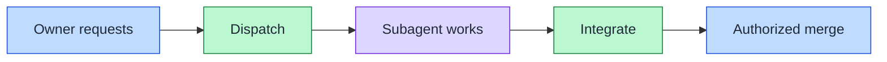

[← Scaffold at a glance](system-map.md)

# Orchestration

How one orchestrator turns owner requests into merged work by handing tasks to subagents in their own lanes.



- [Owner requests](#owner-requests): Only the owner creates tasks; the agent records the request in the queue.
- [Dispatch](#dispatch): On each loop tick, the orchestrator gives the top suited task to a free worker slot.
- [Subagent works](#subagent-works): The subagent builds its one task in its own worktree and commits locally.
- [Integrate](#integrate): The orchestrator merges the target into the lane, re-runs the gates and merges green work into the one working branch.
- [Authorized merge](#authorized-merge): The owner authorizes; the orchestrator squash-merges, and the task closes when the queue records it.

## Owner requests

Only the owner creates tasks; the agent records the request in the queue.

Details: [Queue task lifecycle](queue-lifecycle.md)

- The agent runs queue add --requested with the owner's words and an acceptance check.
- One shared record
  - queue.db holds typed tasks: status, owner, accept, evidence.
  - queue.md is the committed view; line order is priority.
  - Every worktree reads the same record.

**Where it breaks**

- An agent never adds its own tasks; its findings go to the owner instead.

## Dispatch

On each loop tick, the orchestrator gives the top suited task to a free worker slot.

Details: [One loop tick](loop-tick.md)

- It reads the slots from topology.json.
- It creates the worktree lane first, off the working branch's HEAD, then claims the task for that slot.
- Steering later
  - The orchestrator adds ORCH UPDATE notes to the task.
  - The subagent follows the newest one at its next checkpoint.

## Subagent works

The subagent builds its one task in its own worktree and commits locally.

Details: [Feature chain](feature-chain.md)

- It starts with an ff-only check that it is on the working branch's HEAD.
- A chore is built directly; a feature runs design, PRD, plan, TDD, refine.
- It validates, commits, records evidence and never pushes.

**Where it breaks**

- A subagent that skips its checkpoints misses the orchestrator's steering.

## Integrate

The orchestrator merges the target into the lane, re-runs the gates and merges green work into the one working branch.

Details: [Review gates](review-gates.md)

- Red gates send the work back to the lane.
- Then it opens a PR with Critical changes and real check results.

**Where it breaks**

- There is exactly one working branch per session; two long-lived branches split the work.

## Authorized merge

The owner authorizes; the orchestrator squash-merges, and the task closes when the queue records it.

Details: [PR workflow](pr-workflow.md)

- The PR lands on main as one squash commit.
- queue advance --pr --branch records the merge and the fresh branch.

## Detailed flow



## Code walkthrough

About half of this flow is code, and nearly all of it is the queue CLI: scripts/queue.ts with queue-task-origin.ts, queue-claim.ts, queue-worktrees.ts, queue-lanes.ts and queue-delivery.ts, plus scripts/topology.ts for the slots. The code records who owns which task and refuses out-of-order moves. Choosing a slot, starting the subagent, merging the target into the lane, merging the lane, opening the PR and the squash merge are all done by the agent from prose; the code never merges or pushes.

Each excerpt is read from the repo when this page is built. The explanations were written by an agent; `npm test` fails when the lines they explain change.

### Owner requests: code

#### taskOrigin: refuse an agent's add without the owner's words

*Enforces the rule.* It reads the --parent and --requested flags. An unknown parent id is an error. With neither flag, it checks the environment for agent markers such as CLAUDECODE or CODEX_THREAD_ID: an agent session is refused with the AGENT_ADD_REFUSAL message, a human passes. Otherwise it returns tags and a note that record the parent or the quoted request on the task.

```ts
/**
 * Resolve where a new task comes from. Humans need no flags. An agent must name an existing parent
 * task or quote the human's request; either is recorded on the task (a `parent:<id>` or
 * `requested-by:human` tag plus a note) so reviewers can trace every task to its human owner.
 */
export function taskOrigin(q: Queue, f: Parsed, env: NodeJS.ProcessEnv = process.env): Origin {
  const parent = flagValue(f, 'parent');
  const requested = flagValue(f, 'requested');
  if (parent && !q.tasks.some(t => t.id === parent)) return { ok: false, error: `queue add: --parent ${parent} is not a task in this queue` };
  if (!parent && !requested) return isAgentSession(env) ? { ok: false, error: AGENT_ADD_REFUSAL } : { ok: true, patch: {} };
  return { ok: true, patch: originPatch(parent, requested) };
}

const AGENT_ADD_REFUSAL = 'queue add: tasks are human-owned. From an agent session, add a task only when a human asked for it: '
  + 'pass --requested "<the human\'s own words>" (add --parent <task-id> to record lineage). '
  + 'Record findings on the existing task (note, checkpoint, evidence) and ask the human before adding new work.';
```

[`scripts/queue-task-origin.ts:20-35`](https://github.com/victusfate/scaffold/blob/main/scripts/queue-task-origin.ts#L20-L35)

**Why it matters.** This is the check behind 'only the owner creates tasks'. Without it an agent could grow the backlog with its own ideas. The comment at the top of the file notes the quote is not authenticated, so this is a guardrail, not proof.

**Methods and helpers used here**

<details>
<summary><code>isAgentSession</code> · function · scripts/queue-task-origin.ts:14</summary>

Takes an environment (default process.env) and returns true when any agent marker variable is set to a non-empty value: CLAUDECODE, CODEX_THREAD_ID, CODEX_SANDBOX, CODEX_CI, GEMINI_CLI, AI_AGENT, LANE_RUN_ID or SCAFFOLD_AGENT.

```ts
export function isAgentSession(env: NodeJS.ProcessEnv = process.env): boolean {
  return AGENT_ENV_MARKERS.some(key => Boolean(env[key]));
}
```

[`scripts/queue-task-origin.ts:14-16`](https://github.com/victusfate/scaffold/blob/main/scripts/queue-task-origin.ts#L14-L16)

</details>

<details>
<summary><code>Origin</code> · type · scripts/queue-task-origin.ts:18</summary>

The result of checking where a new task comes from: either { ok: true, patch } with the tags and note to put on the task, or { ok: false, error } with the message to print. taskOrigin returns it and the add commands branch on `ok`.

```ts
export type Origin = { ok: true; patch: Partial<Task> } | { ok: false; error: string };
```

[`scripts/queue-task-origin.ts:18`](https://github.com/victusfate/scaffold/blob/main/scripts/queue-task-origin.ts#L18)

</details>

<details>
<summary><code>originPatch</code> · function · scripts/queue-task-origin.ts:38</summary>

Takes a parent task id and a requested quote (either may be empty) and returns the tags and note that record them on a new task: a `parent:<id>` tag and 'Child of &lt;id&gt;.' for a parent, a `requested-by:human` tag and the quoted request for a quote. With both empty it returns an empty tag list and an empty note.

Comment in the source: Tags and note recording where a task came from; both origins are kept when both are given.

```ts
function originPatch(parent: string, requested: string): Partial<Task> {
  const tags = [...(parent ? [`parent:${parent}`] : []), ...(requested ? ['requested-by:human'] : [])];
  const note = [parent && `Child of ${parent}.`, requested && `Requested by a human: "${requested}"`].filter(Boolean).join(' ');
  return { tags, note };
}
```

[`scripts/queue-task-origin.ts:38-42`](https://github.com/victusfate/scaffold/blob/main/scripts/queue-task-origin.ts#L38-L42)

</details>

<details>
<summary><code>flagValue</code> · function · scripts/queue-task-origin.ts:44</summary>

Takes parsed command-line arguments and a flag name and returns that flag's value with surrounding whitespace removed, or an empty string when the flag was not given.

```ts
function flagValue(f: Parsed, key: string): string {
  return f.flags.get(key)?.trim() ?? '';
}
```

[`scripts/queue-task-origin.ts:44-46`](https://github.com/victusfate/scaffold/blob/main/scripts/queue-task-origin.ts#L44-L46)

</details>

<details>
<summary><code>Parsed</code> · interface · scripts/queue-cli-args.ts:4</summary>

The result of parsing queue CLI arguments: positionals in order, a map of value flags to their values, and the set of flags given without a value.

```ts
export interface Parsed { positionals: string[]; flags: Map<string, string>; bools: Set<string>; }
```

[`scripts/queue-cli-args.ts:4`](https://github.com/victusfate/scaffold/blob/main/scripts/queue-cli-args.ts#L4)

</details>

<details>
<summary><code>Queue</code> · interface · scripts/queue-model.ts:121</summary>

The whole work queue in memory: a config object (run status, intervals, failure and lease limits, parallelism, delivery state, the next id counter) plus the ordered list of tasks, where list order is priority. It is what load returns, what save persists, and what every queue operation takes and returns.

```ts
export interface Queue {
  config: QueueConfig;
  tasks: Task[];
}
```

[`scripts/queue-model.ts:121-124`](https://github.com/victusfate/scaffold/blob/main/scripts/queue-model.ts#L121-L124)

</details>

#### queue add: record one task

*Carries out the step.* The title is the joined positional words; an empty title prints usage and exits 1. taskOrigin decides whether the add is allowed, and a refusal exits 2. addTask appends the task (or puts it first with --top) with the flags and origin tags merged in. save writes the store, the log gets an 'add' line, and the new id is printed with a drain hint.

```ts
    case 'add': {
      const title = f.positionals.join(' ').trim();
      if (!title) { console.error('usage: queue add "<title>" [--parent <id> | --requested "<human words>"] [flags]'); return 1; }
      const origin = taskOrigin(q, f);
      if (!origin.ok) { console.error(origin.error); return 2; }
      q = addTask(q, title, { top: f.bools.has('top'), ...withOrigin(taskOverrides(f), origin.patch) });
      save(q); log(`add ${title}`);
      const t = q.tasks[f.bools.has('top') ? 0 : q.tasks.length - 1];
      console.log(`added ${t.id}${t.mode === 'chain' ? ' (chain)' : ''} — ${title}${drainKick(q)}`); return 0;
    }
```

[`scripts/queue.ts:322-331`](https://github.com/victusfate/scaffold/blob/main/scripts/queue.ts#L322-L331)

**Why it matters.** This is the entry point of the flow: the owner's request becomes a typed task with an id. Skipping it leaves the request only in chat, where no later step can find it.

**Methods and helpers used here**

<details>
<summary><code>save</code> · function · scripts/queue-io.ts:296</summary>

Takes a queue and, under the queue lock, writes it to the SQLite store and rewrites the queue.md view in one transaction; lane files of tasks that ended or were removed are deleted after the commit. Throws a QueueIntegrityError and saves nothing if queue.md was edited since the store last rendered it, and throws if the lock stays held for 60 seconds.

Comment in the source: Persist `q` to the store, then re-render the view — one transaction.

```ts
export function save(q: Queue): void {
  withLock(() => openStore((db, defer) => renderView(db, defer, persistQueue(db, defer, q))));
}
```

[`scripts/queue-io.ts:296-298`](https://github.com/victusfate/scaffold/blob/main/scripts/queue-io.ts#L296-L298)

</details>

<details>
<summary><code>log</code> · function · scripts/queue-io.ts:377</summary>

Appends one line, '- &lt;ISO timestamp&gt; &lt;message&gt;', to log.md beside the queue file. Returns nothing.

```ts
export function log(msg: string): void {
  appendFileSync(sidecar('log.md'), `- ${now()} ${msg}\n`);
}
```

[`scripts/queue-io.ts:377-379`](https://github.com/victusfate/scaffold/blob/main/scripts/queue-io.ts#L377-L379)

</details>

<details>
<summary><code>drainKick</code> · function · scripts/queue-gates.ts:60</summary>

Takes a queue and returns a string to append to command output: a newline, the DRAIN-WANTED marker with the count of eligible tasks, and a hint to run tick, when the queue is running, has no active task and has at least one eligible task. Returns an empty string otherwise.

Comment in the source: Emit the stable DRAIN-WANTED marker (plus a human hint) when a mutation leaves a running queue drainable with no driver attached. This is a machine signal — a Monitor on the queue file, a cron, or an agent keys on `queue: DRAIN-WANTED` to (re)start the drain — not just prose a human has to be watching to notice. Empty string when a driver is already active, nothing is eligible, or the queue is stopped/paused (an operator halt is not a stalled drain).

```ts
export function drainKick(q: Queue): string {
  const sig = drainSignal(q);
  return sig ? `\n${sig}  → start now: \`node scripts/queue.ts tick\` (or the loop)` : '';
}
```

[`scripts/queue-gates.ts:60-63`](https://github.com/victusfate/scaffold/blob/main/scripts/queue-gates.ts#L60-L63)

</details>

<details>
<summary><code>addTask</code> · function · scripts/queue-model.ts:451</summary>

Takes a queue, a title and optional field overrides plus a `top` flag, and returns a new queue with one new pending task added at the end, or at the front when `top` is set. The task gets the next task-NNN id, the title is trimmed, and the config's nextId counter is advanced. The input queue is not modified and nothing is saved.

```ts
export function addTask(q: Queue, title: string, opts: { top?: boolean } & Partial<Task> = {}): Queue {
  const { top, ...over } = opts;
  const n = nextIdNum(q);
  const task: Task = { ...newTask(fmtId(n), title.trim()), ...over };
  const config = { ...q.config, nextId: n + 1 };
  return { config, tasks: top ? [task, ...q.tasks] : [...q.tasks, task] };
}
```

[`scripts/queue-model.ts:451-457`](https://github.com/victusfate/scaffold/blob/main/scripts/queue-model.ts#L451-L457)

</details>

<details>
<summary><code>taskOverrides</code> · function · scripts/queue-cli-args.ts:28</summary>

Takes parsed CLI arguments and returns a partial Task built from every editable task field that was given as a flag, each value coerced by fieldPatch. Fields not given are left out.

```ts
export function taskOverrides(flags: Parsed): Partial<Task> {
  const overrides: Partial<Task> = {};
  for (const key of EDITABLE_TASK_FIELDS) {
    if (flags.flags.has(key)) Object.assign(overrides, fieldPatch(key, flags.flags.get(key) ?? ''));
  }
  return overrides;
}
```

[`scripts/queue-cli-args.ts:28-34`](https://github.com/victusfate/scaffold/blob/main/scripts/queue-cli-args.ts#L28-L34)

</details>

<details>
<summary><code>taskOrigin</code> · function · scripts/queue-task-origin.ts:25</summary>

Takes the queue, the parsed add arguments and an environment, and decides whether the add is allowed. It returns an error result when --parent names a task not in the queue, or when neither --parent nor --requested is given and the environment marks an agent session. Otherwise it returns ok with the tags and note for the given parent and request, or an empty patch for a human with no flags.

Comment in the source: Resolve where a new task comes from. Humans need no flags. An agent must name an existing parent task or quote the human's request; either is recorded on the task (a `parent:<id>` or `requested-by:human` tag plus a note) so reviewers can trace every task to its human owner.

```ts
export function taskOrigin(q: Queue, f: Parsed, env: NodeJS.ProcessEnv = process.env): Origin {
  const parent = flagValue(f, 'parent');
  const requested = flagValue(f, 'requested');
  if (parent && !q.tasks.some(t => t.id === parent)) return { ok: false, error: `queue add: --parent ${parent} is not a task in this queue` };
  if (!parent && !requested) return isAgentSession(env) ? { ok: false, error: AGENT_ADD_REFUSAL } : { ok: true, patch: {} };
  return { ok: true, patch: originPatch(parent, requested) };
}
```

[`scripts/queue-task-origin.ts:25-31`](https://github.com/victusfate/scaffold/blob/main/scripts/queue-task-origin.ts#L25-L31)

</details>

<details>
<summary><code>withOrigin</code> · function · scripts/queue-task-origin.ts:49</summary>

Takes the task fields built from the command's own flags and an origin patch, and returns the fields with the origin tags placed first (duplicates removed) and the origin note placed before any --note text. If the origin patch has no tags, the fields are returned unchanged.

Comment in the source: Merge an origin patch with the task's own flags: tags are combined, an explicit --note is kept after the origin note.

```ts
export function withOrigin(overrides: Partial<Task>, origin: Partial<Task>): Partial<Task> {
  if (!origin.tags) return overrides;
  return {
    ...overrides,
    tags: [...origin.tags, ...(overrides.tags ?? []).filter(t => !origin.tags!.includes(t))],
    note: overrides.note ? `${origin.note} ${overrides.note}` : origin.note,
  };
}
```

[`scripts/queue-task-origin.ts:49-56`](https://github.com/victusfate/scaffold/blob/main/scripts/queue-task-origin.ts#L49-L56)

</details>

### Dispatch: code

#### parseTopology and loadTopology: read the worker slots

*Carries out the step.* parseTopology rejects anything that is not an object or has unknown keys, checks the orchestrator model, defaults tick_minutes to 10 and requires it to be positive, then parses the slots. loadTopology reads .agent/topology.json (or TOPOLOGY_FILE); a missing file means an orchestrator with no slots, and bad JSON throws a TopologyError.

```ts
/** Validate a parsed JSON value. Throws TopologyError naming the first problem. */
export function parseTopology(raw: unknown): Topology {
  if (!isObject(raw)) throw new TopologyError('topology must be a JSON object');
  rejectUnknown(raw, TOP_KEYS, 'topology');
  const orchestrator = parseOrchestrator(raw.orchestrator);
  const tick = raw.tick_minutes ?? DEFAULT_TICK_MINUTES;
  if (typeof tick !== 'number' || !Number.isFinite(tick) || tick <= 0) {
    throw new TopologyError('tick_minutes must be a positive number');
  }
  return { orchestrator, tickMinutes: tick, slots: parseSlots(raw.slots ?? []) };
}

/** Read and validate the topology file; a missing file is the default (orchestrator only). */
export function loadTopology(path: string = process.env.TOPOLOGY_FILE ?? TOPOLOGY_PATH): Topology {
  if (!existsSync(path)) return defaultTopology();
  let raw: unknown;
  try { raw = JSON.parse(readFileSync(path, 'utf8')); }
  catch (error) { throw new TopologyError(`${path}: invalid JSON (${(error as Error).message})`); }
  return parseTopology(raw);
}
```

[`scripts/topology.ts:89-108`](https://github.com/victusfate/scaffold/blob/main/scripts/topology.ts#L89-L108)

**Why it matters.** Dispatch starts by reading the slots from this file. The file has no routing fields on purpose: which task suits which slot is the orchestrator's judgment, not code.

**Methods and helpers used here**

<details>
<summary><code>Topology</code> · interface · scripts/topology.ts:25</summary>

The validated topology shape: an orchestrator object with a model string, tickMinutes as a number, and an array of slots (each with id, harness, model and optional effort). It is what parseTopology, loadTopology and defaultTopology return.

```ts
export interface Topology {
  orchestrator: { model: string };
  tickMinutes: number;
  slots: Slot[];
}
```

[`scripts/topology.ts:25-29`](https://github.com/victusfate/scaffold/blob/main/scripts/topology.ts#L25-L29)

</details>

<details>
<summary><code>TopologyError</code> · class · scripts/topology.ts:31</summary>

An Error subclass with no added fields, thrown by the topology parsing and loading functions for any invalid topology file. The script's main catches this class to print the message and exit 1, and rethrows any other error.

```ts
export class TopologyError extends Error {}
```

[`scripts/topology.ts:31`](https://github.com/victusfate/scaffold/blob/main/scripts/topology.ts#L31)

</details>

<details>
<summary><code>DEFAULT_TICK_MINUTES</code> · const · scripts/topology.ts:34</summary>

The number 10, the tick interval in minutes used when a topology file is absent or does not set tick_minutes.

Comment in the source: quality-ok: magic-number — the loop skill's documented default tick cadence

```ts
export const DEFAULT_TICK_MINUTES = 10;
```

[`scripts/topology.ts:34`](https://github.com/victusfate/scaffold/blob/main/scripts/topology.ts#L34)

</details>

<details>
<summary><code>TOPOLOGY_PATH</code> · const · scripts/topology.ts:35</summary>

The absolute path of .agent/topology.json in the repo that contains this script, computed from the script's own location. loadTopology reads this path when neither an argument nor the TOPOLOGY_FILE environment variable is given.

```ts
export const TOPOLOGY_PATH = join(dirname(fileURLToPath(import.meta.url)), '..', '.agent', 'topology.json');
```

[`scripts/topology.ts:35`](https://github.com/victusfate/scaffold/blob/main/scripts/topology.ts#L35)

</details>

<details>
<summary><code>TOP_KEYS</code> · const · scripts/topology.ts:37</summary>

The list of key names allowed at the top level of a topology JSON object: orchestrator, tick_minutes and slots. parseTopology passes it to rejectUnknown so any other top-level key is an error.

```ts
const TOP_KEYS = ['orchestrator', 'tick_minutes', 'slots'];
```

[`scripts/topology.ts:37`](https://github.com/victusfate/scaffold/blob/main/scripts/topology.ts#L37)

</details>

<details>
<summary><code>defaultTopology</code> · function · scripts/topology.ts:41</summary>

Takes nothing and returns a new Topology with orchestrator model 'default', tickMinutes set to DEFAULT_TICK_MINUTES (10) and an empty slots array. loadTopology returns it when the topology file does not exist.

Comment in the source: No file: just the orchestrator, no slots.

```ts
export function defaultTopology(): Topology {
  return { orchestrator: { model: 'default' }, tickMinutes: DEFAULT_TICK_MINUTES, slots: [] };
}
```

[`scripts/topology.ts:41-43`](https://github.com/victusfate/scaffold/blob/main/scripts/topology.ts#L41-L43)

</details>

<details>
<summary><code>isObject</code> · function · scripts/topology.ts:45</summary>

Takes any value and returns true only when it is a non-null object that is not an array, narrowing its type to a string-keyed record.

```ts
function isObject(v: unknown): v is Record<string, unknown> {
  return typeof v === 'object' && v !== null && !Array.isArray(v);
}
```

[`scripts/topology.ts:45-47`](https://github.com/victusfate/scaffold/blob/main/scripts/topology.ts#L45-L47)

</details>

<details>
<summary><code>rejectUnknown</code> · function · scripts/topology.ts:49</summary>

Takes an object, a list of allowed key names and a location label, and throws TopologyError naming the first key of the object that is not in the list, prefixed with the label. Returns nothing when every key is allowed.

```ts
function rejectUnknown(obj: Record<string, unknown>, allowed: string[], where: string): void {
  const extra = Object.keys(obj).find(k => !allowed.includes(k));
  if (extra) throw new TopologyError(`${where}: unknown key "${extra}"`);
}
```

[`scripts/topology.ts:49-52`](https://github.com/victusfate/scaffold/blob/main/scripts/topology.ts#L49-L52)

</details>

<details>
<summary><code>parseOrchestrator</code> · function · scripts/topology.ts:72</summary>

Takes the raw orchestrator value from the topology JSON and returns { model } with the model string. Throws TopologyError if the value is not an object, has any key other than model, or model is not a non-empty string.

```ts
function parseOrchestrator(raw: unknown): { model: string } {
  if (!isObject(raw)) throw new TopologyError('orchestrator must be an object');
  rejectUnknown(raw, ['model'], 'orchestrator');
  return { model: nonEmptyString(raw.model, 'orchestrator.model') };
}
```

[`scripts/topology.ts:72-76`](https://github.com/victusfate/scaffold/blob/main/scripts/topology.ts#L72-L76)

</details>

<details>
<summary><code>parseSlots</code> · function · scripts/topology.ts:78</summary>

Takes the raw slots value from the topology JSON, validates each element as a slot, and returns the resulting Slot array. Throws TopologyError if the value is not an array, any slot is invalid, or two slots share the same id.

```ts
function parseSlots(raw: unknown): Slot[] {
  if (!Array.isArray(raw)) throw new TopologyError('slots must be an array');
  const slots = raw.map(parseSlot);
  const seen = new Set<string>();
  for (const s of slots) {
    if (seen.has(s.id)) throw new TopologyError(`duplicate slot id "${s.id}"`);
    seen.add(s.id);
  }
  return slots;
}
```

[`scripts/topology.ts:78-87`](https://github.com/victusfate/scaffold/blob/main/scripts/topology.ts#L78-L87)

</details>

#### queue worktree add: create the lane

*Carries out the step.* The base is config.integrationBranch, else the current branch. It runs git worktree add at .agent/queue/wt/&lt;id&gt; on a new branch queue/&lt;id&gt;; if that branch already exists it reuses it. It saves the branch and worktree path on the task, logs the base commit, and prints the lane's first step: git merge --ff-only &lt;base&gt;.

```ts
/**
 * Create an isolated git worktree for a task on branch `queue/<id>`, cut from the
 * integration base (config.integrationBranch, or the current branch). Records the
 * branch + worktree path on the task. Merge-back is deliberately agent-driven
 * (see skills/queue.md, aligned with design.md D7) — the CLI never auto-merges.
 */
function cmdWorktreeAdd(q: Queue, id: string): number {
  const t = q.tasks.find(x => x.id === id);
  if (!t) { console.error(`worktree add: unknown task id ${id}`); return 1; }
  const base = q.config.integrationBranch || currentBranch();
  const branch = `queue/${id}`;
  const rel = wtRel(id);
  const abs = join(ROOT, rel);
  let baseSha: string;
  try {
    try { git(`worktree add ${abs} -b ${branch} ${base}`); }
    catch { git(`worktree add ${abs} ${branch}`); } // branch already exists
    baseSha = git(`rev-parse ${base}`);
  } catch (e) { console.error(`worktree add failed: ${(e as Error).message}`); return 1; }
  save(setField(q, id, { branch, worktree: rel }));
  log(`worktree add ${id} → ${rel} (${branch} off ${base} @ ${baseSha})`);
  console.log(`worktree ready: ${rel}  on ${branch}  (base ${base} @ ${baseSha})\n`
    + `First step in the lane: \`git merge --ff-only ${base}\` (a reused branch may be stale); stop if it cannot fast-forward. `
    + `cd ${rel} to work in isolation; commit locally and report the tip. `
    + `The root reviews, integrates into ${base}, finalizes the claim and removes the worktree.`);
  return 0;
}
```

[`scripts/queue-worktrees.ts:18-44`](https://github.com/victusfate/scaffold/blob/main/scripts/queue-worktrees.ts#L18-L44)

**Why it matters.** This creates the isolated lane off the working branch before the task is claimed. The ff-only check and the merge back are only printed as instructions; the comment says the CLI never auto-merges.

**Methods and helpers used here**

<details>
<summary><code>git</code> · function · scripts/queue-worktrees.ts:10</summary>

Takes a git argument string and an optional working directory (default the repo root), runs `git <args>` through the shell and returns its trimmed standard output. It throws if the command exits non-zero.

```ts
function git(args: string, cwd = ROOT): string {
  return execSync(`git ${args}`, { cwd, encoding: 'utf8', stdio: 'pipe' }).trim();
}
```

[`scripts/queue-worktrees.ts:10-12`](https://github.com/victusfate/scaffold/blob/main/scripts/queue-worktrees.ts#L10-L12)

</details>

<details>
<summary><code>currentBranch</code> · function · scripts/queue-worktrees.ts:13</summary>

Returns the name of the branch checked out in the repo root, from `git rev-parse --abbrev-ref HEAD`. If that git command fails it returns 'main'.

```ts
function currentBranch(): string {
  try { return git('rev-parse --abbrev-ref HEAD'); } catch { return 'main'; }
}
```

[`scripts/queue-worktrees.ts:13-15`](https://github.com/victusfate/scaffold/blob/main/scripts/queue-worktrees.ts#L13-L15)

</details>

<details>
<summary><code>wtRel</code> · function · scripts/queue-worktrees.ts:16</summary>

Takes a task id and returns the repo-relative path of that task's worktree, .agent/queue/wt/&lt;id&gt;. It does not create or check anything.

```ts
function wtRel(id: string): string { return join('.agent', 'queue', 'wt', id); }
```

[`scripts/queue-worktrees.ts:16`](https://github.com/victusfate/scaffold/blob/main/scripts/queue-worktrees.ts#L16)

</details>

<details>
<summary><code>ROOT</code> · const · scripts/queue-io.ts:20</summary>

The absolute path of the checkout root, computed as the parent of the directory containing this script. The default queue directory and git lookups are resolved from it.

```ts
export const ROOT = join(dirname(fileURLToPath(import.meta.url)), '..');
```

[`scripts/queue-io.ts:20`](https://github.com/victusfate/scaffold/blob/main/scripts/queue-io.ts#L20)

</details>

<details>
<summary><code>save</code> · function · scripts/queue-io.ts:296</summary>

Takes a queue and, under the queue lock, writes it to the SQLite store and rewrites the queue.md view in one transaction; lane files of tasks that ended or were removed are deleted after the commit. Throws a QueueIntegrityError and saves nothing if queue.md was edited since the store last rendered it, and throws if the lock stays held for 60 seconds.

Comment in the source: Persist `q` to the store, then re-render the view — one transaction.

```ts
export function save(q: Queue): void {
  withLock(() => openStore((db, defer) => renderView(db, defer, persistQueue(db, defer, q))));
}
```

[`scripts/queue-io.ts:296-298`](https://github.com/victusfate/scaffold/blob/main/scripts/queue-io.ts#L296-L298)

</details>

<details>
<summary><code>log</code> · function · scripts/queue-io.ts:377</summary>

Appends one line, '- &lt;ISO timestamp&gt; &lt;message&gt;', to log.md beside the queue file. Returns nothing.

```ts
export function log(msg: string): void {
  appendFileSync(sidecar('log.md'), `- ${now()} ${msg}\n`);
}
```

[`scripts/queue-io.ts:377-379`](https://github.com/victusfate/scaffold/blob/main/scripts/queue-io.ts#L377-L379)

</details>

<details>
<summary><code>Queue</code> · interface · scripts/queue-model.ts:121</summary>

The whole work queue in memory: a config object (run status, intervals, failure and lease limits, parallelism, delivery state, the next id counter) plus the ordered list of tasks, where list order is priority. It is what load returns, what save persists, and what every queue operation takes and returns.

```ts
export interface Queue {
  config: QueueConfig;
  tasks: Task[];
}
```

[`scripts/queue-model.ts:121-124`](https://github.com/victusfate/scaffold/blob/main/scripts/queue-model.ts#L121-L124)

</details>

<details>
<summary><code>setField</code> · function · scripts/queue-model.ts:472</summary>

Takes a queue, a task id and a partial task, and returns a new queue in which that task has the given fields overwritten. An unknown id leaves the tasks unchanged, and nothing is saved.

```ts
export function setField(q: Queue, id: string, patch: Partial<Task>): Queue {
  return mapTask(q, id, t => ({ ...t, ...patch }));
}
```

[`scripts/queue-model.ts:472-474`](https://github.com/victusfate/scaffold/blob/main/scripts/queue-model.ts#L472-L474)

</details>

#### queue claim: give a pending task to a worker or slot

*Carries out the step.* refusal rejects a task that is not pending, is held, or is blocked by an unfinished delivery cycle. branchFlag rejects a --branch value that is not one name. The worker name comes from --worker, else a name built from the process id. One save marks the task active with that owner and, when given, links the branch in the same write.

```ts
/**
 * `queue claim <id> [--worker w] [--branch b]`. Returns the process exit code. The caller passes its task
 * printer, so consumers whose queue keeps `taskBlock` in another module sync this file unchanged.
 */
export function cmdClaim(q: Queue, id: string, flags: Map<string, string>, taskBlock: (t: Task) => string): number {
  const t = q.tasks.find(x => x.id === id)!;
  const refused = refusal(q, t);
  if (refused) { (refused.stderr ? console.error : console.log)(refused.message); return 1; }
  const branch = branchFlag(flags);
  if (branch === null) { console.error('claim: --branch needs one branch name'); return 1; }
  const worker = flags.get('worker') ?? `worker-${process.pid}`;
  const on = branch ? ` on ${branch}` : '';
  save(branch ? setField(beginTask(q, id, now(), worker), id, { branch }) : beginTask(q, id, now(), worker));
  log(`claim ${id} by ${worker}${on}`);
  console.log(`claimed ${id} for ${worker}${on}\n${taskBlock({ ...t, owner: worker, branch: branch || t.branch })}`);
  return 0;
}
```

[`scripts/queue-claim.ts:22-38`](https://github.com/victusfate/scaffold/blob/main/scripts/queue-claim.ts#L22-L38)

**Why it matters.** This is how a slot takes a task: the task's owner becomes the slot id. Linking the branch in the same write means a task is never active with an unlinked branch.

**Methods and helpers used here**

<details>
<summary><code>refusal</code> · function · scripts/queue-claim.ts:8</summary>

Takes the queue and a task and returns null when the task can be claimed. Otherwise it returns a message and whether to print it to stderr: the task is not pending, the current delivery cycle has not finished, or the task is held.

Comment in the source: Why `t` can't be claimed now, or null when it can (printed to stdout, as before the split).

```ts
function refusal(q: Queue, t: Task): { message: string; stderr: boolean } | null {
  if (t.status !== 'pending') return { message: `claim: ${t.id} is ${t.status}, not claimable`, stderr: false };
  if (!deliveryAllows(q, t.id)) return { message: 'claim: current delivery cycle must finish first', stderr: true };
  if (t.held) return { message: `claim: ${t.id} is held — unhold it first`, stderr: false };
  return null;
}
```

[`scripts/queue-claim.ts:8-13`](https://github.com/victusfate/scaffold/blob/main/scripts/queue-claim.ts#L8-L13)

</details>

<details>
<summary><code>branchFlag</code> · function · scripts/queue-claim.ts:16</summary>

Reads the --branch flag from the parsed flags: returns '' when the flag is absent, the trimmed name when it is a non-empty value without whitespace, and null when it was given but is empty or contains whitespace.

Comment in the source: The --branch value: '' when absent, null when given but not one branch name.

```ts
function branchFlag(flags: Map<string, string>): string | null {
  if (!flags.has('branch')) return '';
  const branch = flags.get('branch')?.trim() ?? '';
  return branch && !/\s/.test(branch) ? branch : null;
}
```

[`scripts/queue-claim.ts:16-20`](https://github.com/victusfate/scaffold/blob/main/scripts/queue-claim.ts#L16-L20)

</details>

<details>
<summary><code>now</code> · function · scripts/queue-io.ts:67</summary>

Returns the current time as an ISO 8601 string.

```ts
export function now(): string { return new Date().toISOString(); }
```

[`scripts/queue-io.ts:67`](https://github.com/victusfate/scaffold/blob/main/scripts/queue-io.ts#L67)

</details>

<details>
<summary><code>save</code> · function · scripts/queue-io.ts:296</summary>

Takes a queue and, under the queue lock, writes it to the SQLite store and rewrites the queue.md view in one transaction; lane files of tasks that ended or were removed are deleted after the commit. Throws a QueueIntegrityError and saves nothing if queue.md was edited since the store last rendered it, and throws if the lock stays held for 60 seconds.

Comment in the source: Persist `q` to the store, then re-render the view — one transaction.

```ts
export function save(q: Queue): void {
  withLock(() => openStore((db, defer) => renderView(db, defer, persistQueue(db, defer, q))));
}
```

[`scripts/queue-io.ts:296-298`](https://github.com/victusfate/scaffold/blob/main/scripts/queue-io.ts#L296-L298)

</details>

<details>
<summary><code>log</code> · function · scripts/queue-io.ts:377</summary>

Appends one line, '- &lt;ISO timestamp&gt; &lt;message&gt;', to log.md beside the queue file. Returns nothing.

```ts
export function log(msg: string): void {
  appendFileSync(sidecar('log.md'), `- ${now()} ${msg}\n`);
}
```

[`scripts/queue-io.ts:377-379`](https://github.com/victusfate/scaffold/blob/main/scripts/queue-io.ts#L377-L379)

</details>

<details>
<summary><code>Task</code> · interface · scripts/queue-model.ts:67</summary>

One queue task: its id, title, status (pending, active, done or failed), mode, architecture setting, held flag, banked elapsed seconds, slug, dependency ids, files, contracts, tags, validate command, acceptance text, note, failure count, and the claim fields owner, branch, worktree and startedAt. It is the record stored in the queue and passed to every task operation.

```ts
export interface Task {
  id: string;
  title: string;
  status: TaskStatus;
  mode: TaskMode;
  architecture: ArchitectureMode;
  held: boolean;
  /** Cumulative agent seconds banked across all work sessions on this task. */
  elapsedSecs: number;
  slug: string | null;
  dependsOn: string[];
  files: string[];
  /** Authoritative executable schemas, migrations and tests. References, never a prose classification. */
  contracts: string[];
  /** Free-form labels for grouping and filtering (`group:speed`, `owner-report`); `list --tag` filters on them. */
  tags: string[];
  validate: string | null;
  accept: string | null;
  note: string | null;
  failures: number;
  owner: string | null;
  branch: string | null;
  worktree: string | null;
  startedAt: string | null;
```

[`scripts/queue-model.ts:67-90`](https://github.com/victusfate/scaffold/blob/main/scripts/queue-model.ts#L67-L90) (first 24 lines shown)

</details>

<details>
<summary><code>Queue</code> · interface · scripts/queue-model.ts:121</summary>

The whole work queue in memory: a config object (run status, intervals, failure and lease limits, parallelism, delivery state, the next id counter) plus the ordered list of tasks, where list order is priority. It is what load returns, what save persists, and what every queue operation takes and returns.

```ts
export interface Queue {
  config: QueueConfig;
  tasks: Task[];
}
```

[`scripts/queue-model.ts:121-124`](https://github.com/victusfate/scaffold/blob/main/scripts/queue-model.ts#L121-L124)

</details>

<details>
<summary><code>setField</code> · function · scripts/queue-model.ts:472</summary>

Takes a queue, a task id and a partial task, and returns a new queue in which that task has the given fields overwritten. An unknown id leaves the tasks unchanged, and nothing is saved.

```ts
export function setField(q: Queue, id: string, patch: Partial<Task>): Queue {
  return mapTask(q, id, t => ({ ...t, ...patch }));
}
```

[`scripts/queue-model.ts:472-474`](https://github.com/victusfate/scaffold/blob/main/scripts/queue-model.ts#L472-L474)

</details>

<details>
<summary><code>beginTask</code> · function · scripts/queue-model.ts:503</summary>

Takes a queue, a task id, a current ISO time and an optional owner, and returns a new queue in which that task is active with that owner and startedAt set to the given time. In per-task delivery mode it also records the task as the current delivery task if none is recorded, and clears the delivery-accepted flag when this task is the delivery task. Nothing is saved, and an unknown id leaves the task list unchanged.

Comment in the source: Mark a task active and claim it for a worker, stamping the lease clock.

```ts
export function beginTask(q: Queue, id: string, nowIso: string, owner: string | null = null): Queue {
  q = selectDelivery(q, id);
  if (q.config.deliveryTask === id) q = setConfig(q, { deliveryAccepted: false });
  return mapTask(q, id, t => ({ ...t, status: 'active', owner, startedAt: nowIso }));
}
```

[`scripts/queue-model.ts:503-507`](https://github.com/victusfate/scaffold/blob/main/scripts/queue-model.ts#L503-L507)

</details>

<details>
<summary><code>taskBlock</code> · function · scripts/queue-model.ts:864</summary>

Takes a task and returns the text block handed to a worker: a &lt;queue_task id="..."&gt; element containing the title, the mode, the architecture setting with its guidance text, and the slug, accept, files, contracts and validate lines for whichever of those the task has.

Comment in the source: The prompt block a worker receives for a task (tick/claim).

```ts
export function taskBlock(t: Task): string {
  const spec = [
    t.mode === 'chain' ? 'mode: chain (design→prd→plan→tdd→refine, autonomous, no questions)' : 'mode: direct',
    `architecture: ${t.architecture}`,
    architectureGuidance(t.architecture),
    t.slug ? `slug: docs/${t.slug}/` : '',
    t.accept ? `accept: ${t.accept}` : '',
    t.files.length ? `files: ${t.files.join(', ')}` : '',
    t.contracts.length ? `contracts: ${t.contracts.join(', ')}` : '',
    t.validate ? `validate: ${t.validate}` : '',
  ].filter(Boolean).join('\n');
  return `<queue_task id="${t.id}">\n${t.title}\n${spec}\n</queue_task>`;
}
```

[`scripts/queue-model.ts:864-876`](https://github.com/victusfate/scaffold/blob/main/scripts/queue-model.ts#L864-L876)

</details>

#### slotViews: which slots are busy

*Carries out the step.* It takes the active tasks and, for each topology slot, picks those whose owner equals the slot id. A slot with one or more is busy; with more than one it is flagged overbooked. Active tasks owned by no known slot are returned as orphans.

```ts
/**
 * Derive slot occupancy from task status alone (owner = slot id), so the UI is only as true as the
 * orchestrator's task bookkeeping. Heartbeat sidecars, when present, attach as detail.
 */
export function slotViews(q: Queue, topology: Topology, lanes: LaneView[] = []): { slots: SlotView[]; orphans: ConsoleOrphan[] } {
  const active = q.tasks.filter(t => t.status === 'active');
  const slots = topology.slots.map(slot => {
    const mine = active.filter(t => t.owner === slot.id);
    const lane = lanes.find(l => mine.some(t => t.id === l.id)) ?? null;
    return {
      ...slot, busy: mine.length > 0, overbooked: mine.length > 1, lane,
      tasks: mine.map(t => ({ id: t.id, title: t.title, startedAt: t.startedAt })),
    };
  });
  const ids = new Set(topology.slots.map(s => s.id));
  const orphans = topology.slots.length === 0 ? [] : active.filter(t => !t.owner || !ids.has(t.owner))
    .map(t => ({ id: t.id, title: t.title, owner: t.owner }));
  return { slots, orphans };
}
```

[`scripts/queue-console-slots.ts:19-37`](https://github.com/victusfate/scaffold/blob/main/scripts/queue-console-slots.ts#L19-L37)

**Why it matters.** A free slot is defined as 'no active task owned by this slot id', so the claim's --worker value is what marks a slot busy. This view feeds the console's Slots panel; the dispatch decision itself is still made by the agent.

**Methods and helpers used here**

<details>
<summary><code>SlotView</code> · interface · scripts/queue-console-slots.ts:10</summary>

One topology slot as the queue console shows it: the slot's own fields plus busy (it owns at least one active task), overbooked (it owns more than one), the active tasks it owns, and the matching lane record or null.

Comment in the source: One topology slot: busy iff an active task is owned by the slot id. Lane heartbeat is optional detail.

```ts
export interface SlotView extends Slot {
  busy: boolean;
  /** More than one active task owned by this slot: a dispatch bug worth flagging. */
  overbooked: boolean;
  tasks: SlotTask[];
  lane: LaneView | null;
}
```

[`scripts/queue-console-slots.ts:10-16`](https://github.com/victusfate/scaffold/blob/main/scripts/queue-console-slots.ts#L10-L16)

</details>

<details>
<summary><code>ConsoleOrphan</code> · interface · scripts/queue-console-slots.ts:17</summary>

An active task whose owner is not a declared topology slot, as shown by the queue console: the task id, title and owner (or null).

```ts
export interface ConsoleOrphan { id: string; title: string; owner: string | null }
```

[`scripts/queue-console-slots.ts:17`](https://github.com/victusfate/scaffold/blob/main/scripts/queue-console-slots.ts#L17)

</details>

<details>
<summary><code>Topology</code> · interface · scripts/topology.ts:25</summary>

The validated topology shape: an orchestrator object with a model string, tickMinutes as a number, and an array of slots (each with id, harness, model and optional effort). It is what parseTopology, loadTopology and defaultTopology return.

```ts
export interface Topology {
  orchestrator: { model: string };
  tickMinutes: number;
  slots: Slot[];
}
```

[`scripts/topology.ts:25-29`](https://github.com/victusfate/scaffold/blob/main/scripts/topology.ts#L25-L29)

</details>

<details>
<summary><code>Queue</code> · interface · scripts/queue-model.ts:121</summary>

The whole work queue in memory: a config object (run status, intervals, failure and lease limits, parallelism, delivery state, the next id counter) plus the ordered list of tasks, where list order is priority. It is what load returns, what save persists, and what every queue operation takes and returns.

```ts
export interface Queue {
  config: QueueConfig;
  tasks: Task[];
}
```

[`scripts/queue-model.ts:121-124`](https://github.com/victusfate/scaffold/blob/main/scripts/queue-model.ts#L121-L124)

</details>

<details>
<summary><code>LaneView</code> · interface · scripts/queue-console.ts:80</summary>

A lane's heartbeat record (LaneState) plus two derived flags: stale, whether the heartbeat is older than the queue's lease allows, and stop, whether a stop has been requested for that lane.

```ts
export interface LaneView extends LaneState { stale: boolean; stop: boolean }
```

[`scripts/queue-console.ts:80`](https://github.com/victusfate/scaffold/blob/main/scripts/queue-console.ts#L80)

</details>

### Subagent works: code

#### taskBlock: the task text a worker receives

*Carries out the step.* It builds a list of lines from the task: the mode (chain or direct), the architecture mode and its guidance, the docs slug, the accept note, files, contracts and the validate command. Empty lines are dropped and the result is wrapped in a &lt;queue_task id=...&gt; block. tick and claim print this block.

```ts
/** The prompt block a worker receives for a task (tick/claim). */
export function taskBlock(t: Task): string {
  const spec = [
    t.mode === 'chain' ? 'mode: chain (design→prd→plan→tdd→refine, autonomous, no questions)' : 'mode: direct',
    `architecture: ${t.architecture}`,
    architectureGuidance(t.architecture),
    t.slug ? `slug: docs/${t.slug}/` : '',
    t.accept ? `accept: ${t.accept}` : '',
    t.files.length ? `files: ${t.files.join(', ')}` : '',
    t.contracts.length ? `contracts: ${t.contracts.join(', ')}` : '',
    t.validate ? `validate: ${t.validate}` : '',
  ].filter(Boolean).join('\n');
  return `<queue_task id="${t.id}">\n${t.title}\n${spec}\n</queue_task>`;
}
```

[`scripts/queue-model.ts:863-876`](https://github.com/victusfate/scaffold/blob/main/scripts/queue-model.ts#L863-L876)

**Why it matters.** This is how the subagent learns whether to build a chore directly or run the full design-to-refine chain, and what counts as accepted. Following those steps is then up to the agent.

**Methods and helpers used here**

<details>
<summary><code>architectureGuidance</code> · function · scripts/queue-model.ts:62</summary>

Takes an architecture mode (builder-led, collaborative or model-led) and returns the instruction text for that mode followed by a sentence saying validation, security and compatibility checks stay mandatory. It throws an Error if the value is not one of the three modes.

```ts
export function architectureGuidance(mode: ArchitectureMode): string {
  return ARCHITECTURE_GUIDANCE[parseArchitecture(mode)]
    + ' In every mode, validation, security and compatibility checks remain mandatory; release authority is unchanged.';
}
```

[`scripts/queue-model.ts:62-65`](https://github.com/victusfate/scaffold/blob/main/scripts/queue-model.ts#L62-L65)

</details>

<details>
<summary><code>Task</code> · interface · scripts/queue-model.ts:67</summary>

One queue task: its id, title, status (pending, active, done or failed), mode, architecture setting, held flag, banked elapsed seconds, slug, dependency ids, files, contracts, tags, validate command, acceptance text, note, failure count, and the claim fields owner, branch, worktree and startedAt. It is the record stored in the queue and passed to every task operation.

```ts
export interface Task {
  id: string;
  title: string;
  status: TaskStatus;
  mode: TaskMode;
  architecture: ArchitectureMode;
  held: boolean;
  /** Cumulative agent seconds banked across all work sessions on this task. */
  elapsedSecs: number;
  slug: string | null;
  dependsOn: string[];
  files: string[];
  /** Authoritative executable schemas, migrations and tests. References, never a prose classification. */
  contracts: string[];
  /** Free-form labels for grouping and filtering (`group:speed`, `owner-report`); `list --tag` filters on them. */
  tags: string[];
  validate: string | null;
  accept: string | null;
  note: string | null;
  failures: number;
  owner: string | null;
  branch: string | null;
  worktree: string | null;
  startedAt: string | null;
```

[`scripts/queue-model.ts:67-90`](https://github.com/victusfate/scaffold/blob/main/scripts/queue-model.ts#L67-L90) (first 24 lines shown)

</details>

#### queue lane finish: the subagent reports done and keeps its claim

*Carries out the step.* The first part of cmdLane lists lane heartbeat files, marking stale ones and stop requests. For 'finish' it requires the task to be active and --worker to match the task's owner, then writes the lane file with state awaiting-review and logs that root review is required. The task itself stays active.

```ts
/**
 * The `queue lane ...` verbs: heartbeat sidecars the live board reads, plus
 * cooperative stop flags. Read-only toward the queue itself — beats never
 * touch task state (that is claim/done/fail's job), so this lives with the
 * sidecars rather than the CLI dispatcher.
 */
export function cmdLane(q: Queue, sub: string, id: string, f: Parsed): number {
  if (sub === 'list') {
    const lanes = readLanes();
    if (!lanes.length) { console.log('lanes: none'); return 0; }
    for (const l of lanes) {
      const stale = laneStale(l, now(), q.config.leaseMinutes) ? ' (stale)' : '';
      const stop = stopRequested(l.id) ? ' [stop requested]' : '';
      console.log(`${l.id} @${l.worker ?? '?'} · ${l.step ?? 'no step'}${stale}${stop}`);
    }
    return 0;
  }
  if (!id || !q.tasks.some(t => t.id === id)) { console.error(`lane ${sub}: unknown task id`); return 1; }
  if (sub === 'finish') {
    const task = q.tasks.find(t => t.id === id)!;
    const worker = f.flags.get('worker');
    if (task.status !== 'active' || !worker || task.owner !== worker) {
      console.error('lane finish: active task and matching --worker required');
      return 1;
    }
    beatLane(id, { worker, state: 'awaiting-review', step: 'worker finished', tail: f.flags.get('tail') });
    log(`lane finish ${id} by ${worker}; root review required`);
    console.log(`worker finished ${id}; claim retained for root review`);
    return 0;
  }
```

[`scripts/queue-lanes.ts:104-133`](https://github.com/victusfate/scaffold/blob/main/scripts/queue-lanes.ts#L104-L133)

**Why it matters.** The subagent reports and stops; it does not mark its own task done or merge. The claim stays in place until the orchestrator reviews the lane.

**Methods and helpers used here**

<details>
<summary><code>beatLane</code> · function · scripts/queue-lanes.ts:56</summary>

Takes a task id and an optional patch of worker, model, step, state and tail, and writes the lane's JSON file with those fields merged over the existing record and updatedAt set to the current time, creating the lanes directory if needed. When there is no readable existing record it starts from a blank one with startedAt set to now. Returns the record it wrote.

Comment in the source: Record a heartbeat for a lane: merge the patch over the existing sidecar (or a blank), stamp updatedAt. First beat also stamps startedAt.

```ts
export function beatLane(id: string, patch: LanePatch = {}): LaneState {
  mkdirSync(laneDir(), { recursive: true });
  const prev = existsSync(lanePath(id)) ? readOne(lanePath(id)) : null;
  const base = prev ?? { ...blank(id), startedAt: now() };
  const next: LaneState = {
    ...base,
    worker: patch.worker ?? base.worker,
    model: patch.model ?? base.model,
    step: patch.step ?? base.step,
    state: patch.state ?? base.state,
    tail: patch.tail ?? base.tail,
    updatedAt: now(),
  };
  writeFileSync(lanePath(id), JSON.stringify(next, null, 2) + '\n');
  return next;
}
```

[`scripts/queue-lanes.ts:56-71`](https://github.com/victusfate/scaffold/blob/main/scripts/queue-lanes.ts#L56-L71)

</details>

<details>
<summary><code>readLanes</code> · function · scripts/queue-lanes.ts:74</summary>

Reads every .json file in the lanes directory and returns the lane records sorted by task id. Files that cannot be parsed or have no string id are skipped, and a missing lanes directory gives an empty list.

Comment in the source: Every well-formed lane sidecar; malformed files are skipped, never fatal.

```ts
export function readLanes(): LaneState[] {
  if (!existsSync(laneDir())) return [];
  const out: LaneState[] = [];
  for (const f of readdirSync(laneDir())) {
    if (!f.endsWith('.json')) continue;
    const lane = readOne(join(laneDir(), f));
    if (lane) out.push(lane);
  }
  return out.sort((a, b) => a.id.localeCompare(b.id));
}
```

[`scripts/queue-lanes.ts:74-83`](https://github.com/victusfate/scaffold/blob/main/scripts/queue-lanes.ts#L74-L83)

</details>

<details>
<summary><code>laneStale</code> · function · scripts/queue-lanes.ts:86</summary>

Takes a lane record, a current time as an ISO string and a lease length in minutes, and returns true when the lane's updatedAt is at least that many minutes before the given time. It changes nothing.

Comment in the source: A lane is stale when its heartbeat aged past the lease — grey it, never reap it.

```ts
export function laneStale(lane: LaneState, nowIso: string, leaseMinutes: number): boolean {
  return Date.parse(nowIso) - Date.parse(lane.updatedAt) >= leaseMinutes * 60_000;
}
```

[`scripts/queue-lanes.ts:86-88`](https://github.com/victusfate/scaffold/blob/main/scripts/queue-lanes.ts#L86-L88)

</details>

<details>
<summary><code>stopRequested</code> · function · scripts/queue-lanes.ts:96</summary>

Takes a task id and returns true when its stop flag file (&lt;lanes directory&gt;/&lt;id&gt;.stop) exists. It changes nothing.

```ts
export function stopRequested(id: string): boolean {
  return existsSync(stopPath(id));
}
```

[`scripts/queue-lanes.ts:96-98`](https://github.com/victusfate/scaffold/blob/main/scripts/queue-lanes.ts#L96-L98)

</details>

<details>
<summary><code>now</code> · function · scripts/queue-io.ts:67</summary>

Returns the current time as an ISO 8601 string.

```ts
export function now(): string { return new Date().toISOString(); }
```

[`scripts/queue-io.ts:67`](https://github.com/victusfate/scaffold/blob/main/scripts/queue-io.ts#L67)

</details>

<details>
<summary><code>log</code> · function · scripts/queue-io.ts:377</summary>

Appends one line, '- &lt;ISO timestamp&gt; &lt;message&gt;', to log.md beside the queue file. Returns nothing.

```ts
export function log(msg: string): void {
  appendFileSync(sidecar('log.md'), `- ${now()} ${msg}\n`);
}
```

[`scripts/queue-io.ts:377-379`](https://github.com/victusfate/scaffold/blob/main/scripts/queue-io.ts#L377-L379)

</details>

<details>
<summary><code>Queue</code> · interface · scripts/queue-model.ts:121</summary>

The whole work queue in memory: a config object (run status, intervals, failure and lease limits, parallelism, delivery state, the next id counter) plus the ordered list of tasks, where list order is priority. It is what load returns, what save persists, and what every queue operation takes and returns.

```ts
export interface Queue {
  config: QueueConfig;
  tasks: Task[];
}
```

[`scripts/queue-model.ts:121-124`](https://github.com/victusfate/scaffold/blob/main/scripts/queue-model.ts#L121-L124)

</details>

<details>
<summary><code>Parsed</code> · interface · scripts/queue-cli-args.ts:4</summary>

The result of parsing queue CLI arguments: positionals in order, a map of value flags to their values, and the set of flags given without a value.

```ts
export interface Parsed { positionals: string[]; flags: Map<string, string>; bools: Set<string>; }
```

[`scripts/queue-cli-args.ts:4`](https://github.com/victusfate/scaffold/blob/main/scripts/queue-cli-args.ts#L4)

</details>

#### runValidate: run the task's validate command in its worktree

*Carries out the step.* No validate command means success. Otherwise the command runs with the task's worktree as its working directory when one is recorded. A non-zero exit returns failure with the last three lines of output.

```ts
/** Run a task's validation command; the worktree (if any) is the working dir. */
function runValidate(task: Task): { ok: boolean; tail: string } {
  const cmd = task.validate;
  if (!cmd) return { ok: true, tail: '' };
  const cwd = task.worktree ? join(ROOT, task.worktree) : process.cwd();
  try {
    execSync(cmd, { cwd, stdio: 'pipe', encoding: 'utf8' });
    return { ok: true, tail: '' };
  } catch (e) {
    const out = String((e as { stdout?: string; stderr?: string }).stderr
      || (e as { stdout?: string }).stdout || (e as Error).message);
    return { ok: false, tail: out.trim().split('\n').slice(-3).join(' | ') };
  }
}
```

[`scripts/queue.ts:82-95`](https://github.com/victusfate/scaffold/blob/main/scripts/queue.ts#L82-L95)

**Why it matters.** The task's own gate runs against the lane's files, not the orchestrator's checkout. Without the worktree cwd a lane's work could be judged by code that is not in it.

**Methods and helpers used here**

<details>
<summary><code>ROOT</code> · const · scripts/queue-io.ts:20</summary>

The absolute path of the checkout root, computed as the parent of the directory containing this script. The default queue directory and git lookups are resolved from it.

```ts
export const ROOT = join(dirname(fileURLToPath(import.meta.url)), '..');
```

[`scripts/queue-io.ts:20`](https://github.com/victusfate/scaffold/blob/main/scripts/queue-io.ts#L20)

</details>

<details>
<summary><code>Task</code> · interface · scripts/queue-model.ts:67</summary>

One queue task: its id, title, status (pending, active, done or failed), mode, architecture setting, held flag, banked elapsed seconds, slug, dependency ids, files, contracts, tags, validate command, acceptance text, note, failure count, and the claim fields owner, branch, worktree and startedAt. It is the record stored in the queue and passed to every task operation.

```ts
export interface Task {
  id: string;
  title: string;
  status: TaskStatus;
  mode: TaskMode;
  architecture: ArchitectureMode;
  held: boolean;
  /** Cumulative agent seconds banked across all work sessions on this task. */
  elapsedSecs: number;
  slug: string | null;
  dependsOn: string[];
  files: string[];
  /** Authoritative executable schemas, migrations and tests. References, never a prose classification. */
  contracts: string[];
  /** Free-form labels for grouping and filtering (`group:speed`, `owner-report`); `list --tag` filters on them. */
  tags: string[];
  validate: string | null;
  accept: string | null;
  note: string | null;
  failures: number;
  owner: string | null;
  branch: string | null;
  worktree: string | null;
  startedAt: string | null;
```

[`scripts/queue-model.ts:67-90`](https://github.com/victusfate/scaffold/blob/main/scripts/queue-model.ts#L67-L90) (first 24 lines shown)

</details>

### Integrate: code

#### CI verify job: npm test on every PR to main

*Enforces the rule.* On a pull request to main, the job checks out the code without stored credentials, installs the Node version from .node-version, runs npm ci and then npm test. npm test chains the node tests, the tool tests, the shell tests and the repo checks.

```yaml
jobs:
  verify:
    runs-on: ubuntu-latest
    env:
      FORCE_JAVASCRIPT_ACTIONS_TO_NODE24: true
    steps:
      - uses: actions/checkout@fbc6f3992d24b796d5a048ff273f7fcc4a7b6c09 # v5
        with:
          persist-credentials: false
      - uses: actions/setup-node@a0853c24544627f65ddf259abe73b1d18a591444 # v5
        with:
          node-version-file: .node-version
      - run: npm ci
      - run: npm test
```

[`.github/workflows/ci.yml:11-24`](https://github.com/victusfate/scaffold/blob/main/.github/workflows/ci.yml#L11-L24)

**Why it matters.** These are the 'real check results' the orchestrator reads after it opens the PR. The earlier half of this stage (merge the target into the lane, re-run gates locally, merge the lane) has no code; the agent does it from the rules.

### Authorized merge: code

#### queue advance: record the merged PR and the fresh branch

*Carries out the step.* It refuses unless the id is the selected delivery task, that task was accepted as done, no task is active, --pr looks like a pull request URL and --branch is not empty. On success it clears deliveryTask and deliveryAccepted, saves, and writes the PR and branch to the log.

```ts
/**
 * `queue advance <id> --pr <url> --branch <fresh>` — an audited attestation, not a
 * remote check: the queue verifies its own state (selected task completed and
 * accepted, no active claims) and records the PR and fresh branch the root vouches for.
 */
export function cmdAdvance(q: Queue, id: string, pr: string, branch: string): number {
  const task = q.tasks.find(t => t.id === id);
  if (!id || q.config.deliveryTask !== id || !q.config.deliveryAccepted || (task && task.status !== 'done')
      || q.tasks.some(t => t.status === 'active')
      || !MERGED_PR_URL.test(pr) || !branch.trim()) {
    console.error('advance: requires selected completed task, no active claims, --pr <merged-pr-url> and --branch <fresh-working-branch>');
    return 1;
  }
  const advanced = setConfig(q, { deliveryTask: '', deliveryAccepted: false });
  save(advanced);
  log(`advance ${id}: root attests authorized validated merge ${pr}; fresh branch ${branch}`);
  console.log(`delivery acknowledged for ${id}; external merge/validation evidence is root-owned${drainKick(advanced)}`);
  return 0;
}
```

[`scripts/queue-delivery.ts:9-27`](https://github.com/victusfate/scaffold/blob/main/scripts/queue-delivery.ts#L9-L27)

**Why it matters.** This closes the delivery cycle so the queue will hand out the next task. The code checks only the queue's own state and the URL's shape; it does not ask GitHub whether the PR merged, so the orchestrator vouches for that.

**Methods and helpers used here**

<details>
<summary><code>MERGED_PR_URL</code> · const · scripts/queue-delivery.ts:7</summary>

A regular expression matching an https URL with no whitespace that ends in /pull/&lt;number&gt;. cmdAdvance rejects a --pr value that does not match it; it checks only the shape, not that the PR is merged.

```ts
const MERGED_PR_URL = /^https:\/\/[^\s]+\/pull\/\d+$/;
```

[`scripts/queue-delivery.ts:7`](https://github.com/victusfate/scaffold/blob/main/scripts/queue-delivery.ts#L7)

</details>

<details>
<summary><code>save</code> · function · scripts/queue-io.ts:296</summary>

Takes a queue and, under the queue lock, writes it to the SQLite store and rewrites the queue.md view in one transaction; lane files of tasks that ended or were removed are deleted after the commit. Throws a QueueIntegrityError and saves nothing if queue.md was edited since the store last rendered it, and throws if the lock stays held for 60 seconds.

Comment in the source: Persist `q` to the store, then re-render the view — one transaction.

```ts
export function save(q: Queue): void {
  withLock(() => openStore((db, defer) => renderView(db, defer, persistQueue(db, defer, q))));
}
```

[`scripts/queue-io.ts:296-298`](https://github.com/victusfate/scaffold/blob/main/scripts/queue-io.ts#L296-L298)

</details>

<details>
<summary><code>log</code> · function · scripts/queue-io.ts:377</summary>

Appends one line, '- &lt;ISO timestamp&gt; &lt;message&gt;', to log.md beside the queue file. Returns nothing.

```ts
export function log(msg: string): void {
  appendFileSync(sidecar('log.md'), `- ${now()} ${msg}\n`);
}
```

[`scripts/queue-io.ts:377-379`](https://github.com/victusfate/scaffold/blob/main/scripts/queue-io.ts#L377-L379)

</details>

<details>
<summary><code>Queue</code> · interface · scripts/queue-model.ts:121</summary>

The whole work queue in memory: a config object (run status, intervals, failure and lease limits, parallelism, delivery state, the next id counter) plus the ordered list of tasks, where list order is priority. It is what load returns, what save persists, and what every queue operation takes and returns.

```ts
export interface Queue {
  config: QueueConfig;
  tasks: Task[];
}
```

[`scripts/queue-model.ts:121-124`](https://github.com/victusfate/scaffold/blob/main/scripts/queue-model.ts#L121-L124)

</details>

<details>
<summary><code>setConfig</code> · function · scripts/queue-model.ts:498</summary>

Takes a queue and a partial config and returns a new queue with those config values overriding the existing ones and the same tasks. Nothing is validated or saved.

```ts
export function setConfig(q: Queue, patch: Partial<QueueConfig>): Queue {
  return { config: { ...q.config, ...patch }, tasks: q.tasks };
}
```

[`scripts/queue-model.ts:498-500`](https://github.com/victusfate/scaffold/blob/main/scripts/queue-model.ts#L498-L500)

</details>

<details>
<summary><code>drainKick</code> · function · scripts/queue-gates.ts:60</summary>

Takes a queue and returns a string to append to command output: a newline, the DRAIN-WANTED marker with the count of eligible tasks, and a hint to run tick, when the queue is running, has no active task and has at least one eligible task. Returns an empty string otherwise.

Comment in the source: Emit the stable DRAIN-WANTED marker (plus a human hint) when a mutation leaves a running queue drainable with no driver attached. This is a machine signal — a Monitor on the queue file, a cron, or an agent keys on `queue: DRAIN-WANTED` to (re)start the drain — not just prose a human has to be watching to notice. Empty string when a driver is already active, nothing is eligible, or the queue is stopped/paused (an operator halt is not a stalled drain).

```ts
export function drainKick(q: Queue): string {
  const sig = drainSignal(q);
  return sig ? `\n${sig}  → start now: \`node scripts/queue.ts tick\` (or the loop)` : '';
}
```

[`scripts/queue-gates.ts:60-63`](https://github.com/victusfate/scaffold/blob/main/scripts/queue-gates.ts#L60-L63)

</details>

#### Release job: tag main after the merge

*Carries out the step.* On a push to main it checks out full history and reads the version from package.json. If the tag v&lt;version&gt; already exists it stops. Otherwise it creates the annotated tag and pushes only the tag.

```yaml
  tag:
    runs-on: ubuntu-latest
    permissions:
      contents: write
    steps:
      - name: Checkout
        uses: actions/checkout@fbc6f3992d24b796d5a048ff273f7fcc4a7b6c09 # v5
        with:
          fetch-depth: 0
          persist-credentials: false

      - name: Tag release
        env:
          GH_TOKEN: ${{ github.token }}
        run: |
          VERSION=$(node -p "require('./package.json').version")
          if git rev-parse "v$VERSION" >/dev/null 2>&1; then
            echo "Tag v$VERSION already exists — skipping"
            exit 0
          fi
          git config user.name "github-actions[bot]"
          git config user.email "github-actions[bot]@users.noreply.github.com"
          gh auth setup-git
          git tag -a "v$VERSION" -m "Release v$VERSION"
          git push origin "v$VERSION"
          echo "Tagged v$VERSION"
```

[`.github/workflows/release.yml:18-43`](https://github.com/victusfate/scaffold/blob/main/.github/workflows/release.yml#L18-L43)

**Why it matters.** This is the only code that runs because of the merge. It relies on the version bump already being on the PR branch, and it pushes a tag, never a commit, so main's history stays one squash commit per PR.

## Checked against the source

The orchestration flow matches AGENTS.md and its long form closely: 29 of 36 claims are stated in the sources and none is contradicted. The partial ones are small rewordings (what happens on red gates, when real checks are read, when a task "closes"). The largest gap is what the flow leaves out: the task time box, resolving a stopped subagent's branch in the same tick, and the orchestrator-only push step.

| Confirmed | Partly | Not found | Contradicted | In the source, not shown in the flow | Code excerpts |
|---:|---:|---:|---:|---:|---:|
| 29 | 7 | 0 | 0 | 10 | 12 |

An agent judged each claim against the source; each quote is found in its file when this page is built.

### Owner requests: checks

- **Partly**: queue.db holds typed tasks: status, owner, accept, evidence.
  > \*\*The store is the source of truth.\*\* \`queue.db\` holds every task and the config
  >
  > [`skills/queue.md:35`](https://github.com/victusfate/scaffold/blob/main/skills/queue.md#L35)

  The store and typed fields are stated, but no source line lists these four fields together; evidence is named only in the AGENTS.md typed-fields rule.

<details>
<summary>7 confirmed, with the supporting line</summary>

- **Confirmed**: Only the owner creates tasks; the agent records the request in the queue.
  > an agent adds a task only when the owner explicitly asks for that task, quoting their words
  >
  > [`AGENTS.md:110`](https://github.com/victusfate/scaffold/blob/main/AGENTS.md#L110)

- **Confirmed**: The agent runs queue add --requested with the owner's words and an acceptance check.
  > the owner explicitly asks for \*that\* task, quoting their words (\`--requested "&lt;their words&gt;"\`).
  >
  > [`docs/agents-detail.md:800`](https://github.com/victusfate/scaffold/blob/main/docs/agents-detail.md#L800)

  The accept part is not in the AGENTS.md rule; it comes from skills/queue.md ("Every task carries an `accept:`").

- **Confirmed**: queue.md is the committed view; line order is priority.
  > \*\*\`queue.md\` is the view\*\*, re-rendered after every mutation and committed so the
  >
  > [`skills/queue.md:43`](https://github.com/victusfate/scaffold/blob/main/skills/queue.md#L43)

- **Confirmed**: Every worktree reads the same record.
  > The queue store is shared by every worktree, so an edit made by one agent is visible to the others
  >
  > [`docs/agents-detail.md:947`](https://github.com/victusfate/scaffold/blob/main/docs/agents-detail.md#L947)

- **Confirmed**: An agent never adds its own tasks; its findings go to the owner instead.
  > exception, and findings go to the owner, never into new tasks.
  >
  > [`AGENTS.md:112`](https://github.com/victusfate/scaffold/blob/main/AGENTS.md#L112)

- **Confirmed**: Task waits in the queue (payload: queue task)
  > A resumed \`active\` task is preferred next wake; otherwise the topmost \*\*eligible\*\*
  >
  > [`skills/queue.md:403`](https://github.com/victusfate/scaffold/blob/main/skills/queue.md#L403)

- **Confirmed** (from the diagram): queue.db -render-&gt; queue.md (the view is rendered from the store)
  > file you can open at any moment: \`.agent/queue/queue.md\`.
  >
  > [`skills/queue.md:9`](https://github.com/victusfate/scaffold/blob/main/skills/queue.md#L9)

  Line 8-9 of skills/queue.md: the store "is rendered after every change to one file".

</details>

### Dispatch: checks

<details>
<summary>9 confirmed, with the supporting line</summary>

- **Confirmed**: On each loop tick, the orchestrator gives the top suited task to a free worker slot.
  > \3. For each free slot (no \`\[&gt;\]\` task owned by its id), claim the highest-priority task it suits with
  >
  > [`skills/loop.md:37`](https://github.com/victusfate/scaffold/blob/main/skills/loop.md#L37)

- **Confirmed**: It reads the slots from topology.json.
  > runs the tick: read the topology, review and ship finished
  >
  > [`docs/agents-detail.md:937`](https://github.com/victusfate/scaffold/blob/main/docs/agents-detail.md#L937)

- **Confirmed**: It creates the worktree lane first, off the working branch's HEAD, then claims the task for that slot.
  > that branch's worktree. Create the worktree first so the claim links its branch in the same write; when the
  >
  > [`skills/loop.md:39`](https://github.com/victusfate/scaffold/blob/main/skills/loop.md#L39)

- **Confirmed**: The orchestrator adds ORCH UPDATE notes to the task.
  > priority), append a line to that task's note starting \`ORCH UPDATE &lt;time&gt;:\` with the instruction. Prefer this
  >
  > [`docs/agents-detail.md:951`](https://github.com/victusfate/scaffold/blob/main/docs/agents-detail.md#L951)

- **Confirmed**: The subagent follows the newest one at its next checkpoint.
  > \- \*\*What a lane does with it:\*\* it follows the newest \`ORCH UPDATE\`. When an update conflicts with work in progress,
  >
  > [`docs/agents-detail.md:957`](https://github.com/victusfate/scaffold/blob/main/docs/agents-detail.md#L957)

- **Confirmed**: Task claimed for a slot (payload: worktree + claim)
  > \`node scripts/queue.ts claim &lt;id&gt; --worker &lt;slot-id&gt; --branch &lt;branch&gt;\` and start that slot's harness/model in
  >
  > [`skills/loop.md:38`](https://github.com/victusfate/scaffold/blob/main/skills/loop.md#L38)

- **Confirmed**: Slot: A worker seat (a model plus a tool) that the orchestrator hands tasks to; its id names the task owner.
  > \- \`slots\[\].id\` is unique kebab-case and doubles as the queue task \*\*owner\*\* while the slot is busy. \`harness\`
  >
  > [`docs/agents-detail.md:933`](https://github.com/victusfate/scaffold/blob/main/docs/agents-detail.md#L933)

- **Confirmed**: ORCH UPDATE: The orchestrator's steering note on a running worker's task.
  > \- \*\*Orchestrator → lane:\*\* to steer a running lane (a new finding, a narrowed scope, a bisect result, a changed
  >
  > [`docs/agents-detail.md:950`](https://github.com/victusfate/scaffold/blob/main/docs/agents-detail.md#L950)

- **Confirmed** (from the diagram): Claim top suited task --worker slot --branch b (after the worktree is created)
  > \3. For each free slot (no \`\[&gt;\]\` task owned by its id), claim the highest-priority task it suits with
  >
  > [`skills/loop.md:37`](https://github.com/victusfate/scaffold/blob/main/skills/loop.md#L37)

</details>

### Subagent works: checks

- **Partly**: A chore is built directly; a feature runs design, PRD, plan, TDD, refine.
  > \*\*PRD\*\* \`/to-prd\` → \*\*Plan\*\* vertical slices in \`plan.md\` → \*\*TDD\*\* \`/tdd\` RED → GREEN → REFACTOR, then
  >
  > [`AGENTS.md:180`](https://github.com/victusfate/scaffold/blob/main/AGENTS.md#L180)

  The chain in AGENTS.md ends with `/code-refiner` and `/qa`; the flow stops at refine and leaves out the /qa step (the direct-chore wording is from skills/queue.md).

- **Partly**: A subagent that skips its checkpoints misses the orchestrator's steering.
  > \- \*\*When a lane reads:\*\* at every checkpoint, before any long-running step (a full suite, a bake, a render
  >
  > [`docs/agents-detail.md:955`](https://github.com/victusfate/scaffold/blob/main/docs/agents-detail.md#L955)

  The source states the duty to re-read the task at checkpoints; it does not state this consequence, which is an inference.

- **Partly** (from the diagram): Re-read task at checkpoints, follow newest ORCH UPDATE (shown once, between build and validate)
  > sweep), and before writing its result file, a lane re-reads its own task with the queue CLI's \`show\` command.
  >
  > [`docs/agents-detail.md:956`](https://github.com/victusfate/scaffold/blob/main/docs/agents-detail.md#L956)

  The source asks for a re-read at every checkpoint, before any long-running step and before writing the result file, not once after the build.

<details>
<summary>7 confirmed, with the supporting line</summary>

- **Confirmed**: The subagent builds its one task in its own worktree and commits locally.
  > \- \*\*Subagent:\*\* started by the orchestrator for one task, in its own lane. Works only that task, commits
  >
  > [`AGENTS.md:34`](https://github.com/victusfate/scaffold/blob/main/AGENTS.md#L34)

- **Confirmed**: It starts with an ff-only check that it is on the working branch's HEAD.
  > any edit, is \`git merge --ff-only &lt;working-branch&gt;\`; or the lane brief records the base SHA and the lane
  >
  > [`docs/agents-detail.md:858`](https://github.com/victusfate/scaffold/blob/main/docs/agents-detail.md#L858)

  The source also allows the alternative of checking `git rev-parse HEAD` against a recorded base SHA.

- **Confirmed**: It validates, commits, records evidence and never pushes.
  > \- Only the authorized orchestrator publishes. Lanes and bounded runs commit locally and report; they do not
  >
  > [`AGENTS.md:26`](https://github.com/victusfate/scaffold/blob/main/AGENTS.md#L26)

- **Confirmed**: Lane reports done (payload: local commits + evidence)
  > locally in that lane and reports evidence (commit, tests run, doubts). It re-reads its task at each checkpoint
  >
  > [`AGENTS.md:35`](https://github.com/victusfate/scaffold/blob/main/AGENTS.md#L35)

- **Confirmed**: Worktree: An isolated git checkout per worker, so workers never collide.
  > \- \*\*Lanes work in isolated git worktrees\*\* (\`isolation: "worktree"\`), each branched off the
  >
  > [`docs/agents-detail.md:854`](https://github.com/victusfate/scaffold/blob/main/docs/agents-detail.md#L854)

  Isolation per lane is stated; the "never collide" reason is implied, not written.

- **Confirmed**: ff-only: Fast-forward only: the worker proves it starts from the working branch's HEAD, or stops.
  > checks \`git rev-parse HEAD\` against it. A lane that cannot fast-forward stops and reports instead of
  >
  > [`docs/agents-detail.md:859`](https://github.com/victusfate/scaffold/blob/main/docs/agents-detail.md#L859)

- **Confirmed** (from the diagram): Legend TDD: failing test first, then code, then clean up
  > \*\*PRD\*\* \`/to-prd\` → \*\*Plan\*\* vertical slices in \`plan.md\` → \*\*TDD\*\* \`/tdd\` RED → GREEN → REFACTOR, then
  >
  > [`AGENTS.md:180`](https://github.com/victusfate/scaffold/blob/main/AGENTS.md#L180)

</details>

### Integrate: checks

- **Partly**: Red gates send the work back to the lane.
  > \3. Integrate only when that merged result is green. Hosted CI then confirms main instead of
  >
  > [`docs/agents-detail.md:877`](https://github.com/victusfate/scaffold/blob/main/docs/agents-detail.md#L877)

  The source only says not to integrate until green; the closest route back is the hygiene rule to send another subagent at the same branch, not "back to the lane".

- **Partly**: Then it opens a PR with Critical changes and real check results.
  > \*\*One independent task per PR/merge cycle.\*\* Validate locally, open the PR, verify real required checks on the
  >
  > [`AGENTS.md:190`](https://github.com/victusfate/scaffold/blob/main/AGENTS.md#L190)

  Critical changes in the PR body is stated; real required checks are verified on the final head after the PR is open, they are not something the PR is opened with.

<details>
<summary>3 confirmed, with the supporting line</summary>

- **Confirmed**: The orchestrator merges the target into the lane, re-runs the gates and merges green work into the one working branch.
  > off that branch's HEAD (ff-only first). Before integrating one, \*\*merge\*\* the current target
  >
  > [`AGENTS.md:215`](https://github.com/victusfate/scaffold/blob/main/AGENTS.md#L215)

- **Confirmed**: There is exactly one working branch per session; two long-lived branches split the work.
  > \- \*\*Exactly one working branch per session\*\*, holding both lane code and the orchestrator's own work.
  >
  > [`AGENTS.md:213`](https://github.com/victusfate/scaffold/blob/main/AGENTS.md#L213)

- **Confirmed**: Gates green, PR opened (payload: PR)
  > that each pass on their own can break when combined. Before opening the lane's PR or integrating it:
  >
  > [`docs/agents-detail.md:869`](https://github.com/victusfate/scaffold/blob/main/docs/agents-detail.md#L869)

</details>

### Authorized merge: checks

- **Partly**: The owner authorizes; the orchestrator squash-merges, and the task closes when the queue records it.
  > with explicit session or standing project authorization\*\*. Creating a PR does not authorize merging;
  >
  > [`docs/agents-detail.md:597`](https://github.com/victusfate/scaffold/blob/main/docs/agents-detail.md#L597)

  Authorization may also be standing project policy; and the queue marks the task done at `done` (before the PR), while `advance` only acknowledges the delivery cycle, so "the task closes when the queue records it" blurs two steps.

<details>
<summary>3 confirmed, with the supporting line</summary>

- **Confirmed**: The PR lands on main as one squash commit.
  > \*\*Merge by squash:\*\* one commit per PR on main, titled with the PR title; publication follows
  >
  > [`AGENTS.md:193`](https://github.com/victusfate/scaffold/blob/main/AGENTS.md#L193)

- **Confirmed**: queue advance --pr --branch records the merge and the fresh branch.
  > advance &lt;id&gt; --pr &lt;url&gt; --branch &lt;name&gt; \# root attests merged PR and fresh branch
  >
  > [`skills/queue.md:134`](https://github.com/victusfate/scaffold/blob/main/skills/queue.md#L134)

- **Confirmed** (from the diagram): Owner authorizes the merge? (decision gate before main, squash merge)
  > final head, and merge \*\*only with explicit authorization\*\* (a PR is not approval). A failed gate stays part of
  >
  > [`AGENTS.md:191`](https://github.com/victusfate/scaffold/blob/main/AGENTS.md#L191)

</details>

## In the source, not shown in the flow

- Every task has a time box (default 4-6 hours of worker time); at the box the orchestrator ships the green part and closes the task or returns it to owner triage, and never auto-continues it.
  > work is unbuilt: "exhausted" means built and reachable. \*\*Time-box every task\*\* (default 4–6 h of worker time, or
  >
  > [`AGENTS.md:78`](https://github.com/victusfate/scaffold/blob/main/AGENTS.md#L78)

- When a subagent stops, its branch is resolved in the same tick (merge, merge sound progress and note the rest, or send another subagent); a worker branch is never parked.
  > \- Never park a worker branch: at most one branch per active subagent plus main. When a subagent stops, resolve its
  >
  > [`AGENTS.md:93`](https://github.com/victusfate/scaffold/blob/main/AGENTS.md#L93)

- Each tick the orchestrator first reviews and ships finished slots, and does housekeeping after dispatch; the flow shows only the dispatch part of the tick.
  > slots, dispatch the next priority task to every free slot, then housekeeping. Changing models or the slot mix
  >
  > [`docs/agents-detail.md:938`](https://github.com/victusfate/scaffold/blob/main/docs/agents-detail.md#L938)

- Each tick the orchestrator checks that subagents are actually running and progressing; a subagent that "waits" may be asleep.
  > \- Subagents that "wait" may be asleep: check their processes each tick; subagents never end a turn idle.
  >
  > [`AGENTS.md:88`](https://github.com/victusfate/scaffold/blob/main/AGENTS.md#L88)

- Only the orchestrator publishes: it integrates lanes locally, runs the CI preflight and pushes in controlled batches. The flow says lanes do not push but never shows the push step.
  > run the CI preflight, and publish in controlled batches.
  >
  > [`AGENTS.md:222`](https://github.com/victusfate/scaffold/blob/main/AGENTS.md#L222)

- At integration the lane worktree and completed artifacts are retired, and zombie worktrees from interrupted sessions are reaped.
  > \- \*\*Retire completed artifacts at integration\*\*, and reap zombie worktrees left by interrupted sessions:
  >
  > [`AGENTS.md:218`](https://github.com/victusfate/scaffold/blob/main/AGENTS.md#L218)

- Before deleting branches, worktrees or tasks, confirm the PR is MERGED and its commit is in origin/main.
  > \- Confirm the PR is \`MERGED\` and its commit is in \`origin/main\` before deleting branches, worktrees or tasks.
  >
  > [`AGENTS.md:85`](https://github.com/victusfate/scaffold/blob/main/AGENTS.md#L85)

- The default is one independent task per PR/merge cycle, with subagents parallelizing subtasks of the current task; the flow reads as one separate queue task per slot.
  > cut a fresh branch from updated main before the next independent task. Subagents may parallelize
  >
  > [`docs/agents-detail.md:600`](https://github.com/victusfate/scaffold/blob/main/docs/agents-detail.md#L600)

- The handoff file is removed before the merge to main and check-handoff --pre-merge must pass on the merged head.
  > branches:\*\* before merging to main, the orchestrator commits \`git rm .pause/handoff.md\`, and
  >
  > [`AGENTS.md:197`](https://github.com/victusfate/scaffold/blob/main/AGENTS.md#L197)

- A missing topology file means orchestrator only, with no slots to dispatch to.
  > slot. A missing file means orchestrator only, no slots.
  >
  > [`docs/agents-detail.md:936`](https://github.com/victusfate/scaffold/blob/main/docs/agents-detail.md#L936)

## Glossary

- **Worktree**: An isolated git checkout per worker, so workers never collide.
- **Slot**: A worker seat (a model plus a tool) that the orchestrator hands tasks to; its id names the task owner.
- **ff-only**: Fast-forward only: the worker proves it starts from the working branch's HEAD, or stops.
- **ORCH UPDATE**: The orchestrator's steering note on a running worker's task.

## Ask your LLM

Copy this block into your own assistant to ask about anything on this page.

```text
The reader wants to understand how scaffold's orchestrator splits work across
subagents and lands it on main.
Read this page:
https://github.com/victusfate/scaffold/blob/main/docs/diagrams/pages/orchestration.md
Scaffold: https://github.com/victusfate/scaffold

Questions worth asking:
- Why can't the orchestrator merge to main on its own?
```
