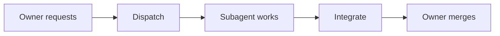

[← Scaffold at a glance](system-map.md)

# Orchestration

How one orchestrator turns owner requests into merged work by handing tasks to subagents in their own lanes.



- [Owner requests](#owner-requests): Only the owner creates tasks; the agent records the request in the queue.
- [Dispatch](#dispatch): On each loop tick, the orchestrator gives the top suited task to a free worker slot.
- [Subagent works](#subagent-works): The subagent builds its one task in its own worktree and commits locally.
- [Integrate](#integrate): The orchestrator merges the target into the lane, re-runs the gates and merges green work into the one working branch.
- [Owner merges](#owner-merges): The owner authorizes the merge; the task closes when the queue records it.

## Owner requests

Only the owner creates tasks; the agent records the request in the queue.

Goes deeper: [Queue task lifecycle](queue-lifecycle.md)

- The agent runs queue add --requested with the owner's words and an acceptance check.
- One shared record
  - queue.db holds typed tasks: status, owner, accept, evidence.
  - queue.md is the committed view; line order is priority.
  - Every worktree reads the same record.

**Where it breaks**

- An agent never adds its own tasks; its findings go to the owner instead.

## Dispatch

On each loop tick, the orchestrator gives the top suited task to a free worker slot.

Goes deeper: [One loop tick](loop-tick.md)

- It reads the slots from topology.json.
- It creates the worktree lane first, off the working branch's HEAD, then claims the task for that slot.
- Steering later
  - The orchestrator adds ORCH UPDATE notes to the task.
  - The subagent follows the newest one at its next checkpoint.

## Subagent works

The subagent builds its one task in its own worktree and commits locally.

Goes deeper: [Feature chain](feature-chain.md)

- It starts with an ff-only check that it is on the working branch's HEAD.
- A chore is built directly; a feature runs design, PRD, plan, TDD, refine.
- It validates, commits, records evidence and never pushes.

**Where it breaks**

- A subagent that skips its checkpoints misses the orchestrator's steering.

## Integrate

The orchestrator merges the target into the lane, re-runs the gates and merges green work into the one working branch.

Goes deeper: [Review gates](review-gates.md)

- Red gates send the work back to the lane.
- Then it opens a PR with Critical changes and real check results.

**Where it breaks**

- There is exactly one working branch per session; two long-lived branches split the work.

## Owner merges

The owner authorizes the merge; the task closes when the queue records it.

Goes deeper: [PR workflow](pr-workflow.md)

- The PR lands on main as one squash commit.
- queue advance --pr --branch records the merge and the fresh branch.

<details>
<summary>Detailed flow</summary>


</details>

## Glossary

- **Worktree**: An isolated git checkout per worker, so workers never collide.
- **Slot**: A worker seat (a model plus a tool) that the orchestrator hands tasks to; its id names the task owner.
- **ff-only**: Fast-forward only: the worker proves it starts from the working branch's HEAD, or stops.
- **ORCH UPDATE**: The orchestrator's steering note on a running worker's task.

## Ask your LLM

Copy this block into your own assistant to ask about anything on this page.

```text
The reader wants to understand how scaffold's orchestrator splits work across subagents and lands it on main.

Orchestration: How one orchestrator turns owner requests into merged work by handing tasks to subagents in their own lanes.
- Owner requests: Only the owner creates tasks; the agent records the request in the queue.
- Dispatch: On each loop tick, the orchestrator gives the top suited task to a free worker slot.
- Subagent works: The subagent builds its one task in its own worktree and commits locally.
- Integrate: The orchestrator merges the target into the lane, re-runs the gates and merges green work into the one working branch.
- Owner merges: The owner authorizes the merge; the task closes when the queue records it.

Questions worth asking:
- Why can't the orchestrator merge to main on its own?
```
