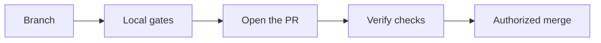

[← Scaffold at a glance](system-map.md)

# PR workflow

How one task becomes one merged PR: local gates first, real checks on GitHub, and a merge only the owner authorizes.



- [Branch](#branch): Pull the latest main and cut a fresh branch for one independent task.
- [Local gates](#local-gates): Run the integration tests and make ci before opening anything.
- [Open the PR](#open-the-pr): /create-pr opens the PR with a structured body and starts watching its checks.
- [Verify checks](#verify-checks): Read the actual check conclusions on the final head, not the merge button.
- [Authorized merge](#authorized-merge): With the owner's explicit authorization, the orchestrator squash-merges it onto main as one commit.

## Branch

Pull the latest main and cut a fresh branch for one independent task.

- One task per PR and merge cycle.

## Local gates

Run the integration tests and make ci before opening anything.

Details: [/create-pr skill](../../../skills/create-pr.md)

- Start from a clean tree with commits ahead of main.
- When a gate fails
  - Auto-correct up to 2 rounds.
  - Still red: failing integration tests stop with no PR; a red make ci opens the PR as a DRAFT listing the red gates.
- Then bump the version and push.

## Open the PR

/create-pr opens the PR with a structured body and starts watching its checks.

Details: [Review gates](review-gates.md)

- /simplify must score every changed file 10/10 before the PR opens.
- The body has a Summary, Critical changes, gate status and Quality Scores.
- Subscribe to the PR, or run gh pr checks --watch.

## Verify checks

Read the actual check conclusions on the final head, not the merge button.

Details: [Session continuity](session-continuity.md)

- First remove the handoff file, push, and run check-handoff --pre-merge, so the final CI run judges the cleared head.
- Capture the watch command's own exit code.
- The Security scan check must pass.

**Where it breaks**

- GitHub counts a skipped required check as passing; treat a skip as suspect.

## Authorized merge

With the owner's explicit authorization, the orchestrator squash-merges it onto main as one commit.

- A PR is not approval.
- The squash merge uses --match-head-commit, so only the commit whose checks were read can land.
- Confirm the PR is MERGED, pull main, and cut a fresh branch before the next task.

## Detailed flow


## Glossary

- **make ci**: The local pre-merge gate: unit and heavy integration checks.
- **Critical changes**: Up to five path:line notes of what changed and what depends on it.
- **Squash merge**: One PR lands as one commit on main.

## Ask your LLM

Copy this block into your own assistant to ask about anything on this page.

```text
The reader wants to understand how scaffold's agents take a task from branch to a merged PR safely.

PR workflow: How one task becomes one merged PR: local gates first, real checks on GitHub, and a merge only the owner authorizes.
- Branch: Pull the latest main and cut a fresh branch for one independent task.
- Local gates: Run the integration tests and make ci before opening anything.
- Open the PR: /create-pr opens the PR with a structured body and starts watching its checks.
- Verify checks: Read the actual check conclusions on the final head, not the merge button.
- Authorized merge: With the owner's explicit authorization, the orchestrator squash-merges it onto main as one commit.

Questions worth asking:
- Why isn't a green merge button enough?

Scaffold: https://github.com/victusfate/scaffold
This page: https://github.com/victusfate/scaffold/blob/main/docs/diagrams/pages/pr-workflow.md
```
