[← Scaffold at a glance](system-map.md)

# QA

How /qa runs the real app, uses the changed parts the way a user would, and fixes what breaks.


- [Set up](#set-up): Pick the surfaces the diff touches and start the app as the repo documents it.
- [Probe](#probe): Run each entry point like a user, including bad input, and capture evidence.
- [Triage](#triage): Sort issues by severity and pick the ones the fix tier covers.
- [Fix loop](#fix-loop): Fix each issue at its root cause with a failing regression test first, then re-run the probe.
- [Final pass](#final-pass): Re-run every probe near a fix, plus the happy path on each surface.
- [QA report](#qa-report): A table of issues with status and commit, plus one summary line for the PR.

## Set up

Pick the surfaces the diff touches and start the app as the repo documents it.

- The working tree must be clean, so each fix can be its own commit.
- Skipped, with a one-line reason, when the change has no runtime entry point.
- Surfaces
  - Browser pages, API endpoints, CLI commands, background jobs.
- Readiness is polled, never waited on with a fixed sleep.
- Only seeded or synthetic data; never production.

## Probe

Run each entry point like a user, including bad input, and capture evidence.

- Each issue gets an ID (QA-001), a severity, exact repro steps, and expected versus actual.

**Where it breaks**

- A surface that could not be reached is marked blocked, never counted as passed.

## Triage

Sort issues by severity and pick the ones the fix tier covers.

- Issues below the tier, in third-party code, or needing infrastructure changes are deferred.
- With --report-only, it stops here and writes the report.

**Fix tiers**

| Tier | Fixes |
|---|---|
| quick | critical, high |
| standard (default) | critical, high, medium |
| exhaustive | all, including low and cosmetic |

## Fix loop

Fix each issue at its root cause with a failing regression test first, then re-run the probe.

Details: [Investigate](investigate.md)

- Each verified fix is committed with its test as fix(qa): QA-NNN.
- A CSS-only defect may use a before/after screenshot instead of a test.

**Where it breaks**

- It stops and reports after two reverts, an edit to an unrelated file, 30 fixes, or when fixes keep spreading across many files.

## Final pass

Re-run every probe near a fix, plus the happy path on each surface.

- Any regression is reported first.

## QA report

A table of issues with status and commit, plus one summary line for the PR.

- Deferred and blocked items are listed with reasons.
- Inside the feature chain it writes qa-report.md; standalone it prints in chat.

<details>
<summary>Detailed flow</summary>



</details>

## Glossary

- **Surface**: A way users reach the app: page, API, command or job.
- **Blocked**: Could not be reached; never counted as passed.
- **Regression test**: An automated test that catches the bug if it comes back.

## Ask your LLM

Copy this block into your own assistant to ask about anything on this page.

```text
The reader wants to understand how scaffold's /qa skill checks that a change really works for a user.

QA: How /qa runs the real app, uses the changed parts the way a user would, and fixes what breaks.
- Set up: Pick the surfaces the diff touches and start the app as the repo documents it.
- Probe: Run each entry point like a user, including bad input, and capture evidence.
- Triage: Sort issues by severity and pick the ones the fix tier covers.
- Fix loop: Fix each issue at its root cause with a failing regression test first, then re-run the probe.
- Final pass: Re-run every probe near a fix, plus the happy path on each surface.
- QA report: A table of issues with status and commit, plus one summary line for the PR.

Questions worth asking:
- Why does a QA fix need a failing regression test before the fix?
```
