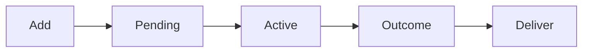

# Queue task lifecycle

The states a queue task passes through, from the owner's request to a merged PR.



- [Add](#add): The owner asks for work and the agent records it with the owner's words.
- [Pending](#pending): The task waits its turn; the top eligible line runs first.
- [Active](#active): A worker or slot claims the task and a lease clock starts.
- [Outcome](#outcome): The task's validate command decides done, retry or failed.
- [Deliver](#deliver): In per-task mode, the task's PR must merge before the queue moves on.

## Add

The owner asks for work and the agent records it with the owner's words.

Goes deeper: [../../../skills/queue.md](../../../skills/queue.md)

- queue add --requested stores the owner's words with a title, an accept note and a validate command.
- queue.db is the store; queue.md is its committed, readable view, re-rendered on each change.

## Pending

The task waits its turn; the top eligible line runs first.

- Three kinds of waiting
  - Eligible: its deps are done and it is not held.
  - Waiting: a dep or gate is unfinished.
  - Held: parked; the drain skips it until unheld.

## Active

A worker or slot claims the task and a lease clock starts.

Goes deeper: [loop-tick.md](loop-tick.md)

- A tick or claim --worker sets the task's owner to the worker or slot.
- release, or park --resume, returns it to pending.

**Where it breaks**

- The lease is the age of the claim, not a process id; tick never reclaims an expired lease, it stops and reports.

## Outcome

The task's validate command decides done, retry or failed.

- A failure below maxFailures goes back to pending for a retry.
- At maxFailures it is marked failed and stays visible; requeue revives it.
- A done task auto-archives to archive.md, but stays while unfinished work depends on it.

**Task markers in queue.md**

| Marker | Meaning |
|---|---|
| [ ] | pending |
| [~] | parked with a resume note |
| [x] | done |
| [!] | failed |

## Deliver

In per-task mode, the task's PR must merge before the queue moves on.

Goes deeper: [pr-workflow.md](pr-workflow.md)

- PR, real checks, and the owner approves the merge.
- Then a fresh branch and queue advance --pr --branch.

**Where it breaks**

- tick exits 7 until the task is advanced; that means delivery is pending, not that the queue drained.

<details>
<summary>Detailed flow</summary>


</details>

## Glossary

- **Lease**: How long a claim has been held; not a process id.
- **Gate**: A task every other task depends on, used to block work temporarily.
- **maxFailures**: The retry cap before a task fails for good.
- **advance**: Records the merged PR and the fresh branch so the queue moves on.

## Ask your LLM

Copy this block into your own assistant to ask about anything on this page.

```text
The reader wants to understand how a task moves through scaffold's work queue, from request to merged PR.

Queue task lifecycle: The states a queue task passes through, from the owner's request to a merged PR.
- Add: The owner asks for work and the agent records it with the owner's words.
- Pending: The task waits its turn; the top eligible line runs first.
- Active: A worker or slot claims the task and a lease clock starts.
- Outcome: The task's validate command decides done, retry or failed.
- Deliver: In per-task mode, the task's PR must merge before the queue moves on.

Questions worth asking:
- Why does a done task still hold up the queue until its PR merges?
```
