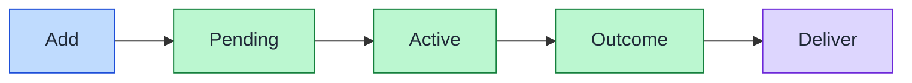

[← Scaffold at a glance](system-map.md)

# Queue task lifecycle

The states a queue task passes through, from the owner's request to a merged PR.



- [Add](#add): The owner asks for work and the agent records it with the owner's words.
- [Pending](#pending): The task waits its turn; the top eligible line runs first.
- [Active](#active): A worker or slot claims the task and a lease clock starts.
- [Outcome](#outcome): Running validate on done, or an explicit fail, decides done, retry or failed.
- [Deliver](#deliver): In per-task mode, the task's PR must merge before the queue moves on.

## Add

The owner asks for work and the agent records it with the owner's words.

Details: [/queue skill](../../../skills/queue.md)

- queue add --requested stores the owner's words with a title, an accept note and a validate command.
- queue.db is the store; queue.md is its committed, readable view, re-rendered on each change.

## Pending

The task waits its turn; the top eligible line runs first.

- Three kinds of waiting
  - Eligible: its deps are done and it is not held.
  - Waiting: a dep or gate is unfinished.
  - Held: set aside; the drain skips it until unheld.

## Active

A worker or slot claims the task and a lease clock starts.

Details: [One loop tick](loop-tick.md)

- A tick or claim --worker sets the task's owner to the worker or slot.
- release, or park --resume, returns it to pending.

**Where it breaks**

- The lease is the age of the claim, not a process id; tick never reclaims an expired lease, it stops and reports.

## Outcome

Running validate on done, or an explicit fail, decides done, retry or failed.

- A failure below maxFailures goes back to pending for a retry.
- At maxFailures it is marked failed and stays visible; requeue revives it.
- A done task auto-archives to archive.md, but stays while unfinished work depends on it.

**Task markers in queue.md**

| Marker | Meaning |
|---|---|
| [ ] | pending |
| [>] | active (claimed) |
| [~] | parked with a resume note |
| [x] | done |
| [!] | failed |

## Deliver

In per-task mode, the task's PR must merge before the queue moves on.

Details: [PR workflow](pr-workflow.md)

- PR, real checks, and the owner approves the merge.
- Then a fresh branch and queue advance --pr --branch.

**Where it breaks**

- tick exits 7 until the task is advanced; that means delivery is pending, not that the queue drained.

## Detailed flow


## Code walkthrough

This flow is almost entirely code. scripts/queue.ts is the CLI, scripts/queue-model.ts holds the state changes as pure functions, scripts/queue-io.ts stores them in queue.db and re-renders queue.md, and queue-task-origin.ts, queue-claim.ts and queue-delivery.ts carry the add, claim and advance commands. The only part left to the agent is the delivery itself: opening the PR, reading checks and merging, which `queue advance` records but does not verify.

Each excerpt is read from the repo when this page is built. The explanations were written by an agent; `npm test` fails when the lines they explain change.

### Add: code

#### queue add: record one task

*Carries out the step.* The title is the joined positional words; an empty title prints usage and exits 1. taskOrigin decides whether the add is allowed, and a refusal exits 2. addTask appends the task (or puts it first with --top) with the flags and origin tags merged in. save writes the store, the log gets an 'add' line, and the new id is printed with a drain hint.

```ts
    case 'add': {
      const title = f.positionals.join(' ').trim();
      if (!title) { console.error('usage: queue add "<title>" [--parent <id> | --requested "<human words>"] [flags]'); return 1; }
      const origin = taskOrigin(q, f);
      if (!origin.ok) { console.error(origin.error); return 2; }
      q = addTask(q, title, { top: f.bools.has('top'), ...withOrigin(taskOverrides(f), origin.patch) });
      save(q); log(`add ${title}`);
      const t = q.tasks[f.bools.has('top') ? 0 : q.tasks.length - 1];
      console.log(`added ${t.id}${t.mode === 'chain' ? ' (chain)' : ''} — ${title}${drainKick(q)}`); return 0;
    }
```

[`scripts/queue.ts:322-331`](https://github.com/victusfate/scaffold/blob/main/scripts/queue.ts#L322-L331)

**Why it matters.** This is the entry point of the flow: the owner's request becomes a typed task with an id. Skipping it leaves the request only in chat, where no later step can find it.

**Methods and helpers used here**

<details>
<summary><code>save</code> · function · scripts/queue-io.ts:296</summary>

Takes a queue and, under the queue lock, writes it to the SQLite store and rewrites the queue.md view in one transaction; lane files of tasks that ended or were removed are deleted after the commit. Throws a QueueIntegrityError and saves nothing if queue.md was edited since the store last rendered it, and throws if the lock stays held for 60 seconds.

Comment in the source: Persist `q` to the store, then re-render the view — one transaction.

```ts
export function save(q: Queue): void {
  withLock(() => openStore((db, defer) => renderView(db, defer, persistQueue(db, defer, q))));
}
```

[`scripts/queue-io.ts:296-298`](https://github.com/victusfate/scaffold/blob/main/scripts/queue-io.ts#L296-L298)

</details>

<details>
<summary><code>log</code> · function · scripts/queue-io.ts:377</summary>

Appends one line, '- &lt;ISO timestamp&gt; &lt;message&gt;', to log.md beside the queue file. Returns nothing.

```ts
export function log(msg: string): void {
  appendFileSync(sidecar('log.md'), `- ${now()} ${msg}\n`);
}
```

[`scripts/queue-io.ts:377-379`](https://github.com/victusfate/scaffold/blob/main/scripts/queue-io.ts#L377-L379)

</details>

<details>
<summary><code>drainKick</code> · function · scripts/queue-gates.ts:60</summary>

Takes a queue and returns a string to append to command output: a newline, the DRAIN-WANTED marker with the count of eligible tasks, and a hint to run tick, when the queue is running, has no active task and has at least one eligible task. Returns an empty string otherwise.

Comment in the source: Emit the stable DRAIN-WANTED marker (plus a human hint) when a mutation leaves a running queue drainable with no driver attached. This is a machine signal — a Monitor on the queue file, a cron, or an agent keys on `queue: DRAIN-WANTED` to (re)start the drain — not just prose a human has to be watching to notice. Empty string when a driver is already active, nothing is eligible, or the queue is stopped/paused (an operator halt is not a stalled drain).

```ts
export function drainKick(q: Queue): string {
  const sig = drainSignal(q);
  return sig ? `\n${sig}  → start now: \`node scripts/queue.ts tick\` (or the loop)` : '';
}
```

[`scripts/queue-gates.ts:60-63`](https://github.com/victusfate/scaffold/blob/main/scripts/queue-gates.ts#L60-L63)

</details>

<details>
<summary><code>addTask</code> · function · scripts/queue-model.ts:451</summary>

Takes a queue, a title and optional field overrides plus a `top` flag, and returns a new queue with one new pending task added at the end, or at the front when `top` is set. The task gets the next task-NNN id, the title is trimmed, and the config's nextId counter is advanced. The input queue is not modified and nothing is saved.

```ts
export function addTask(q: Queue, title: string, opts: { top?: boolean } & Partial<Task> = {}): Queue {
  const { top, ...over } = opts;
  const n = nextIdNum(q);
  const task: Task = { ...newTask(fmtId(n), title.trim()), ...over };
  const config = { ...q.config, nextId: n + 1 };
  return { config, tasks: top ? [task, ...q.tasks] : [...q.tasks, task] };
}
```

[`scripts/queue-model.ts:451-457`](https://github.com/victusfate/scaffold/blob/main/scripts/queue-model.ts#L451-L457)

</details>

<details>
<summary><code>taskOverrides</code> · function · scripts/queue-cli-args.ts:28</summary>

Takes parsed CLI arguments and returns a partial Task built from every editable task field that was given as a flag, each value coerced by fieldPatch. Fields not given are left out.

```ts
export function taskOverrides(flags: Parsed): Partial<Task> {
  const overrides: Partial<Task> = {};
  for (const key of EDITABLE_TASK_FIELDS) {
    if (flags.flags.has(key)) Object.assign(overrides, fieldPatch(key, flags.flags.get(key) ?? ''));
  }
  return overrides;
}
```

[`scripts/queue-cli-args.ts:28-34`](https://github.com/victusfate/scaffold/blob/main/scripts/queue-cli-args.ts#L28-L34)

</details>

<details>
<summary><code>taskOrigin</code> · function · scripts/queue-task-origin.ts:25</summary>

Takes the queue, the parsed add arguments and an environment, and decides whether the add is allowed. It returns an error result when --parent names a task not in the queue, or when neither --parent nor --requested is given and the environment marks an agent session. Otherwise it returns ok with the tags and note for the given parent and request, or an empty patch for a human with no flags.

Comment in the source: Resolve where a new task comes from. Humans need no flags. An agent must name an existing parent task or quote the human's request; either is recorded on the task (a `parent:<id>` or `requested-by:human` tag plus a note) so reviewers can trace every task to its human owner.

```ts
export function taskOrigin(q: Queue, f: Parsed, env: NodeJS.ProcessEnv = process.env): Origin {
  const parent = flagValue(f, 'parent');
  const requested = flagValue(f, 'requested');
  if (parent && !q.tasks.some(t => t.id === parent)) return { ok: false, error: `queue add: --parent ${parent} is not a task in this queue` };
  if (!parent && !requested) return isAgentSession(env) ? { ok: false, error: AGENT_ADD_REFUSAL } : { ok: true, patch: {} };
  return { ok: true, patch: originPatch(parent, requested) };
}
```

[`scripts/queue-task-origin.ts:25-31`](https://github.com/victusfate/scaffold/blob/main/scripts/queue-task-origin.ts#L25-L31)

</details>

<details>
<summary><code>withOrigin</code> · function · scripts/queue-task-origin.ts:49</summary>

Takes the task fields built from the command's own flags and an origin patch, and returns the fields with the origin tags placed first (duplicates removed) and the origin note placed before any --note text. If the origin patch has no tags, the fields are returned unchanged.

Comment in the source: Merge an origin patch with the task's own flags: tags are combined, an explicit --note is kept after the origin note.

```ts
export function withOrigin(overrides: Partial<Task>, origin: Partial<Task>): Partial<Task> {
  if (!origin.tags) return overrides;
  return {
    ...overrides,
    tags: [...origin.tags, ...(overrides.tags ?? []).filter(t => !origin.tags!.includes(t))],
    note: overrides.note ? `${origin.note} ${overrides.note}` : origin.note,
  };
}
```

[`scripts/queue-task-origin.ts:49-56`](https://github.com/victusfate/scaffold/blob/main/scripts/queue-task-origin.ts#L49-L56)

</details>

#### taskOrigin: refuse an agent's add without the owner's words

*Enforces the rule.* It reads the --parent and --requested flags. An unknown parent id is an error. With neither flag, it checks the environment for agent markers such as CLAUDECODE or CODEX_THREAD_ID: an agent session is refused with the AGENT_ADD_REFUSAL message, a human passes. Otherwise it returns tags and a note that record the parent or the quoted request on the task.

```ts
/**
 * Resolve where a new task comes from. Humans need no flags. An agent must name an existing parent
 * task or quote the human's request; either is recorded on the task (a `parent:<id>` or
 * `requested-by:human` tag plus a note) so reviewers can trace every task to its human owner.
 */
export function taskOrigin(q: Queue, f: Parsed, env: NodeJS.ProcessEnv = process.env): Origin {
  const parent = flagValue(f, 'parent');
  const requested = flagValue(f, 'requested');
  if (parent && !q.tasks.some(t => t.id === parent)) return { ok: false, error: `queue add: --parent ${parent} is not a task in this queue` };
  if (!parent && !requested) return isAgentSession(env) ? { ok: false, error: AGENT_ADD_REFUSAL } : { ok: true, patch: {} };
  return { ok: true, patch: originPatch(parent, requested) };
}

const AGENT_ADD_REFUSAL = 'queue add: tasks are human-owned. From an agent session, add a task only when a human asked for it: '
  + 'pass --requested "<the human\'s own words>" (add --parent <task-id> to record lineage). '
  + 'Record findings on the existing task (note, checkpoint, evidence) and ask the human before adding new work.';
```

[`scripts/queue-task-origin.ts:20-35`](https://github.com/victusfate/scaffold/blob/main/scripts/queue-task-origin.ts#L20-L35)

**Why it matters.** This is the check behind 'only the owner creates tasks'. Without it an agent could grow the backlog with its own ideas. The comment at the top of the file notes the quote is not authenticated, so this is a guardrail, not proof.

**Methods and helpers used here**

<details>
<summary><code>isAgentSession</code> · function · scripts/queue-task-origin.ts:14</summary>

Takes an environment (default process.env) and returns true when any agent marker variable is set to a non-empty value: CLAUDECODE, CODEX_THREAD_ID, CODEX_SANDBOX, CODEX_CI, GEMINI_CLI, AI_AGENT, LANE_RUN_ID or SCAFFOLD_AGENT.

```ts
export function isAgentSession(env: NodeJS.ProcessEnv = process.env): boolean {
  return AGENT_ENV_MARKERS.some(key => Boolean(env[key]));
}
```

[`scripts/queue-task-origin.ts:14-16`](https://github.com/victusfate/scaffold/blob/main/scripts/queue-task-origin.ts#L14-L16)

</details>

<details>
<summary><code>Origin</code> · type · scripts/queue-task-origin.ts:18</summary>

The result of checking where a new task comes from: either { ok: true, patch } with the tags and note to put on the task, or { ok: false, error } with the message to print. taskOrigin returns it and the add commands branch on `ok`.

```ts
export type Origin = { ok: true; patch: Partial<Task> } | { ok: false; error: string };
```

[`scripts/queue-task-origin.ts:18`](https://github.com/victusfate/scaffold/blob/main/scripts/queue-task-origin.ts#L18)

</details>

<details>
<summary><code>originPatch</code> · function · scripts/queue-task-origin.ts:38</summary>

Takes a parent task id and a requested quote (either may be empty) and returns the tags and note that record them on a new task: a `parent:<id>` tag and 'Child of &lt;id&gt;.' for a parent, a `requested-by:human` tag and the quoted request for a quote. With both empty it returns an empty tag list and an empty note.

Comment in the source: Tags and note recording where a task came from; both origins are kept when both are given.

```ts
function originPatch(parent: string, requested: string): Partial<Task> {
  const tags = [...(parent ? [`parent:${parent}`] : []), ...(requested ? ['requested-by:human'] : [])];
  const note = [parent && `Child of ${parent}.`, requested && `Requested by a human: "${requested}"`].filter(Boolean).join(' ');
  return { tags, note };
}
```

[`scripts/queue-task-origin.ts:38-42`](https://github.com/victusfate/scaffold/blob/main/scripts/queue-task-origin.ts#L38-L42)

</details>

<details>
<summary><code>flagValue</code> · function · scripts/queue-task-origin.ts:44</summary>

Takes parsed command-line arguments and a flag name and returns that flag's value with surrounding whitespace removed, or an empty string when the flag was not given.

```ts
function flagValue(f: Parsed, key: string): string {
  return f.flags.get(key)?.trim() ?? '';
}
```

[`scripts/queue-task-origin.ts:44-46`](https://github.com/victusfate/scaffold/blob/main/scripts/queue-task-origin.ts#L44-L46)

</details>

<details>
<summary><code>Parsed</code> · interface · scripts/queue-cli-args.ts:4</summary>

The result of parsing queue CLI arguments: positionals in order, a map of value flags to their values, and the set of flags given without a value.

```ts
export interface Parsed { positionals: string[]; flags: Map<string, string>; bools: Set<string>; }
```

[`scripts/queue-cli-args.ts:4`](https://github.com/victusfate/scaffold/blob/main/scripts/queue-cli-args.ts#L4)

</details>

<details>
<summary><code>Queue</code> · interface · scripts/queue-model.ts:121</summary>

The whole work queue in memory: a config object (run status, intervals, failure and lease limits, parallelism, delivery state, the next id counter) plus the ordered list of tasks, where list order is priority. It is what load returns, what save persists, and what every queue operation takes and returns.

```ts
export interface Queue {
  config: QueueConfig;
  tasks: Task[];
}
```

[`scripts/queue-model.ts:121-124`](https://github.com/victusfate/scaffold/blob/main/scripts/queue-model.ts#L121-L124)

</details>

#### renderView: rewrite queue.md from the store on every save

*Carries out the step.* Unless told to discard edits, it first checks that queue.md was not hand-edited since the last render. It serializes the queue to Markdown and records the text's sha256 in the store. After the transaction commits it writes a temp file and renames it over queue.md.

```ts
/**
 * Record the view `q` (the store's contents) renders to, and write it once the
 * transaction commits: via a temp file + rename, so a reader never sees half a file.
 */
function renderView(db: DatabaseSync, defer: Defer, q: Queue, { discardEdits = false } = {}): void {
  const p = resolve(queueFile());
  if (!discardEdits) assertViewUnedited(db, p);
  const md = serializeQueue(q);
  recordRender(db, p, sha256(md));
  defer(() => {
    mkdirSync(dirname(p), { recursive: true });
    const tmp = `${p}.${process.pid}.tmp`;
    writeFileSync(tmp, md);
    renameSync(tmp, p);
  });
}
```

[`scripts/queue-io.ts:215-230`](https://github.com/victusfate/scaffold/blob/main/scripts/queue-io.ts#L215-L230)

**Why it matters.** queue.db is the store and queue.md is its readable view; this keeps the two in step on each change. The rename means a reader never sees half a file, and the hash check stops a save from silently overwriting hand edits.

**Methods and helpers used here**

<details>
<summary><code>queueFile</code> · function · scripts/queue-io.ts:28</summary>

Returns the path of the rendered queue.md view: the QUEUE_FILE environment variable when set, otherwise queue.md in the main checkout's .agent/queue directory, which is shared by all linked worktrees.

Comment in the source: The rendered, human-readable view of the queue. Like the store it lives in the main checkout, so lane worktrees never rewrite (and later merge back) a copy. Sidecars (log, archive, lane heartbeats) sit beside it.

```ts
export function queueFile(): string { return process.env.QUEUE_FILE ?? join(sharedQueueDir(), 'queue.md'); }
```

[`scripts/queue-io.ts:28`](https://github.com/victusfate/scaffold/blob/main/scripts/queue-io.ts#L28)

</details>

<details>
<summary><code>sha256</code> · const · scripts/queue-io.ts:198</summary>

Takes a string and returns its SHA-256 digest as a hex string.

```ts
const sha256 = (text: string): string => createHash('sha256').update(text).digest('hex');
```

[`scripts/queue-io.ts:198`](https://github.com/victusfate/scaffold/blob/main/scripts/queue-io.ts#L198)

</details>

<details>
<summary><code>assertViewUnedited</code> · function · scripts/queue-io.ts:205</summary>

Throws a QueueIntegrityError when the view file at the given path exists and its SHA-256 differs from the hash the store last recorded for it. Does nothing when the store never rendered that path, the file is missing, or the hashes match.

Comment in the source: Refuse to overwrite a view someone edited since the store last rendered it: those edits (a hand reorder, a git merge) exist nowhere else. A path the store never rendered (e.g. a fresh checkout's git copy) is fair to replace.

```ts
function assertViewUnedited(db: DatabaseSync, path: string): void {
  const recorded = renderedHash(db, path);
  if (recorded === null || !existsSync(path) || sha256(readFileSync(path, 'utf8')) === recorded) return;
  throw new QueueIntegrityError(`queue: ${path} changed since the store last rendered it, `
    + 'so it was not overwritten and nothing was saved. Preview what the file would change with '
    + '`node scripts/queue.ts import --dry-run`. If you edited it, apply the edits with `import`. '
    + 'If git swapped in another copy (checkout, pull, merge, stash), `node scripts/queue.ts render` '
    + 'rewrites it from the store.');
}
```

[`scripts/queue-io.ts:205-213`](https://github.com/victusfate/scaffold/blob/main/scripts/queue-io.ts#L205-L213)

</details>

<details>
<summary><code>Queue</code> · interface · scripts/queue-model.ts:121</summary>

The whole work queue in memory: a config object (run status, intervals, failure and lease limits, parallelism, delivery state, the next id counter) plus the ordered list of tasks, where list order is priority. It is what load returns, what save persists, and what every queue operation takes and returns.

```ts
export interface Queue {
  config: QueueConfig;
  tasks: Task[];
}
```

[`scripts/queue-model.ts:121-124`](https://github.com/victusfate/scaffold/blob/main/scripts/queue-model.ts#L121-L124)

</details>

<details>
<summary><code>serializeQueue</code> · function · scripts/queue-model.ts:412</summary>

Takes a queue and returns the Markdown text of the queue file: the title, the config comment block, the header lines, then one checkbox line per task followed by its non-empty fields. Tasks without an id are given new task-NNN ids in the output, and the nextId written covers them. It writes no file and does not modify the queue.

Comment in the source: Render the model back to the canonical Markdown file.

```ts
export function serializeQueue(q: Queue): string {
  const c = q.config;
  const { tasks, nextId } = assignIds(q);
  const lines = [
    '# Work Queue', '',
    '<!-- queue:config',
    `status: ${c.status}`,
    `interval: ${c.interval}`,
    `maxFailures: ${c.maxFailures}`,
    `leaseMinutes: ${c.leaseMinutes}`,
    `maxParallel: ${c.maxParallel}`,
    `integrationBranch: ${c.integrationBranch}`,
    `deliveryMode: ${c.deliveryMode}`,
    `deliveryTask: ${c.deliveryTask}`,
    `deliveryAccepted: ${c.deliveryAccepted}`,
    `resumeAt: ${c.resumeAt}`,
    `idlePoll: ${c.idlePoll}`,
    `pausePoll: ${c.pausePoll}`,
    `nextId: ${nextId}`,
    '-->', '',
    ...HEADER, '',
  ];
  for (const t of tasks) {
    lines.push(`- [${markOf(t)}] ${t.id} — ${t.title}`, ...fieldLines(t));
```

[`scripts/queue-model.ts:412-435`](https://github.com/victusfate/scaffold/blob/main/scripts/queue-model.ts#L412-L435) (first 24 lines shown)

</details>

<details>
<summary><code>Defer</code> · type · scripts/queue-db.ts:79</summary>

The type of the function withStore passes to its callback for queuing a side effect. Queued effects run in order only after the transaction commits, and are dropped if it rolls back.

Comment in the source: Queue a side effect (file write, log line) to run only once the transaction commits.

```ts
export type Defer = (effect: () => void) => void;
```

[`scripts/queue-db.ts:79`](https://github.com/victusfate/scaffold/blob/main/scripts/queue-db.ts#L79)

</details>

<details>
<summary><code>recordRender</code> · function · scripts/queue-db.ts:138</summary>

Takes an open database, a view path and a SHA-256 string, and inserts or updates the views table row for that path with that hash. It runs inside the caller's transaction and returns nothing.

```ts
export function recordRender(db: DatabaseSync, path: string, sha256: string): void {
  db.prepare('INSERT INTO views (path, sha256) VALUES (?, ?) '
    + 'ON CONFLICT (path) DO UPDATE SET sha256 = excluded.sha256').run(path, sha256);
}
```

[`scripts/queue-db.ts:138-141`](https://github.com/victusfate/scaffold/blob/main/scripts/queue-db.ts#L138-L141)

</details>

### Pending: code

#### isEligible and deadlocked: the kinds of waiting

*Carries out the step.* isEligible is true for a pending task that is not held, is allowed by the delivery gate, and whose every dependency is done. deadlocked lists pending tasks with a dependency that failed, which can never become eligible on their own.

```ts
/** A pending task is eligible only when it isn't held and every dependency is done. */
export function isEligible(task: Task, q: Queue): boolean {
  return task.status === 'pending' && !task.held && deliveryAllows(q, task.id)
    && task.dependsOn.every(d => q.tasks.find(x => x.id === d)?.status === 'done');
}

/** Pending tasks blocked by a dependency that failed (can never become eligible). */
export function deadlocked(q: Queue): Task[] {
  return q.tasks.filter(t => t.status === 'pending'
    && t.dependsOn.some(d => q.tasks.find(x => x.id === d)?.status === 'failed'));
}
```

[`scripts/queue-model.ts:763-773`](https://github.com/victusfate/scaffold/blob/main/scripts/queue-model.ts#L763-L773)

**Why it matters.** These two predicates are the eligible, waiting and held states of a pending task. tick uses deadlocked to say why an idle queue is stuck.

**Methods and helpers used here**

<details>
<summary><code>Task</code> · interface · scripts/queue-model.ts:67</summary>

One queue task: its id, title, status (pending, active, done or failed), mode, architecture setting, held flag, banked elapsed seconds, slug, dependency ids, files, contracts, tags, validate command, acceptance text, note, failure count, and the claim fields owner, branch, worktree and startedAt. It is the record stored in the queue and passed to every task operation.

```ts
export interface Task {
  id: string;
  title: string;
  status: TaskStatus;
  mode: TaskMode;
  architecture: ArchitectureMode;
  held: boolean;
  /** Cumulative agent seconds banked across all work sessions on this task. */
  elapsedSecs: number;
  slug: string | null;
  dependsOn: string[];
  files: string[];
  /** Authoritative executable schemas, migrations and tests. References, never a prose classification. */
  contracts: string[];
  /** Free-form labels for grouping and filtering (`group:speed`, `owner-report`); `list --tag` filters on them. */
  tags: string[];
  validate: string | null;
  accept: string | null;
  note: string | null;
  failures: number;
  owner: string | null;
  branch: string | null;
  worktree: string | null;
  startedAt: string | null;
```

[`scripts/queue-model.ts:67-90`](https://github.com/victusfate/scaffold/blob/main/scripts/queue-model.ts#L67-L90) (first 24 lines shown)

</details>

<details>
<summary><code>Queue</code> · interface · scripts/queue-model.ts:121</summary>

The whole work queue in memory: a config object (run status, intervals, failure and lease limits, parallelism, delivery state, the next id counter) plus the ordered list of tasks, where list order is priority. It is what load returns, what save persists, and what every queue operation takes and returns.

```ts
export interface Queue {
  config: QueueConfig;
  tasks: Task[];
}
```

[`scripts/queue-model.ts:121-124`](https://github.com/victusfate/scaffold/blob/main/scripts/queue-model.ts#L121-L124)

</details>

<details>
<summary><code>deliveryAllows</code> · function · scripts/queue-model.ts:757</summary>

Takes a queue and a task id and returns whether that task may be worked on now. It is always true in batch delivery mode; otherwise it is true only when there is no recorded delivery task and no active task, or when the recorded delivery task (or, failing that, the first active task) is this id.

Comment in the source: Admission gate shared by selectors and explicit claim surfaces.

```ts
export function deliveryAllows(q: Queue, id: string): boolean {
  if (q.config.deliveryMode === 'batch') return true;
  const selected = q.config.deliveryTask || q.tasks.find(t => t.status === 'active')?.id;
  return !selected || selected === id;
}
```

[`scripts/queue-model.ts:757-761`](https://github.com/victusfate/scaffold/blob/main/scripts/queue-model.ts#L757-L761)

</details>

#### nextActionable: resume the active task, else the top eligible one

*Carries out the step.* A stopped queue returns null. Otherwise it returns the first active task the delivery gate allows; if there is none, the first eligible task in list order; else null.

```ts
/**
 * The single task a serial worker should act on now: resume an active task if one
 * exists, else the topmost eligible pending task. Null if stopped or drained.
 */
export function nextActionable(q: Queue): Task | null {
  if (q.config.status === 'stopped') return null;
  return q.tasks.find(t => t.status === 'active' && deliveryAllows(q, t.id))
    ?? q.tasks.find(t => isEligible(t, q))
    ?? null;
}
```

[`scripts/queue-model.ts:813-822`](https://github.com/victusfate/scaffold/blob/main/scripts/queue-model.ts#L813-L822)

**Why it matters.** Line order in the queue is the priority, and this is where that order is applied. An already active task is always resumed before anything new starts.

**Methods and helpers used here**

<details>
<summary><code>Task</code> · interface · scripts/queue-model.ts:67</summary>

One queue task: its id, title, status (pending, active, done or failed), mode, architecture setting, held flag, banked elapsed seconds, slug, dependency ids, files, contracts, tags, validate command, acceptance text, note, failure count, and the claim fields owner, branch, worktree and startedAt. It is the record stored in the queue and passed to every task operation.

```ts
export interface Task {
  id: string;
  title: string;
  status: TaskStatus;
  mode: TaskMode;
  architecture: ArchitectureMode;
  held: boolean;
  /** Cumulative agent seconds banked across all work sessions on this task. */
  elapsedSecs: number;
  slug: string | null;
  dependsOn: string[];
  files: string[];
  /** Authoritative executable schemas, migrations and tests. References, never a prose classification. */
  contracts: string[];
  /** Free-form labels for grouping and filtering (`group:speed`, `owner-report`); `list --tag` filters on them. */
  tags: string[];
  validate: string | null;
  accept: string | null;
  note: string | null;
  failures: number;
  owner: string | null;
  branch: string | null;
  worktree: string | null;
  startedAt: string | null;
```

[`scripts/queue-model.ts:67-90`](https://github.com/victusfate/scaffold/blob/main/scripts/queue-model.ts#L67-L90) (first 24 lines shown)

</details>

<details>
<summary><code>Queue</code> · interface · scripts/queue-model.ts:121</summary>

The whole work queue in memory: a config object (run status, intervals, failure and lease limits, parallelism, delivery state, the next id counter) plus the ordered list of tasks, where list order is priority. It is what load returns, what save persists, and what every queue operation takes and returns.

```ts
export interface Queue {
  config: QueueConfig;
  tasks: Task[];
}
```

[`scripts/queue-model.ts:121-124`](https://github.com/victusfate/scaffold/blob/main/scripts/queue-model.ts#L121-L124)

</details>

<details>
<summary><code>deliveryAllows</code> · function · scripts/queue-model.ts:757</summary>

Takes a queue and a task id and returns whether that task may be worked on now. It is always true in batch delivery mode; otherwise it is true only when there is no recorded delivery task and no active task, or when the recorded delivery task (or, failing that, the first active task) is this id.

Comment in the source: Admission gate shared by selectors and explicit claim surfaces.

```ts
export function deliveryAllows(q: Queue, id: string): boolean {
  if (q.config.deliveryMode === 'batch') return true;
  const selected = q.config.deliveryTask || q.tasks.find(t => t.status === 'active')?.id;
  return !selected || selected === id;
}
```

[`scripts/queue-model.ts:757-761`](https://github.com/victusfate/scaffold/blob/main/scripts/queue-model.ts#L757-L761)

</details>

<details>
<summary><code>isEligible</code> · function · scripts/queue-model.ts:764</summary>

Takes a task and its queue and returns true when the task is pending, not held, permitted by the current delivery cycle, and every dependency id resolves to a task in the queue whose status is done. A dependency that is missing from the queue makes it false.

Comment in the source: A pending task is eligible only when it isn't held and every dependency is done.

```ts
export function isEligible(task: Task, q: Queue): boolean {
  return task.status === 'pending' && !task.held && deliveryAllows(q, task.id)
    && task.dependsOn.every(d => q.tasks.find(x => x.id === d)?.status === 'done');
}
```

[`scripts/queue-model.ts:764-767`](https://github.com/victusfate/scaffold/blob/main/scripts/queue-model.ts#L764-L767)

</details>

### Active: code

#### queue tick: start the next task and print it

*Carries out the step.* It runs dispatchGate and returns its exit code if blocked. It asks nextActionable for a task; with none it prints IDLE (naming tasks stuck behind a failed dependency) and exits 3. A pending task is begun, the delivery task is latched, the queue is saved, and the task block is printed with the done/fail commands. Exit 0.

```ts
function cmdTick(q: Queue): number {
  const gate = dispatchGate(q);
  if (gate.blocked !== null) return gate.blocked;
  q = gate.queue;
  const t = nextActionable(q);
  if (!t) {
    const stuck = deadlocked(q);
    console.log(stuck.length
      ? `queue: IDLE — ${stuck.length} task(s) blocked by a failed dependency: ${stuck.map(x => x.id).join(', ')}`
      : 'queue: IDLE — no eligible tasks');
    save(q);
    return EXIT.IDLE;
  }
  if (t.status === 'pending') { q = beginTask(q, t.id, now(), t.owner); log(`begin ${t.id}`); }
  q = selectDelivery(q, t.id);
  save(q);
  const current = q.tasks.find(x => x.id === t.id)!;
  console.log(`queue: working ${t.id}\n${taskBlock(current)}\n`
    + (q.config.deliveryMode === 'batch' ? 'Delivery: legacy batch.\n'
      : 'Delivery: per-task; root must complete the PR/merge cycle before advance.\n')
    + `When finished: node scripts/queue.ts done ${t.id}  (or fail ${t.id} "<reason>")`);
  return EXIT.DISPATCHED;
}
```

[`scripts/queue.ts:127-149`](https://github.com/victusfate/scaffold/blob/main/scripts/queue.ts#L127-L149)

**Why it matters.** This is the serial loop's entry: one call moves the top task from pending to active. The exit codes let a driver tell 'work started' from idle, paused, stopped, conflict and delivery pending without parsing text.

**Methods and helpers used here**

<details>
<summary><code>EXIT</code> · const · scripts/queue.ts:78</summary>

The exit codes the queue's loop commands return so a driver can decide what to do next: DISPATCHED 0, IDLE 3, PAUSED 4 (usage window), STOPPED 5, CONFLICT 6 (expired lease still active) and DELIVERY 7 (a delivery cycle is pending).

Comment in the source: Exit codes for the loop entry points (tick, ready, signal) so a driver can branch its next cadence without parsing text: 0 = work dispatched/wanted → continue; 3 = idle → back off to a long fallback; 4 = paused for a usage window → slow-poll; 5 = stopped → halt; 6 = ownership conflict → stop and report. A bare `return 1` stays the usage/error code.

```ts
const EXIT = { DISPATCHED: 0, IDLE: 3, PAUSED: 4, STOPPED: 5, CONFLICT: 6, DELIVERY: 7 } as const;
```

[`scripts/queue.ts:78`](https://github.com/victusfate/scaffold/blob/main/scripts/queue.ts#L78)

</details>

<details>
<summary><code>dispatchGate</code> · function · scripts/queue.ts:103</summary>

Takes a queue and returns { queue, blocked }, where blocked is null when work may be dispatched or an exit code when it may not. It first resumes a usage pause whose time has passed, saving the queue and writing a log line. It then prints a message and blocks with PAUSED or STOPPED if the queue is stopped, CONFLICT if any active task's lease has expired, or DELIVERY if a per-task delivery is recorded and no task is actionable.

Comment in the source: Auto-resume a due usage pause, then report whether the queue is drainable. Returns a blocking EXIT code for pauses or ambiguous ownership, or null to proceed.

```ts
function dispatchGate(q: Queue): { queue: Queue; blocked: number | null } {
  const due = resumeIfDue(q, now());
  if (due.resumed) { q = due.queue; save(q); log('auto-resumed (usage window reopened)'); }
  if (q.config.status === 'stopped') {
    if (q.config.resumeAt) {
      console.log(`queue: PAUSED until ${q.config.resumeAt} (usage window) — auto-resumes after`);
      return { queue: q, blocked: EXIT.PAUSED };
    }
    console.log('queue: STOPPED — run `queue start` to resume');
    return { queue: q, blocked: EXIT.STOPPED };
  }
  const expired = staleLeases(q, now(), q.config.leaseMinutes);
  if (expired.length) {
    console.log(`queue: OWNERSHIP CONFLICT — expired lease(s) remain active: ${expired
      .map(t => t.id).join(', ')}. Do not reclaim or dispatch; resolve ownership explicitly.`);
    return { queue: q, blocked: EXIT.CONFLICT };
  }
  if (q.config.deliveryMode !== 'batch' && q.config.deliveryTask && !nextActionable(q)) {
    console.log(`queue: DELIVERY PENDING — ${q.config.deliveryTask}; finish its PR/merge cycle and fresh branch, then advance`);
    return { queue: q, blocked: EXIT.DELIVERY };
  }
  return { queue: q, blocked: null };
}
```

[`scripts/queue.ts:103-125`](https://github.com/victusfate/scaffold/blob/main/scripts/queue.ts#L103-L125)

</details>

<details>
<summary><code>now</code> · function · scripts/queue-io.ts:67</summary>

Returns the current time as an ISO 8601 string.

```ts
export function now(): string { return new Date().toISOString(); }
```

[`scripts/queue-io.ts:67`](https://github.com/victusfate/scaffold/blob/main/scripts/queue-io.ts#L67)

</details>

<details>
<summary><code>save</code> · function · scripts/queue-io.ts:296</summary>

Takes a queue and, under the queue lock, writes it to the SQLite store and rewrites the queue.md view in one transaction; lane files of tasks that ended or were removed are deleted after the commit. Throws a QueueIntegrityError and saves nothing if queue.md was edited since the store last rendered it, and throws if the lock stays held for 60 seconds.

Comment in the source: Persist `q` to the store, then re-render the view — one transaction.

```ts
export function save(q: Queue): void {
  withLock(() => openStore((db, defer) => renderView(db, defer, persistQueue(db, defer, q))));
}
```

[`scripts/queue-io.ts:296-298`](https://github.com/victusfate/scaffold/blob/main/scripts/queue-io.ts#L296-L298)

</details>

<details>
<summary><code>log</code> · function · scripts/queue-io.ts:377</summary>

Appends one line, '- &lt;ISO timestamp&gt; &lt;message&gt;', to log.md beside the queue file. Returns nothing.

```ts
export function log(msg: string): void {
  appendFileSync(sidecar('log.md'), `- ${now()} ${msg}\n`);
}
```

[`scripts/queue-io.ts:377-379`](https://github.com/victusfate/scaffold/blob/main/scripts/queue-io.ts#L377-L379)

</details>

<details>
<summary><code>Queue</code> · interface · scripts/queue-model.ts:121</summary>

The whole work queue in memory: a config object (run status, intervals, failure and lease limits, parallelism, delivery state, the next id counter) plus the ordered list of tasks, where list order is priority. It is what load returns, what save persists, and what every queue operation takes and returns.

```ts
export interface Queue {
  config: QueueConfig;
  tasks: Task[];
}
```

[`scripts/queue-model.ts:121-124`](https://github.com/victusfate/scaffold/blob/main/scripts/queue-model.ts#L121-L124)

</details>

<details>
<summary><code>beginTask</code> · function · scripts/queue-model.ts:503</summary>

Takes a queue, a task id, a current ISO time and an optional owner, and returns a new queue in which that task is active with that owner and startedAt set to the given time. In per-task delivery mode it also records the task as the current delivery task if none is recorded, and clears the delivery-accepted flag when this task is the delivery task. Nothing is saved, and an unknown id leaves the task list unchanged.

Comment in the source: Mark a task active and claim it for a worker, stamping the lease clock.

```ts
export function beginTask(q: Queue, id: string, nowIso: string, owner: string | null = null): Queue {
  q = selectDelivery(q, id);
  if (q.config.deliveryTask === id) q = setConfig(q, { deliveryAccepted: false });
  return mapTask(q, id, t => ({ ...t, status: 'active', owner, startedAt: nowIso }));
}
```

[`scripts/queue-model.ts:503-507`](https://github.com/victusfate/scaffold/blob/main/scripts/queue-model.ts#L503-L507)

</details>

<details>
<summary><code>selectDelivery</code> · function · scripts/queue-model.ts:751</summary>

Takes a queue and a task id and returns a queue whose config records that id as the current delivery task, with the delivery-accepted flag set to false. It returns the queue unchanged in batch delivery mode or when a delivery task is already recorded.

Comment in the source: Persist the current cycle independently of task status and archive lifetime.

```ts
export function selectDelivery(q: Queue, id: string): Queue {
  return q.config.deliveryMode === 'batch' || q.config.deliveryTask ? q
    : setConfig(q, { deliveryTask: id, deliveryAccepted: false });
}
```

[`scripts/queue-model.ts:751-754`](https://github.com/victusfate/scaffold/blob/main/scripts/queue-model.ts#L751-L754)

</details>

<details>
<summary><code>deadlocked</code> · function · scripts/queue-model.ts:770</summary>

Takes a queue and returns the pending tasks that depend on at least one task whose status is failed. Nothing is changed.

Comment in the source: Pending tasks blocked by a dependency that failed (can never become eligible).

```ts
export function deadlocked(q: Queue): Task[] {
  return q.tasks.filter(t => t.status === 'pending'
    && t.dependsOn.some(d => q.tasks.find(x => x.id === d)?.status === 'failed'));
}
```

[`scripts/queue-model.ts:770-773`](https://github.com/victusfate/scaffold/blob/main/scripts/queue-model.ts#L770-L773)

</details>

<details>
<summary><code>nextActionable</code> · function · scripts/queue-model.ts:817</summary>

Takes a queue and returns the one task to work on now: the first active task the delivery cycle permits, otherwise the first eligible pending task in list order. Returns null when the queue is stopped or no such task exists.

Comment in the source: The single task a serial worker should act on now: resume an active task if one exists, else the topmost eligible pending task. Null if stopped or drained.

```ts
export function nextActionable(q: Queue): Task | null {
  if (q.config.status === 'stopped') return null;
  return q.tasks.find(t => t.status === 'active' && deliveryAllows(q, t.id))
    ?? q.tasks.find(t => isEligible(t, q))
    ?? null;
}
```

[`scripts/queue-model.ts:817-822`](https://github.com/victusfate/scaffold/blob/main/scripts/queue-model.ts#L817-L822)

</details>

<details>
<summary><code>taskBlock</code> · function · scripts/queue-model.ts:864</summary>

Takes a task and returns the text block handed to a worker: a &lt;queue_task id="..."&gt; element containing the title, the mode, the architecture setting with its guidance text, and the slug, accept, files, contracts and validate lines for whichever of those the task has.

Comment in the source: The prompt block a worker receives for a task (tick/claim).

```ts
export function taskBlock(t: Task): string {
  const spec = [
    t.mode === 'chain' ? 'mode: chain (design→prd→plan→tdd→refine, autonomous, no questions)' : 'mode: direct',
    `architecture: ${t.architecture}`,
    architectureGuidance(t.architecture),
    t.slug ? `slug: docs/${t.slug}/` : '',
    t.accept ? `accept: ${t.accept}` : '',
    t.files.length ? `files: ${t.files.join(', ')}` : '',
    t.contracts.length ? `contracts: ${t.contracts.join(', ')}` : '',
    t.validate ? `validate: ${t.validate}` : '',
  ].filter(Boolean).join('\n');
  return `<queue_task id="${t.id}">\n${t.title}\n${spec}\n</queue_task>`;
}
```

[`scripts/queue-model.ts:864-876`](https://github.com/victusfate/scaffold/blob/main/scripts/queue-model.ts#L864-L876)

</details>

#### queue claim: give a pending task to a worker or slot

*Carries out the step.* refusal rejects a task that is not pending, is held, or is blocked by an unfinished delivery cycle. branchFlag rejects a --branch value that is not one name. The worker name comes from --worker, else a name built from the process id. One save marks the task active with that owner and, when given, links the branch in the same write.

```ts
/**
 * `queue claim <id> [--worker w] [--branch b]`. Returns the process exit code. The caller passes its task
 * printer, so consumers whose queue keeps `taskBlock` in another module sync this file unchanged.
 */
export function cmdClaim(q: Queue, id: string, flags: Map<string, string>, taskBlock: (t: Task) => string): number {
  const t = q.tasks.find(x => x.id === id)!;
  const refused = refusal(q, t);
  if (refused) { (refused.stderr ? console.error : console.log)(refused.message); return 1; }
  const branch = branchFlag(flags);
  if (branch === null) { console.error('claim: --branch needs one branch name'); return 1; }
  const worker = flags.get('worker') ?? `worker-${process.pid}`;
  const on = branch ? ` on ${branch}` : '';
  save(branch ? setField(beginTask(q, id, now(), worker), id, { branch }) : beginTask(q, id, now(), worker));
  log(`claim ${id} by ${worker}${on}`);
  console.log(`claimed ${id} for ${worker}${on}\n${taskBlock({ ...t, owner: worker, branch: branch || t.branch })}`);
  return 0;
}
```

[`scripts/queue-claim.ts:22-38`](https://github.com/victusfate/scaffold/blob/main/scripts/queue-claim.ts#L22-L38)

**Why it matters.** This is how a slot takes a task: the task's owner becomes the slot id. Linking the branch in the same write means a task is never active with an unlinked branch.

**Methods and helpers used here**

<details>
<summary><code>refusal</code> · function · scripts/queue-claim.ts:8</summary>

Takes the queue and a task and returns null when the task can be claimed. Otherwise it returns a message and whether to print it to stderr: the task is not pending, the current delivery cycle has not finished, or the task is held.

Comment in the source: Why `t` can't be claimed now, or null when it can (printed to stdout, as before the split).

```ts
function refusal(q: Queue, t: Task): { message: string; stderr: boolean } | null {
  if (t.status !== 'pending') return { message: `claim: ${t.id} is ${t.status}, not claimable`, stderr: false };
  if (!deliveryAllows(q, t.id)) return { message: 'claim: current delivery cycle must finish first', stderr: true };
  if (t.held) return { message: `claim: ${t.id} is held — unhold it first`, stderr: false };
  return null;
}
```

[`scripts/queue-claim.ts:8-13`](https://github.com/victusfate/scaffold/blob/main/scripts/queue-claim.ts#L8-L13)

</details>

<details>
<summary><code>branchFlag</code> · function · scripts/queue-claim.ts:16</summary>

Reads the --branch flag from the parsed flags: returns '' when the flag is absent, the trimmed name when it is a non-empty value without whitespace, and null when it was given but is empty or contains whitespace.

Comment in the source: The --branch value: '' when absent, null when given but not one branch name.

```ts
function branchFlag(flags: Map<string, string>): string | null {
  if (!flags.has('branch')) return '';
  const branch = flags.get('branch')?.trim() ?? '';
  return branch && !/\s/.test(branch) ? branch : null;
}
```

[`scripts/queue-claim.ts:16-20`](https://github.com/victusfate/scaffold/blob/main/scripts/queue-claim.ts#L16-L20)

</details>

<details>
<summary><code>now</code> · function · scripts/queue-io.ts:67</summary>

Returns the current time as an ISO 8601 string.

```ts
export function now(): string { return new Date().toISOString(); }
```

[`scripts/queue-io.ts:67`](https://github.com/victusfate/scaffold/blob/main/scripts/queue-io.ts#L67)

</details>

<details>
<summary><code>save</code> · function · scripts/queue-io.ts:296</summary>

Takes a queue and, under the queue lock, writes it to the SQLite store and rewrites the queue.md view in one transaction; lane files of tasks that ended or were removed are deleted after the commit. Throws a QueueIntegrityError and saves nothing if queue.md was edited since the store last rendered it, and throws if the lock stays held for 60 seconds.

Comment in the source: Persist `q` to the store, then re-render the view — one transaction.

```ts
export function save(q: Queue): void {
  withLock(() => openStore((db, defer) => renderView(db, defer, persistQueue(db, defer, q))));
}
```

[`scripts/queue-io.ts:296-298`](https://github.com/victusfate/scaffold/blob/main/scripts/queue-io.ts#L296-L298)

</details>

<details>
<summary><code>log</code> · function · scripts/queue-io.ts:377</summary>

Appends one line, '- &lt;ISO timestamp&gt; &lt;message&gt;', to log.md beside the queue file. Returns nothing.

```ts
export function log(msg: string): void {
  appendFileSync(sidecar('log.md'), `- ${now()} ${msg}\n`);
}
```

[`scripts/queue-io.ts:377-379`](https://github.com/victusfate/scaffold/blob/main/scripts/queue-io.ts#L377-L379)

</details>

<details>
<summary><code>Task</code> · interface · scripts/queue-model.ts:67</summary>

One queue task: its id, title, status (pending, active, done or failed), mode, architecture setting, held flag, banked elapsed seconds, slug, dependency ids, files, contracts, tags, validate command, acceptance text, note, failure count, and the claim fields owner, branch, worktree and startedAt. It is the record stored in the queue and passed to every task operation.

```ts
export interface Task {
  id: string;
  title: string;
  status: TaskStatus;
  mode: TaskMode;
  architecture: ArchitectureMode;
  held: boolean;
  /** Cumulative agent seconds banked across all work sessions on this task. */
  elapsedSecs: number;
  slug: string | null;
  dependsOn: string[];
  files: string[];
  /** Authoritative executable schemas, migrations and tests. References, never a prose classification. */
  contracts: string[];
  /** Free-form labels for grouping and filtering (`group:speed`, `owner-report`); `list --tag` filters on them. */
  tags: string[];
  validate: string | null;
  accept: string | null;
  note: string | null;
  failures: number;
  owner: string | null;
  branch: string | null;
  worktree: string | null;
  startedAt: string | null;
```

[`scripts/queue-model.ts:67-90`](https://github.com/victusfate/scaffold/blob/main/scripts/queue-model.ts#L67-L90) (first 24 lines shown)

</details>

<details>
<summary><code>Queue</code> · interface · scripts/queue-model.ts:121</summary>

The whole work queue in memory: a config object (run status, intervals, failure and lease limits, parallelism, delivery state, the next id counter) plus the ordered list of tasks, where list order is priority. It is what load returns, what save persists, and what every queue operation takes and returns.

```ts
export interface Queue {
  config: QueueConfig;
  tasks: Task[];
}
```

[`scripts/queue-model.ts:121-124`](https://github.com/victusfate/scaffold/blob/main/scripts/queue-model.ts#L121-L124)

</details>

<details>
<summary><code>setField</code> · function · scripts/queue-model.ts:472</summary>

Takes a queue, a task id and a partial task, and returns a new queue in which that task has the given fields overwritten. An unknown id leaves the tasks unchanged, and nothing is saved.

```ts
export function setField(q: Queue, id: string, patch: Partial<Task>): Queue {
  return mapTask(q, id, t => ({ ...t, ...patch }));
}
```

[`scripts/queue-model.ts:472-474`](https://github.com/victusfate/scaffold/blob/main/scripts/queue-model.ts#L472-L474)

</details>

<details>
<summary><code>beginTask</code> · function · scripts/queue-model.ts:503</summary>

Takes a queue, a task id, a current ISO time and an optional owner, and returns a new queue in which that task is active with that owner and startedAt set to the given time. In per-task delivery mode it also records the task as the current delivery task if none is recorded, and clears the delivery-accepted flag when this task is the delivery task. Nothing is saved, and an unknown id leaves the task list unchanged.

Comment in the source: Mark a task active and claim it for a worker, stamping the lease clock.

```ts
export function beginTask(q: Queue, id: string, nowIso: string, owner: string | null = null): Queue {
  q = selectDelivery(q, id);
  if (q.config.deliveryTask === id) q = setConfig(q, { deliveryAccepted: false });
  return mapTask(q, id, t => ({ ...t, status: 'active', owner, startedAt: nowIso }));
}
```

[`scripts/queue-model.ts:503-507`](https://github.com/victusfate/scaffold/blob/main/scripts/queue-model.ts#L503-L507)

</details>

<details>
<summary><code>taskBlock</code> · function · scripts/queue-model.ts:864</summary>

Takes a task and returns the text block handed to a worker: a &lt;queue_task id="..."&gt; element containing the title, the mode, the architecture setting with its guidance text, and the slug, accept, files, contracts and validate lines for whichever of those the task has.

Comment in the source: The prompt block a worker receives for a task (tick/claim).

```ts
export function taskBlock(t: Task): string {
  const spec = [
    t.mode === 'chain' ? 'mode: chain (design→prd→plan→tdd→refine, autonomous, no questions)' : 'mode: direct',
    `architecture: ${t.architecture}`,
    architectureGuidance(t.architecture),
    t.slug ? `slug: docs/${t.slug}/` : '',
    t.accept ? `accept: ${t.accept}` : '',
    t.files.length ? `files: ${t.files.join(', ')}` : '',
    t.contracts.length ? `contracts: ${t.contracts.join(', ')}` : '',
    t.validate ? `validate: ${t.validate}` : '',
  ].filter(Boolean).join('\n');
  return `<queue_task id="${t.id}">\n${t.title}\n${spec}\n</queue_task>`;
}
```

[`scripts/queue-model.ts:864-876`](https://github.com/victusfate/scaffold/blob/main/scripts/queue-model.ts#L864-L876)

</details>

#### dispatchGate: stop on a pause, an expired lease or a pending delivery

*Enforces the rule.* It auto-resumes a usage pause whose time has come. A stopped queue returns exit 4 (paused until a time) or 5 (stopped). Any active task older than leaseMinutes prints OWNERSHIP CONFLICT and returns 6 without touching the claim. In per-task mode, a latched delivery task with nothing actionable returns 7.

```ts
/**
 * Auto-resume a due usage pause, then report whether the queue is drainable.
 * Returns a blocking EXIT code for pauses or ambiguous ownership, or null to proceed.
 */
function dispatchGate(q: Queue): { queue: Queue; blocked: number | null } {
  const due = resumeIfDue(q, now());
  if (due.resumed) { q = due.queue; save(q); log('auto-resumed (usage window reopened)'); }
  if (q.config.status === 'stopped') {
    if (q.config.resumeAt) {
      console.log(`queue: PAUSED until ${q.config.resumeAt} (usage window) — auto-resumes after`);
      return { queue: q, blocked: EXIT.PAUSED };
    }
    console.log('queue: STOPPED — run `queue start` to resume');
    return { queue: q, blocked: EXIT.STOPPED };
  }
  const expired = staleLeases(q, now(), q.config.leaseMinutes);
  if (expired.length) {
    console.log(`queue: OWNERSHIP CONFLICT — expired lease(s) remain active: ${expired
      .map(t => t.id).join(', ')}. Do not reclaim or dispatch; resolve ownership explicitly.`);
    return { queue: q, blocked: EXIT.CONFLICT };
  }
  if (q.config.deliveryMode !== 'batch' && q.config.deliveryTask && !nextActionable(q)) {
    console.log(`queue: DELIVERY PENDING — ${q.config.deliveryTask}; finish its PR/merge cycle and fresh branch, then advance`);
    return { queue: q, blocked: EXIT.DELIVERY };
  }
  return { queue: q, blocked: null };
}
```

[`scripts/queue.ts:99-125`](https://github.com/victusfate/scaffold/blob/main/scripts/queue.ts#L99-L125)

**Why it matters.** tick and ready call this first. An expired lease stops dispatch and is reported; it is never reclaimed, because the queue cannot know whether the worker is still running.

**Methods and helpers used here**

<details>
<summary><code>EXIT</code> · const · scripts/queue.ts:78</summary>

The exit codes the queue's loop commands return so a driver can decide what to do next: DISPATCHED 0, IDLE 3, PAUSED 4 (usage window), STOPPED 5, CONFLICT 6 (expired lease still active) and DELIVERY 7 (a delivery cycle is pending).

Comment in the source: Exit codes for the loop entry points (tick, ready, signal) so a driver can branch its next cadence without parsing text: 0 = work dispatched/wanted → continue; 3 = idle → back off to a long fallback; 4 = paused for a usage window → slow-poll; 5 = stopped → halt; 6 = ownership conflict → stop and report. A bare `return 1` stays the usage/error code.

```ts
const EXIT = { DISPATCHED: 0, IDLE: 3, PAUSED: 4, STOPPED: 5, CONFLICT: 6, DELIVERY: 7 } as const;
```

[`scripts/queue.ts:78`](https://github.com/victusfate/scaffold/blob/main/scripts/queue.ts#L78)

</details>

<details>
<summary><code>dispatch</code> · function · scripts/queue.ts:304</summary>

Takes the CLI arguments (and, for add-many, lines read from stdin), loads the queue, and runs the one subcommand named by the first argument, defaulting to `list`. Depending on the subcommand it saves the queue, appends to the queue log, writes lane or archive files, or runs git, and it prints the result to the console. It returns the process exit code: 0 on success, 1 or 2 for usage and input errors or an unknown command, and the EXIT codes for tick, ready and signal.

```ts
function dispatch(argv: string[], stdinItems?: string[]): number {
  const [cmd = 'list', ...rest] = argv;
  const f = parse(rest);
  const id = f.positionals[0];
  let q = load();
  const needId = (): boolean => Boolean(id && q.tasks.some(t => t.id === id));

  switch (cmd) {
    case 'list': case 'status': {
      const tag = f.flags.get('tag');
      if (tag === '') { console.error('queue: list --tag needs a tag name'); return 2; }
      console.log(renderModel(tag ? { ...q, tasks: q.tasks.filter(t => t.tags.includes(tag)) } : q));
      return 0;
    }
    case 'show':
      if (!needId()) { console.error('show: unknown task id'); return 1; }
      console.log(showTask(q.tasks.find(t => t.id === id)!)); return 0;

    case 'add': {
      const title = f.positionals.join(' ').trim();
      if (!title) { console.error('usage: queue add "<title>" [--parent <id> | --requested "<human words>"] [flags]'); return 1; }
      const origin = taskOrigin(q, f);
      if (!origin.ok) { console.error(origin.error); return 2; }
      q = addTask(q, title, { top: f.bools.has('top'), ...withOrigin(taskOverrides(f), origin.patch) });
```

[`scripts/queue.ts:304-327`](https://github.com/victusfate/scaffold/blob/main/scripts/queue.ts#L304-L327) (first 24 lines shown)

</details>

<details>
<summary><code>now</code> · function · scripts/queue-io.ts:67</summary>

Returns the current time as an ISO 8601 string.

```ts
export function now(): string { return new Date().toISOString(); }
```

[`scripts/queue-io.ts:67`](https://github.com/victusfate/scaffold/blob/main/scripts/queue-io.ts#L67)

</details>

<details>
<summary><code>save</code> · function · scripts/queue-io.ts:296</summary>

Takes a queue and, under the queue lock, writes it to the SQLite store and rewrites the queue.md view in one transaction; lane files of tasks that ended or were removed are deleted after the commit. Throws a QueueIntegrityError and saves nothing if queue.md was edited since the store last rendered it, and throws if the lock stays held for 60 seconds.

Comment in the source: Persist `q` to the store, then re-render the view — one transaction.

```ts
export function save(q: Queue): void {
  withLock(() => openStore((db, defer) => renderView(db, defer, persistQueue(db, defer, q))));
}
```

[`scripts/queue-io.ts:296-298`](https://github.com/victusfate/scaffold/blob/main/scripts/queue-io.ts#L296-L298)

</details>

<details>
<summary><code>log</code> · function · scripts/queue-io.ts:377</summary>

Appends one line, '- &lt;ISO timestamp&gt; &lt;message&gt;', to log.md beside the queue file. Returns nothing.

```ts
export function log(msg: string): void {
  appendFileSync(sidecar('log.md'), `- ${now()} ${msg}\n`);
}
```

[`scripts/queue-io.ts:377-379`](https://github.com/victusfate/scaffold/blob/main/scripts/queue-io.ts#L377-L379)

</details>

<details>
<summary><code>Queue</code> · interface · scripts/queue-model.ts:121</summary>

The whole work queue in memory: a config object (run status, intervals, failure and lease limits, parallelism, delivery state, the next id counter) plus the ordered list of tasks, where list order is priority. It is what load returns, what save persists, and what every queue operation takes and returns.

```ts
export interface Queue {
  config: QueueConfig;
  tasks: Task[];
}
```

[`scripts/queue-model.ts:121-124`](https://github.com/victusfate/scaffold/blob/main/scripts/queue-model.ts#L121-L124)

</details>

<details>
<summary><code>resumeIfDue</code> · function · scripts/queue-model.ts:634</summary>

Takes a queue and a current ISO time and returns { queue, resumed }. If the queue is stopped with a resumeAt time that has been reached, the returned queue is set to running with resumeAt cleared and resumed is true; otherwise the queue is returned unchanged with resumed false, including for a stop that has no resumeAt.

Comment in the source: If the queue is paused-until and that time has arrived, resume it (clearing resumeAt). A plain manual stop (no resumeAt) is left untouched.

```ts
export function resumeIfDue(q: Queue, nowIso: string): { queue: Queue; resumed: boolean } {
  const { status, resumeAt } = q.config;
  if (status === 'stopped' && resumeAt && Date.parse(nowIso) >= Date.parse(resumeAt)) {
    return { queue: setConfig(q, { status: 'running', resumeAt: '' }), resumed: true };
  }
  return { queue: q, resumed: false };
}
```

[`scripts/queue-model.ts:634-640`](https://github.com/victusfate/scaffold/blob/main/scripts/queue-model.ts#L634-L640)

</details>

<details>
<summary><code>staleLeases</code> · function · scripts/queue-model.ts:648</summary>

Takes a queue, a current ISO time and a lease length in minutes, and returns the active tasks whose startedAt is at least that many minutes old. An active task with no startedAt counts as age zero. Nothing is changed or released.

Comment in the source: Expired leases identify ownership conflicts; they never authorize releasing claims.

```ts
export function staleLeases(
  q: Queue, nowIso: string, leaseMinutes: number,
): Task[] {
  return q.tasks.filter(t => t.status === 'active' && ageMinutes(t.startedAt, nowIso) >= leaseMinutes);
}
```

[`scripts/queue-model.ts:648-652`](https://github.com/victusfate/scaffold/blob/main/scripts/queue-model.ts#L648-L652)

</details>

<details>
<summary><code>nextActionable</code> · function · scripts/queue-model.ts:817</summary>

Takes a queue and returns the one task to work on now: the first active task the delivery cycle permits, otherwise the first eligible pending task in list order. Returns null when the queue is stopped or no such task exists.

Comment in the source: The single task a serial worker should act on now: resume an active task if one exists, else the topmost eligible pending task. Null if stopped or drained.

```ts
export function nextActionable(q: Queue): Task | null {
  if (q.config.status === 'stopped') return null;
  return q.tasks.find(t => t.status === 'active' && deliveryAllows(q, t.id))
    ?? q.tasks.find(t => isEligible(t, q))
    ?? null;
}
```

[`scripts/queue-model.ts:817-822`](https://github.com/victusfate/scaffold/blob/main/scripts/queue-model.ts#L817-L822)

</details>

### Outcome: code

#### queue done: validate, complete, archive

*Carries out the step.* If the task has a validate command and --skip-validate is absent, it runs it with the queue lock released, reloads the queue, and aborts if the task changed meanwhile. A failed validation records a failure and exits 1. Otherwise it marks the task done, removes every done task no unfinished task depends on, appends those to archive.md, and logs it.

```ts
function cmdDone(q: Queue, id: string, skip: boolean): number {
  const t = q.tasks.find(x => x.id === id);
  if (!t) { console.error(`done: unknown task id ${id}`); return 1; }
  if (t.validate && !skip) {
    const r = unlocked(() => runValidate(t));
    q = load();
    const refreshed = q.tasks.find(task => task.id === id);
    if (!refreshed || !isDeepStrictEqual(t, refreshed)) {
      console.error(`done: ${id} changed during validation; inspect and retry`);
      return 1;
    }
    if (!r.ok) {
      const res = recordFailure(q, id, `validation failed: ${r.tail}`, q.config.maxFailures, now());
      save(res.queue);
      log(`validate-fail ${id} (${res.failures}/${q.config.maxFailures})`);
      console.log(`✗ validation failed for ${id} → ${res.terminal ? 'failed' : 'retry'} (${r.tail})`);
      return 1;
    }
  }
  // Complete the task, then archive it out of the live queue right away — plus any
  // earlier done task this completion just freed (one whose last unfinished
  // dependent was this one). A done task still depended on by unfinished work is
  // kept until that work finishes, so dependency resolution never breaks.
  let dq = markDone(selectDelivery(q, id), id, now());
  const sweep = archivableDone(dq);
  for (const s of sweep) dq = removeTask(dq, s.id);
  save(dq);
  if (sweep.length) appendArchive(sweep);
  const archivedSelf = sweep.some(s => s.id === id);
  log(`done ${id}${sweep.length ? ` → archived ${sweep.map(s => s.id).join(', ')}` : ''}`);
  console.log(`✓ ${id} done${t.validate && !skip ? ' (validation passed)' : ''}`
    + (archivedSelf ? ' → archived' : ' (kept: still a dependency)'));
  return 0;
}
```

[`scripts/queue.ts:165-198`](https://github.com/victusfate/scaffold/blob/main/scripts/queue.ts#L165-L198)

**Why it matters.** Done is decided by the validate command, not by the worker's say-so. The reload check stops a long validation from overwriting a change another process made.

**Methods and helpers used here**

<details>
<summary><code>runValidate</code> · function · scripts/queue.ts:83</summary>

Takes a task and runs its validate command in a shell, in the task's worktree if it has one and otherwise in the current directory. It returns { ok: true, tail: '' } when there is no command or the command exits 0, and { ok: false, tail } with the last three lines of the command's error output joined by ' | ' when it fails. It does not throw.

Comment in the source: Run a task's validation command; the worktree (if any) is the working dir.

```ts
function runValidate(task: Task): { ok: boolean; tail: string } {
  const cmd = task.validate;
  if (!cmd) return { ok: true, tail: '' };
  const cwd = task.worktree ? join(ROOT, task.worktree) : process.cwd();
  try {
    execSync(cmd, { cwd, stdio: 'pipe', encoding: 'utf8' });
    return { ok: true, tail: '' };
  } catch (e) {
    const out = String((e as { stdout?: string; stderr?: string }).stderr
      || (e as { stdout?: string }).stdout || (e as Error).message);
    return { ok: false, tail: out.trim().split('\n').slice(-3).join(' | ') };
  }
}
```

[`scripts/queue.ts:83-95`](https://github.com/victusfate/scaffold/blob/main/scripts/queue.ts#L83-L95)

</details>

<details>
<summary><code>now</code> · function · scripts/queue-io.ts:67</summary>

Returns the current time as an ISO 8601 string.

```ts
export function now(): string { return new Date().toISOString(); }
```

[`scripts/queue-io.ts:67`](https://github.com/victusfate/scaffold/blob/main/scripts/queue-io.ts#L67)

</details>

<details>
<summary><code>unlocked</code> · function · scripts/queue-io.ts:192</summary>

Takes a function and returns its result; if this process holds the queue lock, it releases the lock (closing and deleting the lock file) before running the function and re-acquires it afterwards, even if the function throws. If no lock is held it just runs the function. Re-acquiring can throw if another process keeps the lock for 60 seconds, and the caller has to reload the queue afterwards because other processes may have changed it.

Comment in the source: Release a held queue lock around unbounded work, then retake it. Callers must reload after this returns because another process may have committed changes.

```ts
export function unlocked<T>(fn: () => T): T {
  if (!held) return fn();
  release();
  try { return fn(); } finally { acquire(); }
}
```

[`scripts/queue-io.ts:192-196`](https://github.com/victusfate/scaffold/blob/main/scripts/queue-io.ts#L192-L196)

</details>

<details>
<summary><code>load</code> · function · scripts/queue-io.ts:291</summary>

Opens the SQLite store in one transaction and returns the queue read from it. The first open of a new store also imports an existing queue.md into it, rewrites that file, and may add the store to .gitignore.

```ts
export function load(): Queue {
  return openStore(db => readStore(db));
}
```

[`scripts/queue-io.ts:291-293`](https://github.com/victusfate/scaffold/blob/main/scripts/queue-io.ts#L291-L293)

</details>

<details>
<summary><code>save</code> · function · scripts/queue-io.ts:296</summary>

Takes a queue and, under the queue lock, writes it to the SQLite store and rewrites the queue.md view in one transaction; lane files of tasks that ended or were removed are deleted after the commit. Throws a QueueIntegrityError and saves nothing if queue.md was edited since the store last rendered it, and throws if the lock stays held for 60 seconds.

Comment in the source: Persist `q` to the store, then re-render the view — one transaction.

```ts
export function save(q: Queue): void {
  withLock(() => openStore((db, defer) => renderView(db, defer, persistQueue(db, defer, q))));
}
```

[`scripts/queue-io.ts:296-298`](https://github.com/victusfate/scaffold/blob/main/scripts/queue-io.ts#L296-L298)

</details>

<details>
<summary><code>log</code> · function · scripts/queue-io.ts:377</summary>

Appends one line, '- &lt;ISO timestamp&gt; &lt;message&gt;', to log.md beside the queue file. Returns nothing.

```ts
export function log(msg: string): void {
  appendFileSync(sidecar('log.md'), `- ${now()} ${msg}\n`);
}
```

[`scripts/queue-io.ts:377-379`](https://github.com/victusfate/scaffold/blob/main/scripts/queue-io.ts#L377-L379)

</details>

<details>
<summary><code>appendArchive</code> · function · scripts/queue-io.ts:382</summary>

Takes a list of tasks and appends a dated '## Archived' section to archive.md beside the queue file, one line per task with a done or failed marker, id, title and elapsed time when it is set. Returns nothing.

Comment in the source: Append a batch of finished tasks to the git-ignored archive.md audit log.

```ts
export function appendArchive(tasks: Task[]): void {
  const block = `\n## Archived ${now()}\n\n`
    + tasks.map(t => `- [${t.status === 'done' ? 'x' : '!'}] ${t.id} — ${t.title}`
      + (t.elapsedSecs ? ` · ⏱${formatDurationSecs(t.elapsedSecs)}` : '')).join('\n') + '\n';
  appendFileSync(sidecar('archive.md'), block);
}
```

[`scripts/queue-io.ts:382-387`](https://github.com/victusfate/scaffold/blob/main/scripts/queue-io.ts#L382-L387)

</details>

<details>
<summary><code>Queue</code> · interface · scripts/queue-model.ts:121</summary>

The whole work queue in memory: a config object (run status, intervals, failure and lease limits, parallelism, delivery state, the next id counter) plus the ordered list of tasks, where list order is priority. It is what load returns, what save persists, and what every queue operation takes and returns.

```ts
export interface Queue {
  config: QueueConfig;
  tasks: Task[];
}
```

[`scripts/queue-model.ts:121-124`](https://github.com/victusfate/scaffold/blob/main/scripts/queue-model.ts#L121-L124)

</details>

<details>
<summary><code>removeTask</code> · function · scripts/queue-model.ts:493</summary>

Takes a queue and a task id and returns a new queue without that task. If the task was active and no delivery task is recorded (per-task mode), its id is first recorded as the current delivery task. Nothing is saved.

```ts
export function removeTask(q: Queue, id: string): Queue {
  if (q.tasks.some(t => t.id === id && t.status === 'active')) q = selectDelivery(q, id);
  return withTasks(q, q.tasks.filter(t => t.id !== id));
}
```

[`scripts/queue-model.ts:493-496`](https://github.com/victusfate/scaffold/blob/main/scripts/queue-model.ts#L493-L496)

</details>

<details>
<summary><code>markDone</code> · function · scripts/queue-model.ts:509</summary>

Takes a queue, a task id and a current ISO time, and returns a new queue in which that task is done, with owner, worktree and startedAt cleared and the session time since startedAt added to its elapsed seconds. If the task was active and no delivery task is recorded (per-task mode) it becomes the delivery task, and if it is the delivery task the delivery-accepted flag is set to true. Nothing is saved.

```ts
export function markDone(q: Queue, id: string, nowIso: string): Queue {
  if (q.tasks.some(t => t.id === id && t.status === 'active')) q = selectDelivery(q, id);
  if (q.config.deliveryTask === id) q = setConfig(q, { deliveryAccepted: true });
  return mapTask(q, id, t => ({
    ...t, status: 'done', owner: null, worktree: null, startedAt: null,
    elapsedSecs: bankSession(t, nowIso),
  }));
}
```

[`scripts/queue-model.ts:509-516`](https://github.com/victusfate/scaffold/blob/main/scripts/queue-model.ts#L509-L516)

</details>

<details>
<summary><code>recordFailure</code> · function · scripts/queue-model.ts:524</summary>

Takes a queue, a task id, an optional reason, a failure limit and a current ISO time, and returns the new queue together with the task's new failure count and whether it reached the limit. The task's count goes up by one, its owner, worktree and startedAt are cleared, its session time is banked and the reason replaces its note; below the limit it becomes pending and moves to the end of the list, at the limit it becomes failed and keeps its position. It also updates the delivery task and clears the delivery-accepted flag as beginTask does, and an unknown id returns the queue unchanged with a count of 0.

Comment in the source: Record a failure. The task retries (moved to the back of the line, still pending) until it reaches maxFailures, then goes terminal `failed`. Either way its worktree/owner are released. Returns the new queue plus whether it went terminal and the running failure count.

```ts
export function recordFailure(
  q: Queue, id: string, reason: string | null, maxFailures: number, nowIso: string,
): { queue: Queue; terminal: boolean; failures: number } {
  const task = q.tasks.find(t => t.id === id);
  if (!task) return { queue: q, terminal: false, failures: 0 };
  q = selectDelivery(q, id);
  if (q.config.deliveryTask === id) q = setConfig(q, { deliveryAccepted: false });
  const failures = task.failures + 1;
  const terminal = failures >= maxFailures;
  const updated: Task = {
    ...task, failures, note: reason ?? task.note,
    status: terminal ? 'failed' : 'pending', owner: null, worktree: null, startedAt: null,
    elapsedSecs: bankSession(task, nowIso),
  };
  const rest = q.tasks.filter(t => t.id !== id);
  // terminal keeps position; a retry drops to the back so other work proceeds first.
  const tasks = terminal ? q.tasks.map(t => (t.id === id ? updated : t)) : [...rest, updated];
  return { queue: withTasks(q, tasks), terminal, failures };
}
```

[`scripts/queue-model.ts:524-542`](https://github.com/victusfate/scaffold/blob/main/scripts/queue-model.ts#L524-L542)

</details>

<details>
<summary><code>selectDelivery</code> · function · scripts/queue-model.ts:751</summary>

Takes a queue and a task id and returns a queue whose config records that id as the current delivery task, with the delivery-accepted flag set to false. It returns the queue unchanged in batch delivery mode or when a delivery task is already recorded.

Comment in the source: Persist the current cycle independently of task status and archive lifetime.

```ts
export function selectDelivery(q: Queue, id: string): Queue {
  return q.config.deliveryMode === 'batch' || q.config.deliveryTask ? q
    : setConfig(q, { deliveryTask: id, deliveryAccepted: false });
}
```

[`scripts/queue-model.ts:751-754`](https://github.com/victusfate/scaffold/blob/main/scripts/queue-model.ts#L751-L754)

</details>

#### recordFailure: retry until maxFailures, then failed

*Carries out the step.* It adds one to the task's failure count and stores the reason as the note. Below maxFailures the task goes back to pending and moves to the end of the list; at maxFailures it becomes failed and keeps its place. Owner, worktree and lease are cleared and elapsed time is banked either way.

```ts
/**
 * Record a failure. The task retries (moved to the back of the line, still
 * pending) until it reaches maxFailures, then goes terminal `failed`. Either way
 * its worktree/owner are released. Returns the new queue plus whether it went
 * terminal and the running failure count.
 */
export function recordFailure(
  q: Queue, id: string, reason: string | null, maxFailures: number, nowIso: string,
): { queue: Queue; terminal: boolean; failures: number } {
  const task = q.tasks.find(t => t.id === id);
  if (!task) return { queue: q, terminal: false, failures: 0 };
  q = selectDelivery(q, id);
  if (q.config.deliveryTask === id) q = setConfig(q, { deliveryAccepted: false });
  const failures = task.failures + 1;
  const terminal = failures >= maxFailures;
  const updated: Task = {
    ...task, failures, note: reason ?? task.note,
    status: terminal ? 'failed' : 'pending', owner: null, worktree: null, startedAt: null,
    elapsedSecs: bankSession(task, nowIso),
  };
  const rest = q.tasks.filter(t => t.id !== id);
  // terminal keeps position; a retry drops to the back so other work proceeds first.
  const tasks = terminal ? q.tasks.map(t => (t.id === id ? updated : t)) : [...rest, updated];
  return { queue: withTasks(q, tasks), terminal, failures };
}
```

[`scripts/queue-model.ts:518-542`](https://github.com/victusfate/scaffold/blob/main/scripts/queue-model.ts#L518-L542)

**Why it matters.** This is the retry-or-failed branch of the outcome. Moving a retry to the back lets other work run first; a failed task stays visible until requeue or archive.

**Methods and helpers used here**

<details>
<summary><code>Task</code> · interface · scripts/queue-model.ts:67</summary>

One queue task: its id, title, status (pending, active, done or failed), mode, architecture setting, held flag, banked elapsed seconds, slug, dependency ids, files, contracts, tags, validate command, acceptance text, note, failure count, and the claim fields owner, branch, worktree and startedAt. It is the record stored in the queue and passed to every task operation.

```ts
export interface Task {
  id: string;
  title: string;
  status: TaskStatus;
  mode: TaskMode;
  architecture: ArchitectureMode;
  held: boolean;
  /** Cumulative agent seconds banked across all work sessions on this task. */
  elapsedSecs: number;
  slug: string | null;
  dependsOn: string[];
  files: string[];
  /** Authoritative executable schemas, migrations and tests. References, never a prose classification. */
  contracts: string[];
  /** Free-form labels for grouping and filtering (`group:speed`, `owner-report`); `list --tag` filters on them. */
  tags: string[];
  validate: string | null;
  accept: string | null;
  note: string | null;
  failures: number;
  owner: string | null;
  branch: string | null;
  worktree: string | null;
  startedAt: string | null;
```

[`scripts/queue-model.ts:67-90`](https://github.com/victusfate/scaffold/blob/main/scripts/queue-model.ts#L67-L90) (first 24 lines shown)

</details>

<details>
<summary><code>Queue</code> · interface · scripts/queue-model.ts:121</summary>

The whole work queue in memory: a config object (run status, intervals, failure and lease limits, parallelism, delivery state, the next id counter) plus the ordered list of tasks, where list order is priority. It is what load returns, what save persists, and what every queue operation takes and returns.

```ts
export interface Queue {
  config: QueueConfig;
  tasks: Task[];
}
```

[`scripts/queue-model.ts:121-124`](https://github.com/victusfate/scaffold/blob/main/scripts/queue-model.ts#L121-L124)

</details>

<details>
<summary><code>bankSession</code> · function · scripts/queue-model.ts:240</summary>

Takes a task and a current time as an ISO string and returns the task's elapsed seconds plus the whole seconds since its startedAt. If the task has no startedAt, or the difference is negative, it returns the existing elapsed total unchanged. It does not modify the task.

Comment in the source: The banking rule, one home: ending a session adds now−startedAt (floored at zero for missing leases and clock skew) to the running total.

```ts
export function bankSession(t: Task, nowIso: string): number {
  if (!t.startedAt) return t.elapsedSecs;
  const delta = Math.floor((Date.parse(nowIso) - Date.parse(t.startedAt)) / MS_PER_SEC);
  return t.elapsedSecs + Math.max(0, delta);
}
```

[`scripts/queue-model.ts:240-244`](https://github.com/victusfate/scaffold/blob/main/scripts/queue-model.ts#L240-L244)

</details>

<details>
<summary><code>withTasks</code> · function · scripts/queue-model.ts:443</summary>

Takes a queue and a task list and returns a new queue with the same config object and that task list.

```ts
function withTasks(q: Queue, tasks: Task[]): Queue {
  return { config: q.config, tasks };
}
```

[`scripts/queue-model.ts:443-445`](https://github.com/victusfate/scaffold/blob/main/scripts/queue-model.ts#L443-L445)

</details>

<details>
<summary><code>setConfig</code> · function · scripts/queue-model.ts:498</summary>

Takes a queue and a partial config and returns a new queue with those config values overriding the existing ones and the same tasks. Nothing is validated or saved.

```ts
export function setConfig(q: Queue, patch: Partial<QueueConfig>): Queue {
  return { config: { ...q.config, ...patch }, tasks: q.tasks };
}
```

[`scripts/queue-model.ts:498-500`](https://github.com/victusfate/scaffold/blob/main/scripts/queue-model.ts#L498-L500)

</details>

<details>
<summary><code>selectDelivery</code> · function · scripts/queue-model.ts:751</summary>

Takes a queue and a task id and returns a queue whose config records that id as the current delivery task, with the delivery-accepted flag set to false. It returns the queue unchanged in batch delivery mode or when a delivery task is already recorded.

Comment in the source: Persist the current cycle independently of task status and archive lifetime.

```ts
export function selectDelivery(q: Queue, id: string): Queue {
  return q.config.deliveryMode === 'batch' || q.config.deliveryTask ? q
    : setConfig(q, { deliveryTask: id, deliveryAccepted: false });
}
```

[`scripts/queue-model.ts:751-754`](https://github.com/victusfate/scaffold/blob/main/scripts/queue-model.ts#L751-L754)

</details>

#### archivableDone: which done tasks may leave the queue

*Carries out the step.* It collects the ids that any pending or active task lists as a dependency. It returns the done tasks not in that set. Failed tasks are never returned.

```ts
/**
 * Completed (`done`) tasks that may be archived out of the live queue right now.
 * `isEligible` resolves a task's `deps` against the *live* queue, so a done task is
 * still needed while any unfinished (pending/active) task depends on it — archiving
 * it early would deadlock that dependent. So a done task is archivable only once no
 * unfinished task lists it as a dependency; a chain therefore archives from the
 * leaves inward as each dependent finishes. Failed tasks are never returned — they
 * stay visible so `deadlocked()` can still report dependents blocked by a failed
 * dependency (sweep them explicitly with `queue archive`).
 */
export function archivableDone(q: Queue): Task[] {
  const neededByUnfinished = new Set<string>();
  for (const t of q.tasks) {
    if (t.status === 'pending' || t.status === 'active') {
      for (const d of t.dependsOn) neededByUnfinished.add(d);
    }
  }
  return q.tasks.filter(t => t.status === 'done' && !neededByUnfinished.has(t.id));
}
```

[`scripts/queue-model.ts:775-793`](https://github.com/victusfate/scaffold/blob/main/scripts/queue-model.ts#L775-L793)

**Why it matters.** Dependencies are resolved against the live queue, so archiving a done task that pending work depends on would block that work forever. That is why a done task sometimes stays.

**Methods and helpers used here**

<details>
<summary><code>Task</code> · interface · scripts/queue-model.ts:67</summary>

One queue task: its id, title, status (pending, active, done or failed), mode, architecture setting, held flag, banked elapsed seconds, slug, dependency ids, files, contracts, tags, validate command, acceptance text, note, failure count, and the claim fields owner, branch, worktree and startedAt. It is the record stored in the queue and passed to every task operation.

```ts
export interface Task {
  id: string;
  title: string;
  status: TaskStatus;
  mode: TaskMode;
  architecture: ArchitectureMode;
  held: boolean;
  /** Cumulative agent seconds banked across all work sessions on this task. */
  elapsedSecs: number;
  slug: string | null;
  dependsOn: string[];
  files: string[];
  /** Authoritative executable schemas, migrations and tests. References, never a prose classification. */
  contracts: string[];
  /** Free-form labels for grouping and filtering (`group:speed`, `owner-report`); `list --tag` filters on them. */
  tags: string[];
  validate: string | null;
  accept: string | null;
  note: string | null;
  failures: number;
  owner: string | null;
  branch: string | null;
  worktree: string | null;
  startedAt: string | null;
```

[`scripts/queue-model.ts:67-90`](https://github.com/victusfate/scaffold/blob/main/scripts/queue-model.ts#L67-L90) (first 24 lines shown)

</details>

<details>
<summary><code>Queue</code> · interface · scripts/queue-model.ts:121</summary>

The whole work queue in memory: a config object (run status, intervals, failure and lease limits, parallelism, delivery state, the next id counter) plus the ordered list of tasks, where list order is priority. It is what load returns, what save persists, and what every queue operation takes and returns.

```ts
export interface Queue {
  config: QueueConfig;
  tasks: Task[];
}
```

[`scripts/queue-model.ts:121-124`](https://github.com/victusfate/scaffold/blob/main/scripts/queue-model.ts#L121-L124)

</details>

<details>
<summary><code>isEligible</code> · function · scripts/queue-model.ts:764</summary>

Takes a task and its queue and returns true when the task is pending, not held, permitted by the current delivery cycle, and every dependency id resolves to a task in the queue whose status is done. A dependency that is missing from the queue makes it false.

Comment in the source: A pending task is eligible only when it isn't held and every dependency is done.

```ts
export function isEligible(task: Task, q: Queue): boolean {
  return task.status === 'pending' && !task.held && deliveryAllows(q, task.id)
    && task.dependsOn.every(d => q.tasks.find(x => x.id === d)?.status === 'done');
}
```

[`scripts/queue-model.ts:764-767`](https://github.com/victusfate/scaffold/blob/main/scripts/queue-model.ts#L764-L767)

</details>

<details>
<summary><code>deadlocked</code> · function · scripts/queue-model.ts:770</summary>

Takes a queue and returns the pending tasks that depend on at least one task whose status is failed. Nothing is changed.

Comment in the source: Pending tasks blocked by a dependency that failed (can never become eligible).

```ts
export function deadlocked(q: Queue): Task[] {
  return q.tasks.filter(t => t.status === 'pending'
    && t.dependsOn.some(d => q.tasks.find(x => x.id === d)?.status === 'failed'));
}
```

[`scripts/queue-model.ts:770-773`](https://github.com/victusfate/scaffold/blob/main/scripts/queue-model.ts#L770-L773)

</details>

### Deliver: code

#### selectDelivery and deliveryAllows: one task per delivery cycle

*Enforces the rule.* selectDelivery stores the task id in config.deliveryTask unless the mode is batch or a task is already selected. deliveryAllows answers whether a given task may start: always in batch mode; otherwise only when nothing is selected or it is the selected task.

```ts
/** Persist the current cycle independently of task status and archive lifetime. */
export function selectDelivery(q: Queue, id: string): Queue {
  return q.config.deliveryMode === 'batch' || q.config.deliveryTask ? q
    : setConfig(q, { deliveryTask: id, deliveryAccepted: false });
}

/** Admission gate shared by selectors and explicit claim surfaces. */
export function deliveryAllows(q: Queue, id: string): boolean {
  if (q.config.deliveryMode === 'batch') return true;
  const selected = q.config.deliveryTask || q.tasks.find(t => t.status === 'active')?.id;
  return !selected || selected === id;
}
```

[`scripts/queue-model.ts:750-761`](https://github.com/victusfate/scaffold/blob/main/scripts/queue-model.ts#L750-L761)

**Why it matters.** The selection lives in config, so it survives the task being marked done and archived. That is what holds the queue until the PR cycle is acknowledged.

**Methods and helpers used here**

<details>
<summary><code>Queue</code> · interface · scripts/queue-model.ts:121</summary>

The whole work queue in memory: a config object (run status, intervals, failure and lease limits, parallelism, delivery state, the next id counter) plus the ordered list of tasks, where list order is priority. It is what load returns, what save persists, and what every queue operation takes and returns.

```ts
export interface Queue {
  config: QueueConfig;
  tasks: Task[];
}
```

[`scripts/queue-model.ts:121-124`](https://github.com/victusfate/scaffold/blob/main/scripts/queue-model.ts#L121-L124)

</details>

<details>
<summary><code>setConfig</code> · function · scripts/queue-model.ts:498</summary>

Takes a queue and a partial config and returns a new queue with those config values overriding the existing ones and the same tasks. Nothing is validated or saved.

```ts
export function setConfig(q: Queue, patch: Partial<QueueConfig>): Queue {
  return { config: { ...q.config, ...patch }, tasks: q.tasks };
}
```

[`scripts/queue-model.ts:498-500`](https://github.com/victusfate/scaffold/blob/main/scripts/queue-model.ts#L498-L500)

</details>

#### queue advance: record the merged PR and the fresh branch

*Carries out the step.* It refuses unless the id is the selected delivery task, that task was accepted as done, no task is active, --pr looks like a pull request URL and --branch is not empty. On success it clears deliveryTask and deliveryAccepted, saves, and writes the PR and branch to the log.

```ts
/**
 * `queue advance <id> --pr <url> --branch <fresh>` — an audited attestation, not a
 * remote check: the queue verifies its own state (selected task completed and
 * accepted, no active claims) and records the PR and fresh branch the root vouches for.
 */
export function cmdAdvance(q: Queue, id: string, pr: string, branch: string): number {
  const task = q.tasks.find(t => t.id === id);
  if (!id || q.config.deliveryTask !== id || !q.config.deliveryAccepted || (task && task.status !== 'done')
      || q.tasks.some(t => t.status === 'active')
      || !MERGED_PR_URL.test(pr) || !branch.trim()) {
    console.error('advance: requires selected completed task, no active claims, --pr <merged-pr-url> and --branch <fresh-working-branch>');
    return 1;
  }
  const advanced = setConfig(q, { deliveryTask: '', deliveryAccepted: false });
  save(advanced);
  log(`advance ${id}: root attests authorized validated merge ${pr}; fresh branch ${branch}`);
  console.log(`delivery acknowledged for ${id}; external merge/validation evidence is root-owned${drainKick(advanced)}`);
  return 0;
}
```

[`scripts/queue-delivery.ts:9-27`](https://github.com/victusfate/scaffold/blob/main/scripts/queue-delivery.ts#L9-L27)

**Why it matters.** This closes the delivery cycle so the queue will hand out the next task. The code checks only the queue's own state and the URL's shape; it does not ask GitHub whether the PR merged, so the orchestrator vouches for that.

**Methods and helpers used here**

<details>
<summary><code>MERGED_PR_URL</code> · const · scripts/queue-delivery.ts:7</summary>

A regular expression matching an https URL with no whitespace that ends in /pull/&lt;number&gt;. cmdAdvance rejects a --pr value that does not match it; it checks only the shape, not that the PR is merged.

```ts
const MERGED_PR_URL = /^https:\/\/[^\s]+\/pull\/\d+$/;
```

[`scripts/queue-delivery.ts:7`](https://github.com/victusfate/scaffold/blob/main/scripts/queue-delivery.ts#L7)

</details>

<details>
<summary><code>save</code> · function · scripts/queue-io.ts:296</summary>

Takes a queue and, under the queue lock, writes it to the SQLite store and rewrites the queue.md view in one transaction; lane files of tasks that ended or were removed are deleted after the commit. Throws a QueueIntegrityError and saves nothing if queue.md was edited since the store last rendered it, and throws if the lock stays held for 60 seconds.

Comment in the source: Persist `q` to the store, then re-render the view — one transaction.

```ts
export function save(q: Queue): void {
  withLock(() => openStore((db, defer) => renderView(db, defer, persistQueue(db, defer, q))));
}
```

[`scripts/queue-io.ts:296-298`](https://github.com/victusfate/scaffold/blob/main/scripts/queue-io.ts#L296-L298)

</details>

<details>
<summary><code>log</code> · function · scripts/queue-io.ts:377</summary>

Appends one line, '- &lt;ISO timestamp&gt; &lt;message&gt;', to log.md beside the queue file. Returns nothing.

```ts
export function log(msg: string): void {
  appendFileSync(sidecar('log.md'), `- ${now()} ${msg}\n`);
}
```

[`scripts/queue-io.ts:377-379`](https://github.com/victusfate/scaffold/blob/main/scripts/queue-io.ts#L377-L379)

</details>

<details>
<summary><code>Queue</code> · interface · scripts/queue-model.ts:121</summary>

The whole work queue in memory: a config object (run status, intervals, failure and lease limits, parallelism, delivery state, the next id counter) plus the ordered list of tasks, where list order is priority. It is what load returns, what save persists, and what every queue operation takes and returns.

```ts
export interface Queue {
  config: QueueConfig;
  tasks: Task[];
}
```

[`scripts/queue-model.ts:121-124`](https://github.com/victusfate/scaffold/blob/main/scripts/queue-model.ts#L121-L124)

</details>

<details>
<summary><code>setConfig</code> · function · scripts/queue-model.ts:498</summary>

Takes a queue and a partial config and returns a new queue with those config values overriding the existing ones and the same tasks. Nothing is validated or saved.

```ts
export function setConfig(q: Queue, patch: Partial<QueueConfig>): Queue {
  return { config: { ...q.config, ...patch }, tasks: q.tasks };
}
```

[`scripts/queue-model.ts:498-500`](https://github.com/victusfate/scaffold/blob/main/scripts/queue-model.ts#L498-L500)

</details>

<details>
<summary><code>drainKick</code> · function · scripts/queue-gates.ts:60</summary>

Takes a queue and returns a string to append to command output: a newline, the DRAIN-WANTED marker with the count of eligible tasks, and a hint to run tick, when the queue is running, has no active task and has at least one eligible task. Returns an empty string otherwise.

Comment in the source: Emit the stable DRAIN-WANTED marker (plus a human hint) when a mutation leaves a running queue drainable with no driver attached. This is a machine signal — a Monitor on the queue file, a cron, or an agent keys on `queue: DRAIN-WANTED` to (re)start the drain — not just prose a human has to be watching to notice. Empty string when a driver is already active, nothing is eligible, or the queue is stopped/paused (an operator halt is not a stalled drain).

```ts
export function drainKick(q: Queue): string {
  const sig = drainSignal(q);
  return sig ? `\n${sig}  → start now: \`node scripts/queue.ts tick\` (or the loop)` : '';
}
```

[`scripts/queue-gates.ts:60-63`](https://github.com/victusfate/scaffold/blob/main/scripts/queue-gates.ts#L60-L63)

</details>

#### Test: tick exits 7 until advance is given a PR and a branch

*Test that pins it.* With two tasks, tick starts the first and claim or begin on the second is refused. After done, tick and ready exit 7 and signal exits 3. advance fails for the wrong task and without --pr/--branch, then succeeds, and the next tick starts the second task.

```ts
try {
  ok('add-many', 'First', 'Second');
  ok('tick');
  assert.notEqual(run('claim', 'task-002').status, 0);
  assert.notEqual(run('begin', 'task-002').status, 0);
  ok('done', 'task-001');
  ok('start'); // Start is not acknowledgment of a completed delivery cycle.
  assert.equal(run('tick').status, 7);
  assert.equal(run('ready').status, 7);
  assert.equal(run('signal').status, 3);
  assert.notEqual(run('advance', 'task-002', '--pr', 'https://github.com/a/b/pull/1', '--branch', 'feat/next').status, 0);
  assert.notEqual(run('advance', 'task-001').status, 0);
  ok('advance', 'task-001', '--pr', 'https://github.com/a/b/pull/1', '--branch', 'feat/next');
  assert.match(ok('tick'), /working task-002/);
  for (let i = 0; i < 3; i++) ok('fail', 'task-002', 'red');
  ok('archive');
  assert.notEqual(run('advance', 'task-002', '--pr', 'https://github.com/a/b/pull/2', '--branch', 'feat/next').status, 0);
  assert.equal(run('tick').status, 7);
} finally { rmSync(dir, { recursive: true, force: true }); }
```

[`scripts/queue-delivery.test.ts:42-60`](https://github.com/victusfate/scaffold/blob/main/scripts/queue-delivery.test.ts#L42-L60)

**Why it matters.** It pins the rule that a done task still holds the queue and that exit 7 means delivery pending, not drained.

**Methods and helpers used here**

<details>
<summary><code>done</code> · const · scripts/queue-delivery.test.ts:29</summary>

A queue value in which task-001 was begun, marked done and then removed, leaving task-002 pending. The test asserts that nothing is ready or actionable in it.

```ts
const done = removeTask(markDone(active, 'task-001', now), 'task-001');
```

[`scripts/queue-delivery.test.ts:29`](https://github.com/victusfate/scaffold/blob/main/scripts/queue-delivery.test.ts#L29)

</details>

<details>
<summary><code>dir</code> · const · scripts/queue-delivery.test.ts:34</summary>

A temporary directory created with the prefix 'queue-delivery-' when the test file loads. It holds the isolated queue.md the CLI subprocesses use and is removed at the end of the test.

```ts
const dir = mkdtempSync(join(tmpdir(), 'queue-delivery-'));
```

[`scripts/queue-delivery.test.ts:34`](https://github.com/victusfate/scaffold/blob/main/scripts/queue-delivery.test.ts#L34)

</details>

<details>
<summary><code>run</code> · const · scripts/queue-delivery.test.ts:36</summary>

Runs the queue CLI (scripts/queue.ts) with the given arguments as a synchronous child process, with QUEUE_FILE pointed at the test's temporary directory and a 10 second timeout. Returns the spawnSync result with string stdout and stderr, and does not throw on a non-zero exit.

```ts
const run = (...args: string[]) => spawnSync(process.execPath, [cli, ...args], {
  env: { ...humanEnv(), QUEUE_FILE: join(dir, 'queue.md') }, encoding: 'utf8', timeout: 10_000,
});
```

[`scripts/queue-delivery.test.ts:36-38`](https://github.com/victusfate/scaffold/blob/main/scripts/queue-delivery.test.ts#L36-L38)

</details>

## Checked against the source

The queue lifecycle flow follows skills/queue.md well: 29 of 35 claims are stated and none is contradicted. The weakest point is the park path: `park --resume` and the `[~]` marker appear in the flow but not in skills/queue.md (only in skills/loop.md and the model script), so the skill doc and the flow disagree on the set of commands and markers. The flow also leaves out the needs-spec failure, the two task modes and the fact that advance verifies nothing itself.

| Confirmed | Partly | Not found | Contradicted | In the source, not shown in the flow | Code excerpts |
|---:|---:|---:|---:|---:|---:|
| 29 | 6 | 0 | 0 | 10 | 14 |

An agent judged each claim against the source; each quote is found in its file when this page is built.

### Add: checks

- **Partly**: queue add --requested stores the owner's words with a title, an accept note and a validate command.
  > agents: add --requested "&lt;human words&gt;" (tasks are human-owned; --parent adds lineage only)
  >
  > [`skills/queue.md:125`](https://github.com/victusfate/scaffold/blob/main/skills/queue.md#L125)

  The flag and the title/accept/validate fields are documented, but skills/queue.md does not say the words are stored (docs/agents-detail.md says the CLI records a `requested-by:human` tag), and validate is an optional flag.

<details>
<summary>4 confirmed, with the supporting line</summary>

- **Confirmed**: The owner asks for work and the agent records it with the owner's words.
  > human-owned: an agent adds one only when the owner asked for it, quoting their words with
  >
  > [`skills/queue.md:266`](https://github.com/victusfate/scaffold/blob/main/skills/queue.md#L266)

- **Confirmed**: queue.db is the store; queue.md is its committed, readable view, re-rendered on each change.
  > \*\*\`queue.md\` is the view\*\*, re-rendered after every mutation and committed so the
  >
  > [`skills/queue.md:43`](https://github.com/victusfate/scaffold/blob/main/skills/queue.md#L43)

- **Confirmed**: Task recorded (payload: queue.db row)
  > \*\*The store is the source of truth.\*\* \`queue.db\` holds every task and the config
  >
  > [`skills/queue.md:35`](https://github.com/victusfate/scaffold/blob/main/skills/queue.md#L35)

- **Confirmed** (from the diagram): Legend queue.db: the store (source of truth, git-ignored)
  > lane hands out ids from the same counter. The store is git-ignored: two committed
  >
  > [`skills/queue.md:40`](https://github.com/victusfate/scaffold/blob/main/skills/queue.md#L40)

</details>

### Pending: checks

<details>
<summary>7 confirmed, with the supporting line</summary>

- **Confirmed**: The task waits its turn; the top eligible line runs first.
  > A resumed \`active\` task is preferred next wake; otherwise the topmost \*\*eligible\*\*
  >
  > [`skills/queue.md:403`](https://github.com/victusfate/scaffold/blob/main/skills/queue.md#L403)

  A resumed active task is taken before the top eligible pending one.

- **Confirmed**: Eligible: its deps are done and it is not held.
  > /\*\* A pending task is eligible only when it isn't held and every dependency is done. \*/
  >
  > [`scripts/queue-model.ts:763`](https://github.com/victusfate/scaffold/blob/main/scripts/queue-model.ts#L763)

  skills/queue.md itself only says "all `deps` done"; the held condition is settled in the model file it points to, which also applies the per-task delivery gate.

- **Confirmed**: Waiting: a dep or gate is unfinished.
  > A \*\*gate\*\* is a task that everything else depends on: while it's unfinished,
  >
  > [`skills/queue.md:156`](https://github.com/victusfate/scaffold/blob/main/skills/queue.md#L156)

- **Confirmed**: Held: set aside; the drain skips it until unheld.
  > Blocked parks the card (\`held\` — the drain skips it until dragged out, no
  >
  > [`skills/queue.md:240`](https://github.com/victusfate/scaffold/blob/main/skills/queue.md#L240)

- **Confirmed**: Claimed by a worker (payload: owner + lease)
  > \- otherwise it marks the current task \`active\` and prints a \`&lt;queue\_task&gt;\`
  >
  > [`skills/queue.md:393`](https://github.com/victusfate/scaffold/blob/main/skills/queue.md#L393)

- **Confirmed**: Gate: A task every other task depends on, used to block work temporarily.
  > is the mechanical form of a \*\*temporary priority block\*\* — e.g. the 2026
  >
  > [`skills/queue.md:158`](https://github.com/victusfate/scaffold/blob/main/skills/queue.md#L158)

- **Confirmed** (from the diagram): waiting: a dep or gate is unfinished (gate / ungate)
  > Apply and lift blocks only with \`gate\` / \`ungate\`; \*\*never hand-edit \`queue.md\`
  >
  > [`skills/queue.md:162`](https://github.com/victusfate/scaffold/blob/main/skills/queue.md#L162)

</details>

### Active: checks

- **Partly**: A tick or claim --worker sets the task's owner to the worker or slot.
  > claim &lt;id&gt; \[--worker w\]                \# atomic claim for a parallel worker
  >
  > [`skills/queue.md:131`](https://github.com/victusfate/scaffold/blob/main/skills/queue.md#L131)

  claim --worker is stated; for tick the source only says it marks the task active, not that it sets an owner; slot ids as owners come from skills/loop.md.

- **Partly**: release, or park --resume, returns it to pending.
  > release &lt;id&gt; --worker w                \# return a confirmed-ended owned claim to pending
  >
  > [`skills/queue.md:132`](https://github.com/victusfate/scaffold/blob/main/skills/queue.md#L132)

  release is stated; park is absent from skills/queue.md (command surface and text) and is documented only in skills/loop.md and scripts/queue-model.ts.

- **Partly** (from the diagram): release --worker, or park --branch --resume [~] -&gt; back to pending
  > \`node scripts/queue.ts park &lt;id&gt; --branch &lt;b&gt; --resume "&lt;next step&gt;"\` to preserve work and release ownership.
  >
  > [`skills/loop.md:53`](https://github.com/victusfate/scaffold/blob/main/skills/loop.md#L53)

  The park command and its flags are in skills/loop.md, not in skills/queue.md; the `[~]` marker is only in scripts/queue-model.ts.

<details>
<summary>5 confirmed, with the supporting line</summary>

- **Confirmed**: A worker or slot claims the task and a lease clock starts.
  > for cleanup. \`owner\` is a queue label and \`startedAt\` is a lease clock; neither is a
  >
  > [`skills/queue.md:413`](https://github.com/victusfate/scaffold/blob/main/skills/queue.md#L413)

- **Confirmed**: The lease is the age of the claim, not a process id; tick never reclaims an expired lease, it stops and reports.
  > \`tick\` and \`ready\` never reclaim an expired lease: they exit 6 and leave the task active.
  >
  > [`skills/queue.md:416`](https://github.com/victusfate/scaffold/blob/main/skills/queue.md#L416)

- **Confirmed**: Work finished (payload: validate result)
  > \6. run \`validate\`, then \`done\`.
  >
  > [`skills/queue.md:322`](https://github.com/victusfate/scaffold/blob/main/skills/queue.md#L322)

- **Confirmed**: Lease: How long a claim has been held; not a process id.
  > for cleanup. \`owner\` is a queue label and \`startedAt\` is a lease clock; neither is a
  >
  > [`skills/queue.md:413`](https://github.com/victusfate/scaffold/blob/main/skills/queue.md#L413)

- **Confirmed** (from the diagram): Legend slot: a worker seat declared in topology.json
  > names the orchestrator, the tick cadence and the subagent \*\*slots\*\*, with no routing: the orchestrator judges which
  >
  > [`skills/loop.md:31`](https://github.com/victusfate/scaffold/blob/main/skills/loop.md#L31)

</details>

### Outcome: checks

- **Partly**: A failure below maxFailures goes back to pending for a retry.
  > current delivery task: retries stay selected; terminal failure blocks advancement
  >
  > [`skills/queue.md:405`](https://github.com/victusfate/scaffold/blob/main/skills/queue.md#L405)

  Retries before a terminal failure are stated, but not that the task returns to pending; in the default per-task mode the retry stays the selected delivery task, and only batch mode sends it to the back.

- **Partly**: Task markers in queue.md: [ ] pending, [&gt;] active (claimed), [~] parked with a resume note, [x] done, [!] failed
  > \- \`\[ \]\` pending · \`\[&gt;\]\` active · \`\[x\]\` done · \`\[!\]\` failed
  >
  > [`skills/queue.md:74`](https://github.com/victusfate/scaffold/blob/main/skills/queue.md#L74)

  skills/queue.md lists four markers; `[~]` parked is missing there and appears only in scripts/queue-model.ts.

<details>
<summary>8 confirmed, with the supporting line</summary>

- **Confirmed**: Running validate on done, or an explicit fail, decides done, retry or failed.
  > \3. \*\*Complete:\*\* \`queue done &lt;id&gt;\` (runs \`validate\`; refuses → counts as a failure)
  >
  > [`skills/queue.md:397`](https://github.com/victusfate/scaffold/blob/main/skills/queue.md#L397)

- **Confirmed**: At maxFailures it is marked failed and stays visible; requeue revives it.
  > requeue &lt;id&gt;                           \# revive a failed task (pending again, failures cleared)
  >
  > [`skills/queue.md:138`](https://github.com/victusfate/scaffold/blob/main/skills/queue.md#L138)

- **Confirmed**: A done task auto-archives to archive.md, but stays while unfinished work depends on it.
  > \*\*Completed tasks auto-archive\*\*: \`done\` moves a task straight into \`archive.md\` and
  >
  > [`skills/queue.md:104`](https://github.com/victusfate/scaffold/blob/main/skills/queue.md#L104)

- **Confirmed**: Done and archived (payload: PR)
  > \4. \*\*Deliver\*\* through the PR/merge/fresh-branch cycle above, then \`advance\`.
  >
  > [`skills/queue.md:400`](https://github.com/victusfate/scaffold/blob/main/skills/queue.md#L400)

- **Confirmed**: maxFailures: The retry cap before a task fails for good.
  > \- \*\*config:\*\* \`status\` run/pause · \`interval\` wake cadence · \`maxFailures\` retry cap
  >
  > [`skills/queue.md:75`](https://github.com/victusfate/scaffold/blob/main/skills/queue.md#L75)

  "For good" is softened by `requeue`, which revives a failed task.

- **Confirmed** (from the diagram): done [x] auto-archives to archive.md, before delivery
  > integrated branch. \`done\` records implementation acceptance, \*\*not a merge\*\*.
  >
  > [`skills/queue.md:348`](https://github.com/victusfate/scaffold/blob/main/skills/queue.md#L348)

- **Confirmed** (from the diagram): failed tasks leave via archive sweep
  > DAG never breaks). Terminal \`failed\` tasks stay visible; sweep them with \`archive\`.
  >
  > [`skills/queue.md:107`](https://github.com/victusfate/scaffold/blob/main/skills/queue.md#L107)

- **Confirmed** (from the diagram): Legend validate: the task's own check command
  > \`--validate "&lt;cmd&gt;"\` · \`--accept "&lt;criteria&gt;"\` · \`--top\`. Override the view with
  >
  > [`skills/queue.md:150`](https://github.com/victusfate/scaffold/blob/main/skills/queue.md#L150)

</details>

### Deliver: checks

<details>
<summary>5 confirmed, with the supporting line</summary>

- **Confirmed**: In per-task mode, the task's PR must merge before the queue moves on.
  > \5. Confirm the PR actually merged, update the target base (normally main), and
  >
  > [`skills/queue.md:358`](https://github.com/victusfate/scaffold/blob/main/skills/queue.md#L358)

- **Confirmed**: PR, real checks, and the owner approves the merge.
  > \4. Merge only with explicit session authorization or standing project policy.
  >
  > [`skills/queue.md:353`](https://github.com/victusfate/scaffold/blob/main/skills/queue.md#L353)

  Approval can be standing project policy, not only a per-merge owner approval.

- **Confirmed**: Then a fresh branch and queue advance --pr --branch.
  > \`queue advance &lt;id&gt; --pr &lt;merged-pr-url&gt; --branch &lt;fresh-working-branch&gt;\`.
  >
  > [`skills/queue.md:361`](https://github.com/victusfate/scaffold/blob/main/skills/queue.md#L361)

- **Confirmed**: tick exits 7 until the task is advanced; that means delivery is pending, not that the queue drained.
  > stop/start, and process restart do not release it. Exit \*\*7\*\* means delivery is
  >
  > [`skills/queue.md:365`](https://github.com/victusfate/scaffold/blob/main/skills/queue.md#L365)

- **Confirmed**: advance: Records the merged PR and the fresh branch so the queue moves on.
  > advance &lt;id&gt; --pr &lt;url&gt; --branch &lt;name&gt; \# root attests merged PR and fresh branch
  >
  > [`skills/queue.md:134`](https://github.com/victusfate/scaffold/blob/main/skills/queue.md#L134)

</details>

## In the source, not shown in the flow

- A task has one of two modes, direct or chain; a chain task runs the whole feature-chain with no user input before done.
  > \- \*\*\`direct\`\*\* (default) — small, self-contained work (bug fixes, chores, config).
  >
  > [`skills/queue.md:310`](https://github.com/victusfate/scaffold/blob/main/skills/queue.md#L310)

- A task the executing agent cannot resolve is failed with a needs-spec note; the agent never asks the user during a drain.
  > \*\*fails the task with a \`needs-spec: &lt;what's missing&gt;\` note\*\* (\`queue fail &lt;id&gt;
  >
  > [`skills/queue.md:334`](https://github.com/victusfate/scaffold/blob/main/skills/queue.md#L334)

- A stopped queue does nothing: tick is a no-op until queue start.
  > \6. \*\*Stopped means stopped\*\* — a \`tick\` does nothing until \`queue start\`.
  >
  > [`skills/queue.md:459`](https://github.com/victusfate/scaffold/blob/main/skills/queue.md#L459)

- In per-task mode a terminal failure blocks the queue until the task is repaired or requeued, or the owner changes the delivery plan.
  > until repaired/requeued or the owner explicitly changes the delivery plan. In
  >
  > [`skills/queue.md:406`](https://github.com/victusfate/scaffold/blob/main/skills/queue.md#L406)

- advance does not check GitHub, the branch or CI; the orchestrator must verify those facts before calling it.
  > requires evidence references, but \*\*does not query GitHub, verify the branch,
  >
  > [`skills/queue.md:369`](https://github.com/victusfate/scaffold/blob/main/skills/queue.md#L369)

- Without merge authority the ready PR is kept, the missing authorization is reported and the next task stays gated.
  > authority, keep the ready PR, report the missing authorization, and gate the
  >
  > [`skills/queue.md:355`](https://github.com/victusfate/scaffold/blob/main/skills/queue.md#L355)

- When queue.md was hand-edited, every mutating command refuses until the edits are imported or the view is re-rendered.
  > refuses with a message and saves nothing until you \`import\` the edits or
  >
  > [`skills/queue.md:89`](https://github.com/victusfate/scaffold/blob/main/skills/queue.md#L89)

- An expired lease is released only by the orchestrator, after confirming the owned subagent ended, with the exact stored owner.
  > &lt;id&gt; --worker &lt;exact-owner&gt;\` to return unfinished work to pending
  >
  > [`skills/queue.md:421`](https://github.com/victusfate/scaffold/blob/main/skills/queue.md#L421)

- Batch delivery mode is an explicit opt-in alternative to per-task mode, with the old done/failure progression.
  > \`deliveryMode\` defaults to \`per-task\`; \`batch\` explicitly opts into legacy fan-out.
  >
  > [`skills/queue.md:78`](https://github.com/victusfate/scaffold/blob/main/skills/queue.md#L78)

- done can be forced without validation (done --skip-validate, or operator-done from the console), which the outcome stage does not show.
  > done &lt;id&gt; \[--skip-validate\]            \# implementation accepted; delivery gate remains
  >
  > [`skills/queue.md:133`](https://github.com/victusfate/scaffold/blob/main/skills/queue.md#L133)

## Glossary

- **Lease**: How long a claim has been held; not a process id.
- **Gate**: A task every other task depends on, used to block work temporarily.
- **maxFailures**: The retry cap before a task fails for good.
- **advance**: Records the merged PR and the fresh branch so the queue moves on.

## Ask your LLM

Copy this block into your own assistant to ask about anything on this page.

```text
The reader wants to understand how a task moves through scaffold's work queue,
from request to merged PR.
Read this page:
https://github.com/victusfate/scaffold/blob/main/docs/diagrams/pages/queue-lifecycle.md
Scaffold: https://github.com/victusfate/scaffold

Questions worth asking:
- Why does a done task still hold up the queue until its PR merges?
```
