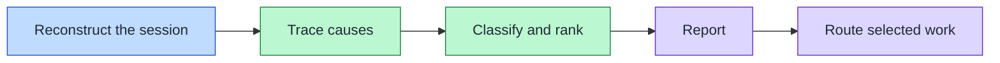

[← Scaffold at a glance](system-map.md)

# Retro

How a session retrospective finds what slowed the agent down, backed by evidence, and proposes fixes to its environment. Nothing changes until the user picks.



- [Reconstruct the session](#reconstruct-the-session): On request, rebuild what happened from the conversation or a session log.
- [Trace causes](#trace-causes): Trace each struggle to a cause in the agent's environment.
- [Classify and rank](#classify-and-rank): Sort findings into categories and rank them by impact and cost.
- [Report](#report): A read-only table of findings with evidence and a recommended selection.
- [Route selected work](#route-selected-work): The user picks remedies, and each goes to the skill that carries it out.

## Reconstruct the session

On request, rebuild what happened from the conversation or a session log.

Details: [/retro skill](../../../skills/retro.md)

- Runs only when the user asks for /retro; the current session is the default.
- Cites concrete turns, commands, failures, corrections and repeated searches.

**Where it breaks**

- If the record is unavailable, the retro reports the missing evidence and stops; it never infers struggles from the code alone.

## Trace causes

Trace each struggle to a cause in the agent's environment.

- Reads repo instructions, existing skills, check commands, hooks and CI wiring.
- Asks whether a remedy already exists but was undiscovered, unwired or broken.

## Classify and rank

Sort findings into categories and rank them by impact and cost.

- Prefers repairing an existing mechanism over adding a new one.
- Keeps a remedy only if it would hold on a different task in the same repo; one remedy per finding.
- A missing hook or CI check counts only when an error escaped or went undetected in this session, and a proposed check must be able to fire in the agent's normal workflow.
- Ranks by impact and recurrence risk, weighed against cost and the upkeep of a new rule or check.

**Categories**

| Category | Session signal |
|---|---|
| Navigation | Repeated searches or a hidden dependency delayed progress. |
| Automated checks | A mechanical error escaped, or a failure went undetected. |
| Review standards | Review missed a judgement call. |
| Steering size | Relevant guidance was buried in instructions. |
| Tool economy | A call returned too much output or required repeated work. |
| No-ops | Repetitive or ineffective steering used up context. |
| Information access | Missing logs, docs or read access blocked progress. |

## Report

A read-only table of findings with evidence and a recommended selection.

- One row per finding (R-01, R-02 and so on)
  - Severity, session evidence, cause, proposed change and where it goes, cost, how to verify it, and when to remove it.
- An empty result is valid after a smooth run.

**Where it breaks**

- The retro edits nothing; installs, hooks, access changes and tasks wait for the user's choice.

## Route selected work

The user picks remedies, and each goes to the skill that carries it out.

Details: [Skillify](skillify.md)

- Where work goes
  - skillify for a reusable procedure, add-linter for linter setup, feature-chain for a substantial change.
  - upstream when the fix belongs in scaffold; improve, code-refiner or prune for code quality.

## Detailed flow



## Code walkthrough

Retro is almost entirely agent-followed prose: skills/retro.md is the whole procedure and no script reconstructs a session, traces causes, ranks findings, builds the report or routes the chosen work. The only retro-specific files with any effect are the thin wrappers and the RESOLVER row that make /retro reachable and carry its 'only when the user requests' description. There is no retro test script; the generic skill validator (scripts/check-resolvable.ts) covers its registration like any other skill.

Each excerpt is read from the repo when this page is built. The explanations were written by an agent; `npm test` fails when the lines they explain change.

### Reconstruct the session: code

#### Claude wrapper: retro runs only on request

*Carries out the step.* The frontmatter description begins 'Use only when the user requests a session retrospective' and ends 'present proposals before changes'. The last line includes the canonical body skills/retro.md.

```markdown
---
description: Use only when the user requests a session retrospective to identify evidence-backed improvements to agent tooling, checks, navigation, and steering; present proposals before changes
---

@../../../skills/retro.md
```

[`.claude/skills/retro/SKILL.md:1-5`](https://github.com/victusfate/scaffold/blob/main/.claude/skills/retro/SKILL.md#L1-L5)

**Why it matters.** The first stage says retro runs only when the user asks for it. This description is the text a harness reads when deciding whether to activate the skill, and the RESOLVER row for retro matches only the literal /retro command. Nothing in code blocks an unrequested run; it rests on this wording. Rebuilding the session from the conversation or a log is done by the agent; no script reads session logs.

### Trace causes: code

No code here: The agent reads repo instructions, skills, check commands, hooks and CI wiring itself and ties each struggle to an environmental cause.

### Classify and rank: code

No code here: The agent sorts findings into the category table in the skill, keeps one durable remedy per finding, and ranks by impact, recurrence and cost.

### Report: code

No code here: The agent writes the R-01 style table with evidence, cause, proposed change, cost and verification, and makes no edits; the read-only rule is not enforced by code.

### Route selected work: code

No code here: After the user picks remedies the agent hands each to the named skill (skillify, add-linter, feature-chain, upstream, improve, code-refiner or prune); there is no dispatcher.

## Checked against the source

The retro flow matches skills/retro.md well: every stage, category signal, report column and routing target is in the source, with one inaccuracy (improve is for a codebase survey, not code quality). The larger gap is omission: the source's guardrail rules (inspect and cite what the hook or CI actually runs, confirm the tool is installed, known-failure lists, mechanical versus judgement) and the per-category remedies are not shown.

| Confirmed | Partly | Not found | Contradicted | In the source, not shown in the flow | Code excerpts |
|---:|---:|---:|---:|---:|---:|
| 35 | 1 | 0 | 0 | 9 | 1 |

An agent judged each claim against the source; each quote is found in its file when this page is built.

### Reconstruct the session: checks

<details>
<summary>7 confirmed, with the supporting line</summary>

- **Confirmed**: On request, rebuild what happened from the conversation or a session log.
  > \1. Reconstruct the session from the conversation or the specified primary logs.
  >
  > [`skills/retro.md:10`](https://github.com/victusfate/scaffold/blob/main/skills/retro.md#L10)

- **Confirmed**: Runs only when the user asks for /retro; the current session is the default.
  > Run only when the user requests \`/retro\` (Codex: \`$retro\`) or a session retrospective.
  >
  > [`skills/retro.md:5`](https://github.com/victusfate/scaffold/blob/main/skills/retro.md#L5)

- **Confirmed**: Cites concrete turns, commands, failures, corrections and repeated searches.
  > Cite concrete turns, commands, failures, corrections, or repeated searches.
  >
  > [`skills/retro.md:11`](https://github.com/victusfate/scaffold/blob/main/skills/retro.md#L11)

- **Confirmed**: If the record is unavailable, the retro reports the missing evidence and stops; it never infers struggles from the code alone.
  > If the requested record is unavailable, report the missing evidence and stop.
  >
  > [`skills/retro.md:12`](https://github.com/victusfate/scaffold/blob/main/skills/retro.md#L12)

- **Confirmed**: reconstruct -&gt; trace: Evidence cited (payload: turns, commands, failures)
  > Cite concrete turns, commands, failures, corrections, or repeated searches.
  >
  > [`skills/retro.md:11`](https://github.com/victusfate/scaffold/blob/main/skills/retro.md#L11)

- **Confirmed** (from the diagram): Current session by default or a log path / session id
  > Default to the current session; accept a session log path or session identifier.
  >
  > [`skills/retro.md:6`](https://github.com/victusfate/scaffold/blob/main/skills/retro.md#L6)

- **Confirmed** (from the diagram): Legend: retro — retrospective: look back at a session to find what slowed it down
  > Review a coding session for friction and propose improvements to the agent's
  >
  > [`skills/retro.md:3`](https://github.com/victusfate/scaffold/blob/main/skills/retro.md#L3)

</details>

### Trace causes: checks

<details>
<summary>4 confirmed, with the supporting line</summary>

- **Confirmed**: Trace each struggle to a cause in the agent's environment.
  > hooks, and CI wiring. Trace each observed struggle to its environmental cause.
  >
  > [`skills/retro.md:15`](https://github.com/victusfate/scaffold/blob/main/skills/retro.md#L15)

- **Confirmed**: Reads repo instructions, existing skills, check commands, hooks and CI wiring.
  > \2. Read the relevant repository instructions, existing skills, check commands,
  >
  > [`skills/retro.md:14`](https://github.com/victusfate/scaffold/blob/main/skills/retro.md#L14)

- **Confirmed**: Asks whether a remedy already exists but was undiscovered, unwired or broken.
  > Check whether the remedy already exists but was undiscovered, unwired, or broken.
  >
  > [`skills/retro.md:16`](https://github.com/victusfate/scaffold/blob/main/skills/retro.md#L16)

- **Confirmed**: trace -&gt; classify: Causes found (payload: candidate findings)
  > \3. Classify supported candidates using the table below. Prefer repairing an
  >
  > [`skills/retro.md:17`](https://github.com/victusfate/scaffold/blob/main/skills/retro.md#L17)

</details>

### Classify and rank: checks

<details>
<summary>15 confirmed, with the supporting line</summary>

- **Confirmed**: Sort findings into categories and rank them by impact and cost.
  > \4. Rank candidates by impact and recurrence risk, accounting for implementation
  >
  > [`skills/retro.md:23`](https://github.com/victusfate/scaffold/blob/main/skills/retro.md#L23)

- **Confirmed**: Prefers repairing an existing mechanism over adding a new one.
  > \3. Classify supported candidates using the table below. Prefer repairing an
  >
  > [`skills/retro.md:17`](https://github.com/victusfate/scaffold/blob/main/skills/retro.md#L17)

- **Confirmed**: Keeps a remedy only if it would hold on a different task in the same repo; one remedy per finding.
  > hold on a different task in the same repository: record durable facts such as
  >
  > [`skills/retro.md:20`](https://github.com/victusfate/scaffold/blob/main/skills/retro.md#L20)

- **Confirmed**: A missing hook or CI check counts only when an error escaped or went undetected in this session, and a proposed check must be able to fire in the agent's normal workflow.
  > Treat a missing guardrail as a candidate only when a mechanical error escaped or
  >
  > [`skills/retro.md:39`](https://github.com/victusfate/scaffold/blob/main/skills/retro.md#L39)

- **Confirmed**: Ranks by impact and recurrence risk, weighed against cost and the upkeep of a new rule or check.
  > cost and the ongoing burden of a new rule or check. Present the report below.
  >
  > [`skills/retro.md:24`](https://github.com/victusfate/scaffold/blob/main/skills/retro.md#L24)

- **Confirmed**: Categories table — Navigation: Repeated searches or a hidden dependency delayed progress.
  > \| Navigation \| Repeated searches or a hidden dependency delayed progress \|
  >
  > [`skills/retro.md:31`](https://github.com/victusfate/scaffold/blob/main/skills/retro.md#L31)

- **Confirmed**: Categories table — Automated checks: A mechanical error escaped, or a failure went undetected.
  > \| Automated checks \| A mechanical error escaped, or a failure went undetected \|
  >
  > [`skills/retro.md:32`](https://github.com/victusfate/scaffold/blob/main/skills/retro.md#L32)

- **Confirmed**: Categories table — Review standards: Review missed a judgement call.
  > \| Review standards \| Review missed a judgement call \|
  >
  > [`skills/retro.md:33`](https://github.com/victusfate/scaffold/blob/main/skills/retro.md#L33)

- **Confirmed**: Categories table — Steering size: Relevant guidance was buried in instructions.
  > \| Steering size \| Relevant guidance was buried in repo or global instructions \|
  >
  > [`skills/retro.md:34`](https://github.com/victusfate/scaffold/blob/main/skills/retro.md#L34)

- **Confirmed**: Categories table — Tool economy: A call returned too much output or required repeated work.
  > \| Tool economy \| A call returned excessive output or required repeated work \|
  >
  > [`skills/retro.md:35`](https://github.com/victusfate/scaffold/blob/main/skills/retro.md#L35)

- **Confirmed**: Categories table — No-ops: Repetitive or ineffective steering used up context.
  > \| No-ops \| Repetitive or ineffective steering consumed context \|
  >
  > [`skills/retro.md:36`](https://github.com/victusfate/scaffold/blob/main/skills/retro.md#L36)

- **Confirmed**: Categories table — Information access: Missing logs, docs or read access blocked progress.
  > \| Information access \| Missing logs, documentation, or read access blocked progress \|
  >
  > [`skills/retro.md:37`](https://github.com/victusfate/scaffold/blob/main/skills/retro.md#L37)

- **Confirmed**: classify -&gt; report: Ranked (payload: R-01 rows)
  > cost and the ongoing burden of a new rule or check. Present the report below.
  >
  > [`skills/retro.md:24`](https://github.com/victusfate/scaffold/blob/main/skills/retro.md#L24)

- **Confirmed** (from the diagram): Legend: tool economy — getting answers with fewer, smaller tool calls
  > Narrow the query, batch independent reads, or improve the existing tool \|
  >
  > [`skills/retro.md:35`](https://github.com/victusfate/scaffold/blob/main/skills/retro.md#L35)

- **Confirmed** (from the diagram): Legend: no-op — an instruction that uses context but changes nothing
  > \| No-ops \| Repetitive or ineffective steering consumed context \|
  >
  > [`skills/retro.md:36`](https://github.com/victusfate/scaffold/blob/main/skills/retro.md#L36)

</details>

### Report: checks

<details>
<summary>6 confirmed, with the supporting line</summary>

- **Confirmed**: A read-only table of findings with evidence and a recommended selection.
  > Finish with a recommended selection; wait for the user's choice before edits.
  >
  > [`skills/retro.md:25`](https://github.com/victusfate/scaffold/blob/main/skills/retro.md#L25)

- **Confirmed**: One row per finding (R-01, R-02 and so on)
  > State the session reviewed, the evidence available, and any gaps. For each candidate:
  >
  > [`skills/retro.md:52`](https://github.com/victusfate/scaffold/blob/main/skills/retro.md#L52)

- **Confirmed**: Severity, session evidence, cause, proposed change and where it goes, cost, how to verify it, and when to remove it.
  > \| ID \| Severity \| Session evidence \| Cause/category \| Proposed change and destination \| Cost/tradeoff \| Verification \|
  >
  > [`skills/retro.md:54`](https://github.com/victusfate/scaffold/blob/main/skills/retro.md#L54)

- **Confirmed**: An empty result is valid after a smooth run.
  > an empty result is valid after a smooth run. Keep a remedy only if it would
  >
  > [`skills/retro.md:19`](https://github.com/victusfate/scaffold/blob/main/skills/retro.md#L19)

- **Confirmed**: The retro edits nothing; installs, hooks, access changes and tasks wait for the user's choice.
  > is a separate implementation step; installs, hooks, access changes, and tasks need
  >
  > [`skills/retro.md:60`](https://github.com/victusfate/scaffold/blob/main/skills/retro.md#L60)

- **Confirmed**: report -&gt; route: User selects remedies (payload: chosen rows)
  > Finish with a recommended selection; wait for the user's choice before edits.
  >
  > [`skills/retro.md:25`](https://github.com/victusfate/scaffold/blob/main/skills/retro.md#L25)

</details>

### Route selected work: checks

- **Partly**: upstream when the fix belongs in scaffold; improve, code-refiner or prune for code quality.
  > \- Use \[\`improve\`\](../.claude/skills/improve/SKILL.md) for a codebase survey,
  >
  > [`skills/retro.md:67`](https://github.com/victusfate/scaffold/blob/main/skills/retro.md#L67)

  The source sends code-quality work to code-refiner or prune only; improve is for a codebase survey, and upstream is for a generic remedy.

<details>
<summary>3 confirmed, with the supporting line</summary>

- **Confirmed**: The user picks remedies, and each goes to the skill that carries it out.
  > that selection. Route selected work through the existing workflow:
  >
  > [`skills/retro.md:61`](https://github.com/victusfate/scaffold/blob/main/skills/retro.md#L61)

- **Confirmed**: skillify for a reusable procedure, add-linter for linter setup, feature-chain for a substantial change.
  > \- Use \[\`feature-chain\`\](feature-chain.md) for a substantial implementation.
  >
  > [`skills/retro.md:65`](https://github.com/victusfate/scaffold/blob/main/skills/retro.md#L65)

- **Confirmed** (from the diagram): Legend: improve / code-refiner / prune — skills for codebase surveys and code-quality cleanup
  > or \[\`code-refiner\`\](code-refiner.md) / \[\`prune\`\](prune.md) for code-quality work.
  >
  > [`skills/retro.md:68`](https://github.com/victusfate/scaffold/blob/main/skills/retro.md#L68)

</details>

## In the source, not shown in the flow

- Before proposing a guardrail, the agent must inspect whether a pre-commit hook or CI actually runs the relevant lint, type and test commands and cite that inspection next to the session evidence.
  > actually runs the relevant lint, type, and test commands, and cite that
  >
  > [`skills/retro.md:42`](https://github.com/victusfate/scaffold/blob/main/skills/retro.md#L42)

- A check may be proposed only after confirming its tool is installed in the agent's environment, not only that its trigger occurs in the normal workflow.
  > it can fire: its tool is installed in the agent's environment and its trigger
  >
  > [`skills/retro.md:44`](https://github.com/victusfate/scaffold/blob/main/skills/retro.md#L44)

- A list of known failures must say it is incomplete and must not blame unlisted failures on the agent's edits.
  > it is incomplete and must not attribute unlisted failures to the agent's edits.
  >
  > [`skills/retro.md:46`](https://github.com/victusfate/scaffold/blob/main/skills/retro.md#L46)

- Mechanical rules (fixed syntax, banned APIs, import shapes, file placement) get an executable check; reviewer prose is reserved for contextual judgement.
  > use an executable check for them. Reserve reviewer prose for contextual judgement.
  >
  > [`skills/retro.md:48`](https://github.com/victusfate/scaffold/blob/main/skills/retro.md#L48)

- Each category has a prescribed remedy (third column of the source table); the spec table and the diagram show only the category and its session signal.
  > \| Category \| Session signal \| Proposed remedy \|
  >
  > [`skills/retro.md:29`](https://github.com/victusfate/scaffold/blob/main/skills/retro.md#L29)

- With a partial record the retro continues but must mark the gaps, and the report states the session reviewed, the evidence available and any gaps.
  > Mark gaps in a partial record; infer no struggles from the code alone.
  >
  > [`skills/retro.md:13`](https://github.com/victusfate/scaffold/blob/main/skills/retro.md#L13)

- A remedy must record durable facts, not a snapshot of this session's failures, and carry no unrelated instruction.
  > the test command, not a snapshot of this session's failures. Give each
  >
  > [`skills/retro.md:21`](https://github.com/victusfate/scaffold/blob/main/skills/retro.md#L21)

- The report must briefly explain the highest-value candidate.
  > Explain the highest-value candidate briefly. Report no actionable findings when
  >
  > [`skills/retro.md:58`](https://github.com/victusfate/scaffold/blob/main/skills/retro.md#L58)

- Rules for implementing a selected documentation remedy: short imperative steps, one home per rule, explicit completion criteria, conditional pointers to detail, small always-loaded guidance.
  > one home per rule, explicit completion criteria, and conditional pointers to detail.
  >
  > [`skills/retro.md:71`](https://github.com/victusfate/scaffold/blob/main/skills/retro.md#L71)

## Glossary

- **CI**: Continuous Integration: checks that run on every push or PR.
- **Hook**: A script that runs automatically, for example before a commit.
- **Steering**: Written guidance that tells the agent how to behave.

## Ask your LLM

Copy this block into your own assistant to ask about anything on this page.

```text
The reader wants to understand scaffold's /retro skill: how an AI agent reviews
a session for friction and proposes environment fixes.
Read this page:
https://github.com/victusfate/scaffold/blob/main/docs/diagrams/pages/retro.md
Scaffold: https://github.com/victusfate/scaffold

Questions worth asking:
- Why look for a cause in the environment instead of blaming the agent's
  mistake?
```
