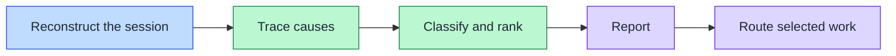

[← Scaffold at a glance](system-map.md)

# Retro

How a session retrospective finds what slowed the agent down, backed by evidence, and proposes fixes to its environment. Nothing changes until the user picks.



- [Reconstruct the session](#reconstruct-the-session): On request, rebuild what happened from the conversation or a session log.
- [Trace causes](#trace-causes): Trace each struggle to a cause in the agent's environment.
- [Classify and rank](#classify-and-rank): Sort findings into categories and rank them by impact and cost.
- [Report](#report): A read-only table of findings with evidence and a recommended selection.
- [Route selected work](#route-selected-work): The user picks remedies, and each goes to the skill that carries it out.

## Reconstruct the session

On request, rebuild what happened from the conversation or a session log.

Details: [/retro skill](../../../skills/retro.md)

- Runs only when the user asks for /retro; the current session is the default.
- Cites concrete turns, commands, failures, corrections and repeated searches.

**Where it breaks**

- If the record is unavailable, the retro reports the missing evidence and stops; it never infers struggles from the code alone.

## Trace causes

Trace each struggle to a cause in the agent's environment.

- Reads repo instructions, existing skills, check commands, hooks and CI wiring.
- Asks whether a remedy already exists but was undiscovered, unwired or broken.

## Classify and rank

Sort findings into categories and rank them by impact and cost.

- Prefers repairing an existing mechanism over adding a new one.
- Ranks by impact and recurrence risk, weighed against cost and the upkeep of a new rule or check.

**Categories**

| Category | Session signal |
|---|---|
| Navigation | Repeated searches or a hidden dependency delayed progress. |
| Automated checks | A mechanical error escaped, or a failure went undetected. |
| Review standards | Review missed a judgement call. |
| Steering size | Relevant guidance was buried in instructions. |
| Tool economy | A call returned too much output or required repeated work. |
| No-ops | Repetitive or ineffective steering used up context. |
| Information access | Missing logs, docs or read access blocked progress. |

## Report

A read-only table of findings with evidence and a recommended selection.

- One row per finding (R-01, R-02 and so on)
  - Severity, session evidence, cause, proposed change and where it goes, cost, and how to verify it.
- An empty result is valid after a smooth run.

**Where it breaks**

- The retro edits nothing; installs, hooks, access changes and tasks wait for the user's choice.

## Route selected work

The user picks remedies, and each goes to the skill that carries it out.

Details: [Skillify](skillify.md)

- Where work goes
  - skillify for a reusable procedure, add-linter for linter setup, feature-chain for a substantial change.
  - upstream when the fix belongs in scaffold; improve, code-refiner or prune for code quality.

## Detailed flow


## Glossary

- **CI**: Continuous Integration: checks that run on every push or PR.
- **Hook**: A script that runs automatically, for example before a commit.
- **Steering**: Written guidance that tells the agent how to behave.

## Ask your LLM

Copy this block into your own assistant to ask about anything on this page.

```text
The reader wants to understand scaffold's /retro skill: how an AI agent reviews a session for friction and proposes environment fixes.
Read this page: https://github.com/victusfate/scaffold/blob/main/docs/diagrams/pages/retro.md
Scaffold: https://github.com/victusfate/scaffold

Questions worth asking:
- Why look for a cause in the environment instead of blaming the agent's mistake?
```
