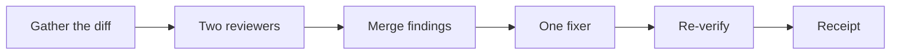

# Review gates

How a diff gets reviewed, fixed and verified before merge: two independent reviewers, one fixer, and a receipt so the same code is not checked twice.



- [Gather the diff](#gather-the-diff): Collect the branch's diff and the full text of every changed file.
- [Two reviewers](#two-reviewers): A correctness reviewer and a structure reviewer read the diff in parallel, without editing.
- [Merge findings](#merge-findings): Combine both reports into one ordered work list, correctness first.
- [One fixer](#one-fixer): A single agent applies the whole list, then re-runs the tests.
- [Re-verify](#re-verify): A fresh check confirms correctness is clear and every rubric score is 10/10.
- [Receipt](#receipt): A verified run writes a receipt for the exact code, so the merge step can reuse it.

## Gather the diff

Collect the branch's diff and the full text of every changed file.

- The diff is git diff main...HEAD.
- For the whole repo instead of a diff, /audit ranks the worst files first.

## Two reviewers

A correctness reviewer and a structure reviewer read the diff in parallel, without editing.

Goes deeper: [../../../skills/code-refiner.md](../../../skills/code-refiner.md)

- Correctness: /validate
  - Finds correctness bugs.
  - A test weakened to pass counts as a defect.
- Structure: /simplify
  - Scores the rubric and lists cleanups.
  - Checks diff economy and repeated code across files.
- Each reviewer starts fresh, with no session context.

## Merge findings

Combine both reports into one ordered work list, correctness first.

- Findings on the same lines become one item.
- If both reviews are clean, the fix step is skipped.
- Run standalone without --fix, it presents the list and waits for approval.

## One fixer

A single agent applies the whole list, then re-runs the tests.

- Only one agent edits, so two agents never change the same files at once.

**Where it breaks**

- If a fix needs a test changed, it is surfaced, never weakened to pass.

## Re-verify

A fresh check confirms correctness is clear and every rubric score is 10/10.

- On a regression it fixes once more; if that still fails, it surfaces what remains and stops.

## Receipt

A verified run writes a receipt for the exact code, so the merge step can reuse it.

- Fail closed
  - A missing, mismatched or corrupt receipt means the checks re-run in full.
- Full suites run only for shared core; other changes run the checks for the parts they touch.

**What the receipt is keyed to**

- HEAD, tree, index and diffs
- Untracked inputs and the base
- Plan and gate-script hashes
- Tool binaries

<details>
<summary>Detailed flow</summary>



</details>

## Glossary

- **Rubric**: Four scores for code: Quality, Readability, Encapsulation, Clarity.
- **Diff economy**: Added lines must earn their place; deletions count as credit.
- **Shared core**: Public API, save formats, networking and workspace build inputs.
- **Fail closed**: When in doubt, block and re-run instead of passing.

## Ask your LLM

Copy this block into your own assistant to ask about anything on this page.

```text
The reader wants to understand how scaffold reviews, fixes and verifies a code change before it merges.

Review gates: How a diff gets reviewed, fixed and verified before merge: two independent reviewers, one fixer, and a receipt so the same code is not checked twice.
- Gather the diff: Collect the branch's diff and the full text of every changed file.
- Two reviewers: A correctness reviewer and a structure reviewer read the diff in parallel, without editing.
- Merge findings: Combine both reports into one ordered work list, correctness first.
- One fixer: A single agent applies the whole list, then re-runs the tests.
- Re-verify: A fresh check confirms correctness is clear and every rubric score is 10/10.
- Receipt: A verified run writes a receipt for the exact code, so the merge step can reuse it.

Questions worth asking:
- Why run two separate reviewers instead of one?
- What counts as shared core, and why does it get the full suite?
```
