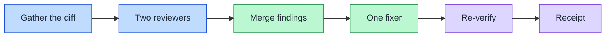

[← Scaffold at a glance](system-map.md)

# Review gates

How a diff gets reviewed, fixed and verified before merge: two independent reviewers, one fixer, and a receipt so the same code is not checked twice.



- [Gather the diff](#gather-the-diff): Collect the branch's diff and the full text of every changed file.
- [Two reviewers](#two-reviewers): A correctness reviewer and a structure reviewer read the diff in parallel, without editing.
- [Merge findings](#merge-findings): Combine both reports into one ordered work list, correctness first.
- [One fixer](#one-fixer): A single agent applies the whole list, then re-runs the tests if a test runner is found.
- [Re-verify](#re-verify): A fresh check confirms correctness is clear and every rubric score is 10/10.
- [Receipt](#receipt): A verified run writes a receipt for the exact code, so the merge step can reuse it.

## Gather the diff

Collect the branch's diff and the full text of every changed file.

- The diff is git diff main...HEAD.
- For the whole repo instead of a diff, /audit ranks the worst files first.

## Two reviewers

A correctness reviewer and a structure reviewer read the diff in parallel, without editing.

Details: [/code-refiner skill](../../../skills/code-refiner.md)

- Correctness: /validate
  - Finds correctness bugs.
  - A test weakened to pass counts as a defect.
- Structure: /simplify
  - Scores the rubric and lists cleanups.
  - Checks diff economy and repeated code across files.
- Each reviewer starts fresh, with no session context.

## Merge findings

Combine both reports into one ordered work list, correctness first.

- Findings on the same lines become one item.
- If both reviews are clean, the fix step is skipped.
- Run standalone without --fix, it presents the list and waits for approval.

## One fixer

A single agent applies the whole list, then re-runs the tests if a test runner is found.

- Only one agent edits, so two agents never change the same files at once.

**Where it breaks**

- If a fix needs a test changed, it is surfaced, never weakened to pass.

## Re-verify

A fresh check confirms correctness is clear and every rubric score is 10/10.

- On a regression it fixes once more; if that still fails, it surfaces what remains and stops.

## Receipt

A verified run writes a receipt for the exact code, so the merge step can reuse it.

- Fail closed
  - A missing, mismatched or corrupt receipt means the checks re-run in full.
- Full suites run only for shared core; other changes run the checks for the parts they touch, plus the task's own gates.

**What the receipt is keyed to**

- HEAD, tree, index and diffs
- Untracked inputs and the base
- Plan and gate-script hashes
- Tool binaries

## Detailed flow


## Code walkthrough

Most of this flow is prose: the two reviewers, the merge of findings, the single fixer and the re-verify loop are all carried out by agents reading skills/code-refiner.md, skills/validate.md and skills/simplify.md. The code that exists is the deterministic part of the structural review (scripts/check-quality-mechanical.sh, run by .githooks/pre-commit and .github/workflows/quality.yml), a few shell tests that pin the wording of the skills, and the queue's per-task validate command. No code in the repo writes, reads or compares a verification receipt; CI simply runs everything on every pull request.

Each excerpt is read from the repo when this page is built. The explanations were written by an agent; `npm test` fails when the lines they explain change.

### Gather the diff: code

#### File selection: explicit files, staged files, or the diff against main

*Carries out the step.* collect reads file names from stdin and keeps those with a source extension (js, mjs, ts, tsx, sh, py, rb, go). With --staged the names come from the git index; with arguments the given files are used as is; with nothing they come from git diff main...HEAD. Each selected file is then passed to check_file.

```bash
# Resolve files: explicit args, staged files, or files changed vs main.
# A read loop rather than mapfile, so this runs on macOS's bash 3.2 (the hook
# ships to consumers' machines), and the loop guard keeps an empty set safe there.
SOURCE_RE='\.(js|mjs|ts|tsx|sh|py|rb|go)$'
FILES=()
collect() { while IFS= read -r f; do FILES+=("$f"); done < <(grep -E "$SOURCE_RE" || true); }
if [ "${1:-}" = "--staged" ]; then
  collect < <(git diff --cached --name-only --diff-filter=ACMR 2>/dev/null)
elif [ $# -gt 0 ]; then
  FILES=("$@")
else
  collect < <(git diff main...HEAD --name-only 2>/dev/null)
fi

if [ ${#FILES[@]} -gt 0 ]; then
  for f in "${FILES[@]}"; do
    check_file "$f"
  done
fi
```

[`scripts/check-quality-mechanical.sh:194-212`](https://github.com/victusfate/scaffold/blob/main/scripts/check-quality-mechanical.sh#L194-L212)

**Why it matters.** This is the same diff the flow gathers (git diff main...HEAD), but only for the mechanical check. The diff and file contents handed to the two reviewers are gathered by the agent, not by this script.

**Methods and helpers used here**

<details>
<summary><code>check_file</code> · shell function · scripts/check-quality-mechanical.sh:46</summary>

Takes one file path and scans it, calling emit for each violation: more than 500 lines without a 'quality-ok: file-length' pragma, a bare integer of two or more digits outside a named constant, string literal, return/exit statement or pragma-covered line (this check is skipped for files whose name contains test or spec), and two or more consecutive comment lines that look like code. It returns 0 without checking anything when the path is not a regular file, is matched by .quality-ignore, or has '@generated' in its first five lines.

```bash
check_file() {
  local file="$1"
  [ -f "$file" ] || return 0
  is_ignored "$file" && return 0
  local ext="${file##*.}"

  # Generated / machine-authored files are skipped whole — the same convention
  # ESLint and Prettier honor. A mechanical CODE-quality check has nothing to say
  # about machine-produced OUTPUT: e.g. a procedural geometry catalog is tens of
  # thousands of lines of raw vertex-coordinate arrays where every number is a
  # coordinate and "extract to a named constant" is meaningless. Mark such a file
  # with `@generated` in its first 5 lines. Use ONLY for genuinely generated/data
  # files — never to silence a lint on hand-maintained logic.
  if head -5 "$file" 2>/dev/null | grep -q '@generated'; then
    return 0
  fi

  # File length. A `quality-ok: file-length — <reason>` pragma anywhere in the file
  # (by convention on the first non-shebang line) blesses a genuinely cohesive file
  # that reads as one unit and would only be fragmented by a split. Like the
  # magic-number pragma, the keyword is the gate; the required reason is enforced at
  # review time, not parsed here. Commented-out-code has no such escape hatch.
  local count
  count=$(wc -l < "$file")
```

[`scripts/check-quality-mechanical.sh:46-69`](https://github.com/victusfate/scaffold/blob/main/scripts/check-quality-mechanical.sh#L46-L69) (first 24 lines shown)

</details>

No code here: The agent runs git diff main...HEAD and reads each changed file in full to hand to the reviewers; only the mechanical check selects its own files by script.

### Two reviewers: code

#### check_file: 500-line file length limit

*Carries out the step.* Counts the lines in the file. If the count is over MAX_LINES (500) and the file has no 'quality-ok: file-length' pragma, it prints a Readability/major violation with a file:line citation and adds one to the violation count.

```bash
  # File length. A `quality-ok: file-length — <reason>` pragma anywhere in the file
  # (by convention on the first non-shebang line) blesses a genuinely cohesive file
  # that reads as one unit and would only be fragmented by a split. Like the
  # magic-number pragma, the keyword is the gate; the required reason is enforced at
  # review time, not parsed here. Commented-out-code has no such escape hatch.
  local count
  count=$(wc -l < "$file")
  if [ "$count" -gt "$MAX_LINES" ] \
     && ! grep -Eq '(#|//)[[:space:]]*quality-ok:[[:space:]]*file-length' "$file"; then
    emit "${file}:${MAX_LINES} [Readability/major] file is ${count} lines — exceeds ${MAX_LINES}-line limit; split into cohesive modules (or add a 'quality-ok: file-length — <reason>' pragma if it is one cohesive unit)"
  fi
```

[`scripts/check-quality-mechanical.sh:63-73`](https://github.com/victusfate/scaffold/blob/main/scripts/check-quality-mechanical.sh#L63-L73)

**Why it matters.** Carries out the rubric's file-length criterion, which the structure reviewer may not override. Without it the limit would depend on a model noticing a long file.

**Methods and helpers used here**

<details>
<summary><code>emit</code> · shell function · scripts/check-quality-mechanical.sh:16</summary>

Prints its first argument, a violation message, to stdout and adds one to the global VIOLATIONS counter. The script exits 1 at the end when that counter is above zero.

```bash
emit() { echo "$1"; VIOLATIONS=$((VIOLATIONS + 1)); }
```

[`scripts/check-quality-mechanical.sh:16`](https://github.com/victusfate/scaffold/blob/main/scripts/check-quality-mechanical.sh#L16)

</details>

#### check_file: flag magic numbers

*Carries out the step.* After the earlier skips (comments, named constants, test files, return/exit, pragma) and after quoted strings are stripped, the line is matched against a pattern for a bare integer of two or more digits. A match prints a Readability/minor violation with file:line. The pragma flag is then reset for the next line.

```bash
    # Flag bare integers ≥2 digits that are not array indices or lone 0/1.
    # Bash ERE in [[ =~ ]] supports {2,}; the regex lives in a variable so it
    # is matched as a pattern (no subprocess vs the old echo|grep).
    local magic_re='[^a-zA-Z0-9_."'\''][0-9]{2,}[^a-zA-Z0-9_.]'
    if [[ "$scan" =~ $magic_re ]]; then
      emit "${file}:${lineno} [Readability/minor] magic number — extract to a named constant (or use quality-ok: magic-number pragma if the value is self-documenting)"
    fi
    prev_quality_ok=0
  done < "$file"
```

[`scripts/check-quality-mechanical.sh:167-175`](https://github.com/victusfate/scaffold/blob/main/scripts/check-quality-mechanical.sh#L167-L175)

**Why it matters.** Carries out the rubric's 'no magic numbers' criterion as a script, so the structure review's mechanical findings are repeatable.

**Methods and helpers used here**

<details>
<summary><code>emit</code> · shell function · scripts/check-quality-mechanical.sh:16</summary>

Prints its first argument, a violation message, to stdout and adds one to the global VIOLATIONS counter. The script exits 1 at the end when that counter is above zero.

```bash
emit() { echo "$1"; VIOLATIONS=$((VIOLATIONS + 1)); }
```

[`scripts/check-quality-mechanical.sh:16`](https://github.com/victusfate/scaffold/blob/main/scripts/check-quality-mechanical.sh#L16)

</details>

#### check_file: flag commented-out code

*Carries out the step.* Reads the file again line by line. A line counts as commented code when it starts with // or # followed by a code keyword such as function, const, return or if. When two such lines are consecutive it prints a Clarity/minor violation for the second one.

```bash
  # Commented-out code: two or more consecutive lines starting with // or #
  # that look like code (contain common code tokens).
  local prev_was_comment=0
  lineno=0
  while IFS= read -r line; do
    lineno=$((lineno + 1))
    if [[ "$line" =~ ^[[:space:]]*(//|#)[[:space:]]*(function|const|let|var|return|if|for|while|class|import|export|}) ]]; then
      if [ "$prev_was_comment" -eq 1 ]; then
        emit "${file}:${lineno} [Clarity/minor] commented-out code block — delete dead code instead of archiving inline"
      fi
      prev_was_comment=1
    else
      prev_was_comment=0
    fi
  done < "$file"
```

[`scripts/check-quality-mechanical.sh:177-191`](https://github.com/victusfate/scaffold/blob/main/scripts/check-quality-mechanical.sh#L177-L191)

**Why it matters.** Carries out the rubric's 'no commented-out code' criterion. This one has no pragma, so the code must be deleted.

**Methods and helpers used here**

<details>
<summary><code>emit</code> · shell function · scripts/check-quality-mechanical.sh:16</summary>

Prints its first argument, a violation message, to stdout and adds one to the global VIOLATIONS counter. The script exits 1 at the end when that counter is above zero.

```bash
emit() { echo "$1"; VIOLATIONS=$((VIOLATIONS + 1)); }
```

[`scripts/check-quality-mechanical.sh:16`](https://github.com/victusfate/scaffold/blob/main/scripts/check-quality-mechanical.sh#L16)

</details>

#### Rubric format test: the four dimensions and scoring rules must be present

*Test that pins it.* Each check greps lib/code-quality-rubric.md for one pattern and counts a pass or fail. This block requires the four dimension headings (Quality, Readability, Encapsulation, Clarity), the citation rule, the score formula, the weights, and the inline-override rules.

```bash
check "file exists"                      "."
check "persona preamble present"         "thoughtful senior engineer|joy to read|asks nothing unnecessary"
check "Quality dimension heading"        "^## 1\. Quality"
check "Readability dimension heading"    "^## 2\. Readability"
check "Encapsulation dimension heading"  "^## 3\. Encapsulation"
check "Clarity dimension heading"        "^## 4\. Clarity"
check "citation requirement stated"      "filename:line|cite.*line|citation"
check "score formula present"            "Score.*10|10.*violation|Σ"
check "weight declarations present"      "minor|major|critical"
check "common failure table present"     "^\| .* \| .* \| .*\|"
check "parameter count criterion"        "parameter|param"
check "reader load criterion"            "reader|cognitive|hold.*mind"
check "inline override section present"  "[Ii]nline override"
check "inline pragma comment form"       "//[[:space:]]*quality-override"
check "mechanical criteria not overridable inline" "overridden inline|inline.*cannot be overridden"
check "malformed pragma flagged as Clarity violation" "malformed pragma|malformed.*\[Clarity"
```

[`scripts/test-rubric-format.sh:22-37`](https://github.com/victusfate/scaffold/blob/main/scripts/test-rubric-format.sh#L22-L37)

**Why it matters.** The structure reviewer scores against this rubric file. The test stops the rubric from losing a dimension or its scoring rule; it does not check any score a reviewer gives.

**Methods and helpers used here**

<details>
<summary><code>check</code> · shell function · scripts/test-rubric-format.sh:8</summary>

Takes a description and an extended-regex pattern and greps the file named by RUBRIC (lib/code-quality-rubric.md) for the pattern, with grep errors suppressed. On a match it prints the description with a check mark and increments the global PASS counter; otherwise it prints it with a cross mark and increments FAIL.

```bash
check() {
  local desc="$1"
  local pattern="$2"
  if grep -qE "$pattern" "$RUBRIC" 2>/dev/null; then
    echo "  ✓ $desc"
    PASS=$((PASS + 1))
  else
    echo "  ✗ $desc"
    FAIL=$((FAIL + 1))
  fi
}
```

[`scripts/test-rubric-format.sh:8-18`](https://github.com/victusfate/scaffold/blob/main/scripts/test-rubric-format.sh#L8-L18)

</details>

#### simplify skill test: rubric include, score table, 10/10 gate

*Test that pins it.* Greps skills/simplify.md for the include of the shared rubric, the 'Quality Scores' heading, the quality-override syntax, a description of inline pragmas, the 10/10 threshold and the auto-fix mode. Each grep records a pass or a fail.

```bash
grep -q '@../lib/code-quality-rubric.md' "$FILE" \
  && ok "@-includes shared rubric" || fail "missing @-include of rubric"

grep -q 'Quality Scores' "$FILE" \
  && ok "score table heading present" || fail "missing 'Quality Scores' heading"

grep -q 'quality-override' "$FILE" \
  && ok "override syntax referenced" || fail "missing override syntax"

grep -qE 'inline override|preceding line|// quality-override|suppress' "$FILE" \
  && ok "inline pragma awareness described" || fail "inline pragma awareness not described"

grep -q '10/10\|score.*10\|10 on all\|all.*10' "$FILE" \
  && ok "10/10 gate threshold stated" || fail "missing 10/10 gate threshold"

grep -qE 'auto.?fix|auto fix' "$FILE" \
  && ok "auto-fix mode described" || fail "missing auto-fix mode"
```

[`scripts/test-simplify.sh:11-27`](https://github.com/victusfate/scaffold/blob/main/scripts/test-simplify.sh#L11-L27)

**Why it matters.** Pins the text the structure reviewer follows, including the 10/10 gate that re-verify depends on. It checks that the words exist, not that a review obeyed them.

**Methods and helpers used here**

<details>
<summary><code>fail</code> · shell function · scripts/test-simplify.sh:5</summary>

Takes a description, prints it to stdout prefixed with a cross mark, and increments the script's global FAIL counter. It does not exit the script.

```bash
fail(){ echo "  ✗ $1"; FAIL=$((FAIL + 1)); }
```

[`scripts/test-simplify.sh:5`](https://github.com/victusfate/scaffold/blob/main/scripts/test-simplify.sh#L5)

</details>

No code here: The agent starts two fresh read-only subagents in one message, one applying skills/validate.md and one applying skills/simplify.md; the bug hunt, test-integrity check, rubric scores, diff economy and cross-file repeat check are all model judgment.

### Merge findings: code

No code here: The invoking agent joins the two reports, makes findings on the same lines one item, orders correctness before structure, and either skips the fix when both are clean or presents the list and waits when run without --fix.

### One fixer: code

No code here: One agent applies the whole work list in a single pass, re-runs the repo's tests, and reports instead of editing when a fix would need a test changed.

### Re-verify: code

#### pre-commit hook: lint and mechanical check on staged files

*Enforces the rule.* staged lists the staged files that match a pattern. If an ESLint config exists and ESLint is installed, the staged JS/TS files are linted. Then, if the mechanical check script exists, it runs with --staged. A non-zero exit from either step aborts the commit (set -eu).

```bash
# Linters read the working-tree copy, so a partially staged file is checked as edited.
staged() { git diff --cached --name-only --diff-filter=ACMR -z -- "$@"; }

if ls eslint.config.* > /dev/null 2>&1; then
  if [ -x node_modules/.bin/eslint ]; then
    staged '*.js' '*.mjs' '*.cjs' '*.ts' '*.tsx' |
      xargs -0 -r node_modules/.bin/eslint --no-warn-ignored --
  else
    echo "pre-commit: ESLint configured but not installed — skipping (install deps, e.g. npm ci)" >&2
  fi
fi

if [ -f scripts/check-quality-mechanical.sh ]; then
  bash scripts/check-quality-mechanical.sh --staged
fi
```

[`.githooks/pre-commit:16-30`](https://github.com/victusfate/scaffold/blob/main/.githooks/pre-commit#L16-L30)

**Why it matters.** Any commit made after the fixer's pass goes through this hook when hooks are enabled, so the mechanical part of the structural check is re-run by code. The correctness re-check and the rubric scores are still done by an agent.

#### Quality Gate workflow: mechanical checks on every pull request

*Enforces the rule.* On a pull request being opened or updated, the job checks out the code, lists every tracked source file, and runs the mechanical check on all of them. The job fails if the script reports any violation.

```yaml
  mechanical:
    name: Mechanical checks
    runs-on: ubuntu-latest
    steps:
      - uses: actions/checkout@fbc6f3992d24b796d5a048ff273f7fcc4a7b6c09 # v5
        with:
          persist-credentials: false
      - name: Run mechanical quality checks (all files)
        run: |
          mapfile -t FILES < <(git ls-files | grep -E '\.(js|mjs|ts|tsx|sh|py|rb|go)$' || true)
          [ ${#FILES[@]} -gt 0 ] && bash scripts/check-quality-mechanical.sh "${FILES[@]}"
```

[`.github/workflows/quality.yml:11-21`](https://github.com/victusfate/scaffold/blob/main/.github/workflows/quality.yml#L11-L21)

**Why it matters.** This is the hosted backstop for the mechanical criteria: a violation the local review missed still blocks the PR. It checks all files, not just the diff.

#### create-pr gate test: 10/10 threshold stated, gate placed before the PR body

*Test that pins it.* Greps skills/create-pr.md for the 10/10 threshold and for the override mechanism. It then finds the line numbers of the 'Step 5' and 'Step 6' headings and fails unless Step 5 (the quality gate) comes first.

```bash
grep -qE '10/10|score.*10|all.*10|10 on all' "$FILE" \
  && ok "10/10 threshold stated" || fail "10/10 threshold not stated"

grep -qE 'quality.override|override' "$FILE" \
  && ok "override mechanism referenced" || fail "override mechanism not referenced"

# Gate (Step 5) must appear before Step 6 (PR body drafting). Match the section
# HEADINGS, not prose cross-references, so an earlier "(Step 6)" mention in the
# body of another step can't invert the check.
gate_line=$(grep -nE '^#+[[:space:]].*Step 5' "$FILE" | head -1 | cut -d: -f1)
step6_line=$(grep -nE '^#+[[:space:]].*Step 6' "$FILE" | head -1 | cut -d: -f1)
if [ -n "$gate_line" ] && [ -n "$step6_line" ] && [ "$gate_line" -lt "$step6_line" ]; then
  ok "quality gate (Step 5) appears before PR body drafting (Step 6)"
else
  fail "quality gate must appear before PR body drafting"
fi
```

[`scripts/test-create-pr-gate.sh:17-32`](https://github.com/victusfate/scaffold/blob/main/scripts/test-create-pr-gate.sh#L17-L32)

**Why it matters.** Keeps the 10/10 rubric gate in the PR path and ahead of drafting the PR. It pins the order in the skill text only.

**Methods and helpers used here**

<details>
<summary><code>fail</code> · shell function · scripts/test-create-pr-gate.sh:5</summary>

Takes a description, prints it to stdout prefixed with a cross mark, and increments the script's global FAIL counter. It does not exit the script.

```bash
fail(){ echo "  ✗ $1"; FAIL=$((FAIL + 1)); }
```

[`scripts/test-create-pr-gate.sh:5`](https://github.com/victusfate/scaffold/blob/main/scripts/test-create-pr-gate.sh#L5)

</details>

No code here: The agent starts a fresh correctness and structural check on the new diff, loops the fix once on a regression, and stops with the remaining items if it still fails; only the mechanical criteria are re-checked by code.

### Receipt: code

#### runValidate: run a task's own validate command

*Carries out the step.* Reads the task's validate command; with none it returns ok. Otherwise it runs the command with execSync in the task's worktree if it has one, else the current directory. On failure it returns the last three lines of the output.

```ts
/** Run a task's validation command; the worktree (if any) is the working dir. */
function runValidate(task: Task): { ok: boolean; tail: string } {
  const cmd = task.validate;
  if (!cmd) return { ok: true, tail: '' };
  const cwd = task.worktree ? join(ROOT, task.worktree) : process.cwd();
  try {
    execSync(cmd, { cwd, stdio: 'pipe', encoding: 'utf8' });
    return { ok: true, tail: '' };
  } catch (e) {
    const out = String((e as { stdout?: string; stderr?: string }).stderr
      || (e as { stdout?: string }).stdout || (e as Error).message);
    return { ok: false, tail: out.trim().split('\n').slice(-3).join(' | ') };
  }
}
```

[`scripts/queue.ts:82-95`](https://github.com/victusfate/scaffold/blob/main/scripts/queue.ts#L82-L95)

**Why it matters.** This is the 'task's own gates' part of the stage, for queued tasks. It always runs the command; it does not look for or write a receipt.

**Methods and helpers used here**

<details>
<summary><code>ROOT</code> · const · scripts/queue-io.ts:20</summary>

The absolute path of the checkout root, computed as the parent of the directory containing this script. The default queue directory and git lookups are resolved from it.

```ts
export const ROOT = join(dirname(fileURLToPath(import.meta.url)), '..');
```

[`scripts/queue-io.ts:20`](https://github.com/victusfate/scaffold/blob/main/scripts/queue-io.ts#L20)

</details>

<details>
<summary><code>Task</code> · interface · scripts/queue-model.ts:67</summary>

One queue task: its id, title, status (pending, active, done or failed), mode, architecture setting, held flag, banked elapsed seconds, slug, dependency ids, files, contracts, tags, validate command, acceptance text, note, failure count, and the claim fields owner, branch, worktree and startedAt. It is the record stored in the queue and passed to every task operation.

```ts
export interface Task {
  id: string;
  title: string;
  status: TaskStatus;
  mode: TaskMode;
  architecture: ArchitectureMode;
  held: boolean;
  /** Cumulative agent seconds banked across all work sessions on this task. */
  elapsedSecs: number;
  slug: string | null;
  dependsOn: string[];
  files: string[];
  /** Authoritative executable schemas, migrations and tests. References, never a prose classification. */
  contracts: string[];
  /** Free-form labels for grouping and filtering (`group:speed`, `owner-report`); `list --tag` filters on them. */
  tags: string[];
  validate: string | null;
  accept: string | null;
  note: string | null;
  failures: number;
  owner: string | null;
  branch: string | null;
  worktree: string | null;
  startedAt: string | null;
```

[`scripts/queue-model.ts:67-90`](https://github.com/victusfate/scaffold/blob/main/scripts/queue-model.ts#L67-L90) (first 24 lines shown)

</details>

#### queue done: a task completes only if its validate command passes

*Enforces the rule.* Finds the task. If it has a validate command and --skip-validate was not given, it runs the command without holding the queue lock, reloads the queue, and refuses to continue if the task changed meanwhile. If validation failed it records a failure, saves, and returns 1 without marking the task done.

```ts
function cmdDone(q: Queue, id: string, skip: boolean): number {
  const t = q.tasks.find(x => x.id === id);
  if (!t) { console.error(`done: unknown task id ${id}`); return 1; }
  if (t.validate && !skip) {
    const r = unlocked(() => runValidate(t));
    q = load();
    const refreshed = q.tasks.find(task => task.id === id);
    if (!refreshed || !isDeepStrictEqual(t, refreshed)) {
      console.error(`done: ${id} changed during validation; inspect and retry`);
      return 1;
    }
    if (!r.ok) {
      const res = recordFailure(q, id, `validation failed: ${r.tail}`, q.config.maxFailures, now());
      save(res.queue);
      log(`validate-fail ${id} (${res.failures}/${q.config.maxFailures})`);
      console.log(`✗ validation failed for ${id} → ${res.terminal ? 'failed' : 'retry'} (${r.tail})`);
      return 1;
    }
  }
```

[`scripts/queue.ts:165-183`](https://github.com/victusfate/scaffold/blob/main/scripts/queue.ts#L165-L183)

**Why it matters.** Makes 'done' depend on a check that just ran, which is the fail-closed idea of this stage. The check is re-run on every done; nothing is reused from an earlier run.

**Methods and helpers used here**

<details>
<summary><code>runValidate</code> · function · scripts/queue.ts:83</summary>

Takes a task and runs its validate command in a shell, in the task's worktree if it has one and otherwise in the current directory. It returns { ok: true, tail: '' } when there is no command or the command exits 0, and { ok: false, tail } with the last three lines of the command's error output joined by ' | ' when it fails. It does not throw.

Comment in the source: Run a task's validation command; the worktree (if any) is the working dir.

```ts
function runValidate(task: Task): { ok: boolean; tail: string } {
  const cmd = task.validate;
  if (!cmd) return { ok: true, tail: '' };
  const cwd = task.worktree ? join(ROOT, task.worktree) : process.cwd();
  try {
    execSync(cmd, { cwd, stdio: 'pipe', encoding: 'utf8' });
    return { ok: true, tail: '' };
  } catch (e) {
    const out = String((e as { stdout?: string; stderr?: string }).stderr
      || (e as { stdout?: string }).stdout || (e as Error).message);
    return { ok: false, tail: out.trim().split('\n').slice(-3).join(' | ') };
  }
}
```

[`scripts/queue.ts:83-95`](https://github.com/victusfate/scaffold/blob/main/scripts/queue.ts#L83-L95)

</details>

<details>
<summary><code>now</code> · function · scripts/queue-io.ts:67</summary>

Returns the current time as an ISO 8601 string.

```ts
export function now(): string { return new Date().toISOString(); }
```

[`scripts/queue-io.ts:67`](https://github.com/victusfate/scaffold/blob/main/scripts/queue-io.ts#L67)

</details>

<details>
<summary><code>unlocked</code> · function · scripts/queue-io.ts:192</summary>

Takes a function and returns its result; if this process holds the queue lock, it releases the lock (closing and deleting the lock file) before running the function and re-acquires it afterwards, even if the function throws. If no lock is held it just runs the function. Re-acquiring can throw if another process keeps the lock for 60 seconds, and the caller has to reload the queue afterwards because other processes may have changed it.

Comment in the source: Release a held queue lock around unbounded work, then retake it. Callers must reload after this returns because another process may have committed changes.

```ts
export function unlocked<T>(fn: () => T): T {
  if (!held) return fn();
  release();
  try { return fn(); } finally { acquire(); }
}
```

[`scripts/queue-io.ts:192-196`](https://github.com/victusfate/scaffold/blob/main/scripts/queue-io.ts#L192-L196)

</details>

<details>
<summary><code>load</code> · function · scripts/queue-io.ts:291</summary>

Opens the SQLite store in one transaction and returns the queue read from it. The first open of a new store also imports an existing queue.md into it, rewrites that file, and may add the store to .gitignore.

```ts
export function load(): Queue {
  return openStore(db => readStore(db));
}
```

[`scripts/queue-io.ts:291-293`](https://github.com/victusfate/scaffold/blob/main/scripts/queue-io.ts#L291-L293)

</details>

<details>
<summary><code>save</code> · function · scripts/queue-io.ts:296</summary>

Takes a queue and, under the queue lock, writes it to the SQLite store and rewrites the queue.md view in one transaction; lane files of tasks that ended or were removed are deleted after the commit. Throws a QueueIntegrityError and saves nothing if queue.md was edited since the store last rendered it, and throws if the lock stays held for 60 seconds.

Comment in the source: Persist `q` to the store, then re-render the view — one transaction.

```ts
export function save(q: Queue): void {
  withLock(() => openStore((db, defer) => renderView(db, defer, persistQueue(db, defer, q))));
}
```

[`scripts/queue-io.ts:296-298`](https://github.com/victusfate/scaffold/blob/main/scripts/queue-io.ts#L296-L298)

</details>

<details>
<summary><code>log</code> · function · scripts/queue-io.ts:377</summary>

Appends one line, '- &lt;ISO timestamp&gt; &lt;message&gt;', to log.md beside the queue file. Returns nothing.

```ts
export function log(msg: string): void {
  appendFileSync(sidecar('log.md'), `- ${now()} ${msg}\n`);
}
```

[`scripts/queue-io.ts:377-379`](https://github.com/victusfate/scaffold/blob/main/scripts/queue-io.ts#L377-L379)

</details>

<details>
<summary><code>Queue</code> · interface · scripts/queue-model.ts:121</summary>

The whole work queue in memory: a config object (run status, intervals, failure and lease limits, parallelism, delivery state, the next id counter) plus the ordered list of tasks, where list order is priority. It is what load returns, what save persists, and what every queue operation takes and returns.

```ts
export interface Queue {
  config: QueueConfig;
  tasks: Task[];
}
```

[`scripts/queue-model.ts:121-124`](https://github.com/victusfate/scaffold/blob/main/scripts/queue-model.ts#L121-L124)

</details>

<details>
<summary><code>recordFailure</code> · function · scripts/queue-model.ts:524</summary>

Takes a queue, a task id, an optional reason, a failure limit and a current ISO time, and returns the new queue together with the task's new failure count and whether it reached the limit. The task's count goes up by one, its owner, worktree and startedAt are cleared, its session time is banked and the reason replaces its note; below the limit it becomes pending and moves to the end of the list, at the limit it becomes failed and keeps its position. It also updates the delivery task and clears the delivery-accepted flag as beginTask does, and an unknown id returns the queue unchanged with a count of 0.

Comment in the source: Record a failure. The task retries (moved to the back of the line, still pending) until it reaches maxFailures, then goes terminal `failed`. Either way its worktree/owner are released. Returns the new queue plus whether it went terminal and the running failure count.

```ts
export function recordFailure(
  q: Queue, id: string, reason: string | null, maxFailures: number, nowIso: string,
): { queue: Queue; terminal: boolean; failures: number } {
  const task = q.tasks.find(t => t.id === id);
  if (!task) return { queue: q, terminal: false, failures: 0 };
  q = selectDelivery(q, id);
  if (q.config.deliveryTask === id) q = setConfig(q, { deliveryAccepted: false });
  const failures = task.failures + 1;
  const terminal = failures >= maxFailures;
  const updated: Task = {
    ...task, failures, note: reason ?? task.note,
    status: terminal ? 'failed' : 'pending', owner: null, worktree: null, startedAt: null,
    elapsedSecs: bankSession(task, nowIso),
  };
  const rest = q.tasks.filter(t => t.id !== id);
  // terminal keeps position; a retry drops to the back so other work proceeds first.
  const tasks = terminal ? q.tasks.map(t => (t.id === id ? updated : t)) : [...rest, updated];
  return { queue: withTasks(q, tasks), terminal, failures };
}
```

[`scripts/queue-model.ts:524-542`](https://github.com/victusfate/scaffold/blob/main/scripts/queue-model.ts#L524-L542)

</details>

#### CI verify job: the full test suite on every pull request to main

*Enforces the rule.* The job checks out the code, installs the Node version from .node-version, runs npm ci and then npm test. npm test runs the node tests, the tool tests, every scripts/test-*.sh and the repo checks.

```yaml
  verify:
    runs-on: ubuntu-latest
    env:
      FORCE_JAVASCRIPT_ACTIONS_TO_NODE24: true
    steps:
      - uses: actions/checkout@fbc6f3992d24b796d5a048ff273f7fcc4a7b6c09 # v5
        with:
          persist-credentials: false
      - uses: actions/setup-node@a0853c24544627f65ddf259abe73b1d18a591444 # v5
        with:
          node-version-file: .node-version
      - run: npm ci
      - run: npm test
```

[`.github/workflows/ci.yml:12-24`](https://github.com/victusfate/scaffold/blob/main/.github/workflows/ci.yml#L12-L24)

**Why it matters.** The flow says a missing receipt means checks re-run in full. There is no receipt lookup in this workflow, so that is what always happens here: hosted verification is never skipped or narrowed.

No code here: No script writes, reads or compares a receipt keyed to tree identity, and none picks full suites versus affected checks; the rule exists only as text in AGENTS.md and docs/agents-detail.md, so the agent re-runs checks itself.

## Checked against the source

Stages 1–5 match skills/code-refiner.md line for line, and the receipt and scope-by-risk facts match AGENTS.md and docs/agents-detail.md. The weakest point is the join between re-verify and the receipt: no source says the code-refiner re-verify is the run that writes the receipt. Two true claims (the /audit worst-first ranking and the diff-economy definition) rest on skills/audit.md and skills/simplify.md, which are not in the spec's sources.

| Confirmed | Partly | Not found | Contradicted | In the source, not shown in the flow | Code excerpts |
|---:|---:|---:|---:|---:|---:|
| 36 | 3 | 0 | 0 | 6 | 12 |

An agent judged each claim against the source; each quote is found in its file when this page is built.

### Gather the diff: checks

<details>
<summary>4 confirmed, with the supporting line</summary>

- **Confirmed**: Collect the branch's diff and the full text of every changed file.
  > Pass each the diff (\`git diff main...HEAD\`) and the changed-file contents.
  >
  > [`skills/code-refiner.md:38`](https://github.com/victusfate/scaffold/blob/main/skills/code-refiner.md#L38)

- **Confirmed**: The diff is git diff main...HEAD.
  > Pass each the diff (\`git diff main...HEAD\`) and the changed-file contents.
  >
  > [`skills/code-refiner.md:38`](https://github.com/victusfate/scaffold/blob/main/skills/code-refiner.md#L38)

- **Confirmed**: For the whole repo instead of a diff, /audit ranks the worst files first.
  > Score any scope of source files against the four rubric dimensions and report the worst-offending files first, with cited violations.
  >
  > [`skills/audit.md:3`](https://github.com/victusfate/scaffold/blob/main/skills/audit.md#L3)

  skills/code-refiner.md only says to use /audit for a full-repo survey; the worst-first ranking is stated in skills/audit.md, which would need adding to sources.

- **Confirmed**: gather → reviewers: Diff collected (payload: diff + changed files)
  > Pass each the diff (\`git diff main...HEAD\`) and the changed-file contents.
  >
  > [`skills/code-refiner.md:38`](https://github.com/victusfate/scaffold/blob/main/skills/code-refiner.md#L38)

</details>

### Two reviewers: checks

- **Partly** (from the diagram): Legend: isolated reviewer — fresh subagent with no session context, so it reviews objectively
  > has isolated context (no session priors) and applies its source skill's criteria
  >
  > [`skills/code-refiner.md:27`](https://github.com/victusfate/scaffold/blob/main/skills/code-refiner.md#L27)

  The source states the isolated context but not that it makes the review objective; "so it reviews objectively" is the page's own rationale.

<details>
<summary>10 confirmed, with the supporting line</summary>

- **Confirmed**: A correctness reviewer and a structure reviewer read the diff in parallel, without editing.
  > The two reviews are \*\*read-only\*\*, so they run concurrently with no write
  >
  > [`skills/code-refiner.md:20`](https://github.com/victusfate/scaffold/blob/main/skills/code-refiner.md#L20)

- **Confirmed**: Correctness: /validate — Finds correctness bugs.
  > \1. \*\*Correctness reviewer\*\* — apply Phase 2 of \[\`skills/validate.md\`\](validate.md):
  >
  > [`skills/code-refiner.md:30`](https://github.com/victusfate/scaffold/blob/main/skills/code-refiner.md#L30)

- **Confirmed**: Correctness: /validate — A test weakened to pass counts as a defect.
  > correctness bugs + the test-integrity check (a test weakened to pass is a
  >
  > [`skills/code-refiner.md:31`](https://github.com/victusfate/scaffold/blob/main/skills/code-refiner.md#L31)

- **Confirmed**: Structure: /simplify — Scores the rubric and lists cleanups.
  > Return \`SCORES\_STRUCTURE\` (the Quality Scores table) + violations.
  >
  > [`skills/code-refiner.md:36`](https://github.com/victusfate/scaffold/blob/main/skills/code-refiner.md#L36)

- **Confirmed**: Structure: /simplify — Checks diff economy and repeated code across files.
  > cleanup dimensions, the diff-economy lens, and the cross-file DRY check.
  >
  > [`skills/code-refiner.md:35`](https://github.com/victusfate/scaffold/blob/main/skills/code-refiner.md#L35)

- **Confirmed**: Each reviewer starts fresh, with no session context.
  > has isolated context (no session priors) and applies its source skill's criteria
  >
  > [`skills/code-refiner.md:27`](https://github.com/victusfate/scaffold/blob/main/skills/code-refiner.md#L27)

- **Confirmed**: reviewers → merge: Both reports in (payload: findings + scores)
  > Combine the two result sets into one ordered work list:
  >
  > [`skills/code-refiner.md:42`](https://github.com/victusfate/scaffold/blob/main/skills/code-refiner.md#L42)

- **Confirmed**: Rubric: Four scores for code: Quality, Readability, Encapsulation, Clarity.
  > \| File \| Quality \| Readability \| Encapsulation \| Clarity \|
  >
  > [`skills/code-refiner.md:80`](https://github.com/victusfate/scaffold/blob/main/skills/code-refiner.md#L80)

- **Confirmed**: Diff economy: Added lines must earn their place; deletions that keep behavior count as credit.
  > \- \*\*Credit deletions.\*\* A change that removes complexity while behavior remains is the target, not a red flag.
  >
  > [`skills/simplify.md:31`](https://github.com/victusfate/scaffold/blob/main/skills/simplify.md#L31)

  The listed sources only name the diff-economy lens; its definition is in skills/simplify.md, which would need adding to sources.

- **Confirmed** (from the diagram): Stage title: Two isolated reviewers in parallel
  > \*\*Phase 1 — parallel review (two isolated reviewers, find-only):\*\*
  >
  > [`skills/code-refiner.md:24`](https://github.com/victusfate/scaffold/blob/main/skills/code-refiner.md#L24)

</details>

### Merge findings: checks

<details>
<summary>6 confirmed, with the supporting line</summary>

- **Confirmed**: Combine both reports into one ordered work list, correctness first.
  > \- \*\*Order\*\* the work: correctness fixes first (keep behavior stable), then
  >
  > [`skills/code-refiner.md:45`](https://github.com/victusfate/scaffold/blob/main/skills/code-refiner.md#L45)

- **Confirmed**: Findings on the same lines become one item.
  > \- \*\*Dedupe\*\* overlaps — a correctness finding and a structural violation on the
  >
  > [`skills/code-refiner.md:43`](https://github.com/victusfate/scaffold/blob/main/skills/code-refiner.md#L43)

- **Confirmed**: If both reviews are clean, the fix step is skipped.
  > \- If both review sets are clean (no correctness findings, all dimensions 10/10),
  >
  > [`skills/code-refiner.md:48`](https://github.com/victusfate/scaffold/blob/main/skills/code-refiner.md#L48)

- **Confirmed**: Run standalone without --fix, it presents the list and waits for approval.
  > \- \*\*Review\*\* (standalone default, no \`--fix\`): run Phases 1–2 and present the
  >
  > [`skills/code-refiner.md:65`](https://github.com/victusfate/scaffold/blob/main/skills/code-refiner.md#L65)

- **Confirmed**: merge → fixer: Work list ordered (payload: work list)
  > A \*\*single\*\* agent applies the merged work list to the working tree in one
  >
  > [`skills/code-refiner.md:53`](https://github.com/victusfate/scaffold/blob/main/skills/code-refiner.md#L53)

- **Confirmed** (from the diagram): Order: correctness first, then structure
  > structural fixes. Note where a structural refactor would dissolve a correctness
  >
  > [`skills/code-refiner.md:46`](https://github.com/victusfate/scaffold/blob/main/skills/code-refiner.md#L46)

</details>

### One fixer: checks

<details>
<summary>5 confirmed, with the supporting line</summary>

- **Confirmed**: A single agent applies the whole list, then re-runs the tests if a test runner is found.
  > \1. Re-run the test suite (if a runner is detectable). A test must not be weakened
  >
  > [`skills/code-refiner.md:55`](https://github.com/victusfate/scaffold/blob/main/skills/code-refiner.md#L55)

- **Confirmed**: Only one agent edits, so two agents never change the same files at once.
  > conflict. The fix is a \*\*single serial pass\*\*, so two agents never edit the same
  >
  > [`skills/code-refiner.md:21`](https://github.com/victusfate/scaffold/blob/main/skills/code-refiner.md#L21)

- **Confirmed**: If a fix needs a test changed, it is surfaced, never weakened to pass.
  > to pass — if a fix would require changing a test, surface it instead.
  >
  > [`skills/code-refiner.md:56`](https://github.com/victusfate/scaffold/blob/main/skills/code-refiner.md#L56)

- **Confirmed**: fixer → reverify: Fixes applied, tests re-run (payload: new diff)
  > \2. \*\*Re-verify\*\* — start a fresh correctness + structural check on the new diff to
  >
  > [`skills/code-refiner.md:57`](https://github.com/victusfate/scaffold/blob/main/skills/code-refiner.md#L57)

- **Confirmed** (from the diagram): One serial fixer
  > \- Phase 3 is single-agent and serial — never parallelize the fix.
  >
  > [`skills/code-refiner.md:93`](https://github.com/victusfate/scaffold/blob/main/skills/code-refiner.md#L93)

</details>

### Re-verify: checks

- **Partly**: reverify → receipt: Correctness clear, all 10/10 (payload: verified run)
  > \- \*\*Verify once per commit.\*\* The reviewer's verified run writes a receipt keyed to the exact tree identity:
  >
  > [`docs/agents-detail.md:219`](https://github.com/victusfate/scaffold/blob/main/docs/agents-detail.md#L219)

  The source says the reviewer's verified run writes the receipt but never says /code-refiner's re-verify gate is that run; skills/code-refiner.md does not mention a receipt, so the hand-off between these two stages is the page's own link.

<details>
<summary>2 confirmed, with the supporting line</summary>

- **Confirmed**: A fresh check confirms correctness is clear and every rubric score is 10/10.
  > confirm findings resolved and nothing regressed. Gate: structural dimensions
  >
  > [`skills/code-refiner.md:58`](https://github.com/victusfate/scaffold/blob/main/skills/code-refiner.md#L58)

- **Confirmed**: On a regression it fixes once more; if that still fails, it surfaces what remains and stops.
  > regression; if it still fails, surface the remaining items and stop.
  >
  > [`skills/code-refiner.md:60`](https://github.com/victusfate/scaffold/blob/main/skills/code-refiner.md#L60)

</details>

### Receipt: checks

- **Partly** (from the diagram): Legend: affected-delta — checks only for the parts the change touches
  > inputs); otherwise the affected-delta checks plus the task's own gates.
  >
  > [`AGENTS.md:131`](https://github.com/victusfate/scaffold/blob/main/AGENTS.md#L131)

  AGENTS.md and docs/agents-detail.md use the term "affected-delta checks" without defining it; the definition is the page's reading of the term (no definition found elsewhere in the repo by grep).

<details>
<summary>9 confirmed, with the supporting line</summary>

- **Confirmed**: A verified run writes a receipt for the exact code, so the merge step can reuse it.
  > tree identity; the merge step reuses a matching receipt, and any mismatch or corrupt receipt fails closed.
  >
  > [`AGENTS.md:129`](https://github.com/victusfate/scaffold/blob/main/AGENTS.md#L129)

- **Confirmed**: Fail closed: A missing, mismatched or corrupt receipt means the checks re-run in full.
  > instead of re-running the same checks. Any mismatch, or a missing or corrupt receipt, fails closed: the
  >
  > [`docs/agents-detail.md:222`](https://github.com/victusfate/scaffold/blob/main/docs/agents-detail.md#L222)

- **Confirmed**: Full suites run only for shared core; other changes run the checks for the parts they touch, plus the task's own gates.
  > formats, networking, workspace build inputs. Any other change runs the affected-delta checks plus the
  >
  > [`docs/agents-detail.md:225`](https://github.com/victusfate/scaffold/blob/main/docs/agents-detail.md#L225)

- **Confirmed**: What the receipt is keyed to: HEAD, tree, index and diffs; untracked inputs and the base; plan.
  > \`HEAD\`, the tree, the index, staged and unstaged diffs, hashes of untracked inputs, the base, the plan,
  >
  > [`docs/agents-detail.md:220`](https://github.com/victusfate/scaffold/blob/main/docs/agents-detail.md#L220)

- **Confirmed**: What the receipt is keyed to: gate-script hashes; tool binaries.
  > hashes of the gate scripts, and the resolved tool binaries. The merge step reuses a matching receipt
  >
  > [`docs/agents-detail.md:221`](https://github.com/victusfate/scaffold/blob/main/docs/agents-detail.md#L221)

- **Confirmed**: Shared core: Public API, save or codec formats, networking and workspace build inputs.
  > \- \*\*Scope review by risk.\*\* Full suites are for changes that touch shared core: public API, save or codec
  >
  > [`docs/agents-detail.md:224`](https://github.com/victusfate/scaffold/blob/main/docs/agents-detail.md#L224)

- **Confirmed**: Fail closed: When in doubt, block and re-run instead of passing.
  > instead of re-running the same checks. Any mismatch, or a missing or corrupt receipt, fails closed: the
  >
  > [`docs/agents-detail.md:222`](https://github.com/victusfate/scaffold/blob/main/docs/agents-detail.md#L222)

- **Confirmed** (from the diagram): Stage title: Verify once per commit; receipt keyed to exact tree identity
  > (\`scripts/delivery-metrics.ts\`). \*\*Verify once per commit:\*\* the verified run writes a receipt keyed to the exact
  >
  > [`AGENTS.md:128`](https://github.com/victusfate/scaffold/blob/main/AGENTS.md#L128)

- **Confirmed** (from the diagram): Legend: receipt — record of a verified run, valid only for that exact code
  > \- \*\*Verify once per commit.\*\* The reviewer's verified run writes a receipt keyed to the exact tree identity:
  >
  > [`docs/agents-detail.md:219`](https://github.com/victusfate/scaffold/blob/main/docs/agents-detail.md#L219)

</details>

## In the source, not shown in the flow

- Mode is detected from context: triggered by feature-chain or tdd (or with --fix) the refiner auto-fixes through all three phases; the flow shows only the standalone wait.
  > Detect mode from context: triggered by feature-chain/tdd → auto-fix; invoked
  >
  > [`skills/code-refiner.md:68`](https://github.com/victusfate/scaffold/blob/main/skills/code-refiner.md#L68)

- Every PR body must carry a "## Critical changes" section of at most five path:line notes; this Review economics rule is not shown.
  > Machines check what they can; agent review stays line by line. Every PR body carries \*\*\`\#\# Critical changes\`\*\*:
  >
  > [`AGENTS.md:126`](https://github.com/victusfate/scaffold/blob/main/AGENTS.md#L126)

- A local receipt may let hosted CI skip a check only where the local scope covers the hosted scope; otherwise hosted runs in full.
  > \*\*A local receipt is a second fail-open trap.\*\* A receipt from a local verified run may let hosted CI skip a
  >
  > [`docs/agents-detail.md:639`](https://github.com/victusfate/scaffold/blob/main/docs/agents-detail.md#L639)

- When a structural refactor would dissolve a correctness finding, the merge step plans that work once, not twice.
  > finding — do that once, not twice.
  >
  > [`skills/code-refiner.md:47`](https://github.com/victusfate/scaffold/blob/main/skills/code-refiner.md#L47)

- The --effort flag is passed through to the correctness review and --comment posts the merged findings as inline PR comments.
  > \- \`--comment\` — post the merged findings as inline PR comments
  >
  > [`skills/code-refiner.md:16`](https://github.com/victusfate/scaffold/blob/main/skills/code-refiner.md#L16)

- Machines check everything decidable (scanners, lint, types, tests) and a repeated review comment becomes a rule or check.
  > \- \*\*Machines check everything decidable:\*\* scanners, lint, types, tests, \`/validate\`, \`/simplify\`.
  >
  > [`docs/agents-detail.md:203`](https://github.com/victusfate/scaffold/blob/main/docs/agents-detail.md#L203)

## Glossary

- **Rubric**: Four scores for code: Quality, Readability, Encapsulation, Clarity.
- **Diff economy**: Added lines must earn their place; deletions that keep behavior count as credit.
- **Shared core**: Public API, save or codec formats, networking and workspace build inputs.
- **Fail closed**: When in doubt, block and re-run instead of passing.

## Ask your LLM

Copy this block into your own assistant to ask about anything on this page.

```text
The reader wants to understand how scaffold reviews, fixes and verifies a code
change before it merges.
Read this page:
https://github.com/victusfate/scaffold/blob/main/docs/diagrams/pages/review-gates.md
Scaffold: https://github.com/victusfate/scaffold

Questions worth asking:
- Why run two separate reviewers instead of one?
- What counts as shared core, and why does it get the full suite?
```
