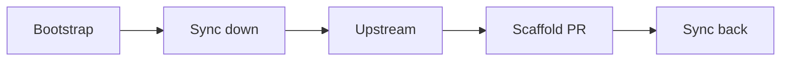

[← Scaffold at a glance](system-map.md)

# Scaffold sync

How shared rules and skills flow from the scaffold repo into project repos, and how a project's generic fix flows back up.



- [Bootstrap](#bootstrap): The first time, install the sync script, then run it once the user confirms.
- [Sync down](#sync-down): /sync-scaffold merges scaffold's files into the project on the current branch.
- [Upstream](#upstream): /upstream splits a project change into its universal half and moves that half into scaffold.
- [Scaffold PR](#scaffold-pr): Open a scaffold PR that says why the change is universal, and merge it only if authorized.
- [Sync back](#sync-back): Run /sync-scaffold again on a project branch to pull the merged change back in.

## Bootstrap

The first time, install the sync script, then run it once the user confirms.

Goes deeper: [/sync-scaffold skill](../../../skills/sync-scaffold.md)

- If bin/sync-from-scaffold.sh is missing, a curl of bootstrap.sh installs the script only.

## Sync down

/sync-scaffold merges scaffold's files into the project on the current branch.

Goes deeper: [/sync-scaffold skill](../../../skills/sync-scaffold.md)

- The manifest, scaffold-files.txt, lists the files scaffold ships.
- Each file gets a 3-way merge from the last synced commit.
- When a merge can't be automatic
  - No base and the file differs: the incoming copy is saved as a .scaffold-new sidecar to review.
  - Paths in .scaffold-keep are skipped.
  - Conflict markers: resolve, commit, re-run.

**Where it breaks**

- A sidecar is not applied: the original file is unchanged until someone diffs and merges it.

## Upstream

/upstream splits a project change into its universal half and moves that half into scaffold.

Goes deeper: [/upstream skill](../../../skills/upstream.md)

- Work in a scaffold worktree off origin/main, never its main checkout.
- Make the change the scaffold way: skill, wrappers, RESOLVER, manifest, test.
- npm test, eslint and typecheck must pass.

## Scaffold PR

Open a scaffold PR that says why the change is universal, and merge it only if authorized.

Goes deeper: [PR workflow](pr-workflow.md)

- The PR names the consumer that needed it.
- Read the real check conclusions; a skipped check is not a pass.
- Remove the worktree after the merge.

## Sync back

Run /sync-scaffold again on a project branch to pull the merged change back in.

Goes deeper: [/upstream skill](../../../skills/upstream.md)

- Keep .scaffold-keep paths and merge diverged files.
- Put the project-specific half in the project's own policy file.
- Then the project's own gates, PR and authorized merge.
- Another way out: /hoist-skill
  - Exports chosen skills into another repo in a target harness's format.
  - .sync/hoisted records the name, harness and pinned ref; --from-manifest replays it.

<details>
<summary>Detailed flow</summary>


</details>

## Glossary

- **Consumer**: A project repo that syncs from scaffold.
- **Manifest**: The list of files scaffold ships to consumers.
- **Sidecar**: A .scaffold-new copy saved beside your file for you to review and merge; your file is never overwritten.
- **.scaffold-keep**: The consumer's list of paths the sync never touches.

## Ask your LLM

Copy this block into your own assistant to ask about anything on this page.

```text
The reader wants to understand how scaffold's shared agent rules and skills sync into project repos and how fixes flow back.

Scaffold sync: How shared rules and skills flow from the scaffold repo into project repos, and how a project's generic fix flows back up.
- Bootstrap: The first time, install the sync script, then run it once the user confirms.
- Sync down: /sync-scaffold merges scaffold's files into the project on the current branch.
- Upstream: /upstream splits a project change into its universal half and moves that half into scaffold.
- Scaffold PR: Open a scaffold PR that says why the change is universal, and merge it only if authorized.
- Sync back: Run /sync-scaffold again on a project branch to pull the merged change back in.

Questions worth asking:
- What decides whether a change belongs in scaffold or stays in the project?
```
