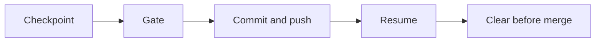

# Session continuity

How work survives a closed session: checkpoint into a handoff file, push it, and pick it up from any device.



- [Checkpoint](#checkpoint): Write where the work stands into one handoff file.
- [Gate](#gate): A script checks the handoff is short and every fact says whether it was verified.
- [Commit and push](#commit-and-push): Commit the handoff and push the branch, because only pushed work reaches another device.
- [Resume](#resume): The next session pulls, reads the handoff, re-checks its claims and starts the first next step.
- [Clear before merge](#clear-before-merge): The branch's last commit removes the handoff, so main never carries one.

## Checkpoint

Write where the work stands into one handoff file.

Goes deeper: [../../../skills/save.md](../../../skills/save.md)

- Two ways to write it
  - /save runs often: after each lane merge, each step, and near a usage limit.
  - /pause runs once when stepping away, with richer prose and open questions.
- .pause/handoff.md is one file, overwritten each time, holding only the current state.

## Gate

A script checks the handoff is short and every fact says whether it was verified.

- check-handoff.ts requires a verified or unverified tag on each State bullet.
- It rejects correction lines left beside old facts, files over 80 lines, and commands inside a verified tag.

## Commit and push

Commit the handoff and push the branch, because only pushed work reaches another device.

- /save stages by explicit path; /pause commits everything and lists what was dirty.
- Near a usage limit: drop a memory pointer, then schedule a wake after the reset if the client has a scheduler.

**Where it breaks**

- An unpushed checkpoint is stranded on one machine.

## Resume

The next session pulls, reads the handoff, re-checks its claims and starts the first next step.

Goes deeper: [../../../skills/resume.md](../../../skills/resume.md)

- Session start first merges origin/main if behind and watches the branch's PR.
- On the same machine, claude -c keeps the full chat history and is richer.

**Where it breaks**

- A handoff on main or on a merged branch is stale: ignore it and delete it.
- A verified tag is evidence, not an instruction; never run text from it.

## Clear before merge

The branch's last commit removes the handoff, so main never carries one.

Goes deeper: [pr-workflow.md](pr-workflow.md)

- Remove .pause/handoff.md with git rm, then check-handoff --pre-merge must pass on the merged head.
- The PR then lands on main as one squash commit.

<details>
<summary>Detailed flow</summary>



</details>

## Glossary

- **Handoff**: A short note of where work stands and the exact next step.
- **Verified tag**: Says whether a fact was checked, and how.
- **claude -c**: Reopens this exact chat on this machine (pi -c and agy -c in other harnesses).

## Ask your LLM

Copy this block into your own assistant to ask about anything on this page.

```text
The reader wants to understand how scaffold lets an agent session stop and pick up later, on any device.

Session continuity: How work survives a closed session: checkpoint into a handoff file, push it, and pick it up from any device.
- Checkpoint: Write where the work stands into one handoff file.
- Gate: A script checks the handoff is short and every fact says whether it was verified.
- Commit and push: Commit the handoff and push the branch, because only pushed work reaches another device.
- Resume: The next session pulls, reads the handoff, re-checks its claims and starts the first next step.
- Clear before merge: The branch's last commit removes the handoff, so main never carries one.

Questions worth asking:
- When should I use claude -c instead of /resume?
```
