[← Scaffold at a glance](system-map.md)

# Skillify

How finished work becomes a reusable skill that every agent and every downstream repo can invoke.


- [Reconstruct context](#reconstruct-context): Rebuild what the session did without asking the user to re-explain.
- [Interview](#interview): Four short rounds, one question at a time, each with a recommended answer.
- [Name and dedupe](#name-and-dedupe): Pick one skill, give it a short name, and check it isn't a duplicate.
- [Generate and register](#generate-and-register): Write the skill body and its wrappers, register it, and validate.
- [PR to scaffold](#pr-to-scaffold): Open a pull request against scaffold so every repo inherits the skill, then stop for review.

## Reconstruct context

Rebuild what the session did without asking the user to re-explain.

Details: [/skillify skill](../../../skills/skillify.md)

- Reads the conversation, project manifests, git diff --stat and git log.
- Writes a one-paragraph recap that the user confirms in one line.

## Interview

Four short rounds, one question at a time, each with a recommended answer.

- Intent, then inputs, then steps, then edge cases.
- Stops early if all four are already clear from context.

## Name and dedupe

Pick one skill, give it a short name, and check it isn't a duplicate.

- One skill per run: if the session had several, pick the most valuable and say so.
- The slug is kebab-case, at most 30 characters, and stated before any file is written.

**Where it breaks**

- If RESOLVER already has a skill with overlapping purpose, extend that one with an argument instead of adding a near-duplicate.

## Generate and register

Write the skill body and its wrappers, register it, and validate.

- Five files
  - `skills/<slug>.md` is the canonical body.
  - Thin wrappers for Claude, Cursor, .agents and .agent/workflows point at it, all with the same description.
- Register
  - A RESOLVER row with a unique ^/slug anchor.
  - New paths appended to .github/scaffold-files.txt so sync copies them.
  - A focused test for any script logic.

**Where it breaks**

- Register or it doesn't ship: client discovery alone does not make a skill available through scaffold sync.
- node scripts/check-resolvable.ts must pass before the PR; it rejects wrapper descriptions that drift apart.

## PR to scaffold

Open a pull request against scaffold so every repo inherits the skill, then stop for review.

Details: [Scaffold sync](scaffold-sync.md)

- Branch `skillify/<slug>` off `scaffold/main`, push, and open a PR titled `feat(skill): <slug>`.
- Do not merge; the summary lists slug, files, validator result and PR link.

<details>
<summary>Detailed flow</summary>



</details>

## Glossary

- **Slug**: The skill's short kebab-case name, used everywhere it is referenced.
- **RESOLVER**: The routing table that maps /slug to its skill file.
- **Wrapper**: A thin per-tool file that points at the canonical skill body.

## Ask your LLM

Copy this block into your own assistant to ask about anything on this page.

```text
The reader wants to understand scaffold's /skillify skill: how an AI agent turns a finished session into a registered, reusable skill.

Skillify: How finished work becomes a reusable skill that every agent and every downstream repo can invoke.
- Reconstruct context: Rebuild what the session did without asking the user to re-explain.
- Interview: Four short rounds, one question at a time, each with a recommended answer.
- Name and dedupe: Pick one skill, give it a short name, and check it isn't a duplicate.
- Generate and register: Write the skill body and its wrappers, register it, and validate.
- PR to scaffold: Open a pull request against scaffold so every repo inherits the skill, then stop for review.

Questions worth asking:
- Why only one skill per run?

Scaffold: https://github.com/victusfate/scaffold
This page: https://github.com/victusfate/scaffold/blob/main/docs/diagrams/pages/skillify.md
```
