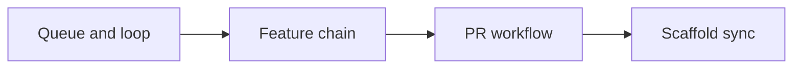

# Scaffold at a glance

How scaffold's skills fit together. Click a skill for its own page; each page starts high level and drills down.



- [Feature chain](#feature-chain): Idea → design → PRD → TDD → refine → QA → PR.
- [PR workflow](#pr-workflow): One task per PR, real CI checks, owner merges.
- [Queue and loop](#queue-and-loop): A visible task queue drained by the orchestrator and its subagents.
- [Save, pause, resume](#save-pause-resume): Keep a long session alive across closes and devices.
- [Scaffold sync](#scaffold-sync): Move skills and rules between scaffold and the repos that use it.

## Feature chain

Idea → design → PRD → TDD → refine → QA → PR.

Goes deeper: [feature-chain.md](feature-chain.md)

## PR workflow

One task per PR, real CI checks, owner merges.

Goes deeper: [pr-workflow.md](pr-workflow.md)

## Queue and loop

A visible task queue drained by the orchestrator and its subagents.

Goes deeper: [queue-lifecycle.md](queue-lifecycle.md)

## Save, pause, resume

Keep a long session alive across closes and devices.

Goes deeper: [session-continuity.md](session-continuity.md)

## Scaffold sync

Move skills and rules between scaffold and the repos that use it.

Goes deeper: [scaffold-sync.md](scaffold-sync.md)

## Ask your LLM

Copy this block into your own assistant to ask about anything on this page.

```text
The reader wants an overview of scaffold, a template that gives AI coding agents shared skills, rules and workflows.

Scaffold at a glance: How scaffold's skills fit together. Click a skill for its own page; each page starts high level and drills down.
- Feature chain: Idea → design → PRD → TDD → refine → QA → PR.
- PR workflow: One task per PR, real CI checks, owner merges.
- Queue and loop: A visible task queue drained by the orchestrator and its subagents.
- Save, pause, resume: Keep a long session alive across closes and devices.
- Scaffold sync: Move skills and rules between scaffold and the repos that use it.
```
