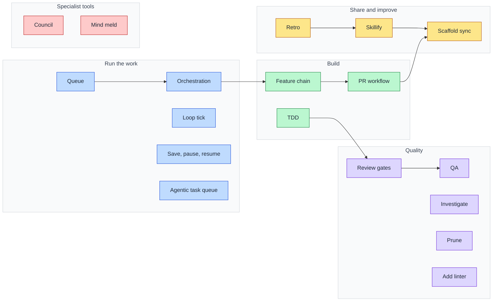

# Scaffold at a glance

Scaffold gives AI coding agents shared skills, rules and workflows. Click any skill link below the map for its own page; each page starts high level and drills down to the full detail.



- [Orchestration](orchestration.md): One orchestrator per session owns the plan and the branch; subagents do one task each in their own worktree.
- [Queue](queue-lifecycle.md): A visible, editable task list that agents drain one task at a time or in parallel.
- [Loop tick](loop-tick.md): The heartbeat that picks the next queue task and keeps work moving.
- [Save, pause, resume](session-continuity.md): Checkpoint a long session into git so it survives a close and resumes anywhere.
- [Agentic task queue](agentic-task-queue.md): The design for a queue shared across projects, and which parts of it are built.
- [Feature chain](feature-chain.md): Design, PRD, TDD, refine and QA, ending in a PR for the owner.
- [TDD](tdd.md): Build in thin vertical slices: failing test, minimal code, refactor.
- [PR workflow](pr-workflow.md): One task per PR, real CI checks, squash merge only with owner approval.
- [Review gates](review-gates.md): Independent correctness and structure reviews, one fix pass, re-verified.
- [QA](qa.md): Drive the real app the way a user would and fix what breaks.
- [Investigate](investigate.md): Find the root cause before changing code.
- [Prune](prune.md): Run every quality lens, then fix the findings through the feature chain.
- [Add linter](add-linter.md): Add linter configs and CI workflows for each language in a repo.
- [Scaffold sync](scaffold-sync.md): Sync skills down to consumer repos, upstream improvements, hoist skills out.
- [Skillify](skillify.md): Turn finished work into a reusable, registered skill.
- [Retro](retro.md): An evidence-backed look back at a session that proposes concrete fixes.
- [Council](council.md): Five advisors, anonymous peer review and a chairman verdict for hard decisions.
- [Mind meld](mind-meld.md): A repo-owned learning IDE built from code indexes and real runs.

## Scaffold Flow Atlas

18 diagrams, checked against their source docs. Each page below shows its stages, the code that carries each stage out with the helpers that code calls, and every claim set beside the line of source it rests on.

| Flow | Confirmed | Partly | Not found | Contradicted | In the source, not shown in the flow | Code excerpts |
|---|---:|---:|---:|---:|---:|---:|
| [Orchestration](orchestration.md) | 29 | 7 | 0 | 0 | 10 | 12 |
| [Queue task lifecycle](queue-lifecycle.md) | 29 | 6 | 0 | 0 | 10 | 14 |
| [One loop tick](loop-tick.md) | 30 | 5 | 0 | 0 | 6 | 14 |
| [Session continuity](session-continuity.md) | 30 | 3 | 0 | 0 | 8 | 9 |
| [Agentic task queue](agentic-task-queue.md) | 23 | 1 | 1 | 0 | 9 | 14 |
| [Feature chain](feature-chain.md) | 30 | 6 | 0 | 0 | 8 | 12 |
| [TDD](tdd.md) | 37 | 6 | 0 | 0 | 4 | 11 |
| [PR workflow](pr-workflow.md) | 29 | 5 | 0 | 0 | 11 | 13 |
| [Review gates](review-gates.md) | 33 | 3 | 0 | 0 | 5 | 12 |
| [QA](qa.md) | 34 | 3 | 0 | 0 | 8 | 6 |
| [Investigate](investigate.md) | 31 | 1 | 0 | 0 | 7 | 6 |
| [Prune](prune.md) | 26 | 0 | 0 | 0 | 4 | 11 |
| [Add linter](add-linter.md) | 28 | 3 | 0 | 0 | 8 | 13 |
| [Scaffold sync](scaffold-sync.md) | 30 | 6 | 0 | 0 | 8 | 14 |
| [Skillify](skillify.md) | 30 | 4 | 0 | 0 | 4 | 14 |
| [Retro](retro.md) | 35 | 1 | 0 | 0 | 9 | 1 |
| [Council](council.md) | 43 | 1 | 0 | 0 | 4 | 6 |
| [Mind meld](mind-meld.md) | 46 | 1 | 1 | 0 | 8 | 14 |
| **All flows** | **573** | **62** | **2** | **0** | **131** | **196** |

The verdicts and explanations were written by an agent and are judgments. Quotes and code are read from the repo when the pages are built, and `npm test` fails when a quoted line or an explained block of code changes.

## Ask your LLM

Copy this block into your own assistant to ask about anything on this page.

```text
The reader wants an overview of scaffold, a template that gives AI coding agents
shared skills, rules and workflows, and how its skills fit together.
Read this page:
https://github.com/victusfate/scaffold/blob/main/docs/diagrams/pages/system-map.md
Scaffold: https://github.com/victusfate/scaffold
```
