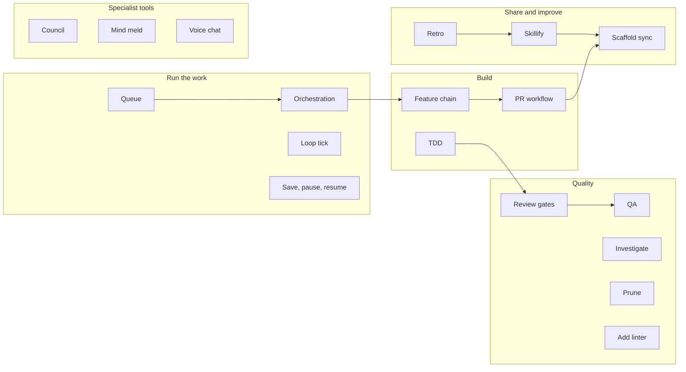

# Scaffold at a glance

Scaffold gives AI coding agents shared skills, rules and workflows. Click any skill link below the map for its own page; each page starts high level and drills down to the full detail.



- [Orchestration](orchestration.md): One orchestrator per session owns the plan and the branch; subagents do one task each in their own worktree.
- [Queue](queue-lifecycle.md): A visible, editable task list that agents drain one task at a time or in parallel.
- [Loop tick](loop-tick.md): The heartbeat that picks the next queue task and keeps work moving.
- [Save, pause, resume](session-continuity.md): Checkpoint a long session into git so it survives a close and resumes anywhere.
- [Feature chain](feature-chain.md): Design, PRD, TDD, refine and QA, ending in a PR for the owner.
- [TDD](tdd.md): Build in thin vertical slices: failing test, minimal code, refactor.
- [PR workflow](pr-workflow.md): One task per PR, real CI checks, squash merge only with owner approval.
- [Review gates](review-gates.md): Independent correctness and structure reviews, one fix pass, re-verified.
- [QA](qa.md): Drive the real app the way a user would and fix what breaks.
- [Investigate](investigate.md): Find the root cause before changing code.
- [Prune](prune.md): Run every quality lens, then fix the findings through the feature chain.
- [Add linter](add-linter.md): Add linter configs and CI workflows for each language in a repo.
- [Scaffold sync](scaffold-sync.md): Sync skills down to consumer repos, upstream improvements, hoist skills out.
- [Skillify](skillify.md): Turn finished work into a reusable, registered skill.
- [Retro](retro.md): An evidence-backed look back at a session that proposes concrete fixes.
- [Council](council.md): Five advisors, anonymous peer review and a chairman verdict for hard decisions.
- [Mind meld](mind-meld.md): A repo-owned learning IDE built from code indexes and real runs.
- [Voice chat](voice-chat.md): A hands-free voice loop with the coding agent.

## Ask your LLM

Copy this block into your own assistant to ask about anything on this page.

```text
The reader wants an overview of scaffold, a template that gives AI coding agents shared skills, rules and workflows, and how its skills fit together.

Scaffold at a glance: Scaffold gives AI coding agents shared skills, rules and workflows. Click any skill link below the map for its own page; each page starts high level and drills down to the full detail.
- Orchestration: One orchestrator per session owns the plan and the branch; subagents do one task each in their own worktree.
- Queue: A visible, editable task list that agents drain one task at a time or in parallel.
- Loop tick: The heartbeat that picks the next queue task and keeps work moving.
- Save, pause, resume: Checkpoint a long session into git so it survives a close and resumes anywhere.
- Feature chain: Design, PRD, TDD, refine and QA, ending in a PR for the owner.
- TDD: Build in thin vertical slices: failing test, minimal code, refactor.
- PR workflow: One task per PR, real CI checks, squash merge only with owner approval.
- Review gates: Independent correctness and structure reviews, one fix pass, re-verified.
- QA: Drive the real app the way a user would and fix what breaks.
- Investigate: Find the root cause before changing code.
- Prune: Run every quality lens, then fix the findings through the feature chain.
- Add linter: Add linter configs and CI workflows for each language in a repo.
- Scaffold sync: Sync skills down to consumer repos, upstream improvements, hoist skills out.
- Skillify: Turn finished work into a reusable, registered skill.
- Retro: An evidence-backed look back at a session that proposes concrete fixes.
- Council: Five advisors, anonymous peer review and a chairman verdict for hard decisions.
- Mind meld: A repo-owned learning IDE built from code indexes and real runs.
- Voice chat: A hands-free voice loop with the coding agent.

Scaffold: https://github.com/victusfate/scaffold
This page: https://github.com/victusfate/scaffold/blob/main/docs/diagrams/pages/system-map.md
```
