[← Scaffold at a glance](system-map.md)

# TDD

How a feature gets built one thin slice at a time: a failing test, the least code that passes it, a quality check, a commit.


- [Plan the slices](#plan-the-slices): Split the PRD into vertical slices and confirm their size once with the user.
- [Before code](#before-code): For each slice, decide the interface and list the behaviors to test.
- [Red, then green](#red-then-green): Write one failing test, then the least code that makes it pass, and repeat.
- [Refactor check](#refactor-check): Score each touched file on the four-part rubric and audit the tests before committing.
- [Commit and log](#commit-and-log): Commit the red, green and refactor steps, log the slice, then start the next one.
- [All slices pass](#all-slices-pass): Run the full suite, then /code-refiner, then stop for the user's review.

## Plan the slices

Split the PRD into vertical slices and confirm their size once with the user.

- If plan.md is missing, the agent writes it from prd.md first.
- Each slice cuts through every layer
  - Data, logic, UI and tests together.
  - After the size is confirmed, an interface change is surfaced only if it departs from plan.md; a large fix is always surfaced.

## Before code

For each slice, decide the interface and list the behaviors to test.

- List behaviors, not implementation steps.
- Name the assumption the slice tests
  - Use the design's evidence, or mark it unknown.
  - If a probe contradicts the intent, revise the design, PRD and unfinished slices first.

## Red, then green

Write one failing test, then the least code that makes it pass, and repeat.

Details: [Investigate](investigate.md)

- The first test is a tracer bullet: one behavior, proving the path works end to end.
- Tests use the public interface only, so they survive an internal refactor.

**Where it breaks**

- Writing all tests first verifies imagined behavior; one test at a time keeps them honest.
- A test that fails for a different reason, or an old test that breaks, stops the loop for /investigate.

## Refactor check

Score each touched file on the four-part rubric and audit the tests before committing.

- Aim for 10/10 on every score
  - A fix under 30 lines is applied in place, then re-tested and re-scored.
  - A bigger fix is flagged to the user for cleanup, never silently patched.
- Test self-audit
  - Assertions use sentinel values, not defaults.
  - Every form of a new flag is covered.
  - A missing caller-side test is flagged for the integration suite.

## Commit and log

Commit the red, green and refactor steps, log the slice, then start the next one.

- Commits: test (red), feat (green), and refactor only if something was refactored.
- Each slice's status is appended to tdd-log.md.

## All slices pass

Run the full suite, then /code-refiner, then stop for the user's review.

Details: [Review gates](review-gates.md)

- /code-refiner runs in auto-fix mode: correctness and structure reviews, then one fix pass.
- A summary lists what was built, the tests and any deviation from the plan.

## Detailed flow



## Code walkthrough

Almost all of /tdd is prose the agent follows from skills/tdd.md: planning slices, writing the failing test, the minimal code and the rubric scoring are not coded anywhere. Code only backs the edges: scripts/check-quality-mechanical.sh checks three of the rubric rules, .githooks/pre-commit runs it on each commit, package.json and .github/workflows/ci.yml define and run the full suite, and two shell tests pin that skills/tdd.md keeps its rubric and /investigate wording. Nothing in the repo checks that a test failed before it passed, that commits follow the red/green naming, or that tdd-log.md was written.

Each excerpt is read from the repo when this page is built. The explanations were written by an agent; `npm test` fails when the lines they explain change.

### Plan the slices: code

No code here: The agent reads prd.md, writes plan.md as vertical slices, and asks the user once whether the slice size is right; no script creates or checks plan.md.

### Before code: code

No code here: For each slice the agent decides the interface changes, lists the behaviors to test and names the assumption the slice tests, all from the skill text.

### Red, then green: code

#### test-investigate-skill.sh: tdd must point at /investigate

*Test that pins it.* The has helper greps a file for a pattern and records a pass or a fail. These lines assert that skills/create-pr.md and skills/tdd.md both mention /investigate. finish prints the totals and returns non-zero if any assertion failed.

```bash
has skills/create-pr.md '/investigate'           "create-pr Step 2 diagnoses with /investigate"
has skills/tdd.md '/investigate'                 "tdd routes unexpected failures to /investigate"

finish
```

[`scripts/test-investigate-skill.sh:22-25`](https://github.com/victusfate/scaffold/blob/main/scripts/test-investigate-skill.sh#L22-L25)

**Why it matters.** The loop says to stop and run /investigate when a test fails for an unexpected reason. This test only keeps that sentence in the skill text; it does not make the agent stop.

**Methods and helpers used here**

<details>
<summary><code>has</code> · shell function · scripts/lib/skill-test.sh:11</summary>

Takes a file, an extended regular expression and a label, and greps the file case-insensitively for the pattern. It prints the label with a check mark and increments PASS on a match, or prints it with a cross and increments FAIL otherwise, including when the file cannot be read.

Comment in the source: has &lt;file&gt; &lt;extended-regex&gt; &lt;label&gt; — case-insensitive grep assertion.

```bash
has() { grep -qiE "$2" "$1" && ok "$3" || fail "$3"; }
```

[`scripts/lib/skill-test.sh:11`](https://github.com/victusfate/scaffold/blob/main/scripts/lib/skill-test.sh#L11)

</details>

<details>
<summary><code>finish</code> · shell function · scripts/lib/skill-test.sh:16</summary>

Prints a blank line and then the '&lt;PASS&gt; passed, &lt;FAIL&gt; failed.' totals from the global counters. Its exit status is 0 when FAIL is zero and non-zero otherwise, so a test script ending with it fails if any assertion failed.

```bash
finish() { echo ""; echo "$PASS passed, $FAIL failed."; [ "$FAIL" -eq 0 ]; }
```

[`scripts/lib/skill-test.sh:16`](https://github.com/victusfate/scaffold/blob/main/scripts/lib/skill-test.sh#L16)

</details>

### Refactor check: code

#### test-tdd-rubric.sh: skills/tdd.md must keep its rubric steps

*Test that pins it.* Greps skills/tdd.md for six patterns: the @-include of lib/code-quality-rubric.md, the rubric being loaded before GREEN, REFACTOR as a confirmation pass, the per-slice score table, the 30-line fix threshold, and the surface-to-user rule. It counts passes and failures and exits non-zero if any pattern is missing. npm test runs it through test:shell.

```bash
echo "TDD rubric integration check: $TDD"
check "@-include of rubric present"           "@\.\./lib/code-quality-rubric"
check "rubric loaded before GREEN"            "rubric|quality.*before|generative"
check "REFACTOR as confirmation framing"      "confirm|confirmation|already"
check "per-slice score display"               "score.*slice|slice.*score|dimension.*score|Quality Scores"
check "auto-fix threshold stated"             "30 line|30-line|auto.fix"
check "surface threshold stated"              "surface|block.*arch|architectural"
echo ""; echo "$PASS passed, $FAIL failed."; [ "$FAIL" -eq 0 ]
```

[`scripts/test-tdd-rubric.sh:15-22`](https://github.com/victusfate/scaffold/blob/main/scripts/test-tdd-rubric.sh#L15-L22)

**Why it matters.** The refactor check is carried out by the agent from this text. If an edit dropped the rubric include or the 10/10 scoring from the skill, the agent would stop doing the check and nothing else would notice.

**Methods and helpers used here**

<details>
<summary><code>check</code> · shell function · scripts/test-tdd-rubric.sh:6</summary>

Takes a description and an extended-regex pattern and greps the file named by TDD (skills/tdd.md) for the pattern, with grep errors suppressed. On a match it prints the description with a check mark and increments the global PASS counter; otherwise it prints it with a cross mark and increments FAIL.

```bash
check() {
  local desc="$1"; local pattern="$2"
  if grep -qE "$pattern" "$TDD" 2>/dev/null; then
    echo "  ✓ $desc"; PASS=$((PASS + 1))
  else
    echo "  ✗ $desc"; FAIL=$((FAIL + 1))
  fi
}
```

[`scripts/test-tdd-rubric.sh:6-13`](https://github.com/victusfate/scaffold/blob/main/scripts/test-tdd-rubric.sh#L6-L13)

</details>

#### check_file: the 500-line file length check

*Enforces the rule.* Counts the lines in the file with wc -l. If the count is over MAX_LINES (500) and the file has no "quality-ok: file-length" pragma, it emits a Readability/major violation with the file name. Each emit adds one to VIOLATIONS, which makes the script exit non-zero at the end.

```bash
  # File length. A `quality-ok: file-length — <reason>` pragma anywhere in the file
  # (by convention on the first non-shebang line) blesses a genuinely cohesive file
  # that reads as one unit and would only be fragmented by a split. Like the
  # magic-number pragma, the keyword is the gate; the required reason is enforced at
  # review time, not parsed here. Commented-out-code has no such escape hatch.
  local count
  count=$(wc -l < "$file")
  if [ "$count" -gt "$MAX_LINES" ] \
     && ! grep -Eq '(#|//)[[:space:]]*quality-ok:[[:space:]]*file-length' "$file"; then
    emit "${file}:${MAX_LINES} [Readability/major] file is ${count} lines — exceeds ${MAX_LINES}-line limit; split into cohesive modules (or add a 'quality-ok: file-length — <reason>' pragma if it is one cohesive unit)"
  fi
```

[`scripts/check-quality-mechanical.sh:63-73`](https://github.com/victusfate/scaffold/blob/main/scripts/check-quality-mechanical.sh#L63-L73)

**Why it matters.** The rubric scores Readability down for a file over 500 lines. This is the one part of that score a script decides, so the agent cannot score a too-long file 10/10 and have it pass the commit hook or CI.

**Methods and helpers used here**

<details>
<summary><code>emit</code> · shell function · scripts/check-quality-mechanical.sh:16</summary>

Prints its first argument, a violation message, to stdout and adds one to the global VIOLATIONS counter. The script exits 1 at the end when that counter is above zero.

```bash
emit() { echo "$1"; VIOLATIONS=$((VIOLATIONS + 1)); }
```

[`scripts/check-quality-mechanical.sh:16`](https://github.com/victusfate/scaffold/blob/main/scripts/check-quality-mechanical.sh#L16)

</details>

#### check_file: the magic number check

*Enforces the rule.* Runs after the earlier skips (test files, pragma lines, return/exit lines, named constants, numbers inside strings). It matches the remaining text against a pattern for a bare integer of two or more digits. A match emits a Readability/minor violation with file:line telling the author to extract a named constant.

```bash
    # Flag bare integers ≥2 digits that are not array indices or lone 0/1.
    # Bash ERE in [[ =~ ]] supports {2,}; the regex lives in a variable so it
    # is matched as a pattern (no subprocess vs the old echo|grep).
    local magic_re='[^a-zA-Z0-9_."'\''][0-9]{2,}[^a-zA-Z0-9_.]'
    if [[ "$scan" =~ $magic_re ]]; then
      emit "${file}:${lineno} [Readability/minor] magic number — extract to a named constant (or use quality-ok: magic-number pragma if the value is self-documenting)"
    fi
```

[`scripts/check-quality-mechanical.sh:167-173`](https://github.com/victusfate/scaffold/blob/main/scripts/check-quality-mechanical.sh#L167-L173)

**Why it matters.** "No magic numbers" is a mechanical rubric rule. Without this check it would rest on the agent noticing bare literals while scoring its own code.

**Methods and helpers used here**

<details>
<summary><code>emit</code> · shell function · scripts/check-quality-mechanical.sh:16</summary>

Prints its first argument, a violation message, to stdout and adds one to the global VIOLATIONS counter. The script exits 1 at the end when that counter is above zero.

```bash
emit() { echo "$1"; VIOLATIONS=$((VIOLATIONS + 1)); }
```

[`scripts/check-quality-mechanical.sh:16`](https://github.com/victusfate/scaffold/blob/main/scripts/check-quality-mechanical.sh#L16)

</details>

#### check_file: the commented-out code check

*Enforces the rule.* Reads the file line by line. A line counts as commented-out code when it starts with // or # followed by a code word such as function, const, return or import. When two such lines come in a row it emits a Clarity/minor violation with file:line. There is no pragma that turns this check off.

```bash
  # Commented-out code: two or more consecutive lines starting with // or #
  # that look like code (contain common code tokens).
  local prev_was_comment=0
  lineno=0
  while IFS= read -r line; do
    lineno=$((lineno + 1))
    if [[ "$line" =~ ^[[:space:]]*(//|#)[[:space:]]*(function|const|let|var|return|if|for|while|class|import|export|}) ]]; then
      if [ "$prev_was_comment" -eq 1 ]; then
        emit "${file}:${lineno} [Clarity/minor] commented-out code block — delete dead code instead of archiving inline"
      fi
      prev_was_comment=1
    else
      prev_was_comment=0
    fi
  done < "$file"
```

[`scripts/check-quality-mechanical.sh:177-191`](https://github.com/victusfate/scaffold/blob/main/scripts/check-quality-mechanical.sh#L177-L191)

**Why it matters.** "No commented-out code" is a mechanical rubric rule under Clarity. The script catches it even if the agent's own score table says 10.

**Methods and helpers used here**

<details>
<summary><code>emit</code> · shell function · scripts/check-quality-mechanical.sh:16</summary>

Prints its first argument, a violation message, to stdout and adds one to the global VIOLATIONS counter. The script exits 1 at the end when that counter is above zero.

```bash
emit() { echo "$1"; VIOLATIONS=$((VIOLATIONS + 1)); }
```

[`scripts/check-quality-mechanical.sh:16`](https://github.com/victusfate/scaffold/blob/main/scripts/check-quality-mechanical.sh#L16)

</details>

#### Integration test header: skip unless RUN_INTEGRATION is set

*Carries out the step.* The file is a Node script. Before importing anything it checks process.env.RUN_INTEGRATION. If the variable is not set it prints a skip line and exits 0, so the test counts as passed without running.

```bash
#!/usr/bin/env node
// End-to-end integration test for hoist-skill — simulates a real consumer workflow.
// Runs against a real empty temp directory (not the scaffold root).
// Gate: set RUN_INTEGRATION=1 to run.

if (!process.env.RUN_INTEGRATION) {
  console.log('skip — set RUN_INTEGRATION=1 to run integration tests');
  process.exit(0);
}
```

[`tools/hoist-skill/test-integration:1-9`](https://github.com/victusfate/scaffold/blob/main/tools/hoist-skill/test-integration#L1-L9)

**Why it matters.** The test self-audit asks for a caller-side test and says to put it in the integration suite when it does not fit the acceptance tests. This is the gate convention skills/tdd.md prescribes for those files, shown in a real one.

### Commit and log: code

#### pre-commit hook: mechanical check, typecheck, skill routing gate

*Enforces the rule.* Runs on every git commit once core.hooksPath points at .githooks. It runs the mechanical quality check on the staged files, then tsc --noEmit if a tsconfig.json exists, then check-resolvable.ts and the skills-doc freshness check. The script runs under set -eu, so the first failing step aborts the commit.

```bash
if [ -f scripts/check-quality-mechanical.sh ]; then
  bash scripts/check-quality-mechanical.sh --staged
fi

if [ -f tsconfig.json ]; then
  if [ -x node_modules/.bin/tsc ]; then
    node_modules/.bin/tsc --noEmit
  else
    echo "pre-commit: tsconfig.json present but tsc not installed — skipping (install deps, e.g. npm ci)" >&2
  fi
fi

if [ -f scripts/check-resolvable.ts ]; then node scripts/check-resolvable.ts; fi
if [ -f scripts/update-skills-doc.ts ]; then node scripts/update-skills-doc.ts --check; fi
```

[`.githooks/pre-commit:28-41`](https://github.com/victusfate/scaffold/blob/main/.githooks/pre-commit#L28-L41)

**Why it matters.** Each slice is committed as red, green and optional refactor commits. With the hook enabled, every one of those commits must pass the mechanical check and the typecheck. The hook does not check the commit message format or tdd-log.md.

**Methods and helpers used here**

<details>
<summary><code>staged</code> · shell function · .githooks/pre-commit:17</summary>

Prints the NUL-separated paths of files staged in the git index as added, copied, modified or renamed, limited to the pathspecs passed as arguments. It changes nothing; the output is meant to be piped to xargs -0.

Comment in the source: Linters read the working-tree copy, so a partially staged file is checked as edited.

```bash
staged() { git diff --cached --name-only --diff-filter=ACMR -z -- "$@"; }
```

[`.githooks/pre-commit:17`](https://github.com/victusfate/scaffold/blob/main/.githooks/pre-commit#L17)

</details>

#### SessionStart hook: turn on the pre-commit gate in cloud sessions

*Carries out the step.* When CLAUDE_CODE_REMOTE is "true", .githooks/pre-commit exists and core.hooksPath is not set, it sets core.hooksPath to .githooks. In a local session it changes nothing.

```bash
# Cloud sessions get the pre-commit gate without anyone remembering to opt in.
# Locally, enabling hooks stays your choice: git config core.hooksPath .githooks
if [ "${CLAUDE_CODE_REMOTE:-}" = "true" ] && [ -f .githooks/pre-commit ] &&
  [ -z "$(git config core.hooksPath)" ]; then
  git config core.hooksPath .githooks
fi
```

[`.claude/session-start/hook.sh:12-17`](https://github.com/victusfate/scaffold/blob/main/.claude/session-start/hook.sh#L12-L17)

**Why it matters.** The per-slice commits are only gated if the hook is enabled. This turns it on for cloud sessions; locally it stays the user's choice, so the gate may not run there.

### All slices pass: code

#### package.json: what "the full suite" runs

*Carries out the step.* npm test chains four scripts. test:node runs every *.test.ts under scripts/, tools/ and lib/ with node --test. test:tools runs each tool's own test file, test:shell runs every scripts/test-*.sh, and test:checks runs the repo checks. test:integration is separate and is not part of npm test.

```json
    "test": "npm run test:node && npm run test:tools && npm run test:shell && npm run test:checks",
    "test:node": "node --test --test-concurrency=1 'scripts/**/*.test.ts' 'tools/**/*.test.ts' 'lib/**/*.test.ts'",
    "test:tools": "tools/hoist-skill/test && tools/sync/test && node tools/linter-setup/test && node tools/dependency-watch/test",
    "test:shell": "for f in scripts/test-*.sh; do [ \"$f\" = scripts/test-read-once.sh ] || bash \"$f\" || exit 1; done",
    "test:checks": "node scripts/check-resolvable.ts --strict && node scripts/update-skills-doc.ts --check && node scripts/check-agents-detail.ts && node scripts/check-handoff.ts && node scripts/check-guidelines.ts && node scripts/render-explorer-pages.ts --check && node scripts/render-diagrams.ts --check",
    "test:integration": "RUN_INTEGRATION=1 tools/hoist-skill/test-integration && RUN_INTEGRATION=1 tools/sync/test-integration && RUN_INTEGRATION=1 tools/linter-setup/test-integration",
```

[`package.json:9-14`](https://github.com/victusfate/scaffold/blob/main/package.json#L9-L14)

**Why it matters.** The last stage starts when "the full test suite is green". These scripts are what that suite is in this repo.

#### CI job "verify": npm test on every PR to main

*Enforces the rule.* On a pull request to main the job checks out the code, installs the Node version named in .node-version, runs npm ci, and then runs npm test. A failing test fails the job.

```yaml
  verify:
    runs-on: ubuntu-latest
    env:
      FORCE_JAVASCRIPT_ACTIONS_TO_NODE24: true
    steps:
      - uses: actions/checkout@fbc6f3992d24b796d5a048ff273f7fcc4a7b6c09 # v5
        with:
          persist-credentials: false
      - uses: actions/setup-node@a0853c24544627f65ddf259abe73b1d18a591444 # v5
        with:
          node-version-file: .node-version
      - run: npm ci
      - run: npm test
```

[`.github/workflows/ci.yml:12-24`](https://github.com/victusfate/scaffold/blob/main/.github/workflows/ci.yml#L12-L24)

**Why it matters.** After the agent stops for review, this job re-runs the full suite on the PR. A suite that was not really green locally is caught here.

#### Quality Gate workflow: mechanical checks on all tracked source

*Enforces the rule.* On every pull request the job lists all tracked js, mjs, ts, tsx, sh, py, rb and go files with git ls-files. It passes the whole list to check-quality-mechanical.sh. Any violation makes the script exit 1, which fails the job.

```yaml
  mechanical:
    name: Mechanical checks
    runs-on: ubuntu-latest
    steps:
      - uses: actions/checkout@fbc6f3992d24b796d5a048ff273f7fcc4a7b6c09 # v5
        with:
          persist-credentials: false
      - name: Run mechanical quality checks (all files)
        run: |
          mapfile -t FILES < <(git ls-files | grep -E '\.(js|mjs|ts|tsx|sh|py|rb|go)$' || true)
          [ ${#FILES[@]} -gt 0 ] && bash scripts/check-quality-mechanical.sh "${FILES[@]}"
```

[`.github/workflows/quality.yml:11-21`](https://github.com/victusfate/scaffold/blob/main/.github/workflows/quality.yml#L11-L21)

**Why it matters.** /code-refiner must leave every rubric score at 10/10. This job re-checks the three mechanical rules on the PR, for every source file and not only the ones the slice touched.

## Checked against the source

The TDD spec and diagram match skills/tdd.md closely; every stage, gate, threshold and artifact is stated in the source. The only non-confirmed items are small teaching glosses ('keeps them honest', TDD as 'then clean up', RED 'because the behavior doesn't exist yet'). The main omission is that the rubric is loaded before GREEN code is written, plus the optional integration-test section.

| Confirmed | Partly | Not found | Contradicted | In the source, not shown in the flow | Code excerpts |
|---:|---:|---:|---:|---:|---:|
| 43 | 3 | 0 | 0 | 4 | 11 |

An agent judged each claim against the source; each quote is found in its file when this page is built.

### Plan the slices: checks

<details>
<summary>7 confirmed, with the supporting line</summary>

- **Confirmed**: Split the PRD into vertical slices and confirm their size once with the user.
  > Confirm granularity once with the user before coding.
  >
  > [`skills/tdd.md:5`](https://github.com/victusfate/scaffold/blob/main/skills/tdd.md#L5)

- **Confirmed**: If plan.md is missing, the agent writes it from prd.md first.
  > If \`plan.md\` doesn't exist yet, create it first: break \`prd.md\` into vertical slices
  >
  > [`skills/tdd.md:5`](https://github.com/victusfate/scaffold/blob/main/skills/tdd.md#L5)

- **Confirmed**: Each slice cuts through every layer
  > (each cuts through all layers: data → logic → UI → tests)
  >
  > [`skills/tdd.md:5`](https://github.com/victusfate/scaffold/blob/main/skills/tdd.md#L5)

- **Confirmed**: Data, logic, UI and tests together.
  > (each cuts through all layers: data → logic → UI → tests)
  >
  > [`skills/tdd.md:5`](https://github.com/victusfate/scaffold/blob/main/skills/tdd.md#L5)

- **Confirmed**: After the size is confirmed, an interface change is surfaced only if it departs from plan.md; a large fix is always surfaced.
  > Granularity was confirmed once at plan time; surface an interface change to the user only if it departs from \`plan.md\`.
  >
  > [`skills/tdd.md:25`](https://github.com/victusfate/scaffold/blob/main/skills/tdd.md#L25)

- **Confirmed**: Slice size confirmed (payload: plan.md)
  > Confirm granularity once with the user before coding.
  >
  > [`skills/tdd.md:5`](https://github.com/victusfate/scaffold/blob/main/skills/tdd.md#L5)

- **Confirmed**: Vertical slice: A piece of a feature that cuts through every layer: data, logic, UI and tests.
  > (each cuts through all layers: data → logic → UI → tests)
  >
  > [`skills/tdd.md:5`](https://github.com/victusfate/scaffold/blob/main/skills/tdd.md#L5)

</details>

### Before code: checks

<details>
<summary>6 confirmed, with the supporting line</summary>

- **Confirmed**: For each slice, decide the interface and list the behaviors to test.
  > \- Decide the interface changes and which behaviors to test (prioritize critical paths).
  >
  > [`skills/tdd.md:25`](https://github.com/victusfate/scaffold/blob/main/skills/tdd.md#L25)

- **Confirmed**: List behaviors, not implementation steps.
  > \- List behaviors to test, not implementation steps.
  >
  > [`skills/tdd.md:26`](https://github.com/victusfate/scaffold/blob/main/skills/tdd.md#L26)

- **Confirmed**: Name the assumption the slice tests
  > \- Name the assumption and intended outcome this slice tests; use the design's
  >
  > [`skills/tdd.md:27`](https://github.com/victusfate/scaffold/blob/main/skills/tdd.md#L27)

- **Confirmed**: Use the design's evidence, or mark it unknown.
  > evidence, or mark it unknown. If a probe contradicts intent, revise design/PRD
  >
  > [`skills/tdd.md:28`](https://github.com/victusfate/scaffold/blob/main/skills/tdd.md#L28)

- **Confirmed**: If a probe contradicts the intent, revise the design, PRD and unfinished slices first.
  > and unfinished slices before implementing more of that premise.
  >
  > [`skills/tdd.md:29`](https://github.com/victusfate/scaffold/blob/main/skills/tdd.md#L29)

- **Confirmed**: Behaviors listed (payload: test list)
  > \- List behaviors to test, not implementation steps.
  >
  > [`skills/tdd.md:26`](https://github.com/victusfate/scaffold/blob/main/skills/tdd.md#L26)

</details>

### Red, then green: checks

- **Partly**: Writing all tests first verifies imagined behavior; one test at a time keeps them honest.
  > Tests written in bulk verify imagined behavior and become insensitive to real changes.
  >
  > [`skills/tdd.md:20`](https://github.com/victusfate/scaffold/blob/main/skills/tdd.md#L20)

  The source states the failure of bulk-written tests and the one-test-at-a-time rule, but 'keeps them honest' is the page's own rationale for the rule.

- **Partly** (from the diagram): Legend TDD: Test-Driven Development: failing test first, then code, then clean up
  > Never write code that would violate the rubric; REFACTOR is a confirmation pass, not a correction pass.
  >
  > [`skills/tdd.md:48`](https://github.com/victusfate/scaffold/blob/main/skills/tdd.md#L48)

  Dictionary-style definition, but 'then clean up' differs from the source, which makes REFACTOR a confirmation pass and not a correction pass.

- **Partly** (from the diagram): Legend RED: a new test that fails because the behavior doesn't exist yet
  > RED:      Write next test → confirm it fails
  >
  > [`skills/tdd.md:36`](https://github.com/victusfate/scaffold/blob/main/skills/tdd.md#L36)

  The source says the new test must be confirmed to fail and must fail for the reason it was written for; 'because the behavior doesn't exist yet' is the page's own gloss.

<details>
<summary>9 confirmed, with the supporting line</summary>

- **Confirmed**: Write one failing test, then the least code that makes it pass, and repeat.
  > Rules: one test at a time, only enough code to pass, don't anticipate future tests.
  >
  > [`skills/tdd.md:40`](https://github.com/victusfate/scaffold/blob/main/skills/tdd.md#L40)

- **Confirmed**: The first test is a tracer bullet: one behavior, proving the path works end to end.
  > \*\*Tracer bullet:\*\* write ONE test for ONE behavior → RED → minimal code → GREEN. This proves the path works end-to-end.
  >
  > [`skills/tdd.md:32`](https://github.com/victusfate/scaffold/blob/main/skills/tdd.md#L32)

- **Confirmed**: Tests use the public interface only, so they survive an internal refactor.
  > Tests verify \*\*behavior through public interfaces\*\*, not implementation details. A good test reads like a specification and survives internal refactors
  >
  > [`skills/tdd.md:9`](https://github.com/victusfate/scaffold/blob/main/skills/tdd.md#L9)

- **Confirmed**: A test that fails for a different reason, or an old test that breaks, stops the loop for /investigate.
  > or a previously green test breaks, stop the loop and run \`/investigate\` to find the root cause before writing more code.
  >
  > [`skills/tdd.md:42`](https://github.com/victusfate/scaffold/blob/main/skills/tdd.md#L42)

- **Confirmed**: Tests green (payload: code + tests)
  > REFACTOR: Confirm quality scores — only after GREEN, never while RED
  >
  > [`skills/tdd.md:38`](https://github.com/victusfate/scaffold/blob/main/skills/tdd.md#L38)

- **Confirmed**: Tracer bullet: The first test, which proves the path works end to end.
  > This proves the path works end-to-end.
  >
  > [`skills/tdd.md:32`](https://github.com/victusfate/scaffold/blob/main/skills/tdd.md#L32)

- **Confirmed** (from the diagram): RED: next test, confirm it fails
  > RED:      Write next test → confirm it fails
  >
  > [`skills/tdd.md:36`](https://github.com/victusfate/scaffold/blob/main/skills/tdd.md#L36)

- **Confirmed** (from the diagram): GREEN: minimal code, confirm it passes
  > GREEN:    Write minimal code to pass → confirm it passes
  >
  > [`skills/tdd.md:37`](https://github.com/victusfate/scaffold/blob/main/skills/tdd.md#L37)

- **Confirmed** (from the diagram): Legend GREEN: just enough code to make that test pass
  > GREEN:    Write minimal code to pass → confirm it passes
  >
  > [`skills/tdd.md:37`](https://github.com/victusfate/scaffold/blob/main/skills/tdd.md#L37)

</details>

### Refactor check: checks

<details>
<summary>12 confirmed, with the supporting line</summary>

- **Confirmed**: Score each touched file on the four-part rubric and audit the tests before committing.
  > Score every file touched in this slice against the four rubric dimensions. Emit the score table:
  >
  > [`skills/tdd.md:59`](https://github.com/victusfate/scaffold/blob/main/skills/tdd.md#L59)

- **Confirmed**: Aim for 10/10 on every score
  > \- Do not commit until all scores are 10/10 or violations are explicitly surfaced.
  >
  > [`skills/tdd.md:72`](https://github.com/victusfate/scaffold/blob/main/skills/tdd.md#L72)

- **Confirmed**: A fix under 30 lines is applied in place, then re-tested and re-scored.
  > \- Fix &lt;30 lines: apply in place, re-run tests, re-score.
  >
  > [`skills/tdd.md:70`](https://github.com/victusfate/scaffold/blob/main/skills/tdd.md#L70)

- **Confirmed**: A bigger fix is flagged to the user for cleanup, never silently patched.
  > \- Fix &gt;30 lines or requires architectural rethinking: surface to the user with the citation; do not silently patch.
  >
  > [`skills/tdd.md:71`](https://github.com/victusfate/scaffold/blob/main/skills/tdd.md#L71)

- **Confirmed**: Test self-audit
  > \*\*Test-quality self-audit (run at REFACTOR, before committing):\*\*
  >
  > [`skills/tdd.md:74`](https://github.com/victusfate/scaffold/blob/main/skills/tdd.md#L74)

- **Confirmed**: Assertions use sentinel values, not defaults.
  > Does any assertion use the default value for the field it verifies? Replace it with a sentinel (non-default) value
  >
  > [`skills/tdd.md:75`](https://github.com/victusfate/scaffold/blob/main/skills/tdd.md#L75)

- **Confirmed**: Every form of a new flag is covered.
  > \- For every new flag or optional argument: is each form covered?
  >
  > [`skills/tdd.md:76`](https://github.com/victusfate/scaffold/blob/main/skills/tdd.md#L76)

- **Confirmed**: A missing caller-side test is flagged for the integration suite.
  > If not, flag it for the integration test suite.
  >
  > [`skills/tdd.md:77`](https://github.com/victusfate/scaffold/blob/main/skills/tdd.md#L77)

- **Confirmed**: All 10/10 or surfaced (payload: score table)
  > \- Do not commit until all scores are 10/10 or violations are explicitly surfaced.
  >
  > [`skills/tdd.md:72`](https://github.com/victusfate/scaffold/blob/main/skills/tdd.md#L72)

- **Confirmed**: Rubric: Four scores for code: Quality, Readability, Encapsulation, Clarity.
  > \| File \| Quality \| Readability \| Encapsulation \| Clarity \|
  >
  > [`skills/tdd.md:63`](https://github.com/victusfate/scaffold/blob/main/skills/tdd.md#L63)

- **Confirmed**: Sentinel value: A non-default test value, so a bug that silently resets a field can't hide.
  > a bug that silently resets to the default hides behind matching data.
  >
  > [`skills/tdd.md:75`](https://github.com/victusfate/scaffold/blob/main/skills/tdd.md#L75)

- **Confirmed** (from the diagram): Legend REFACTOR: confirm the quality scores after GREEN, before committing
  > \*\*Quality confirmation (run at REFACTOR, before committing):\*\*
  >
  > [`skills/tdd.md:57`](https://github.com/victusfate/scaffold/blob/main/skills/tdd.md#L57)

</details>

### Commit and log: checks

<details>
<summary>5 confirmed, with the supporting line</summary>

- **Confirmed**: Commit the red, green and refactor steps, log the slice, then start the next one.
  > Execute \`./docs/&lt;feature-slug&gt;/plan.md\` using TDD, one vertical slice at a time.
  >
  > [`skills/tdd.md:3`](https://github.com/victusfate/scaffold/blob/main/skills/tdd.md#L3)

- **Confirmed**: Commits: test (red), feat (green), and refactor only if something was refactored.
  > refactor(&lt;slug&gt;): slice N — &lt;what changed&gt;   \# only if refactor happened
  >
  > [`skills/tdd.md:85`](https://github.com/victusfate/scaffold/blob/main/skills/tdd.md#L85)

- **Confirmed**: Each slice's status is appended to tdd-log.md.
  > Append to \`./docs/&lt;feature-slug&gt;/tdd-log.md\`:
  >
  > [`skills/tdd.md:88`](https://github.com/victusfate/scaffold/blob/main/skills/tdd.md#L88)

- **Confirmed**: No slices left (payload: commits)
  > \#\#\# When all slices pass
  >
  > [`skills/tdd.md:117`](https://github.com/victusfate/scaffold/blob/main/skills/tdd.md#L117)

- **Confirmed** (from the diagram): More slices? yes → back to stage 2
  > \#\#\# Workflow per slice
  >
  > [`skills/tdd.md:22`](https://github.com/victusfate/scaffold/blob/main/skills/tdd.md#L22)

</details>

### All slices pass: checks

<details>
<summary>4 confirmed, with the supporting line</summary>

- **Confirmed**: Run the full suite, then /code-refiner, then stop for the user's review.
  > When the full test suite is green, run \`/code-refiner\` in auto-fix mode.
  >
  > [`skills/tdd.md:119`](https://github.com/victusfate/scaffold/blob/main/skills/tdd.md#L119)

- **Confirmed**: /code-refiner runs in auto-fix mode: correctness and structure reviews, then one fix pass.
  > correctness + test-integrity (\`validate\`) and structural quality (\`simplify\`) — merges the findings, applies them in one coherent pass
  >
  > [`skills/tdd.md:119`](https://github.com/victusfate/scaffold/blob/main/skills/tdd.md#L119)

- **Confirmed**: A summary lists what was built, the tests and any deviation from the plan.
  > Then present a summary and stop for review:
  >
  > [`skills/tdd.md:119`](https://github.com/victusfate/scaffold/blob/main/skills/tdd.md#L119)

- **Confirmed** (from the diagram): Summary, then wait for user review
  > Wait for the user to confirm or request changes.
  >
  > [`skills/tdd.md:137`](https://github.com/victusfate/scaffold/blob/main/skills/tdd.md#L137)

</details>

## In the source, not shown in the flow

- The quality rubric is loaded before writing GREEN code and code is written to it from the start; the flow shows the rubric only as a score after GREEN.
  > \*\*The rubric is the generative voice, not a post-hoc judge.\*\* Before writing GREEN code, load the quality rubric:
  >
  > [`skills/tdd.md:44`](https://github.com/victusfate/scaffold/blob/main/skills/tdd.md#L44)

- The optional integration-test path (separate file, env-var gated, written when a feature crosses a system boundary) is not shown beyond the caller-side flag.
  > \- The feature crosses a system boundary (writes files a downstream consumer reads, curls a remote, spawns a subprocess)
  >
  > [`skills/tdd.md:104`](https://github.com/victusfate/scaffold/blob/main/skills/tdd.md#L104)

- A green test of the wrong acceptance criterion does not close the gap; the flow shows the premise revision but not this rule.
  > the wrong acceptance criterion does not close the gap.
  >
  > [`skills/tdd.md:30`](https://github.com/victusfate/scaffold/blob/main/skills/tdd.md#L30)

- The per-cycle checklist rule against speculative code (no speculative features, do not anticipate future tests) is not shown.
  > \- No speculative features added
  >
  > [`skills/tdd.md:55`](https://github.com/victusfate/scaffold/blob/main/skills/tdd.md#L55)

## Glossary

- **Vertical slice**: A piece of a feature that cuts through every layer: data, logic, UI and tests.
- **Rubric**: Four scores for code: Quality, Readability, Encapsulation, Clarity.
- **Sentinel value**: A non-default test value, so a bug that silently resets a field can't hide.
- **Tracer bullet**: The first test, which proves the path works end to end.

## Ask your LLM

Copy this block into your own assistant to ask about anything on this page.

```text
The reader wants to understand how scaffold's /tdd skill builds a feature
test-first, one slice at a time.
Read this page:
https://github.com/victusfate/scaffold/blob/main/docs/diagrams/pages/tdd.md
Scaffold: https://github.com/victusfate/scaffold

Questions worth asking:
- Why list behaviors to test instead of implementation steps?
- What goes wrong if you write all the tests before any code?
```
