[← Scaffold at a glance](system-map.md)

# Voice chat

How to talk to the coding agent hands-free through headphones. Audio stays on your machine; only the agent call goes out.


- [Check and install](#check-and-install): A built-in check reports what is missing; install it and re-run until clean.
- [Pick a voice](#pick-a-voice): Choose how replies are spoken, or leave it on auto.
- [Launch](#launch): Start the loop with Claude by default, or Codex.
- [Each turn](#each-turn): Your speech is recorded, transcribed, answered by the agent, and read back aloud.
- [Stop](#stop): Quit with Ctrl-C or by saying an exit phrase.

## Check and install

A built-in check reports what is missing; install it and re-run until clean.

Details: [/voice-chat skill](../../../skills/voice-chat.md)

- node scripts/voice/voice-loop.ts --check prints the speech model, voice backend, platform, recorder and player.
- Install
  - macOS: brew install sox whisper-cpp.
  - Linux or WSL: apt install sox espeak-ng pulseaudio-utils, plus whisper-cli on PATH.
  - Download the ggml-base.en Whisper model once.

## Pick a voice

Choose how replies are spoken, or leave it on auto.

- auto tries Piper, then macOS say, then espeak-ng.
- XTTS clones a voice from a sample of about 6 seconds; it is the richest and heaviest, needs Python, and is never picked automatically.

**Most-used settings**

| Variable | Default | What |
|---|---|---|
| VOICE_TTS_BACKEND | auto | say, espeak, piper or xtts |
| VOICE_AGENT | claude | claude or codex CLI |
| VOICE_GREETING / VOICE_SIGNOFF | neutral | spoken lines, to give the loop a persona |
| VOICE_START_THRESHOLD / VOICE_STOP_SECS / VOICE_STOP_THRESHOLD | 1% / 1.5 / 1% | silence-gate feel, the biggest lever |

## Launch

Start the loop with Claude by default, or Codex.

- node scripts/voice/voice-loop.ts
- Set VOICE_AGENT=codex for Codex, on both --check and launch.

**Where it breaks**

- The runner speaks only the Claude and Codex CLI protocols; never swap in another binary while keeping their flags.

## Each turn

Your speech is recorded, transcribed, answered by the agent, and read back aloud.

- One turn at a time
  - Mic, then a sox silence gate, then a wav file.
  - whisper.cpp turns it into text, locally.
  - The Claude or Codex CLI replies; this is the only remote call.
  - Text-to-speech plays the reply in your headphones, locally.
- No push-to-talk: the silence gate starts and stops recording by sound level.

**Where it breaks**

- Headphones are assumed so the agent's voice never re-enters the mic.

## Stop

Quit with Ctrl-C or by saying an exit phrase.

- Exit phrases: "stop listening", "goodbye agent", "that's all for now".

## Detailed flow



## Glossary

- **TTS**: Text-To-Speech: reads the reply aloud.
- **Silence gate**: Starts and stops recording by sound level, so there is no push-to-talk.
- **whisper.cpp**: A local speech-recognition program and its model file.
- **sox**: A command-line audio tool that records the mic.

## Ask your LLM

Copy this block into your own assistant to ask about anything on this page.

```text
The reader wants to understand scaffold's /voice-chat skill: a hands-free voice loop for talking to a coding agent.

Voice chat: How to talk to the coding agent hands-free through headphones. Audio stays on your machine; only the agent call goes out.
- Check and install: A built-in check reports what is missing; install it and re-run until clean.
- Pick a voice: Choose how replies are spoken, or leave it on auto.
- Launch: Start the loop with Claude by default, or Codex.
- Each turn: Your speech is recorded, transcribed, answered by the agent, and read back aloud.
- Stop: Quit with Ctrl-C or by saying an exit phrase.

Questions worth asking:
- Which account and billing does the agent call use?

Scaffold: https://github.com/victusfate/scaffold
This page: https://github.com/victusfate/scaffold/blob/main/docs/diagrams/pages/voice-chat.md
```
