[← Flow Atlas](README.md) · [Design doc](../agentic-task-queue/design.md)

# Agentic task queue

How a task moves from ingestion into a shared GitHub Issues queue, gets claimed by one worker, and is run in an isolated worktree and merged back into the target repo.



Source of truth: [`docs/agentic-task-queue/design.md`](https://github.com/victusfate/scaffold/blob/3ff4a42f6a7f6122e417b57ec7954458c1947777/docs/agentic-task-queue/design.md). Snapshot of commit `3ff4a42`; see [how this was made](README.md#what-kind-of-evidence-this-is).

| Confirmed | Partly | Not found | Contradicted | In the source, not shown | Code excerpts |
|---:|---:|---:|---:|---:|---:|
| 23 | 1 | 1 | 0 | 9 | 14 |

Every box in the diagram and all four merge-back outcomes are stated in design.md. The two write-back arrows are weaker: the design never says a completed issue is closed, and it only implies a failed label through status being mirrored as labels. The diagram leaves out the collision check on automated ingestion, the direct run-step failure path, dependency and priority ordering, and the stale-lease return to pending.

**The code.** The design describes a queue shared across projects and stored as GitHub Issues. What is built is a queue for one repository: a local SQLite store (.agent/queue/queue.db) with a Markdown view (queue.md), driven by scripts/queue.ts, queue-model.ts, queue-io.ts, queue-db.ts, queue-claim.ts and queue-worktrees.ts. Built: manual adding, dependency ordering, claiming under a lock, a lease clock, worktree per task, running the validate command, retry then failed. Not built anywhere in this repo: the GitHub Issues store and its labels, assign-and-verify claiming, cross-project targeting, the push trigger, GitHub Action workers, automated and assistant-proposed ingestion with the collision check, the high/default priority tiers, the proposed and reconciling states, and any merge-back or reconciliation code (merging is done by the agent and the root from skills/queue.md). Two built behaviours contradict the design: an expired lease blocks dispatch instead of returning the task to pending, and an agent is refused when it tries to add a task on its own.

## Parts of the diagram

1. [Ingestion sources](#ingestion-sources): Three ways work enters the queue as issues: a person running /queue ingest, automated watchers and cron hooks, and assistant proposals that wait for a human to select them.
2. [DISPATCH LAYER  (shared, cross-project)](#dispatch-layer-shared-cross-project): Stores every task as a GitHub issue for all projects, triggers workers by schedule or by event, and hands each task to exactly one worker through an assign, verify and lease claim.
3. [Workers](#workers): The agents that claim and execute tasks: Claude routines and manual pulls in phase 1, with GitHub Action crons added in phase 2.
4. [EXECUTION LAYER  (per target repo)](#execution-layer-per-target-repo): Runs one claimed task in its own worktree in the task's target repo, validates it, and merges it back into the integration branch, sending conflicts to an agent-driven reconciliation task.

## Ingestion sources

Three ways work enters the queue as issues: a person running /queue ingest, automated watchers and cron hooks, and assistant proposals that wait for a human to select them.

### Code behind this stage

#### queue add: the one built ingestion path

*Carries out the step.* The command joins its arguments into a title and refuses an empty one. It asks taskOrigin whether this caller may add a task. It then appends the task (or puts it first with --top), saves, logs, and prints the new id plus a drain marker if the task can run now.

```ts
    case 'add': {
      const title = f.positionals.join(' ').trim();
      if (!title) { console.error('usage: queue add "<title>" [--parent <id> | --requested "<human words>"] [flags]'); return 1; }
      const origin = taskOrigin(q, f);
      if (!origin.ok) { console.error(origin.error); return 2; }
      q = addTask(q, title, { top: f.bools.has('top'), ...withOrigin(taskOverrides(f), origin.patch) });
      save(q); log(`add ${title}`);
      const t = q.tasks[f.bools.has('top') ? 0 : q.tasks.length - 1];
      console.log(`added ${t.id}${t.mode === 'chain' ? ' (chain)' : ''} — ${title}${drainKick(q)}`); return 0;
    }
```

[`scripts/queue.ts:322-331`](https://github.com/victusfate/scaffold/blob/3ff4a42f6a7f6122e417b57ec7954458c1947777/scripts/queue.ts#L322-L331)

**Why it matters.** This is manual ingestion as built: one task per call, written by whoever runs the command. There is no alignment loop or slicer in code; the caller supplies deps, files and validate as flags.

**Methods and helpers used here**

<details>
<summary><code>save</code> · function · scripts/queue-io.ts:296</summary>

Takes a queue and, under the queue lock, writes it to the SQLite store and rewrites the queue.md view in one transaction; lane files of tasks that ended or were removed are deleted after the commit. Throws a QueueIntegrityError and saves nothing if queue.md was edited since the store last rendered it, and throws if the lock stays held for 60 seconds.

```ts
export function save(q: Queue): void {
  withLock(() => openStore((db, defer) => renderView(db, defer, persistQueue(db, defer, q))));
}
```

[`scripts/queue-io.ts:296`](https://github.com/victusfate/scaffold/blob/3ff4a42f6a7f6122e417b57ec7954458c1947777/scripts/queue-io.ts#L296-L298)

</details>

<details>
<summary><code>log</code> · function · scripts/queue-io.ts:377</summary>

Appends one line, '- &lt;ISO timestamp&gt; &lt;message&gt;', to log.md beside the queue file. Returns nothing.

```ts
export function log(msg: string): void {
  appendFileSync(sidecar('log.md'), `- ${now()} ${msg}\n`);
}
```

[`scripts/queue-io.ts:377`](https://github.com/victusfate/scaffold/blob/3ff4a42f6a7f6122e417b57ec7954458c1947777/scripts/queue-io.ts#L377-L379)

</details>

<details>
<summary><code>drainKick</code> · function · scripts/queue-gates.ts:60</summary>

Takes a queue and returns a string to append to command output: a newline, the DRAIN-WANTED marker with the count of eligible tasks, and a hint to run tick, when the queue is running, has no active task and has at least one eligible task. Returns an empty string otherwise.

```ts
export function drainKick(q: Queue): string {
  const sig = drainSignal(q);
  return sig ? `\n${sig}  → start now: \`node scripts/queue.ts tick\` (or the loop)` : '';
}
```

[`scripts/queue-gates.ts:60`](https://github.com/victusfate/scaffold/blob/3ff4a42f6a7f6122e417b57ec7954458c1947777/scripts/queue-gates.ts#L60-L63)

</details>

<details>
<summary><code>addTask</code> · function · scripts/queue-model.ts:451</summary>

Takes a queue, a title and optional field overrides plus a `top` flag, and returns a new queue with one new pending task added at the end, or at the front when `top` is set. The task gets the next task-NNN id, the title is trimmed, and the config's nextId counter is advanced. The input queue is not modified and nothing is saved.

```ts
export function addTask(q: Queue, title: string, opts: { top?: boolean } & Partial<Task> = {}): Queue {
  const { top, ...over } = opts;
  const n = nextIdNum(q);
  const task: Task = { ...newTask(fmtId(n), title.trim()), ...over };
  const config = { ...q.config, nextId: n + 1 };
  return { config, tasks: top ? [task, ...q.tasks] : [...q.tasks, task] };
}
```

[`scripts/queue-model.ts:451`](https://github.com/victusfate/scaffold/blob/3ff4a42f6a7f6122e417b57ec7954458c1947777/scripts/queue-model.ts#L451-L457)

</details>

<details>
<summary><code>taskOverrides</code> · function · scripts/queue-cli-args.ts:28</summary>

Takes parsed CLI arguments and returns a partial Task built from every editable task field that was given as a flag, each value coerced by fieldPatch. Fields not given are left out.

```ts
export function taskOverrides(flags: Parsed): Partial<Task> {
  const overrides: Partial<Task> = {};
  for (const key of EDITABLE_TASK_FIELDS) {
    if (flags.flags.has(key)) Object.assign(overrides, fieldPatch(key, flags.flags.get(key) ?? ''));
  }
  return overrides;
}
```

[`scripts/queue-cli-args.ts:28`](https://github.com/victusfate/scaffold/blob/3ff4a42f6a7f6122e417b57ec7954458c1947777/scripts/queue-cli-args.ts#L28-L34)

</details>

<details>
<summary><code>taskOrigin</code> · function · scripts/queue-task-origin.ts:25</summary>

Takes the queue, the parsed add arguments and an environment, and decides whether the add is allowed. It returns an error result when --parent names a task not in the queue, or when neither --parent nor --requested is given and the environment marks an agent session. Otherwise it returns ok with the tags and note for the given parent and request, or an empty patch for a human with no flags.

```ts
export function taskOrigin(q: Queue, f: Parsed, env: NodeJS.ProcessEnv = process.env): Origin {
  const parent = flagValue(f, 'parent');
  const requested = flagValue(f, 'requested');
  if (parent && !q.tasks.some(t => t.id === parent)) return { ok: false, error: `queue add: --parent ${parent} is not a task in this queue` };
  if (!parent && !requested) return isAgentSession(env) ? { ok: false, error: AGENT_ADD_REFUSAL } : { ok: true, patch: {} };
  return { ok: true, patch: originPatch(parent, requested) };
}
```

[`scripts/queue-task-origin.ts:25`](https://github.com/victusfate/scaffold/blob/3ff4a42f6a7f6122e417b57ec7954458c1947777/scripts/queue-task-origin.ts#L25-L31)

</details>

<details>
<summary><code>withOrigin</code> · function · scripts/queue-task-origin.ts:49</summary>

Takes the task fields built from the command's own flags and an origin patch, and returns the fields with the origin tags placed first (duplicates removed) and the origin note placed before any --note text. If the origin patch has no tags, the fields are returned unchanged.

```ts
export function withOrigin(overrides: Partial<Task>, origin: Partial<Task>): Partial<Task> {
  if (!origin.tags) return overrides;
  return {
    ...overrides,
    tags: [...origin.tags, ...(overrides.tags ?? []).filter(t => !origin.tags!.includes(t))],
    note: overrides.note ? `${origin.note} ${overrides.note}` : origin.note,
  };
}
```

[`scripts/queue-task-origin.ts:49`](https://github.com/victusfate/scaffold/blob/3ff4a42f6a7f6122e417b57ec7954458c1947777/scripts/queue-task-origin.ts#L49-L56)

</details>

#### taskOrigin: agents may not add tasks on their own

*Enforces the rule.* It reads the --parent and --requested flags. A named parent must be an existing task. With neither flag, a human is allowed, but a session that carries an agent environment marker is refused with an explanation. With a flag, the origin is recorded on the task as a tag and a note.

```ts
export function taskOrigin(q: Queue, f: Parsed, env: NodeJS.ProcessEnv = process.env): Origin {
  const parent = flagValue(f, 'parent');
  const requested = flagValue(f, 'requested');
  if (parent && !q.tasks.some(t => t.id === parent)) return { ok: false, error: `queue add: --parent ${parent} is not a task in this queue` };
  if (!parent && !requested) return isAgentSession(env) ? { ok: false, error: AGENT_ADD_REFUSAL } : { ok: true, patch: {} };
  return { ok: true, patch: originPatch(parent, requested) };
}
```

[`scripts/queue-task-origin.ts:25-31`](https://github.com/victusfate/scaffold/blob/3ff4a42f6a7f6122e417b57ec7954458c1947777/scripts/queue-task-origin.ts#L25-L31)

**Why it matters.** This is the opposite of the design's automated ingestion: the code blocks agent-created tasks unless a human asked for them. No watcher, cron or telemetry source feeds the queue.

**Methods and helpers used here**

<details>
<summary><code>isAgentSession</code> · function · scripts/queue-task-origin.ts:14</summary>

Takes an environment (default process.env) and returns true when any agent marker variable is set to a non-empty value: CLAUDECODE, CODEX_THREAD_ID, CODEX_SANDBOX, CODEX_CI, GEMINI_CLI, AI_AGENT, LANE_RUN_ID or SCAFFOLD_AGENT.

```ts
export function isAgentSession(env: NodeJS.ProcessEnv = process.env): boolean {
  return AGENT_ENV_MARKERS.some(key => Boolean(env[key]));
}
```

[`scripts/queue-task-origin.ts:14`](https://github.com/victusfate/scaffold/blob/3ff4a42f6a7f6122e417b57ec7954458c1947777/scripts/queue-task-origin.ts#L14-L16)

</details>

<details>
<summary><code>Origin</code> · type · scripts/queue-task-origin.ts:18</summary>

The result of checking where a new task comes from: either { ok: true, patch } with the tags and note to put on the task, or { ok: false, error } with the message to print. taskOrigin returns it and the add commands branch on `ok`.

```ts
export type Origin = { ok: true; patch: Partial<Task> } | { ok: false; error: string };
```

[`scripts/queue-task-origin.ts:18`](https://github.com/victusfate/scaffold/blob/3ff4a42f6a7f6122e417b57ec7954458c1947777/scripts/queue-task-origin.ts#L18)

</details>

<details>
<summary><code>AGENT_ADD_REFUSAL</code> · const · scripts/queue-task-origin.ts:33</summary>

The error message returned when an agent session tries to add a task without --parent or --requested. It says tasks are human-owned and tells the agent to pass --requested with the human's own words, or to record findings on an existing task instead.

```ts
const AGENT_ADD_REFUSAL = 'queue add: tasks are human-owned. From an agent session, add a task only when a human asked for it: '
  + 'pass --requested "<the human\'s own words>" (add --parent <task-id> to record lineage). '
```

[`scripts/queue-task-origin.ts:33`](https://github.com/victusfate/scaffold/blob/3ff4a42f6a7f6122e417b57ec7954458c1947777/scripts/queue-task-origin.ts#L33-L34)

</details>

<details>
<summary><code>originPatch</code> · function · scripts/queue-task-origin.ts:38</summary>

Takes a parent task id and a requested quote (either may be empty) and returns the tags and note that record them on a new task: a `parent:<id>` tag and 'Child of &lt;id&gt;.' for a parent, a `requested-by:human` tag and the quoted request for a quote. With both empty it returns an empty tag list and an empty note.

```ts
function originPatch(parent: string, requested: string): Partial<Task> {
  const tags = [...(parent ? [`parent:${parent}`] : []), ...(requested ? ['requested-by:human'] : [])];
  const note = [parent && `Child of ${parent}.`, requested && `Requested by a human: "${requested}"`].filter(Boolean).join(' ');
  return { tags, note };
}
```

[`scripts/queue-task-origin.ts:38`](https://github.com/victusfate/scaffold/blob/3ff4a42f6a7f6122e417b57ec7954458c1947777/scripts/queue-task-origin.ts#L38-L42)

</details>

<details>
<summary><code>flagValue</code> · function · scripts/queue-task-origin.ts:44</summary>

Takes parsed command-line arguments and a flag name and returns that flag's value with surrounding whitespace removed, or an empty string when the flag was not given.

```ts
function flagValue(f: Parsed, key: string): string {
  return f.flags.get(key)?.trim() ?? '';
}
```

[`scripts/queue-task-origin.ts:44`](https://github.com/victusfate/scaffold/blob/3ff4a42f6a7f6122e417b57ec7954458c1947777/scripts/queue-task-origin.ts#L44-L46)

</details>

<details>
<summary><code>Parsed</code> · interface · scripts/queue-cli-args.ts:4</summary>

The result of parsing queue CLI arguments: positionals in order, a map of value flags to their values, and the set of flags given without a value.

```ts
export interface Parsed { positionals: string[]; flags: Map<string, string>; bools: Set<string>; }
```

[`scripts/queue-cli-args.ts:4`](https://github.com/victusfate/scaffold/blob/3ff4a42f6a7f6122e417b57ec7954458c1947777/scripts/queue-cli-args.ts#L4)

</details>

<details>
<summary><code>Queue</code> · interface · scripts/queue-model.ts:121</summary>

The whole work queue in memory: a config object (run status, intervals, failure and lease limits, parallelism, delivery state, the next id counter) plus the ordered list of tasks, where list order is priority. It is what load returns, what save persists, and what every queue operation takes and returns.

```ts
export interface Queue {
  config: QueueConfig;
  tasks: Task[];
}
```

[`scripts/queue-model.ts:121`](https://github.com/victusfate/scaffold/blob/3ff4a42f6a7f6122e417b57ec7954458c1947777/scripts/queue-model.ts#L121-L124)

</details>

No code here: Not built: /queue ingest with its alignment loop and slicer, automated watcher/cron/telemetry ingestion with the context-collision check and deferral count, and assistant proposals with a proposed state; an agent breaks work into tasks by hand from skills/queue.md and adds them one at a time.

### Checked against the source

<details>
<summary>4 confirmed, with the supporting line</summary>

- **Confirmed** (from the diagram): M: Manual /queue ingest (alignment loop then slice)
  > Manual ingestion (\`/queue ingest\`) runs an interactive alignment loop before
  >
  > [`docs/agentic-task-queue/design.md:62`](https://github.com/victusfate/scaffold/blob/3ff4a42f6a7f6122e417b57ec7954458c1947777/docs/agentic-task-queue/design.md#L62)

- **Confirmed** (from the diagram): A: Automated watchers / cron / telemetry
  > 1. \*\*Trigger\*\* — file-watcher, telemetry monitor, or cron hook fires.
  >
  > [`docs/agentic-task-queue/design.md:369`](https://github.com/victusfate/scaffold/blob/3ff4a42f6a7f6122e417b57ec7954458c1947777/docs/agentic-task-queue/design.md#L369)

- **Confirmed** (from the diagram): P: Assistant library proposals
  > An external source (a personal-assistant library) may propose tasks. These enter
  >
  > [`docs/agentic-task-queue/design.md:377`](https://github.com/victusfate/scaffold/blob/3ff4a42f6a7f6122e417b57ec7954458c1947777/docs/agentic-task-queue/design.md#L377)

- **Confirmed** (from the diagram): P -.-&gt; Q: proposed then human selects
  > as issues with \`status: "proposed"\` and are \*\*not\*\* eligible for claim until a
  >
  > [`docs/agentic-task-queue/design.md:378`](https://github.com/victusfate/scaffold/blob/3ff4a42f6a7f6122e417b57ec7954458c1947777/docs/agentic-task-queue/design.md#L378)

</details>

## DISPATCH LAYER  (shared, cross-project)

Stores every task as a GitHub issue for all projects, triggers workers by schedule or by event, and hands each task to exactly one worker through an assign, verify and lease claim.

### Code behind this stage

#### SCHEMA: the queue store is a local SQLite file

*Carries out the step.* The store has a meta table for config, a tasks table and a views table that remembers the hash of the rendered queue.md. A task row holds id, position, status, dependencies, files, validate command, failures, owner, branch, worktree and start time. Status can only be pending, active, done or failed, and position is unique.

```ts
const SCHEMA = `
CREATE TABLE IF NOT EXISTS meta (
  key   TEXT PRIMARY KEY NOT NULL,
  value TEXT NOT NULL
);
CREATE TABLE IF NOT EXISTS tasks (
  id           TEXT PRIMARY KEY NOT NULL CHECK (id <> ''),
  position     INTEGER NOT NULL UNIQUE,
  title        TEXT NOT NULL,
  status       TEXT NOT NULL CHECK (status IN ('pending', 'active', 'done', 'failed')),
  mode         TEXT NOT NULL CHECK (mode IN ('direct', 'chain')),
  architecture ${ARCHITECTURE_COLUMN},
  held         INTEGER NOT NULL CHECK (held IN (0, 1)),
  elapsed_secs INTEGER NOT NULL CHECK (elapsed_secs >= 0),
  slug         TEXT,
  depends_on   TEXT NOT NULL,
  files        TEXT NOT NULL,
  tags         TEXT NOT NULL DEFAULT '[]',
  contracts    TEXT NOT NULL DEFAULT '[]' CHECK (json_valid(contracts) AND json_type(contracts) = 'array'),
  validate     TEXT,
  accept       TEXT,
  note         TEXT,
  failures     INTEGER NOT NULL CHECK (failures >= 0),
  owner        TEXT,
  branch       TEXT,
  worktree     TEXT,
  started_at   TEXT
);
CREATE TABLE IF NOT EXISTS views (
  path   TEXT PRIMARY KEY NOT NULL,
  sha256 TEXT NOT NULL
);
`;
```

[`scripts/queue-db.ts:36-68`](https://github.com/victusfate/scaffold/blob/3ff4a42f6a7f6122e417b57ec7954458c1947777/scripts/queue-db.ts#L36-L68)

**Why it matters.** This takes the place of the GitHub Issues store in the design. It has no repo, priority, assignee, heartbeat or deferrals column, and no proposed or reconciling status, so those parts of the task schema cannot be stored.

**Methods and helpers used here**

<details>
<summary><code>ARCHITECTURE_COLUMN</code> · const · scripts/queue-db.ts:34</summary>

The SQL column definition for the tasks.architecture column: text, not null, defaulting to the default architecture mode, with a CHECK limiting it to the known modes. It is used in the CREATE TABLE schema and in the ALTER TABLE that adds the column to older stores.

```ts
const ARCHITECTURE_COLUMN = `TEXT NOT NULL DEFAULT '${DEFAULT_ARCHITECTURE}' CHECK (architecture IN (${ARCHITECTURE_MODES.map(mode => `'${mode}'`).join(', ')}))`;
```

[`scripts/queue-db.ts:34`](https://github.com/victusfate/scaffold/blob/3ff4a42f6a7f6122e417b57ec7954458c1947777/scripts/queue-db.ts#L34)

</details>

#### acquire: one lock file makes every queue command atomic

*Enforces the rule.* It tries to create the lock file beside the store in exclusive mode and writes its pid and time into it. If the file already exists it checks whether the holder process is dead and, if so, takes over. Otherwise it waits 20 ms and tries again, and after 60 seconds it throws.

```ts
function acquire(): void {
  const path = lockPath();
  mkdirSync(dirname(path), { recursive: true });
  const deadline = Date.now() + LOCK_WAIT_MS;
  for (;;) {
    try {
      const fd = openSync(path, 'wx');
      try {
        writeFileSync(fd, `pid=${process.pid} acquiredAt=${now()}\n`);
      } catch (error) {
        closeSync(fd);
        rmSync(path, { force: true });
        throw error;
      }
      held = { fd, path };
      return;
    } catch (error) {
      if ((error as NodeJS.ErrnoException).code !== 'EEXIST') throw error;
      if (reclaimDeadHolder(path)) continue;
      if (Date.now() >= deadline) {
        throw new Error(`queue: lock ${path} remained held for ${LOCK_WAIT_MS}ms; `
          + 'confirm its holder is dead before removing it', { cause: error });
      }
      napSync(LOCK_POLL_MS);
    }
  }
}
```

[`scripts/queue-io.ts:89-115`](https://github.com/victusfate/scaffold/blob/3ff4a42f6a7f6122e417b57ec7954458c1947777/scripts/queue-io.ts#L89-L115)

**Why it matters.** Every CLI command runs inside this lock, so two workers on the same machine cannot both claim one task. This replaces the design's assign, re-read and verify on a GitHub issue; it does not work across machines.

**Methods and helpers used here**

<details>
<summary><code>now</code> · function · scripts/queue-io.ts:67</summary>

Returns the current time as an ISO 8601 string.

```ts
export function now(): string { return new Date().toISOString(); }
```

[`scripts/queue-io.ts:67`](https://github.com/victusfate/scaffold/blob/3ff4a42f6a7f6122e417b57ec7954458c1947777/scripts/queue-io.ts#L67)

</details>

<details>
<summary><code>LOCK_POLL_MS</code> · const · scripts/queue-io.ts:79</summary>

The 20 milliseconds a process sleeps between attempts to take the queue lock while another process holds it.

Comment in the source: Queue mutations span read → mutate → write, so an exclusive sidecar prevents concurrent CLI and console processes from saving stale snapshots. A lock is never age-stolen: a slow, live process is indistinguishable from a dead one. It is reclaimed only when its recorded holder is confirmed dead on this host (no such process, or that PID now belongs to a process started after the lock was taken). A holder killed mid-transaction (SIGKILL, a caller's `timeout`) never runs its `finally`, so without this its lock wedged every later caller. Otherwise contenders wait this bounded interval, then fail loudly.

```ts
const LOCK_POLL_MS = 20;
```

[`scripts/queue-io.ts:79`](https://github.com/victusfate/scaffold/blob/3ff4a42f6a7f6122e417b57ec7954458c1947777/scripts/queue-io.ts#L79)

</details>

<details>
<summary><code>LOCK_WAIT_MS</code> · const · scripts/queue-io.ts:80</summary>

The 60,000 milliseconds a process keeps retrying for the queue lock before throwing an error that the lock remained held.

```ts
const LOCK_WAIT_MS = 60_000;
```

[`scripts/queue-io.ts:80`](https://github.com/victusfate/scaffold/blob/3ff4a42f6a7f6122e417b57ec7954458c1947777/scripts/queue-io.ts#L80)

</details>

<details>
<summary><code>held</code> · let · scripts/queue-io.ts:81</summary>

Module state holding the file descriptor and path of the queue lock this process currently holds, or null when it holds none. withLock and unlocked read it to decide whether to acquire or release.

```ts
let held: { fd: number; path: string } | null = null;
```

[`scripts/queue-io.ts:81`](https://github.com/victusfate/scaffold/blob/3ff4a42f6a7f6122e417b57ec7954458c1947777/scripts/queue-io.ts#L81)

</details>

<details>
<summary><code>lockPath</code> · function · scripts/queue-io.ts:83</summary>

Returns the path of the queue lock file: the store path from dbFile() with '.lock' appended.

```ts
function lockPath(): string { return `${dbFile()}.lock`; }
```

[`scripts/queue-io.ts:83`](https://github.com/victusfate/scaffold/blob/3ff4a42f6a7f6122e417b57ec7954458c1947777/scripts/queue-io.ts#L83)

</details>

<details>
<summary><code>napSync</code> · function · scripts/queue-io.ts:85</summary>

Blocks the current thread for the given number of milliseconds and returns nothing.

```ts
function napSync(ms: number): void {
  Atomics.wait(new Int32Array(new SharedArrayBuffer(4)), 0, 0, ms);
}
```

[`scripts/queue-io.ts:85`](https://github.com/victusfate/scaffold/blob/3ff4a42f6a7f6122e417b57ec7954458c1947777/scripts/queue-io.ts#L85-L87)

</details>

<details>
<summary><code>reclaimDeadHolder</code> · function · scripts/queue-io.ts:156</summary>

Takes the lock file path and returns true when the caller should retry taking the lock immediately: the lock vanished, another contender moved it, or its recorded holder was confirmed dead and the file was removed (with a notice on stderr). Returns false when the record is unreadable, names this process, names a holder that may be alive, or the file changed during the attempt.

```ts
function reclaimDeadHolder(path: string): boolean {
  let text: string;
  try { text = readFileSync(path, 'utf8'); } catch { return true; } // released meanwhile: retry now
  const record = parseLockRecord(text);
  if (!record || record.pid === process.pid || !holderIsDead(record)) return false;
  const aside = `${path}.dead-${record.pid}-${process.pid}`;
  try { renameSync(path, aside); } catch { return true; } // another contender won: retry
  if (readFileSync(aside, 'utf8') !== text) {
    try { linkSync(aside, path); } catch { /* a newer lock exists; ours was not it */ }
    rmSync(aside, { force: true });
    return false;
  }
  rmSync(aside, { force: true });
  process.stderr.write(`queue: reclaimed lock from dead holder pid=${record.pid} (${text.trim()})\n`);
  return true;
}
```

[`scripts/queue-io.ts:156`](https://github.com/victusfate/scaffold/blob/3ff4a42f6a7f6122e417b57ec7954458c1947777/scripts/queue-io.ts#L156-L171)

</details>

#### isEligible: the dependency gate

*Enforces the rule.* A task is eligible when it is pending, not held, allowed by the current delivery cycle, and every task it depends on is done. deadlocked lists pending tasks that depend on a failed task, which can never become eligible.

```ts
/** A pending task is eligible only when it isn't held and every dependency is done. */
export function isEligible(task: Task, q: Queue): boolean {
  return task.status === 'pending' && !task.held && deliveryAllows(q, task.id)
    && task.dependsOn.every(d => q.tasks.find(x => x.id === d)?.status === 'done');
}

/** Pending tasks blocked by a dependency that failed (can never become eligible). */
export function deadlocked(q: Queue): Task[] {
  return q.tasks.filter(t => t.status === 'pending'
    && t.dependsOn.some(d => q.tasks.find(x => x.id === d)?.status === 'failed'));
}
```

[`scripts/queue-model.ts:763-773`](https://github.com/victusfate/scaffold/blob/3ff4a42f6a7f6122e417b57ec7954458c1947777/scripts/queue-model.ts#L763-L773)

**Why it matters.** This is the design's rule that a task never starts before its dependencies complete, and that a failure only strands its dependents. Order among eligible tasks is the line order of the queue; the two priority tiers are not built.

**Methods and helpers used here**

<details>
<summary><code>Task</code> · interface · scripts/queue-model.ts:67</summary>

One queue task: its id, title, status (pending, active, done or failed), mode, architecture setting, held flag, banked elapsed seconds, slug, dependency ids, files, contracts, tags, validate command, acceptance text, note, failure count, and the claim fields owner, branch, worktree and startedAt. It is the record stored in the queue and passed to every task operation.

```ts
export interface Task {
  id: string;
  title: string;
  status: TaskStatus;
  mode: TaskMode;
  architecture: ArchitectureMode;
  held: boolean;
  /** Cumulative agent seconds banked across all work sessions on this task. */
  elapsedSecs: number;
  slug: string | null;
  dependsOn: string[];
  files: string[];
  /** Authoritative executable schemas, migrations and tests. References, never a prose classification. */
  contracts: string[];
  /** Free-form labels for grouping and filtering (`group:speed`, `owner-report`); `list --tag` filters on them. */
  tags: string[];
  validate: string | null;
  accept: string | null;
  note: string | null;
  failures: number;
  owner: string | null;
  branch: string | null;
  worktree: string | null;
  startedAt: string | null;
```

[`scripts/queue-model.ts:67`](https://github.com/victusfate/scaffold/blob/3ff4a42f6a7f6122e417b57ec7954458c1947777/scripts/queue-model.ts#L67-L90) (first 24 lines shown)

</details>

<details>
<summary><code>Queue</code> · interface · scripts/queue-model.ts:121</summary>

The whole work queue in memory: a config object (run status, intervals, failure and lease limits, parallelism, delivery state, the next id counter) plus the ordered list of tasks, where list order is priority. It is what load returns, what save persists, and what every queue operation takes and returns.

```ts
export interface Queue {
  config: QueueConfig;
  tasks: Task[];
}
```

[`scripts/queue-model.ts:121`](https://github.com/victusfate/scaffold/blob/3ff4a42f6a7f6122e417b57ec7954458c1947777/scripts/queue-model.ts#L121-L124)

</details>

<details>
<summary><code>deliveryAllows</code> · function · scripts/queue-model.ts:757</summary>

Takes a queue and a task id and returns whether that task may be worked on now. It is always true in batch delivery mode; otherwise it is true only when there is no recorded delivery task and no active task, or when the recorded delivery task (or, failing that, the first active task) is this id.

```ts
export function deliveryAllows(q: Queue, id: string): boolean {
  if (q.config.deliveryMode === 'batch') return true;
  const selected = q.config.deliveryTask || q.tasks.find(t => t.status === 'active')?.id;
  return !selected || selected === id;
}
```

[`scripts/queue-model.ts:757`](https://github.com/victusfate/scaffold/blob/3ff4a42f6a7f6122e417b57ec7954458c1947777/scripts/queue-model.ts#L757-L761)

</details>

#### claim: lease a task to a worker

*Carries out the step.* It refuses a task that is not pending, is held, or is blocked by an unfinished delivery cycle. It takes the worker name from --worker or makes one from the process id. In one save it marks the task active, records the owner and start time, and links a branch if --branch was given.

```ts
export function cmdClaim(q: Queue, id: string, flags: Map<string, string>, taskBlock: (t: Task) => string): number {
  const t = q.tasks.find(x => x.id === id)!;
  const refused = refusal(q, t);
  if (refused) { (refused.stderr ? console.error : console.log)(refused.message); return 1; }
  const branch = branchFlag(flags);
  if (branch === null) { console.error('claim: --branch needs one branch name'); return 1; }
  const worker = flags.get('worker') ?? `worker-${process.pid}`;
  const on = branch ? ` on ${branch}` : '';
  save(branch ? setField(beginTask(q, id, now(), worker), id, { branch }) : beginTask(q, id, now(), worker));
  log(`claim ${id} by ${worker}${on}`);
  console.log(`claimed ${id} for ${worker}${on}\n${taskBlock({ ...t, owner: worker, branch: branch || t.branch })}`);
  return 0;
}
```

[`scripts/queue-claim.ts:26-38`](https://github.com/victusfate/scaffold/blob/3ff4a42f6a7f6122e417b57ec7954458c1947777/scripts/queue-claim.ts#L26-L38)

**Why it matters.** This is the claim step. It is safe because the caller already holds the queue lock, not because of a verify-after-write.

**Methods and helpers used here**

<details>
<summary><code>refusal</code> · function · scripts/queue-claim.ts:8</summary>

Takes the queue and a task and returns null when the task can be claimed. Otherwise it returns a message and whether to print it to stderr: the task is not pending, the current delivery cycle has not finished, or the task is held.

```ts
function refusal(q: Queue, t: Task): { message: string; stderr: boolean } | null {
  if (t.status !== 'pending') return { message: `claim: ${t.id} is ${t.status}, not claimable`, stderr: false };
  if (!deliveryAllows(q, t.id)) return { message: 'claim: current delivery cycle must finish first', stderr: true };
  if (t.held) return { message: `claim: ${t.id} is held — unhold it first`, stderr: false };
  return null;
}
```

[`scripts/queue-claim.ts:8`](https://github.com/victusfate/scaffold/blob/3ff4a42f6a7f6122e417b57ec7954458c1947777/scripts/queue-claim.ts#L8-L13)

</details>

<details>
<summary><code>branchFlag</code> · function · scripts/queue-claim.ts:16</summary>

Reads the --branch flag from the parsed flags: returns '' when the flag is absent, the trimmed name when it is a non-empty value without whitespace, and null when it was given but is empty or contains whitespace.

```ts
function branchFlag(flags: Map<string, string>): string | null {
  if (!flags.has('branch')) return '';
  const branch = flags.get('branch')?.trim() ?? '';
  return branch && !/\s/.test(branch) ? branch : null;
}
```

[`scripts/queue-claim.ts:16`](https://github.com/victusfate/scaffold/blob/3ff4a42f6a7f6122e417b57ec7954458c1947777/scripts/queue-claim.ts#L16-L20)

</details>

<details>
<summary><code>now</code> · function · scripts/queue-io.ts:67</summary>

Returns the current time as an ISO 8601 string.

```ts
export function now(): string { return new Date().toISOString(); }
```

[`scripts/queue-io.ts:67`](https://github.com/victusfate/scaffold/blob/3ff4a42f6a7f6122e417b57ec7954458c1947777/scripts/queue-io.ts#L67)

</details>

<details>
<summary><code>save</code> · function · scripts/queue-io.ts:296</summary>

Takes a queue and, under the queue lock, writes it to the SQLite store and rewrites the queue.md view in one transaction; lane files of tasks that ended or were removed are deleted after the commit. Throws a QueueIntegrityError and saves nothing if queue.md was edited since the store last rendered it, and throws if the lock stays held for 60 seconds.

```ts
export function save(q: Queue): void {
  withLock(() => openStore((db, defer) => renderView(db, defer, persistQueue(db, defer, q))));
}
```

[`scripts/queue-io.ts:296`](https://github.com/victusfate/scaffold/blob/3ff4a42f6a7f6122e417b57ec7954458c1947777/scripts/queue-io.ts#L296-L298)

</details>

<details>
<summary><code>log</code> · function · scripts/queue-io.ts:377</summary>

Appends one line, '- &lt;ISO timestamp&gt; &lt;message&gt;', to log.md beside the queue file. Returns nothing.

```ts
export function log(msg: string): void {
  appendFileSync(sidecar('log.md'), `- ${now()} ${msg}\n`);
}
```

[`scripts/queue-io.ts:377`](https://github.com/victusfate/scaffold/blob/3ff4a42f6a7f6122e417b57ec7954458c1947777/scripts/queue-io.ts#L377-L379)

</details>

<details>
<summary><code>Task</code> · interface · scripts/queue-model.ts:67</summary>

One queue task: its id, title, status (pending, active, done or failed), mode, architecture setting, held flag, banked elapsed seconds, slug, dependency ids, files, contracts, tags, validate command, acceptance text, note, failure count, and the claim fields owner, branch, worktree and startedAt. It is the record stored in the queue and passed to every task operation.

```ts
export interface Task {
  id: string;
  title: string;
  status: TaskStatus;
  mode: TaskMode;
  architecture: ArchitectureMode;
  held: boolean;
  /** Cumulative agent seconds banked across all work sessions on this task. */
  elapsedSecs: number;
  slug: string | null;
  dependsOn: string[];
  files: string[];
  /** Authoritative executable schemas, migrations and tests. References, never a prose classification. */
  contracts: string[];
  /** Free-form labels for grouping and filtering (`group:speed`, `owner-report`); `list --tag` filters on them. */
  tags: string[];
  validate: string | null;
  accept: string | null;
  note: string | null;
  failures: number;
  owner: string | null;
  branch: string | null;
  worktree: string | null;
  startedAt: string | null;
```

[`scripts/queue-model.ts:67`](https://github.com/victusfate/scaffold/blob/3ff4a42f6a7f6122e417b57ec7954458c1947777/scripts/queue-model.ts#L67-L90) (first 24 lines shown)

</details>

<details>
<summary><code>Queue</code> · interface · scripts/queue-model.ts:121</summary>

The whole work queue in memory: a config object (run status, intervals, failure and lease limits, parallelism, delivery state, the next id counter) plus the ordered list of tasks, where list order is priority. It is what load returns, what save persists, and what every queue operation takes and returns.

```ts
export interface Queue {
  config: QueueConfig;
  tasks: Task[];
}
```

[`scripts/queue-model.ts:121`](https://github.com/victusfate/scaffold/blob/3ff4a42f6a7f6122e417b57ec7954458c1947777/scripts/queue-model.ts#L121-L124)

</details>

<details>
<summary><code>setField</code> · function · scripts/queue-model.ts:472</summary>

Takes a queue, a task id and a partial task, and returns a new queue in which that task has the given fields overwritten. An unknown id leaves the tasks unchanged, and nothing is saved.

```ts
export function setField(q: Queue, id: string, patch: Partial<Task>): Queue {
  return mapTask(q, id, t => ({ ...t, ...patch }));
}
```

[`scripts/queue-model.ts:472`](https://github.com/victusfate/scaffold/blob/3ff4a42f6a7f6122e417b57ec7954458c1947777/scripts/queue-model.ts#L472-L474)

</details>

<details>
<summary><code>beginTask</code> · function · scripts/queue-model.ts:503</summary>

Takes a queue, a task id, a current ISO time and an optional owner, and returns a new queue in which that task is active with that owner and startedAt set to the given time. In per-task delivery mode it also records the task as the current delivery task if none is recorded, and clears the delivery-accepted flag when this task is the delivery task. Nothing is saved, and an unknown id leaves the task list unchanged.

```ts
export function beginTask(q: Queue, id: string, nowIso: string, owner: string | null = null): Queue {
  q = selectDelivery(q, id);
  if (q.config.deliveryTask === id) q = setConfig(q, { deliveryAccepted: false });
  return mapTask(q, id, t => ({ ...t, status: 'active', owner, startedAt: nowIso }));
}
```

[`scripts/queue-model.ts:503`](https://github.com/victusfate/scaffold/blob/3ff4a42f6a7f6122e417b57ec7954458c1947777/scripts/queue-model.ts#L503-L507)

</details>

<details>
<summary><code>taskBlock</code> · function · scripts/queue-model.ts:864</summary>

Takes a task and returns the text block handed to a worker: a &lt;queue_task id="..."&gt; element containing the title, the mode, the architecture setting with its guidance text, and the slug, accept, files, contracts and validate lines for whichever of those the task has.

```ts
export function taskBlock(t: Task): string {
  const spec = [
    t.mode === 'chain' ? 'mode: chain (design→prd→plan→tdd→refine, autonomous, no questions)' : 'mode: direct',
    `architecture: ${t.architecture}`,
    architectureGuidance(t.architecture),
    t.slug ? `slug: docs/${t.slug}/` : '',
    t.accept ? `accept: ${t.accept}` : '',
    t.files.length ? `files: ${t.files.join(', ')}` : '',
    t.contracts.length ? `contracts: ${t.contracts.join(', ')}` : '',
    t.validate ? `validate: ${t.validate}` : '',
  ].filter(Boolean).join('\n');
  return `<queue_task id="${t.id}">\n${t.title}\n${spec}\n</queue_task>`;
}
```

[`scripts/queue-model.ts:864`](https://github.com/victusfate/scaffold/blob/3ff4a42f6a7f6122e417b57ec7954458c1947777/scripts/queue-model.ts#L864-L876)

</details>

#### dispatchGate: an expired lease stops dispatch

*Enforces the rule.* Before any task is handed out, it resumes a paused queue whose pause time has passed, and reports a stopped or paused queue. It then looks for active tasks whose start time is older than leaseMinutes. If any exist it prints OWNERSHIP CONFLICT and returns exit code 6 without changing them. It also blocks while a finished task still waits for its merge to be acknowledged.

```ts
function dispatchGate(q: Queue): { queue: Queue; blocked: number | null } {
  const due = resumeIfDue(q, now());
  if (due.resumed) { q = due.queue; save(q); log('auto-resumed (usage window reopened)'); }
  if (q.config.status === 'stopped') {
    if (q.config.resumeAt) {
      console.log(`queue: PAUSED until ${q.config.resumeAt} (usage window) — auto-resumes after`);
      return { queue: q, blocked: EXIT.PAUSED };
    }
    console.log('queue: STOPPED — run `queue start` to resume');
    return { queue: q, blocked: EXIT.STOPPED };
  }
  const expired = staleLeases(q, now(), q.config.leaseMinutes);
  if (expired.length) {
    console.log(`queue: OWNERSHIP CONFLICT — expired lease(s) remain active: ${expired
      .map(t => t.id).join(', ')}. Do not reclaim or dispatch; resolve ownership explicitly.`);
    return { queue: q, blocked: EXIT.CONFLICT };
  }
  if (q.config.deliveryMode !== 'batch' && q.config.deliveryTask && !nextActionable(q)) {
    console.log(`queue: DELIVERY PENDING — ${q.config.deliveryTask}; finish its PR/merge cycle and fresh branch, then advance`);
    return { queue: q, blocked: EXIT.DELIVERY };
  }
  return { queue: q, blocked: null };
}
```

[`scripts/queue.ts:103-125`](https://github.com/victusfate/scaffold/blob/3ff4a42f6a7f6122e417b57ec7954458c1947777/scripts/queue.ts#L103-L125)

**Why it matters.** The design says a stale lease returns the task to pending for another worker. The code deliberately does not: it stops and asks for the owner to be resolved, so a slow worker is never doubled up.

**Methods and helpers used here**

<details>
<summary><code>EXIT</code> · const · scripts/queue.ts:78</summary>

The exit codes the queue's loop commands return so a driver can decide what to do next: DISPATCHED 0, IDLE 3, PAUSED 4 (usage window), STOPPED 5, CONFLICT 6 (expired lease still active) and DELIVERY 7 (a delivery cycle is pending).

Comment in the source: Exit codes for the loop entry points (tick, ready, signal) so a driver can branch its next cadence without parsing text: 0 = work dispatched/wanted → continue; 3 = idle → back off to a long fallback; 4 = paused for a usage window → slow-poll; 5 = stopped → halt; 6 = ownership conflict → stop and report. A bare `return 1` stays the usage/error code.

```ts
const EXIT = { DISPATCHED: 0, IDLE: 3, PAUSED: 4, STOPPED: 5, CONFLICT: 6, DELIVERY: 7 } as const;
```

[`scripts/queue.ts:78`](https://github.com/victusfate/scaffold/blob/3ff4a42f6a7f6122e417b57ec7954458c1947777/scripts/queue.ts#L78)

</details>

<details>
<summary><code>dispatch</code> · function · scripts/queue.ts:304</summary>

Takes the CLI arguments (and, for add-many, lines read from stdin), loads the queue, and runs the one subcommand named by the first argument, defaulting to `list`. Depending on the subcommand it saves the queue, appends to the queue log, writes lane or archive files, or runs git, and it prints the result to the console. It returns the process exit code: 0 on success, 1 or 2 for usage and input errors or an unknown command, and the EXIT codes for tick, ready and signal.

```ts
function dispatch(argv: string[], stdinItems?: string[]): number {
  const [cmd = 'list', ...rest] = argv;
  const f = parse(rest);
  const id = f.positionals[0];
  let q = load();
  const needId = (): boolean => Boolean(id && q.tasks.some(t => t.id === id));

  switch (cmd) {
    case 'list': case 'status': {
      const tag = f.flags.get('tag');
      if (tag === '') { console.error('queue: list --tag needs a tag name'); return 2; }
      console.log(renderModel(tag ? { ...q, tasks: q.tasks.filter(t => t.tags.includes(tag)) } : q));
      return 0;
    }
    case 'show':
      if (!needId()) { console.error('show: unknown task id'); return 1; }
      console.log(showTask(q.tasks.find(t => t.id === id)!)); return 0;

    case 'add': {
      const title = f.positionals.join(' ').trim();
      if (!title) { console.error('usage: queue add "<title>" [--parent <id> | --requested "<human words>"] [flags]'); return 1; }
      const origin = taskOrigin(q, f);
      if (!origin.ok) { console.error(origin.error); return 2; }
      q = addTask(q, title, { top: f.bools.has('top'), ...withOrigin(taskOverrides(f), origin.patch) });
```

[`scripts/queue.ts:304`](https://github.com/victusfate/scaffold/blob/3ff4a42f6a7f6122e417b57ec7954458c1947777/scripts/queue.ts#L304-L327) (first 24 lines shown)

</details>

<details>
<summary><code>now</code> · function · scripts/queue-io.ts:67</summary>

Returns the current time as an ISO 8601 string.

```ts
export function now(): string { return new Date().toISOString(); }
```

[`scripts/queue-io.ts:67`](https://github.com/victusfate/scaffold/blob/3ff4a42f6a7f6122e417b57ec7954458c1947777/scripts/queue-io.ts#L67)

</details>

<details>
<summary><code>save</code> · function · scripts/queue-io.ts:296</summary>

Takes a queue and, under the queue lock, writes it to the SQLite store and rewrites the queue.md view in one transaction; lane files of tasks that ended or were removed are deleted after the commit. Throws a QueueIntegrityError and saves nothing if queue.md was edited since the store last rendered it, and throws if the lock stays held for 60 seconds.

```ts
export function save(q: Queue): void {
  withLock(() => openStore((db, defer) => renderView(db, defer, persistQueue(db, defer, q))));
}
```

[`scripts/queue-io.ts:296`](https://github.com/victusfate/scaffold/blob/3ff4a42f6a7f6122e417b57ec7954458c1947777/scripts/queue-io.ts#L296-L298)

</details>

<details>
<summary><code>log</code> · function · scripts/queue-io.ts:377</summary>

Appends one line, '- &lt;ISO timestamp&gt; &lt;message&gt;', to log.md beside the queue file. Returns nothing.

```ts
export function log(msg: string): void {
  appendFileSync(sidecar('log.md'), `- ${now()} ${msg}\n`);
}
```

[`scripts/queue-io.ts:377`](https://github.com/victusfate/scaffold/blob/3ff4a42f6a7f6122e417b57ec7954458c1947777/scripts/queue-io.ts#L377-L379)

</details>

<details>
<summary><code>Queue</code> · interface · scripts/queue-model.ts:121</summary>

The whole work queue in memory: a config object (run status, intervals, failure and lease limits, parallelism, delivery state, the next id counter) plus the ordered list of tasks, where list order is priority. It is what load returns, what save persists, and what every queue operation takes and returns.

```ts
export interface Queue {
  config: QueueConfig;
  tasks: Task[];
}
```

[`scripts/queue-model.ts:121`](https://github.com/victusfate/scaffold/blob/3ff4a42f6a7f6122e417b57ec7954458c1947777/scripts/queue-model.ts#L121-L124)

</details>

<details>
<summary><code>resumeIfDue</code> · function · scripts/queue-model.ts:634</summary>

Takes a queue and a current ISO time and returns { queue, resumed }. If the queue is stopped with a resumeAt time that has been reached, the returned queue is set to running with resumeAt cleared and resumed is true; otherwise the queue is returned unchanged with resumed false, including for a stop that has no resumeAt.

```ts
export function resumeIfDue(q: Queue, nowIso: string): { queue: Queue; resumed: boolean } {
  const { status, resumeAt } = q.config;
  if (status === 'stopped' && resumeAt && Date.parse(nowIso) >= Date.parse(resumeAt)) {
    return { queue: setConfig(q, { status: 'running', resumeAt: '' }), resumed: true };
  }
  return { queue: q, resumed: false };
}
```

[`scripts/queue-model.ts:634`](https://github.com/victusfate/scaffold/blob/3ff4a42f6a7f6122e417b57ec7954458c1947777/scripts/queue-model.ts#L634-L640)

</details>

<details>
<summary><code>staleLeases</code> · function · scripts/queue-model.ts:648</summary>

Takes a queue, a current ISO time and a lease length in minutes, and returns the active tasks whose startedAt is at least that many minutes old. An active task with no startedAt counts as age zero. Nothing is changed or released.

```ts
export function staleLeases(
  q: Queue, nowIso: string, leaseMinutes: number,
): Task[] {
  return q.tasks.filter(t => t.status === 'active' && ageMinutes(t.startedAt, nowIso) >= leaseMinutes);
}
```

[`scripts/queue-model.ts:648`](https://github.com/victusfate/scaffold/blob/3ff4a42f6a7f6122e417b57ec7954458c1947777/scripts/queue-model.ts#L648-L652)

</details>

<details>
<summary><code>nextActionable</code> · function · scripts/queue-model.ts:817</summary>

Takes a queue and returns the one task to work on now: the first active task the delivery cycle permits, otherwise the first eligible pending task in list order. Returns null when the queue is stopped or no such task exists.

```ts
export function nextActionable(q: Queue): Task | null {
  if (q.config.status === 'stopped') return null;
  return q.tasks.find(t => t.status === 'active' && deliveryAllows(q, t.id))
    ?? q.tasks.find(t => isEligible(t, q))
    ?? null;
}
```

[`scripts/queue-model.ts:817`](https://github.com/victusfate/scaffold/blob/3ff4a42f6a7f6122e417b57ec7954458c1947777/scripts/queue-model.ts#L817-L822)

</details>

#### drainSignal: tell a poller that work is waiting

*Carries out the step.* It returns nothing when the queue is stopped or any task is active. Otherwise it counts eligible tasks and, if there are any, returns the line "queue: DRAIN-WANTED &lt;n&gt; pending". The queue signal command prints that line, and add, set and top append it to their output.

```ts
/** Stable prefix a Monitor / cron / agent keys on to (re)start a stalled drain. */
export const DRAIN_MARKER = 'queue: DRAIN-WANTED';

/**
 * The machine signal that a running queue has drainable work but no driver
 * attached — the invariant "non-empty + running ⇒ a driver is attached" made
 * observable. Returns a stable `queue: DRAIN-WANTED <n> pending` marker when the
 * queue is running, no task is active (nothing is currently draining), and at
 * least one pending task is eligible to run now; `null` otherwise (stopped, a
 * driver already active, or nothing eligible — dep-blocked/empty is genuinely
 * idle). Emitted on any mutation that can leave a running queue drainable, so a
 * later add/reprioritize re-attaches a driver instead of stalling until idlePoll.
 */
export function drainSignal(q: Queue): string | null {
  if (q.config.status !== 'running') return null;
  if (q.tasks.some(t => t.status === 'active')) return null;
  const ready = q.tasks.filter(t => isEligible(t, q)).length;
  return ready ? `${DRAIN_MARKER} ${ready} pending` : null;
}
```

[`scripts/queue-model.ts:837-855`](https://github.com/victusfate/scaffold/blob/3ff4a42f6a7f6122e417b57ec7954458c1947777/scripts/queue-model.ts#L837-L855)

**Why it matters.** This is the built form of distribution: something polls the local queue and wakes a worker when the marker appears. The push path (an issue or label event firing a worker) does not exist.

**Methods and helpers used here**

<details>
<summary><code>Queue</code> · interface · scripts/queue-model.ts:121</summary>

The whole work queue in memory: a config object (run status, intervals, failure and lease limits, parallelism, delivery state, the next id counter) plus the ordered list of tasks, where list order is priority. It is what load returns, what save persists, and what every queue operation takes and returns.

```ts
export interface Queue {
  config: QueueConfig;
  tasks: Task[];
}
```

[`scripts/queue-model.ts:121`](https://github.com/victusfate/scaffold/blob/3ff4a42f6a7f6122e417b57ec7954458c1947777/scripts/queue-model.ts#L121-L124)

</details>

<details>
<summary><code>isEligible</code> · function · scripts/queue-model.ts:764</summary>

Takes a task and its queue and returns true when the task is pending, not held, permitted by the current delivery cycle, and every dependency id resolves to a task in the queue whose status is done. A dependency that is missing from the queue makes it false.

```ts
export function isEligible(task: Task, q: Queue): boolean {
  return task.status === 'pending' && !task.held && deliveryAllows(q, task.id)
    && task.dependsOn.every(d => q.tasks.find(x => x.id === d)?.status === 'done');
}
```

[`scripts/queue-model.ts:764`](https://github.com/victusfate/scaffold/blob/3ff4a42f6a7f6122e417b57ec7954458c1947777/scripts/queue-model.ts#L764-L767)

</details>

No code here: Not built: the GitHub Issues store with status/priority/project labels, assign-then-verify claiming, a heartbeat that returns a stale task to pending, the push trigger, cross-project sharing and the high/default priority tiers; the store is one repository's local SQLite file.

### Checked against the source

<details>
<summary>5 confirmed, with the supporting line</summary>

- **Confirmed** (from the diagram): Subgraph title: DISPATCH LAYER (shared, cross-project), holding the queue store, distribution and claim
  > The dispatch layer owns the shared store, atomic claiming, cross-project
  >
  > [`docs/agentic-task-queue/design.md:183`](https://github.com/victusfate/scaffold/blob/3ff4a42f6a7f6122e417b57ec7954458c1947777/docs/agentic-task-queue/design.md#L183)

- **Confirmed** (from the diagram): Q: GitHub Issues queue store; 1 task = 1 issue; labels: status / priority / project
  > target repo), labels carry \`status\`, \`priority\`, and \`project:&lt;repo&gt;\`, and the
  >
  > [`docs/agentic-task-queue/design.md:34`](https://github.com/victusfate/scaffold/blob/3ff4a42f6a7f6122e417b57ec7954458c1947777/docs/agentic-task-queue/design.md#L34)

- **Confirmed** (from the diagram): CRON: Cron / routine; pull: ask for top eligible
  > - \*\*Cron / routine (pull):\*\* a scheduled runner wakes, asks the store for the
  >
  > [`docs/agentic-task-queue/design.md:220`](https://github.com/victusfate/scaffold/blob/3ff4a42f6a7f6122e417b57ec7954458c1947777/docs/agentic-task-queue/design.md#L220)

- **Confirmed** (from the diagram): PUSH: Push; issue / label event
  > - \*\*Push (event):\*\* marking a task ready (an issue label/assignment event) fires
  >
  > [`docs/agentic-task-queue/design.md:222`](https://github.com/victusfate/scaffold/blob/3ff4a42f6a7f6122e417b57ec7954458c1947777/docs/agentic-task-queue/design.md#L222)

- **Confirmed** (from the diagram): CLAIM (decision): Claim; assign · verify · lease
  > \#\#\# D12 — Atomic claim: assign + verify + lease
  >
  > [`docs/agentic-task-queue/design.md:201`](https://github.com/victusfate/scaffold/blob/3ff4a42f6a7f6122e417b57ec7954458c1947777/docs/agentic-task-queue/design.md#L201)

</details>

## Workers

The agents that claim and execute tasks: Claude routines and manual pulls in phase 1, with GitHub Action crons added in phase 2.

### Code behind this stage

#### tick: a worker pulls the next task

*Carries out the step.* It runs the dispatch gate and returns its exit code if blocked. It picks an already active task if there is one, else the first eligible task from the top. With nothing to do it prints IDLE, naming tasks stuck behind a failed dependency, and exits 3. Otherwise it marks the task active and prints the task block with the done and fail commands to run after.

```ts
function cmdTick(q: Queue): number {
  const gate = dispatchGate(q);
  if (gate.blocked !== null) return gate.blocked;
  q = gate.queue;
  const t = nextActionable(q);
  if (!t) {
    const stuck = deadlocked(q);
    console.log(stuck.length
      ? `queue: IDLE — ${stuck.length} task(s) blocked by a failed dependency: ${stuck.map(x => x.id).join(', ')}`
      : 'queue: IDLE — no eligible tasks');
    save(q);
    return EXIT.IDLE;
  }
  if (t.status === 'pending') { q = beginTask(q, t.id, now(), t.owner); log(`begin ${t.id}`); }
  q = selectDelivery(q, t.id);
  save(q);
  const current = q.tasks.find(x => x.id === t.id)!;
  console.log(`queue: working ${t.id}\n${taskBlock(current)}\n`
    + (q.config.deliveryMode === 'batch' ? 'Delivery: legacy batch.\n'
      : 'Delivery: per-task; root must complete the PR/merge cycle before advance.\n')
    + `When finished: node scripts/queue.ts done ${t.id}  (or fail ${t.id} "<reason>")`);
  return EXIT.DISPATCHED;
}
```

[`scripts/queue.ts:127-149`](https://github.com/victusfate/scaffold/blob/3ff4a42f6a7f6122e417b57ec7954458c1947777/scripts/queue.ts#L127-L149)

**Why it matters.** This is the pull a Phase 1 worker makes. The agent then does the work itself; the script does not start an agent.

**Methods and helpers used here**

<details>
<summary><code>EXIT</code> · const · scripts/queue.ts:78</summary>

The exit codes the queue's loop commands return so a driver can decide what to do next: DISPATCHED 0, IDLE 3, PAUSED 4 (usage window), STOPPED 5, CONFLICT 6 (expired lease still active) and DELIVERY 7 (a delivery cycle is pending).

Comment in the source: Exit codes for the loop entry points (tick, ready, signal) so a driver can branch its next cadence without parsing text: 0 = work dispatched/wanted → continue; 3 = idle → back off to a long fallback; 4 = paused for a usage window → slow-poll; 5 = stopped → halt; 6 = ownership conflict → stop and report. A bare `return 1` stays the usage/error code.

```ts
const EXIT = { DISPATCHED: 0, IDLE: 3, PAUSED: 4, STOPPED: 5, CONFLICT: 6, DELIVERY: 7 } as const;
```

[`scripts/queue.ts:78`](https://github.com/victusfate/scaffold/blob/3ff4a42f6a7f6122e417b57ec7954458c1947777/scripts/queue.ts#L78)

</details>

<details>
<summary><code>dispatchGate</code> · function · scripts/queue.ts:103</summary>

Takes a queue and returns { queue, blocked }, where blocked is null when work may be dispatched or an exit code when it may not. It first resumes a usage pause whose time has passed, saving the queue and writing a log line. It then prints a message and blocks with PAUSED or STOPPED if the queue is stopped, CONFLICT if any active task's lease has expired, or DELIVERY if a per-task delivery is recorded and no task is actionable.

```ts
function dispatchGate(q: Queue): { queue: Queue; blocked: number | null } {
  const due = resumeIfDue(q, now());
  if (due.resumed) { q = due.queue; save(q); log('auto-resumed (usage window reopened)'); }
  if (q.config.status === 'stopped') {
    if (q.config.resumeAt) {
      console.log(`queue: PAUSED until ${q.config.resumeAt} (usage window) — auto-resumes after`);
      return { queue: q, blocked: EXIT.PAUSED };
    }
    console.log('queue: STOPPED — run `queue start` to resume');
    return { queue: q, blocked: EXIT.STOPPED };
  }
  const expired = staleLeases(q, now(), q.config.leaseMinutes);
  if (expired.length) {
    console.log(`queue: OWNERSHIP CONFLICT — expired lease(s) remain active: ${expired
      .map(t => t.id).join(', ')}. Do not reclaim or dispatch; resolve ownership explicitly.`);
    return { queue: q, blocked: EXIT.CONFLICT };
  }
  if (q.config.deliveryMode !== 'batch' && q.config.deliveryTask && !nextActionable(q)) {
    console.log(`queue: DELIVERY PENDING — ${q.config.deliveryTask}; finish its PR/merge cycle and fresh branch, then advance`);
    return { queue: q, blocked: EXIT.DELIVERY };
  }
  return { queue: q, blocked: null };
}
```

[`scripts/queue.ts:103`](https://github.com/victusfate/scaffold/blob/3ff4a42f6a7f6122e417b57ec7954458c1947777/scripts/queue.ts#L103-L125)

</details>

<details>
<summary><code>now</code> · function · scripts/queue-io.ts:67</summary>

Returns the current time as an ISO 8601 string.

```ts
export function now(): string { return new Date().toISOString(); }
```

[`scripts/queue-io.ts:67`](https://github.com/victusfate/scaffold/blob/3ff4a42f6a7f6122e417b57ec7954458c1947777/scripts/queue-io.ts#L67)

</details>

<details>
<summary><code>save</code> · function · scripts/queue-io.ts:296</summary>

Takes a queue and, under the queue lock, writes it to the SQLite store and rewrites the queue.md view in one transaction; lane files of tasks that ended or were removed are deleted after the commit. Throws a QueueIntegrityError and saves nothing if queue.md was edited since the store last rendered it, and throws if the lock stays held for 60 seconds.

```ts
export function save(q: Queue): void {
  withLock(() => openStore((db, defer) => renderView(db, defer, persistQueue(db, defer, q))));
}
```

[`scripts/queue-io.ts:296`](https://github.com/victusfate/scaffold/blob/3ff4a42f6a7f6122e417b57ec7954458c1947777/scripts/queue-io.ts#L296-L298)

</details>

<details>
<summary><code>log</code> · function · scripts/queue-io.ts:377</summary>

Appends one line, '- &lt;ISO timestamp&gt; &lt;message&gt;', to log.md beside the queue file. Returns nothing.

```ts
export function log(msg: string): void {
  appendFileSync(sidecar('log.md'), `- ${now()} ${msg}\n`);
}
```

[`scripts/queue-io.ts:377`](https://github.com/victusfate/scaffold/blob/3ff4a42f6a7f6122e417b57ec7954458c1947777/scripts/queue-io.ts#L377-L379)

</details>

<details>
<summary><code>Queue</code> · interface · scripts/queue-model.ts:121</summary>

The whole work queue in memory: a config object (run status, intervals, failure and lease limits, parallelism, delivery state, the next id counter) plus the ordered list of tasks, where list order is priority. It is what load returns, what save persists, and what every queue operation takes and returns.

```ts
export interface Queue {
  config: QueueConfig;
  tasks: Task[];
}
```

[`scripts/queue-model.ts:121`](https://github.com/victusfate/scaffold/blob/3ff4a42f6a7f6122e417b57ec7954458c1947777/scripts/queue-model.ts#L121-L124)

</details>

<details>
<summary><code>beginTask</code> · function · scripts/queue-model.ts:503</summary>

Takes a queue, a task id, a current ISO time and an optional owner, and returns a new queue in which that task is active with that owner and startedAt set to the given time. In per-task delivery mode it also records the task as the current delivery task if none is recorded, and clears the delivery-accepted flag when this task is the delivery task. Nothing is saved, and an unknown id leaves the task list unchanged.

```ts
export function beginTask(q: Queue, id: string, nowIso: string, owner: string | null = null): Queue {
  q = selectDelivery(q, id);
  if (q.config.deliveryTask === id) q = setConfig(q, { deliveryAccepted: false });
  return mapTask(q, id, t => ({ ...t, status: 'active', owner, startedAt: nowIso }));
}
```

[`scripts/queue-model.ts:503`](https://github.com/victusfate/scaffold/blob/3ff4a42f6a7f6122e417b57ec7954458c1947777/scripts/queue-model.ts#L503-L507)

</details>

<details>
<summary><code>selectDelivery</code> · function · scripts/queue-model.ts:751</summary>

Takes a queue and a task id and returns a queue whose config records that id as the current delivery task, with the delivery-accepted flag set to false. It returns the queue unchanged in batch delivery mode or when a delivery task is already recorded.

```ts
export function selectDelivery(q: Queue, id: string): Queue {
  return q.config.deliveryMode === 'batch' || q.config.deliveryTask ? q
    : setConfig(q, { deliveryTask: id, deliveryAccepted: false });
}
```

[`scripts/queue-model.ts:751`](https://github.com/victusfate/scaffold/blob/3ff4a42f6a7f6122e417b57ec7954458c1947777/scripts/queue-model.ts#L751-L754)

</details>

<details>
<summary><code>deadlocked</code> · function · scripts/queue-model.ts:770</summary>

Takes a queue and returns the pending tasks that depend on at least one task whose status is failed. Nothing is changed.

```ts
export function deadlocked(q: Queue): Task[] {
  return q.tasks.filter(t => t.status === 'pending'
    && t.dependsOn.some(d => q.tasks.find(x => x.id === d)?.status === 'failed'));
}
```

[`scripts/queue-model.ts:770`](https://github.com/victusfate/scaffold/blob/3ff4a42f6a7f6122e417b57ec7954458c1947777/scripts/queue-model.ts#L770-L773)

</details>

<details>
<summary><code>nextActionable</code> · function · scripts/queue-model.ts:817</summary>

Takes a queue and returns the one task to work on now: the first active task the delivery cycle permits, otherwise the first eligible pending task in list order. Returns null when the queue is stopped or no such task exists.

```ts
export function nextActionable(q: Queue): Task | null {
  if (q.config.status === 'stopped') return null;
  return q.tasks.find(t => t.status === 'active' && deliveryAllows(q, t.id))
    ?? q.tasks.find(t => isEligible(t, q))
    ?? null;
}
```

[`scripts/queue-model.ts:817`](https://github.com/victusfate/scaffold/blob/3ff4a42f6a7f6122e417b57ec7954458c1947777/scripts/queue-model.ts#L817-L822)

</details>

<details>
<summary><code>taskBlock</code> · function · scripts/queue-model.ts:864</summary>

Takes a task and returns the text block handed to a worker: a &lt;queue_task id="..."&gt; element containing the title, the mode, the architecture setting with its guidance text, and the slug, accept, files, contracts and validate lines for whichever of those the task has.

```ts
export function taskBlock(t: Task): string {
  const spec = [
    t.mode === 'chain' ? 'mode: chain (design→prd→plan→tdd→refine, autonomous, no questions)' : 'mode: direct',
    `architecture: ${t.architecture}`,
    architectureGuidance(t.architecture),
    t.slug ? `slug: docs/${t.slug}/` : '',
    t.accept ? `accept: ${t.accept}` : '',
    t.files.length ? `files: ${t.files.join(', ')}` : '',
    t.contracts.length ? `contracts: ${t.contracts.join(', ')}` : '',
    t.validate ? `validate: ${t.validate}` : '',
  ].filter(Boolean).join('\n');
  return `<queue_task id="${t.id}">\n${t.title}\n${spec}\n</queue_task>`;
}
```

[`scripts/queue-model.ts:864`](https://github.com/victusfate/scaffold/blob/3ff4a42f6a7f6122e417b57ec7954458c1947777/scripts/queue-model.ts#L864-L876)

</details>

#### queue loop: print the routine a Claude session runs

*Carries out the step.* It prints a /loop instruction for the current queue. A paused queue gets a slow poll. Otherwise the text tells the session to arm a monitor that polls queue signal, then repeat tick (or ready, for parallel batch mode) while the exit code is 0, stop on idle, and stop and report on an ownership conflict.

```ts
function cmdLoop(q: Queue): number {
  const paused = q.config.status === 'stopped' && q.config.resumeAt !== '';
  if (paused) {
    console.log(`/loop ${q.config.pausePoll} queue is paused for a usage window: run `
      + '`node scripts/queue.ts tick` — it auto-resumes once the window reopens, then '
      + 'switch back to the normal interval');
    return 0;
  }
  const drain = q.config.deliveryMode === 'batch' && q.config.maxParallel > 1
    ? 'run `node scripts/queue.ts ready` and dispatch each returned task in its own worktree, then done/fail each'
    : 'run `node scripts/queue.ts tick` and do the task it prints, then `done <id>` or `fail <id>`';
  // Arm a Monitor that POLLS `queue signal` (not the file mtime): it emits an event
  // only when a running queue has eligible work and no active driver, so it never
  // fires on an empty/idle queue, yet re-wakes the loop the moment a later add makes
  // work drainable. Each finished task auto-archives out of the queue, so a drain
  // ends with the queue truly empty. On idle (tick exits 3) TERMINATE the loop
  // (ScheduleWakeup stop:true) — the signal-Monitor is the standing driver. Exit 5
  // (operator stop) always ends the loop; exit 4 slow-polls a usage window.
  const signalPoll = `arm a Monitor whose command polls the drain signal — e.g. `
    + `\`while true; do node scripts/queue.ts signal; sleep ${q.config.idlePoll}; done\` — `
    + `it prints a line ONLY when work is drainable, so it never fires on an empty queue`;
  console.log(`/loop ${q.config.idlePoll} drain the work queue: FIRST ${signalPoll}; `
    + `ONE orchestrator owns this session; other sessions and user-launched agent CLIs are `
    + `independent and must never be stopped, reclaimed, interrupted, or signalled. Queue lease `
    + `expiry is metadata only and grants no process authority. `
    + `Delivery mode: ${q.config.deliveryMode}. Read skills/queue.md: per-task requires root PR, real local and hosted validation, authorized merge and fresh branch before advance; exit 7 is pending delivery, not drained. `
    + `THEN repeatedly ${drain} — keep going while tick/ready exits 0 (each completed task `
    + `auto-archives out of the queue). On exit 3 (idle/drained) TERMINATE the loop with `
    + `ScheduleWakeup stop:true; the signal-Monitor re-wakes the loop only when a later add `
    + `makes work drainable, so the queue can't stall and no loop fires on an empty queue. `
    + `Only if you could NOT arm a Monitor, fall back to re-arming the ${q.config.idlePoll} `
    + `heartbeat (it must poll, so it may wake on an empty queue). Exit 5 (operator stop) `
    + `always stops the loop; exit 4 slow-polls at ${q.config.pausePoll}. `
    + `Exit 6 (ownership conflict) stops dispatch: report the conflict and leave claims, `
    + `processes, and worktrees untouched until ownership is resolved. `
    + `Cadence: busy → continue immediately · idle → stop:true (signal-Monitor re-wakes on new `
    + `work; ${q.config.idlePoll} heartbeat only if unmonitored) · paused → ${q.config.pausePoll}.`);
  return 0;
}
```

[`scripts/queue.ts:250-288`](https://github.com/victusfate/scaffold/blob/3ff4a42f6a7f6122e417b57ec7954458c1947777/scripts/queue.ts#L250-L288)

**Why it matters.** This is how the worker substrate is built: a text instruction for a live agent session, with exit codes to steer it. Phase 2, a GitHub Action that drains the queue on a schedule, has no workflow in .github/workflows.

**Methods and helpers used here**

<details>
<summary><code>dispatch</code> · function · scripts/queue.ts:304</summary>

Takes the CLI arguments (and, for add-many, lines read from stdin), loads the queue, and runs the one subcommand named by the first argument, defaulting to `list`. Depending on the subcommand it saves the queue, appends to the queue log, writes lane or archive files, or runs git, and it prints the result to the console. It returns the process exit code: 0 on success, 1 or 2 for usage and input errors or an unknown command, and the EXIT codes for tick, ready and signal.

```ts
function dispatch(argv: string[], stdinItems?: string[]): number {
  const [cmd = 'list', ...rest] = argv;
  const f = parse(rest);
  const id = f.positionals[0];
  let q = load();
  const needId = (): boolean => Boolean(id && q.tasks.some(t => t.id === id));

  switch (cmd) {
    case 'list': case 'status': {
      const tag = f.flags.get('tag');
      if (tag === '') { console.error('queue: list --tag needs a tag name'); return 2; }
      console.log(renderModel(tag ? { ...q, tasks: q.tasks.filter(t => t.tags.includes(tag)) } : q));
      return 0;
    }
    case 'show':
      if (!needId()) { console.error('show: unknown task id'); return 1; }
      console.log(showTask(q.tasks.find(t => t.id === id)!)); return 0;

    case 'add': {
      const title = f.positionals.join(' ').trim();
      if (!title) { console.error('usage: queue add "<title>" [--parent <id> | --requested "<human words>"] [flags]'); return 1; }
      const origin = taskOrigin(q, f);
      if (!origin.ok) { console.error(origin.error); return 2; }
      q = addTask(q, title, { top: f.bools.has('top'), ...withOrigin(taskOverrides(f), origin.patch) });
```

[`scripts/queue.ts:304`](https://github.com/victusfate/scaffold/blob/3ff4a42f6a7f6122e417b57ec7954458c1947777/scripts/queue.ts#L304-L327) (first 24 lines shown)

</details>

<details>
<summary><code>log</code> · function · scripts/queue-io.ts:377</summary>

Appends one line, '- &lt;ISO timestamp&gt; &lt;message&gt;', to log.md beside the queue file. Returns nothing.

```ts
export function log(msg: string): void {
  appendFileSync(sidecar('log.md'), `- ${now()} ${msg}\n`);
}
```

[`scripts/queue-io.ts:377`](https://github.com/victusfate/scaffold/blob/3ff4a42f6a7f6122e417b57ec7954458c1947777/scripts/queue-io.ts#L377-L379)

</details>

<details>
<summary><code>Queue</code> · interface · scripts/queue-model.ts:121</summary>

The whole work queue in memory: a config object (run status, intervals, failure and lease limits, parallelism, delivery state, the next id counter) plus the ordered list of tasks, where list order is priority. It is what load returns, what save persists, and what every queue operation takes and returns.

```ts
export interface Queue {
  config: QueueConfig;
  tasks: Task[];
}
```

[`scripts/queue-model.ts:121`](https://github.com/victusfate/scaffold/blob/3ff4a42f6a7f6122e417b57ec7954458c1947777/scripts/queue-model.ts#L121-L124)

</details>

No code here: Phase 1 is an agent session following the printed /loop text and skills/queue.md; Phase 2 GitHub Action worker crons are not built (the only queue workflow, agent-loop.yml, runs tests).

### Checked against the source

<details>
<summary>2 confirmed, with the supporting line</summary>

- **Confirmed** (from the diagram): W1: Phase 1; Claude routines + manual pulls
  > - \*\*Phase 1 (v1):\*\* workers are \*\*Claude routines and manual pulls\*\* — a Claude
  >
  > [`docs/agentic-task-queue/design.md:230`](https://github.com/victusfate/scaffold/blob/3ff4a42f6a7f6122e417b57ec7954458c1947777/docs/agentic-task-queue/design.md#L230)

- **Confirmed** (from the diagram): W2: Phase 2 (later); GitHub Action crons
  > - \*\*Phase 2 (later):\*\* add \*\*GitHub Action worker crons\*\* — a scheduled/dispatched
  >
  > [`docs/agentic-task-queue/design.md:234`](https://github.com/victusfate/scaffold/blob/3ff4a42f6a7f6122e417b57ec7954458c1947777/docs/agentic-task-queue/design.md#L234)

</details>

## EXECUTION LAYER  (per target repo)

Runs one claimed task in its own worktree in the task's target repo, validates it, and merges it back into the integration branch, sending conflicts to an agent-driven reconciliation task.

### Code behind this stage

#### worktree add: an isolated checkout per task

*Carries out the step.* It takes the base from the integrationBranch setting, or the current branch if that is blank. It creates a git worktree at .agent/queue/wt/&lt;id&gt; on a new branch queue/&lt;id&gt; cut from the base, or reuses the branch if it exists. It records the branch and worktree path on the task and prints what the lane should do next, including that the root does the integration.

```ts
function cmdWorktreeAdd(q: Queue, id: string): number {
  const t = q.tasks.find(x => x.id === id);
  if (!t) { console.error(`worktree add: unknown task id ${id}`); return 1; }
  const base = q.config.integrationBranch || currentBranch();
  const branch = `queue/${id}`;
  const rel = wtRel(id);
  const abs = join(ROOT, rel);
  let baseSha: string;
  try {
    try { git(`worktree add ${abs} -b ${branch} ${base}`); }
    catch { git(`worktree add ${abs} ${branch}`); } // branch already exists
    baseSha = git(`rev-parse ${base}`);
  } catch (e) { console.error(`worktree add failed: ${(e as Error).message}`); return 1; }
  save(setField(q, id, { branch, worktree: rel }));
  log(`worktree add ${id} → ${rel} (${branch} off ${base} @ ${baseSha})`);
  console.log(`worktree ready: ${rel}  on ${branch}  (base ${base} @ ${baseSha})\n`
    + `First step in the lane: \`git merge --ff-only ${base}\` (a reused branch may be stale); stop if it cannot fast-forward. `
    + `cd ${rel} to work in isolation; commit locally and report the tip. `
    + `The root reviews, integrates into ${base}, finalizes the claim and removes the worktree.`);
  return 0;
}
```

[`scripts/queue-worktrees.ts:24-44`](https://github.com/victusfate/scaffold/blob/3ff4a42f6a7f6122e417b57ec7954458c1947777/scripts/queue-worktrees.ts#L24-L44)

**Why it matters.** This is the worktree-per-task rule, in the same repository as the queue. Checking out a different target repo from a project label is not built.

**Methods and helpers used here**

<details>
<summary><code>git</code> · function · scripts/queue-worktrees.ts:10</summary>

Takes a git argument string and an optional working directory (default the repo root), runs `git <args>` through the shell and returns its trimmed standard output. It throws if the command exits non-zero.

```ts
function git(args: string, cwd = ROOT): string {
  return execSync(`git ${args}`, { cwd, encoding: 'utf8', stdio: 'pipe' }).trim();
}
```

[`scripts/queue-worktrees.ts:10`](https://github.com/victusfate/scaffold/blob/3ff4a42f6a7f6122e417b57ec7954458c1947777/scripts/queue-worktrees.ts#L10-L12)

</details>

<details>
<summary><code>currentBranch</code> · function · scripts/queue-worktrees.ts:13</summary>

Returns the name of the branch checked out in the repo root, from `git rev-parse --abbrev-ref HEAD`. If that git command fails it returns 'main'.

```ts
function currentBranch(): string {
  try { return git('rev-parse --abbrev-ref HEAD'); } catch { return 'main'; }
}
```

[`scripts/queue-worktrees.ts:13`](https://github.com/victusfate/scaffold/blob/3ff4a42f6a7f6122e417b57ec7954458c1947777/scripts/queue-worktrees.ts#L13-L15)

</details>

<details>
<summary><code>wtRel</code> · function · scripts/queue-worktrees.ts:16</summary>

Takes a task id and returns the repo-relative path of that task's worktree, .agent/queue/wt/&lt;id&gt;. It does not create or check anything.

```ts
function wtRel(id: string): string { return join('.agent', 'queue', 'wt', id); }
```

[`scripts/queue-worktrees.ts:16`](https://github.com/victusfate/scaffold/blob/3ff4a42f6a7f6122e417b57ec7954458c1947777/scripts/queue-worktrees.ts#L16)

</details>

<details>
<summary><code>ROOT</code> · const · scripts/queue-io.ts:20</summary>

The absolute path of the checkout root, computed as the parent of the directory containing this script. The default queue directory and git lookups are resolved from it.

```ts
export const ROOT = join(dirname(fileURLToPath(import.meta.url)), '..');
```

[`scripts/queue-io.ts:20`](https://github.com/victusfate/scaffold/blob/3ff4a42f6a7f6122e417b57ec7954458c1947777/scripts/queue-io.ts#L20)

</details>

<details>
<summary><code>save</code> · function · scripts/queue-io.ts:296</summary>

Takes a queue and, under the queue lock, writes it to the SQLite store and rewrites the queue.md view in one transaction; lane files of tasks that ended or were removed are deleted after the commit. Throws a QueueIntegrityError and saves nothing if queue.md was edited since the store last rendered it, and throws if the lock stays held for 60 seconds.

```ts
export function save(q: Queue): void {
  withLock(() => openStore((db, defer) => renderView(db, defer, persistQueue(db, defer, q))));
}
```

[`scripts/queue-io.ts:296`](https://github.com/victusfate/scaffold/blob/3ff4a42f6a7f6122e417b57ec7954458c1947777/scripts/queue-io.ts#L296-L298)

</details>

<details>
<summary><code>log</code> · function · scripts/queue-io.ts:377</summary>

Appends one line, '- &lt;ISO timestamp&gt; &lt;message&gt;', to log.md beside the queue file. Returns nothing.

```ts
export function log(msg: string): void {
  appendFileSync(sidecar('log.md'), `- ${now()} ${msg}\n`);
}
```

[`scripts/queue-io.ts:377`](https://github.com/victusfate/scaffold/blob/3ff4a42f6a7f6122e417b57ec7954458c1947777/scripts/queue-io.ts#L377-L379)

</details>

<details>
<summary><code>Queue</code> · interface · scripts/queue-model.ts:121</summary>

The whole work queue in memory: a config object (run status, intervals, failure and lease limits, parallelism, delivery state, the next id counter) plus the ordered list of tasks, where list order is priority. It is what load returns, what save persists, and what every queue operation takes and returns.

```ts
export interface Queue {
  config: QueueConfig;
  tasks: Task[];
}
```

[`scripts/queue-model.ts:121`](https://github.com/victusfate/scaffold/blob/3ff4a42f6a7f6122e417b57ec7954458c1947777/scripts/queue-model.ts#L121-L124)

</details>

<details>
<summary><code>setField</code> · function · scripts/queue-model.ts:472</summary>

Takes a queue, a task id and a partial task, and returns a new queue in which that task has the given fields overwritten. An unknown id leaves the tasks unchanged, and nothing is saved.

```ts
export function setField(q: Queue, id: string, patch: Partial<Task>): Queue {
  return mapTask(q, id, t => ({ ...t, ...patch }));
}
```

[`scripts/queue-model.ts:472`](https://github.com/victusfate/scaffold/blob/3ff4a42f6a7f6122e417b57ec7954458c1947777/scripts/queue-model.ts#L472-L474)

</details>

#### done: run validate, then complete

*Enforces the rule.* If the task has a validate command it releases the lock, runs the command in the task's worktree, and reloads the queue; a task that changed meanwhile is refused. A failing command records a failure and exits 1. A pass marks the task done, then moves it and any done tasks nothing still depends on into the archive.

```ts
function cmdDone(q: Queue, id: string, skip: boolean): number {
  const t = q.tasks.find(x => x.id === id);
  if (!t) { console.error(`done: unknown task id ${id}`); return 1; }
  if (t.validate && !skip) {
    const r = unlocked(() => runValidate(t));
    q = load();
    const refreshed = q.tasks.find(task => task.id === id);
    if (!refreshed || !isDeepStrictEqual(t, refreshed)) {
      console.error(`done: ${id} changed during validation; inspect and retry`);
      return 1;
    }
    if (!r.ok) {
      const res = recordFailure(q, id, `validation failed: ${r.tail}`, q.config.maxFailures, now());
      save(res.queue);
      log(`validate-fail ${id} (${res.failures}/${q.config.maxFailures})`);
      console.log(`✗ validation failed for ${id} → ${res.terminal ? 'failed' : 'retry'} (${r.tail})`);
      return 1;
    }
  }
  // Complete the task, then archive it out of the live queue right away — plus any
  // earlier done task this completion just freed (one whose last unfinished
  // dependent was this one). A done task still depended on by unfinished work is
  // kept until that work finishes, so dependency resolution never breaks.
  let dq = markDone(selectDelivery(q, id), id, now());
  const sweep = archivableDone(dq);
  for (const s of sweep) dq = removeTask(dq, s.id);
  save(dq);
  if (sweep.length) appendArchive(sweep);
  const archivedSelf = sweep.some(s => s.id === id);
  log(`done ${id}${sweep.length ? ` → archived ${sweep.map(s => s.id).join(', ')}` : ''}`);
  console.log(`✓ ${id} done${t.validate && !skip ? ' (validation passed)' : ''}`
    + (archivedSelf ? ' → archived' : ' (kept: still a dependency)'));
  return 0;
}
```

[`scripts/queue.ts:165-198`](https://github.com/victusfate/scaffold/blob/3ff4a42f6a7f6122e417b57ec7954458c1947777/scripts/queue.ts#L165-L198)

**Why it matters.** This is the validation gate before a task counts as completed. It checks the task branch only; it does not merge and does not re-run validation on the merged result.

**Methods and helpers used here**

<details>
<summary><code>runValidate</code> · function · scripts/queue.ts:83</summary>

Takes a task and runs its validate command in a shell, in the task's worktree if it has one and otherwise in the current directory. It returns { ok: true, tail: '' } when there is no command or the command exits 0, and { ok: false, tail } with the last three lines of the command's error output joined by ' | ' when it fails. It does not throw.

```ts
function runValidate(task: Task): { ok: boolean; tail: string } {
  const cmd = task.validate;
  if (!cmd) return { ok: true, tail: '' };
  const cwd = task.worktree ? join(ROOT, task.worktree) : process.cwd();
  try {
    execSync(cmd, { cwd, stdio: 'pipe', encoding: 'utf8' });
    return { ok: true, tail: '' };
  } catch (e) {
    const out = String((e as { stdout?: string; stderr?: string }).stderr
      || (e as { stdout?: string }).stdout || (e as Error).message);
    return { ok: false, tail: out.trim().split('\n').slice(-3).join(' | ') };
  }
}
```

[`scripts/queue.ts:83`](https://github.com/victusfate/scaffold/blob/3ff4a42f6a7f6122e417b57ec7954458c1947777/scripts/queue.ts#L83-L95)

</details>

<details>
<summary><code>now</code> · function · scripts/queue-io.ts:67</summary>

Returns the current time as an ISO 8601 string.

```ts
export function now(): string { return new Date().toISOString(); }
```

[`scripts/queue-io.ts:67`](https://github.com/victusfate/scaffold/blob/3ff4a42f6a7f6122e417b57ec7954458c1947777/scripts/queue-io.ts#L67)

</details>

<details>
<summary><code>unlocked</code> · function · scripts/queue-io.ts:192</summary>

Takes a function and returns its result; if this process holds the queue lock, it releases the lock (closing and deleting the lock file) before running the function and re-acquires it afterwards, even if the function throws. If no lock is held it just runs the function. Re-acquiring can throw if another process keeps the lock for 60 seconds, and the caller has to reload the queue afterwards because other processes may have changed it.

```ts
export function unlocked<T>(fn: () => T): T {
  if (!held) return fn();
  release();
  try { return fn(); } finally { acquire(); }
}
```

[`scripts/queue-io.ts:192`](https://github.com/victusfate/scaffold/blob/3ff4a42f6a7f6122e417b57ec7954458c1947777/scripts/queue-io.ts#L192-L196)

</details>

<details>
<summary><code>load</code> · function · scripts/queue-io.ts:291</summary>

Opens the SQLite store in one transaction and returns the queue read from it. The first open of a new store also imports an existing queue.md into it, rewrites that file, and may add the store to .gitignore.

```ts
export function load(): Queue {
  return openStore(db => readStore(db));
}
```

[`scripts/queue-io.ts:291`](https://github.com/victusfate/scaffold/blob/3ff4a42f6a7f6122e417b57ec7954458c1947777/scripts/queue-io.ts#L291-L293)

</details>

<details>
<summary><code>save</code> · function · scripts/queue-io.ts:296</summary>

Takes a queue and, under the queue lock, writes it to the SQLite store and rewrites the queue.md view in one transaction; lane files of tasks that ended or were removed are deleted after the commit. Throws a QueueIntegrityError and saves nothing if queue.md was edited since the store last rendered it, and throws if the lock stays held for 60 seconds.

```ts
export function save(q: Queue): void {
  withLock(() => openStore((db, defer) => renderView(db, defer, persistQueue(db, defer, q))));
}
```

[`scripts/queue-io.ts:296`](https://github.com/victusfate/scaffold/blob/3ff4a42f6a7f6122e417b57ec7954458c1947777/scripts/queue-io.ts#L296-L298)

</details>

<details>
<summary><code>log</code> · function · scripts/queue-io.ts:377</summary>

Appends one line, '- &lt;ISO timestamp&gt; &lt;message&gt;', to log.md beside the queue file. Returns nothing.

```ts
export function log(msg: string): void {
  appendFileSync(sidecar('log.md'), `- ${now()} ${msg}\n`);
}
```

[`scripts/queue-io.ts:377`](https://github.com/victusfate/scaffold/blob/3ff4a42f6a7f6122e417b57ec7954458c1947777/scripts/queue-io.ts#L377-L379)

</details>

<details>
<summary><code>appendArchive</code> · function · scripts/queue-io.ts:382</summary>

Takes a list of tasks and appends a dated '## Archived' section to archive.md beside the queue file, one line per task with a done or failed marker, id, title and elapsed time when it is set. Returns nothing.

```ts
export function appendArchive(tasks: Task[]): void {
  const block = `\n## Archived ${now()}\n\n`
    + tasks.map(t => `- [${t.status === 'done' ? 'x' : '!'}] ${t.id} — ${t.title}`
      + (t.elapsedSecs ? ` · ⏱${formatDurationSecs(t.elapsedSecs)}` : '')).join('\n') + '\n';
  appendFileSync(sidecar('archive.md'), block);
}
```

[`scripts/queue-io.ts:382`](https://github.com/victusfate/scaffold/blob/3ff4a42f6a7f6122e417b57ec7954458c1947777/scripts/queue-io.ts#L382-L387)

</details>

<details>
<summary><code>Queue</code> · interface · scripts/queue-model.ts:121</summary>

The whole work queue in memory: a config object (run status, intervals, failure and lease limits, parallelism, delivery state, the next id counter) plus the ordered list of tasks, where list order is priority. It is what load returns, what save persists, and what every queue operation takes and returns.

```ts
export interface Queue {
  config: QueueConfig;
  tasks: Task[];
}
```

[`scripts/queue-model.ts:121`](https://github.com/victusfate/scaffold/blob/3ff4a42f6a7f6122e417b57ec7954458c1947777/scripts/queue-model.ts#L121-L124)

</details>

<details>
<summary><code>removeTask</code> · function · scripts/queue-model.ts:493</summary>

Takes a queue and a task id and returns a new queue without that task. If the task was active and no delivery task is recorded (per-task mode), its id is first recorded as the current delivery task. Nothing is saved.

```ts
export function removeTask(q: Queue, id: string): Queue {
  if (q.tasks.some(t => t.id === id && t.status === 'active')) q = selectDelivery(q, id);
  return withTasks(q, q.tasks.filter(t => t.id !== id));
}
```

[`scripts/queue-model.ts:493`](https://github.com/victusfate/scaffold/blob/3ff4a42f6a7f6122e417b57ec7954458c1947777/scripts/queue-model.ts#L493-L496)

</details>

<details>
<summary><code>markDone</code> · function · scripts/queue-model.ts:509</summary>

Takes a queue, a task id and a current ISO time, and returns a new queue in which that task is done, with owner, worktree and startedAt cleared and the session time since startedAt added to its elapsed seconds. If the task was active and no delivery task is recorded (per-task mode) it becomes the delivery task, and if it is the delivery task the delivery-accepted flag is set to true. Nothing is saved.

```ts
export function markDone(q: Queue, id: string, nowIso: string): Queue {
  if (q.tasks.some(t => t.id === id && t.status === 'active')) q = selectDelivery(q, id);
  if (q.config.deliveryTask === id) q = setConfig(q, { deliveryAccepted: true });
  return mapTask(q, id, t => ({
    ...t, status: 'done', owner: null, worktree: null, startedAt: null,
    elapsedSecs: bankSession(t, nowIso),
  }));
}
```

[`scripts/queue-model.ts:509`](https://github.com/victusfate/scaffold/blob/3ff4a42f6a7f6122e417b57ec7954458c1947777/scripts/queue-model.ts#L509-L516)

</details>

<details>
<summary><code>recordFailure</code> · function · scripts/queue-model.ts:524</summary>

Takes a queue, a task id, an optional reason, a failure limit and a current ISO time, and returns the new queue together with the task's new failure count and whether it reached the limit. The task's count goes up by one, its owner, worktree and startedAt are cleared, its session time is banked and the reason replaces its note; below the limit it becomes pending and moves to the end of the list, at the limit it becomes failed and keeps its position. It also updates the delivery task and clears the delivery-accepted flag as beginTask does, and an unknown id returns the queue unchanged with a count of 0.

```ts
export function recordFailure(
  q: Queue, id: string, reason: string | null, maxFailures: number, nowIso: string,
): { queue: Queue; terminal: boolean; failures: number } {
  const task = q.tasks.find(t => t.id === id);
  if (!task) return { queue: q, terminal: false, failures: 0 };
  q = selectDelivery(q, id);
  if (q.config.deliveryTask === id) q = setConfig(q, { deliveryAccepted: false });
  const failures = task.failures + 1;
  const terminal = failures >= maxFailures;
  const updated: Task = {
    ...task, failures, note: reason ?? task.note,
    status: terminal ? 'failed' : 'pending', owner: null, worktree: null, startedAt: null,
    elapsedSecs: bankSession(task, nowIso),
  };
  const rest = q.tasks.filter(t => t.id !== id);
  // terminal keeps position; a retry drops to the back so other work proceeds first.
  const tasks = terminal ? q.tasks.map(t => (t.id === id ? updated : t)) : [...rest, updated];
  return { queue: withTasks(q, tasks), terminal, failures };
}
```

[`scripts/queue-model.ts:524`](https://github.com/victusfate/scaffold/blob/3ff4a42f6a7f6122e417b57ec7954458c1947777/scripts/queue-model.ts#L524-L542)

</details>

<details>
<summary><code>selectDelivery</code> · function · scripts/queue-model.ts:751</summary>

Takes a queue and a task id and returns a queue whose config records that id as the current delivery task, with the delivery-accepted flag set to false. It returns the queue unchanged in batch delivery mode or when a delivery task is already recorded.

```ts
export function selectDelivery(q: Queue, id: string): Queue {
  return q.config.deliveryMode === 'batch' || q.config.deliveryTask ? q
    : setConfig(q, { deliveryTask: id, deliveryAccepted: false });
}
```

[`scripts/queue-model.ts:751`](https://github.com/victusfate/scaffold/blob/3ff4a42f6a7f6122e417b57ec7954458c1947777/scripts/queue-model.ts#L751-L754)

</details>

#### recordFailure: retry, then failed

*Carries out the step.* It adds one to the task's failure count and stores the reason as its note. Below maxFailures the task goes back to pending at the end of the line with its owner and worktree link cleared. At maxFailures it becomes failed and keeps its place.

```ts
export function recordFailure(
  q: Queue, id: string, reason: string | null, maxFailures: number, nowIso: string,
): { queue: Queue; terminal: boolean; failures: number } {
  const task = q.tasks.find(t => t.id === id);
  if (!task) return { queue: q, terminal: false, failures: 0 };
  q = selectDelivery(q, id);
  if (q.config.deliveryTask === id) q = setConfig(q, { deliveryAccepted: false });
  const failures = task.failures + 1;
  const terminal = failures >= maxFailures;
  const updated: Task = {
    ...task, failures, note: reason ?? task.note,
    status: terminal ? 'failed' : 'pending', owner: null, worktree: null, startedAt: null,
    elapsedSecs: bankSession(task, nowIso),
  };
  const rest = q.tasks.filter(t => t.id !== id);
  // terminal keeps position; a retry drops to the back so other work proceeds first.
  const tasks = terminal ? q.tasks.map(t => (t.id === id ? updated : t)) : [...rest, updated];
  return { queue: withTasks(q, tasks), terminal, failures };
}
```

[`scripts/queue-model.ts:524-542`](https://github.com/victusfate/scaffold/blob/3ff4a42f6a7f6122e417b57ec7954458c1947777/scripts/queue-model.ts#L524-L542)

**Why it matters.** The design marks a task failed on the first failure and deletes its worktree. The code retries up to maxFailures (default 3) and only clears the worktree link; removing the worktree is a separate command.

**Methods and helpers used here**

<details>
<summary><code>Task</code> · interface · scripts/queue-model.ts:67</summary>

One queue task: its id, title, status (pending, active, done or failed), mode, architecture setting, held flag, banked elapsed seconds, slug, dependency ids, files, contracts, tags, validate command, acceptance text, note, failure count, and the claim fields owner, branch, worktree and startedAt. It is the record stored in the queue and passed to every task operation.

```ts
export interface Task {
  id: string;
  title: string;
  status: TaskStatus;
  mode: TaskMode;
  architecture: ArchitectureMode;
  held: boolean;
  /** Cumulative agent seconds banked across all work sessions on this task. */
  elapsedSecs: number;
  slug: string | null;
  dependsOn: string[];
  files: string[];
  /** Authoritative executable schemas, migrations and tests. References, never a prose classification. */
  contracts: string[];
  /** Free-form labels for grouping and filtering (`group:speed`, `owner-report`); `list --tag` filters on them. */
  tags: string[];
  validate: string | null;
  accept: string | null;
  note: string | null;
  failures: number;
  owner: string | null;
  branch: string | null;
  worktree: string | null;
  startedAt: string | null;
```

[`scripts/queue-model.ts:67`](https://github.com/victusfate/scaffold/blob/3ff4a42f6a7f6122e417b57ec7954458c1947777/scripts/queue-model.ts#L67-L90) (first 24 lines shown)

</details>

<details>
<summary><code>Queue</code> · interface · scripts/queue-model.ts:121</summary>

The whole work queue in memory: a config object (run status, intervals, failure and lease limits, parallelism, delivery state, the next id counter) plus the ordered list of tasks, where list order is priority. It is what load returns, what save persists, and what every queue operation takes and returns.

```ts
export interface Queue {
  config: QueueConfig;
  tasks: Task[];
}
```

[`scripts/queue-model.ts:121`](https://github.com/victusfate/scaffold/blob/3ff4a42f6a7f6122e417b57ec7954458c1947777/scripts/queue-model.ts#L121-L124)

</details>

<details>
<summary><code>bankSession</code> · function · scripts/queue-model.ts:240</summary>

Takes a task and a current time as an ISO string and returns the task's elapsed seconds plus the whole seconds since its startedAt. If the task has no startedAt, or the difference is negative, it returns the existing elapsed total unchanged. It does not modify the task.

```ts
export function bankSession(t: Task, nowIso: string): number {
  if (!t.startedAt) return t.elapsedSecs;
  const delta = Math.floor((Date.parse(nowIso) - Date.parse(t.startedAt)) / MS_PER_SEC);
  return t.elapsedSecs + Math.max(0, delta);
}
```

[`scripts/queue-model.ts:240`](https://github.com/victusfate/scaffold/blob/3ff4a42f6a7f6122e417b57ec7954458c1947777/scripts/queue-model.ts#L240-L244)

</details>

<details>
<summary><code>withTasks</code> · function · scripts/queue-model.ts:443</summary>

Takes a queue and a task list and returns a new queue with the same config object and that task list.

```ts
function withTasks(q: Queue, tasks: Task[]): Queue {
  return { config: q.config, tasks };
}
```

[`scripts/queue-model.ts:443`](https://github.com/victusfate/scaffold/blob/3ff4a42f6a7f6122e417b57ec7954458c1947777/scripts/queue-model.ts#L443-L445)

</details>

<details>
<summary><code>setConfig</code> · function · scripts/queue-model.ts:498</summary>

Takes a queue and a partial config and returns a new queue with those config values overriding the existing ones and the same tasks. Nothing is validated or saved.

```ts
export function setConfig(q: Queue, patch: Partial<QueueConfig>): Queue {
  return { config: { ...q.config, ...patch }, tasks: q.tasks };
}
```

[`scripts/queue-model.ts:498`](https://github.com/victusfate/scaffold/blob/3ff4a42f6a7f6122e417b57ec7954458c1947777/scripts/queue-model.ts#L498-L500)

</details>

<details>
<summary><code>selectDelivery</code> · function · scripts/queue-model.ts:751</summary>

Takes a queue and a task id and returns a queue whose config records that id as the current delivery task, with the delivery-accepted flag set to false. It returns the queue unchanged in batch delivery mode or when a delivery task is already recorded.

```ts
export function selectDelivery(q: Queue, id: string): Queue {
  return q.config.deliveryMode === 'batch' || q.config.deliveryTask ? q
    : setConfig(q, { deliveryTask: id, deliveryAccepted: false });
}
```

[`scripts/queue-model.ts:751`](https://github.com/victusfate/scaffold/blob/3ff4a42f6a7f6122e417b57ec7954458c1947777/scripts/queue-model.ts#L751-L754)

</details>

#### advance: the root says the merge happened

*Enforces the rule.* It requires that the named task is the one awaiting delivery, is done and accepted, that no task is active, and that a pull request URL and a fresh branch name were given. It then clears the delivery latch so the next task can be dispatched, and logs the PR and branch.

```ts
export function cmdAdvance(q: Queue, id: string, pr: string, branch: string): number {
  const task = q.tasks.find(t => t.id === id);
  if (!id || q.config.deliveryTask !== id || !q.config.deliveryAccepted || (task && task.status !== 'done')
      || q.tasks.some(t => t.status === 'active')
      || !MERGED_PR_URL.test(pr) || !branch.trim()) {
    console.error('advance: requires selected completed task, no active claims, --pr <merged-pr-url> and --branch <fresh-working-branch>');
    return 1;
  }
  const advanced = setConfig(q, { deliveryTask: '', deliveryAccepted: false });
  save(advanced);
  log(`advance ${id}: root attests authorized validated merge ${pr}; fresh branch ${branch}`);
  console.log(`delivery acknowledged for ${id}; external merge/validation evidence is root-owned${drainKick(advanced)}`);
  return 0;
}
```

[`scripts/queue-delivery.ts:14-27`](https://github.com/victusfate/scaffold/blob/3ff4a42f6a7f6122e417b57ec7954458c1947777/scripts/queue-delivery.ts#L14-L27)

**Why it matters.** This is the only code at the merge-back step, and it is an attestation: the script does not merge, check the PR, or detect conflicts. Until it runs, dispatchGate holds the next task back.

**Methods and helpers used here**

<details>
<summary><code>MERGED_PR_URL</code> · const · scripts/queue-delivery.ts:7</summary>

A regular expression matching an https URL with no whitespace that ends in /pull/&lt;number&gt;. cmdAdvance rejects a --pr value that does not match it; it checks only the shape, not that the PR is merged.

```ts
const MERGED_PR_URL = /^https:\/\/[^\s]+\/pull\/\d+$/;
```

[`scripts/queue-delivery.ts:7`](https://github.com/victusfate/scaffold/blob/3ff4a42f6a7f6122e417b57ec7954458c1947777/scripts/queue-delivery.ts#L7)

</details>

<details>
<summary><code>save</code> · function · scripts/queue-io.ts:296</summary>

Takes a queue and, under the queue lock, writes it to the SQLite store and rewrites the queue.md view in one transaction; lane files of tasks that ended or were removed are deleted after the commit. Throws a QueueIntegrityError and saves nothing if queue.md was edited since the store last rendered it, and throws if the lock stays held for 60 seconds.

```ts
export function save(q: Queue): void {
  withLock(() => openStore((db, defer) => renderView(db, defer, persistQueue(db, defer, q))));
}
```

[`scripts/queue-io.ts:296`](https://github.com/victusfate/scaffold/blob/3ff4a42f6a7f6122e417b57ec7954458c1947777/scripts/queue-io.ts#L296-L298)

</details>

<details>
<summary><code>log</code> · function · scripts/queue-io.ts:377</summary>

Appends one line, '- &lt;ISO timestamp&gt; &lt;message&gt;', to log.md beside the queue file. Returns nothing.

```ts
export function log(msg: string): void {
  appendFileSync(sidecar('log.md'), `- ${now()} ${msg}\n`);
}
```

[`scripts/queue-io.ts:377`](https://github.com/victusfate/scaffold/blob/3ff4a42f6a7f6122e417b57ec7954458c1947777/scripts/queue-io.ts#L377-L379)

</details>

<details>
<summary><code>Queue</code> · interface · scripts/queue-model.ts:121</summary>

The whole work queue in memory: a config object (run status, intervals, failure and lease limits, parallelism, delivery state, the next id counter) plus the ordered list of tasks, where list order is priority. It is what load returns, what save persists, and what every queue operation takes and returns.

```ts
export interface Queue {
  config: QueueConfig;
  tasks: Task[];
}
```

[`scripts/queue-model.ts:121`](https://github.com/victusfate/scaffold/blob/3ff4a42f6a7f6122e417b57ec7954458c1947777/scripts/queue-model.ts#L121-L124)

</details>

<details>
<summary><code>setConfig</code> · function · scripts/queue-model.ts:498</summary>

Takes a queue and a partial config and returns a new queue with those config values overriding the existing ones and the same tasks. Nothing is validated or saved.

```ts
export function setConfig(q: Queue, patch: Partial<QueueConfig>): Queue {
  return { config: { ...q.config, ...patch }, tasks: q.tasks };
}
```

[`scripts/queue-model.ts:498`](https://github.com/victusfate/scaffold/blob/3ff4a42f6a7f6122e417b57ec7954458c1947777/scripts/queue-model.ts#L498-L500)

</details>

<details>
<summary><code>drainKick</code> · function · scripts/queue-gates.ts:60</summary>

Takes a queue and returns a string to append to command output: a newline, the DRAIN-WANTED marker with the count of eligible tasks, and a hint to run tick, when the queue is running, has no active task and has at least one eligible task. Returns an empty string otherwise.

```ts
export function drainKick(q: Queue): string {
  const sig = drainSignal(q);
  return sig ? `\n${sig}  → start now: \`node scripts/queue.ts tick\` (or the loop)` : '';
}
```

[`scripts/queue-gates.ts:60`](https://github.com/victusfate/scaffold/blob/3ff4a42f6a7f6122e417b57ec7954458c1947777/scripts/queue-gates.ts#L60-L63)

</details>

No code here: Not built: checking out a target repo from a project label, the merge-back into the integration branch, the reconciling state and the automatic high-priority reconciliation task; the agent applies changes, and the root merges and resolves conflicts by hand under skills/queue.md.

### Checked against the source

- **Not found** (from the diagram): DONE -.-&gt; Q: close issue

  design.md never says a completed task's issue is closed; completion is only described as marking status "completed" (searched the file for "clos": no match).

- **Partly** (from the diagram): FAIL -.-&gt; Q: label failed
  > \`status\`, \`priority\`, and \`project\` are mirrored as labels so the store is
  >
  > [`docs/agentic-task-queue/design.md:281`](https://github.com/victusfate/scaffold/blob/3ff4a42f6a7f6122e417b57ec7954458c1947777/docs/agentic-task-queue/design.md#L281)

  The design says status is mirrored as a label and that the task is marked "failed", but never names a failed label or a write-back step in those words.

<details>
<summary>12 confirmed, with the supporting line</summary>

- **Confirmed** (from the diagram): Subgraph title: EXECUTION LAYER (per target repo)
  > are all scoped to the target repo. One shared queue, many target repos; the
  >
  > [`docs/agentic-task-queue/design.md:248`](https://github.com/victusfate/scaffold/blob/3ff4a42f6a7f6122e417b57ec7954458c1947777/docs/agentic-task-queue/design.md#L248)

- **Confirmed** (from the diagram): CO: Check out target repo; project label to repo
  > field in the body). A worker, on claiming, checks out that repo and runs the
  >
  > [`docs/agentic-task-queue/design.md:246`](https://github.com/victusfate/scaffold/blob/3ff4a42f6a7f6122e417b57ec7954458c1947777/docs/agentic-task-queue/design.md#L246)

- **Confirmed** (from the diagram): WT: Worktree per task; branch off integration tip
  > 1. Each task branches off the integration tip into its own worktree.
  >
  > [`docs/agentic-task-queue/design.md:99`](https://github.com/victusfate/scaffold/blob/3ff4a42f6a7f6122e417b57ec7954458c1947777/docs/agentic-task-queue/design.md#L99)

- **Confirmed** (from the diagram): RUN: Apply changes; run command + validationScript
  > 6. Run \`command\` then \`validationScript\`.
  >
  > [`docs/agentic-task-queue/design.md:409`](https://github.com/victusfate/scaffold/blob/3ff4a42f6a7f6122e417b57ec7954458c1947777/docs/agentic-task-queue/design.md#L409)

- **Confirmed** (from the diagram): MB (decision): Merge-back into integration
  > \| \*\*merge-back\*\* \| Merging a completed task branch into the integration branch \|
  >
  > [`docs/agentic-task-queue/design.md:270`](https://github.com/victusfate/scaffold/blob/3ff4a42f6a7f6122e417b57ec7954458c1947777/docs/agentic-task-queue/design.md#L270)

- **Confirmed** (from the diagram): DONE: completed
  > proposed → pending → running → completed
  >
  > [`docs/agentic-task-queue/design.md:322`](https://github.com/victusfate/scaffold/blob/3ff4a42f6a7f6122e417b57ec7954458c1947777/docs/agentic-task-queue/design.md#L322)

- **Confirmed** (from the diagram): REC: Reconciliation task; agent-driven, keeps commits
  > - It \*\*starts from the existing task branch\*\* (the worker's commits are
  >
  > [`docs/agentic-task-queue/design.md:138`](https://github.com/victusfate/scaffold/blob/3ff4a42f6a7f6122e417b57ec7954458c1947777/docs/agentic-task-queue/design.md#L138)

- **Confirmed** (from the diagram): FAIL: failed; held for later
  > \`reconciling → failed\` and is \*\*held for later resolution\*\* (human or a
  >
  > [`docs/agentic-task-queue/design.md:147`](https://github.com/victusfate/scaffold/blob/3ff4a42f6a7f6122e417b57ec7954458c1947777/docs/agentic-task-queue/design.md#L147)

- **Confirmed** (from the diagram): MB --&gt; DONE: clean + validation ok
  > - \*\*Clean merge + validation passes →\*\* record \`result.mergeCommit\`, delete
  >
  > [`docs/agentic-task-queue/design.md:128`](https://github.com/victusfate/scaffold/blob/3ff4a42f6a7f6122e417b57ec7954458c1947777/docs/agentic-task-queue/design.md#L128)

- **Confirmed** (from the diagram): MB --&gt; REC: conflict / fails
  > 2. \*\*Any merge conflict, or a clean merge whose validation then fails →\*\* set the
  >
  > [`docs/agentic-task-queue/design.md:130`](https://github.com/victusfate/scaffold/blob/3ff4a42f6a7f6122e417b57ec7954458c1947777/docs/agentic-task-queue/design.md#L130)

- **Confirmed** (from the diagram): REC --&gt; DONE: clean validated merge
  > integration tip; it resolves to \`completed\` (clean validated merge) or \`failed\`
  >
  > [`docs/agentic-task-queue/design.md:330`](https://github.com/victusfate/scaffold/blob/3ff4a42f6a7f6122e417b57ec7954458c1947777/docs/agentic-task-queue/design.md#L330)

- **Confirmed** (from the diagram): REC --&gt; FAIL: cannot merge safely
  > - \*\*Cannot produce a clean, validated merge →\*\* the original task transitions
  >
  > [`docs/agentic-task-queue/design.md:146`](https://github.com/victusfate/scaffold/blob/3ff4a42f6a7f6122e417b57ec7954458c1947777/docs/agentic-task-queue/design.md#L146)

</details>

## In the source, not shown in the flow

- Automated ingestion does not write straight into the store: it passes a context-collision check against pending or running manual tasks and is deferred (dropped after 3 deferrals) on overlap.
  > a \`pending\` or \`running\` manual task's \`contextFiles\` is \*\*deferred, re-evaluated
  >
  > [`docs/agentic-task-queue/design.md:167`](https://github.com/victusfate/scaffold/blob/3ff4a42f6a7f6122e417b57ec7954458c1947777/docs/agentic-task-queue/design.md#L167)

- A task can fail directly in the run step (task or validation failure) without going through merge-back or reconciliation: the worktree is deleted and the task is marked failed.
  > 8. \*\*Failure:\*\* delete the worktree (no reset needed — the integration branch was
  >
  > [`docs/agentic-task-queue/design.md:416`](https://github.com/victusfate/scaffold/blob/3ff4a42f6a7f6122e417b57ec7954458c1947777/docs/agentic-task-queue/design.md#L416)

- Eligibility is gated by dependencies: no task starts until every dependsOn task is completed.
  > never starts a task until all declared dependencies are \`"completed"\`. The
  >
  > [`docs/agentic-task-queue/design.md:48`](https://github.com/victusfate/scaffold/blob/3ff4a42f6a7f6122e417b57ec7954458c1947777/docs/agentic-task-queue/design.md#L48)

- Selection among eligible tasks is two-tier priority (all high before any default), first-in first-out within a tier.
  > eligible \`"high"\` task is selected before any \`"default"\` task; within a tier,
  >
  > [`docs/agentic-task-queue/design.md:54`](https://github.com/victusfate/scaffold/blob/3ff4a42f6a7f6122e417b57ec7954458c1947777/docs/agentic-task-queue/design.md#L54)

- A stale lease heartbeat returns a running task to pending for another worker; the diagram names the lease but shows no path back to the queue.
  > died — common in ephemeral environments), a sweep returns the task to \`pending\`
  >
  > [`docs/agentic-task-queue/design.md:212`](https://github.com/victusfate/scaffold/blob/3ff4a42f6a7f6122e417b57ec7954458c1947777/docs/agentic-task-queue/design.md#L212)

- A worker that loses the claim race backs off and picks the next eligible task.
  > assignee\*\* (verify-after-write). If another worker won the race, the loser backs
  >
  > [`docs/agentic-task-queue/design.md:205`](https://github.com/victusfate/scaffold/blob/3ff4a42f6a7f6122e417b57ec7954458c1947777/docs/agentic-task-queue/design.md#L205)

- A failure does not halt the queue; only the failed task's transitive dependents are skipped and reported.
  > still runs. Only the failed task's \*\*transitive dependents\*\* are skipped — their
  >
  > [`docs/agentic-task-queue/design.md:158`](https://github.com/victusfate/scaffold/blob/3ff4a42f6a7f6122e417b57ec7954458c1947777/docs/agentic-task-queue/design.md#L158)

- Reconciliation is itself a new high-priority task put back in the queue, and the original task sits in a reconciling state meanwhile; the diagram draws it as a box inside the execution layer with no return to the store.
  > task \`"reconciling"\` and \*\*enqueue a first-class reconciliation task\*\*
  >
  > [`docs/agentic-task-queue/design.md:131`](https://github.com/victusfate/scaffold/blob/3ff4a42f6a7f6122e417b57ec7954458c1947777/docs/agentic-task-queue/design.md#L131)

- Merges into the integration branch happen one at a time even when tasks run in parallel.
  > - \*\*Integration merges serialize even when execution parallelizes.\*\* Tasks 1–3
  >
  > [`docs/agentic-task-queue/design.md:108`](https://github.com/victusfate/scaffold/blob/3ff4a42f6a7f6122e417b57ec7954458c1947777/docs/agentic-task-queue/design.md#L108)
