[← Flow Atlas](README.md) · [Summary page](../diagrams/pages/feature-chain.md)

# Feature chain

How a feature idea becomes a reviewed, tested PR. The owner decides intent and authorizes merges; the agent does the rest.



Source of truth: [`skills/feature-chain.md`](https://github.com/victusfate/scaffold/blob/3ff4a42f6a7f6122e417b57ec7954458c1947777/skills/feature-chain.md). Snapshot of commit `3ff4a42`; see [how this was made](README.md#what-kind-of-evidence-this-is).

| Confirmed | Partly | Not found | Contradicted | In the source, not shown | Code excerpts |
|---:|---:|---:|---:|---:|---:|
| 30 | 6 | 0 | 0 | 8 | 12 |

The feature-chain flow follows skills/feature-chain.md and the skills it delegates to: all six stages, their order and their outputs are in the source. The weakest claim is the owner-review stage, which merges two cases the source keeps apart (a queued task always gets a PR; an interactive feature without merge authority stops first). The flow also leaves out the rule that the chain does not pause between phases, the handling of a supplied document beyond placing it, and that /qa fixes what it finds.

**The code.** The chain itself is prose: skills/feature-chain.md tells the agent which skill to run next, and no script detects the entry point, writes design.md, prd.md or plan.md, or moves between phases. Code appears in three places: scripts/queue-model.ts carries a queued task's "chain" mode and architecture mode into the worker prompt, the commit hook and scripts/check-quality-mechanical.sh gate the commits and the refine step, and the queue delivery code plus CI and scripts/check-handoff.ts guard the final review and merge.

## Stages

1. [Design](#design): Agree on what to build and why, one question at a time.
2. [PRD](#prd): Turn the design into user stories and testing decisions, without re-interviewing.
3. [TDD slices](#tdd-slices): Build in thin vertical slices: failing test, minimal code, refactor, commit.
4. [Refine](#refine): Two independent reviewers (correctness, structure) report; one pass applies every fix.
5. [QA](#qa): Run the real app and drive the changed entry points the way a user would.
6. [Owner review](#owner-review): A summary for the owner. Without merge authority the agent stops for review; with it, the agent opens the PR, validates and merges.

## Design

Agree on what to build and why, one question at a time.

**How it works**

- The agent explores the code first and only asks what the code can't answer, each time with a recommended answer.
- Resumes at the first missing artifact in `docs/<slug>/`; a supplied document is placed as design.md.
- Output: design.md
  - Decisions with rationale, canonical vocabulary, edge cases.
  - Then /design-review patches structural gaps.

Hands off to **PRD**: Design agreed (`design.md`).

### Code behind this stage

#### Architecture modes and the guidance text for each

*Carries out the step.* Defines the three modes: builder-led, collaborative and model-led, with collaborative as the default. parseArchitecture throws on any other value. architectureGuidance returns the sentence for the mode and appends that validation, security and compatibility checks stay mandatory and release authority is unchanged.

```ts
export const ARCHITECTURE_MODES = ['builder-led', 'collaborative', 'model-led'] as const;
export type ArchitectureMode = typeof ARCHITECTURE_MODES[number];
export const DEFAULT_ARCHITECTURE: ArchitectureMode = 'collaborative';

/** The task dial allocates architectural contribution, never validation or release authority. */
export function parseArchitecture(value: string): ArchitectureMode {
  if (!(ARCHITECTURE_MODES as readonly string[]).includes(value)) {
    throw new Error(`architecture: expected ${ARCHITECTURE_MODES.join('|')}; got ${value}`);
  }
  return value as ArchitectureMode;
}

const ARCHITECTURE_GUIDANCE: Record<ArchitectureMode, string> = {
  'builder-led': "Follow the builder's supplied architecture; surface risks and conflicts with executable contracts before changing it.",
  collaborative: 'Propose architectural tradeoffs; ask only unresolved product or risk questions, using source and executable contracts as evidence.',
  'model-led': 'Own architectural investigation, decisions and checks; the builder focuses on UX and product intent. Resolve technical design without requiring the builder to act as architect.',
};

export function architectureGuidance(mode: ArchitectureMode): string {
  return ARCHITECTURE_GUIDANCE[parseArchitecture(mode)]
    + ' In every mode, validation, security and compatibility checks remain mandatory; release authority is unchanged.';
}
```

[`scripts/queue-model.ts:44-65`](https://github.com/victusfate/scaffold/blob/3ff4a42f6a7f6122e417b57ec7954458c1947777/scripts/queue-model.ts#L44-L65)

**Why it matters.** skills/feature-chain.md names this file as the source for how much of the technical design the agent owns versus asks the builder. It keeps the mode from being read as permission to skip checks or to merge.

#### taskBlock: the prompt block a queue worker receives

*Carries out the step.* Builds the text a worker gets for one task. The first line says "mode: chain" with the phase order, or "mode: direct". It then adds the architecture mode and its guidance, the docs/&lt;slug&gt;/ folder, the acceptance text, files, contracts and validate command when set, and wraps it all in a queue_task tag.

```ts
/** The prompt block a worker receives for a task (tick/claim). */
export function taskBlock(t: Task): string {
  const spec = [
    t.mode === 'chain' ? 'mode: chain (design→prd→plan→tdd→refine, autonomous, no questions)' : 'mode: direct',
    `architecture: ${t.architecture}`,
    architectureGuidance(t.architecture),
    t.slug ? `slug: docs/${t.slug}/` : '',
    t.accept ? `accept: ${t.accept}` : '',
    t.files.length ? `files: ${t.files.join(', ')}` : '',
    t.contracts.length ? `contracts: ${t.contracts.join(', ')}` : '',
    t.validate ? `validate: ${t.validate}` : '',
  ].filter(Boolean).join('\n');
  return `<queue_task id="${t.id}">\n${t.title}\n${spec}\n</queue_task>`;
}
```

[`scripts/queue-model.ts:863-876`](https://github.com/victusfate/scaffold/blob/3ff4a42f6a7f6122e417b57ec7954458c1947777/scripts/queue-model.ts#L863-L876)

**Why it matters.** This is how a queued task starts the chain and tells the worker which docs/&lt;slug&gt;/ folder to look in for existing artifacts. The worker still has to follow the skill text; this code only delivers the instruction.

**Methods and helpers used here**

<details>
<summary><code>architectureGuidance</code> · function · scripts/queue-model.ts:62</summary>

Takes an architecture mode (builder-led, collaborative or model-led) and returns the instruction text for that mode followed by a sentence saying validation, security and compatibility checks stay mandatory. It throws an Error if the value is not one of the three modes.

```ts
export function architectureGuidance(mode: ArchitectureMode): string {
  return ARCHITECTURE_GUIDANCE[parseArchitecture(mode)]
    + ' In every mode, validation, security and compatibility checks remain mandatory; release authority is unchanged.';
}
```

[`scripts/queue-model.ts:62`](https://github.com/victusfate/scaffold/blob/3ff4a42f6a7f6122e417b57ec7954458c1947777/scripts/queue-model.ts#L62-L65)

</details>

<details>
<summary><code>Task</code> · interface · scripts/queue-model.ts:67</summary>

One queue task: its id, title, status (pending, active, done or failed), mode, architecture setting, held flag, banked elapsed seconds, slug, dependency ids, files, contracts, tags, validate command, acceptance text, note, failure count, and the claim fields owner, branch, worktree and startedAt. It is the record stored in the queue and passed to every task operation.

```ts
export interface Task {
  id: string;
  title: string;
  status: TaskStatus;
  mode: TaskMode;
  architecture: ArchitectureMode;
  held: boolean;
  /** Cumulative agent seconds banked across all work sessions on this task. */
  elapsedSecs: number;
  slug: string | null;
  dependsOn: string[];
  files: string[];
  /** Authoritative executable schemas, migrations and tests. References, never a prose classification. */
  contracts: string[];
  /** Free-form labels for grouping and filtering (`group:speed`, `owner-report`); `list --tag` filters on them. */
  tags: string[];
  validate: string | null;
  accept: string | null;
  note: string | null;
  failures: number;
  owner: string | null;
  branch: string | null;
  worktree: string | null;
  startedAt: string | null;
```

[`scripts/queue-model.ts:67`](https://github.com/victusfate/scaffold/blob/3ff4a42f6a7f6122e417b57ec7954458c1947777/scripts/queue-model.ts#L67-L90) (first 24 lines shown)

</details>

### Checked against the source

- **Partly**: Resumes at the first missing artifact in `docs/<slug>/`; a supplied document is placed as design.md.
  > \| \`plan.md\` exists \| Resume Phase 3 at first incomplete slice \|
  >
  > [`skills/feature-chain.md:28`](https://github.com/victusfate/scaffold/blob/3ff4a42f6a7f6122e417b57ec7954458c1947777/skills/feature-chain.md#L28)

  The table matches for design.md and prd.md and for a supplied document, but when plan.md exists the chain resumes at the first incomplete slice, which is not a missing artifact.

<details>
<summary>10 confirmed, with the supporting line</summary>

- **Confirmed**: Agree on what to build and why, one question at a time.
  > \*\*Ask one question at a time.\*\* Wait for feedback before continuing. Provide your recommended answer with each question.
  >
  > [`skills/co-plan.md:10`](https://github.com/victusfate/scaffold/blob/3ff4a42f6a7f6122e417b57ec7954458c1947777/skills/co-plan.md#L10)

- **Confirmed**: The agent explores the code first and only asks what the code can't answer, each time with a recommended answer.
  > If a question can be answered by exploring the codebase, explore it instead of asking.
  >
  > [`skills/co-plan.md:12`](https://github.com/victusfate/scaffold/blob/3ff4a42f6a7f6122e417b57ec7954458c1947777/skills/co-plan.md#L12)

- **Confirmed**: Output: design.md
  > When a term or decision is resolved, write it to \`./docs/&lt;feature-slug&gt;/design.md\` immediately — don't batch.
  >
  > [`skills/co-plan.md:26`](https://github.com/victusfate/scaffold/blob/3ff4a42f6a7f6122e417b57ec7954458c1947777/skills/co-plan.md#L26)

- **Confirmed**: Decisions with rationale, canonical vocabulary, edge cases.
  > \`design.md\` is a glossary and decision record — not a spec or implementation plan.
  >
  > [`skills/co-plan.md:74`](https://github.com/victusfate/scaffold/blob/3ff4a42f6a7f6122e417b57ec7954458c1947777/skills/co-plan.md#L74)

- **Confirmed**: Then /design-review patches structural gaps.
  > \*\*When \`design.md\` is committed:\*\* run \`/design-review\` in auto-fix mode (it
  >
  > [`skills/feature-chain.md:58`](https://github.com/victusfate/scaffold/blob/3ff4a42f6a7f6122e417b57ec7954458c1947777/skills/feature-chain.md#L58)

- **Confirmed**: Design agreed (payload: design.md)
  > patches \`design.md\` and resolves any blockers), then proceed immediately to
  >
  > [`skills/feature-chain.md:59`](https://github.com/victusfate/scaffold/blob/3ff4a42f6a7f6122e417b57ec7954458c1947777/skills/feature-chain.md#L59)

- **Confirmed** (from the diagram): Check docs/slug/ for existing artifacts
  > Check \`./docs/&lt;feature-slug&gt;/\` for existing artifacts and detect whether a document was supplied externally
  >
  > [`skills/feature-chain.md:23`](https://github.com/victusfate/scaffold/blob/3ff4a42f6a7f6122e417b57ec7954458c1947777/skills/feature-chain.md#L23)

- **Confirmed** (from the diagram): Stop anytime: stop · pause · just answer
  > If the user says "stop", "pause", or "just answer", stop the chain immediately.
  >
  > [`skills/feature-chain.md:132`](https://github.com/victusfate/scaffold/blob/3ff4a42f6a7f6122e417b57ec7954458c1947777/skills/feature-chain.md#L132)

- **Confirmed** (from the diagram): Commit design.md, then /design-review auto-fix mode
  > \*\*When \`design.md\` is committed:\*\* run \`/design-review\` in auto-fix mode (it
  >
  > [`skills/feature-chain.md:58`](https://github.com/victusfate/scaffold/blob/3ff4a42f6a7f6122e417b57ec7954458c1947777/skills/feature-chain.md#L58)

- **Confirmed** (from the diagram): Legend, slug: short kebab-case name of the feature's docs folder
  > Feature-slug rule: kebab-case, drop articles, keep it under \~30 chars.
  >
  > [`docs/agents-detail.md:558`](https://github.com/victusfate/scaffold/blob/3ff4a42f6a7f6122e417b57ec7954458c1947777/docs/agents-detail.md#L558)

</details>

## PRD

Turn the design into user stories and testing decisions, without re-interviewing.

**How it works**

- Cross-checks the design against the codebase and confirms with the owner which modules need tests.

Hands off to **TDD slices**: Stories and tests named (`prd.md`).

### Code behind this stage

No code here: The agent runs /to-prd: it reads design.md and the codebase, confirms with the owner which modules need tests, writes prd.md and commits it, with no script involved.

### Checked against the source

<details>
<summary>5 confirmed, with the supporting line</summary>

- **Confirmed**: Turn the design into user stories and testing decisions, without re-interviewing.
  > Synthesize the current context and codebase into a PRD. \*\*Do not interview the user\*\*
  >
  > [`skills/to-prd.md:3`](https://github.com/victusfate/scaffold/blob/3ff4a42f6a7f6122e417b57ec7954458c1947777/skills/to-prd.md#L3)

- **Confirmed**: Cross-checks the design against the codebase and confirms with the owner which modules need tests.
  > - Confirm with the user which modules need tests.
  >
  > [`skills/to-prd.md:13`](https://github.com/victusfate/scaffold/blob/3ff4a42f6a7f6122e417b57ec7954458c1947777/skills/to-prd.md#L13)

- **Confirmed**: Stories and tests named (payload: prd.md)
  > \*\*When \`prd.md\` is committed:\*\* proceed immediately to Phase 3.
  >
  > [`skills/feature-chain.md:70`](https://github.com/victusfate/scaffold/blob/3ff4a42f6a7f6122e417b57ec7954458c1947777/skills/feature-chain.md#L70)

- **Confirmed**: PRD: Product requirements document: the problem, the solution and the user stories.
  > The problem from the user's perspective.
  >
  > [`skills/to-prd.md:24`](https://github.com/victusfate/scaffold/blob/3ff4a42f6a7f6122e417b57ec7954458c1947777/skills/to-prd.md#L24)

- **Confirmed** (from the diagram): Write prd.md, commit docs PRD
  > Commit \`prd.md\` with message \`docs(&lt;slug&gt;): PRD\`.
  >
  > [`skills/to-prd.md:63`](https://github.com/victusfate/scaffold/blob/3ff4a42f6a7f6122e417b57ec7954458c1947777/skills/to-prd.md#L63)

</details>

## TDD slices

Build in thin vertical slices: failing test, minimal code, refactor, commit.

**How it works**

- Granularity is confirmed once with the owner; after that, slices run without pausing unless an interface change departs from plan.md or a large fix must be surfaced.

**Where it breaks**

- Writing all tests first verifies imagined behavior; one test at a time keeps them honest.

Hands off to **Refine**: All slices green (`commits`).

### Code behind this stage

#### pre-commit hook: mechanical check, typecheck, skill routing gate

*Enforces the rule.* Runs on every git commit once core.hooksPath points at .githooks. It runs the mechanical quality check on the staged files, then tsc --noEmit if a tsconfig.json exists, then check-resolvable.ts and the skills-doc freshness check. The script runs under set -eu, so the first failing step aborts the commit.

```bash
if [ -f scripts/check-quality-mechanical.sh ]; then
  bash scripts/check-quality-mechanical.sh --staged
fi

if [ -f tsconfig.json ]; then
  if [ -x node_modules/.bin/tsc ]; then
    node_modules/.bin/tsc --noEmit
  else
    echo "pre-commit: tsconfig.json present but tsc not installed — skipping (install deps, e.g. npm ci)" >&2
  fi
fi

if [ -f scripts/check-resolvable.ts ]; then node scripts/check-resolvable.ts; fi
if [ -f scripts/update-skills-doc.ts ]; then node scripts/update-skills-doc.ts --check; fi
```

[`.githooks/pre-commit:28-41`](https://github.com/victusfate/scaffold/blob/3ff4a42f6a7f6122e417b57ec7954458c1947777/.githooks/pre-commit#L28-L41)

**Why it matters.** The TDD phase commits per slice, and the refiner fixes are committed after it. With the hook enabled each of those commits must pass the mechanical check and the typecheck; nothing checks the red/green order or tdd-log.md.

**Methods and helpers used here**

<details>
<summary><code>staged</code> · shell function · .githooks/pre-commit:17</summary>

Prints the NUL-separated paths of files staged in the git index as added, copied, modified or renamed, limited to the pathspecs passed as arguments. It changes nothing; the output is meant to be piped to xargs -0.

Comment in the source: Linters read the working-tree copy, so a partially staged file is checked as edited.

```bash
staged() { git diff --cached --name-only --diff-filter=ACMR -z -- "$@"; }

if ls eslint.config.* > /dev/null 2>&1; then
  if [ -x node_modules/.bin/eslint ]; then
    staged '*.js' '*.mjs' '*.cjs' '*.ts' '*.tsx' |
      xargs -0 -r node_modules/.bin/eslint --no-warn-ignored --
  else
    echo "pre-commit: ESLint configured but not installed — skipping (install deps, e.g. npm ci)" >&2
  fi
fi

if [ -f scripts/check-quality-mechanical.sh ]; then
  bash scripts/check-quality-mechanical.sh --staged
fi

if [ -f tsconfig.json ]; then
  if [ -x node_modules/.bin/tsc ]; then
    node_modules/.bin/tsc --noEmit
  else
    echo "pre-commit: tsconfig.json present but tsc not installed — skipping (install deps, e.g. npm ci)" >&2
  fi
fi

if [ -f scripts/check-resolvable.ts ]; then node scripts/check-resolvable.ts; fi
```

[`.githooks/pre-commit:17`](https://github.com/victusfate/scaffold/blob/3ff4a42f6a7f6122e417b57ec7954458c1947777/.githooks/pre-commit#L17-L40) (first 24 lines shown)

</details>

### Checked against the source

- **Partly**: Granularity is confirmed once with the owner; after that, slices run without pausing unless an interface change departs from plan.md or a large fix must be surfaced.
  > Granularity was confirmed once at plan time; surface an interface change to the user only if it departs from \`plan.md\`.
  >
  > [`skills/tdd.md:25`](https://github.com/victusfate/scaffold/blob/3ff4a42f6a7f6122e417b57ec7954458c1947777/skills/tdd.md#L25)

  tdd.md states the two surfacing conditions but never says slices otherwise run without pausing, and it also stops the loop for /investigate on an unexpected failure.

- **Partly**: Vertical slice: A thin piece of a feature that cuts through every layer and works on its own.
  > (each cuts through all layers: data → logic → UI → tests)
  >
  > [`skills/tdd.md:5`](https://github.com/victusfate/scaffold/blob/3ff4a42f6a7f6122e417b57ec7954458c1947777/skills/tdd.md#L5)

  The source says a slice cuts through all layers; it does not say a slice is thin or that it works on its own.

- **Partly** (from the diagram): Legend, REFACTOR: tidy without changing behavior
  > REFACTOR is a confirmation pass, not a correction pass.
  >
  > [`skills/tdd.md:48`](https://github.com/victusfate/scaffold/blob/3ff4a42f6a7f6122e417b57ec7954458c1947777/skills/tdd.md#L48)

  The source defines REFACTOR as confirming quality scores, a confirmation pass rather than a tidy-up; 'without changing behavior' is not stated.

<details>
<summary>5 confirmed, with the supporting line</summary>

- **Confirmed**: Build in thin vertical slices: failing test, minimal code, refactor, commit.
  > one-time granularity confirmation), the RED → GREEN → REFACTOR loop, per-slice
  >
  > [`skills/feature-chain.md:77`](https://github.com/victusfate/scaffold/blob/3ff4a42f6a7f6122e417b57ec7954458c1947777/skills/feature-chain.md#L77)

- **Confirmed**: Writing all tests first verifies imagined behavior; one test at a time keeps them honest.
  > Tests written in bulk verify imagined behavior and become insensitive to real changes.
  >
  > [`skills/tdd.md:20`](https://github.com/victusfate/scaffold/blob/3ff4a42f6a7f6122e417b57ec7954458c1947777/skills/tdd.md#L20)

- **Confirmed**: All slices green (payload: commits)
  > \*\*When all slices are complete and the full test suite passes:\*\* run
  >
  > [`skills/feature-chain.md:80`](https://github.com/victusfate/scaffold/blob/3ff4a42f6a7f6122e417b57ec7954458c1947777/skills/feature-chain.md#L80)

- **Confirmed** (from the diagram): Commits + tdd-log.md
  > commits, and \`tdd-log.md\`.
  >
  > [`skills/feature-chain.md:78`](https://github.com/victusfate/scaffold/blob/3ff4a42f6a7f6122e417b57ec7954458c1947777/skills/feature-chain.md#L78)

- **Confirmed** (from the diagram): Premise fails? revise design / PRD, then resume
  > Design Validity criteria as evidence arrives; revise the originating design/PRD
  >
  > [`skills/feature-chain.md:7`](https://github.com/victusfate/scaffold/blob/3ff4a42f6a7f6122e417b57ec7954458c1947777/skills/feature-chain.md#L7)

</details>

## Refine

Two independent reviewers (correctness, structure) report; one pass applies every fix.

**How it works**

- A test weakened to pass counts as a defect, not a fix.

Hands off to **QA**: Fixes applied, re-verified (`commits`).

### Code behind this stage

#### package.json: what "the full suite" runs

*Carries out the step.* npm test chains four scripts. test:node runs every *.test.ts under scripts/, tools/ and lib/ with node --test. test:tools runs each tool's own test file, test:shell runs every scripts/test-*.sh, and test:checks runs the repo checks. test:integration is separate and is not part of npm test.

```json
    "test": "npm run test:node && npm run test:tools && npm run test:shell && npm run test:checks",
    "test:node": "node --test --test-concurrency=1 'scripts/**/*.test.ts' 'tools/**/*.test.ts' 'lib/**/*.test.ts'",
    "test:tools": "tools/hoist-skill/test && tools/sync/test && node tools/linter-setup/test && node tools/dependency-watch/test",
    "test:shell": "for f in scripts/test-*.sh; do [ \"$f\" = scripts/test-read-once.sh ] || bash \"$f\" || exit 1; done",
    "test:checks": "node scripts/check-resolvable.ts --strict && node scripts/update-skills-doc.ts --check && node scripts/check-agents-detail.ts && node scripts/check-handoff.ts && node scripts/check-guidelines.ts && node scripts/render-explorer-pages.ts --check && node scripts/render-diagrams.ts --check",
    "test:integration": "RUN_INTEGRATION=1 tools/hoist-skill/test-integration && RUN_INTEGRATION=1 tools/sync/test-integration && RUN_INTEGRATION=1 tools/linter-setup/test-integration",
```

[`package.json:9-14`](https://github.com/victusfate/scaffold/blob/3ff4a42f6a7f6122e417b57ec7954458c1947777/package.json#L9-L14)

**Why it matters.** Refine starts only "when the full test suite passes". These scripts define that suite for this repo.

#### check_file: the 500-line file length check

*Enforces the rule.* Counts the lines in the file with wc -l. If the count is over MAX_LINES (500) and the file has no "quality-ok: file-length" pragma, it emits a Readability/major violation with the file name. Each emit adds one to VIOLATIONS, which makes the script exit non-zero at the end.

```bash
  # File length. A `quality-ok: file-length — <reason>` pragma anywhere in the file
  # (by convention on the first non-shebang line) blesses a genuinely cohesive file
  # that reads as one unit and would only be fragmented by a split. Like the
  # magic-number pragma, the keyword is the gate; the required reason is enforced at
  # review time, not parsed here. Commented-out-code has no such escape hatch.
  local count
  count=$(wc -l < "$file")
  if [ "$count" -gt "$MAX_LINES" ] \
     && ! grep -Eq '(#|//)[[:space:]]*quality-ok:[[:space:]]*file-length' "$file"; then
    emit "${file}:${MAX_LINES} [Readability/major] file is ${count} lines — exceeds ${MAX_LINES}-line limit; split into cohesive modules (or add a 'quality-ok: file-length — <reason>' pragma if it is one cohesive unit)"
  fi
```

[`scripts/check-quality-mechanical.sh:63-73`](https://github.com/victusfate/scaffold/blob/3ff4a42f6a7f6122e417b57ec7954458c1947777/scripts/check-quality-mechanical.sh#L63-L73)

**Why it matters.** /code-refiner must end with every rubric score at 10/10, and mechanical violations cannot be overridden. This is one of the three rubric rules a script decides rather than the reviewer agents.

**Methods and helpers used here**

<details>
<summary><code>emit</code> · shell function · scripts/check-quality-mechanical.sh:16</summary>

Prints its first argument, a violation message, to stdout and adds one to the global VIOLATIONS counter. The script exits 1 at the end when that counter is above zero.

```bash
emit() { echo "$1"; VIOLATIONS=$((VIOLATIONS + 1)); }

QUALITY_IGNORE=()
if [ -f .quality-ignore ]; then
  while IFS= read -r pat || [ -n "$pat" ]; do
    pat="${pat%%#*}"; pat="${pat#"${pat%%[![:space:]]*}"}"; pat="${pat%"${pat##*[![:space:]]}"}"
    [ -n "$pat" ] && QUALITY_IGNORE+=("${pat%/}")
  done < .quality-ignore
fi

is_ignored() {
  local f="${1#./}" pat
  for pat in ${QUALITY_IGNORE[@]+"${QUALITY_IGNORE[@]}"}; do
    if [[ "$pat" == *'*'* ]]; then
      # shellcheck disable=SC2053 # the pattern is a deliberate glob
      [[ "$f" == $pat ]] && return 0
    else
      [[ "$f" == "$pat" || "$f" == "$pat"/* ]] && return 0
    fi
  done
  return 1
}
```

[`scripts/check-quality-mechanical.sh:16`](https://github.com/victusfate/scaffold/blob/3ff4a42f6a7f6122e417b57ec7954458c1947777/scripts/check-quality-mechanical.sh#L16-L37)

</details>

<details>
<summary><code>has</code> · shell function · scripts/lib/skill-test.sh:11</summary>

Takes a file, an extended regular expression and a label, and greps the file case-insensitively for the pattern. It prints the label with a check mark and increments PASS on a match, or prints it with a cross and increments FAIL otherwise, including when the file cannot be read.

Comment in the source: has &lt;file&gt; &lt;extended-regex&gt; &lt;label&gt; — case-insensitive grep assertion.

```bash
has() { grep -qiE "$2" "$1" && ok "$3" || fail "$3"; }

# has_cs <file> <extended-regex> <label> — case-sensitive variant.
has_cs() { grep -qE "$2" "$1" && ok "$3" || fail "$3"; }

finish() { echo ""; echo "$PASS passed, $FAIL failed."; [ "$FAIL" -eq 0 ]; }

```

[`scripts/lib/skill-test.sh:11`](https://github.com/victusfate/scaffold/blob/3ff4a42f6a7f6122e417b57ec7954458c1947777/scripts/lib/skill-test.sh#L11-L17)

</details>

#### Quality Gate workflow: mechanical checks on all tracked source

*Enforces the rule.* On every pull request the job lists all tracked js, mjs, ts, tsx, sh, py, rb and go files with git ls-files. It passes the whole list to check-quality-mechanical.sh. Any violation makes the script exit 1, which fails the job.

```yaml
  mechanical:
    name: Mechanical checks
    runs-on: ubuntu-latest
    steps:
      - uses: actions/checkout@fbc6f3992d24b796d5a048ff273f7fcc4a7b6c09 # v5
        with:
          persist-credentials: false
      - name: Run mechanical quality checks (all files)
        run: |
          mapfile -t FILES < <(git ls-files | grep -E '\.(js|mjs|ts|tsx|sh|py|rb|go)$' || true)
          [ ${#FILES[@]} -gt 0 ] && bash scripts/check-quality-mechanical.sh "${FILES[@]}"
```

[`.github/workflows/quality.yml:11-21`](https://github.com/victusfate/scaffold/blob/3ff4a42f6a7f6122e417b57ec7954458c1947777/.github/workflows/quality.yml#L11-L21)

**Why it matters.** Re-runs the mechanical rubric rules on the PR. If the refiner pass left a mechanical violation, this job fails even though the agents reported 10/10.

### Checked against the source

<details>
<summary>4 confirmed, with the supporting line</summary>

- **Confirmed**: Two independent reviewers (correctness, structure) report; one pass applies every fix.
  > \*\*Phase 1 — parallel review (two isolated reviewers, find-only):\*\*
  >
  > [`skills/code-refiner.md:24`](https://github.com/victusfate/scaffold/blob/3ff4a42f6a7f6122e417b57ec7954458c1947777/skills/code-refiner.md#L24)

- **Confirmed**: A test weakened to pass counts as a defect, not a fix.
  > - A test weakened to reach green is a defect, not a fix (per \`validate\`).
  >
  > [`skills/code-refiner.md:95`](https://github.com/victusfate/scaffold/blob/3ff4a42f6a7f6122e417b57ec7954458c1947777/skills/code-refiner.md#L95)

- **Confirmed**: Fixes applied, re-verified (payload: commits)
  > \*\*Commit the refiner's fixes\*\* (\`refactor(&lt;feature-slug&gt;): code-refiner fixes\`,
  >
  > [`skills/feature-chain.md:88`](https://github.com/victusfate/scaffold/blob/3ff4a42f6a7f6122e417b57ec7954458c1947777/skills/feature-chain.md#L88)

- **Confirmed** (from the diagram): Legend, auto-fix mode: the review applies its own fixes instead of asking first
  > - \*\*Auto-fix\*\* (from the chain, or with \`--fix\`): run Phases 1–3, apply, re-verify, report.
  >
  > [`skills/code-refiner.md:64`](https://github.com/victusfate/scaffold/blob/3ff4a42f6a7f6122e417b57ec7954458c1947777/skills/code-refiner.md#L64)

</details>

## QA

Run the real app and drive the changed entry points the way a user would.

**How it works**

- Skipped, with the reason recorded, when the change has no runtime entry point.

Hands off to **Owner review**: Entry points work (`qa-report.md`).

### Code behind this stage

#### test-qa-skill.sh: feature-chain must run /qa and report it

*Test that pins it.* Greps skills/qa.md for the "QA found" summary line. Then it greps skills/feature-chain.md for "/qa" and for "QA". finish prints the totals and returns non-zero if any assertion failed.

```bash
has "$S" 'QA found'                             "one-line summary for PR body"
has skills/feature-chain.md '/qa'               "feature-chain runs /qa"
has skills/feature-chain.md 'QA'                "feature-chain Phase 4 summary reports QA"

finish
```

[`scripts/test-qa-skill.sh:25-29`](https://github.com/victusfate/scaffold/blob/3ff4a42f6a7f6122e417b57ec7954458c1947777/scripts/test-qa-skill.sh#L25-L29)

**Why it matters.** The QA phase is done by the agent driving the real app. This test only keeps the chain wired to /qa and the QA line in the final summary; without it an edit could drop the step unnoticed.

**Methods and helpers used here**

<details>
<summary><code>has</code> · shell function · scripts/lib/skill-test.sh:11</summary>

Takes a file, an extended regular expression and a label, and greps the file case-insensitively for the pattern. It prints the label with a check mark and increments PASS on a match, or prints it with a cross and increments FAIL otherwise, including when the file cannot be read.

Comment in the source: has &lt;file&gt; &lt;extended-regex&gt; &lt;label&gt; — case-insensitive grep assertion.

```bash
has() { grep -qiE "$2" "$1" && ok "$3" || fail "$3"; }

# has_cs <file> <extended-regex> <label> — case-sensitive variant.
has_cs() { grep -qE "$2" "$1" && ok "$3" || fail "$3"; }

finish() { echo ""; echo "$PASS passed, $FAIL failed."; [ "$FAIL" -eq 0 ]; }

```

[`scripts/lib/skill-test.sh:11`](https://github.com/victusfate/scaffold/blob/3ff4a42f6a7f6122e417b57ec7954458c1947777/scripts/lib/skill-test.sh#L11-L17)

</details>

<details>
<summary><code>finish</code> · shell function · scripts/lib/skill-test.sh:16</summary>

Prints a blank line and then the '&lt;PASS&gt; passed, &lt;FAIL&gt; failed.' totals from the global counters. Its exit status is 0 when FAIL is zero and non-zero otherwise, so a test script ending with it fails if any assertion failed.

```bash
finish() { echo ""; echo "$PASS passed, $FAIL failed."; [ "$FAIL" -eq 0 ]; }

```

[`scripts/lib/skill-test.sh:16`](https://github.com/victusfate/scaffold/blob/3ff4a42f6a7f6122e417b57ec7954458c1947777/scripts/lib/skill-test.sh#L16-L17)

</details>

### Checked against the source

- **Partly**: Run the real app and drive the changed entry points the way a user would.
  > Run the real app, drive the changed entry points the way a user would, then fix
  >
  > [`skills/qa.md:3`](https://github.com/victusfate/scaffold/blob/3ff4a42f6a7f6122e417b57ec7954458c1947777/skills/qa.md#L3)

  The source's QA also fixes what breaks, each fix with a regression test; the role describes only driving the app.

<details>
<summary>3 confirmed, with the supporting line</summary>

- **Confirmed**: Skipped, with the reason recorded, when the change has no runtime entry point.
  > when the change has no runtime entry point, and record the reason for Phase 4.
  >
  > [`skills/feature-chain.md:94`](https://github.com/victusfate/scaffold/blob/3ff4a42f6a7f6122e417b57ec7954458c1947777/skills/feature-chain.md#L94)

- **Confirmed**: Entry points work (payload: qa-report.md)
  > each, and writes \`docs/&lt;feature-slug&gt;/qa-report.md\`. This is the reachability check from AGENTS.md
  >
  > [`skills/feature-chain.md:92`](https://github.com/victusfate/scaffold/blob/3ff4a42f6a7f6122e417b57ec7954458c1947777/skills/feature-chain.md#L92)

- **Confirmed** (from the diagram): Legend, entry point: where a user reaches it: page, API endpoint, CLI command, job
  > user-facing entry point (UI route, API endpoint, CLI command, job). It starts the
  >
  > [`skills/feature-chain.md:90`](https://github.com/victusfate/scaffold/blob/3ff4a42f6a7f6122e417b57ec7954458c1947777/skills/feature-chain.md#L90)

</details>

## Owner review

A summary for the owner. Without merge authority the agent stops for review; with it, the agent opens the PR, validates and merges.

**How it works**

- Merging needs explicit owner authorization; a PR is not approval.

### Code behind this stage

#### CI job "verify": npm test on every PR to main

*Enforces the rule.* On a pull request to main the job checks out the code, installs the Node version named in .node-version, runs npm ci, and then runs npm test. A failing test fails the job.

```yaml
  verify:
    runs-on: ubuntu-latest
    env:
      FORCE_JAVASCRIPT_ACTIONS_TO_NODE24: true
    steps:
      - uses: actions/checkout@fbc6f3992d24b796d5a048ff273f7fcc4a7b6c09 # v5
        with:
          persist-credentials: false
      - uses: actions/setup-node@a0853c24544627f65ddf259abe73b1d18a591444 # v5
        with:
          node-version-file: .node-version
      - run: npm ci
      - run: npm test
```

[`.github/workflows/ci.yml:12-24`](https://github.com/victusfate/scaffold/blob/3ff4a42f6a7f6122e417b57ec7954458c1947777/.github/workflows/ci.yml#L12-L24)

**Why it matters.** When the agent has merge authority it must validate the PR first. This job is the hosted run of the full suite on that PR.

#### selectDelivery and deliveryAllows: one task per delivery cycle

*Enforces the rule.* selectDelivery records a task id as the current delivery task, unless the queue is in batch mode or one is already recorded. deliveryAllows then answers whether a task may be claimed: always in batch mode, otherwise only when no task is selected or the task is the selected one.

```ts
/** Persist the current cycle independently of task status and archive lifetime. */
export function selectDelivery(q: Queue, id: string): Queue {
  return q.config.deliveryMode === 'batch' || q.config.deliveryTask ? q
    : setConfig(q, { deliveryTask: id, deliveryAccepted: false });
}

/** Admission gate shared by selectors and explicit claim surfaces. */
export function deliveryAllows(q: Queue, id: string): boolean {
  if (q.config.deliveryMode === 'batch') return true;
  const selected = q.config.deliveryTask || q.tasks.find(t => t.status === 'active')?.id;
  return !selected || selected === id;
}
```

[`scripts/queue-model.ts:750-761`](https://github.com/victusfate/scaffold/blob/3ff4a42f6a7f6122e417b57ec7954458c1947777/scripts/queue-model.ts#L750-L761)

**Why it matters.** For a queued chain task the review phase "gates the next independent task" until its PR cycle ends. This is that gate: other tasks are not eligible while one delivery is open.

**Methods and helpers used here**

<details>
<summary><code>Queue</code> · interface · scripts/queue-model.ts:121</summary>

The whole work queue in memory: a config object (run status, intervals, failure and lease limits, parallelism, delivery state, the next id counter) plus the ordered list of tasks, where list order is priority. It is what load returns, what save persists, and what every queue operation takes and returns.

```ts
export interface Queue {
  config: QueueConfig;
  tasks: Task[];
}
```

[`scripts/queue-model.ts:121`](https://github.com/victusfate/scaffold/blob/3ff4a42f6a7f6122e417b57ec7954458c1947777/scripts/queue-model.ts#L121-L124)

</details>

<details>
<summary><code>setConfig</code> · function · scripts/queue-model.ts:498</summary>

Takes a queue and a partial config and returns a new queue with those config values overriding the existing ones and the same tasks. Nothing is validated or saved.

```ts
export function setConfig(q: Queue, patch: Partial<QueueConfig>): Queue {
  return { config: { ...q.config, ...patch }, tasks: q.tasks };
}
```

[`scripts/queue-model.ts:498`](https://github.com/victusfate/scaffold/blob/3ff4a42f6a7f6122e417b57ec7954458c1947777/scripts/queue-model.ts#L498-L500)

</details>

#### Dispatch guard: DELIVERY PENDING

*Enforces the rule.* Before dispatching, if the queue is not in batch mode, a delivery task is recorded and nothing else is actionable, it prints DELIVERY PENDING with the task id and returns the DELIVERY exit code. Otherwise it returns with no block.

```ts
  if (q.config.deliveryMode !== 'batch' && q.config.deliveryTask && !nextActionable(q)) {
    console.log(`queue: DELIVERY PENDING — ${q.config.deliveryTask}; finish its PR/merge cycle and fresh branch, then advance`);
    return { queue: q, blocked: EXIT.DELIVERY };
  }
  return { queue: q, blocked: null };
}
```

[`scripts/queue.ts:120-125`](https://github.com/victusfate/scaffold/blob/3ff4a42f6a7f6122e417b57ec7954458c1947777/scripts/queue.ts#L120-L125)

**Why it matters.** A finished chain task without merge authority leaves its PR waiting for the owner. This message is what a drain loop sees instead of the next task.

**Methods and helpers used here**

<details>
<summary><code>EXIT</code> · const · scripts/queue.ts:78</summary>

The exit codes the queue's loop commands return so a driver can decide what to do next: DISPATCHED 0, IDLE 3, PAUSED 4 (usage window), STOPPED 5, CONFLICT 6 (expired lease still active) and DELIVERY 7 (a delivery cycle is pending).

Comment in the source: Exit codes for the loop entry points (tick, ready, signal) so a driver can branch its next cadence without parsing text: 0 = work dispatched/wanted → continue; 3 = idle → back off to a long fallback; 4 = paused for a usage window → slow-poll; 5 = stopped → halt; 6 = ownership conflict → stop and report. A bare `return 1` stays the usage/error code.

```ts
const EXIT = { DISPATCHED: 0, IDLE: 3, PAUSED: 4, STOPPED: 5, CONFLICT: 6, DELIVERY: 7 } as const;
```

[`scripts/queue.ts:78`](https://github.com/victusfate/scaffold/blob/3ff4a42f6a7f6122e417b57ec7954458c1947777/scripts/queue.ts#L78)

</details>

<details>
<summary><code>log</code> · function · scripts/queue-io.ts:377</summary>

Appends one line, '- &lt;ISO timestamp&gt; &lt;message&gt;', to log.md beside the queue file. Returns nothing.

```ts
export function log(msg: string): void {
  appendFileSync(sidecar('log.md'), `- ${now()} ${msg}\n`);
}
```

[`scripts/queue-io.ts:377`](https://github.com/victusfate/scaffold/blob/3ff4a42f6a7f6122e417b57ec7954458c1947777/scripts/queue-io.ts#L377-L379)

</details>

<details>
<summary><code>nextActionable</code> · function · scripts/queue-model.ts:817</summary>

Takes a queue and returns the one task to work on now: the first active task the delivery cycle permits, otherwise the first eligible pending task in list order. Returns null when the queue is stopped or no such task exists.

```ts
export function nextActionable(q: Queue): Task | null {
  if (q.config.status === 'stopped') return null;
  return q.tasks.find(t => t.status === 'active' && deliveryAllows(q, t.id))
    ?? q.tasks.find(t => isEligible(t, q))
    ?? null;
}
```

[`scripts/queue-model.ts:817`](https://github.com/victusfate/scaffold/blob/3ff4a42f6a7f6122e417b57ec7954458c1947777/scripts/queue-model.ts#L817-L822)

</details>

#### queue advance: close the delivery cycle after the merge

*Enforces the rule.* cmdAdvance refuses unless the id is the selected delivery task, that task is done and accepted, no task is active, --pr looks like a pull request URL and --branch is not empty. On success it clears deliveryTask and deliveryAccepted, saves the queue and logs the PR and the fresh branch. Its own comment says it records what the root vouches for and does not check the remote.

```ts
/**
 * `queue advance <id> --pr <url> --branch <fresh>` — an audited attestation, not a
 * remote check: the queue verifies its own state (selected task completed and
 * accepted, no active claims) and records the PR and fresh branch the root vouches for.
 */
export function cmdAdvance(q: Queue, id: string, pr: string, branch: string): number {
  const task = q.tasks.find(t => t.id === id);
  if (!id || q.config.deliveryTask !== id || !q.config.deliveryAccepted || (task && task.status !== 'done')
      || q.tasks.some(t => t.status === 'active')
      || !MERGED_PR_URL.test(pr) || !branch.trim()) {
    console.error('advance: requires selected completed task, no active claims, --pr <merged-pr-url> and --branch <fresh-working-branch>');
    return 1;
  }
  const advanced = setConfig(q, { deliveryTask: '', deliveryAccepted: false });
  save(advanced);
  log(`advance ${id}: root attests authorized validated merge ${pr}; fresh branch ${branch}`);
  console.log(`delivery acknowledged for ${id}; external merge/validation evidence is root-owned${drainKick(advanced)}`);
  return 0;
}
```

[`scripts/queue-delivery.ts:9-27`](https://github.com/victusfate/scaffold/blob/3ff4a42f6a7f6122e417b57ec7954458c1947777/scripts/queue-delivery.ts#L9-L27)

**Why it matters.** The chain ends with "confirm the merge and cut a fresh branch before the next task". This command is the only way to reopen dispatch, and it makes the orchestrator name the merged PR and the new branch.

**Methods and helpers used here**

<details>
<summary><code>MERGED_PR_URL</code> · const · scripts/queue-delivery.ts:7</summary>

A regular expression matching an https URL with no whitespace that ends in /pull/&lt;number&gt;. cmdAdvance rejects a --pr value that does not match it; it checks only the shape, not that the PR is merged.

```ts
const MERGED_PR_URL = /^https:\/\/[^\s]+\/pull\/\d+$/;
```

[`scripts/queue-delivery.ts:7`](https://github.com/victusfate/scaffold/blob/3ff4a42f6a7f6122e417b57ec7954458c1947777/scripts/queue-delivery.ts#L7)

</details>

<details>
<summary><code>save</code> · function · scripts/queue-io.ts:296</summary>

Takes a queue and, under the queue lock, writes it to the SQLite store and rewrites the queue.md view in one transaction; lane files of tasks that ended or were removed are deleted after the commit. Throws a QueueIntegrityError and saves nothing if queue.md was edited since the store last rendered it, and throws if the lock stays held for 60 seconds.

```ts
export function save(q: Queue): void {
  withLock(() => openStore((db, defer) => renderView(db, defer, persistQueue(db, defer, q))));
}
```

[`scripts/queue-io.ts:296`](https://github.com/victusfate/scaffold/blob/3ff4a42f6a7f6122e417b57ec7954458c1947777/scripts/queue-io.ts#L296-L298)

</details>

<details>
<summary><code>log</code> · function · scripts/queue-io.ts:377</summary>

Appends one line, '- &lt;ISO timestamp&gt; &lt;message&gt;', to log.md beside the queue file. Returns nothing.

```ts
export function log(msg: string): void {
  appendFileSync(sidecar('log.md'), `- ${now()} ${msg}\n`);
}
```

[`scripts/queue-io.ts:377`](https://github.com/victusfate/scaffold/blob/3ff4a42f6a7f6122e417b57ec7954458c1947777/scripts/queue-io.ts#L377-L379)

</details>

<details>
<summary><code>Queue</code> · interface · scripts/queue-model.ts:121</summary>

The whole work queue in memory: a config object (run status, intervals, failure and lease limits, parallelism, delivery state, the next id counter) plus the ordered list of tasks, where list order is priority. It is what load returns, what save persists, and what every queue operation takes and returns.

```ts
export interface Queue {
  config: QueueConfig;
  tasks: Task[];
}
```

[`scripts/queue-model.ts:121`](https://github.com/victusfate/scaffold/blob/3ff4a42f6a7f6122e417b57ec7954458c1947777/scripts/queue-model.ts#L121-L124)

</details>

<details>
<summary><code>setConfig</code> · function · scripts/queue-model.ts:498</summary>

Takes a queue and a partial config and returns a new queue with those config values overriding the existing ones and the same tasks. Nothing is validated or saved.

```ts
export function setConfig(q: Queue, patch: Partial<QueueConfig>): Queue {
  return { config: { ...q.config, ...patch }, tasks: q.tasks };
}
```

[`scripts/queue-model.ts:498`](https://github.com/victusfate/scaffold/blob/3ff4a42f6a7f6122e417b57ec7954458c1947777/scripts/queue-model.ts#L498-L500)

</details>

<details>
<summary><code>drainKick</code> · function · scripts/queue-gates.ts:60</summary>

Takes a queue and returns a string to append to command output: a newline, the DRAIN-WANTED marker with the count of eligible tasks, and a hint to run tick, when the queue is running, has no active task and has at least one eligible task. Returns an empty string otherwise.

```ts
export function drainKick(q: Queue): string {
  const sig = drainSignal(q);
  return sig ? `\n${sig}  → start now: \`node scripts/queue.ts tick\` (or the loop)` : '';
}
```

[`scripts/queue-gates.ts:60`](https://github.com/victusfate/scaffold/blob/3ff4a42f6a7f6122e417b57ec7954458c1947777/scripts/queue-gates.ts#L60-L63)

</details>

#### check-handoff.ts --pre-merge: no handoff file on the head to merge

*Enforces the rule.* preMerge returns an error when .pause/handoff.md still exists, with the git rm command that clears it. The CLI block below it picks preMerge when --pre-merge is passed, prints each error, and exits 1 if there is one.

```ts
/** Errors when a handoff would ride a merge into main. */
export function preMerge(path: string): string[] {
  return existsSync(path) ? [`handoffs live only on branches; clear it before merging to main: git rm ${path} && git commit -m "chore: clear handoff before merge"`] : [];
}

if (import.meta.url === `file://${process.argv[1]}`) {
  const args = process.argv.slice(2);
  const mergeMode = args.includes('--pre-merge');
  const path = args.find(a => a !== '--pre-merge') ?? '.pause/handoff.md';
  const errors = mergeMode ? preMerge(path) : existsSync(path) ? check(readFileSync(path, 'utf8')) : [];
  for (const e of errors) console.error(`check-handoff: ${path}: ${e}`);
  if (errors.length) process.exit(1);
  console.log(`check-handoff: OK (${existsSync(path) ? path : `no ${path}`})`);
}
```

[`scripts/check-handoff.ts:48-61`](https://github.com/victusfate/scaffold/blob/3ff4a42f6a7f6122e417b57ec7954458c1947777/scripts/check-handoff.ts#L48-L61)

**Why it matters.** A merge to main must not carry a session handoff file. The orchestrator runs this on the head it merges; without it a later /resume on main could act on a stale handoff.

**Methods and helpers used here**

<details>
<summary><code>check</code> · function · scripts/check-handoff.ts:27</summary>

Takes the text of a handoff and an optional line limit (default 80) and returns a list of error strings, empty when the handoff passes. It reports a missing '## State' heading, any bullet under that heading with no [verified: ...] or [unverified] tag, any line whose verified tag contains shell syntax or a fetch command, any line with a correction marker, and a line count over the limit. It reads nothing but its argument and has no side effects.

```ts
export function check(text: string, maxLines = MAX_LINES): string[] {
  const lines = text.replace(/\n$/, '').split('\n');
  const errors: string[] = [];
  let inState = false;
  let sawState = false;
  lines.forEach((line, i) => {
    const n = i + 1;
    if (/^#{1,6} /.test(line)) {
      inState = /^## State\s*$/.test(line);
      sawState ||= inState;
    } else if (inState && /^\s*[-*] /.test(line) && !TAG.test(line)) {
      errors.push(`State bullet at line ${n} needs [verified: <cmd>] or [unverified]: ${line.trim()}`);
    }
    if (UNSAFE_TAG.test(line)) errors.push(`line ${n}: a [verified: …] tag is evidence, not a command to replay; cite a repo check or file:line: ${line.trim()}`);
    if (CLASH.test(line)) errors.push(`line ${n} keeps a correction beside the old fact; rewrite the fact in place: ${line.trim()}`);
  });
  if (!sawState) errors.unshift("no '## State' section: list the facts the next session relies on, each tagged [verified: <cmd>] or [unverified]");
  if (lines.length > maxLines) errors.push(`handoff is ${lines.length} lines, over the ${maxLines}-line limit; keep current state, drop history (git keeps it)`);
  return errors;
}
```

[`scripts/check-handoff.ts:27`](https://github.com/victusfate/scaffold/blob/3ff4a42f6a7f6122e417b57ec7954458c1947777/scripts/check-handoff.ts#L27-L46)

</details>

### Checked against the source

- **Partly**: A summary for the owner. Without merge authority the agent stops for review; with it, the agent opens the PR, validates and merges.
  > - Queued task: return to the queue delivery cycle. Create/update its PR, validate locally and on the host, and merge only when explicit session or standing project authorization exists.
  >
  > [`skills/feature-chain.md:102`](https://github.com/victusfate/scaffold/blob/3ff4a42f6a7f6122e417b57ec7954458c1947777/skills/feature-chain.md#L102)

  The PR/validate/merge path is written for a queued task, and a queued task without merge authority still gets its PR, which is preserved while the next task is gated; only an interactive feature without authority stops before a PR.

<details>
<summary>3 confirmed, with the supporting line</summary>

- **Confirmed**: Merging needs explicit owner authorization; a PR is not approval.
  > Never infer merge authority from permission to create a PR.
  >
  > [`skills/feature-chain.md:126`](https://github.com/victusfate/scaffold/blob/3ff4a42f6a7f6122e417b57ec7954458c1947777/skills/feature-chain.md#L126)

- **Confirmed** (from the diagram): Summary: built, tests, QA, deviations
  > \#\#\# Decisions that deviated from the plan
  >
  > [`skills/feature-chain.md:120`](https://github.com/victusfate/scaffold/blob/3ff4a42f6a7f6122e417b57ec7954458c1947777/skills/feature-chain.md#L120)

- **Confirmed** (from the diagram): No → stop: please review before merging
  > When merge authority is absent, prompt: \*\*"All tests pass. Please review the generated source before merging."\*\*
  >
  > [`skills/feature-chain.md:124`](https://github.com/victusfate/scaffold/blob/3ff4a42f6a7f6122e417b57ec7954458c1947777/skills/feature-chain.md#L124)

</details>

## In the source, not shown in the flow

- The chain must not pause for permission between phases; the only pauses are the ones owned by each phase's skill. The flow never states this.
  > Run the full feature chain end-to-end. \*\*Do not pause for permission between phases.\*\*
  >
  > [`skills/feature-chain.md:3`](https://github.com/victusfate/scaffold/blob/3ff4a42f6a7f6122e417b57ec7954458c1947777/skills/feature-chain.md#L3)

- Entry-point detection first honors the task's architectural contribution mode (defaulting to collaborative); no stage shows it.
  > Honor the task's architectural contribution mode from the queue, or the builder's
  >
  > [`skills/feature-chain.md:16`](https://github.com/victusfate/scaffold/blob/3ff4a42f6a7f6122e417b57ec7954458c1947777/skills/feature-chain.md#L16)

- The slug is stated before the first file is written so the user can correct it.
  > State the slug before writing the first file so the user can correct it.
  >
  > [`skills/feature-chain.md:33`](https://github.com/victusfate/scaffold/blob/3ff4a42f6a7f6122e417b57ec7954458c1947777/skills/feature-chain.md#L33)

- A supplied document is not only placed as design.md: it goes through /design-review, a commit, and a grill limited to its open questions before the PRD.
  > 4. \*\*Grill on ambiguity.\*\* Read \`design.md\` for unresolved decisions, fuzzy vocabulary, or missing edge cases.
  >
  > [`skills/feature-chain.md:44`](https://github.com/victusfate/scaffold/blob/3ff4a42f6a7f6122e417b57ec7954458c1947777/skills/feature-chain.md#L44)

- If the feature adds a tool, script, skill or bin command, the design Q&amp;A must settle its home and descriptor contract.
  > - \*\*Callable units — decide at design time.\*\* If the feature adds a tool,
  >
  > [`skills/feature-chain.md:54`](https://github.com/victusfate/scaffold/blob/3ff4a42f6a7f6122e417b57ec7954458c1947777/skills/feature-chain.md#L54)

- /qa fixes in-tier issues, each with a regression test, rather than only driving the entry points.
  > app, drives the changed entry points, fixes in-tier issues with a regression test
  >
  > [`skills/feature-chain.md:91`](https://github.com/victusfate/scaffold/blob/3ff4a42f6a7f6122e417b57ec7954458c1947777/skills/feature-chain.md#L91)

- For a queued task without merge authority, the ready PR is preserved and the next independent task is gated; the flow shows only stop or merge.
  > Without merge authority, preserve the ready PR and gate the next independent task.
  >
  > [`skills/feature-chain.md:102`](https://github.com/victusfate/scaffold/blob/3ff4a42f6a7f6122e417b57ec7954458c1947777/skills/feature-chain.md#L102)

- The agent returns to the owner for unresolved intent or material tradeoffs found mid-chain instead of converting them into a ticket.
  > Continue within authorized scope; return to the owner for unresolved intent or
  >
  > [`skills/feature-chain.md:9`](https://github.com/victusfate/scaffold/blob/3ff4a42f6a7f6122e417b57ec7954458c1947777/skills/feature-chain.md#L9)

## Glossary

- **PRD**: Product requirements document: the problem, the solution and the user stories.
- **Vertical slice**: A thin piece of a feature that cuts through every layer and works on its own.
