[← Flow Atlas](README.md) · [Summary page](../diagrams/pages/investigate.md)

# Investigate

How /investigate finds the root cause of a bug before changing any code, then proves the fix with fresh evidence.



Source of truth: [`skills/investigate.md`](https://github.com/victusfate/scaffold/blob/3ff4a42f6a7f6122e417b57ec7954458c1947777/skills/investigate.md). Snapshot of commit `3ff4a42`; see [how this was made](README.md#what-kind-of-evidence-this-is).

| Confirmed | Partly | Not found | Contradicted | In the source, not shown | Code excerpts |
|---:|---:|---:|---:|---:|---:|
| 31 | 1 | 0 | 0 | 7 | 6 |

The spec and diagram match skills/investigate.md almost claim for claim; the one unsupported element is the stated reason for not stacking changes, which the source does not give. The gaps are omissions: the 'Not a root cause' rules for flaky and environment explanations, external-cause handling, and the non-test rows of the evidence table (CI fixed, subagent fixed) are not shown.

**The code.** /investigate is prose only: every stage is the agent following skills/investigate.md, and no script counts fix attempts, checks that a test failed first, or verifies evidence. The code around it is scripts/test-investigate-skill.sh, which greps the skill text and its links from /tdd and /create-pr, the shared grep helpers in scripts/lib/skill-test.sh, and the wrapper check in scripts/resolver-phases.ts.

## Stages

1. [Reproduce](#reproduce): Read the whole error, reproduce it on demand, and trace back to where it first goes wrong.
2. [Compare](#compare): Find similar code that works and list every difference.
3. [Hypothesis](#hypothesis): Write down one guess about the cause and test it with the smallest change.
4. [Fix](#fix): Write a failing regression test, then make one fix at the root cause.
5. [Verify](#verify): Re-run the new test, the original command and nearby tests, then report.

## Reproduce

Read the whole error, reproduce it on demand, and trace back to where it first goes wrong.

**How it works**

- Until this step is done, only logging and probes are allowed, not behavior changes.
- Steps
  - Read the full trace, warnings and exit codes.
  - Write down the exact steps that reproduce it.
  - Check what changed: git log, diff, environment.
  - Log what crosses each boundary and trace back to the divergence.

Hands off to **Compare**: Reproduces on demand (`exact steps`).

### Code behind this stage

#### Wrapper integrity: each harness wrapper must point at the skill file

*Enforces the rule.* For every registered skill it builds the expected path skills/&lt;name&gt;.md. It then opens each harness wrapper that exists (Claude, Cursor, Antigravity skill and workflow) and fails the check if the wrapper does not contain a reference to that path. It runs from scripts/check-resolvable.ts, in the pre-commit hook and in npm test.

```ts
export function phaseWrapperIntegrity(rows: ResolverRow[], { fail, SKILLS_DIR, CURSOR_RULES, ANTIGRAVITY_SKILLS, ANTIGRAVITY_WORKFLOWS, rel }: PhaseCtx): void {
  for (const r of rows) {
    const expected = `skills/${r.name}.md`;
    const check = (path: string, include: string): void => {
      if (!existsSync(path)) return;
      if (!readFileSync(path, 'utf8').includes(include))
        fail('Wrapper', `${rel(path)} must contain '${include}' — edit skills/${r.name}.md, not the wrapper`);
    };
    check(join(SKILLS_DIR, r.name, 'SKILL.md'),              `@../../../${expected}`);
    check(join(CURSOR_RULES, `${r.name}.mdc`),               `@../../${expected}`);
    check(join(ANTIGRAVITY_SKILLS, r.name, 'SKILL.md'),      `../../../${expected}`);
    check(join(ANTIGRAVITY_WORKFLOWS, `${r.name}.md`),       `../../${expected}`);
  }
}
```

[`scripts/resolver-phases.ts:142-155`](https://github.com/victusfate/scaffold/blob/3ff4a42f6a7f6122e417b57ec7954458c1947777/scripts/resolver-phases.ts#L142-L155)

**Why it matters.** This is the only code on the way into /investigate: it guarantees the command loads skills/investigate.md and not a stale copy. Everything after that entry is the agent following the text.

**Methods and helpers used here**

<details>
<summary><code>PhaseCtx</code> · interface · scripts/resolver-phases.ts:12</summary>

The shared context handed to every resolver check phase: the fail and warn reporter functions, a function that makes a path repo-relative, the repo root and the skill, Cursor, Antigravity, manifest and internal-list paths, the STRICT flag, the skill directories on disk, the set of bundled skills, the tracked files, the manifest entries, and a function that tests whether a path is listed in the manifest.

Comment in the source: Shared context passed to every phase. Each phase destructures the subset it needs; collecting them in one type keeps the call sites in check-resolvable.ts honest about what each phase consumes.

```ts
export interface PhaseCtx {
  fail: Reporter;
  warn: Reporter;
  rel: (p: string) => string;
  ROOT: string;
  SKILLS_DIR: string;
  CURSOR_RULES: string;
  ANTIGRAVITY_SKILLS: string;
  ANTIGRAVITY_WORKFLOWS: string;
  MANIFEST: string;
  INTERNAL: string;
  STRICT: boolean;
  skillDirs: string[];
  bundledSkills: Set<string>;
  trackedFiles: string[];
  manifestSet: Set<string>;
  listedInManifest: (p: string) => boolean;
}
```

[`scripts/resolver-phases.ts:12`](https://github.com/victusfate/scaffold/blob/3ff4a42f6a7f6122e417b57ec7954458c1947777/scripts/resolver-phases.ts#L12-L29)

</details>

<details>
<summary><code>ResolverRow</code> · interface · tools/lib/resolver-parse.ts:4</summary>

One parsed row of the RESOLVER.md skills table: the skill name, the raw regex cell (backticks kept), the path to the skill's canonical file, and the purpose text. parseResolverRows returns these.

```ts
export interface ResolverRow {
  name: string;
  regexCell: string;
  path: string;
  purpose: string;
}
```

[`tools/lib/resolver-parse.ts:4`](https://github.com/victusfate/scaffold/blob/3ff4a42f6a7f6122e417b57ec7954458c1947777/tools/lib/resolver-parse.ts#L4-L9)

</details>

#### investigate skill test: the root-cause rule and the first two phases

*Test that pins it.* Four case-insensitive greps over skills/investigate.md require the upstream credit, the phrase 'no fix without a root cause', a 'Phase 1 ... Reproduce' heading and a 'Phase 2 ... Compare' heading.

```bash
has "$S" 'obra/superpowers.*MIT'                 "credits upstream (MIT)"
has "$S" 'no fix without (a )?root cause'        "no-fix-before-root-cause law"
has "$S" 'Phase 1.*Reproduce'                    "phase 1: reproduce"
has "$S" 'Phase 2.*(Compare|Pattern)'            "phase 2: compare against working code"
```

[`scripts/test-investigate-skill.sh:10-13`](https://github.com/victusfate/scaffold/blob/3ff4a42f6a7f6122e417b57ec7954458c1947777/scripts/test-investigate-skill.sh#L10-L13)

**Why it matters.** Keeps the rule that nothing is fixed before the cause is found, and the Reproduce and Compare phases, in the text. It cannot tell whether an agent reproduced anything.

**Methods and helpers used here**

<details>
<summary><code>has</code> · shell function · scripts/lib/skill-test.sh:11</summary>

Takes a file, an extended regular expression and a label, and greps the file case-insensitively for the pattern. It prints the label with a check mark and increments PASS on a match, or prints it with a cross and increments FAIL otherwise, including when the file cannot be read.

Comment in the source: has &lt;file&gt; &lt;extended-regex&gt; &lt;label&gt; — case-insensitive grep assertion.

```bash
has() { grep -qiE "$2" "$1" && ok "$3" || fail "$3"; }

# has_cs <file> <extended-regex> <label> — case-sensitive variant.
has_cs() { grep -qE "$2" "$1" && ok "$3" || fail "$3"; }

finish() { echo ""; echo "$PASS passed, $FAIL failed."; [ "$FAIL" -eq 0 ]; }

```

[`scripts/lib/skill-test.sh:11`](https://github.com/victusfate/scaffold/blob/3ff4a42f6a7f6122e417b57ec7954458c1947777/scripts/lib/skill-test.sh#L11-L17)

</details>

#### has / has_cs / finish: the assertions the skill tests are built from

*Test that pins it.* ok and fail print a line and bump a counter. has runs a case-insensitive extended-regex grep over a file and records pass or fail; has_cs is the case-sensitive form. finish prints the totals and returns non-zero if anything failed.

```bash
PASS=0; FAIL=0
ok()  { echo "  ✓ $1"; PASS=$((PASS + 1)); }
fail(){ echo "  ✗ $1"; FAIL=$((FAIL + 1)); }

# has <file> <extended-regex> <label> — case-insensitive grep assertion.
has() { grep -qiE "$2" "$1" && ok "$3" || fail "$3"; }

# has_cs <file> <extended-regex> <label> — case-sensitive variant.
has_cs() { grep -qE "$2" "$1" && ok "$3" || fail "$3"; }

finish() { echo ""; echo "$PASS passed, $FAIL failed."; [ "$FAIL" -eq 0 ]; }
```

[`scripts/lib/skill-test.sh:6-16`](https://github.com/victusfate/scaffold/blob/3ff4a42f6a7f6122e417b57ec7954458c1947777/scripts/lib/skill-test.sh#L6-L16)

**Why it matters.** Shows what the skill acceptance tests can and cannot prove: they only check that a phrase is present in the skill text. They never run the flow or watch what an agent does.

No code here: The agent reads the full error, writes down the exact reproducing command, checks git log and git diff main...HEAD and the environment, logs what crosses each boundary, and traces back to the first divergence.

### Checked against the source

<details>
<summary>10 confirmed, with the supporting line</summary>

- **Confirmed**: Read the whole error, reproduce it on demand, and trace back to where it first goes wrong.
  > that, until you reach the first place behavior diverges from intent. That is
  >
  > [`skills/investigate.md:31`](https://github.com/victusfate/scaffold/blob/3ff4a42f6a7f6122e417b57ec7954458c1947777/skills/investigate.md#L31)

- **Confirmed**: Until this step is done, only logging and probes are allowed, not behavior changes.
  > \*\*No fix without a root cause.\*\* Until Phase 1 is done you may add logging or
  >
  > [`skills/investigate.md:11`](https://github.com/victusfate/scaffold/blob/3ff4a42f6a7f6122e417b57ec7954458c1947777/skills/investigate.md#L11)

- **Confirmed**: Read the full trace, warnings and exit codes.
  > 1. \*\*Read the whole error.\*\* Full stack trace, every warning above it, exit codes,
  >
  > [`skills/investigate.md:19`](https://github.com/victusfate/scaffold/blob/3ff4a42f6a7f6122e417b57ec7954458c1947777/skills/investigate.md#L19)

- **Confirmed**: Write down the exact steps that reproduce it.
  > 2. \*\*Reproduce on demand.\*\* Write down the exact command or steps. If it does not
  >
  > [`skills/investigate.md:21`](https://github.com/victusfate/scaffold/blob/3ff4a42f6a7f6122e417b57ec7954458c1947777/skills/investigate.md#L21)

- **Confirmed**: Check what changed: git log, diff, environment.
  > 3. \*\*Check what changed.\*\* \`git log --oneline -15\`, \`git diff main...HEAD\`, recent
  >
  > [`skills/investigate.md:24`](https://github.com/victusfate/scaffold/blob/3ff4a42f6a7f6122e417b57ec7954458c1947777/skills/investigate.md#L24)

- **Confirmed**: Log what crosses each boundary and trace back to the divergence.
  > route → service → DB), log what enters and leaves each boundary in one run.
  >
  > [`skills/investigate.md:28`](https://github.com/victusfate/scaffold/blob/3ff4a42f6a7f6122e417b57ec7954458c1947777/skills/investigate.md#L28)

- **Confirmed**: Reproduces on demand — exact steps
  > 2. \*\*Reproduce on demand.\*\* Write down the exact command or steps. If it does not
  >
  > [`skills/investigate.md:21`](https://github.com/victusfate/scaffold/blob/3ff4a42f6a7f6122e417b57ec7954458c1947777/skills/investigate.md#L21)

- **Confirmed**: Root cause: The first place behavior diverges from intent.
  > that, until you reach the first place behavior diverges from intent. That is
  >
  > [`skills/investigate.md:31`](https://github.com/victusfate/scaffold/blob/3ff4a42f6a7f6122e417b57ec7954458c1947777/skills/investigate.md#L31)

- **Confirmed** (from the diagram): boundary: where data passes between components, logged in/out
  > 4. \*\*Instrument boundaries.\*\* When data crosses components (CI → script → tool,
  >
  > [`skills/investigate.md:27`](https://github.com/victusfate/scaffold/blob/3ff4a42f6a7f6122e417b57ec7954458c1947777/skills/investigate.md#L27)

- **Confirmed** (from the diagram): env: environment: OS, runtime, CI vs local machine
  > dependency or config changes, and environment differences (CI vs local, OS,
  >
  > [`skills/investigate.md:25`](https://github.com/victusfate/scaffold/blob/3ff4a42f6a7f6122e417b57ec7954458c1947777/skills/investigate.md#L25)

</details>

## Compare

Find similar code that works and list every difference.

**How it works**

- Include differences that seem like they can't matter.
- Note what the broken path assumes: config, env vars, ordering, file layout.

Hands off to **Hypothesis**: Differences listed (`difference list`).

### Code behind this stage

No code here: The agent finds similar working code in the repo, lists every difference from the broken path, and notes what the broken path assumes.

### Checked against the source

<details>
<summary>4 confirmed, with the supporting line</summary>

- **Confirmed**: Find similar code that works and list every difference.
  > - Find similar code in the same repo that works. List every difference between it
  >
  > [`skills/investigate.md:36`](https://github.com/victusfate/scaffold/blob/3ff4a42f6a7f6122e417b57ec7954458c1947777/skills/investigate.md#L36)

- **Confirmed**: Include differences that seem like they can't matter.
  > and the broken path, including ones that "can't matter".
  >
  > [`skills/investigate.md:37`](https://github.com/victusfate/scaffold/blob/3ff4a42f6a7f6122e417b57ec7954458c1947777/skills/investigate.md#L37)

- **Confirmed**: Note what the broken path assumes: config, env vars, ordering, file layout.
  > - Note what the broken path assumes: config, env vars, ordering, file layout.
  >
  > [`skills/investigate.md:40`](https://github.com/victusfate/scaffold/blob/3ff4a42f6a7f6122e417b57ec7954458c1947777/skills/investigate.md#L40)

- **Confirmed**: Differences listed — difference list
  > - Find similar code in the same repo that works. List every difference between it
  >
  > [`skills/investigate.md:36`](https://github.com/victusfate/scaffold/blob/3ff4a42f6a7f6122e417b57ec7954458c1947777/skills/investigate.md#L36)

</details>

## Hypothesis

Write down one guess about the cause and test it with the smallest change.

**How it works**

- Form: X is the root cause because Y.
- Change one variable at a time.

**Where it breaks**

- Stacking a second change on an unconfirmed first one hides which change mattered.

Hands off to **Fix**: Cause confirmed (`root cause`).

### Code behind this stage

#### investigate skill test: single hypothesis, one change at a time, failing test first

*Test that pins it.* Greps skills/investigate.md for a 'Phase 3 ... Hypothes' heading, a 'Phase 4 ... Fix' heading, the phrase 'one variable at a time' (or 'one change at a time'), and 'failing test'.

```bash
has "$S" 'Phase 3.*Hypothes'                     "phase 3: single hypothesis"
has "$S" 'Phase 4.*Fix'                          "phase 4: fix"
has "$S" 'one (variable|change) at a time'       "test one change at a time"
has "$S" 'failing test'                          "failing regression test before fix"
```

[`scripts/test-investigate-skill.sh:14-17`](https://github.com/victusfate/scaffold/blob/3ff4a42f6a7f6122e417b57ec7954458c1947777/scripts/test-investigate-skill.sh#L14-L17)

**Why it matters.** Pins the Hypothesis rule (one variable at a time) and the Fix rule (failing test first) in the text. No code checks that only one thing was changed or that the test failed before the fix.

**Methods and helpers used here**

<details>
<summary><code>has</code> · shell function · scripts/lib/skill-test.sh:11</summary>

Takes a file, an extended regular expression and a label, and greps the file case-insensitively for the pattern. It prints the label with a check mark and increments PASS on a match, or prints it with a cross and increments FAIL otherwise, including when the file cannot be read.

Comment in the source: has &lt;file&gt; &lt;extended-regex&gt; &lt;label&gt; — case-insensitive grep assertion.

```bash
has() { grep -qiE "$2" "$1" && ok "$3" || fail "$3"; }

# has_cs <file> <extended-regex> <label> — case-sensitive variant.
has_cs() { grep -qE "$2" "$1" && ok "$3" || fail "$3"; }

finish() { echo ""; echo "$PASS passed, $FAIL failed."; [ "$FAIL" -eq 0 ]; }

```

[`scripts/lib/skill-test.sh:11`](https://github.com/victusfate/scaffold/blob/3ff4a42f6a7f6122e417b57ec7954458c1947777/scripts/lib/skill-test.sh#L11-L17)

</details>

No code here: The agent writes one 'X is the root cause because Y' statement and tests it with the smallest change, forming a new hypothesis instead of stacking changes when it is refuted.

### Checked against the source

- **Partly**: Stacking a second change on an unconfirmed first one hides which change mattered.
  > - Confirmed → Phase 4. Refuted → new hypothesis from the evidence. Do not stack a
  >
  > [`skills/investigate.md:46`](https://github.com/victusfate/scaffold/blob/3ff4a42f6a7f6122e417b57ec7954458c1947777/skills/investigate.md#L46)

  The source forbids stacking a second change on an unconfirmed first one but gives no reason; 'hides which change mattered' is the spec's own rationale.

<details>
<summary>5 confirmed, with the supporting line</summary>

- **Confirmed**: Write down one guess about the cause and test it with the smallest change.
  > - Test it with the smallest possible change, \*\*one variable at a time\*\*.
  >
  > [`skills/investigate.md:45`](https://github.com/victusfate/scaffold/blob/3ff4a42f6a7f6122e417b57ec7954458c1947777/skills/investigate.md#L45)

- **Confirmed**: Form: X is the root cause because Y.
  > - State one hypothesis in writing: "X is the root cause because Y."
  >
  > [`skills/investigate.md:44`](https://github.com/victusfate/scaffold/blob/3ff4a42f6a7f6122e417b57ec7954458c1947777/skills/investigate.md#L44)

- **Confirmed**: Change one variable at a time.
  > - Test it with the smallest possible change, \*\*one variable at a time\*\*.
  >
  > [`skills/investigate.md:45`](https://github.com/victusfate/scaffold/blob/3ff4a42f6a7f6122e417b57ec7954458c1947777/skills/investigate.md#L45)

- **Confirmed**: Cause confirmed — root cause
  > - Confirmed → Phase 4. Refuted → new hypothesis from the evidence. Do not stack a
  >
  > [`skills/investigate.md:46`](https://github.com/victusfate/scaffold/blob/3ff4a42f6a7f6122e417b57ec7954458c1947777/skills/investigate.md#L46)

- **Confirmed** (from the diagram): Confirmed? no → new hypothesis; never stack changes
  > - Confirmed → Phase 4. Refuted → new hypothesis from the evidence. Do not stack a
  >
  > [`skills/investigate.md:46`](https://github.com/victusfate/scaffold/blob/3ff4a42f6a7f6122e417b57ec7954458c1947777/skills/investigate.md#L46)

</details>

## Fix

Write a failing regression test, then make one fix at the root cause.

**How it works**

- The test must fail for the named reason, not a bad fixture or import.
- No bundled refactors or unrelated edits.

Hands off to **Verify**: Test fails, then passes (`regression test`).

### Code behind this stage

#### investigate skill test: links from create-pr and tdd

*Test that pins it.* Greps skills/create-pr.md and skills/tdd.md for '/investigate'. finish then prints the totals and fails the script if any assertion failed.

```bash
has skills/create-pr.md '/investigate'           "create-pr Step 2 diagnoses with /investigate"
has skills/tdd.md '/investigate'                 "tdd routes unexpected failures to /investigate"

finish
```

[`scripts/test-investigate-skill.sh:22-25`](https://github.com/victusfate/scaffold/blob/3ff4a42f6a7f6122e417b57ec7954458c1947777/scripts/test-investigate-skill.sh#L22-L25)

**Why it matters.** The Fix stage hands the regression test to /tdd, and /tdd and /create-pr send unexpected failures back here. This keeps those links from being removed from the other skills.

**Methods and helpers used here**

<details>
<summary><code>has</code> · shell function · scripts/lib/skill-test.sh:11</summary>

Takes a file, an extended regular expression and a label, and greps the file case-insensitively for the pattern. It prints the label with a check mark and increments PASS on a match, or prints it with a cross and increments FAIL otherwise, including when the file cannot be read.

Comment in the source: has &lt;file&gt; &lt;extended-regex&gt; &lt;label&gt; — case-insensitive grep assertion.

```bash
has() { grep -qiE "$2" "$1" && ok "$3" || fail "$3"; }

# has_cs <file> <extended-regex> <label> — case-sensitive variant.
has_cs() { grep -qE "$2" "$1" && ok "$3" || fail "$3"; }

finish() { echo ""; echo "$PASS passed, $FAIL failed."; [ "$FAIL" -eq 0 ]; }

```

[`scripts/lib/skill-test.sh:11`](https://github.com/victusfate/scaffold/blob/3ff4a42f6a7f6122e417b57ec7954458c1947777/scripts/lib/skill-test.sh#L11-L17)

</details>

<details>
<summary><code>finish</code> · shell function · scripts/lib/skill-test.sh:16</summary>

Prints a blank line and then the '&lt;PASS&gt; passed, &lt;FAIL&gt; failed.' totals from the global counters. Its exit status is 0 when FAIL is zero and non-zero otherwise, so a test script ending with it fails if any assertion failed.

```bash
finish() { echo ""; echo "$PASS passed, $FAIL failed."; [ "$FAIL" -eq 0 ]; }

```

[`scripts/lib/skill-test.sh:16`](https://github.com/victusfate/scaffold/blob/3ff4a42f6a7f6122e417b57ec7954458c1947777/scripts/lib/skill-test.sh#L16-L17)

</details>

No code here: The agent writes the smallest failing regression test in the repo's test style, confirms it fails for the named reason, then makes one fix at the root cause with no other edits.

### Checked against the source

<details>
<summary>4 confirmed, with the supporting line</summary>

- **Confirmed**: Write a failing regression test, then make one fix at the root cause.
  > 2. \*\*One fix at the root cause.\*\* No bundled refactors or "while I'm here" edits.
  >
  > [`skills/investigate.md:55`](https://github.com/victusfate/scaffold/blob/3ff4a42f6a7f6122e417b57ec7954458c1947777/skills/investigate.md#L55)

- **Confirmed**: The test must fail for the named reason, not a bad fixture or import.
  > and see it fail for the reason you identified, not a bad fixture or import.
  >
  > [`skills/investigate.md:54`](https://github.com/victusfate/scaffold/blob/3ff4a42f6a7f6122e417b57ec7954458c1947777/skills/investigate.md#L54)

- **Confirmed**: No bundled refactors or unrelated edits.
  > 2. \*\*One fix at the root cause.\*\* No bundled refactors or "while I'm here" edits.
  >
  > [`skills/investigate.md:55`](https://github.com/victusfate/scaffold/blob/3ff4a42f6a7f6122e417b57ec7954458c1947777/skills/investigate.md#L55)

- **Confirmed**: Test fails, then passes — regression test
  > \| Regression test works \| It failed before the fix and passes after \| It passes once \|
  >
  > [`skills/investigate.md:73`](https://github.com/victusfate/scaffold/blob/3ff4a42f6a7f6122e417b57ec7954458c1947777/skills/investigate.md#L73)

</details>

## Verify

Re-run the new test, the original command and nearby tests, then report.

**How it works**

- Never say fixed or passing without output produced in this turn.
- Not fixed, and under three tries: go back to Reproduce with the new information.
- Report
  - Symptom, root cause, evidence, fix, regression test, commands re-run.

**Where it breaks**

- After three failed fixes, stop and question the design with the user before a fourth.

### Code behind this stage

#### investigate skill test: three-fix stop, architecture question, evidence, flakes

*Test that pins it.* Greps skills/investigate.md for 'three failed fixes' (or a close variant), 'architecture', 'evidence' and 'flak'.

```bash
has "$S" 'three (failed )?fixes|3 failed fixes'  "stop after three failed fixes"
has "$S" 'architecture'                          "escalate to architecture question"
has "$S" 'evidence'                              "evidence-before-claims gate"
has "$S" 'flak'                                  "flake is not a root cause"
```

[`scripts/test-investigate-skill.sh:18-21`](https://github.com/victusfate/scaffold/blob/3ff4a42f6a7f6122e417b57ec7954458c1947777/scripts/test-investigate-skill.sh#L18-L21)

**Why it matters.** Keeps the stop-after-three rule, the design question for the user, the evidence-before-claims table and the 'flaky is not a root cause' note in the text. The attempt count is kept by the agent.

**Methods and helpers used here**

<details>
<summary><code>has</code> · shell function · scripts/lib/skill-test.sh:11</summary>

Takes a file, an extended regular expression and a label, and greps the file case-insensitively for the pattern. It prints the label with a check mark and increments PASS on a match, or prints it with a cross and increments FAIL otherwise, including when the file cannot be read.

Comment in the source: has &lt;file&gt; &lt;extended-regex&gt; &lt;label&gt; — case-insensitive grep assertion.

```bash
has() { grep -qiE "$2" "$1" && ok "$3" || fail "$3"; }

# has_cs <file> <extended-regex> <label> — case-sensitive variant.
has_cs() { grep -qE "$2" "$1" && ok "$3" || fail "$3"; }

finish() { echo ""; echo "$PASS passed, $FAIL failed."; [ "$FAIL" -eq 0 ]; }

```

[`scripts/lib/skill-test.sh:11`](https://github.com/victusfate/scaffold/blob/3ff4a42f6a7f6122e417b57ec7954458c1947777/scripts/lib/skill-test.sh#L11-L17)

</details>

No code here: The agent re-runs the new test, the original command and the nearby suite in the same turn, counts failed attempts itself, stops after three to raise the design question, and writes the six-line report.

### Checked against the source

<details>
<summary>8 confirmed, with the supporting line</summary>

- **Confirmed**: Re-run the new test, the original command and nearby tests, then report.
  > 3. \*\*Verify with fresh evidence.\*\* Re-run the new test, the original failing
  >
  > [`skills/investigate.md:56`](https://github.com/victusfate/scaffold/blob/3ff4a42f6a7f6122e417b57ec7954458c1947777/skills/investigate.md#L56)

- **Confirmed**: Never say fixed or passing without output produced in this turn.
  > Never say fixed, passing, or working without evidence produced in this turn:
  >
  > [`skills/investigate.md:67`](https://github.com/victusfate/scaffold/blob/3ff4a42f6a7f6122e417b57ec7954458c1947777/skills/investigate.md#L67)

- **Confirmed**: Not fixed, and under three tries: go back to Reproduce with the new information.
  > 4. \*\*If the fix did not work:\*\* count the attempts. Fewer than three → back to
  >
  > [`skills/investigate.md:58`](https://github.com/victusfate/scaffold/blob/3ff4a42f6a7f6122e417b57ec7954458c1947777/skills/investigate.md#L58)

- **Confirmed**: Report: Symptom, root cause, evidence, fix, regression test, commands re-run.
  > Verified:    &lt;commands re-run, results&gt;
  >
  > [`skills/investigate.md:100`](https://github.com/victusfate/scaffold/blob/3ff4a42f6a7f6122e417b57ec7954458c1947777/skills/investigate.md#L100)

- **Confirmed**: After three failed fixes, stop and question the design with the user before a fourth.
  > Phase 1 with the new information. \*\*After three failed fixes, stop.\*\* Each
  >
  > [`skills/investigate.md:59`](https://github.com/victusfate/scaffold/blob/3ff4a42f6a7f6122e417b57ec7954458c1947777/skills/investigate.md#L59)

- **Confirmed**: Fresh evidence: Output produced this turn, not an earlier run.
  > \| Tests pass \| Test command output, 0 failures, exit 0 \| An earlier run, "should pass" \|
  >
  > [`skills/investigate.md:71`](https://github.com/victusfate/scaffold/blob/3ff4a42f6a7f6122e417b57ec7954458c1947777/skills/investigate.md#L71)

- **Confirmed** (from the diagram): 3 fixes failed? stop, question the design, report to the user
  > not a wrong patch. Report to the user what you tried, what each attempt
  >
  > [`skills/investigate.md:61`](https://github.com/victusfate/scaffold/blob/3ff4a42f6a7f6122e417b57ec7954458c1947777/skills/investigate.md#L61)

- **Confirmed** (from the diagram): Report: Regression test failed before, passes after
  > Regression:  &lt;test file — failed before, passes after&gt;
  >
  > [`skills/investigate.md:99`](https://github.com/victusfate/scaffold/blob/3ff4a42f6a7f6122e417b57ec7954458c1947777/skills/investigate.md#L99)

</details>

## In the source, not shown in the flow

- 'Flaky' and 'environment' are not accepted as root causes: timing failures have causes to find, and an environment cause must be proven by the same commit passing in one environment and failing in another.
  > - \*\*"Flaky."\*\* Timing-dependent failures have causes: shared state, ordering,
  >
  > [`skills/investigate.md:82`](https://github.com/victusfate/scaffold/blob/3ff4a42f6a7f6122e417b57ec7954458c1947777/skills/investigate.md#L82)

- When the investigation ends at an external cause: record what was checked, add handling (clear error, bounded retry, timeout) and logging.
  > If the investigation ends at an external cause, record what you checked,
  >
  > [`skills/investigate.md:88`](https://github.com/victusfate/scaffold/blob/3ff4a42f6a7f6122e417b57ec7954458c1947777/skills/investigate.md#L88)

- If the failure does not reproduce reliably, gather more data (run N times, vary inputs, capture timing) rather than guess.
  > reproduce reliably, gather more data (run it N times, vary inputs, capture
  >
  > [`skills/investigate.md:22`](https://github.com/victusfate/scaffold/blob/3ff4a42f6a7f6122e417b57ec7954458c1947777/skills/investigate.md#L22)

- Evidence table requirements beyond tests: 'CI fixed' needs the failing job re-run green on the new commit, and a subagent's fix needs the diff read and the check re-run.
  > \| CI fixed \| The failing job re-run green on the new commit \| Local tests green \|
  >
  > [`skills/investigate.md:74`](https://github.com/victusfate/scaffold/blob/3ff4a42f6a7f6122e417b57ec7954458c1947777/skills/investigate.md#L74)

- Phase 2 also requires reading a reference implementation or documented pattern in full before applying it.
  > - When following a reference implementation or documented pattern, read all of it
  >
  > [`skills/investigate.md:38`](https://github.com/victusfate/scaffold/blob/3ff4a42f6a7f6122e417b57ec7954458c1947777/skills/investigate.md#L38)

- After instrumenting, investigate only the boundary that breaks.
  > The run shows which boundary breaks; investigate only that one.
  >
  > [`skills/investigate.md:29`](https://github.com/victusfate/scaffold/blob/3ff4a42f6a7f6122e417b57ec7954458c1947777/skills/investigate.md#L29)

- The skill applies every time, including simple-looking bugs, time pressure, and after one fix has already failed.
  > Use it every time, including when the bug looks simple, when there is time
  >
  > [`skills/investigate.md:14`](https://github.com/victusfate/scaffold/blob/3ff4a42f6a7f6122e417b57ec7954458c1947777/skills/investigate.md#L14)

## Glossary

- **Fresh evidence**: Output produced this turn, not an earlier run.
- **Regression test**: An automated test that catches the bug if it comes back.
- **Root cause**: The first place behavior diverges from intent.
