[← Flow Atlas](README.md) · [Summary page](../diagrams/pages/mind-meld.md)

# Mind meld

How a repo gets explained: by default a static map of every source file (`mind-meld.ts map`, any language, no execution), then recorded runs for the flows where real behavior matters. This page covers the recorded dive.



Source of truth: [`skills/mind-meld.md`](https://github.com/victusfate/scaffold/blob/3ff4a42f6a7f6122e417b57ec7954458c1947777/skills/mind-meld.md). Snapshot of commit `3ff4a42`; see [how this was made](README.md#what-kind-of-evidence-this-is).

| Confirmed | Partly | Not found | Contradicted | In the source, not shown | Code excerpts |
|---:|---:|---:|---:|---:|---:|
| 46 | 1 | 1 | 0 | 8 | 14 |

The recorded-dive stages match skills/mind-meld.md closely: every spec role, detail, risk, step and glossary entry has a source line. The two diagram-only problems are the "learning IDE" label, which the skill doc never uses, and the verify-to-view gate, which the source states as a gate on trusting the evidence rather than on opening the viewer. The largest gap is what is not shown: the default static map mode has no stage, and the sandbox test gate, secret redaction and no-download rules are absent.

**The code.** Most of the recorded dive is code: scripts/mind-meld.ts is the CLI and reference adapter, scripts/mind-meld-sandbox.ts runs code in Docker, scripts/mind-meld-schema.ts validates the bundle, and scripts/mind-meld-viewer.ts and scripts/mind-meld-pages.ts render it. That code only covers the tiny reference example (scripts/mind-meld-example.ts); adapters for a real stack are left to each repo. Choosing the question and writing the narration are done by the agent from the skill text. The default static map (scripts/mind-meld-map.ts, scripts/mind-meld-langs.ts) is also code, but this diagram has no stage for it.

## Stages

1. [Start with a question](#start-with-a-question): Name what a reader needs to understand and find the real code that answers it.
2. [Build adapters](#build-adapters): Repo-specific code indexes the source in its language and runs it in its runtime.
3. [Record real runs](#record-real-runs): Run the code in a locked-down sandbox and record what actually happened.
4. [Validated bundle](#validated-bundle): Index, source and runs go into one JSON file checked by an executable schema.
5. [Tour and narrate](#tour-and-narrate): A guided tour follows input through ownership and mutations to output, citing source lines.
6. [Verify and view offline](#verify-and-view-offline): Check the recording still matches the source, then open the tour as one offline page.

## Start with a question

Name what a reader needs to understand and find the real code that answers it.

**How it works**

- Name the question and the observable result that answers it.
- Find the actual user entry point, integration test and state owner in source.
- Pick an existing test or a small flow that reaches that code.
- Scaffold supplies the method, schema, viewer and a reference adapter; each repo writes its own adapters.

Hands off to **Build adapters**: Entry point and test chosen (`target flow`).

### Code behind this stage

No code here: The agent names the question, finds the real entry point, test and state owner by reading source, and picks a flow to record; no script helps choose.

### Checked against the source

- **Not found** (from the diagram): Title and legend L1: /mind-meld is a "learning IDE" (Integrated Development Environment: a workspace for exploring code)

  skills/mind-meld.md never uses the term IDE; it describes Mind Meld as a visual code walkthrough or a learning REPL (searched the whole file for "IDE").

<details>
<summary>6 confirmed, with the supporting line</summary>

- **Confirmed**: Name what a reader needs to understand and find the real code that answers it.
  > 1. Name the question a reader needs to answer and the observable result that answers it.
  >
  > [`skills/mind-meld.md:62`](https://github.com/victusfate/scaffold/blob/3ff4a42f6a7f6122e417b57ec7954458c1947777/skills/mind-meld.md#L62)

- **Confirmed**: Name the question and the observable result that answers it.
  > 1. Name the question a reader needs to answer and the observable result that answers it.
  >
  > [`skills/mind-meld.md:62`](https://github.com/victusfate/scaffold/blob/3ff4a42f6a7f6122e417b57ec7954458c1947777/skills/mind-meld.md#L62)

- **Confirmed**: Find the actual user entry point, integration test and state owner in source.
  > 2. Find the actual user entry point, integration test and state owner in source.
  >
  > [`skills/mind-meld.md:63`](https://github.com/victusfate/scaffold/blob/3ff4a42f6a7f6122e417b57ec7954458c1947777/skills/mind-meld.md#L63)

- **Confirmed**: Pick an existing test or a small flow that reaches that code.
  > 3. Pick an existing test or a small flow that reaches that code.
  >
  > [`skills/mind-meld.md:64`](https://github.com/victusfate/scaffold/blob/3ff4a42f6a7f6122e417b57ec7954458c1947777/skills/mind-meld.md#L64)

- **Confirmed**: Scaffold supplies the method, schema, viewer and a reference adapter; each repo writes its own adapters.
  > Scaffold supplies the method, exchange schema, offline viewer and reference adapter.
  >
  > [`skills/mind-meld.md:57`](https://github.com/victusfate/scaffold/blob/3ff4a42f6a7f6122e417b57ec7954458c1947777/skills/mind-meld.md#L57)

- **Confirmed**: question -&gt; adapters: Entry point and test chosen (payload: target flow)
  > 3. Pick an existing test or a small flow that reaches that code.
  >
  > [`skills/mind-meld.md:64`](https://github.com/victusfate/scaffold/blob/3ff4a42f6a7f6122e417b57ec7954458c1947777/skills/mind-meld.md#L64)

</details>

## Build adapters

Repo-specific code indexes the source in its language and runs it in its runtime.

**How it works**

- An index adapter records nodes, static call edges, source bytes and hashes.
- An execution adapter runs only targets it has registered.

**Where it breaks**

- Never turn a natural-language question into an arbitrary shell command.

Hands off to **Record real runs**: Targets registered (`index + runner`).

### Code behind this stage

#### index(): the reference index adapter

*Carries out the step.* It reads the five mind-meld source files into memory. It parses the example file with the TypeScript compiler and makes one node per exported function, with its start and end line. It then walks each function body and records a static call edge wherever one indexed function calls another. The result is a version 1 bundle with the source text, a hash per file and no runs yet.

```ts
export function index(): MeldBundle {
  const tsc = compiler ?? missingTypeScript();
  const sources = Object.fromEntries(IMPLEMENTATION.map(file => [`scripts/${file}`, readFileSync(join(ROOT, 'scripts', file), 'utf8')]));
  const ast = tsc.createSourceFile(EXAMPLE, sources[EXAMPLE], tsc.ScriptTarget.Latest, true, tsc.ScriptKind.TS);
  const functions = ast.statements.filter(tsc.isFunctionDeclaration).filter(f => f.modifiers?.some(m => m.kind === tsc.SyntaxKind.ExportKeyword));
  const nodes: MeldNode[] = functions.map(f => ({
    id: f.name!.text, file: EXAMPLE,
    line: ast.getLineAndCharacterOfPosition(f.getStart(ast)).line + 1,
    endLine: ast.getLineAndCharacterOfPosition(f.getEnd()).line + 1,
    layer: f.name!.text === 'combat' ? 'entry' : 'core',
  }));
  const ids = new Set(nodes.map(n => n.id));
  const edges: MeldEdge[] = [];
  for (const f of functions) {
    function visit(node: ts.Node): void {
      if (tsc.isCallExpression(node) && tsc.isIdentifier(node.expression) && ids.has(node.expression.text)) {
        edges.push({ from: f.name!.text, to: node.expression.text, file: EXAMPLE,
          line: ast.getLineAndCharacterOfPosition(node.getStart(ast)).line + 1, kind: 'call' });
      }
      tsc.forEachChild(node, visit);
    }
    visit(f);
  }
  return { version: 1, nodes, edges, sources, ...sourceManifest(sources), runs: [] };
}
```

[`scripts/mind-meld.ts:42-66`](https://github.com/victusfate/scaffold/blob/3ff4a42f6a7f6122e417b57ec7954458c1947777/scripts/mind-meld.ts#L42-L66)

**Why it matters.** This is the "index adapter" half of the stage: nodes, static call edges, source bytes and hashes. It only indexes the reference example, so a real repo still has to write its own.

**Methods and helpers used here**

<details>
<summary><code>ROOT</code> · const · scripts/mind-meld.ts:20</summary>

The absolute path of the repository root, computed as the parent of the directory containing this script. Source files are read and snapshots verified relative to it.

```ts
const ROOT = join(dirname(fileURLToPath(import.meta.url)), '..');
```

[`scripts/mind-meld.ts:20`](https://github.com/victusfate/scaffold/blob/3ff4a42f6a7f6122e417b57ec7954458c1947777/scripts/mind-meld.ts#L20)

</details>

<details>
<summary><code>EXAMPLE</code> · const · scripts/mind-meld.ts:21</summary>

The repo-relative path 'scripts/mind-meld-example.ts', the example program that index() parses for nodes and edges and that runs execute in the sandbox.

```ts
const EXAMPLE = 'scripts/mind-meld-example.ts';
```

[`scripts/mind-meld.ts:21`](https://github.com/victusfate/scaffold/blob/3ff4a42f6a7f6122e417b57ec7954458c1947777/scripts/mind-meld.ts#L21)

</details>

<details>
<summary><code>IMPLEMENTATION</code> · const · scripts/mind-meld.ts:24</summary>

The five mind-meld file names under scripts/ whose contents index() reads into the bundle's sources, so they all feed the snapshot hash.

```ts
const IMPLEMENTATION = ['mind-meld.ts', 'mind-meld-schema.ts', 'mind-meld-sandbox.ts', 'mind-meld-example.ts', 'mind-meld-viewer.ts'];
```

[`scripts/mind-meld.ts:24`](https://github.com/victusfate/scaffold/blob/3ff4a42f6a7f6122e417b57ec7954458c1947777/scripts/mind-meld.ts#L24)

</details>

<details>
<summary><code>compiler</code> · const · scripts/mind-meld.ts:26</summary>

The TypeScript compiler module returned by loadTypeScript() at module load, or a falsy value when the package is not available. index() parses source with it and cacheKey() includes its version.

```ts
const compiler = await loadTypeScript();   // optional: only index() parses source
```

[`scripts/mind-meld.ts:26`](https://github.com/victusfate/scaffold/blob/3ff4a42f6a7f6122e417b57ec7954458c1947777/scripts/mind-meld.ts#L26)

</details>

<details>
<summary><code>missingTypeScript</code> · function · scripts/mind-meld.ts:27</summary>

Always throws an Error saying that mind meld index needs the typescript package and how to provide it. It never returns.

```ts
function missingTypeScript(): never {
  throw new Error('mind meld index needs the typescript package: install it (npm i -D typescript) or set SCAFFOLD_TYPESCRIPT_DIR');
}
```

[`scripts/mind-meld.ts:27`](https://github.com/victusfate/scaffold/blob/3ff4a42f6a7f6122e417b57ec7954458c1947777/scripts/mind-meld.ts#L27-L29)

</details>

<details>
<summary><code>MeldNode</code> · interface · scripts/mind-meld-schema.ts:7</summary>

One indexed declaration in a Mind Meld bundle: its id, the source file it lives in, its first and last line, and a layer name used to group it in views.

```ts
export interface MeldNode { id: string; file: string; line: number; endLine: number; layer: string }
```

[`scripts/mind-meld-schema.ts:7`](https://github.com/victusfate/scaffold/blob/3ff4a42f6a7f6122e417b57ec7954458c1947777/scripts/mind-meld-schema.ts#L7)

</details>

<details>
<summary><code>MeldEdge</code> · interface · scripts/mind-meld-schema.ts:9</summary>

One static call edge in a Mind Meld bundle: the calling node id (from), the called node id (to), the file and line of the call expression, and kind fixed to 'call'.

```ts
export interface MeldEdge { from: string; to: string; file: string; line: number; kind: 'call' }
```

[`scripts/mind-meld-schema.ts:9`](https://github.com/victusfate/scaffold/blob/3ff4a42f6a7f6122e417b57ec7954458c1947777/scripts/mind-meld-schema.ts#L9)

</details>

<details>
<summary><code>MeldBundle</code> · interface · scripts/mind-meld-schema.ts:11</summary>

The shape of a mind-meld exchange file, version 1: the indexed nodes (functions with file, line span and layer), the full text of each source file keyed by path, a hash per source file, one snapshot hash over those hashes, the static call edges, and the recorded runs with their events.

```ts
export interface MeldBundle { version: 1; nodes: MeldNode[]; sources: Record<string, string>; sourceHashes: Record<string, string>; snapshotHash: string; edges: MeldEdge[]; runs: MeldRun[] }
```

[`scripts/mind-meld-schema.ts:11`](https://github.com/victusfate/scaffold/blob/3ff4a42f6a7f6122e417b57ec7954458c1947777/scripts/mind-meld-schema.ts#L11)

</details>

<details>
<summary><code>text</code> · function · scripts/mind-meld-schema.ts:17</summary>

Type assertion that the value is a string of at most 1,000,000 characters. Throws 'expected bounded string' otherwise and returns nothing.

```ts
function text(value: unknown): asserts value is string {
  if (typeof value !== 'string' || value.length > MAX_TEXT_LENGTH) throw new Error('expected bounded string');
}
```

[`scripts/mind-meld-schema.ts:17`](https://github.com/victusfate/scaffold/blob/3ff4a42f6a7f6122e417b57ec7954458c1947777/scripts/mind-meld-schema.ts#L17-L19)

</details>

<details>
<summary><code>sourceManifest</code> · function · scripts/mind-meld-schema.ts:57</summary>

Takes a map of file path to source text and returns sourceHashes (each file's SHA-256, with files in sorted order) and snapshotHash (the SHA-256 of that hash map's JSON).

```ts
export function sourceManifest(sources: Record<string, string>): { sourceHashes: Record<string, string>; snapshotHash: string } {
  const sourceHashes = Object.fromEntries(Object.keys(sources).sort().map(file => [file, sourceHash(sources[file])]));
  return { sourceHashes, snapshotHash: sourceHash(JSON.stringify(sourceHashes)) };
}
```

[`scripts/mind-meld-schema.ts:57`](https://github.com/victusfate/scaffold/blob/3ff4a42f6a7f6122e417b57ec7954458c1947777/scripts/mind-meld-schema.ts#L57-L60)

</details>

#### run_flow / run_piece: only registered targets run

*Enforces the rule.* run_flow accepts one entry name, combat, and throws for anything else. run_piece accepts only the damage target with the fake policy save: memory, and throws otherwise. Both then hand off to the shared run function.

```ts
export function run_flow(entry: string, value: unknown): MeldRun {
  if (entry !== 'combat') throw new Error('reference flow supports only combat');
  return run('flow', value);
}
export function run_piece(target: string, value: unknown, fakes: { save: string }): MeldRun {
  if (target !== 'damage' || Object.keys(fakes).join(',') !== 'save' || fakes.save !== 'memory') throw new Error('reference piece supports damage with save: memory');
  return run('piece', value);
}
```

[`scripts/mind-meld.ts:96-103`](https://github.com/victusfate/scaffold/blob/3ff4a42f6a7f6122e417b57ec7954458c1947777/scripts/mind-meld.ts#L96-L103)

**Why it matters.** This is the rule that an execution adapter runs only targets it has registered. Without it a question could be turned into an arbitrary command.

**Methods and helpers used here**

<details>
<summary><code>run</code> · function · scripts/mind-meld.ts:83</summary>

Takes a mode ('flow' or 'piece') and an inputs value, and returns the recorded MeldRun, from the in-process cache when the key matches. Otherwise it re-indexes the sources, executes the example file in the sandbox, validates the result and caches it. Throws on invalid inputs, on a sandbox or validation failure, or if the sources changed during execution.

```ts
function run(mode: 'flow' | 'piece', value: unknown): MeldRun {
  const normalized = inputs(value);
  const snapshot = index();
  const key = cacheKey(mode, normalized, snapshot);
  const hit = cache.get(key);
  if (hit) return structuredClone(hit);
  const raw = JSON.parse(runSandbox(join(ROOT, EXAMPLE), [mode, JSON.stringify(normalized)], MELD_LIMIT_MS, snapshot.sourceHashes[EXAMPLE])) as Record<string, unknown>;
  const result = { ...raw, key, snapshotHash: snapshot.snapshotHash, mode, entry: mode === 'flow' ? 'combat' : 'damage' } as MeldRun;
  if (index().snapshotHash !== snapshot.snapshotHash) throw new Error('source changed during execution');
  validateBundle({ ...snapshot, runs: [result] });
  cache.set(key, structuredClone(result));
  return result;
}
```

[`scripts/mind-meld.ts:83`](https://github.com/victusfate/scaffold/blob/3ff4a42f6a7f6122e417b57ec7954458c1947777/scripts/mind-meld.ts#L83-L95)

</details>

<details>
<summary><code>MeldRun</code> · interface · scripts/mind-meld-schema.ts:10</summary>

One recorded execution in a Mind Meld bundle: its cache key, the snapshot hash of the sources it ran against, the mode ('flow' or 'piece'), the entry node id, the output text and the ordered list of recorded events.

```ts
export interface MeldRun { key: string; snapshotHash: string; mode: 'flow' | 'piece'; entry: string; output: string; events: MeldEvent[] }
```

[`scripts/mind-meld-schema.ts:10`](https://github.com/victusfate/scaffold/blob/3ff4a42f6a7f6122e417b57ec7954458c1947777/scripts/mind-meld-schema.ts#L10)

</details>

<details>
<summary><code>value</code> · const · scripts/mind-meld-pages.ts:24</summary>

Takes a recorded string and returns it wrapped as a markdown code span, with line breaks replaced by the two characters \n and tabs by \t so the span stays on one line.

Comment in the source: A recorded value exactly as recorded, in a code span so it can't render as markdown or a hidden HTML tag. Line breaks and tabs are shown as \n and \t, since a code span can't hold a line break.

```ts
const value = (text: string): string => codeSpan(text.replace(/\r?\n/g, '\\n').replace(/\t/g, '\\t'));
```

[`scripts/mind-meld-pages.ts:24`](https://github.com/victusfate/scaffold/blob/3ff4a42f6a7f6122e417b57ec7954458c1947777/scripts/mind-meld-pages.ts#L24)

</details>

#### loadAdapters: a repo adds its own language adapter

*Carries out the step.* It looks for .mind-meld/languages in the repo and imports every .ts, .js or .mjs file there. Each default export must have a name, extensions and a facts function, or loading fails with the file name. The repo adapters are placed before the four built-in ones, so a repo can replace a built-in for an extension.

```ts
const isAdapter = (a: unknown): a is LanguageAdapter => {
  const x = a as Partial<LanguageAdapter> | null;
  return Boolean(x && typeof x.name === 'string' && Array.isArray(x.extensions) && typeof x.facts === 'function');
};

// The repo's own adapters come first, so a repo can also replace a built-in for an extension.
export async function loadAdapters(root: string): Promise<LanguageAdapter[]> {
  const dir = join(root, REPO_ADAPTERS);
  const files = existsSync(dir) ? readdirSync(dir).filter(f => /\.(ts|js|mjs)$/.test(f)).sort() : [];
  const repo = await Promise.all(files.map(async f => {
    const adapter = ((await import(pathToFileURL(join(dir, f)).href)) as { default?: unknown }).default;
    if (!isAdapter(adapter)) throw new Error(`${REPO_ADAPTERS}/${f}: default export needs name, extensions and facts()`);
    return adapter;
  }));
  return [...repo, ...BUILT_IN];
}
```

[`scripts/mind-meld-langs.ts:229-244`](https://github.com/victusfate/scaffold/blob/3ff4a42f6a7f6122e417b57ec7954458c1947777/scripts/mind-meld-langs.ts#L229-L244)

**Why it matters.** This is how repo-specific code plugs in for the static map. Note it serves the map command; the recorded dive has no equivalent loader, so its adapters are hand-written exports like the reference.

**Methods and helpers used here**

<details>
<summary><code>LanguageAdapter</code> · interface · scripts/mind-meld-langs.ts:31</summary>

The interface a language adapter implements: a display name, the list of file extensions it handles, and a facts function that takes repo-relative file paths and an AdapterContext and returns, directly or as a promise, the FileFacts (definitions and imports) for those files.

Comment in the source: A language adapter. Scaffold ships TypeScript, Python, Rust and Ruby below; a repo adds any other language in its own .mind-meld/languages/&lt;name&gt;.ts (default export), so scaffold does not grow.

```ts
export interface LanguageAdapter {
  name: string;
  extensions: string[];
  facts(files: string[], ctx: AdapterContext): FileFacts[] | Promise<FileFacts[]>;
}
```

[`scripts/mind-meld-langs.ts:31`](https://github.com/victusfate/scaffold/blob/3ff4a42f6a7f6122e417b57ec7954458c1947777/scripts/mind-meld-langs.ts#L31-L35)

</details>

<details>
<summary><code>BUILT_IN</code> · const · scripts/mind-meld-langs.ts:221</summary>

The list of language adapters that ship with scaffold: TypeScript (.ts, .tsx, .mts), Python (.py), Rust (.rs) and Ruby (.rb), each pairing its file extensions with the function that extracts definitions and imports. loadAdapters appends it after any adapters the repo defines, so a repo adapter for the same extension is found first.

Comment in the source: ── Dispatch ───────────────────────────────────────────────────────────────────────────────────────

```ts
export const BUILT_IN: LanguageAdapter[] = [
  { name: 'TypeScript', extensions: ['.ts', '.tsx', '.mts'], facts: typescriptFacts },
  { name: 'Python', extensions: ['.py'], facts: pythonFacts },
  { name: 'Rust', extensions: ['.rs'], facts: rustFacts },
  { name: 'Ruby', extensions: ['.rb'], facts: rubyFacts },
];
```

[`scripts/mind-meld-langs.ts:221`](https://github.com/victusfate/scaffold/blob/3ff4a42f6a7f6122e417b57ec7954458c1947777/scripts/mind-meld-langs.ts#L221-L226)

</details>

<details>
<summary><code>REPO_ADAPTERS</code> · const · scripts/mind-meld-langs.ts:227</summary>

The string '.mind-meld/languages', the repo-relative directory from which loadAdapters imports a repository's own language adapter modules. It also appears in the error thrown when a module there has no valid default export.

```ts
export const REPO_ADAPTERS = '.mind-meld/languages';
```

[`scripts/mind-meld-langs.ts:227`](https://github.com/victusfate/scaffold/blob/3ff4a42f6a7f6122e417b57ec7954458c1947777/scripts/mind-meld-langs.ts#L227)

</details>

No code here: Adapters for a real stack (Rust, Godot and so on) are written by hand in the child repo following the contract table; scaffold ships only the reference adapter for its own example.

### Checked against the source

<details>
<summary>11 confirmed, with the supporting line</summary>

- **Confirmed**: Repo-specific code indexes the source in its language and runs it in its runtime.
  > 4. Build an index adapter for the repo's language and an execution adapter for its runtime.
  >
  > [`skills/mind-meld.md:65`](https://github.com/victusfate/scaffold/blob/3ff4a42f6a7f6122e417b57ec7954458c1947777/skills/mind-meld.md#L65)

- **Confirmed**: An index adapter records nodes, static call edges, source bytes and hashes.
  > A validated version 1 bundle with nodes, static edges, source bytes and hashes
  >
  > [`skills/mind-meld.md:135`](https://github.com/victusfate/scaffold/blob/3ff4a42f6a7f6122e417b57ec7954458c1947777/skills/mind-meld.md#L135)

- **Confirmed**: An execution adapter runs only targets it has registered.
  > A child adapter registers its own allowed targets; never turn a natural-language
  >
  > [`skills/mind-meld.md:142`](https://github.com/victusfate/scaffold/blob/3ff4a42f6a7f6122e417b57ec7954458c1947777/skills/mind-meld.md#L142)

- **Confirmed**: Never turn a natural-language question into an arbitrary shell command.
  > question into an arbitrary shell command.
  >
  > [`skills/mind-meld.md:143`](https://github.com/victusfate/scaffold/blob/3ff4a42f6a7f6122e417b57ec7954458c1947777/skills/mind-meld.md#L143)

- **Confirmed**: Adapter contract table: index() -&gt; A validated version 1 bundle with nodes, static edges, source bytes and hashes
  > \| \`index()\` \| Repo snapshot supplied by the adapter \| A validated version 1 bundle with nodes, static edges, source bytes and hashes \|
  >
  > [`skills/mind-meld.md:135`](https://github.com/victusfate/scaffold/blob/3ff4a42f6a7f6122e417b57ec7954458c1947777/skills/mind-meld.md#L135)

- **Confirmed**: Adapter contract table: run_flow(entry, inputs) -&gt; A recorded run bound to the exact indexed source snapshot
  > A recorded run bound to the exact indexed source snapshot
  >
  > [`skills/mind-meld.md:136`](https://github.com/victusfate/scaffold/blob/3ff4a42f6a7f6122e417b57ec7954458c1947777/skills/mind-meld.md#L136)

- **Confirmed**: Adapter contract table: run_piece(target, inputs, fakes) -&gt; A recorded isolated run, with the fake policy in its cache identity
  > A recorded isolated run with the fake policy in its cache identity
  >
  > [`skills/mind-meld.md:137`](https://github.com/victusfate/scaffold/blob/3ff4a42f6a7f6122e417b57ec7954458c1947777/skills/mind-meld.md#L137)

- **Confirmed**: Adapter contract table: diff(runA, runB) -&gt; Ordered paths, outputs and state mutations from each run
  > Ordered paths, outputs and state mutations from each run
  >
  > [`skills/mind-meld.md:138`](https://github.com/victusfate/scaffold/blob/3ff4a42f6a7f6122e417b57ec7954458c1947777/skills/mind-meld.md#L138)

- **Confirmed**: adapters -&gt; run: Targets registered (payload: index + runner)
  > A child adapter registers its own allowed targets; never turn a natural-language
  >
  > [`skills/mind-meld.md:142`](https://github.com/victusfate/scaffold/blob/3ff4a42f6a7f6122e417b57ec7954458c1947777/skills/mind-meld.md#L142)

- **Confirmed**: Adapter: Repo-specific code that indexes or runs one language or runtime.
  > The child repo owns its stack adapters and its runnable instance.
  >
  > [`skills/mind-meld.md:58`](https://github.com/victusfate/scaffold/blob/3ff4a42f6a7f6122e417b57ec7954458c1947777/skills/mind-meld.md#L58)

- **Confirmed** (from the diagram): Legend L5 static edge: a call that might happen, read from source, not an observed call
  > expressions. A static call edge means a possible dependency, not an observed call.
  >
  > [`skills/mind-meld.md:148`](https://github.com/victusfate/scaffold/blob/3ff4a42f6a7f6122e417b57ec7954458c1947777/skills/mind-meld.md#L148)

</details>

## Record real runs

Run the code in a locked-down sandbox and record what actually happened.

**How it works**

- Three runs
  - A full flow, one isolated piece with fakes, and a contrasting run that tests an assumption.
- Sandbox
  - Pinned image, no network, read-only source, time and resource limits.
  - It never mounts the Docker socket, home, credentials or production data.
- Failed runs and their inputs are kept as evidence.

**Where it breaks**

- If the sandbox is unavailable, execution is blocked; static browsing still works and the limitation is stated.

Hands off to **Validated bundle**: Runs recorded (`recorded events`).

### Code behind this stage

#### sandboxArgs: the locked-down docker run command

*Enforces the rule.* It builds the argument list for docker run. The list pins the image by digest and forbids pulling, turns the network off, makes the root read-only, drops all capabilities, runs as an unprivileged user and caps processes, memory and CPU. The source file is mounted read-only and the only writable place is a small temporary /work. The command inside the container is wrapped in timeout so it is killed at the deadline.

```ts
export function sandboxArgs(source: string, name: string, args: string[], timeoutMs = MELD_LIMIT_MS): string[] {
  const file = realpathSync(source);
  if (file.includes(',')) throw new Error('Docker bind path cannot contain commas');
  return [...dockerArgs(), 'run', '--rm', '--pull=never', '--name', name,
    '--network=none', '--read-only', '--cap-drop=ALL', '--security-opt=no-new-privileges',
    '--pids-limit=32', '--memory=128m', '--cpus=1', '--user=65534:65534',
    '--tmpfs=/work:rw,noexec,nosuid,size=16m,mode=1777', '--workdir=/work',
    '--env=HOME=/work', '--env=HTTP_PROXY=', '--env=HTTPS_PROXY=', '--env=ALL_PROXY=',
    '--env=NO_PROXY=', '--env=no_proxy=', '--env=http_proxy=', '--env=https_proxy=', '--env=all_proxy=',
    '--mount', `type=bind,src=${file},dst=/app/example.ts,readonly`,
    MELD_IMAGE, 'timeout', '-s', 'KILL', String(Math.ceil(timeoutMs / MILLISECONDS_PER_SECOND)), 'node', '/app/example.ts', ...args];
}
```

[`scripts/mind-meld-sandbox.ts:19-30`](https://github.com/victusfate/scaffold/blob/3ff4a42f6a7f6122e417b57ec7954458c1947777/scripts/mind-meld-sandbox.ts#L19-L30)

**Why it matters.** These flags are the sandbox the "Record real runs" stage promises. Dropping any of them would let recorded code reach the network or write to the repo.

**Methods and helpers used here**

<details>
<summary><code>MELD_IMAGE</code> · const · scripts/mind-meld-sandbox.ts:11</summary>

The Docker image reference, node:26-alpine pinned by sha256 digest, that sandboxed runs execute in. It is also included in the hash that keys a recorded run, so a different image produces a different key.

```ts
export const MELD_IMAGE = 'node:26-alpine@sha256:c6ad9e9c1d80f6eb607c26b4b0a132ff7a2344fad1c78ea3baa2a7d4c8de6d94';
```

[`scripts/mind-meld-sandbox.ts:11`](https://github.com/victusfate/scaffold/blob/3ff4a42f6a7f6122e417b57ec7954458c1947777/scripts/mind-meld-sandbox.ts#L11)

</details>

<details>
<summary><code>MELD_LIMIT_MS</code> · const · scripts/mind-meld-sandbox.ts:12</summary>

The number 10000, in milliseconds. It is the default and the maximum timeout runSandbox accepts for a sandboxed run, and the timeout for the docker rm cleanup call.

```ts
export const MELD_LIMIT_MS = 10_000;
```

[`scripts/mind-meld-sandbox.ts:12`](https://github.com/victusfate/scaffold/blob/3ff4a42f6a7f6122e417b57ec7954458c1947777/scripts/mind-meld-sandbox.ts#L12)

</details>

<details>
<summary><code>MILLISECONDS_PER_SECOND</code> · const · scripts/mind-meld-sandbox.ts:14</summary>

The number 1000. sandboxArgs divides the timeout by it and rounds up to get the whole seconds passed to the timeout command inside the container.

```ts
const MILLISECONDS_PER_SECOND = 1000;
```

[`scripts/mind-meld-sandbox.ts:14`](https://github.com/victusfate/scaffold/blob/3ff4a42f6a7f6122e417b57ec7954458c1947777/scripts/mind-meld-sandbox.ts#L14)

</details>

<details>
<summary><code>dockerArgs</code> · function · scripts/mind-meld-sandbox.ts:17</summary>

Returns the single-element list ['--host=unix:///var/run/docker.sock'], the leading docker arguments that force every call to the local daemon's socket.

```ts
export function dockerArgs(): string[] { return ['--host=unix:///var/run/docker.sock']; }
```

[`scripts/mind-meld-sandbox.ts:17`](https://github.com/victusfate/scaffold/blob/3ff4a42f6a7f6122e417b57ec7954458c1947777/scripts/mind-meld-sandbox.ts#L17)

</details>

#### runSandbox: snapshot, run, clean up

*Carries out the step.* It rejects a timeout outside the allowed limit and makes a unique container name and a temporary folder. It copies the source into that folder as a read-only file, checking the hash first if one was given, and runs the container. Whether the run worked or not, it then force-removes only the container with that name and deletes the temporary folder. A cleanup error or the run error is thrown; otherwise the output is returned.

```ts
/** The only container removed is this invocation's random named child. */
export function runSandbox(source: string, args: string[], timeoutMs = MELD_LIMIT_MS, expectedHash?: string): string {
  if (!Number.isInteger(timeoutMs) || timeoutMs < 1 || timeoutMs > MELD_LIMIT_MS) throw new Error('invalid timeout');
  const name = `mind-meld-${randomUUID()}`;
  const scratch = mkdtempSync(join(tmpdir(), 'mind-meld-'));
  const snapshot = join(scratch, 'example.ts');
  const env = dockerEnvironment();
  let error: Error | undefined;
  let output = '';
  try {
    snapshotSource(source, snapshot, expectedHash);
    output = executeChild(sandboxArgs(snapshot, name, args, timeoutMs), { env, timeoutMs });
  } catch (cause) { error = cause instanceof Error ? cause : new Error(String(cause)); }
  const cleanup = cleanupChild(name, env);
  rmSync(scratch, { recursive: true, force: true });
  if (cleanup) throw cleanup;
  if (error) throw error;
  return output;
}
```

[`scripts/mind-meld-sandbox.ts:53-71`](https://github.com/victusfate/scaffold/blob/3ff4a42f6a7f6122e417b57ec7954458c1947777/scripts/mind-meld-sandbox.ts#L53-L71)

**Why it matters.** This carries out one recorded run and guarantees nothing is left behind. There is no fallback path: if Docker fails, the run fails.

**Methods and helpers used here**

<details>
<summary><code>MELD_LIMIT_MS</code> · const · scripts/mind-meld-sandbox.ts:12</summary>

The number 10000, in milliseconds. It is the default and the maximum timeout runSandbox accepts for a sandboxed run, and the timeout for the docker rm cleanup call.

```ts
export const MELD_LIMIT_MS = 10_000;
```

[`scripts/mind-meld-sandbox.ts:12`](https://github.com/victusfate/scaffold/blob/3ff4a42f6a7f6122e417b57ec7954458c1947777/scripts/mind-meld-sandbox.ts#L12)

</details>

<details>
<summary><code>sandboxArgs</code> · function · scripts/mind-meld-sandbox.ts:19</summary>

Takes a source file path, a container name, the program arguments and a timeout, and returns the full docker argument list for a locked-down 'docker run' that mounts the resolved file read-only at /app/example.ts and runs it with node under a kill timeout of the rounded-up seconds. It starts nothing itself; it throws if the file does not exist or its real path contains a comma.

```ts
export function sandboxArgs(source: string, name: string, args: string[], timeoutMs = MELD_LIMIT_MS): string[] {
  const file = realpathSync(source);
  if (file.includes(',')) throw new Error('Docker bind path cannot contain commas');
  return [...dockerArgs(), 'run', '--rm', '--pull=never', '--name', name,
    '--network=none', '--read-only', '--cap-drop=ALL', '--security-opt=no-new-privileges',
    '--pids-limit=32', '--memory=128m', '--cpus=1', '--user=65534:65534',
    '--tmpfs=/work:rw,noexec,nosuid,size=16m,mode=1777', '--workdir=/work',
    '--env=HOME=/work', '--env=HTTP_PROXY=', '--env=HTTPS_PROXY=', '--env=ALL_PROXY=',
    '--env=NO_PROXY=', '--env=no_proxy=', '--env=http_proxy=', '--env=https_proxy=', '--env=all_proxy=',
    '--mount', `type=bind,src=${file},dst=/app/example.ts,readonly`,
    MELD_IMAGE, 'timeout', '-s', 'KILL', String(Math.ceil(timeoutMs / MILLISECONDS_PER_SECOND)), 'node', '/app/example.ts', ...args];
}
```

[`scripts/mind-meld-sandbox.ts:19`](https://github.com/victusfate/scaffold/blob/3ff4a42f6a7f6122e417b57ec7954458c1947777/scripts/mind-meld-sandbox.ts#L19-L30)

</details>

<details>
<summary><code>dockerEnvironment</code> · function · scripts/mind-meld-sandbox.ts:32</summary>

Returns a copy of the current process environment with DOCKER_HOST, DOCKER_CONTEXT, DOCKER_TLS, DOCKER_TLS_VERIFY and DOCKER_CERT_PATH removed. It does not modify process.env.

```ts
function dockerEnvironment(): NodeJS.ProcessEnv {
  const env = { ...process.env };
  for (const key of ['DOCKER_HOST', 'DOCKER_CONTEXT', 'DOCKER_TLS', 'DOCKER_TLS_VERIFY', 'DOCKER_CERT_PATH']) delete env[key];
  return env;
}
```

[`scripts/mind-meld-sandbox.ts:32`](https://github.com/victusfate/scaffold/blob/3ff4a42f6a7f6122e417b57ec7954458c1947777/scripts/mind-meld-sandbox.ts#L32-L36)

</details>

<details>
<summary><code>cleanupChild</code> · function · scripts/mind-meld-sandbox.ts:37</summary>

Takes a container name and an environment and runs 'docker rm --force' on that container against the local Docker socket. It returns null on success or when Docker reports no such container, and returns (does not throw) an Error when the command could not run or failed for another reason.

```ts
function cleanupChild(name: string, env: NodeJS.ProcessEnv): Error | null {
  const result = spawnSync('docker', [...dockerArgs(), 'rm', '--force', name], { env, encoding: 'utf8', timeout: MELD_LIMIT_MS });
  if (result.error) return new Error(`Mind Meld child cleanup failed: ${result.error.message}`);
  if (result.status !== 0 && !result.stderr.includes('No such container:')) return new Error(`Mind Meld child cleanup failed: ${result.stderr}`);
  return null;
}
```

[`scripts/mind-meld-sandbox.ts:37`](https://github.com/victusfate/scaffold/blob/3ff4a42f6a7f6122e417b57ec7954458c1947777/scripts/mind-meld-sandbox.ts#L37-L42)

</details>

<details>
<summary><code>snapshotSource</code> · function · scripts/mind-meld-sandbox.ts:43</summary>

Reads the source file and writes its bytes to the target path with read-only (0444) permissions. If an expected hash is given and the SHA-256 of the bytes differs from it, it throws 'source changed before execution' before writing anything.

```ts
function snapshotSource(source: string, target: string, expectedHash: string | undefined): void {
  const bytes = readFileSync(source);
  if (expectedHash && sourceHash(bytes) !== expectedHash) throw new Error('source changed before execution');
  writeFileSync(target, bytes, { mode: 0o444 }); chmodSync(target, 0o444);
}
```

[`scripts/mind-meld-sandbox.ts:43`](https://github.com/victusfate/scaffold/blob/3ff4a42f6a7f6122e417b57ec7954458c1947777/scripts/mind-meld-sandbox.ts#L43-L47)

</details>

<details>
<summary><code>executeChild</code> · function · scripts/mind-meld-sandbox.ts:48</summary>

Runs docker synchronously with the given arguments, environment and timeout, killing it with SIGKILL at the timeout and capping output at 1,000,000 bytes, and returns its stdout. It throws an Error when docker cannot be run, times out, or exits non-zero.

```ts
function executeChild(args: string[], options: { env: NodeJS.ProcessEnv; timeoutMs: number }): string {
  const result = spawnSync('docker', args, { env: options.env, encoding: 'utf8', timeout: options.timeoutMs, maxBuffer: MAX_OUTPUT, killSignal: 'SIGKILL' });
  if (result.error || result.status !== 0) throw new Error(`Mind Meld sandbox failed (no unsafe fallback): ${result.error?.message ?? result.stderr}`);
  return result.stdout;
}
```

[`scripts/mind-meld-sandbox.ts:48`](https://github.com/victusfate/scaffold/blob/3ff4a42f6a7f6122e417b57ec7954458c1947777/scripts/mind-meld-sandbox.ts#L48-L52)

</details>

#### span: how an event gets recorded

*Carries out the step.* Each instrumented function calls span with its name, its parent event id and its input. span appends a new event, runs the real work, then stores the output and the measured duration on that event. The script prints the output and the full event list as JSON when it ends.

```ts
function span(node: string, parent: string | null, input: string, work: () => string): string {
  const event: Event = { id: String(events.length), node, parent, durationMs: 0, input, output: '', changes: [] };
  events.push(event);
  const start = performance.now();
  event.output = work();
  event.durationMs = performance.now() - start;
  return event.output;
}
```

[`scripts/mind-meld-example.ts:7-14`](https://github.com/victusfate/scaffold/blob/3ff4a42f6a7f6122e417b57ec7954458c1947777/scripts/mind-meld-example.ts#L7-L14)

**Why it matters.** This is where the recording comes from: real calls inside the container, with the parent taken from the actual call. The reference example is the only code instrumented this way.

**Methods and helpers used here**

<details>
<summary><code>Event</code> · interface · scripts/mind-meld-example.ts:4</summary>

The shape of one recorded call in the example program: an id, the node (function) name, the parent event id or null, the duration in milliseconds, the input and output as strings, and a list of state changes each with a key, before and after value.

Comment in the source: A tiny real TypeScript stack: combat -&gt; pure damage -&gt; in-memory save. Invoked only inside the reference container by mind-meld.ts.

```ts
interface Event { id: string; node: string; parent: string | null; durationMs: number; input: string; output: string; changes: { key: string; before: string; after: string }[] }
```

[`scripts/mind-meld-example.ts:4`](https://github.com/victusfate/scaffold/blob/3ff4a42f6a7f6122e417b57ec7954458c1947777/scripts/mind-meld-example.ts#L4)

</details>

<details>
<summary><code>events</code> · const · scripts/mind-meld-example.ts:5</summary>

A module-level array that collects one Event per traced call, in call order, as span() runs. The whole array is printed in the JSON the script writes to stdout at the end.

```ts
const events: Event[] = [];
```

[`scripts/mind-meld-example.ts:5`](https://github.com/victusfate/scaffold/blob/3ff4a42f6a7f6122e417b57ec7954458c1947777/scripts/mind-meld-example.ts#L5)

</details>

<details>
<summary><code>output</code> · const · scripts/mind-meld-example.ts:37</summary>

The string result of the example run chosen by the first command-line argument: combat(hp, damage) when the mode is 'flow', otherwise damage(hp, damage, null), with hp and damage taken from the JSON in the second argument. It is printed to stdout together with the recorded events.

```ts
const output = mode === 'flow' ? combat(inputs.hp, inputs.damage) : damage(inputs.hp, inputs.damage, null);
```

[`scripts/mind-meld-example.ts:37`](https://github.com/victusfate/scaffold/blob/3ff4a42f6a7f6122e417b57ec7954458c1947777/scripts/mind-meld-example.ts#L37)

</details>

#### Sandbox probes: no writes, no network, timeout kills

*Test that pins it.* The first test runs a probe script in the real sandbox that tries to overwrite its own source and open a network connection, and expects both to fail while a save in the temporary folder works. The second runs an endless loop with a 1.5 second limit and expects the sandbox to fail it. Both run only when RUN_MIND_MELD_SANDBOX is set; CI sets it in the mind-meld-sandbox job.

```ts
void test('real sandbox denies repository writes and external network, allows isolated save', live, () => temp(root => {
  const file = join(root, 'probe.ts');
  writeFileSync(file, `import {writeFileSync} from 'node:fs';\nimport {connect} from 'node:net';\ntry {writeFileSync('/app/example.ts','tamper'); throw new Error('writable source');} catch(e) {if (!['EROFS','EACCES'].includes(e.code)) throw e;}\nwriteFileSync('/work/save.json','isolated');\nconst socket = connect({host:'1.1.1.1',port:53});\nsocket.on('connect',()=>{throw new Error('network connected');});\nsocket.on('error',e=>{if(e.code!=='ENETUNREACH') throw e;console.log('isolated');});`);
  assert.equal(runSandbox(file, []).trim(), 'isolated');
}));
void test('real sandbox kills a timed-out computation', live, () => temp(root => {
  const file = join(root, 'loop.ts'); writeFileSync(file, 'while(true) {}');
  assert.throws(() => runSandbox(file, [], 1500), /sandbox failed/);
}));
```

[`scripts/mind-meld.test.ts:88-96`](https://github.com/victusfate/scaffold/blob/3ff4a42f6a7f6122e417b57ec7954458c1947777/scripts/mind-meld.test.ts#L88-L96)

**Why it matters.** The skill says an execution adapter may not be called working until these probes pass. They are the proof that the sandbox flags do what they claim.

**Methods and helpers used here**

<details>
<summary><code>live</code> · const · scripts/mind-meld.test.ts:17</summary>

Test options object whose skip field is set unless the environment variable RUN_MIND_MELD_SANDBOX is '1' and the typescript package loads. It is passed to the tests that run the real sandbox container.

```ts
const live = { skip: process.env.RUN_MIND_MELD_SANDBOX !== '1' || parses.skip };
```

[`scripts/mind-meld.test.ts:17`](https://github.com/victusfate/scaffold/blob/3ff4a42f6a7f6122e417b57ec7954458c1947777/scripts/mind-meld.test.ts#L17)

</details>

<details>
<summary><code>temp</code> · function · scripts/mind-meld.test.ts:18</summary>

Creates a new 'meld-test-' directory under the system temp directory, calls the given function with its path, and returns that function's result. The directory is removed recursively afterwards, including when the function throws.

```ts
function temp<T>(work: (root: string) => T): T {
  const root = mkdtempSync(join(tmpdir(), 'meld-test-'));
  try { return work(root); } finally { rmSync(root, { recursive: true, force: true }); }
}
```

[`scripts/mind-meld.test.ts:18`](https://github.com/victusfate/scaffold/blob/3ff4a42f6a7f6122e417b57ec7954458c1947777/scripts/mind-meld.test.ts#L18-L21)

</details>

<details>
<summary><code>runSandbox</code> · function · scripts/mind-meld-sandbox.ts:54</summary>

Copies the source file into a new temp directory as a read-only example.ts, runs it with the given arguments in a randomly named Docker container (no network, read-only filesystem, no image pull, limited memory, CPU and processes) and returns the container's stdout. It then force-removes that container and deletes the temp directory whether or not the run succeeded. It throws when the timeout is not an integer between 1 and 10000 ms, when expectedHash is given and the source no longer matches it, when the run fails or times out, or when the container cleanup fails.

```ts
export function runSandbox(source: string, args: string[], timeoutMs = MELD_LIMIT_MS, expectedHash?: string): string {
  if (!Number.isInteger(timeoutMs) || timeoutMs < 1 || timeoutMs > MELD_LIMIT_MS) throw new Error('invalid timeout');
  const name = `mind-meld-${randomUUID()}`;
  const scratch = mkdtempSync(join(tmpdir(), 'mind-meld-'));
  const snapshot = join(scratch, 'example.ts');
  const env = dockerEnvironment();
  let error: Error | undefined;
  let output = '';
  try {
    snapshotSource(source, snapshot, expectedHash);
    output = executeChild(sandboxArgs(snapshot, name, args, timeoutMs), { env, timeoutMs });
  } catch (cause) { error = cause instanceof Error ? cause : new Error(String(cause)); }
  const cleanup = cleanupChild(name, env);
  rmSync(scratch, { recursive: true, force: true });
  if (cleanup) throw cleanup;
  if (error) throw error;
  return output;
}
```

[`scripts/mind-meld-sandbox.ts:54`](https://github.com/victusfate/scaffold/blob/3ff4a42f6a7f6122e417b57ec7954458c1947777/scripts/mind-meld-sandbox.ts#L54-L71)

</details>

### Checked against the source

<details>
<summary>10 confirmed, with the supporting line</summary>

- **Confirmed**: Run the code in a locked-down sandbox and record what actually happened.
  > The map shows what may run. To see what actually runs (values, state changes, timing), record a flow.
  >
  > [`skills/mind-meld.md:54`](https://github.com/victusfate/scaffold/blob/3ff4a42f6a7f6122e417b57ec7954458c1947777/skills/mind-meld.md#L54)

- **Confirmed**: Three runs: A full flow, one isolated piece with fakes, and a contrasting run that tests an assumption.
  > 5. Record a real flow, one isolated piece, and a contrasting run that tests an assumption.
  >
  > [`skills/mind-meld.md:66`](https://github.com/victusfate/scaffold/blob/3ff4a42f6a7f6122e417b57ec7954458c1947777/skills/mind-meld.md#L66)

- **Confirmed**: Sandbox: Pinned image, no network, read-only source, time and resource limits.
  > It uses a pinned pre-pulled image, no network, a read-only root, an unprivileged
  >
  > [`skills/mind-meld.md:175`](https://github.com/victusfate/scaffold/blob/3ff4a42f6a7f6122e417b57ec7954458c1947777/skills/mind-meld.md#L175)

- **Confirmed**: Sandbox: It never mounts the Docker socket, home, credentials or production data.
  > the child. It never mounts the Docker socket, home, credentials or production data.
  >
  > [`skills/mind-meld.md:181`](https://github.com/victusfate/scaffold/blob/3ff4a42f6a7f6122e417b57ec7954458c1947777/skills/mind-meld.md#L181)

- **Confirmed**: Failed runs and their inputs are kept as evidence.
  > A failed run is useful evidence; retain the failure and its inputs instead of hiding it.
  >
  > [`skills/mind-meld.md:75`](https://github.com/victusfate/scaffold/blob/3ff4a42f6a7f6122e417b57ec7954458c1947777/skills/mind-meld.md#L75)

- **Confirmed**: If the sandbox is unavailable, execution is blocked; static browsing still works and the limitation is stated.
  > execution; retain static browsing and state the limitation without an unsafe fallback.
  >
  > [`skills/mind-meld.md:189`](https://github.com/victusfate/scaffold/blob/3ff4a42f6a7f6122e417b57ec7954458c1947777/skills/mind-meld.md#L189)

- **Confirmed**: run -&gt; bundle: Runs recorded (payload: recorded events)
  > The bundle embeds source bytes for offline inspection and binds each run to the
  >
  > [`skills/mind-meld.md:160`](https://github.com/victusfate/scaffold/blob/3ff4a42f6a7f6122e417b57ec7954458c1947777/skills/mind-meld.md#L160)

- **Confirmed**: Sandbox: An isolated container that cannot touch the network or real data.
  > the child. It never mounts the Docker socket, home, credentials or production data.
  >
  > [`skills/mind-meld.md:181`](https://github.com/victusfate/scaffold/blob/3ff4a42f6a7f6122e417b57ec7954458c1947777/skills/mind-meld.md#L181)

- **Confirmed**: Fakes: Stand-ins for outside boundaries, such as an in-memory save.
  > with \`{save: "memory"}\` as its boundary policy. Reject other targets and fake policies.
  >
  > [`skills/mind-meld.md:141`](https://github.com/victusfate/scaffold/blob/3ff4a42f6a7f6122e417b57ec7954458c1947777/skills/mind-meld.md#L141)

- **Confirmed** (from the diagram): Legend L3 flow / piece: a full integration run / one function run alone with fakes
  > A named allowed function/system and explicit boundary replacements
  >
  > [`skills/mind-meld.md:137`](https://github.com/victusfate/scaffold/blob/3ff4a42f6a7f6122e417b57ec7954458c1947777/skills/mind-meld.md#L137)

</details>

## Validated bundle

Index, source and runs go into one JSON file checked by an executable schema.

**How it works**

- Recordings are cached by everything that could change them: source, dependencies, versions, inputs and fakes.
- diff compares two runs: paths, outputs and state mutations.

**Where it breaks**

- A recording is never reused under a new source hash.

Hands off to **Tour and narrate**: Schema passes (`version 1 bundle`).

### Code behind this stage

#### cacheKey and run: cache a recording by what could change it

*Carries out the step.* cacheKey hashes the source snapshot hash, compiler version, image, mode, inputs and fake policy. run checks the inputs, indexes the source and looks the key up in an in-memory cache, returning a copy on a hit. On a miss it runs the sandbox, stamps the result with the key and snapshot hash, and fails if the source changed while it ran. The result is validated as part of a bundle before it is cached.

```ts
/** Includes every execution dependency, runtime/image, inputs, fake policy and schema. */
export function cacheKey(mode: 'flow' | 'piece', value: unknown, snapshot = index()): string {
  const snapshotHash = snapshot.snapshotHash;
  return createHash('sha256').update(JSON.stringify({ version: 1, snapshotHash, compiler: compiler?.version ?? null, image: MELD_IMAGE, mode, inputs: inputs(value), fakes: { save: 'memory' } })).digest('hex');
}
function run(mode: 'flow' | 'piece', value: unknown): MeldRun {
  const normalized = inputs(value);
  const snapshot = index();
  const key = cacheKey(mode, normalized, snapshot);
  const hit = cache.get(key);
  if (hit) return structuredClone(hit);
  const raw = JSON.parse(runSandbox(join(ROOT, EXAMPLE), [mode, JSON.stringify(normalized)], MELD_LIMIT_MS, snapshot.sourceHashes[EXAMPLE])) as Record<string, unknown>;
  const result = { ...raw, key, snapshotHash: snapshot.snapshotHash, mode, entry: mode === 'flow' ? 'combat' : 'damage' } as MeldRun;
  if (index().snapshotHash !== snapshot.snapshotHash) throw new Error('source changed during execution');
  validateBundle({ ...snapshot, runs: [result] });
  cache.set(key, structuredClone(result));
  return result;
}
```

[`scripts/mind-meld.ts:78-95`](https://github.com/victusfate/scaffold/blob/3ff4a42f6a7f6122e417b57ec7954458c1947777/scripts/mind-meld.ts#L78-L95)

**Why it matters.** This is the rule that a recording is never reused under a new source hash. The cache lives only for one process; nothing is stored on disk.

**Methods and helpers used here**

<details>
<summary><code>ROOT</code> · const · scripts/mind-meld.ts:20</summary>

The absolute path of the repository root, computed as the parent of the directory containing this script. Source files are read and snapshots verified relative to it.

```ts
const ROOT = join(dirname(fileURLToPath(import.meta.url)), '..');
```

[`scripts/mind-meld.ts:20`](https://github.com/victusfate/scaffold/blob/3ff4a42f6a7f6122e417b57ec7954458c1947777/scripts/mind-meld.ts#L20)

</details>

<details>
<summary><code>EXAMPLE</code> · const · scripts/mind-meld.ts:21</summary>

The repo-relative path 'scripts/mind-meld-example.ts', the example program that index() parses for nodes and edges and that runs execute in the sandbox.

```ts
const EXAMPLE = 'scripts/mind-meld-example.ts';
```

[`scripts/mind-meld.ts:21`](https://github.com/victusfate/scaffold/blob/3ff4a42f6a7f6122e417b57ec7954458c1947777/scripts/mind-meld.ts#L21)

</details>

<details>
<summary><code>cache</code> · const · scripts/mind-meld.ts:25</summary>

An in-process Map from run cache key to recorded MeldRun. run() returns a clone from it on a key match and stores a clone after each new sandbox run; it is not saved between processes.

```ts
const cache = new Map<string, MeldRun>();
```

[`scripts/mind-meld.ts:25`](https://github.com/victusfate/scaffold/blob/3ff4a42f6a7f6122e417b57ec7954458c1947777/scripts/mind-meld.ts#L25)

</details>

<details>
<summary><code>compiler</code> · const · scripts/mind-meld.ts:26</summary>

The TypeScript compiler module returned by loadTypeScript() at module load, or a falsy value when the package is not available. index() parses source with it and cacheKey() includes its version.

```ts
const compiler = await loadTypeScript();   // optional: only index() parses source
```

[`scripts/mind-meld.ts:26`](https://github.com/victusfate/scaffold/blob/3ff4a42f6a7f6122e417b57ec7954458c1947777/scripts/mind-meld.ts#L26)

</details>

<details>
<summary><code>inputs</code> · function · scripts/mind-meld.ts:31</summary>

Takes an unknown value and returns { hp, damage } when it is an object with exactly those two keys, both finite non-negative numbers. Throws an Error describing the problem otherwise.

```ts
function inputs(value: unknown): Inputs {
  if (!value || typeof value !== 'object' || Array.isArray(value)) throw new Error('expected {hp, damage}');
  const raw = value as Record<string, unknown>;
  if (Object.keys(raw).sort().join(',') !== 'damage,hp') throw new Error('expected only hp and damage');
  for (const n of [raw.hp, raw.damage]) {
    if (typeof n !== 'number' || !Number.isFinite(n) || n < 0) throw new Error('hp and damage must be nonnegative finite numbers');
  }
  return { hp: Number(raw.hp), damage: Number(raw.damage) };
}
```

[`scripts/mind-meld.ts:31`](https://github.com/victusfate/scaffold/blob/3ff4a42f6a7f6122e417b57ec7954458c1947777/scripts/mind-meld.ts#L31-L39)

</details>

<details>
<summary><code>index</code> · function · scripts/mind-meld.ts:42</summary>

Reads the five mind-meld source files from scripts/, parses the example file with the TypeScript compiler, and returns a bundle holding one node per exported function, one edge per direct call between those functions, the sources with their hashes, and no runs. Throws if the typescript package is not available.

```ts
export function index(): MeldBundle {
  const tsc = compiler ?? missingTypeScript();
  const sources = Object.fromEntries(IMPLEMENTATION.map(file => [`scripts/${file}`, readFileSync(join(ROOT, 'scripts', file), 'utf8')]));
  const ast = tsc.createSourceFile(EXAMPLE, sources[EXAMPLE], tsc.ScriptTarget.Latest, true, tsc.ScriptKind.TS);
  const functions = ast.statements.filter(tsc.isFunctionDeclaration).filter(f => f.modifiers?.some(m => m.kind === tsc.SyntaxKind.ExportKeyword));
  const nodes: MeldNode[] = functions.map(f => ({
    id: f.name!.text, file: EXAMPLE,
    line: ast.getLineAndCharacterOfPosition(f.getStart(ast)).line + 1,
    endLine: ast.getLineAndCharacterOfPosition(f.getEnd()).line + 1,
    layer: f.name!.text === 'combat' ? 'entry' : 'core',
  }));
  const ids = new Set(nodes.map(n => n.id));
  const edges: MeldEdge[] = [];
  for (const f of functions) {
    function visit(node: ts.Node): void {
      if (tsc.isCallExpression(node) && tsc.isIdentifier(node.expression) && ids.has(node.expression.text)) {
        edges.push({ from: f.name!.text, to: node.expression.text, file: EXAMPLE,
          line: ast.getLineAndCharacterOfPosition(node.getStart(ast)).line + 1, kind: 'call' });
      }
      tsc.forEachChild(node, visit);
    }
    visit(f);
  }
  return { version: 1, nodes, edges, sources, ...sourceManifest(sources), runs: [] };
```

[`scripts/mind-meld.ts:42`](https://github.com/victusfate/scaffold/blob/3ff4a42f6a7f6122e417b57ec7954458c1947777/scripts/mind-meld.ts#L42-L65) (first 24 lines shown)

</details>

<details>
<summary><code>MELD_IMAGE</code> · const · scripts/mind-meld-sandbox.ts:11</summary>

The Docker image reference, node:26-alpine pinned by sha256 digest, that sandboxed runs execute in. It is also included in the hash that keys a recorded run, so a different image produces a different key.

```ts
export const MELD_IMAGE = 'node:26-alpine@sha256:c6ad9e9c1d80f6eb607c26b4b0a132ff7a2344fad1c78ea3baa2a7d4c8de6d94';
```

[`scripts/mind-meld-sandbox.ts:11`](https://github.com/victusfate/scaffold/blob/3ff4a42f6a7f6122e417b57ec7954458c1947777/scripts/mind-meld-sandbox.ts#L11)

</details>

<details>
<summary><code>MELD_LIMIT_MS</code> · const · scripts/mind-meld-sandbox.ts:12</summary>

The number 10000, in milliseconds. It is the default and the maximum timeout runSandbox accepts for a sandboxed run, and the timeout for the docker rm cleanup call.

```ts
export const MELD_LIMIT_MS = 10_000;
```

[`scripts/mind-meld-sandbox.ts:12`](https://github.com/victusfate/scaffold/blob/3ff4a42f6a7f6122e417b57ec7954458c1947777/scripts/mind-meld-sandbox.ts#L12)

</details>

<details>
<summary><code>runSandbox</code> · function · scripts/mind-meld-sandbox.ts:54</summary>

Copies the source file into a new temp directory as a read-only example.ts, runs it with the given arguments in a randomly named Docker container (no network, read-only filesystem, no image pull, limited memory, CPU and processes) and returns the container's stdout. It then force-removes that container and deletes the temp directory whether or not the run succeeded. It throws when the timeout is not an integer between 1 and 10000 ms, when expectedHash is given and the source no longer matches it, when the run fails or times out, or when the container cleanup fails.

```ts
export function runSandbox(source: string, args: string[], timeoutMs = MELD_LIMIT_MS, expectedHash?: string): string {
  if (!Number.isInteger(timeoutMs) || timeoutMs < 1 || timeoutMs > MELD_LIMIT_MS) throw new Error('invalid timeout');
  const name = `mind-meld-${randomUUID()}`;
  const scratch = mkdtempSync(join(tmpdir(), 'mind-meld-'));
  const snapshot = join(scratch, 'example.ts');
  const env = dockerEnvironment();
  let error: Error | undefined;
  let output = '';
  try {
    snapshotSource(source, snapshot, expectedHash);
    output = executeChild(sandboxArgs(snapshot, name, args, timeoutMs), { env, timeoutMs });
  } catch (cause) { error = cause instanceof Error ? cause : new Error(String(cause)); }
  const cleanup = cleanupChild(name, env);
  rmSync(scratch, { recursive: true, force: true });
  if (cleanup) throw cleanup;
  if (error) throw error;
  return output;
}
```

[`scripts/mind-meld-sandbox.ts:54`](https://github.com/victusfate/scaffold/blob/3ff4a42f6a7f6122e417b57ec7954458c1947777/scripts/mind-meld-sandbox.ts#L54-L71)

</details>

<details>
<summary><code>MeldRun</code> · interface · scripts/mind-meld-schema.ts:10</summary>

One recorded execution in a Mind Meld bundle: its cache key, the snapshot hash of the sources it ran against, the mode ('flow' or 'piece'), the entry node id, the output text and the ordered list of recorded events.

```ts
export interface MeldRun { key: string; snapshotHash: string; mode: 'flow' | 'piece'; entry: string; output: string; events: MeldEvent[] }
```

[`scripts/mind-meld-schema.ts:10`](https://github.com/victusfate/scaffold/blob/3ff4a42f6a7f6122e417b57ec7954458c1947777/scripts/mind-meld-schema.ts#L10)

</details>

<details>
<summary><code>validateBundle</code> · function · scripts/mind-meld-schema.ts:86</summary>

Type assertion that a value is a well-formed version 1 Mind Meld bundle: it checks source limits, source and snapshot hashes, nodes, edges, and every run (unique key, matching snapshot hash, known entry node, mode 'flow' or 'piece', valid events). Throws an Error naming the first problem found and returns nothing.

```ts
export function validateBundle(value: unknown): asserts value is MeldBundle {
  const b = record(value);
  if (b.version !== 1) throw new Error('unsupported Mind Meld version');
  const sources = record(b.sources);
  validateSources(sources);
  validateManifest(b, sources);
  const nodes = validateNodes(b.nodes, sources);
  validateEdges(b.edges, nodes, sources);
  const keys = new Set<string>();
  for (const item of array(b.runs)) {
    const r = record(item); text(r.key); text(r.entry); text(r.output);
    if (r.snapshotHash !== b.snapshotHash) throw new Error('run belongs to another source snapshot');
    if (keys.has(r.key) || !nodes.has(r.entry)) throw new Error('duplicate run or missing entry');
    if (r.mode !== 'flow' && r.mode !== 'piece') throw new Error('invalid run mode');
    validateEvents(r.events, nodes); keys.add(r.key);
  }
}
```

[`scripts/mind-meld-schema.ts:86`](https://github.com/victusfate/scaffold/blob/3ff4a42f6a7f6122e417b57ec7954458c1947777/scripts/mind-meld-schema.ts#L86-L102)

</details>

<details>
<summary><code>value</code> · const · scripts/mind-meld-pages.ts:24</summary>

Takes a recorded string and returns it wrapped as a markdown code span, with line breaks replaced by the two characters \n and tabs by \t so the span stays on one line.

Comment in the source: A recorded value exactly as recorded, in a code span so it can't render as markdown or a hidden HTML tag. Line breaks and tabs are shown as \n and \t, since a code span can't hold a line break.

```ts
const value = (text: string): string => codeSpan(text.replace(/\r?\n/g, '\\n').replace(/\t/g, '\\t'));
```

[`scripts/mind-meld-pages.ts:24`](https://github.com/victusfate/scaffold/blob/3ff4a42f6a7f6122e417b57ec7954458c1947777/scripts/mind-meld-pages.ts#L24)

</details>

#### validateBundle: the executable schema

*Enforces the rule.* It requires version 1, then checks the sources for size, the hashes against the source text, the nodes against the sources and the static edges against the nodes. For each run it checks the fields, that the run carries the bundle snapshot hash, that its key is unique and its entry is an indexed node, and then validates its events. Any failed check throws.

```ts
export function validateBundle(value: unknown): asserts value is MeldBundle {
  const b = record(value);
  if (b.version !== 1) throw new Error('unsupported Mind Meld version');
  const sources = record(b.sources);
  validateSources(sources);
  validateManifest(b, sources);
  const nodes = validateNodes(b.nodes, sources);
  validateEdges(b.edges, nodes, sources);
  const keys = new Set<string>();
  for (const item of array(b.runs)) {
    const r = record(item); text(r.key); text(r.entry); text(r.output);
    if (r.snapshotHash !== b.snapshotHash) throw new Error('run belongs to another source snapshot');
    if (keys.has(r.key) || !nodes.has(r.entry)) throw new Error('duplicate run or missing entry');
    if (r.mode !== 'flow' && r.mode !== 'piece') throw new Error('invalid run mode');
    validateEvents(r.events, nodes); keys.add(r.key);
  }
}
```

[`scripts/mind-meld-schema.ts:86-102`](https://github.com/victusfate/scaffold/blob/3ff4a42f6a7f6122e417b57ec7954458c1947777/scripts/mind-meld-schema.ts#L86-L102)

**Why it matters.** Every command validates a bundle with this before it renders, diffs or prints it. Without it a hand-edited or mismatched bundle could be shown as evidence.

**Methods and helpers used here**

<details>
<summary><code>MeldBundle</code> · interface · scripts/mind-meld-schema.ts:11</summary>

The shape of a mind-meld exchange file, version 1: the indexed nodes (functions with file, line span and layer), the full text of each source file keyed by path, a hash per source file, one snapshot hash over those hashes, the static call edges, and the recorded runs with their events.

```ts
export interface MeldBundle { version: 1; nodes: MeldNode[]; sources: Record<string, string>; sourceHashes: Record<string, string>; snapshotHash: string; edges: MeldEdge[]; runs: MeldRun[] }
```

[`scripts/mind-meld-schema.ts:11`](https://github.com/victusfate/scaffold/blob/3ff4a42f6a7f6122e417b57ec7954458c1947777/scripts/mind-meld-schema.ts#L11)

</details>

<details>
<summary><code>record</code> · function · scripts/mind-meld-schema.ts:13</summary>

Returns the value typed as a string-keyed object when it is a non-null, non-array object. Throws 'expected object' otherwise.

```ts
function record(value: unknown): Record<string, unknown> {
  if (!value || typeof value !== 'object' || Array.isArray(value)) throw new Error('expected object');
  return value as Record<string, unknown>;
}
```

[`scripts/mind-meld-schema.ts:13`](https://github.com/victusfate/scaffold/blob/3ff4a42f6a7f6122e417b57ec7954458c1947777/scripts/mind-meld-schema.ts#L13-L16)

</details>

<details>
<summary><code>text</code> · function · scripts/mind-meld-schema.ts:17</summary>

Type assertion that the value is a string of at most 1,000,000 characters. Throws 'expected bounded string' otherwise and returns nothing.

```ts
function text(value: unknown): asserts value is string {
  if (typeof value !== 'string' || value.length > MAX_TEXT_LENGTH) throw new Error('expected bounded string');
}
```

[`scripts/mind-meld-schema.ts:17`](https://github.com/victusfate/scaffold/blob/3ff4a42f6a7f6122e417b57ec7954458c1947777/scripts/mind-meld-schema.ts#L17-L19)

</details>

<details>
<summary><code>array</code> · function · scripts/mind-meld-schema.ts:20</summary>

Returns the value as an array when it is an array of at most 10,000 items. Throws 'expected bounded array' otherwise.

```ts
function array(value: unknown): unknown[] {
  if (!Array.isArray(value) || value.length > MAX_ARRAY_LENGTH) throw new Error('expected bounded array');
  return value as unknown[];
}
```

[`scripts/mind-meld-schema.ts:20`](https://github.com/victusfate/scaffold/blob/3ff4a42f6a7f6122e417b57ec7954458c1947777/scripts/mind-meld-schema.ts#L20-L23)

</details>

<details>
<summary><code>validateNodes</code> · function · scripts/mind-meld-schema.ts:27</summary>

Checks every node in a list (string id, file and layer, positive integer line and endLine, unique id, file present in sources, span inside that file's line count) and returns the set of node ids. Throws on the first failure.

```ts
function validateNodes(value: unknown, sources: Record<string, unknown>): Set<string> {
  const ids = new Set<string>();
  for (const item of array(value)) {
    const n = record(item);
    text(n.id); text(n.file); text(n.layer); positive(n.line); positive(n.endLine);
    if (ids.has(n.id) || !Object.hasOwn(sources, n.file)) throw new Error('duplicate node or missing source');
    const source = sources[n.file]; text(source);
    if (n.endLine < n.line || n.endLine > source.split('\n').length) throw new Error('span outside source');
    ids.add(n.id);
  }
  return ids;
}
```

[`scripts/mind-meld-schema.ts:27`](https://github.com/victusfate/scaffold/blob/3ff4a42f6a7f6122e417b57ec7954458c1947777/scripts/mind-meld-schema.ts#L27-L38)

</details>

<details>
<summary><code>validateEvents</code> · function · scripts/mind-meld-schema.ts:42</summary>

Checks a run's event list against the set of node ids: each event needs a unique string id, a known node, string input and output, a parent that is null or the id of an earlier event, a finite non-negative durationMs, and changes with string key, before and after. Throws on the first failure and returns nothing.

```ts
function validateEvents(value: unknown, nodes: Set<string>): void {
  const ids = new Set<string>();
  for (const item of array(value)) {
    const e = record(item);
    text(e.id); text(e.node); text(e.input); text(e.output);
    if (ids.has(e.id) || !nodes.has(e.node)) throw new Error('duplicate event or missing node');
    validateParent(e.parent, ids);
    if (typeof e.durationMs !== 'number' || !Number.isFinite(e.durationMs) || e.durationMs < 0) throw new Error('invalid duration');
    for (const change of array(e.changes)) {
      const c = record(change); text(c.key); text(c.before); text(c.after);
    }
    ids.add(e.id);
  }
}
```

[`scripts/mind-meld-schema.ts:42`](https://github.com/victusfate/scaffold/blob/3ff4a42f6a7f6122e417b57ec7954458c1947777/scripts/mind-meld-schema.ts#L42-L55)

</details>

<details>
<summary><code>validateManifest</code> · function · scripts/mind-meld-schema.ts:61</summary>

Checks that every source path is a relative, forward-slash path with no empty, '.' or '..' segments, that the bundle's sourceHashes holds exactly one matching SHA-256 per source, and that snapshotHash equals the hash of those hashes. Throws 'invalid source path', 'source hash mismatch' or 'snapshot hash mismatch' otherwise.

```ts
function validateManifest(b: Record<string, unknown>, sources: Record<string, unknown>): void {
  const hashes = record(b.sourceHashes);
  const checked: Record<string, string> = {};
  for (const file of Object.keys(sources).sort()) {
    if (!file || file.startsWith('/') || file.includes('\\') || file.split('/').some(p => !p || p === '.' || p === '..') || file.includes('\0')) throw new Error('invalid source path');
    const content = sources[file]; text(content);
    if (hashes[file] !== sourceHash(content)) throw new Error('source hash mismatch');
    checked[file] = String(hashes[file]);
  }
  if (Object.keys(hashes).length !== Object.keys(sources).length || b.snapshotHash !== sourceHash(JSON.stringify(checked))) throw new Error('snapshot hash mismatch');
}
```

[`scripts/mind-meld-schema.ts:61`](https://github.com/victusfate/scaffold/blob/3ff4a42f6a7f6122e417b57ec7954458c1947777/scripts/mind-meld-schema.ts#L61-L71)

</details>

<details>
<summary><code>validateEdges</code> · function · scripts/mind-meld-schema.ts:72</summary>

Checks every edge in a list: string from, to and file, a positive integer line, both endpoints in the given node id set, kind 'call', and a line no greater than the line count of the edge's source file. Throws on the first failure and returns nothing.

```ts
function validateEdges(value: unknown, nodes: Set<string>, sources: Record<string, unknown>): void {
  for (const item of array(value)) {
    const e = record(item); text(e.from); text(e.to); text(e.file); positive(e.line);
    if (!nodes.has(e.from) || !nodes.has(e.to) || e.kind !== 'call') throw new Error('invalid static edge');
    const source = sources[e.file]; text(source);
    if (e.line > source.split('\n').length) throw new Error('edge outside source');
  }
}
```

[`scripts/mind-meld-schema.ts:72`](https://github.com/victusfate/scaffold/blob/3ff4a42f6a7f6122e417b57ec7954458c1947777/scripts/mind-meld-schema.ts#L72-L79)

</details>

<details>
<summary><code>validateSources</code> · function · scripts/mind-meld-schema.ts:80</summary>

Throws if the sources map has more than 1,000 entries, any value is not a bounded string, or the values total more than 10,000,000 bytes. Returns nothing.

```ts
function validateSources(sources: Record<string, unknown>): void {
  if (Object.keys(sources).length > MAX_SOURCE_COUNT) throw new Error('too many sources');
  let bytes = 0;
  for (const source of Object.values(sources)) { text(source); bytes += Buffer.byteLength(source); }
  if (bytes > MAX_SOURCE_BYTES) throw new Error('sources too large');
}
```

[`scripts/mind-meld-schema.ts:80`](https://github.com/victusfate/scaffold/blob/3ff4a42f6a7f6122e417b57ec7954458c1947777/scripts/mind-meld-schema.ts#L80-L85)

</details>

#### sourceManifest and validateManifest: the snapshot identity

*Enforces the rule.* sourceManifest hashes each source file and then hashes the sorted list of those hashes into one snapshot hash. validateManifest repeats the work on a bundle it is given: it rejects absolute or escaping paths, recomputes every file hash, and compares the recomputed snapshot hash with the one in the bundle.

```ts
export const sourceHash = (source: string | Buffer): string => createHash('sha256').update(source).digest('hex');
export function sourceManifest(sources: Record<string, string>): { sourceHashes: Record<string, string>; snapshotHash: string } {
  const sourceHashes = Object.fromEntries(Object.keys(sources).sort().map(file => [file, sourceHash(sources[file])]));
  return { sourceHashes, snapshotHash: sourceHash(JSON.stringify(sourceHashes)) };
}
function validateManifest(b: Record<string, unknown>, sources: Record<string, unknown>): void {
  const hashes = record(b.sourceHashes);
  const checked: Record<string, string> = {};
  for (const file of Object.keys(sources).sort()) {
    if (!file || file.startsWith('/') || file.includes('\\') || file.split('/').some(p => !p || p === '.' || p === '..') || file.includes('\0')) throw new Error('invalid source path');
    const content = sources[file]; text(content);
    if (hashes[file] !== sourceHash(content)) throw new Error('source hash mismatch');
    checked[file] = String(hashes[file]);
  }
  if (Object.keys(hashes).length !== Object.keys(sources).length || b.snapshotHash !== sourceHash(JSON.stringify(checked))) throw new Error('snapshot hash mismatch');
}
```

[`scripts/mind-meld-schema.ts:56-71`](https://github.com/victusfate/scaffold/blob/3ff4a42f6a7f6122e417b57ec7954458c1947777/scripts/mind-meld-schema.ts#L56-L71)

**Why it matters.** This binds the embedded source text to the hash that runs are stamped with. It is what makes "this run belongs to this source" checkable.

**Methods and helpers used here**

<details>
<summary><code>record</code> · function · scripts/mind-meld-schema.ts:13</summary>

Returns the value typed as a string-keyed object when it is a non-null, non-array object. Throws 'expected object' otherwise.

```ts
function record(value: unknown): Record<string, unknown> {
  if (!value || typeof value !== 'object' || Array.isArray(value)) throw new Error('expected object');
  return value as Record<string, unknown>;
}
```

[`scripts/mind-meld-schema.ts:13`](https://github.com/victusfate/scaffold/blob/3ff4a42f6a7f6122e417b57ec7954458c1947777/scripts/mind-meld-schema.ts#L13-L16)

</details>

<details>
<summary><code>text</code> · function · scripts/mind-meld-schema.ts:17</summary>

Type assertion that the value is a string of at most 1,000,000 characters. Throws 'expected bounded string' otherwise and returns nothing.

```ts
function text(value: unknown): asserts value is string {
  if (typeof value !== 'string' || value.length > MAX_TEXT_LENGTH) throw new Error('expected bounded string');
}
```

[`scripts/mind-meld-schema.ts:17`](https://github.com/victusfate/scaffold/blob/3ff4a42f6a7f6122e417b57ec7954458c1947777/scripts/mind-meld-schema.ts#L17-L19)

</details>

#### diff: compare two recorded runs

*Carries out the step.* For each of the two runs it lists the nodes its events visited in order, its output, and all state changes its events recorded. It returns the six lists side by side and judges nothing.

```ts
export function diff(a: MeldRun, b: MeldRun): { pathA: string[]; pathB: string[]; outputA: string; outputB: string; changesA: unknown[]; changesB: unknown[] } {
  return { pathA: a.events.map(e => e.node), pathB: b.events.map(e => e.node), outputA: a.output, outputB: b.output,
    changesA: a.events.flatMap(e => e.changes), changesB: b.events.flatMap(e => e.changes) };
}
```

[`scripts/mind-meld.ts:104-107`](https://github.com/victusfate/scaffold/blob/3ff4a42f6a7f6122e417b57ec7954458c1947777/scripts/mind-meld.ts#L104-L107)

**Why it matters.** This is the diff operation of the bundle stage: paths, outputs and state mutations from each run. The agent reads the difference; the code only lays it out.

**Methods and helpers used here**

<details>
<summary><code>MeldRun</code> · interface · scripts/mind-meld-schema.ts:10</summary>

One recorded execution in a Mind Meld bundle: its cache key, the snapshot hash of the sources it ran against, the mode ('flow' or 'piece'), the entry node id, the output text and the ordered list of recorded events.

```ts
export interface MeldRun { key: string; snapshotHash: string; mode: 'flow' | 'piece'; entry: string; output: string; events: MeldEvent[] }
```

[`scripts/mind-meld-schema.ts:10`](https://github.com/victusfate/scaffold/blob/3ff4a42f6a7f6122e417b57ec7954458c1947777/scripts/mind-meld-schema.ts#L10)

</details>

### Checked against the source

<details>
<summary>9 confirmed, with the supporting line</summary>

- **Confirmed**: Index, source and runs go into one JSON file checked by an executable schema.
  > Use \`scripts/mind-meld-schema.ts\` as the executable schema and validator.
  >
  > [`skills/mind-meld.md:154`](https://github.com/victusfate/scaffold/blob/3ff4a42f6a7f6122e417b57ec7954458c1947777/skills/mind-meld.md#L154)

- **Confirmed**: Recordings are cached by everything that could change them: source, dependencies, versions, inputs and fakes.
  > Key recordings by source content, transitive runtime dependencies, adapter and
  >
  > [`skills/mind-meld.md:194`](https://github.com/victusfate/scaffold/blob/3ff4a42f6a7f6122e417b57ec7954458c1947777/skills/mind-meld.md#L194)

- **Confirmed**: diff compares two runs: paths, outputs and state mutations.
  > \| \`diff(runA, runB)\` \| Two validated recordings, possibly from different snapshots \| Ordered paths, outputs and state mutations from each run \|
  >
  > [`skills/mind-meld.md:138`](https://github.com/victusfate/scaffold/blob/3ff4a42f6a7f6122e417b57ec7954458c1947777/skills/mind-meld.md#L138)

- **Confirmed**: A recording is never reused under a new source hash.
  > Re-index/re-run only changed dependencies; never reuse a recording under a new hash.
  >
  > [`skills/mind-meld.md:200`](https://github.com/victusfate/scaffold/blob/3ff4a42f6a7f6122e417b57ec7954458c1947777/skills/mind-meld.md#L200)

- **Confirmed**: bundle -&gt; tour: Schema passes (payload: version 1 bundle)
  > Validate imported bundles before rendering, diffing, or narrating them.
  >
  > [`skills/mind-meld.md:155`](https://github.com/victusfate/scaffold/blob/3ff4a42f6a7f6122e417b57ec7954458c1947777/skills/mind-meld.md#L155)

- **Confirmed**: Bundle: One JSON file holding the index, source bytes and recorded runs.
  > The bundle embeds source bytes for offline inspection and binds each run to the
  >
  > [`skills/mind-meld.md:160`](https://github.com/victusfate/scaffold/blob/3ff4a42f6a7f6122e417b57ec7954458c1947777/skills/mind-meld.md#L160)

- **Confirmed** (from the diagram): Legend L8 snapshot hash: fingerprint of the exact source a run came from
  > same content snapshot. Static dependencies remain separate from observed calls.
  >
  > [`skills/mind-meld.md:161`](https://github.com/victusfate/scaffold/blob/3ff4a42f6a7f6122e417b57ec7954458c1947777/skills/mind-meld.md#L161)

- **Confirmed** (from the diagram): Legend L9 schema: the executable rules a bundle must pass before use
  > Validate imported bundles before rendering, diffing, or narrating them.
  >
  > [`skills/mind-meld.md:155`](https://github.com/victusfate/scaffold/blob/3ff4a42f6a7f6122e417b57ec7954458c1947777/skills/mind-meld.md#L155)

- **Confirmed** (from the diagram): Legend L10 cache key: everything that must match to reuse a past recording
  > mode, canonicalized inputs and fake policy. Exclude timings and generated artifacts.
  >
  > [`skills/mind-meld.md:196`](https://github.com/victusfate/scaffold/blob/3ff4a42f6a7f6122e417b57ec7954458c1947777/skills/mind-meld.md#L196)

</details>

## Tour and narrate

A guided tour follows input through ownership and mutations to output, citing source lines.

**How it works**

- Narration cites file:line and event ids, and separates a possible dependency from an observed call.
- Reproduce a relevant failure and explain how to diagnose and repair it.

**Where it breaks**

- The model must never invent an edge, value, timing, mutation or successful run.

Hands off to **Verify and view offline**: Tour written (`tour.json`).

### Code behind this stage

No code here: The agent writes the narration from the two prompts in the skill and must cite file:line and event ids; the code only steps through recorded events in the viewer and never checks or stores narration.

### Checked against the source

<details>
<summary>5 confirmed, with the supporting line</summary>

- **Confirmed**: A guided tour follows input through ownership and mutations to output, citing source lines.
  > 6. Make a tour that follows input, ownership, mutations, serialization and output.
  >
  > [`skills/mind-meld.md:67`](https://github.com/victusfate/scaffold/blob/3ff4a42f6a7f6122e417b57ec7954458c1947777/skills/mind-meld.md#L67)

  The numbered step also lists serialization, which the spec and diagram box T1 leave out; the narration prompt uses the shorter list.

- **Confirmed**: Narration cites file:line and event ids, and separates a possible dependency from an observed call.
  > &gt; event ids. Distinguish a possible static dependency from an observed call.
  >
  > [`skills/mind-meld.md:211`](https://github.com/victusfate/scaffold/blob/3ff4a42f6a7f6122e417b57ec7954458c1947777/skills/mind-meld.md#L211)

- **Confirmed**: Reproduce a relevant failure and explain how to diagnose and repair it.
  > 7. Reproduce a relevant failure and explain the path to diagnosis and repair with source citations.
  >
  > [`skills/mind-meld.md:68`](https://github.com/victusfate/scaffold/blob/3ff4a42f6a7f6122e417b57ec7954458c1947777/skills/mind-meld.md#L68)

- **Confirmed**: The model must never invent an edge, value, timing, mutation or successful run.
  > Never synthesize a missing edge, timing, value, mutation or successful run with an LLM.
  >
  > [`skills/mind-meld.md:169`](https://github.com/victusfate/scaffold/blob/3ff4a42f6a7f6122e417b57ec7954458c1947777/skills/mind-meld.md#L169)

- **Confirmed**: tour -&gt; view: Tour written (payload: tour.json)
  > node scripts/mind-meld.ts view "$meld\_dir/tour.json" &gt; "$meld\_dir/tour.html"
  >
  > [`skills/mind-meld.md:102`](https://github.com/victusfate/scaffold/blob/3ff4a42f6a7f6122e417b57ec7954458c1947777/skills/mind-meld.md#L102)

</details>

## Verify and view offline

Check the recording still matches the source, then open the tour as one offline page.

**How it works**

- verify fails if any recorded source differs from the checkout or escapes it.
- view writes tour.html, which needs no server or network.
- The page shows its snapshot hash and says freshness is unknown offline.
- pages writes the same evidence as a GitHub markdown page (call path, source links, recorded calls, an LLM block), facts only.

### Code behind this stage

#### verifySnapshot: does the recording still match the checkout?

*Enforces the rule.* It validates the bundle, then resolves each recorded file path inside the chosen checkout root. If a path resolves outside the root, or the file on disk hashes differently from the recording, it throws "stale source snapshot" with the file name.

```ts
/** Verify recorded source bytes against a checkout; offline HTML cannot perform this check. */
export function verifySnapshot(bundle: MeldBundle, root = ROOT): void {
  validateBundle(bundle);
  const base = realpathSync(root);
  for (const [file, hash] of Object.entries(bundle.sourceHashes)) {
    const path = realpathSync(resolve(base, file));
    if (!path.startsWith(base + sep) || sourceHash(readFileSync(path, 'utf8')) !== hash) throw new Error(`stale source snapshot: ${file}`);
  }
}
```

[`scripts/mind-meld.ts:68-76`](https://github.com/victusfate/scaffold/blob/3ff4a42f6a7f6122e417b57ec7954458c1947777/scripts/mind-meld.ts#L68-L76)

**Why it matters.** This is the verify step. Without it an old tour could be read as a statement about today's code.

**Methods and helpers used here**

<details>
<summary><code>ROOT</code> · const · scripts/mind-meld.ts:20</summary>

The absolute path of the repository root, computed as the parent of the directory containing this script. Source files are read and snapshots verified relative to it.

```ts
const ROOT = join(dirname(fileURLToPath(import.meta.url)), '..');
```

[`scripts/mind-meld.ts:20`](https://github.com/victusfate/scaffold/blob/3ff4a42f6a7f6122e417b57ec7954458c1947777/scripts/mind-meld.ts#L20)

</details>

<details>
<summary><code>MeldBundle</code> · interface · scripts/mind-meld-schema.ts:11</summary>

The shape of a mind-meld exchange file, version 1: the indexed nodes (functions with file, line span and layer), the full text of each source file keyed by path, a hash per source file, one snapshot hash over those hashes, the static call edges, and the recorded runs with their events.

```ts
export interface MeldBundle { version: 1; nodes: MeldNode[]; sources: Record<string, string>; sourceHashes: Record<string, string>; snapshotHash: string; edges: MeldEdge[]; runs: MeldRun[] }
```

[`scripts/mind-meld-schema.ts:11`](https://github.com/victusfate/scaffold/blob/3ff4a42f6a7f6122e417b57ec7954458c1947777/scripts/mind-meld-schema.ts#L11)

</details>

<details>
<summary><code>sourceHash</code> · const · scripts/mind-meld-schema.ts:56</summary>

Takes a string or Buffer and returns its SHA-256 digest as a hex string.

```ts
export const sourceHash = (source: string | Buffer): string => createHash('sha256').update(source).digest('hex');
```

[`scripts/mind-meld-schema.ts:56`](https://github.com/victusfate/scaffold/blob/3ff4a42f6a7f6122e417b57ec7954458c1947777/scripts/mind-meld-schema.ts#L56)

</details>

<details>
<summary><code>validateBundle</code> · function · scripts/mind-meld-schema.ts:86</summary>

Type assertion that a value is a well-formed version 1 Mind Meld bundle: it checks source limits, source and snapshot hashes, nodes, edges, and every run (unique key, matching snapshot hash, known entry node, mode 'flow' or 'piece', valid events). Throws an Error naming the first problem found and returns nothing.

```ts
export function validateBundle(value: unknown): asserts value is MeldBundle {
  const b = record(value);
  if (b.version !== 1) throw new Error('unsupported Mind Meld version');
  const sources = record(b.sources);
  validateSources(sources);
  validateManifest(b, sources);
  const nodes = validateNodes(b.nodes, sources);
  validateEdges(b.edges, nodes, sources);
  const keys = new Set<string>();
  for (const item of array(b.runs)) {
    const r = record(item); text(r.key); text(r.entry); text(r.output);
    if (r.snapshotHash !== b.snapshotHash) throw new Error('run belongs to another source snapshot');
    if (keys.has(r.key) || !nodes.has(r.entry)) throw new Error('duplicate run or missing entry');
    if (r.mode !== 'flow' && r.mode !== 'piece') throw new Error('invalid run mode');
    validateEvents(r.events, nodes); keys.add(r.key);
  }
}
```

[`scripts/mind-meld-schema.ts:86`](https://github.com/victusfate/scaffold/blob/3ff4a42f6a7f6122e417b57ec7954458c1947777/scripts/mind-meld-schema.ts#L86-L102)

</details>

<details>
<summary><code>hash</code> · const · scripts/mind-meld-viewer.ts:137</summary>

Takes a string and returns its SHA-256 digest in base64, the form used for the script and style hashes in the viewer page's Content-Security-Policy.

```ts
const hash = (text: string) => createHash('sha256').update(text).digest('base64');
```

[`scripts/mind-meld-viewer.ts:137`](https://github.com/victusfate/scaffold/blob/3ff4a42f6a7f6122e417b57ec7954458c1947777/scripts/mind-meld-viewer.ts#L137)

</details>

#### renderViewer: the one-file offline page

*Carries out the step.* It validates the bundle and embeds it, with the viewer function, as one inline script. The page carries a Content-Security-Policy that allows only that script and that style by hash and blocks all network connections. The page text states the snapshot hash and that checkout freshness is unknown offline. The same viewer script holds the run selector, the Previous and Next step buttons and the state-key filter.

```ts
export function renderViewer(bundle: MeldBundle): string {
  validateBundle(bundle);
  const data = jsonForScript(bundle);
  const script = stripTypeScriptTypes(`(${viewer.toString()})(${data});`);
  return `<!doctype html>
<html lang="en"><head><meta charset="utf-8"><meta name="viewport" content="width=device-width,initial-scale=1">
<meta http-equiv="Content-Security-Policy" content="default-src 'none'; script-src 'sha256-${hash(script)}'; style-src 'sha256-${hash(STYLE)}'; connect-src 'none'; object-src 'none'; base-uri 'none'; form-action 'none'">
<title>Mind Meld · recorded code tour</title><style>${STYLE}</style></head><body>
<header><h1>Mind Meld</h1><p>A learning IDE over recorded execution. Click a node or step to inspect its source.</p><small>Static arrows show possible calls from source. Observed arrows, values and changes come from recorded runs. Narration never supplies edges.</small></header>
<main><p id="snapshot">Source snapshot: ${bundle.snapshotHash}. Offline capture; current checkout freshness is unknown. Run the CLI verify command before relying on this tour.</p><section><h2>Structure map</h2><div id="diagram"></div><div id="graph"></div><h3>Static dependencies (possible calls)</h3><ul id="static-edges"></ul><h3>Observed call edges</h3><ul id="edges"></ul></section>
<div class="columns"><section><h2>Flow trace &amp; guided tour</h2><label>Recorded run <select id="run"></select></label>
<button id="previous" type="button">Previous step</button><button id="next" type="button">Next step</button><p id="position" aria-live="polite"></p><ol id="trace"></ol><pre id="values"></pre>
<h2>Data flow</h2><label>Follow state key <input id="state" placeholder="e.g. hp"></label><ol id="changes"></ol></section>
<aside><h2>Source</h2><p id="citation" aria-live="polite"></p><pre><code id="source"></code></pre></aside></div></main>
<script>${script}</script></body></html>`;
}
```

[`scripts/mind-meld-viewer.ts:138-153`](https://github.com/victusfate/scaffold/blob/3ff4a42f6a7f6122e417b57ec7954458c1947777/scripts/mind-meld-viewer.ts#L138-L153)

**Why it matters.** This is the view command that writes tour.html. The policy is why the page needs no server and cannot fetch anything.

**Methods and helpers used here**

<details>
<summary><code>viewer</code> · function · scripts/mind-meld-viewer.ts:9</summary>

The browser-side program of the viewer page; renderViewer embeds its source text in the HTML and calls it with the bundle. It takes a bundle, draws the SVG call graph, fills the node lists, static edge list and run selector, and wires the click, change and input handlers that show source, events and state changes. It only touches the DOM and expects the page's fixed element ids to exist.

```ts
function viewer(bundle: MeldBundle): void {
  const RUN_HASH_LENGTH = 10;
  const GRAPH_LEFT = 20;
  const GRAPH_TOP = 30;
  const GRAPH_COLUMN_STEP = 240;
  const GRAPH_ROW_STEP = 80;
  const GRAPH_MIN_HEIGHT = 150;
  const GRAPH_MIN_WIDTH = 480;
  const GRAPH_NODE_WIDTH = 170;
  const GRAPH_NODE_HEIGHT = 40;
  const GRAPH_CORNER_RADIUS = 6;
  const GRAPH_LABEL_INSET = 12;
  const GRAPH_LABEL_BASELINE = 26;
  const element = (tag: string, text = '') => {
    const node = document.createElement(tag); node.textContent = text; return node;
  };
  const graph = document.getElementById('graph')!;
  const trace = document.getElementById('trace')!;
  const source = document.getElementById('source')!;
  const citation = document.getElementById('citation')!;
  const changes = document.getElementById('changes')!;
  const runChoice = document.getElementById('run') as HTMLSelectElement;
  const query = document.getElementById('state') as HTMLInputElement;
  let runIndex = 0;
```

[`scripts/mind-meld-viewer.ts:9`](https://github.com/victusfate/scaffold/blob/3ff4a42f6a7f6122e417b57ec7954458c1947777/scripts/mind-meld-viewer.ts#L9-L32) (first 24 lines shown)

</details>

<details>
<summary><code>STYLE</code> · const · scripts/mind-meld-viewer.ts:136</summary>

The CSS text for the offline viewer page. It is inlined into the page's style element and hashed for the style-src entry of the page's Content-Security-Policy.

```ts
const STYLE = `body{font:16px system-ui;margin:0;background:#f7f5ef;color:#18252c}header,main{padding:1.5rem;max-width:1200px;margin:auto}h1{margin:.3rem 0}button,select,input{font:inherit;padding:.55rem;margin:.2rem;border:1px solid #667680;border-radius:.3rem;background:white;color:inherit}button:focus-visible,input:focus-visible,select:focus-visible{outline:3px solid #007b83;outline-offset:2px}#graph,.columns{display:grid;grid-template-columns:repeat(auto-fit,minmax(260px,1fr));gap:1rem}section,aside{min-width:0}pre{overflow:auto;background:#17252c;color:#f5f3eb;padding:1rem;line-height:1.5;max-height:34rem}mark{background:#ffe29b;color:#17252c}#snapshot{overflow-wrap:anywhere}#diagram svg{width:100%;max-height:22rem}li{margin:.35rem 0}#position{font-weight:bold}label{display:block}small{color:#435760}`;
```

[`scripts/mind-meld-viewer.ts:136`](https://github.com/victusfate/scaffold/blob/3ff4a42f6a7f6122e417b57ec7954458c1947777/scripts/mind-meld-viewer.ts#L136)

</details>

<details>
<summary><code>hash</code> · const · scripts/mind-meld-viewer.ts:137</summary>

Takes a string and returns its SHA-256 digest in base64, the form used for the script and style hashes in the viewer page's Content-Security-Policy.

```ts
const hash = (text: string) => createHash('sha256').update(text).digest('base64');
```

[`scripts/mind-meld-viewer.ts:137`](https://github.com/victusfate/scaffold/blob/3ff4a42f6a7f6122e417b57ec7954458c1947777/scripts/mind-meld-viewer.ts#L137)

</details>

<details>
<summary><code>MeldBundle</code> · interface · scripts/mind-meld-schema.ts:11</summary>

The shape of a mind-meld exchange file, version 1: the indexed nodes (functions with file, line span and layer), the full text of each source file keyed by path, a hash per source file, one snapshot hash over those hashes, the static call edges, and the recorded runs with their events.

```ts
export interface MeldBundle { version: 1; nodes: MeldNode[]; sources: Record<string, string>; sourceHashes: Record<string, string>; snapshotHash: string; edges: MeldEdge[]; runs: MeldRun[] }
```

[`scripts/mind-meld-schema.ts:11`](https://github.com/victusfate/scaffold/blob/3ff4a42f6a7f6122e417b57ec7954458c1947777/scripts/mind-meld-schema.ts#L11)

</details>

<details>
<summary><code>validateBundle</code> · function · scripts/mind-meld-schema.ts:86</summary>

Type assertion that a value is a well-formed version 1 Mind Meld bundle: it checks source limits, source and snapshot hashes, nodes, edges, and every run (unique key, matching snapshot hash, known entry node, mode 'flow' or 'piece', valid events). Throws an Error naming the first problem found and returns nothing.

```ts
export function validateBundle(value: unknown): asserts value is MeldBundle {
  const b = record(value);
  if (b.version !== 1) throw new Error('unsupported Mind Meld version');
  const sources = record(b.sources);
  validateSources(sources);
  validateManifest(b, sources);
  const nodes = validateNodes(b.nodes, sources);
  validateEdges(b.edges, nodes, sources);
  const keys = new Set<string>();
  for (const item of array(b.runs)) {
    const r = record(item); text(r.key); text(r.entry); text(r.output);
    if (r.snapshotHash !== b.snapshotHash) throw new Error('run belongs to another source snapshot');
    if (keys.has(r.key) || !nodes.has(r.entry)) throw new Error('duplicate run or missing entry');
    if (r.mode !== 'flow' && r.mode !== 'piece') throw new Error('invalid run mode');
    validateEvents(r.events, nodes); keys.add(r.key);
  }
}
```

[`scripts/mind-meld-schema.ts:86`](https://github.com/victusfate/scaffold/blob/3ff4a42f6a7f6122e417b57ec7954458c1947777/scripts/mind-meld-schema.ts#L86-L102)

</details>

<details>
<summary><code>jsonForScript</code> · function · scripts/json-script.ts:9</summary>

Takes any JSON-serializable value and returns its JSON.stringify text with every '&lt;' and the U+2028 and U+2029 characters replaced by their \u escapes, so the text can be placed inside an HTML script element without ending or breaking it. Parsing the result gives back the same value.

```ts
export function jsonForScript(value: unknown): string {
  return JSON.stringify(value).replace(/</g, '\\u003c').replaceAll(LINE_SEP, '\\u2028').replaceAll(PARA_SEP, '\\u2029');
}
```

[`scripts/json-script.ts:9`](https://github.com/victusfate/scaffold/blob/3ff4a42f6a7f6122e417b57ec7954458c1947777/scripts/json-script.ts#L9-L11)

</details>

#### bundleToSpec: the same evidence as a markdown page

*Carries out the step.* It validates the bundle and turns each indexed function into a page entry with its source link, static calls, recorded calls and source excerpt. If there are runs, the arrows are only the recorded parent-to-child calls; if there are none, the arrows are the static calls, labelled as not observed. The spec is checked before it is returned for rendering.

```ts
export function bundleToSpec(bundle: MeldBundle, options: PageOptions): ExplorerSpec {
  validateBundle(bundle);
  const entries = [...new Set(bundle.runs.map(r => r.entry))];
  const lanes = laneOrder(bundle);
  const spec: ExplorerSpec = {
    title: options.title ?? `Mind meld: ${entries.join(', ') || 'index'}`,
    lede: lede(bundle),
    lanes: lanes.map(id => ({ id, name: id })),
    // Stages follow lane order so a reader meets the entry point first.
    nodes: Object.fromEntries(lanes.flatMap(lane => bundle.nodes.filter(n => layerOf(n) === lane))
      .map(n => [n.id, nodeOf(bundle, n, options.sourcePrefix)])),
    flows: bundle.runs.length ? bundle.runs.flatMap(flowOf) : staticFlow(bundle),
    ask: { context: bundle.runs.length
      ? `The reader is learning how ${entries.join(', ')} works in this repo from recorded runs (snapshot ${bundle.snapshotHash}).`
      : `The reader is learning how this repo's code is structured, from a static index (snapshot ${bundle.snapshotHash}).` },
  };
  const problems = validateSpec(spec);
  if (problems.length) throw new Error(`mind-meld pages: ${problems.join('; ')}`);
  return spec;
}
```

[`scripts/mind-meld-pages.ts:85-104`](https://github.com/victusfate/scaffold/blob/3ff4a42f6a7f6122e417b57ec7954458c1947777/scripts/mind-meld-pages.ts#L85-L104)

**Why it matters.** This is the pages command. Every line comes from an indexed span or a recorded event, so the page cannot contain narration or invented steps.

**Methods and helpers used here**

<details>
<summary><code>PageOptions</code> · interface · scripts/mind-meld-pages.ts:12</summary>

The options for rendering a mind-meld bundle as a markdown page: sourcePrefix is the required path prefix put in front of source file links (for example '../'), title optionally overrides the generated page title, and context is an optional PageContext passed through to the markdown renderer.

```ts
export interface PageOptions {
  // How links on the page reach source files, e.g. '../' for a page one directory below the repo root.
  sourcePrefix: string;
  title?: string;
  context?: PageContext;
}
```

[`scripts/mind-meld-pages.ts:12`](https://github.com/victusfate/scaffold/blob/3ff4a42f6a7f6122e417b57ec7954458c1947777/scripts/mind-meld-pages.ts#L12-L17)

</details>

<details>
<summary><code>layerOf</code> · const · scripts/mind-meld-pages.ts:26</summary>

Takes a bundle node and returns its layer string, or the placeholder '(no layer)' when the layer is empty.

```ts
const layerOf = (node: MeldNode): string => node.layer || NO_LAYER;
```

[`scripts/mind-meld-pages.ts:26`](https://github.com/victusfate/scaffold/blob/3ff4a42f6a7f6122e417b57ec7954458c1947777/scripts/mind-meld-pages.ts#L26)

</details>

<details>
<summary><code>nodeOf</code> · function · scripts/mind-meld-pages.ts:35</summary>

Takes a bundle, one of its nodes and a source link prefix, and returns the ExplorerNode for that function. The result uses the node's layer as its lane and its id as its name, and its details hold a link to the file and line span, the sorted list of functions it statically calls (if any), one bullet per recorded call with input, output and state changes, and the source excerpt for its lines.

```ts
function nodeOf(bundle: MeldBundle, node: MeldNode, sourcePrefix: string): ExplorerNode {
  const span = `${node.file}:${node.line}-${node.endLine}`;
  const calls = bundle.edges.filter(e => e.from === node.id).map(e => e.to);
  return {
    lane: layerOf(node),
    name: node.id,
    role: `Defined in ${span}.`,
    details: [
      // <...> keeps a path with spaces or parentheses one link target.
      `Source: [${span}](<${sourcePrefix}${node.file}#L${node.line}-L${node.endLine}>)`,
      ...(calls.length ? [`${STATIC_CALLS}: ${[...new Set(calls)].sort().join(', ')}`] : []),
      ...recordedCalls(bundle, node.id),
      { t: 'Source excerpt', more: [], code: excerpt(bundle.sources[node.file], node) },
    ],
  };
}
```

[`scripts/mind-meld-pages.ts:35`](https://github.com/victusfate/scaffold/blob/3ff4a42f6a7f6122e417b57ec7954458c1947777/scripts/mind-meld-pages.ts#L35-L50)

</details>

<details>
<summary><code>flowOf</code> · function · scripts/mind-meld-pages.ts:53</summary>

Takes one recorded run and returns either a one-element list holding a Flow or an empty list. The flow has a step for every event whose parent event was recorded in the same run, going from the parent's node to the event's node and labelled with the recorded input and output; a run with no such events yields an empty list.

Comment in the source: A recorded hop is a call whose parent was recorded in the same run; a single-call run has none.

```ts
function flowOf(run: MeldRun): Flow[] {
  const byId = new Map<string, MeldEvent>(run.events.map(e => [e.id, e]));
  const steps = run.events.flatMap((e): FlowStep[] => {
    const parent = e.parent ? byId.get(e.parent) : undefined;
    return parent ? [[parent.node, e.node, `called with ${value(e.input)}`, `returned ${value(e.output)}`]] : [];
  });
  return steps.length ? [{ id: run.key, name: `${run.mode} ${run.entry} returned ${value(run.output)}`, steps }] : [];
}
```

[`scripts/mind-meld-pages.ts:53`](https://github.com/victusfate/scaffold/blob/3ff4a42f6a7f6122e417b57ec7954458c1947777/scripts/mind-meld-pages.ts#L53-L60)

</details>

<details>
<summary><code>staticFlow</code> · function · scripts/mind-meld-pages.ts:64</summary>

Takes a bundle and returns either an empty list, when it has no edges, or a one-element list with a flow whose id is 'static'. That flow has one step per indexed call edge, labelled as a call that may happen at the edge's file and line and marked 'not observed'.

Comment in the source: Without recorded runs the only true arrows are the indexed static calls, named as possible, not observed; nothing else may be drawn (an invented chain would be a claim the bundle never made).

```ts
function staticFlow(bundle: MeldBundle): Flow[] {
  const steps = bundle.edges.map((e): FlowStep => [e.from, e.to, `may call (static, ${e.file}:${e.line})`, 'not observed']);
  return steps.length ? [{ id: 'static', name: STATIC_CALLS, steps }] : [];
}
```

[`scripts/mind-meld-pages.ts:64`](https://github.com/victusfate/scaffold/blob/3ff4a42f6a7f6122e417b57ec7954458c1947777/scripts/mind-meld-pages.ts#L64-L67)

</details>

<details>
<summary><code>laneOrder</code> · function · scripts/mind-meld-pages.ts:70</summary>

Takes a bundle and returns the distinct layer names in display order: first the layers of the nodes hit by recorded events, in the order the events occurred, then any remaining layers in node order. A node with an empty layer is listed as '(no layer)'.

Comment in the source: Lanes in the order a reader meets them: along the first recorded path, then any other indexed layer.

```ts
function laneOrder(bundle: MeldBundle): string[] {
  const byId = new Map(bundle.nodes.map(n => [n.id, n]));
  const seen = bundle.runs.flatMap(r => r.events.map(e => layerOf(byId.get(e.node)!)));
  return [...new Set([...seen, ...bundle.nodes.map(layerOf)])];
}
```

[`scripts/mind-meld-pages.ts:70`](https://github.com/victusfate/scaffold/blob/3ff4a42f6a7f6122e417b57ec7954458c1947777/scripts/mind-meld-pages.ts#L70-L74)

</details>

<details>
<summary><code>lede</code> · function · scripts/mind-meld-pages.ts:76</summary>

Takes a bundle and returns the page's opening sentence. It says the page was recorded from real runs at the bundle's snapshot hash when runs exist, or indexed statically with no runs recorded otherwise, and always adds that agreement with the current checkout is unknown until 'mind-meld.ts verify' passes.

```ts
function lede(bundle: MeldBundle): string {
  const origin = bundle.runs.length
    ? `Recorded from real runs of this repo's code at source snapshot ${bundle.snapshotHash}.`
    : `Indexed from this repo's source at snapshot ${bundle.snapshotHash}. No runs were recorded, so arrows are static calls that may happen, not observed ones.`;
  return `${origin} Whether that matches today's checkout is unknown until \`mind-meld.ts verify\` passes.`;
}
```

[`scripts/mind-meld-pages.ts:76`](https://github.com/victusfate/scaffold/blob/3ff4a42f6a7f6122e417b57ec7954458c1947777/scripts/mind-meld-pages.ts#L76-L81)

</details>

<details>
<summary><code>ExplorerSpec</code> · type · scripts/explorer-spec.ts:50</summary>

The type of the JSON that describes one explorer page. It requires a title, a list of lanes and a map of nodes, and optionally carries an eyebrow, lede, flows, glossary, timeline, topics, Q&amp;A framing, a start node or flow, a detail image path, and the source files the page summarizes with the hash recorded at last review.

```ts
export type ExplorerSpec = {
  title: string;
  eyebrow?: string;
  lede?: string;
  lanes: { id: string; name: string; sub?: string }[];
  nodes: Record<string, ExplorerNode>;
  flows?: Flow[];
  glossary?: Record<string, Term>;
  timeline?: { intro?: string; tracks: string[]; events: TimelineEvent[] };
  topics?: Topic[];
  // Q&A framing sent with every question, ahead of the selected-node context.
  ask?: { context: string; style?: string };
  start?: { node?: string; flow?: string };
  // Relative path to the full detailed diagram image, shown after the stages on the markdown page.
  detail?: string;
  // Repo-relative files the page summarizes, and their hash when the page was last reviewed. A source
  // edit flags the page for review (render-explorer-pages); the hash is refreshed by acknowledging it.
  sources?: string[];
  reviewed?: string;
};
```

[`scripts/explorer-spec.ts:50`](https://github.com/victusfate/scaffold/blob/3ff4a42f6a7f6122e417b57ec7954458c1947777/scripts/explorer-spec.ts#L50-L69)

</details>

<details>
<summary><code>validateSpec</code> · function · scripts/explorer-spec.ts:149</summary>

Takes an ExplorerSpec and returns a list of problem strings, empty when the spec is valid. If the title, lanes, nodes or (with sources) the reviewed hash are missing it returns only those errors; otherwise it reports nodes without a name, role or known lane, lanes with no nodes, duplicate or empty flows and malformed steps, incomplete glossary terms and aliases claimed twice, out-of-range timeline tracks, and any reference to an unknown node, topic or flow. It does not throw for these problems and has no side effects.

Comment in the source: Returns every problem found; an empty list means the spec renders cleanly.

```ts
export function validateSpec(s: ExplorerSpec): string[] {
  const errs = checkRequired(s);
  if (errs.length) return errs;
  const refs: Refs = {
    nodes: known(Object.keys(s.nodes), 'node'),
    topics: known((s.topics ?? []).map(t => t.id), 'topic'),
    flows: known((s.flows ?? []).map(f => f.id), 'flow'),
  };
  checkNodes(s, errs);
  checkFlows(s, refs, errs);
  checkGlossary(s, errs);
  checkTopics(s, refs, errs);
  checkTimeline(s, refs, errs);
  checkStart(s, refs, errs);
  return errs;
}
```

[`scripts/explorer-spec.ts:149`](https://github.com/victusfate/scaffold/blob/3ff4a42f6a7f6122e417b57ec7954458c1947777/scripts/explorer-spec.ts#L149-L164)

</details>

<details>
<summary><code>MeldBundle</code> · interface · scripts/mind-meld-schema.ts:11</summary>

The shape of a mind-meld exchange file, version 1: the indexed nodes (functions with file, line span and layer), the full text of each source file keyed by path, a hash per source file, one snapshot hash over those hashes, the static call edges, and the recorded runs with their events.

```ts
export interface MeldBundle { version: 1; nodes: MeldNode[]; sources: Record<string, string>; sourceHashes: Record<string, string>; snapshotHash: string; edges: MeldEdge[]; runs: MeldRun[] }
```

[`scripts/mind-meld-schema.ts:11`](https://github.com/victusfate/scaffold/blob/3ff4a42f6a7f6122e417b57ec7954458c1947777/scripts/mind-meld-schema.ts#L11)

</details>

<details>
<summary><code>validateBundle</code> · function · scripts/mind-meld-schema.ts:86</summary>

Type assertion that a value is a well-formed version 1 Mind Meld bundle: it checks source limits, source and snapshot hashes, nodes, edges, and every run (unique key, matching snapshot hash, known entry node, mode 'flow' or 'piece', valid events). Throws an Error naming the first problem found and returns nothing.

```ts
export function validateBundle(value: unknown): asserts value is MeldBundle {
  const b = record(value);
  if (b.version !== 1) throw new Error('unsupported Mind Meld version');
  const sources = record(b.sources);
  validateSources(sources);
  validateManifest(b, sources);
  const nodes = validateNodes(b.nodes, sources);
  validateEdges(b.edges, nodes, sources);
  const keys = new Set<string>();
  for (const item of array(b.runs)) {
    const r = record(item); text(r.key); text(r.entry); text(r.output);
    if (r.snapshotHash !== b.snapshotHash) throw new Error('run belongs to another source snapshot');
    if (keys.has(r.key) || !nodes.has(r.entry)) throw new Error('duplicate run or missing entry');
    if (r.mode !== 'flow' && r.mode !== 'piece') throw new Error('invalid run mode');
    validateEvents(r.events, nodes); keys.add(r.key);
  }
}
```

[`scripts/mind-meld-schema.ts:86`](https://github.com/victusfate/scaffold/blob/3ff4a42f6a7f6122e417b57ec7954458c1947777/scripts/mind-meld-schema.ts#L86-L102)

</details>

### Checked against the source

- **Partly** (from the diagram): V1 --&gt;|yes| V2: view (tour.html) is reached only when verify says recorded source matches the checkout
  > 8. Verify the recording's source hashes before treating it as evidence about today's checkout.
  >
  > [`skills/mind-meld.md:69`](https://github.com/victusfate/scaffold/blob/3ff4a42f6a7f6122e417b57ec7954458c1947777/skills/mind-meld.md#L69)

  The source runs verify before view in its command list but gates treating the recording as evidence, not opening the viewer; the page itself says freshness is unknown offline, and the diagram shows no "no" branch.

<details>
<summary>5 confirmed, with the supporting line</summary>

- **Confirmed**: Check the recording still matches the source, then open the tour as one offline page.
  > 8. Verify the recording's source hashes before treating it as evidence about today's checkout.
  >
  > [`skills/mind-meld.md:69`](https://github.com/victusfate/scaffold/blob/3ff4a42f6a7f6122e417b57ec7954458c1947777/skills/mind-meld.md#L69)

- **Confirmed**: verify fails if any recorded source differs from the checkout or escapes it.
  > \`verify &lt;bundle.json&gt; \[checkout-root\]\` fails if any recorded source differs or escapes the checkout.
  >
  > [`skills/mind-meld.md:115`](https://github.com/victusfate/scaffold/blob/3ff4a42f6a7f6122e417b57ec7954458c1947777/skills/mind-meld.md#L115)

- **Confirmed**: view writes tour.html, which needs no server or network.
  > Open \`$meld\_dir/tour.html\` directly in a browser. It needs no server or network.
  >
  > [`skills/mind-meld.md:111`](https://github.com/victusfate/scaffold/blob/3ff4a42f6a7f6122e417b57ec7954458c1947777/skills/mind-meld.md#L111)

- **Confirmed**: The page shows its snapshot hash and says freshness is unknown offline.
  > The page identifies its snapshot hash and says checkout freshness is unknown offline.
  >
  > [`skills/mind-meld.md:114`](https://github.com/victusfate/scaffold/blob/3ff4a42f6a7f6122e417b57ec7954458c1947777/skills/mind-meld.md#L114)

- **Confirmed**: pages writes the same evidence as a GitHub markdown page (call path, source links, recorded calls, an LLM block), facts only.
  > \`pages\` writes the same evidence as a GitHub markdown page anyone can read: the recorded call path,
  >
  > [`skills/mind-meld.md:106`](https://github.com/victusfate/scaffold/blob/3ff4a42f6a7f6122e417b57ec7954458c1947777/skills/mind-meld.md#L106)

</details>

## In the source, not shown in the flow

- The sandboxed test run (RUN_MIND_MELD_SANDBOX=1) must pass before anyone claims an execution adapter works; no stage shows this gate.
  > The second command must pass before claiming that an execution adapter works.
  >
  > [`skills/mind-meld.md:124`](https://github.com/victusfate/scaffold/blob/3ff4a42f6a7f6122e417b57ec7954458c1947777/skills/mind-meld.md#L124)

- Recordings must keep payloads bounded and have secrets redacted before leaving the sandbox, and tours must not hold credentials, production saves or personal data.
  > Keep large payloads bounded and redact secrets before a recording leaves the sandbox.
  >
  > [`skills/mind-meld.md:167`](https://github.com/victusfate/scaffold/blob/3ff4a42f6a7f6122e417b57ec7954458c1947777/skills/mind-meld.md#L167)

- Nothing may be downloaded (dependencies or images) during indexing, execution or viewing; the pinned image is pulled once beforehand.
  > Do not download dependencies or images during indexing, execution, or viewing.
  >
  > [`skills/mind-meld.md:84`](https://github.com/victusfate/scaffold/blob/3ff4a42f6a7f6122e417b57ec7954458c1947777/skills/mind-meld.md#L84)

- A question answered by a new small run must go through the adapter before its result is described.
  > &gt; inputs and fakes. Run it through the adapter before describing its result.
  >
  > [`skills/mind-meld.md:219`](https://github.com/victusfate/scaffold/blob/3ff4a42f6a7f6122e417b57ec7954458c1947777/skills/mind-meld.md#L219)

- Narration is stored separately from the evidence, with the hashes of the evidence it explains.
  > Store narration separately with the evidence hashes it explains.
  >
  > [`skills/mind-meld.md:222`](https://github.com/victusfate/scaffold/blob/3ff4a42f6a7f6122e417b57ec7954458c1947777/skills/mind-meld.md#L222)

- Generated artifacts (index, runs, tour) go in a temporary directory outside the repo.
  > Put generated artifacts in a temporary directory outside the repo:
  >
  > [`skills/mind-meld.md:92`](https://github.com/victusfate/scaffold/blob/3ff4a42f6a7f6122e417b57ec7954458c1947777/skills/mind-meld.md#L92)

- Every adapter needs its own sandbox and timeout probes, and imported repo code is treated as untrusted.
  > Require sandbox and timeout probes for each adapter. An unavailable sandbox blocks
  >
  > [`skills/mind-meld.md:188`](https://github.com/victusfate/scaffold/blob/3ff4a42f6a7f6122e417b57ec7954458c1947777/skills/mind-meld.md#L188)

- The default mode, the static repo map (`mind-meld.ts map`, with per-language adapters under `.mind-meld/languages/`), has no stage or box; only the spec lede mentions it.
  > node scripts/mind-meld.ts map . docs/map    \# no execution, no Docker
  >
  > [`skills/mind-meld.md:10`](https://github.com/victusfate/scaffold/blob/3ff4a42f6a7f6122e417b57ec7954458c1947777/skills/mind-meld.md#L10)

## Glossary

- **Adapter**: Repo-specific code that indexes or runs one language or runtime.
- **Bundle**: One JSON file holding the index, source bytes and recorded runs.
- **Fakes**: Stand-ins for outside boundaries, such as an in-memory save.
- **Sandbox**: An isolated container that cannot touch the network or real data.
