[← Flow Atlas](README.md) · [Summary page](../diagrams/pages/pr-workflow.md)

# PR workflow

How one task becomes one merged PR: local gates first, real checks on GitHub, and a merge only the owner authorizes.



Source of truth: [`skills/create-pr.md`](https://github.com/victusfate/scaffold/blob/3ff4a42f6a7f6122e417b57ec7954458c1947777/skills/create-pr.md), [`AGENTS.md`](https://github.com/victusfate/scaffold/blob/3ff4a42f6a7f6122e417b57ec7954458c1947777/AGENTS.md). Snapshot of commit `3ff4a42`; see [how this was made](README.md#what-kind-of-evidence-this-is).

| Confirmed | Partly | Not found | Contradicted | In the source, not shown | Code excerpts |
|---:|---:|---:|---:|---:|---:|
| 29 | 5 | 0 | 0 | 11 | 13 |

The PR workflow flow is well supported: 29 of 34 claims are stated in skills/create-pr.md or AGENTS.md and none is contradicted. The partial ones simplify conditions (quality overrides, extra body sections, the DRAFT and UNVERIFIED branches). The main gaps are source steps the flow never shows: the UNVERIFIED no-local-gate path, the 30-line auto-correct limit, the /deslop pass and the Callable-unit checklist that blocks a merge.

**The code.** Most of this flow is the agent following skills/create-pr.md with git and gh; no script opens, watches or merges the PR. Code covers the edges: a session-start hook that warns when the branch is behind main, compute-bump.ts for the version, the hosted checks in .github/workflows (ci.yml, quality.yml, security.yml), check-handoff.ts before the merge, and release.yml after it. The repo has no Makefile, so the skill's `make ci` step falls through to its 'no local gate' branch here.

## Stages

1. [Branch](#branch): Pull the latest main and cut a fresh branch for one independent task.
2. [Local gates](#local-gates): Run the integration tests and make ci before opening anything.
3. [Open the PR](#open-the-pr): /create-pr opens the PR with a structured body and starts watching its checks.
4. [Verify checks](#verify-checks): Read the actual check conclusions on the final head, not the merge button.
5. [Authorized merge](#authorized-merge): With the owner's explicit authorization, the orchestrator squash-merges it onto main as one commit.

## Branch

Pull the latest main and cut a fresh branch for one independent task.

**How it works**

- One task per PR and merge cycle.

Hands off to **Local gates**: Task built on the branch (`commits`).

### Code behind this stage

#### Session-start hook: warn when the branch is behind origin/main

*Enforces the rule.* It fetches origin/main quietly and exits if the fetch fails. It reads the current branch and counts commits that origin/main has and HEAD lacks. If the count is not zero it prints a warning: pull when on main, merge origin/main otherwise.

```bash
# Fetch origin/main quietly; ignore network errors.
git fetch origin main --quiet 2>/dev/null || exit 0

BRANCH=$(git rev-parse --abbrev-ref HEAD 2>/dev/null || echo "")
[ -z "$BRANCH" ] || [ "$BRANCH" = "HEAD" ] && exit 0

BEHIND=$(git rev-list --count HEAD..origin/main 2>/dev/null || echo "0")
[ "$BEHIND" = "0" ] && exit 0

if [ "$BRANCH" = "main" ]; then
  echo "⚠  main is $BEHIND commit(s) behind origin/main — run: git pull origin main"
else
  echo "⚠  '$BRANCH' is $BEHIND commit(s) behind origin/main — merge before new feature work: git merge origin/main"
fi
```

[`.claude/session-start/hook.sh:19-32`](https://github.com/victusfate/scaffold/blob/3ff4a42f6a7f6122e417b57ec7954458c1947777/.claude/session-start/hook.sh#L19-L32)

**Why it matters.** This covers 'pull the latest main' as a warning only; it always exits 0 and changes nothing. Cutting the fresh branch is done by the agent.

### Checked against the source

<details>
<summary>3 confirmed, with the supporting line</summary>

- **Confirmed**: Pull the latest main and cut a fresh branch for one independent task.
  > 1. Pull latest main: \`git checkout main &amp;&amp; git pull origin main\`
  >
  > [`docs/agents-detail.md:605`](https://github.com/victusfate/scaffold/blob/3ff4a42f6a7f6122e417b57ec7954458c1947777/docs/agents-detail.md#L605)

- **Confirmed**: One task per PR and merge cycle.
  > \*\*One independent task per PR/merge cycle.\*\* Validate locally, open the PR, verify real required checks on the
  >
  > [`AGENTS.md:190`](https://github.com/victusfate/scaffold/blob/3ff4a42f6a7f6122e417b57ec7954458c1947777/AGENTS.md#L190)

- **Confirmed**: Task built on the branch (payload: commits)
  > 3. Do the work, verify with build/tests
  >
  > [`docs/agents-detail.md:607`](https://github.com/victusfate/scaffold/blob/3ff4a42f6a7f6122e417b57ec7954458c1947777/docs/agents-detail.md#L607)

</details>

## Local gates

Run the integration tests and make ci before opening anything.

**How it works**

- Start from a clean tree with commits ahead of main.
- When a gate fails
  - Auto-correct up to 2 rounds.
  - Still red: failing integration tests stop with no PR; a red make ci opens the PR as a DRAFT listing the red gates.
- Then bump the version and push.

Hands off to **Open the PR**: make ci green, pushed (`pushed branch`).

### Code behind this stage

#### npm test: the local test and check commands

*Carries out the step.* test runs four parts in order and stops at the first failure: the node tests one file at a time, the tool tests, every scripts/test-*.sh, and the repo checks (resolver, skills doc, agents detail, handoff, guidelines, explorer pages, diagrams). test:integration is separate and needs RUN_INTEGRATION=1.

```json
  "scripts": {
    "test": "npm run test:node && npm run test:tools && npm run test:shell && npm run test:checks",
    "test:node": "node --test --test-concurrency=1 'scripts/**/*.test.ts' 'tools/**/*.test.ts' 'lib/**/*.test.ts'",
    "test:tools": "tools/hoist-skill/test && tools/sync/test && node tools/linter-setup/test && node tools/dependency-watch/test",
    "test:shell": "for f in scripts/test-*.sh; do [ \"$f\" = scripts/test-read-once.sh ] || bash \"$f\" || exit 1; done",
    "test:checks": "node scripts/check-resolvable.ts --strict && node scripts/update-skills-doc.ts --check && node scripts/check-agents-detail.ts && node scripts/check-handoff.ts && node scripts/check-guidelines.ts && node scripts/render-explorer-pages.ts --check && node scripts/render-diagrams.ts --check",
```

[`package.json:8-13`](https://github.com/victusfate/scaffold/blob/3ff4a42f6a7f6122e417b57ec7954458c1947777/package.json#L8-L13)

**Why it matters.** These are the commands the local gates run in this repo, and the same ones CI runs. The skill looks for `make ci` or scripts/ci-local.sh first; neither exists here, so the agent runs these directly.

#### Pre-commit hook: lint, quality check and typecheck on each commit

*Enforces the rule.* With set -eu any failing step blocks the commit. It runs ESLint on staged JS/TS files, the mechanical quality check on staged files, the whole-project tsc --noEmit, then check-resolvable and the skills-doc freshness check. Each step is skipped when its tool or file is missing.

```bash
set -eu

# Linters read the working-tree copy, so a partially staged file is checked as edited.
staged() { git diff --cached --name-only --diff-filter=ACMR -z -- "$@"; }

if ls eslint.config.* > /dev/null 2>&1; then
  if [ -x node_modules/.bin/eslint ]; then
    staged '*.js' '*.mjs' '*.cjs' '*.ts' '*.tsx' |
      xargs -0 -r node_modules/.bin/eslint --no-warn-ignored --
  else
    echo "pre-commit: ESLint configured but not installed — skipping (install deps, e.g. npm ci)" >&2
  fi
fi

if [ -f scripts/check-quality-mechanical.sh ]; then
  bash scripts/check-quality-mechanical.sh --staged
fi

if [ -f tsconfig.json ]; then
  if [ -x node_modules/.bin/tsc ]; then
    node_modules/.bin/tsc --noEmit
  else
    echo "pre-commit: tsconfig.json present but tsc not installed — skipping (install deps, e.g. npm ci)" >&2
  fi
fi

if [ -f scripts/check-resolvable.ts ]; then node scripts/check-resolvable.ts; fi
if [ -f scripts/update-skills-doc.ts ]; then node scripts/update-skills-doc.ts --check; fi
```

[`.githooks/pre-commit:14-41`](https://github.com/victusfate/scaffold/blob/3ff4a42f6a7f6122e417b57ec7954458c1947777/.githooks/pre-commit#L14-L41)

**Why it matters.** It catches lint and type errors before they reach the PR. It only runs when core.hooksPath is set to .githooks, which the session-start hook does for cloud sessions; locally it is opt-in.

#### computeBump: next version from commit messages

*Carries out the step.* It scans commit subject and body lines. A BREAKING CHANGE or a feat!/fix! line means major and stops the scan; a feat: line means minor; a fix: line means patch if nothing higher was seen. With no such line it returns none; otherwise it returns the bumped version string.

```ts
export function computeBump(messages: string[], current: string): BumpResult {
  let bump: BumpKind = 'none';
  for (const line of messages) {
    if (/(BREAKING CHANGE|^feat(\(.*\))?!:|^fix(\(.*\))?!:)/.test(line)) { bump = 'major'; break; }
    // A 'major' match above always breaks, so bump is never 'major' here.
    if (/^feat(\(.*\))?:/.test(line)) { bump = 'minor'; }
    else if (/^fix(\(.*\))?:/.test(line)) { if (bump === 'none') bump = 'patch'; }
  }
  if (bump === 'none') return { bump, next: null };

  const [major, minor, patch] = current.split('.').map(Number);
  const next = bump === 'major' ? `${major + 1}.0.0`
             : bump === 'minor' ? `${major}.${minor + 1}.0`
             : `${major}.${minor}.${patch + 1}`;
  return { bump, next };
}
```

[`scripts/compute-bump.ts:20-35`](https://github.com/victusfate/scaffold/blob/3ff4a42f6a7f6122e417b57ec7954458c1947777/scripts/compute-bump.ts#L20-L35)

**Why it matters.** The skill pipes git log origin/main..HEAD into this to pick the version it commits on the branch before pushing. The release job later tags exactly that version.

**Methods and helpers used here**

<details>
<summary><code>BumpKind</code> · type · scripts/compute-bump.ts:13</summary>

A string union of 'major', 'minor', 'patch' and 'none'. It names the size of the version bump computeBump derived from the commit messages.

```ts
export type BumpKind = 'major' | 'minor' | 'patch' | 'none';
```

[`scripts/compute-bump.ts:13`](https://github.com/victusfate/scaffold/blob/3ff4a42f6a7f6122e417b57ec7954458c1947777/scripts/compute-bump.ts#L13)

</details>

<details>
<summary><code>BumpResult</code> · interface · scripts/compute-bump.ts:15</summary>

The return shape of computeBump: bump is the BumpKind chosen, and next is the resulting version string, or null when bump is 'none'.

```ts
export interface BumpResult {
  bump: BumpKind;
  next: string | null;
}
```

[`scripts/compute-bump.ts:15`](https://github.com/victusfate/scaffold/blob/3ff4a42f6a7f6122e417b57ec7954458c1947777/scripts/compute-bump.ts#L15-L18)

</details>

### Checked against the source

- **Partly**: make ci green, pushed (payload: pushed branch)
  > - \*\*All phases pass → the branch is MERGE-READY.\*\* Open the PR normally (Step 7).
  >
  > [`skills/create-pr.md:75`](https://github.com/victusfate/scaffold/blob/3ff4a42f6a7f6122e417b57ec7954458c1947777/skills/create-pr.md#L75)

  Green is only one of three ways forward: a still-red gate continues as a DRAFT PR and a repo with no local gate continues as UNVERIFIED.

- **Partly** (from the diagram): Run integration tests -&gt; make ci green? (the only failure path drawn is auto-correct then DRAFT PR)
  > Do not create the PR.
  >
  > [`skills/create-pr.md:53`](https://github.com/victusfate/scaffold/blob/3ff4a42f6a7f6122e417b57ec7954458c1947777/skills/create-pr.md#L53)

  The diagram draws no failure exit for integration tests; in the source, integration tests still failing after 2 rounds stop with no PR at all (the spec says this, the diagram does not).

<details>
<summary>7 confirmed, with the supporting line</summary>

- **Confirmed**: Run the integration tests and make ci before opening anything.
  > Run the repo's \*\*local pre-merge gate\*\*, the CI-equivalent that validates everything BEFORE any GitHub run.
  >
  > [`skills/create-pr.md:61`](https://github.com/victusfate/scaffold/blob/3ff4a42f6a7f6122e417b57ec7954458c1947777/skills/create-pr.md#L61)

  Both steps are conditional in the source: integration tests are skipped when none exist, and make ci falls back to scripts/ci-local.sh or NO_LOCAL_GATE.

- **Confirmed**: Start from a clean tree with commits ahead of main.
  > - Uncommitted changes → stop and tell the user to commit or stash first.
  >
  > [`skills/create-pr.md:17`](https://github.com/victusfate/scaffold/blob/3ff4a42f6a7f6122e417b57ec7954458c1947777/skills/create-pr.md#L17)

- **Confirmed**: Auto-correct up to 2 rounds.
  > \*\*If any fail, auto-correct (up to 2 rounds).\*\* Each round:
  >
  > [`skills/create-pr.md:37`](https://github.com/victusfate/scaffold/blob/3ff4a42f6a7f6122e417b57ec7954458c1947777/skills/create-pr.md#L37)

- **Confirmed**: Still red: failing integration tests stop with no PR; a red make ci opens the PR as a DRAFT listing the red gates.
  > DRAFT\*\* (\`gh pr create --draft\`) with the failing gates listed in the \*Pre-merge gate status\*
  >
  > [`skills/create-pr.md:78`](https://github.com/victusfate/scaffold/blob/3ff4a42f6a7f6122e417b57ec7954458c1947777/skills/create-pr.md#L78)

- **Confirmed**: Then bump the version and push.
  > Bump the release version on the branch, so the bump commit is pushed under your credentials and \`verify\` runs
  >
  > [`skills/create-pr.md:95`](https://github.com/victusfate/scaffold/blob/3ff4a42f6a7f6122e417b57ec7954458c1947777/skills/create-pr.md#L95)

  The bump is skipped when there is no package.json, when the branch already bumped, or when the computed bump is none.

- **Confirmed**: make ci: The local pre-merge gate: unit and heavy integration checks.
  > \# full local gate: Tier-1 unit + Tier-2 heavy integration. Prefer \`make ci\`.
  >
  > [`skills/create-pr.md:67`](https://github.com/victusfate/scaffold/blob/3ff4a42f6a7f6122e417b57ec7954458c1947777/skills/create-pr.md#L67)

- **Confirmed** (from the diagram): Legend DRAFT PR: a PR marked not ready, used while a local gate is red
  > section and tell the user exactly which gates are red. \*\*Never open a ready (non-draft) PR while
  >
  > [`skills/create-pr.md:79`](https://github.com/victusfate/scaffold/blob/3ff4a42f6a7f6122e417b57ec7954458c1947777/skills/create-pr.md#L79)

</details>

## Open the PR

/create-pr opens the PR with a structured body and starts watching its checks.

**How it works**

- /simplify must score every changed file 10/10 before the PR opens.
- The body has a Summary, Critical changes, gate status and Quality Scores.
- Subscribe to the PR, or run gh pr checks --watch.

Hands off to **Verify checks**: PR opened (`PR`).

### Code behind this stage

#### Test: the quality gate comes before the PR body in the skill text

*Test that pins it.* It finds the line numbers of the 'Step 5' and 'Step 6' headings in skills/create-pr.md, matching headings only. It passes when Step 5 (the quality gate) appears before Step 6 (drafting the PR body), and fails otherwise.

```bash
# Gate (Step 5) must appear before Step 6 (PR body drafting). Match the section
# HEADINGS, not prose cross-references, so an earlier "(Step 6)" mention in the
# body of another step can't invert the check.
gate_line=$(grep -nE '^#+[[:space:]].*Step 5' "$FILE" | head -1 | cut -d: -f1)
step6_line=$(grep -nE '^#+[[:space:]].*Step 6' "$FILE" | head -1 | cut -d: -f1)
if [ -n "$gate_line" ] && [ -n "$step6_line" ] && [ "$gate_line" -lt "$step6_line" ]; then
  ok "quality gate (Step 5) appears before PR body drafting (Step 6)"
else
  fail "quality gate must appear before PR body drafting"
fi
```

[`scripts/test-create-pr-gate.sh:23-32`](https://github.com/victusfate/scaffold/blob/3ff4a42f6a7f6122e417b57ec7954458c1947777/scripts/test-create-pr-gate.sh#L23-L32)

**Why it matters.** This pins the order 'score 10/10 first, then open the PR' in the skill document. It checks the text of the instructions, not what an agent did; nothing in code checks the scores or the PR body.

**Methods and helpers used here**

<details>
<summary><code>fail</code> · shell function · scripts/test-create-pr-gate.sh:5</summary>

Takes a description, prints it to stdout prefixed with a cross mark, and increments the script's global FAIL counter. It does not exit the script.

```bash
fail(){ echo "  ✗ $1"; FAIL=$((FAIL + 1)); }

FILE=skills/create-pr.md

[ -f "$FILE" ] || { echo "MISSING: $FILE"; exit 1; }

grep -q 'quality' "$FILE" \
  && ok "quality gate mentioned" || fail "no quality gate mention"

grep -qE 'Quality Scores|quality.*score|score.*table' "$FILE" \
  && ok "score table referenced" || fail "score table not referenced"

grep -qE '10/10|score.*10|all.*10|10 on all' "$FILE" \
  && ok "10/10 threshold stated" || fail "10/10 threshold not stated"

grep -qE 'quality.override|override' "$FILE" \
  && ok "override mechanism referenced" || fail "override mechanism not referenced"

# Gate (Step 5) must appear before Step 6 (PR body drafting). Match the section
# HEADINGS, not prose cross-references, so an earlier "(Step 6)" mention in the
# body of another step can't invert the check.
gate_line=$(grep -nE '^#+[[:space:]].*Step 5' "$FILE" | head -1 | cut -d: -f1)
step6_line=$(grep -nE '^#+[[:space:]].*Step 6' "$FILE" | head -1 | cut -d: -f1)
if [ -n "$gate_line" ] && [ -n "$step6_line" ] && [ "$gate_line" -lt "$step6_line" ]; then
```

[`scripts/test-create-pr-gate.sh:5`](https://github.com/victusfate/scaffold/blob/3ff4a42f6a7f6122e417b57ec7954458c1947777/scripts/test-create-pr-gate.sh#L5-L28) (first 24 lines shown)

</details>

### Checked against the source

- **Partly**: /simplify must score every changed file 10/10 before the PR opens.
  > Once all scores are 10/10 (or approved overrides cover every remaining violation), save the Quality Scores table for the PR body (Step 6).
  >
  > [`skills/create-pr.md:158`](https://github.com/victusfate/scaffold/blob/3ff4a42f6a7f6122e417b57ec7954458c1947777/skills/create-pr.md#L158)

  The source allows approved `quality-override` annotations to cover remaining model-driven violations, so 10/10 on every file is not strictly required.

- **Partly**: The body has a Summary, Critical changes, gate status and Quality Scores.
  > - \*\*Body\*\* — use this template exactly:
  >
  > [`skills/create-pr.md:165`](https://github.com/victusfate/scaffold/blob/3ff4a42f6a7f6122e417b57ec7954458c1947777/skills/create-pr.md#L165)

  The template also requires a Test plan section and the session URL, and conditionally the Auto-corrections and Callable-unit checklist sections; the flow lists four of them.

<details>
<summary>5 confirmed, with the supporting line</summary>

- **Confirmed**: /create-pr opens the PR with a structured body and starts watching its checks.
  > Create a pull request for the current branch and immediately set up monitoring: subscribe when a subscription
  >
  > [`skills/create-pr.md:6`](https://github.com/victusfate/scaffold/blob/3ff4a42f6a7f6122e417b57ec7954458c1947777/skills/create-pr.md#L6)

- **Confirmed**: Subscribe to the PR, or run gh pr checks --watch.
  > - Otherwise run \`gh pr checks &lt;pr&gt; --watch\` to wait for CI. Capture its exit status directly; poll the running
  >
  > [`skills/create-pr.md:247`](https://github.com/victusfate/scaffold/blob/3ff4a42f6a7f6122e417b57ec7954458c1947777/skills/create-pr.md#L247)

- **Confirmed**: PR opened (payload: PR)
  > Open the PR with \`gh pr create\` against the repo's default base branch (usually \`main\`); Claude Code may use \`mcp\_\_github\_\_create\_pull\_request\`.
  >
  > [`skills/create-pr.md:233`](https://github.com/victusfate/scaffold/blob/3ff4a42f6a7f6122e417b57ec7954458c1947777/skills/create-pr.md#L233)

- **Confirmed**: Critical changes: Up to five path:line notes of what changed and what depends on it.
  > at most five \`path:line\` notes of what changed where and what depends on it. Measure delivery, not output
  >
  > [`AGENTS.md:127`](https://github.com/victusfate/scaffold/blob/3ff4a42f6a7f6122e417b57ec7954458c1947777/AGENTS.md#L127)

- **Confirmed** (from the diagram): /simplify runs after the push and before gh pr create
  > Run \`/simplify\` in review mode (standalone invocation) against the changed files to produce the Quality Scores table.
  >
  > [`skills/create-pr.md:149`](https://github.com/victusfate/scaffold/blob/3ff4a42f6a7f6122e417b57ec7954458c1947777/skills/create-pr.md#L149)

  Order in the source: Step 4 push, Step 5 quality gate, Step 7 create the PR.

</details>

## Verify checks

Read the actual check conclusions on the final head, not the merge button.

**How it works**

- First remove the handoff file, push, and run check-handoff --pre-merge, so the final CI run judges the cleared head.
- Capture the watch command's own exit code.
- The Security scan check must pass.

**Where it breaks**

- GitHub counts a skipped required check as passing; treat a skip as suspect.

Hands off to **Authorized merge**: Real checks green (`verified head commit`).

### Code behind this stage

#### CI verify job: npm test on every PR to main

*Enforces the rule.* On a pull request to main, the job checks out the code without stored credentials, installs the Node version from .node-version, runs npm ci and then npm test. npm test chains the node tests, the tool tests, the shell tests and the repo checks.

```yaml
jobs:
  verify:
    runs-on: ubuntu-latest
    env:
      FORCE_JAVASCRIPT_ACTIONS_TO_NODE24: true
    steps:
      - uses: actions/checkout@fbc6f3992d24b796d5a048ff273f7fcc4a7b6c09 # v5
        with:
          persist-credentials: false
      - uses: actions/setup-node@a0853c24544627f65ddf259abe73b1d18a591444 # v5
        with:
          node-version-file: .node-version
      - run: npm ci
      - run: npm test
```

[`.github/workflows/ci.yml:11-24`](https://github.com/victusfate/scaffold/blob/3ff4a42f6a7f6122e417b57ec7954458c1947777/.github/workflows/ci.yml#L11-L24)

**Why it matters.** This is one of the real checks whose conclusion the agent reads on the final head. The workflow has no roll-up job, so each job's own result must be read.

#### CI lint job: lint, typecheck and import boundaries

*Enforces the rule.* After checkout and npm ci it runs npm run lint (ESLint with zero warnings allowed), npm run typecheck (tsc --noEmit), then the import-boundary check. Any failing step fails the job.

```yaml
  lint:
    runs-on: ubuntu-latest
    steps:
      - uses: actions/checkout@fbc6f3992d24b796d5a048ff273f7fcc4a7b6c09 # v5
        with:
          persist-credentials: false
      - uses: actions/setup-node@a0853c24544627f65ddf259abe73b1d18a591444 # v5
        with:
          node-version-file: .node-version
          cache: npm
      - run: npm ci
      - run: npm run lint
      - run: npm run typecheck
      - run: node scripts/check-import-boundaries.ts
```

[`.github/workflows/ci.yml:37-50`](https://github.com/victusfate/scaffold/blob/3ff4a42f6a7f6122e417b57ec7954458c1947777/.github/workflows/ci.yml#L37-L50)

**Why it matters.** A second hosted check on the PR head, separate from the tests. A PR that passes tests but breaks types or boundaries stops here.

#### Quality Gate: mechanical checks on all source files

*Enforces the rule.* On PR open, update or reopen it lists every tracked js, mjs, ts, tsx, sh, py, rb and go file. If there are any, it runs scripts/check-quality-mechanical.sh on all of them.

```yaml
  mechanical:
    name: Mechanical checks
    runs-on: ubuntu-latest
    steps:
      - uses: actions/checkout@fbc6f3992d24b796d5a048ff273f7fcc4a7b6c09 # v5
        with:
          persist-credentials: false
      - name: Run mechanical quality checks (all files)
        run: |
          mapfile -t FILES < <(git ls-files | grep -E '\.(js|mjs|ts|tsx|sh|py|rb|go)$' || true)
          [ ${#FILES[@]} -gt 0 ] && bash scripts/check-quality-mechanical.sh "${FILES[@]}"
```

[`.github/workflows/quality.yml:11-21`](https://github.com/victusfate/scaffold/blob/3ff4a42f6a7f6122e417b57ec7954458c1947777/.github/workflows/quality.yml#L11-L21)

**Why it matters.** This is the machine half of the quality bar; the 10/10 score from /simplify is model judgment made before the PR opens.

#### Security scan: list what the PR changes and scan it for secrets

*Enforces the rule.* The fetch helper downloads a release asset and rejects it unless its sha256 matches the pinned value. The step lists files added or changed between the base tip and the PR merge commit. If any changed, it downloads gitleaks, copies the changed files to a temp tree and scans them, adding 'gitleaks' to the failed list on a finding.

```yaml
      - name: Scan the changes
        run: |
          set -euo pipefail
          bin="$RUNNER_TEMP/bin"; mkdir -p "$bin"
          # fetch <repo> <tag> <asset> <sha256>: download a release asset and refuse it unless it is the pinned one.
          fetch() {
            curl -sSfL --retry 3 -o "$RUNNER_TEMP/$3" "https://github.com/$1/releases/download/$2/$3"
            echo "$4  $RUNNER_TEMP/$3" | sha256sum -c --quiet -
          }
          mapfile -d '' changed < <(git diff -z --name-only --diff-filter=ACMR HEAD^1 HEAD)
          echo "${#changed[@]} changed file(s)"
          failed=()

          if [ ${#changed[@]} -gt 0 ]; then
            fetch gitleaks/gitleaks "v$GITLEAKS_VERSION" "gitleaks_${GITLEAKS_VERSION}_linux_x64.tar.gz" "$GITLEAKS_SHA256"
            tar -xzf "$RUNNER_TEMP/gitleaks_${GITLEAKS_VERSION}_linux_x64.tar.gz" -C "$bin" gitleaks
            tree="$RUNNER_TEMP/changed"; mkdir -p "$tree"
            # The checkout is HEAD, so copy the changed files from it (paths on stdin: no argument-length limit).
            printf '%s\0' "${changed[@]}" | tar --null -T - -cf - | tar -x -C "$tree"
            echo "::group::gitleaks (secrets in changed files)"
            (cd "$tree" && "$bin/gitleaks" dir . --no-banner --redact -v -i "$GITHUB_WORKSPACE") || failed+=(gitleaks)
            echo "::endgroup::"
          fi
```

[`.github/workflows/security.yml:37-59`](https://github.com/victusfate/scaffold/blob/3ff4a42f6a7f6122e417b57ec7954458c1947777/.github/workflows/security.yml#L37-L59)

**Why it matters.** This starts the 'Security scan' check that must pass before merge. Scanning only what the PR adds keeps it fast; osv-scanner and zizmor follow in the same step when lockfiles or workflows changed.

#### Security scan: zizmor on workflow changes, then fail if any scanner failed

*Enforces the rule.* If a changed path is a workflow, an action file or dependabot.yml, it downloads the pinned zizmor and runs it, recording a failure. At the end, a non-empty failed list prints an error naming the scanners and exits 1; otherwise it prints 'security scan: clean'.

```yaml
          if printf '%s\n' "${changed[@]}" | grep -qE '^(\.github/(workflows|actions)/|action\.ya?ml$|\.github/dependabot\.ya?ml$)'; then
            fetch zizmorcore/zizmor "v$ZIZMOR_VERSION" zizmor-x86_64-unknown-linux-gnu.tar.gz "$ZIZMOR_SHA256"
            tar -xzf "$RUNNER_TEMP/zizmor-x86_64-unknown-linux-gnu.tar.gz" -C "$bin" zizmor
            echo "::group::zizmor (GitHub Actions workflows)"
            "$bin/zizmor" . || failed+=(zizmor)
            echo "::endgroup::"
          fi

          if [ ${#failed[@]} -gt 0 ]; then
            echo "::error::security scan found problems: ${failed[*]} (see the groups above)"
            exit 1
          fi
          echo "security scan: clean"
```

[`.github/workflows/security.yml:77-89`](https://github.com/victusfate/scaffold/blob/3ff4a42f6a7f6122e417b57ec7954458c1947777/.github/workflows/security.yml#L77-L89)

**Why it matters.** All three scanners report through this one exit, so the check's conclusion is a real pass or fail. The job runs on every pull request, so it is not skipped by a path filter.

#### check-handoff --pre-merge: fail while a handoff file exists

*Enforces the rule.* preMerge returns an error when .pause/handoff.md exists, with the git rm command to clear it. The CLI block picks preMerge when --pre-merge is passed, else the content check. Any error is printed and the process exits 1; otherwise it prints OK.

```ts
/** Errors when a handoff would ride a merge into main. */
export function preMerge(path: string): string[] {
  return existsSync(path) ? [`handoffs live only on branches; clear it before merging to main: git rm ${path} && git commit -m "chore: clear handoff before merge"`] : [];
}

if (import.meta.url === `file://${process.argv[1]}`) {
  const args = process.argv.slice(2);
  const mergeMode = args.includes('--pre-merge');
  const path = args.find(a => a !== '--pre-merge') ?? '.pause/handoff.md';
  const errors = mergeMode ? preMerge(path) : existsSync(path) ? check(readFileSync(path, 'utf8')) : [];
  for (const e of errors) console.error(`check-handoff: ${path}: ${e}`);
  if (errors.length) process.exit(1);
  console.log(`check-handoff: OK (${existsSync(path) ? path : `no ${path}`})`);
}
```

[`scripts/check-handoff.ts:48-61`](https://github.com/victusfate/scaffold/blob/3ff4a42f6a7f6122e417b57ec7954458c1947777/scripts/check-handoff.ts#L48-L61)

**Why it matters.** A handoff must not ride a merge into main, where a later /resume would act on it. The agent runs this on the head it is about to merge; nothing in CI runs the --pre-merge form.

**Methods and helpers used here**

<details>
<summary><code>check</code> · function · scripts/check-handoff.ts:27</summary>

Takes the text of a handoff and an optional line limit (default 80) and returns a list of error strings, empty when the handoff passes. It reports a missing '## State' heading, any bullet under that heading with no [verified: ...] or [unverified] tag, any line whose verified tag contains shell syntax or a fetch command, any line with a correction marker, and a line count over the limit. It reads nothing but its argument and has no side effects.

```ts
export function check(text: string, maxLines = MAX_LINES): string[] {
  const lines = text.replace(/\n$/, '').split('\n');
  const errors: string[] = [];
  let inState = false;
  let sawState = false;
  lines.forEach((line, i) => {
    const n = i + 1;
    if (/^#{1,6} /.test(line)) {
      inState = /^## State\s*$/.test(line);
      sawState ||= inState;
    } else if (inState && /^\s*[-*] /.test(line) && !TAG.test(line)) {
      errors.push(`State bullet at line ${n} needs [verified: <cmd>] or [unverified]: ${line.trim()}`);
    }
    if (UNSAFE_TAG.test(line)) errors.push(`line ${n}: a [verified: …] tag is evidence, not a command to replay; cite a repo check or file:line: ${line.trim()}`);
    if (CLASH.test(line)) errors.push(`line ${n} keeps a correction beside the old fact; rewrite the fact in place: ${line.trim()}`);
  });
  if (!sawState) errors.unshift("no '## State' section: list the facts the next session relies on, each tagged [verified: <cmd>] or [unverified]");
  if (lines.length > maxLines) errors.push(`handoff is ${lines.length} lines, over the ${maxLines}-line limit; keep current state, drop history (git keeps it)`);
  return errors;
}
```

[`scripts/check-handoff.ts:27`](https://github.com/victusfate/scaffold/blob/3ff4a42f6a7f6122e417b57ec7954458c1947777/scripts/check-handoff.ts#L27-L46)

</details>

### Checked against the source

- **Partly** (from the diagram): Legend CI: automated checks run on every push
  > Under the two-tier CI model, GitHub Actions runs instant unit checks only; heavy integration gates (too slow or
  >
  > [`skills/create-pr.md:62`](https://github.com/victusfate/scaffold/blob/3ff4a42f6a7f6122e417b57ec7954458c1947777/skills/create-pr.md#L62)

  In this workflow hosted CI is only the instant unit tier; the heavy gates run locally, which the legend line does not say.

<details>
<summary>8 confirmed, with the supporting line</summary>

- **Confirmed**: Read the actual check conclusions on the final head, not the merge button.
  > - \*\*Read the actual check conclusions, not the merge button\*\* (\`gh pr checks &lt;pr&gt;\`;
  >
  > [`skills/create-pr.md:293`](https://github.com/victusfate/scaffold/blob/3ff4a42f6a7f6122e417b57ec7954458c1947777/skills/create-pr.md#L293)

- **Confirmed**: First remove the handoff file, push, and run check-handoff --pre-merge, so the final CI run judges the cleared head.
  > Do this before the final CI run, so CI judges, and the merge uses, the cleared head.
  >
  > [`skills/create-pr.md:276`](https://github.com/victusfate/scaffold/blob/3ff4a42f6a7f6122e417b57ec7954458c1947777/skills/create-pr.md#L276)

  Applies only when the branch carries `.pause/handoff.md`.

- **Confirmed**: Capture the watch command's own exit code.
  > - \*\*Capture the watch's own exit\*\*, not a wrapper's:
  >
  > [`skills/create-pr.md:296`](https://github.com/victusfate/scaffold/blob/3ff4a42f6a7f6122e417b57ec7954458c1947777/skills/create-pr.md#L296)

- **Confirmed**: The Security scan check must pass.
  > must pass before merge. Fix a finding, or suppress a reviewed false positive in the tool's own in-repo format
  >
  > [`AGENTS.md:206`](https://github.com/victusfate/scaffold/blob/3ff4a42f6a7f6122e417b57ec7954458c1947777/AGENTS.md#L206)

- **Confirmed**: GitHub counts a skipped required check as passing; treat a skip as suspect.
  > \*\*A skipped required check counts as passing on GitHub:\*\* read the actual conclusions, capture the watch
  >
  > [`AGENTS.md:195`](https://github.com/victusfate/scaffold/blob/3ff4a42f6a7f6122e417b57ec7954458c1947777/AGENTS.md#L195)

- **Confirmed**: Real checks green (payload: verified head commit)
  > sha=$(git rev-parse HEAD)   \# the commit whose checks you verified
  >
  > [`skills/create-pr.md:283`](https://github.com/victusfate/scaffold/blob/3ff4a42f6a7f6122e417b57ec7954458c1947777/skills/create-pr.md#L283)

- **Confirmed** (from the diagram): Legend handoff: .pause/handoff.md, notes for in-flight work, kept off main
  > \*\*Handoffs live only on branches.\*\* \`.pause/handoff.md\` is the checkpoint for work in flight: \`/save\` and
  >
  > [`docs/agents-detail.md:645`](https://github.com/victusfate/scaffold/blob/3ff4a42f6a7f6122e417b57ec7954458c1947777/docs/agents-detail.md#L645)

- **Confirmed** (from the diagram): Legend Security scan: CI check: gitleaks, osv-scanner, zizmor on the changes
  > The \`Security scan\` CI check (\`.github/workflows/security.yml\`: gitleaks, osv-scanner, zizmor on what the PR changes)
  >
  > [`AGENTS.md:205`](https://github.com/victusfate/scaffold/blob/3ff4a42f6a7f6122e417b57ec7954458c1947777/AGENTS.md#L205)

</details>

## Authorized merge

With the owner's explicit authorization, the orchestrator squash-merges it onto main as one commit.

**How it works**

- A PR is not approval.
- The squash merge uses --match-head-commit, so only the commit whose checks were read can land.
- Confirm the PR is MERGED, pull main, and cut a fresh branch before the next task.

### Code behind this stage

#### queue advance: record the merged PR and the fresh branch

*Carries out the step.* It refuses unless the id is the selected delivery task, that task was accepted as done, no task is active, --pr looks like a pull request URL and --branch is not empty. On success it clears deliveryTask and deliveryAccepted, saves, and writes the PR and branch to the log.

```ts
/**
 * `queue advance <id> --pr <url> --branch <fresh>` — an audited attestation, not a
 * remote check: the queue verifies its own state (selected task completed and
 * accepted, no active claims) and records the PR and fresh branch the root vouches for.
 */
export function cmdAdvance(q: Queue, id: string, pr: string, branch: string): number {
  const task = q.tasks.find(t => t.id === id);
  if (!id || q.config.deliveryTask !== id || !q.config.deliveryAccepted || (task && task.status !== 'done')
      || q.tasks.some(t => t.status === 'active')
      || !MERGED_PR_URL.test(pr) || !branch.trim()) {
    console.error('advance: requires selected completed task, no active claims, --pr <merged-pr-url> and --branch <fresh-working-branch>');
    return 1;
  }
  const advanced = setConfig(q, { deliveryTask: '', deliveryAccepted: false });
  save(advanced);
  log(`advance ${id}: root attests authorized validated merge ${pr}; fresh branch ${branch}`);
  console.log(`delivery acknowledged for ${id}; external merge/validation evidence is root-owned${drainKick(advanced)}`);
  return 0;
}
```

[`scripts/queue-delivery.ts:9-27`](https://github.com/victusfate/scaffold/blob/3ff4a42f6a7f6122e417b57ec7954458c1947777/scripts/queue-delivery.ts#L9-L27)

**Why it matters.** This closes the delivery cycle so the queue will hand out the next task. The code checks only the queue's own state and the URL's shape; it does not ask GitHub whether the PR merged, so the orchestrator vouches for that.

**Methods and helpers used here**

<details>
<summary><code>MERGED_PR_URL</code> · const · scripts/queue-delivery.ts:7</summary>

A regular expression matching an https URL with no whitespace that ends in /pull/&lt;number&gt;. cmdAdvance rejects a --pr value that does not match it; it checks only the shape, not that the PR is merged.

```ts
const MERGED_PR_URL = /^https:\/\/[^\s]+\/pull\/\d+$/;
```

[`scripts/queue-delivery.ts:7`](https://github.com/victusfate/scaffold/blob/3ff4a42f6a7f6122e417b57ec7954458c1947777/scripts/queue-delivery.ts#L7)

</details>

<details>
<summary><code>save</code> · function · scripts/queue-io.ts:296</summary>

Takes a queue and, under the queue lock, writes it to the SQLite store and rewrites the queue.md view in one transaction; lane files of tasks that ended or were removed are deleted after the commit. Throws a QueueIntegrityError and saves nothing if queue.md was edited since the store last rendered it, and throws if the lock stays held for 60 seconds.

```ts
export function save(q: Queue): void {
  withLock(() => openStore((db, defer) => renderView(db, defer, persistQueue(db, defer, q))));
}
```

[`scripts/queue-io.ts:296`](https://github.com/victusfate/scaffold/blob/3ff4a42f6a7f6122e417b57ec7954458c1947777/scripts/queue-io.ts#L296-L298)

</details>

<details>
<summary><code>log</code> · function · scripts/queue-io.ts:377</summary>

Appends one line, '- &lt;ISO timestamp&gt; &lt;message&gt;', to log.md beside the queue file. Returns nothing.

```ts
export function log(msg: string): void {
  appendFileSync(sidecar('log.md'), `- ${now()} ${msg}\n`);
}
```

[`scripts/queue-io.ts:377`](https://github.com/victusfate/scaffold/blob/3ff4a42f6a7f6122e417b57ec7954458c1947777/scripts/queue-io.ts#L377-L379)

</details>

<details>
<summary><code>Queue</code> · interface · scripts/queue-model.ts:121</summary>

The whole work queue in memory: a config object (run status, intervals, failure and lease limits, parallelism, delivery state, the next id counter) plus the ordered list of tasks, where list order is priority. It is what load returns, what save persists, and what every queue operation takes and returns.

```ts
export interface Queue {
  config: QueueConfig;
  tasks: Task[];
}
```

[`scripts/queue-model.ts:121`](https://github.com/victusfate/scaffold/blob/3ff4a42f6a7f6122e417b57ec7954458c1947777/scripts/queue-model.ts#L121-L124)

</details>

<details>
<summary><code>setConfig</code> · function · scripts/queue-model.ts:498</summary>

Takes a queue and a partial config and returns a new queue with those config values overriding the existing ones and the same tasks. Nothing is validated or saved.

```ts
export function setConfig(q: Queue, patch: Partial<QueueConfig>): Queue {
  return { config: { ...q.config, ...patch }, tasks: q.tasks };
}
```

[`scripts/queue-model.ts:498`](https://github.com/victusfate/scaffold/blob/3ff4a42f6a7f6122e417b57ec7954458c1947777/scripts/queue-model.ts#L498-L500)

</details>

<details>
<summary><code>drainKick</code> · function · scripts/queue-gates.ts:60</summary>

Takes a queue and returns a string to append to command output: a newline, the DRAIN-WANTED marker with the count of eligible tasks, and a hint to run tick, when the queue is running, has no active task and has at least one eligible task. Returns an empty string otherwise.

```ts
export function drainKick(q: Queue): string {
  const sig = drainSignal(q);
  return sig ? `\n${sig}  → start now: \`node scripts/queue.ts tick\` (or the loop)` : '';
}
```

[`scripts/queue-gates.ts:60`](https://github.com/victusfate/scaffold/blob/3ff4a42f6a7f6122e417b57ec7954458c1947777/scripts/queue-gates.ts#L60-L63)

</details>

#### Release job: tag main after the merge

*Carries out the step.* On a push to main it checks out full history and reads the version from package.json. If the tag v&lt;version&gt; already exists it stops. Otherwise it creates the annotated tag and pushes only the tag.

```yaml
  tag:
    runs-on: ubuntu-latest
    permissions:
      contents: write
    steps:
      - name: Checkout
        uses: actions/checkout@fbc6f3992d24b796d5a048ff273f7fcc4a7b6c09 # v5
        with:
          fetch-depth: 0
          persist-credentials: false

      - name: Tag release
        env:
          GH_TOKEN: ${{ github.token }}
        run: |
          VERSION=$(node -p "require('./package.json').version")
          if git rev-parse "v$VERSION" >/dev/null 2>&1; then
            echo "Tag v$VERSION already exists — skipping"
            exit 0
          fi
          git config user.name "github-actions[bot]"
          git config user.email "github-actions[bot]@users.noreply.github.com"
          gh auth setup-git
          git tag -a "v$VERSION" -m "Release v$VERSION"
          git push origin "v$VERSION"
          echo "Tagged v$VERSION"
```

[`.github/workflows/release.yml:18-43`](https://github.com/victusfate/scaffold/blob/3ff4a42f6a7f6122e417b57ec7954458c1947777/.github/workflows/release.yml#L18-L43)

**Why it matters.** This is the only code that runs because of the merge. It relies on the version bump already being on the PR branch, and it pushes a tag, never a commit, so main's history stays one squash commit per PR.

### Checked against the source

<details>
<summary>6 confirmed, with the supporting line</summary>

- **Confirmed**: With the owner's explicit authorization, the orchestrator squash-merges it onto main as one commit.
  > final head, and merge \*\*only with explicit authorization\*\* (a PR is not approval). A failed gate stays part of
  >
  > [`AGENTS.md:191`](https://github.com/victusfate/scaffold/blob/3ff4a42f6a7f6122e417b57ec7954458c1947777/AGENTS.md#L191)

  The long form words it as "explicit session or standing project authorization".

- **Confirmed**: A PR is not approval.
  > PR creation is not merge authorization. In the default queue flow, the orchestrator keeps this task current until local and required hosted
  >
  > [`skills/create-pr.md:259`](https://github.com/victusfate/scaffold/blob/3ff4a42f6a7f6122e417b57ec7954458c1947777/skills/create-pr.md#L259)

- **Confirmed**: The squash merge uses --match-head-commit, so only the commit whose checks were read can land.
  > Merge exactly the commit whose checks you read, so a later push cannot slip in:
  >
  > [`skills/create-pr.md:280`](https://github.com/victusfate/scaffold/blob/3ff4a42f6a7f6122e417b57ec7954458c1947777/skills/create-pr.md#L280)

- **Confirmed**: Confirm the PR is MERGED, pull main, and cut a fresh branch before the next task.
  > the task. Confirm the merge and cut a fresh branch before the next task. Never commit feature work to main.
  >
  > [`AGENTS.md:192`](https://github.com/victusfate/scaffold/blob/3ff4a42f6a7f6122e417b57ec7954458c1947777/AGENTS.md#L192)

- **Confirmed**: Squash merge: One PR lands as one commit on main.
  > \*\*Merge by squash:\*\* one commit per PR on main, titled with the PR title; publication follows
  >
  > [`AGENTS.md:193`](https://github.com/victusfate/scaffold/blob/3ff4a42f6a7f6122e417b57ec7954458c1947777/AGENTS.md#L193)

- **Confirmed** (from the diagram): Stage 6: Confirm MERGED, pull main, then fresh branch from updated main
  > the current task; never grow the branch with another feature to defer it. Confirm the actual merge and
  >
  > [`docs/agents-detail.md:599`](https://github.com/victusfate/scaffold/blob/3ff4a42f6a7f6122e417b57ec7954458c1947777/docs/agents-detail.md#L599)

</details>

## In the source, not shown in the flow

- A repo with no local gate (no make ci or scripts/ci-local.sh) is recorded as readiness UNVERIFIED and the PR still opens, saying so.
  > - \`NO\_LOCAL\_GATE\` → record it in the status section (readiness = UNVERIFIED), proceed, and say so.
  >
  > [`skills/create-pr.md:81`](https://github.com/victusfate/scaffold/blob/3ff4a42f6a7f6122e417b57ec7954458c1947777/skills/create-pr.md#L81)

- Auto-correction has a scope limit: a fix over about 30 lines or one that is architecturally significant stops and is reported to the user.
  > 2. \*\*Scope check\*\* — if the fix needs more than \~30 lines across all files, or touches something architecturally significant, stop and report the diagnosis to the user. Do not guess at large changes.
  >
  > [`skills/create-pr.md:40`](https://github.com/victusfate/scaffold/blob/3ff4a42f6a7f6122e417b57ec7954458c1947777/skills/create-pr.md#L40)

- The drafted title and body prose go through /deslop before the PR is created.
  > \*\*Prose check:\*\* run \`/deslop\` in edit mode on the drafted title and the body's
  >
  > [`skills/create-pr.md:204`](https://github.com/victusfate/scaffold/blob/3ff4a42f6a7f6122e417b57ec7954458c1947777/skills/create-pr.md#L204)

- A diff that adds a tool, script, skill or bin command gets a Callable-unit checklist in the body, and an unchecked box blocks the merge.
  > \*\*Callable-unit gate:\*\* if the diff adds a tool, script, skill, or bin command, append this section to the body. An unchecked box blocks merge.
  >
  > [`skills/create-pr.md:217`](https://github.com/victusfate/scaffold/blob/3ff4a42f6a7f6122e417b57ec7954458c1947777/skills/create-pr.md#L217)

- If the branch already has an open PR, report it and subscribe to it instead of creating a duplicate.
  > - Already-open PR for this branch → report the existing PR URL and subscribe to it instead of creating a duplicate.
  >
  > [`skills/create-pr.md:308`](https://github.com/victusfate/scaffold/blob/3ff4a42f6a7f6122e417b57ec7954458c1947777/skills/create-pr.md#L308)

- Without merge authority the ready PR is preserved, the blocker is reported, and no other independent task starts.
  > If merge authority is absent, preserve the ready PR and report that blocker; do not start another independent
  >
  > [`skills/create-pr.md:261`](https://github.com/victusfate/scaffold/blob/3ff4a42f6a7f6122e417b57ec7954458c1947777/skills/create-pr.md#L261)

- Before merging, check that the PR head still equals the commit whose checks were read; if it moved, pull and re-check.
  > \[ "$(gh pr view &lt;pr&gt; --json headRefOid -q .headRefOid)" = "$sha" \] \|\| { echo "PR head moved; pull and re-check"; exit 1; }
  >
  > [`skills/create-pr.md:284`](https://github.com/victusfate/scaffold/blob/3ff4a42f6a7f6122e417b57ec7954458c1947777/skills/create-pr.md#L284)

- A local receipt may let hosted CI skip a check only where the local run covered the hosted job's scope.
  > where the local run's scope covers the hosted job's scope;\*\* when the hosted selector picks a wider set, hosted
  >
  > [`AGENTS.md:199`](https://github.com/victusfate/scaffold/blob/3ff4a42f6a7f6122e417b57ec7954458c1947777/AGENTS.md#L199)

- If you own the CI, required roll-up jobs are made to fail closed (if: always() plus a guard step).
  > command's own exit, and make roll-up jobs fail closed (\`if: always()\` plus a guard). \*\*Handoffs live only on
  >
  > [`AGENTS.md:196`](https://github.com/victusfate/scaffold/blob/3ff4a42f6a7f6122e417b57ec7954458c1947777/AGENTS.md#L196)

- The final report states whether a subscription is active or only a CLI check was done; a CLI check is never claimed as a subscription.
  > a CLI check was performed. Never claim a CLI check is a persistent subscription.
  >
  > [`skills/create-pr.md:255`](https://github.com/victusfate/scaffold/blob/3ff4a42f6a7f6122e417b57ec7954458c1947777/skills/create-pr.md#L255)

- After the merge and the fresh branch, the queue task is acknowledged with queue advance.
  > task. Follow \`queue advance\` in \[queue.md\](queue.md) only after verifying those facts; apply
  >
  > [`skills/create-pr.md:262`](https://github.com/victusfate/scaffold/blob/3ff4a42f6a7f6122e417b57ec7954458c1947777/skills/create-pr.md#L262)

## Glossary

- **Critical changes**: Up to five path:line notes of what changed and what depends on it.
- **make ci**: The local pre-merge gate: unit and heavy integration checks.
- **Squash merge**: One PR lands as one commit on main.
