[← Flow Atlas](README.md) · [Summary page](../diagrams/pages/qa.md)

# QA

How /qa runs the real app, uses the changed parts the way a user would, and fixes what breaks.



Source of truth: [`skills/qa.md`](https://github.com/victusfate/scaffold/blob/3ff4a42f6a7f6122e417b57ec7954458c1947777/skills/qa.md). Snapshot of commit `3ff4a42`; see [how this was made](README.md#what-kind-of-evidence-this-is).

| Confirmed | Partly | Not found | Contradicted | In the source, not shown | Code excerpts |
|---:|---:|---:|---:|---:|---:|
| 34 | 3 | 0 | 0 | 8 | 6 |

The spec and diagram follow skills/qa.md closely; every stage, tier and stop condition traces to source text, with only small wording gaps (the diagram's stop decision omits the 'fixes keep spreading' trigger, the API legend omits webhooks). The main gap is omission: the fix loop's classify step (verified / best-effort / reverted), the no-new-dependency tooling rule, the never-commit-evidence rule and the every-five-fixes self-check are not shown.

**The code.** /qa is carried out entirely by the agent following skills/qa.md: no script starts the app, runs probes, assigns severities, counts reverts or writes the report. The only code is scripts/test-qa-skill.sh, which greps the skill text so its rules cannot be dropped, the wrapper check in scripts/resolver-phases.ts that keeps the /qa command pointing at that text, and the pre-commit hook that each fix commit passes through.

## Stages

1. [Set up](#set-up): Pick the surfaces the diff touches and start the app as the repo documents it.
2. [Probe](#probe): Run each entry point like a user, including bad input, and capture evidence.
3. [Triage](#triage): Sort issues by severity and pick the ones the fix tier covers.
4. [Fix loop](#fix-loop): Fix each issue at its root cause with a failing regression test first, then re-run the probe.
5. [Final pass](#final-pass): Re-run every probe near a fix, plus the happy path on each surface.
6. [QA report](#qa-report): A table of issues with status and commit, plus one summary line for the PR.

## Set up

Pick the surfaces the diff touches and start the app as the repo documents it.

**How it works**

- The working tree must be clean, so each fix can be its own commit.
- Skipped, with a one-line reason, when the change has no runtime entry point.
- Surfaces
  - Browser pages, API endpoints, CLI commands, background jobs.
- Readiness is polled, never waited on with a fixed sleep.
- Only seeded or synthetic data; never production.

Hands off to **Probe**: App ready (`surfaces`).

### Code behind this stage

#### Wrapper integrity: each harness wrapper must point at the skill file

*Enforces the rule.* For every registered skill it builds the expected path skills/&lt;name&gt;.md. It then opens each harness wrapper that exists (Claude, Cursor, Antigravity skill and workflow) and fails the check if the wrapper does not contain a reference to that path. It runs from scripts/check-resolvable.ts, in the pre-commit hook and in npm test.

```ts
export function phaseWrapperIntegrity(rows: ResolverRow[], { fail, SKILLS_DIR, CURSOR_RULES, ANTIGRAVITY_SKILLS, ANTIGRAVITY_WORKFLOWS, rel }: PhaseCtx): void {
  for (const r of rows) {
    const expected = `skills/${r.name}.md`;
    const check = (path: string, include: string): void => {
      if (!existsSync(path)) return;
      if (!readFileSync(path, 'utf8').includes(include))
        fail('Wrapper', `${rel(path)} must contain '${include}' — edit skills/${r.name}.md, not the wrapper`);
    };
    check(join(SKILLS_DIR, r.name, 'SKILL.md'),              `@../../../${expected}`);
    check(join(CURSOR_RULES, `${r.name}.mdc`),               `@../../${expected}`);
    check(join(ANTIGRAVITY_SKILLS, r.name, 'SKILL.md'),      `../../../${expected}`);
    check(join(ANTIGRAVITY_WORKFLOWS, `${r.name}.md`),       `../../${expected}`);
  }
}
```

[`scripts/resolver-phases.ts:142-155`](https://github.com/victusfate/scaffold/blob/3ff4a42f6a7f6122e417b57ec7954458c1947777/scripts/resolver-phases.ts#L142-L155)

**Why it matters.** This is the only code on the way into /qa: it guarantees the command loads skills/qa.md and not a stale copy. Everything after that entry is the agent following the text.

**Methods and helpers used here**

<details>
<summary><code>PhaseCtx</code> · interface · scripts/resolver-phases.ts:12</summary>

The shared context handed to every resolver check phase: the fail and warn reporter functions, a function that makes a path repo-relative, the repo root and the skill, Cursor, Antigravity, manifest and internal-list paths, the STRICT flag, the skill directories on disk, the set of bundled skills, the tracked files, the manifest entries, and a function that tests whether a path is listed in the manifest.

Comment in the source: Shared context passed to every phase. Each phase destructures the subset it needs; collecting them in one type keeps the call sites in check-resolvable.ts honest about what each phase consumes.

```ts
export interface PhaseCtx {
  fail: Reporter;
  warn: Reporter;
  rel: (p: string) => string;
  ROOT: string;
  SKILLS_DIR: string;
  CURSOR_RULES: string;
  ANTIGRAVITY_SKILLS: string;
  ANTIGRAVITY_WORKFLOWS: string;
  MANIFEST: string;
  INTERNAL: string;
  STRICT: boolean;
  skillDirs: string[];
  bundledSkills: Set<string>;
  trackedFiles: string[];
  manifestSet: Set<string>;
  listedInManifest: (p: string) => boolean;
}
```

[`scripts/resolver-phases.ts:12`](https://github.com/victusfate/scaffold/blob/3ff4a42f6a7f6122e417b57ec7954458c1947777/scripts/resolver-phases.ts#L12-L29)

</details>

<details>
<summary><code>ResolverRow</code> · interface · tools/lib/resolver-parse.ts:4</summary>

One parsed row of the RESOLVER.md skills table: the skill name, the raw regex cell (backticks kept), the path to the skill's canonical file, and the purpose text. parseResolverRows returns these.

```ts
export interface ResolverRow {
  name: string;
  regexCell: string;
  path: string;
  purpose: string;
}
```

[`tools/lib/resolver-parse.ts:4`](https://github.com/victusfate/scaffold/blob/3ff4a42f6a7f6122e417b57ec7954458c1947777/tools/lib/resolver-parse.ts#L4-L9)

</details>

#### qa skill test: surfaces, clean tree, diff scope

*Test that pins it.* Three case-sensitive greps require the bold surface names browser, API and CLI in skills/qa.md. Two more require the text 'git status --porcelain' and either 'diff-aware' or 'git diff'.

```bash
has_cs "$S" '\*\*browser\*\*'                   "surface: browser"
has_cs "$S" '\*\*API\*\*'                       "surface: HTTP API"
has_cs "$S" '\*\*CLI\*\*'                       "surface: CLI"
has "$S" 'git status --porcelain'               "requires a clean working tree"
has "$S" 'diff-aware|git diff'                  "scopes probes to the diff by default"
```

[`scripts/test-qa-skill.sh:11-15`](https://github.com/victusfate/scaffold/blob/3ff4a42f6a7f6122e417b57ec7954458c1947777/scripts/test-qa-skill.sh#L11-L15)

**Why it matters.** Pins the setup rules in the text: the surface list, the clean-tree check, and scoping probes to the diff. Nothing here runs git status or picks surfaces; the agent does that.

**Methods and helpers used here**

<details>
<summary><code>has</code> · shell function · scripts/lib/skill-test.sh:11</summary>

Takes a file, an extended regular expression and a label, and greps the file case-insensitively for the pattern. It prints the label with a check mark and increments PASS on a match, or prints it with a cross and increments FAIL otherwise, including when the file cannot be read.

Comment in the source: has &lt;file&gt; &lt;extended-regex&gt; &lt;label&gt; — case-insensitive grep assertion.

```bash
has() { grep -qiE "$2" "$1" && ok "$3" || fail "$3"; }

# has_cs <file> <extended-regex> <label> — case-sensitive variant.
has_cs() { grep -qE "$2" "$1" && ok "$3" || fail "$3"; }

finish() { echo ""; echo "$PASS passed, $FAIL failed."; [ "$FAIL" -eq 0 ]; }

```

[`scripts/lib/skill-test.sh:11`](https://github.com/victusfate/scaffold/blob/3ff4a42f6a7f6122e417b57ec7954458c1947777/scripts/lib/skill-test.sh#L11-L17)

</details>

<details>
<summary><code>has_cs</code> · shell function · scripts/lib/skill-test.sh:14</summary>

Takes a file, an extended regular expression and a label, and greps the file case-sensitively for the pattern. It prints the label with a check mark and increments PASS on a match, or prints it with a cross and increments FAIL otherwise.

Comment in the source: has_cs &lt;file&gt; &lt;extended-regex&gt; &lt;label&gt; — case-sensitive variant.

```bash
has_cs() { grep -qE "$2" "$1" && ok "$3" || fail "$3"; }

finish() { echo ""; echo "$PASS passed, $FAIL failed."; [ "$FAIL" -eq 0 ]; }

```

[`scripts/lib/skill-test.sh:14`](https://github.com/victusfate/scaffold/blob/3ff4a42f6a7f6122e417b57ec7954458c1947777/scripts/lib/skill-test.sh#L14-L17)

</details>

#### has / has_cs / finish: the assertions the skill tests are built from

*Test that pins it.* ok and fail print a line and bump a counter. has runs a case-insensitive extended-regex grep over a file and records pass or fail; has_cs is the case-sensitive form. finish prints the totals and returns non-zero if anything failed.

```bash
PASS=0; FAIL=0
ok()  { echo "  ✓ $1"; PASS=$((PASS + 1)); }
fail(){ echo "  ✗ $1"; FAIL=$((FAIL + 1)); }

# has <file> <extended-regex> <label> — case-insensitive grep assertion.
has() { grep -qiE "$2" "$1" && ok "$3" || fail "$3"; }

# has_cs <file> <extended-regex> <label> — case-sensitive variant.
has_cs() { grep -qE "$2" "$1" && ok "$3" || fail "$3"; }

finish() { echo ""; echo "$PASS passed, $FAIL failed."; [ "$FAIL" -eq 0 ]; }
```

[`scripts/lib/skill-test.sh:6-16`](https://github.com/victusfate/scaffold/blob/3ff4a42f6a7f6122e417b57ec7954458c1947777/scripts/lib/skill-test.sh#L6-L16)

**Why it matters.** Shows what the skill acceptance tests can and cannot prove: they only check that a phrase is present in the skill text. They never run the flow or watch what an agent does.

No code here: The agent runs git status --porcelain, picks surfaces from git diff main...HEAD --stat, starts the app the way the repo documents, polls for readiness, and uses only seeded or synthetic data.

### Checked against the source

- **Partly** (from the diagram): API: application programming interface: HTTP endpoints
  > - \*\*API\*\* — HTTP endpoints, webhooks
  >
  > [`skills/qa.md:38`](https://github.com/victusfate/scaffold/blob/3ff4a42f6a7f6122e417b57ec7954458c1947777/skills/qa.md#L38)

  The source's API surface also includes webhooks.

<details>
<summary>11 confirmed, with the supporting line</summary>

- **Confirmed**: Pick the surfaces the diff touches and start the app as the repo documents it.
  > 2. \*\*Pick the surfaces\*\* from the diff (\`git diff main...HEAD --stat\`) and the
  >
  > [`skills/qa.md:35`](https://github.com/victusfate/scaffold/blob/3ff4a42f6a7f6122e417b57ec7954458c1947777/skills/qa.md#L35)

- **Confirmed**: The working tree must be clean, so each fix can be its own commit.
  > commit or stash first. Each QA fix must be its own commit.
  >
  > [`skills/qa.md:34`](https://github.com/victusfate/scaffold/blob/3ff4a42f6a7f6122e417b57ec7954458c1947777/skills/qa.md#L34)

- **Confirmed**: Skipped, with a one-line reason, when the change has no runtime entry point.
  > Skip \`/qa\`, and say why in one line, when the change has no runtime entry point:
  >
  > [`skills/qa.md:26`](https://github.com/victusfate/scaffold/blob/3ff4a42f6a7f6122e417b57ec7954458c1947777/skills/qa.md#L26)

- **Confirmed**: Surfaces: Browser pages, API endpoints, CLI commands, background jobs.
  > Surfaces: browser ✓  API ✓  CLI —  job blocked (&lt;reason&gt;)
  >
  > [`skills/qa.md:120`](https://github.com/victusfate/scaffold/blob/3ff4a42f6a7f6122e417b57ec7954458c1947777/skills/qa.md#L120)

- **Confirmed**: Readiness is polled, never waited on with a fixed sleep.
  > background and wait for readiness by polling (HTTP 200, a log line), never a
  >
  > [`skills/qa.md:44`](https://github.com/victusfate/scaffold/blob/3ff4a42f6a7f6122e417b57ec7954458c1947777/skills/qa.md#L44)

- **Confirmed**: Only seeded or synthetic data; never production.
  > 5. \*\*Identity.\*\* Use seeded or synthetic test accounts and data. Never ask the user
  >
  > [`skills/qa.md:51`](https://github.com/victusfate/scaffold/blob/3ff4a42f6a7f6122e417b57ec7954458c1947777/skills/qa.md#L51)

- **Confirmed**: App ready — surfaces
  > background and wait for readiness by polling (HTTP 200, a log line), never a
  >
  > [`skills/qa.md:44`](https://github.com/victusfate/scaffold/blob/3ff4a42f6a7f6122e417b57ec7954458c1947777/skills/qa.md#L44)

- **Confirmed**: Surface: A way users reach the app: page, API, command or job.
  > Surfaces: browser ✓  API ✓  CLI —  job blocked (&lt;reason&gt;)
  >
  > [`skills/qa.md:120`](https://github.com/victusfate/scaffold/blob/3ff4a42f6a7f6122e417b57ec7954458c1947777/skills/qa.md#L120)

- **Confirmed** (from the diagram): Clean tree? dirty → ask user to commit or stash
  > 1. \*\*Clean tree.\*\* Run \`git status --porcelain\`. If dirty, stop and ask the user to
  >
  > [`skills/qa.md:33`](https://github.com/victusfate/scaffold/blob/3ff4a42f6a7f6122e417b57ec7954458c1947777/skills/qa.md#L33)

- **Confirmed** (from the diagram): CLI: command-line interface: commands, flags, exit codes
  > - \*\*CLI\*\* — commands, flags, exit codes
  >
  > [`skills/qa.md:39`](https://github.com/victusfate/scaffold/blob/3ff4a42f6a7f6122e417b57ec7954458c1947777/skills/qa.md#L39)

- **Confirmed** (from the diagram): job: background work: workers, queues, scheduled tasks
  > - \*\*job\*\* — workers, queues, scheduled tasks
  >
  > [`skills/qa.md:40`](https://github.com/victusfate/scaffold/blob/3ff4a42f6a7f6122e417b57ec7954458c1947777/skills/qa.md#L40)

</details>

## Probe

Run each entry point like a user, including bad input, and capture evidence.

**How it works**

- Each issue gets an ID (QA-001), a severity, exact repro steps, and expected versus actual.

**Where it breaks**

- A surface that could not be reached is marked blocked, never counted as passed.

Hands off to **Triage**: Issues logged (`QA-NNN list`).

### Code behind this stage

No code here: The agent drives each entry point with good and bad input using the repo's own tools, saves evidence outside the repo, logs each issue as QA-NNN with severity and repro steps, and marks unreachable surfaces blocked.

### Checked against the source

<details>
<summary>6 confirmed, with the supporting line</summary>

- **Confirmed**: Run each entry point like a user, including bad input, and capture evidence.
  > For each surface, write down the steps, run them, and capture evidence:
  >
  > [`skills/qa.md:60`](https://github.com/victusfate/scaffold/blob/3ff4a42f6a7f6122e417b57ec7954458c1947777/skills/qa.md#L60)

- **Confirmed**: Each issue gets an ID (QA-001), a severity, exact repro steps, and expected versus actual.
  > Each issue gets: ID (\`QA-001\`…), severity (critical / high / medium / low), surface,
  >
  > [`skills/qa.md:74`](https://github.com/victusfate/scaffold/blob/3ff4a42f6a7f6122e417b57ec7954458c1947777/skills/qa.md#L74)

- **Confirmed**: A surface that could not be reached is marked blocked, never counted as passed.
  > \*\*blocked\*\*, with the reason. Never report blocked as passed.
  >
  > [`skills/qa.md:78`](https://github.com/victusfate/scaffold/blob/3ff4a42f6a7f6122e417b57ec7954458c1947777/skills/qa.md#L78)

- **Confirmed**: Issues logged — QA-NNN list
  > Each issue gets: ID (\`QA-001\`…), severity (critical / high / medium / low), surface,
  >
  > [`skills/qa.md:74`](https://github.com/victusfate/scaffold/blob/3ff4a42f6a7f6122e417b57ec7954458c1947777/skills/qa.md#L74)

- **Confirmed**: Blocked: Could not be reached; never counted as passed.
  > Mark a surface you could not reach (app won't start, auth wall, missing service)
  >
  > [`skills/qa.md:77`](https://github.com/victusfate/scaffold/blob/3ff4a42f6a7f6122e417b57ec7954458c1947777/skills/qa.md#L77)

- **Confirmed** (from the diagram): Capture evidence: screenshots, responses, logs
  > Put evidence (screenshots, response dumps, logs) in a scratch directory outside
  >
  > [`skills/qa.md:55`](https://github.com/victusfate/scaffold/blob/3ff4a42f6a7f6122e417b57ec7954458c1947777/skills/qa.md#L55)

</details>

## Triage

Sort issues by severity and pick the ones the fix tier covers.

**How it works**

- Issues below the tier, in third-party code, or needing infrastructure changes are deferred.
- With --report-only, it stops here and writes the report.

Hands off to **Fix loop**: In-tier issues chosen (`fix list`).

### Code behind this stage

No code here: The agent sorts issues by severity, applies the quick, standard or exhaustive tier, defers the rest, and stops here in --report-only mode; the test only checks that the three tier names appear in the skill text.

### Checked against the source

<details>
<summary>5 confirmed, with the supporting line</summary>

- **Confirmed**: Sort issues by severity and pick the ones the fix tier covers.
  > Sort issues by severity and apply the fix tier. Mark as deferred anything below the
  >
  > [`skills/qa.md:82`](https://github.com/victusfate/scaffold/blob/3ff4a42f6a7f6122e417b57ec7954458c1947777/skills/qa.md#L82)

- **Confirmed**: Issues below the tier, in third-party code, or needing infrastructure changes are deferred.
  > tier, anything in third-party code, and anything that needs infrastructure changes.
  >
  > [`skills/qa.md:83`](https://github.com/victusfate/scaffold/blob/3ff4a42f6a7f6122e417b57ec7954458c1947777/skills/qa.md#L83)

- **Confirmed**: With --report-only, it stops here and writes the report.
  > In \`--report-only\` mode, stop here and write the report.
  >
  > [`skills/qa.md:84`](https://github.com/victusfate/scaffold/blob/3ff4a42f6a7f6122e417b57ec7954458c1947777/skills/qa.md#L84)

- **Confirmed**: In-tier issues chosen — fix list
  > For each in-tier issue, highest severity first:
  >
  > [`skills/qa.md:88`](https://github.com/victusfate/scaffold/blob/3ff4a42f6a7f6122e417b57ec7954458c1947777/skills/qa.md#L88)

- **Confirmed** (from the diagram): fix tier: quick = critical + high, standard adds medium, exhaustive adds low + cosmetic
  > \*\*Fix tiers:\*\* quick = critical + high; standard = + medium; exhaustive = + low and
  >
  > [`skills/qa.md:21`](https://github.com/victusfate/scaffold/blob/3ff4a42f6a7f6122e417b57ec7954458c1947777/skills/qa.md#L21)

</details>

## Fix loop

Fix each issue at its root cause with a failing regression test first, then re-run the probe.

**How it works**

- Each verified fix is committed with its test as fix(qa): QA-NNN.
- A CSS-only defect may use a before/after screenshot instead of a test.

**Where it breaks**

- It stops and reports after two reverts, an edit to an unrelated file, 30 fixes, or when fixes keep spreading across many files.

Hands off to **Final pass**: Fixes committed (`fix(qa) commits`).

### Code behind this stage

#### qa skill test: fix-loop rules

*Test that pins it.* Four greps over skills/qa.md require the phrases 'regression test', '/investigate', 're-run' or 're-verify', and 'two reverts'.

```bash
has "$S" 'regression test'                      "regression test before each fix"
has "$S" '/investigate'                         "diagnoses with /investigate"
has "$S" 're-run|re-verify'                     "re-verifies after each fix"
has "$S" 'two reverts'                          "self-regulation stop rule"
```

[`scripts/test-qa-skill.sh:19-22`](https://github.com/victusfate/scaffold/blob/3ff4a42f6a7f6122e417b57ec7954458c1947777/scripts/test-qa-skill.sh#L19-L22)

**Why it matters.** Keeps the fix loop's rules in the text: a regression test per fix, diagnosis through /investigate, re-running the probe, and the stop rule. The revert count and the 30-fix cap are tracked by the agent, not by code.

**Methods and helpers used here**

<details>
<summary><code>has</code> · shell function · scripts/lib/skill-test.sh:11</summary>

Takes a file, an extended regular expression and a label, and greps the file case-insensitively for the pattern. It prints the label with a check mark and increments PASS on a match, or prints it with a cross and increments FAIL otherwise, including when the file cannot be read.

Comment in the source: has &lt;file&gt; &lt;extended-regex&gt; &lt;label&gt; — case-insensitive grep assertion.

```bash
has() { grep -qiE "$2" "$1" && ok "$3" || fail "$3"; }

# has_cs <file> <extended-regex> <label> — case-sensitive variant.
has_cs() { grep -qE "$2" "$1" && ok "$3" || fail "$3"; }

finish() { echo ""; echo "$PASS passed, $FAIL failed."; [ "$FAIL" -eq 0 ]; }

```

[`scripts/lib/skill-test.sh:11`](https://github.com/victusfate/scaffold/blob/3ff4a42f6a7f6122e417b57ec7954458c1947777/scripts/lib/skill-test.sh#L11-L17)

</details>

#### pre-commit hook: lint and mechanical check on staged files

*Enforces the rule.* staged lists the staged files that match a pattern. If an ESLint config exists and ESLint is installed, the staged JS/TS files are linted. Then, if the mechanical check script exists, it runs with --staged. A non-zero exit from either step aborts the commit (set -eu).

```bash
# Linters read the working-tree copy, so a partially staged file is checked as edited.
staged() { git diff --cached --name-only --diff-filter=ACMR -z -- "$@"; }

if ls eslint.config.* > /dev/null 2>&1; then
  if [ -x node_modules/.bin/eslint ]; then
    staged '*.js' '*.mjs' '*.cjs' '*.ts' '*.tsx' |
      xargs -0 -r node_modules/.bin/eslint --no-warn-ignored --
  else
    echo "pre-commit: ESLint configured but not installed — skipping (install deps, e.g. npm ci)" >&2
  fi
fi

if [ -f scripts/check-quality-mechanical.sh ]; then
  bash scripts/check-quality-mechanical.sh --staged
fi
```

[`.githooks/pre-commit:16-30`](https://github.com/victusfate/scaffold/blob/3ff4a42f6a7f6122e417b57ec7954458c1947777/.githooks/pre-commit#L16-L30)

**Why it matters.** Each QA fix is its own commit (fix(qa): QA-NNN), so with hooks enabled every fix is linted and mechanically checked before it lands. The hook does not check the commit message, the regression test, or that the probe was re-run.

No code here: The agent follows /investigate for each in-tier issue, writes the failing regression test, fixes, re-runs the probe, commits, and counts reverts and fixes itself to decide when to stop.

### Checked against the source

- **Partly** (from the diagram): 2 reverts, off-issue edit, or 30 fixes? stop and report
  > files. Hard cap: 30 fixes per run.
  >
  > [`skills/qa.md:106`](https://github.com/victusfate/scaffold/blob/3ff4a42f6a7f6122e417b57ec7954458c1947777/skills/qa.md#L106)

  The diagram's stop decision drops the fourth trigger the source lists (fixes keep spreading across many files); the spec risk includes it.

<details>
<summary>6 confirmed, with the supporting line</summary>

- **Confirmed**: Fix each issue at its root cause with a failing regression test first, then re-run the probe.
  > 1. \*\*Diagnose and fix\*\* with \`/investigate\` Phases 1–4: root cause first, a
  >
  > [`skills/qa.md:90`](https://github.com/victusfate/scaffold/blob/3ff4a42f6a7f6122e417b57ec7954458c1947777/skills/qa.md#L90)

- **Confirmed**: Each verified fix is committed with its test as fix(qa): QA-NNN.
  > 3. \*\*Commit\*\* the verified fix with its test, staging explicit paths:
  >
  > [`skills/qa.md:97`](https://github.com/victusfate/scaffold/blob/3ff4a42f6a7f6122e417b57ec7954458c1947777/skills/qa.md#L97)

- **Confirmed**: A CSS-only defect may use a before/after screenshot instead of a test.
  > production seam that only the test needs, and a CSS-only defect may use a
  >
  > [`skills/qa.md:93`](https://github.com/victusfate/scaffold/blob/3ff4a42f6a7f6122e417b57ec7954458c1947777/skills/qa.md#L93)

- **Confirmed**: It stops and reports after two reverts, an edit to an unrelated file, 30 fixes, or when fixes keep spreading across many files.
  > the loop is helping. Stop and report to the user after two reverts, after any
  >
  > [`skills/qa.md:104`](https://github.com/victusfate/scaffold/blob/3ff4a42f6a7f6122e417b57ec7954458c1947777/skills/qa.md#L104)

- **Confirmed**: Fixes committed — fix(qa) commits
  > \`fix(qa): QA-NNN — &lt;short description&gt;\`.
  >
  > [`skills/qa.md:98`](https://github.com/victusfate/scaffold/blob/3ff4a42f6a7f6122e417b57ec7954458c1947777/skills/qa.md#L98)

- **Confirmed** (from the diagram): Re-run the probe + adjacent happy path
  > 2. \*\*Re-verify the QA probe:\*\* re-run the original probe and the adjacent happy
  >
  > [`skills/qa.md:95`](https://github.com/victusfate/scaffold/blob/3ff4a42f6a7f6122e417b57ec7954458c1947777/skills/qa.md#L95)

</details>

## Final pass

Re-run every probe near a fix, plus the happy path on each surface.

**How it works**

- Any regression is reported first.

Hands off to **QA report**: Regressions checked (`evidence`).

### Code behind this stage

No code here: The agent re-runs every probe near a fix plus the happy path on each surface and puts any regression first in the report.

### Checked against the source

- **Partly**: Regressions checked — evidence
  > If anything regressed, say so first in the report.
  >
  > [`skills/qa.md:111`](https://github.com/victusfate/scaffold/blob/3ff4a42f6a7f6122e417b57ec7954458c1947777/skills/qa.md#L111)

  Regressions feeding the report is stated; the source does not say evidence is the payload handed to the report (the template carries no evidence column, and evidence stays in a scratch directory).

<details>
<summary>2 confirmed, with the supporting line</summary>

- **Confirmed**: Re-run every probe near a fix, plus the happy path on each surface.
  > Re-run every probe that touched a fixed area, plus the happy path on each surface.
  >
  > [`skills/qa.md:110`](https://github.com/victusfate/scaffold/blob/3ff4a42f6a7f6122e417b57ec7954458c1947777/skills/qa.md#L110)

- **Confirmed**: Any regression is reported first.
  > If anything regressed, say so first in the report.
  >
  > [`skills/qa.md:111`](https://github.com/victusfate/scaffold/blob/3ff4a42f6a7f6122e417b57ec7954458c1947777/skills/qa.md#L111)

</details>

## QA report

A table of issues with status and commit, plus one summary line for the PR.

**How it works**

- Deferred and blocked items are listed with reasons.
- Inside the feature chain it writes qa-report.md; standalone it prints in chat.

### Code behind this stage

#### qa skill test: blocked status, summary line, feature-chain wiring

*Test that pins it.* Greps skills/qa.md for 'blocked' and for 'QA found'. Then greps skills/feature-chain.md for '/qa' and for 'QA'.

```bash
has "$S" 'blocked'                              "unreachable surface is reported blocked, not passed"
has "$S" 'QA found'                             "one-line summary for PR body"
has skills/feature-chain.md '/qa'               "feature-chain runs /qa"
has skills/feature-chain.md 'QA'                "feature-chain Phase 4 summary reports QA"
```

[`scripts/test-qa-skill.sh:24-27`](https://github.com/victusfate/scaffold/blob/3ff4a42f6a7f6122e417b57ec7954458c1947777/scripts/test-qa-skill.sh#L24-L27)

**Why it matters.** Pins that an unreachable surface is reported as blocked, that the report ends with the one-line summary, and that the feature chain calls /qa and repeats that line. The report itself is written by the agent.

**Methods and helpers used here**

<details>
<summary><code>has</code> · shell function · scripts/lib/skill-test.sh:11</summary>

Takes a file, an extended regular expression and a label, and greps the file case-insensitively for the pattern. It prints the label with a check mark and increments PASS on a match, or prints it with a cross and increments FAIL otherwise, including when the file cannot be read.

Comment in the source: has &lt;file&gt; &lt;extended-regex&gt; &lt;label&gt; — case-insensitive grep assertion.

```bash
has() { grep -qiE "$2" "$1" && ok "$3" || fail "$3"; }

# has_cs <file> <extended-regex> <label> — case-sensitive variant.
has_cs() { grep -qE "$2" "$1" && ok "$3" || fail "$3"; }

finish() { echo ""; echo "$PASS passed, $FAIL failed."; [ "$FAIL" -eq 0 ]; }

```

[`scripts/lib/skill-test.sh:11`](https://github.com/victusfate/scaffold/blob/3ff4a42f6a7f6122e417b57ec7954458c1947777/scripts/lib/skill-test.sh#L11-L17)

</details>

No code here: The agent fills in the report table and summary line, writing docs/&lt;feature-slug&gt;/qa-report.md inside the feature chain or printing it in chat when standalone.

### Checked against the source

<details>
<summary>4 confirmed, with the supporting line</summary>

- **Confirmed**: A table of issues with status and commit, plus one summary line for the PR.
  > \| ID \| Sev \| Surface \| Issue \| Status \| Commit \|
  >
  > [`skills/qa.md:123`](https://github.com/victusfate/scaffold/blob/3ff4a42f6a7f6122e417b57ec7954458c1947777/skills/qa.md#L123)

- **Confirmed**: Deferred and blocked items are listed with reasons.
  > Blocked:  &lt;surface — reason&gt;
  >
  > [`skills/qa.md:128`](https://github.com/victusfate/scaffold/blob/3ff4a42f6a7f6122e417b57ec7954458c1947777/skills/qa.md#L128)

- **Confirmed**: Inside the feature chain it writes qa-report.md; standalone it prints in chat.
  > Inside \`/feature-chain\`, write \`docs/&lt;feature-slug&gt;/qa-report.md\`; standalone,
  >
  > [`skills/qa.md:115`](https://github.com/victusfate/scaffold/blob/3ff4a42f6a7f6122e417b57ec7954458c1947777/skills/qa.md#L115)

- **Confirmed** (from the diagram): One summary line for the PR body
  > End with one line for the PR body:
  >
  > [`skills/qa.md:131`](https://github.com/victusfate/scaffold/blob/3ff4a42f6a7f6122e417b57ec7954458c1947777/skills/qa.md#L131)

</details>

## In the source, not shown in the flow

- Fix-loop step 4 classifies each fix as verified, best-effort, or reverted (revert only that commit, keep the test and evidence, mark deferred); the flow never shows these outcomes.
  > 4. \*\*Classify:\*\* verified / best-effort (fix applied, could not fully re-verify, say
  >
  > [`skills/qa.md:99`](https://github.com/victusfate/scaffold/blob/3ff4a42f6a7f6122e417b57ec7954458c1947777/skills/qa.md#L99)

- Tooling rule: use the repo's existing runner or client and never add a dependency for QA; with no browser tooling, fall back to a throwaway Playwright script outside the repo or mark browser probes blocked.
  > \`curl\` or its HTTP test client, the CLI binary. Do not add a dependency for QA.
  >
  > [`skills/qa.md:47`](https://github.com/victusfate/scaffold/blob/3ff4a42f6a7f6122e417b57ec7954458c1947777/skills/qa.md#L47)

- Evidence goes in a scratch or gitignored directory and is never committed.
  > the repo, or a gitignored one. Never commit it.
  >
  > [`skills/qa.md:56`](https://github.com/victusfate/scaffold/blob/3ff4a42f6a7f6122e417b57ec7954458c1947777/skills/qa.md#L56)

- Self-regulation checkpoint: after every five fixes and after any revert, check whether the loop is helping.
  > \*\*Self-regulation:\*\* after every five fixes, and after any revert, check whether
  >
  > [`skills/qa.md:103`](https://github.com/victusfate/scaffold/blob/3ff4a42f6a7f6122e417b57ec7954458c1947777/skills/qa.md#L103)

- Identity safety: never ask for real credentials in chat and never send real emails, payments or webhooks to third parties.
  > real emails, payments, or webhooks to third parties.
  >
  > [`skills/qa.md:53`](https://github.com/victusfate/scaffold/blob/3ff4a42f6a7f6122e417b57ec7954458c1947777/skills/qa.md#L53)

- Per-surface probe assertions (browser console errors and failed requests, API persisted state and idempotency, CLI exit code and files written, job retry without duplicate side effects) are not shown.
  > Assert status code, response shape, and the persisted state (read it back).
  >
  > [`skills/qa.md:68`](https://github.com/victusfate/scaffold/blob/3ff4a42f6a7f6122e417b57ec7954458c1947777/skills/qa.md#L68)

- QA fix additions: extend an existing test or fixture when one covers the boundary and never add a production seam only the test needs.
  > an existing test or fixture when one covers the boundary, never add a
  >
  > [`skills/qa.md:92`](https://github.com/victusfate/scaffold/blob/3ff4a42f6a7f6122e417b57ec7954458c1947777/skills/qa.md#L92)

- The start command is recorded in the report.
  > fixed sleep. Record the start command in the report.
  >
  > [`skills/qa.md:45`](https://github.com/victusfate/scaffold/blob/3ff4a42f6a7f6122e417b57ec7954458c1947777/skills/qa.md#L45)

## Glossary

- **Blocked**: Could not be reached; never counted as passed.
- **Regression test**: An automated test that catches the bug if it comes back.
- **Surface**: A way users reach the app: page, API, command or job.
