[← Flow Atlas](README.md) · [Summary page](../diagrams/pages/scaffold-sync.md)

# Scaffold sync

How shared rules and skills flow from the scaffold repo into project repos, and how a project's generic fix flows back up.



Source of truth: [`skills/sync-scaffold.md`](https://github.com/victusfate/scaffold/blob/3ff4a42f6a7f6122e417b57ec7954458c1947777/skills/sync-scaffold.md), [`skills/upstream.md`](https://github.com/victusfate/scaffold/blob/3ff4a42f6a7f6122e417b57ec7954458c1947777/skills/upstream.md), [`skills/hoist-skill.md`](https://github.com/victusfate/scaffold/blob/3ff4a42f6a7f6122e417b57ec7954458c1947777/skills/hoist-skill.md). Snapshot of commit `3ff4a42`; see [how this was made](README.md#what-kind-of-evidence-this-is).

| Confirmed | Partly | Not found | Contradicted | In the source, not shown | Code excerpts |
|---:|---:|---:|---:|---:|---:|
| 30 | 6 | 0 | 0 | 8 | 14 |

The bootstrap, upstream, scaffold PR, sync-back and hoist stages match their skill docs. The sync-down mechanics (3-way merge from the last synced commit, the no-base sidecar condition, .scaffold-keep skipping) are not described in skills/sync-scaffold.md; they live in bin/sync-from-scaffold.sh, so those claims have no support in the listed sources. The flow also omits that invoking /upstream is itself the merge authorization and when it stops at a ready PR.

**The code.** The downward half is real code: bin/bootstrap.sh installs the sync script and bin/sync-from-scaffold.sh does the manifest read, 3-way merge, sidecars, keep list and SHA bookkeeping, with an optional workflow that runs it and opens a PR. The upward half (/upstream) is agent-followed prose; code only enforces its edges, through the manifest checks in scripts/resolver-phases.ts and the CI jobs. /hoist-skill is implemented in tools/hoist-skill/.

## Stages

1. [Bootstrap](#bootstrap): The first time, install the sync script, then run it once the user confirms.
2. [Sync down](#sync-down): /sync-scaffold merges scaffold's files into the project on the current branch.
3. [Upstream](#upstream): /upstream splits a project change into its universal half and moves that half into scaffold.
4. [Scaffold PR](#scaffold-pr): Open a scaffold PR that says why the change is universal, and merge it only if authorized.
5. [Sync back](#sync-back): Run /sync-scaffold again on a project branch to pull the merged change back in.

## Bootstrap

The first time, install the sync script, then run it once the user confirms.

**How it works**

- If bin/sync-from-scaffold.sh is missing, a curl of bootstrap.sh installs the script only.

Hands off to **Sync down**: Sync script installed (`bin/sync-from-scaffold.sh`).

### Code behind this stage

#### bootstrap: add the remote and install the sync script

*Carries out the step.* It adds a git remote named scaffold if there is none and fetches its main branch. It creates bin/ and writes the sync script from scaffold/main using `git show`. It marks the script executable.

```bash
# Add scaffold remote and fetch
if ! git remote get-url scaffold &>/dev/null; then
  git remote add scaffold "$SCAFFOLD_URL"
  echo "Added remote 'scaffold' → $SCAFFOLD_URL"
fi
git fetch scaffold main --depth=1 --quiet

# Install the sync script using git — no curl needed from here on
mkdir -p bin
git show scaffold/main:bin/sync-from-scaffold.sh > bin/sync-from-scaffold.sh
chmod +x bin/sync-from-scaffold.sh
echo "Installed bin/sync-from-scaffold.sh"
```

[`bin/bootstrap.sh:37-48`](https://github.com/victusfate/scaffold/blob/3ff4a42f6a7f6122e417b57ec7954458c1947777/bin/bootstrap.sh#L37-L48)

**Why it matters.** This is all the first-time curl does to the repo: one new script, no tracked file changed. Later syncs need only git.

#### bootstrap: run the sync only when asked

*Enforces the rule.* If --run was passed it runs the sync script at once. Otherwise it prints that setup is complete and shows the command for the first sync. It also mentions the optional workflow install.

```bash
if [ "$RUN_SYNC" -eq 1 ]; then
  echo "Running first sync..."
  bash bin/sync-from-scaffold.sh
else
  echo "Setup complete. No tracked files were changed."
  echo ""
  echo "Run the first sync when ready:"
  echo "  bash bin/sync-from-scaffold.sh"
  echo ""
  echo "Or re-run bootstrap with --run to sync immediately:"
  echo "  bash bin/bootstrap.sh --run"
  if [ "$WITH_WORKFLOW" -eq 0 ]; then
    echo ""
    echo "To also install the automated sync workflow:"
    echo "  bash bin/bootstrap.sh --with-workflow"
  fi
fi
```

[`bin/bootstrap.sh:59-75`](https://github.com/victusfate/scaffold/blob/3ff4a42f6a7f6122e417b57ec7954458c1947777/bin/bootstrap.sh#L59-L75)

**Why it matters.** The first sync waits for the user to confirm. By default the script stops after installing, so nothing is merged into the project unasked.

### Checked against the source

<details>
<summary>3 confirmed, with the supporting line</summary>

- **Confirmed**: The first time, install the sync script, then run it once the user confirms.
  > Or offer to run it now. Do not run it without confirmation.
  >
  > [`skills/sync-scaffold.md:39`](https://github.com/victusfate/scaffold/blob/3ff4a42f6a7f6122e417b57ec7954458c1947777/skills/sync-scaffold.md#L39)

- **Confirmed**: If bin/sync-from-scaffold.sh is missing, a curl of bootstrap.sh installs the script only.
  > This installs \`bin/sync-from-scaffold.sh\` but does \*\*not\*\* run the sync automatically.
  >
  > [`skills/sync-scaffold.md:33`](https://github.com/victusfate/scaffold/blob/3ff4a42f6a7f6122e417b57ec7954458c1947777/skills/sync-scaffold.md#L33)

- **Confirmed**: Sync script installed (bin/sync-from-scaffold.sh): bootstrap → down
  > This installs \`bin/sync-from-scaffold.sh\` but does \*\*not\*\* run the sync automatically.
  >
  > [`skills/sync-scaffold.md:33`](https://github.com/victusfate/scaffold/blob/3ff4a42f6a7f6122e417b57ec7954458c1947777/skills/sync-scaffold.md#L33)

</details>

## Sync down

/sync-scaffold merges scaffold's files into the project on the current branch.

**How it works**

- The manifest, scaffold-files.txt, lists the files scaffold ships.
- Each file gets a 3-way merge from the last synced commit.
- When a merge can't be automatic
  - No base and the file differs: the incoming copy is saved as a .scaffold-new sidecar to review.
  - Paths in .scaffold-keep are skipped.
  - Conflict markers: resolve, commit, re-run.

**Where it breaks**

- A sidecar is not applied: the original file is unchanged until someone diffs and merges it.

Hands off to **Upstream**: Project finds a generic fix (`project change`).

### Code behind this stage

#### Read the manifest from scaffold/main

*Carries out the step.* It reads .github/scaffold-files.txt from the fetched scaffold/main. If that read fails it prints an error and exits before any write. It then loads each non-empty line into the list of files to sync.

```bash
# Read manifest from scaffold — a failed read must abort before any writes
# (a process-substitution failure is invisible to set -e and would otherwise
# no-op the loop and still save the SHA, silently marking us synced)
if ! manifest=$(git show scaffold/main:.github/scaffold-files.txt 2>/dev/null); then
  echo "error: could not read manifest .github/scaffold-files.txt from scaffold/main" >&2
  exit 1
fi
files=()
while IFS= read -r line; do
  [[ -n "$line" ]] && files+=("$line")
done <<< "$manifest"
```

[`bin/sync-from-scaffold.sh:114-124`](https://github.com/victusfate/scaffold/blob/3ff4a42f6a7f6122e417b57ec7954458c1947777/bin/sync-from-scaffold.sh#L114-L124)

**Why it matters.** The manifest decides which files scaffold ships. Aborting on a failed read stops an empty list from being recorded as a successful sync.

#### in_keep_list: match a path against .scaffold-keep

*Enforces the rule.* It returns 'no match' when the repo has no .scaffold-keep file. Otherwise it reads the file line by line, skipping blank lines and comments. It returns a match as soon as the path fits one pattern as a shell glob.

```bash
# Returns 0 if $1 matches any pattern in .scaffold-keep, 1 otherwise.
in_keep_list() {
  local file="$1" pattern
  [ -f ".scaffold-keep" ] || return 1
  while IFS= read -r pattern; do
    [[ -z "$pattern" || "$pattern" == \#* ]] && continue
    # shellcheck disable=SC2053
    [[ "$file" == $pattern ]] && return 0
  done < ".scaffold-keep"
  return 1
}
```

[`bin/sync-from-scaffold.sh:155-165`](https://github.com/victusfate/scaffold/blob/3ff4a42f6a7f6122e417b57ec7954458c1947777/bin/sync-from-scaffold.sh#L155-L165)

**Why it matters.** Paths the project owns are skipped on every sync, even new ones. Without this a sync would overwrite files the project chose to keep.

#### sync_file: 3-way merge, or a sidecar when there is no base

*Carries out the step.* When a last synced SHA exists and had this file, it writes three temp copies: the local file, the file at the last SHA, and the file on scaffold/main. `git merge-file` merges them; a clean result replaces the file, a conflict writes the marked-up result and records the file as a conflict. With no base, the incoming copy is written to &lt;file&gt;.scaffold-new and the original is left alone.

```bash
  # Three-way merge using last synced SHA as base
  if [ -n "$last_sha" ] && git cat-file -e "${last_sha}:${file}" 2>/dev/null; then
    ours=$(mktemp); base=$(mktemp); theirs=$(mktemp); merged=$(mktemp)
    cp "$file" "$ours"
    git show "${last_sha}:${file}" > "$base"
    git show "scaffold/main:${file}" > "$theirs"

    # Merge into a scratch file so --dry-run can preview without touching $file.
    if git merge-file -p "$ours" "$base" "$theirs" > "$merged" 2>/dev/null; then
      [ "$DRY_RUN" = 1 ] || cp "$merged" "$file"
      updated+=("M $file")
    else
      # non-zero exit means conflicts; $merged holds the marked-up content
      [ "$DRY_RUN" = 1 ] || cp "$merged" "$file"
      conflicts+=("$file")
    fi
    rm -f "$ours" "$base" "$theirs" "$merged"
    ours=''; base=''; theirs=''
  else
    # No base SHA — don't overwrite; save sidecar for deliberate review
    [ "$DRY_RUN" = 1 ] || git show "scaffold/main:${file}" > "${file}.scaffold-new"
    review+=("$file  →  ${file}.scaffold-new")
  fi
```

[`bin/sync-from-scaffold.sh:205-227`](https://github.com/victusfate/scaffold/blob/3ff4a42f6a7f6122e417b57ec7954458c1947777/bin/sync-from-scaffold.sh#L205-L227)

**Why it matters.** This is the core of sync down. The base makes local edits survive a merge; the sidecar avoids a silent first-sync overwrite.

#### Save the synced SHA only on a clean sync

*Enforces the rule.* After all files are processed it checks three things: this is not a dry run, there are no conflicts, and there are no sidecars pending review. Only then does it write scaffold's commit SHA to .github/scaffold-sync-sha.

```bash
# Save SHA only when there are no unresolved conflicts or pending reviews
# (and never on a dry run).
if [ "$DRY_RUN" != 1 ] && [ ${#conflicts[@]} -eq 0 ] && [ ${#review[@]} -eq 0 ]; then
  mkdir -p "$(dirname "$SHA_FILE")"
  echo "$current_sha" > "$SHA_FILE"
fi
```

[`bin/sync-from-scaffold.sh:322-327`](https://github.com/victusfate/scaffold/blob/3ff4a42f6a7f6122e417b57ec7954458c1947777/bin/sync-from-scaffold.sh#L322-L327)

**Why it matters.** The saved SHA is the merge base for the next sync. Holding it back while conflicts or sidecars remain means a re-run still sees the unfinished files.

#### Workflow: run the sync and open a PR

*Carries out the step.* On manual dispatch the job runs the sync script and records whether the tree changed. If it did, it commits everything on a branch named chore/sync-scaffold-guidance and pushes it. It opens a PR unless one for that branch is already open.

```yaml
      - name: Sync from scaffold
        id: sync
        run: |
          bash bin/sync-from-scaffold.sh
          if git diff --quiet && git diff --staged --quiet && [ -z "$(git ls-files --others --exclude-standard)" ]; then
            echo "changed=false" >> "$GITHUB_OUTPUT"
          else
            echo "changed=true" >> "$GITHUB_OUTPUT"
          fi

      - name: Open PR
        if: steps.sync.outputs.changed == 'true'
        env:
          GH_TOKEN: ${{ secrets.GITHUB_TOKEN }}
        run: |
          git config user.name "github-actions[bot]"
          git config user.email "github-actions[bot]@users.noreply.github.com"
          gh auth setup-git
          git checkout -b chore/sync-scaffold-guidance
          git add -A
          git commit -m "chore: sync agent guidance from scaffold"
          git push -u origin chore/sync-scaffold-guidance
          existing=$(gh pr list --head "chore/sync-scaffold-guidance" --state open --json number --jq '.[0].number' 2>/dev/null || true)
          if [ -n "$existing" ]; then
            echo "PR already open (#$existing)"
          else
            gh pr create \
              --title "chore: sync agent guidance from scaffold" \
              --body "Automated sync from [victusfate/scaffold](https://github.com/victusfate/scaffold). Review the diff before merging — any conflicts have markers and need manual resolution." \
              --label dependencies
          fi
```

[`.github/workflows/sync-scaffold.yml:20-50`](https://github.com/victusfate/scaffold/blob/3ff4a42f6a7f6122e417b57ec7954458c1947777/.github/workflows/sync-scaffold.yml#L20-L50)

**Why it matters.** This is the optional hands-off form of sync down, installed by bootstrap --with-workflow. It still lands through a PR, so a person reviews the diff.

### Checked against the source

- **Partly** (outside tracked sources): Each file gets a 3-way merge from the last synced commit.
  > if git merge-file -p "$ours" "$base" "$theirs" &gt; "$merged" 2&gt;/dev/null; then
  >
  > [`bin/sync-from-scaffold.sh:213`](https://github.com/victusfate/scaffold/blob/3ff4a42f6a7f6122e417b57ec7954458c1947777/bin/sync-from-scaffold.sh#L213)

  The sync script does run a three-way merge, but it is not stated in sync-scaffold.md, upstream.md or hoist-skill.md, nor in any skills/, scripts/ or docs/ file they point to; the three-way merge appears only in bin/sync-from-scaffold.sh and README.md, and there it applies only to files that differ and have a base at the last synced SHA.

- **Partly**: No base and the file differs: the incoming copy is saved as a .scaffold-new sidecar to review.
  > the original was not changed; a \`.scaffold-new\` sidecar holds the incoming version.
  >
  > [`skills/sync-scaffold.md:25`](https://github.com/victusfate/scaffold/blob/3ff4a42f6a7f6122e417b57ec7954458c1947777/skills/sync-scaffold.md#L25)

  The sidecar and its review are confirmed; the trigger condition (no base and the file differs) is not in the skill docs, only in bin/sync-from-scaffold.sh.

- **Partly**: Paths in .scaffold-keep are skipped.
  > - \*\*Kept\*\* — files protected by \`.scaffold-keep\` (skipped as intended).
  >
  > [`skills/hoist-skill.md:54`](https://github.com/victusfate/scaffold/blob/3ff4a42f6a7f6122e417b57ec7954458c1947777/skills/hoist-skill.md#L54)

  Said for the hoist tool; sync-scaffold.md never mentions .scaffold-keep (it only lists "kept" among report categories), and upstream.md tells the agent to keep those paths when resolving conflicts.

- **Partly**: Sidecar: A .scaffold-new copy saved beside your file for you to review and merge; your file is never overwritten.
  > - \*\*Force\*\* — whether to overwrite differing files. Default: no (sidecars are written instead). Only set \`--force\` if the user explicitly asks.
  >
  > [`skills/hoist-skill.md:17`](https://github.com/victusfate/scaffold/blob/3ff4a42f6a7f6122e417b57ec7954458c1947777/skills/hoist-skill.md#L17)

  The sidecar definition is confirmed, but "never overwritten" is too strong: hoist-skill --force overwrites differing files.

- **Partly**: .scaffold-keep: The consumer's list of paths the sync never touches.
  > - \*\*Kept\*\* — files protected by \`.scaffold-keep\` (skipped as intended).
  >
  > [`skills/hoist-skill.md:54`](https://github.com/victusfate/scaffold/blob/3ff4a42f6a7f6122e417b57ec7954458c1947777/skills/hoist-skill.md#L54)

  Stated for the hoist tool; for /sync-scaffold itself the skill docs only tell the agent to keep those paths during conflict resolution (the script behaviour lives in bin/sync-from-scaffold.sh).

<details>
<summary>6 confirmed, with the supporting line</summary>

- **Confirmed**: /sync-scaffold merges scaffold's files into the project on the current branch.
  > \*\*Always run on the current working branch.\*\* Do not switch to main or any other branch before or after syncing.
  >
  > [`skills/sync-scaffold.md:5`](https://github.com/victusfate/scaffold/blob/3ff4a42f6a7f6122e417b57ec7954458c1947777/skills/sync-scaffold.md#L5)

- **Confirmed**: The manifest, scaffold-files.txt, lists the files scaffold ships.
  >   - all five paths added to \`.github/scaffold-files.txt\`, the sync manifest;
  >
  > [`skills/upstream.md:57`](https://github.com/victusfate/scaffold/blob/3ff4a42f6a7f6122e417b57ec7954458c1947777/skills/upstream.md#L57)

- **Confirmed**: Conflict markers: resolve, commit, re-run.
  > tell the user to resolve the markers, commit, then re-run.
  >
  > [`skills/sync-scaffold.md:23`](https://github.com/victusfate/scaffold/blob/3ff4a42f6a7f6122e417b57ec7954458c1947777/skills/sync-scaffold.md#L23)

- **Confirmed**: A sidecar is not applied: the original file is unchanged until someone diffs and merges it.
  > The user should diff and merge deliberately, then re-run the sync.
  >
  > [`skills/sync-scaffold.md:25`](https://github.com/victusfate/scaffold/blob/3ff4a42f6a7f6122e417b57ec7954458c1947777/skills/sync-scaffold.md#L25)

- **Confirmed**: Project finds a generic fix (project change): down → upstream
  > Move a change that belongs to every scaffold consumer (a rule, skill, script or tool)
  >
  > [`skills/upstream.md:3`](https://github.com/victusfate/scaffold/blob/3ff4a42f6a7f6122e417b57ec7954458c1947777/skills/upstream.md#L3)

- **Confirmed**: Manifest: The list of files scaffold ships to consumers.
  > - \*\*Script or tool:\*\* add it with a test, and add it to the manifest if consumers
  >
  > [`skills/upstream.md:62`](https://github.com/victusfate/scaffold/blob/3ff4a42f6a7f6122e417b57ec7954458c1947777/skills/upstream.md#L62)

</details>

## Upstream

/upstream splits a project change into its universal half and moves that half into scaffold.

**How it works**

- Work in a scaffold worktree off origin/main, never its main checkout.
- Make the change the scaffold way: skill, wrappers, RESOLVER, manifest, test.
- npm test, eslint and typecheck must pass.

Hands off to **Scaffold PR**: Gates pass (`scaffold branch`).

### Code behind this stage

#### phaseScaffold: every skill path must be in the manifest

*Enforces the rule.* It fails if the manifest file is missing. For each row in the skill resolver table it fails when the skill's path is not listed in the manifest. It warns if the resolver table or the check script itself is not listed.

```ts
export function phaseScaffold(rows: ResolverRow[], { fail, warn, MANIFEST, listedInManifest, rel }: PhaseCtx): void {
  if (!existsSync(MANIFEST)) { fail('Scaffold', `manifest not found at ${rel(MANIFEST)}`); return; }
  for (const r of rows) {
    if (!listedInManifest(r.path))
      fail('Scaffold', `'${r.name}' path ${r.path} not in scaffold manifest — won't sync downstream`);
  }
  for (const p of ['.claude/skills/RESOLVER.md', 'scripts/check-resolvable.ts']) {
    if (!listedInManifest(p)) warn('Scaffold', `${p} not in scaffold manifest — consider adding it`);
  }
}
```

[`scripts/resolver-phases.ts:202-211`](https://github.com/victusfate/scaffold/blob/3ff4a42f6a7f6122e417b57ec7954458c1947777/scripts/resolver-phases.ts#L202-L211)

**Why it matters.** The 'scaffold way' includes adding new files to the manifest. Without this check a new skill could merge into scaffold and never reach a consumer.

**Methods and helpers used here**

<details>
<summary><code>PhaseCtx</code> · interface · scripts/resolver-phases.ts:12</summary>

The shared context handed to every resolver check phase: the fail and warn reporter functions, a function that makes a path repo-relative, the repo root and the skill, Cursor, Antigravity, manifest and internal-list paths, the STRICT flag, the skill directories on disk, the set of bundled skills, the tracked files, the manifest entries, and a function that tests whether a path is listed in the manifest.

Comment in the source: Shared context passed to every phase. Each phase destructures the subset it needs; collecting them in one type keeps the call sites in check-resolvable.ts honest about what each phase consumes.

```ts
export interface PhaseCtx {
  fail: Reporter;
  warn: Reporter;
  rel: (p: string) => string;
  ROOT: string;
  SKILLS_DIR: string;
  CURSOR_RULES: string;
  ANTIGRAVITY_SKILLS: string;
  ANTIGRAVITY_WORKFLOWS: string;
  MANIFEST: string;
  INTERNAL: string;
  STRICT: boolean;
  skillDirs: string[];
  bundledSkills: Set<string>;
  trackedFiles: string[];
  manifestSet: Set<string>;
  listedInManifest: (p: string) => boolean;
}
```

[`scripts/resolver-phases.ts:12`](https://github.com/victusfate/scaffold/blob/3ff4a42f6a7f6122e417b57ec7954458c1947777/scripts/resolver-phases.ts#L12-L29)

</details>

<details>
<summary><code>ResolverRow</code> · interface · tools/lib/resolver-parse.ts:4</summary>

One parsed row of the RESOLVER.md skills table: the skill name, the raw regex cell (backticks kept), the path to the skill's canonical file, and the purpose text. parseResolverRows returns these.

```ts
export interface ResolverRow {
  name: string;
  regexCell: string;
  path: string;
  purpose: string;
}
```

[`tools/lib/resolver-parse.ts:4`](https://github.com/victusfate/scaffold/blob/3ff4a42f6a7f6122e417b57ec7954458c1947777/tools/lib/resolver-parse.ts#L4-L9)

</details>

#### phaseManifestCompleteness: every tracked file is shipped or held back

*Enforces the rule.* It runs only in scaffold, where the internal list exists. Every tracked file that is in neither the manifest nor the internal list is an error. Every manifest entry that is not tracked, or is also internal, is an error.

```ts
export function phaseManifestCompleteness(_rows: ResolverRow[], { fail, MANIFEST, INTERNAL, manifestSet, trackedFiles, rel }: PhaseCtx): void {
  if (!existsSync(INTERNAL)) return; // not the scaffold repo — nothing to guard
  if (!existsSync(MANIFEST)) { fail('Manifest', `manifest not found at ${rel(MANIFEST)}`); return; }

  const patterns = readFileSync(INTERNAL, 'utf8')
    .split('\n').map(l => l.replace(/#.*/, '').trim()).filter(Boolean);
  const isInternal = compileIgnore(patterns);
  const tracked = new Set(trackedFiles);

  for (const [top, files] of groupByTopDir(trackedFiles.filter(f => !manifestSet.has(f) && !isInternal(f)))) {
    if (files.length > 1) // only a directory key can hold more than one file
      fail('Manifest', `${files.length} tracked files under ${top} are neither shipped nor held back — add \`${top}\` to ${rel(INTERNAL)} to hold back the directory, or list each file in ${rel(MANIFEST)}`);
    else for (const f of files)
      fail('Manifest', `${f} is tracked but neither shipped (${rel(MANIFEST)}) nor held back (${rel(INTERNAL)}) — add it to one`);
  }
  for (const p of manifestSet) {
    if (!tracked.has(p))
      fail('Manifest', `${rel(MANIFEST)} lists ${p}, which is not a tracked file — remove or fix it`);
    else if (isInternal(p))
      fail('Manifest', `${p} is in both ${rel(MANIFEST)} and ${rel(INTERNAL)} — a file can't be shipped and held back`);
  }
}
```

[`scripts/resolver-phases.ts:235-256`](https://github.com/victusfate/scaffold/blob/3ff4a42f6a7f6122e417b57ec7954458c1947777/scripts/resolver-phases.ts#L235-L256)

**Why it matters.** A script or tool added upstream must be classified before the gates pass. This closes the 'added a file but forgot the manifest' gap.

**Methods and helpers used here**

<details>
<summary><code>PhaseCtx</code> · interface · scripts/resolver-phases.ts:12</summary>

The shared context handed to every resolver check phase: the fail and warn reporter functions, a function that makes a path repo-relative, the repo root and the skill, Cursor, Antigravity, manifest and internal-list paths, the STRICT flag, the skill directories on disk, the set of bundled skills, the tracked files, the manifest entries, and a function that tests whether a path is listed in the manifest.

Comment in the source: Shared context passed to every phase. Each phase destructures the subset it needs; collecting them in one type keeps the call sites in check-resolvable.ts honest about what each phase consumes.

```ts
export interface PhaseCtx {
  fail: Reporter;
  warn: Reporter;
  rel: (p: string) => string;
  ROOT: string;
  SKILLS_DIR: string;
  CURSOR_RULES: string;
  ANTIGRAVITY_SKILLS: string;
  ANTIGRAVITY_WORKFLOWS: string;
  MANIFEST: string;
  INTERNAL: string;
  STRICT: boolean;
  skillDirs: string[];
  bundledSkills: Set<string>;
  trackedFiles: string[];
  manifestSet: Set<string>;
  listedInManifest: (p: string) => boolean;
}
```

[`scripts/resolver-phases.ts:12`](https://github.com/victusfate/scaffold/blob/3ff4a42f6a7f6122e417b57ec7954458c1947777/scripts/resolver-phases.ts#L12-L29)

</details>

<details>
<summary><code>compileIgnore</code> · const · scripts/resolver-phases.ts:213</summary>

Takes a list of path patterns and returns a function that tests whether a repo-relative path matches any of them. A pattern containing `*` is matched as a whole-path glob; any other pattern matches that exact path or anything under it as a directory. It is the same function as compileKeepMatcher from tools/lib/safe-write.ts.

```ts
const compileIgnore = compileKeepMatcher;
```

[`scripts/resolver-phases.ts:213`](https://github.com/victusfate/scaffold/blob/3ff4a42f6a7f6122e417b57ec7954458c1947777/scripts/resolver-phases.ts#L213)

</details>

<details>
<summary><code>groupByTopDir</code> · function · scripts/resolver-phases.ts:218</summary>

Takes a list of repo-relative file paths and returns a Map that groups them by their first directory segment with a trailing slash (for example `packages/`). A file at the repo root is keyed by its own name.

Comment in the source: Unclassified files keyed by top-level directory (`packages/`), or by the file itself at the root: a new directory of many files gets one error naming the line that classifies it, not one error per file.

```ts
function groupByTopDir(files: string[]): Map<string, string[]> {
  const groups = new Map<string, string[]>();
  for (const f of files) {
    const top = f.includes('/') ? f.slice(0, f.indexOf('/') + 1) : f;
    const list = groups.get(top);
    if (list) list.push(f); else groups.set(top, [f]);
  }
  return groups;
}
```

[`scripts/resolver-phases.ts:218`](https://github.com/victusfate/scaffold/blob/3ff4a42f6a7f6122e417b57ec7954458c1947777/scripts/resolver-phases.ts#L218-L226)

</details>

<details>
<summary><code>ResolverRow</code> · interface · tools/lib/resolver-parse.ts:4</summary>

One parsed row of the RESOLVER.md skills table: the skill name, the raw regex cell (backticks kept), the path to the skill's canonical file, and the purpose text. parseResolverRows returns these.

```ts
export interface ResolverRow {
  name: string;
  regexCell: string;
  path: string;
  purpose: string;
}
```

[`tools/lib/resolver-parse.ts:4`](https://github.com/victusfate/scaffold/blob/3ff4a42f6a7f6122e417b57ec7954458c1947777/tools/lib/resolver-parse.ts#L4-L9)

</details>

#### The gates /upstream runs locally

*Carries out the step.* `test` chains the node tests, tool tests, shell tests and the check scripts. `test:checks` starts with `check-resolvable.ts --strict` and the skills-doc freshness check. `lint` is eslint with zero warnings allowed and `typecheck` is `tsc --noEmit`.

```json
  "scripts": {
    "test": "npm run test:node && npm run test:tools && npm run test:shell && npm run test:checks",
    "test:node": "node --test --test-concurrency=1 'scripts/**/*.test.ts' 'tools/**/*.test.ts' 'lib/**/*.test.ts'",
    "test:tools": "tools/hoist-skill/test && tools/sync/test && node tools/linter-setup/test && node tools/dependency-watch/test",
    "test:shell": "for f in scripts/test-*.sh; do [ \"$f\" = scripts/test-read-once.sh ] || bash \"$f\" || exit 1; done",
    "test:checks": "node scripts/check-resolvable.ts --strict && node scripts/update-skills-doc.ts --check && node scripts/check-agents-detail.ts && node scripts/check-handoff.ts && node scripts/check-guidelines.ts && node scripts/render-explorer-pages.ts --check && node scripts/render-diagrams.ts --check",
    "test:integration": "RUN_INTEGRATION=1 tools/hoist-skill/test-integration && RUN_INTEGRATION=1 tools/sync/test-integration && RUN_INTEGRATION=1 tools/linter-setup/test-integration",
    "test:loop:integration": "RUN_INTEGRATION=1 node scripts/agent-loop.integration.test.ts",
    "lint": "eslint . --max-warnings 0",
    "typecheck": "tsc --noEmit",
```

[`package.json:8-17`](https://github.com/victusfate/scaffold/blob/3ff4a42f6a7f6122e417b57ec7954458c1947777/package.json#L8-L17)

**Why it matters.** These are the three commands the upstream step requires before pushing. The resolver and manifest checks above run inside `npm test`.

### Checked against the source

- **Partly**: npm test, eslint and typecheck must pass.
  > npm run typecheck   \# when TypeScript changed
  >
  > [`skills/upstream.md:70`](https://github.com/victusfate/scaffold/blob/3ff4a42f6a7f6122e417b57ec7954458c1947777/skills/upstream.md#L70)

  Typecheck is required only when TypeScript changed, and eslint must show 0 errors while existing warnings are tolerated.

<details>
<summary>6 confirmed, with the supporting line</summary>

- **Confirmed**: /upstream splits a project change into its universal half and moves that half into scaffold.
  > Decide what is universal and what belongs only to this project.
  >
  > [`skills/upstream.md:21`](https://github.com/victusfate/scaffold/blob/3ff4a42f6a7f6122e417b57ec7954458c1947777/skills/upstream.md#L21)

- **Confirmed**: Work in a scaffold worktree off origin/main, never its main checkout.
  > \*\*Do not switch branches or edit files in its main checkout.\*\* Another session may
  >
  > [`skills/upstream.md:36`](https://github.com/victusfate/scaffold/blob/3ff4a42f6a7f6122e417b57ec7954458c1947777/skills/upstream.md#L36)

- **Confirmed**: Make the change the scaffold way: skill, wrappers, RESOLVER, manifest, test.
  >   - all five paths added to \`.github/scaffold-files.txt\`, the sync manifest;
  >
  > [`skills/upstream.md:57`](https://github.com/victusfate/scaffold/blob/3ff4a42f6a7f6122e417b57ec7954458c1947777/skills/upstream.md#L57)

- **Confirmed** (from the diagram): RESOLVER: table mapping triggers to skills
  >   - a row in \`.claude/skills/RESOLVER.md\` with the trigger regex, path and
  >
  > [`skills/upstream.md:55`](https://github.com/victusfate/scaffold/blob/3ff4a42f6a7f6122e417b57ec7954458c1947777/skills/upstream.md#L55)

- **Confirmed** (from the diagram): harness: agent tool: Claude Code, Codex, Cursor, agy, pi
  > - \*\*Harness\*\* — \`claude\` (default), \`cursor\`, \`antigravity\`, \`codex\`, \`pi\`, or \`all\`.
  >
  > [`skills/hoist-skill.md:15`](https://github.com/victusfate/scaffold/blob/3ff4a42f6a7f6122e417b57ec7954458c1947777/skills/hoist-skill.md#L15)

- **Confirmed**: Gates pass (scaffold branch): upstream → pr
  > Fix every failure before pushing. Hosted CI confirms; it isn't the place to find failures.
  >
  > [`skills/upstream.md:73`](https://github.com/victusfate/scaffold/blob/3ff4a42f6a7f6122e417b57ec7954458c1947777/skills/upstream.md#L73)

</details>

## Scaffold PR

Open a scaffold PR that says why the change is universal, and merge it only if authorized.

**How it works**

- The PR names the consumer that needed it.
- Read the real check conclusions; a skipped check is not a pass.
- Remove the worktree after the merge.

Hands off to **Sync back**: Scaffold PR merged (`scaffold main`).

### Code behind this stage

#### CI lint job on the scaffold PR

*Enforces the rule.* On a pull request to main the job installs dependencies, then runs lint, typecheck and the import-boundary check. The verify job in the same file runs `npm test`.

```yaml
  lint:
    runs-on: ubuntu-latest
    steps:
      - uses: actions/checkout@fbc6f3992d24b796d5a048ff273f7fcc4a7b6c09 # v5
        with:
          persist-credentials: false
      - uses: actions/setup-node@a0853c24544627f65ddf259abe73b1d18a591444 # v5
        with:
          node-version-file: .node-version
          cache: npm
      - run: npm ci
      - run: npm run lint
      - run: npm run typecheck
      - run: node scripts/check-import-boundaries.ts
```

[`.github/workflows/ci.yml:37-50`](https://github.com/victusfate/scaffold/blob/3ff4a42f6a7f6122e417b57ec7954458c1947777/.github/workflows/ci.yml#L37-L50)

**Why it matters.** These are the real checks whose conclusions must be read before merging the scaffold PR. Writing the PR body and deciding whether the merge is authorized are left to the agent.

### Checked against the source

<details>
<summary>5 confirmed, with the supporting line</summary>

- **Confirmed**: Open a scaffold PR that says why the change is universal, and merge it only if authorized.
  > 3. Merge when every required check passed and the merge is authorized (see
  >
  > [`skills/upstream.md:83`](https://github.com/victusfate/scaffold/blob/3ff4a42f6a7f6122e417b57ec7954458c1947777/skills/upstream.md#L83)

- **Confirmed**: The PR names the consumer that needed it.
  > universal and which consumer it came from.
  >
  > [`skills/upstream.md:79`](https://github.com/victusfate/scaffold/blob/3ff4a42f6a7f6122e417b57ec7954458c1947777/skills/upstream.md#L79)

- **Confirmed**: Read the real check conclusions; a skipped check is not a pass.
  > - Never merge on skipped, failing or unread checks.
  >
  > [`skills/upstream.md:112`](https://github.com/victusfate/scaffold/blob/3ff4a42f6a7f6122e417b57ec7954458c1947777/skills/upstream.md#L112)

- **Confirmed**: Remove the worktree after the merge.
  > Purpose). Delete the branch and remove the scaffold worktree.
  >
  > [`skills/upstream.md:84`](https://github.com/victusfate/scaffold/blob/3ff4a42f6a7f6122e417b57ec7954458c1947777/skills/upstream.md#L84)

- **Confirmed**: Scaffold PR merged (scaffold main): pr → back
  > 3. Sync scaffold back into this consumer.
  >
  > [`skills/upstream.md:8`](https://github.com/victusfate/scaffold/blob/3ff4a42f6a7f6122e417b57ec7954458c1947777/skills/upstream.md#L8)

</details>

## Sync back

Run /sync-scaffold again on a project branch to pull the merged change back in.

**How it works**

- Keep .scaffold-keep paths and merge diverged files.
- Put the project-specific half in the project's own policy file.
- Then the project's own gates, PR and authorized merge.
- Another way out: /hoist-skill
  - Exports chosen skills into another repo in a target harness's format.
  - .sync/hoisted records the name, harness and pinned ref; --from-manifest replays it.

### Code behind this stage

#### --mark-resolved: accept a committed conflict resolution

*Enforces the rule.* For each file passed with --mark-resolved it checks that the file is in the manifest, exists, is tracked, has no unstaged or staged changes, and contains no conflict markers. Any failure prints an error and exits before the sync writes anything.

```bash
# Explicit resolutions must be managed, tracked, committed, and marker-free.
# Validate every requested path before sync writes anything; never infer resolution
# merely because an unrelated consumer commit happens to be clean.
for file in "${resolved_files[@]}"; do
  managed=0
  for entry in "${files[@]}"; do [ "$entry" != "$file" ] || managed=1; done
  if [ "$managed" != 1 ] || [ ! -f "$file" ] \
     || ! git ls-files --error-unmatch -- ":(literal)$file" >/dev/null 2>&1 \
     || ! git diff --quiet -- ":(literal)$file" \
     || ! git diff --cached --quiet -- ":(literal)$file" \
     || grep -Eq '^(<<<<<<< |=======($| )|>>>>>>> )' "$file"; then
    echo "error: --mark-resolved needs a committed, marker-free managed file: $file" >&2
    exit 1
  fi
done
```

[`bin/sync-from-scaffold.sh:126-140`](https://github.com/victusfate/scaffold/blob/3ff4a42f6a7f6122e417b57ec7954458c1947777/bin/sync-from-scaffold.sh#L126-L140)

**Why it matters.** After resolving a diverged file the re-run must accept the project's version instead of merging again. The checks stop a file being marked resolved while markers or uncommitted edits remain.

#### Compose AGENTS.md from scaffold's copy plus AGENTS.local.md

*Carries out the step.* When AGENTS.local.md exists, AGENTS.md is skipped if it is on the keep list or has uncommitted edits. Otherwise the script takes scaffold's AGENTS.md and appends a marked block holding AGENTS.local.md. It writes the result only if it differs.

```bash
# ── Compose AGENTS.md = scaffold's AGENTS.md + the AGENTS.local.md block ─────
if [ -f "$LOCAL_AGENTS" ] && git cat-file -e "scaffold/main:AGENTS.md" 2>/dev/null; then
  if in_keep_list AGENTS.md; then
    kept+=("AGENTS.md")   # .scaffold-keep wins: never compose over a kept AGENTS.md
  elif [ -f AGENTS.md ] && { ! git diff --quiet -- AGENTS.md || ! git diff --cached --quiet -- AGENTS.md; }; then
    skipped+=("AGENTS.md")
  else
    composed=$(mktemp)
    git show "scaffold/main:AGENTS.md" > "$composed"
    local_block >> "$composed"
    if [ ! -f AGENTS.md ] || ! cmp -s "$composed" AGENTS.md; then
      [ "$DRY_RUN" = 1 ] || cp "$composed" AGENTS.md
      updated+=("M AGENTS.md (scaffold + $LOCAL_AGENTS)")
    fi
    rm -f "$composed"
  fi
fi
```

[`bin/sync-from-scaffold.sh:256-272`](https://github.com/victusfate/scaffold/blob/3ff4a42f6a7f6122e417b57ec7954458c1947777/bin/sync-from-scaffold.sh#L256-L272)

**Why it matters.** This is one coded place for the project-specific half of a rule: it lives in AGENTS.local.md and is re-attached on every sync. The upstream text stays identical to scaffold's.

**Methods and helpers used here**

<details>
<summary><code>local_block</code> · shell function · bin/sync-from-scaffold.sh:72</summary>

Prints to stdout the block that is appended to AGENTS.md: a blank line, the BEGIN marker line, the contents of AGENTS.local.md (with a newline added if the file does not end in one), then the END marker line. It takes no arguments and writes no files; it fails if AGENTS.local.md cannot be read.

Comment in the source: The block appended to AGENTS.md: markers around AGENTS.local.md, separated from the upstream text by a blank line.

```bash
local_block() {
  printf '\n%s\n' "$LOCAL_BEGIN"
  cat "$LOCAL_AGENTS"
  [ -z "$(tail -c 1 "$LOCAL_AGENTS")" ] || printf '\n'
  printf '%s\n' "$LOCAL_END"
}
```

[`bin/sync-from-scaffold.sh:72`](https://github.com/victusfate/scaffold/blob/3ff4a42f6a7f6122e417b57ec7954458c1947777/bin/sync-from-scaffold.sh#L72-L77)

</details>

<details>
<summary><code>in_keep_list</code> · shell function · bin/sync-from-scaffold.sh:156</summary>

Takes a file path and returns 0 if it matches any glob pattern listed in .scaffold-keep in the current directory, skipping blank lines and lines starting with #. Returns 1 when nothing matches or when .scaffold-keep does not exist.

Comment in the source: Returns 0 if $1 matches any pattern in .scaffold-keep, 1 otherwise.

```bash
in_keep_list() {
  local file="$1" pattern
  [ -f ".scaffold-keep" ] || return 1
  while IFS= read -r pattern; do
    [[ -z "$pattern" || "$pattern" == \#* ]] && continue
    # shellcheck disable=SC2053
    [[ "$file" == $pattern ]] && return 0
  done < ".scaffold-keep"
  return 1
}
```

[`bin/sync-from-scaffold.sh:156`](https://github.com/victusfate/scaffold/blob/3ff4a42f6a7f6122e417b57ec7954458c1947777/bin/sync-from-scaffold.sh#L156-L165)

</details>

#### upsertManifest: record hoisted skills in .sync/hoisted

*Carries out the step.* It reads the existing entries and keeps the file's comment header. For each new entry it replaces the one with the same name and harness, or appends it. It writes one tab-separated line per entry: name, harness, ref.

```ts
export function upsertManifest(path: string, newEntries: ManifestEntry[]): void {
  mkdirSync(dirname(path), { recursive: true });
  const existing = readManifest(path);
  let header = '# .sync/hoisted — skills hoisted from scaffold; replayed by /pull-scaffold.\n# <name>\t<harness>\t<ref>\n';
  if (existsSync(path)) {
    const commentLines = readFileSync(path, 'utf8').split('\n').filter(l => l.startsWith('#'));
    if (commentLines.length) header = commentLines.join('\n') + '\n';
  }
  // Explicitly hoisting the replacement retires the matching legacy registration.
  const merged = existing.filter(e => e.name !== PREVIOUS_PLAN ||
    !newEntries.some(n => n.name === CURRENT_PLAN && n.harness === e.harness));
  for (const entry of newEntries) {
    const idx = merged.findIndex(e => e.name === entry.name && e.harness === entry.harness);
    if (idx >= 0) merged[idx] = entry;
    else merged.push(entry);
  }
  writeFileSync(path, header + merged.map(e => `${e.name}\t${e.harness}\t${e.ref}`).join('\n') + '\n', 'utf8');
}
```

[`tools/hoist-skill/manifest.ts:42-59`](https://github.com/victusfate/scaffold/blob/3ff4a42f6a7f6122e417b57ec7954458c1947777/tools/hoist-skill/manifest.ts#L42-L59)

**Why it matters.** This is the /hoist-skill record of what was exported and at which pinned ref. Without it a later replay would not know which skills to re-emit.

**Methods and helpers used here**

<details>
<summary><code>ManifestEntry</code> · interface · tools/hoist-skill/manifest.ts:5</summary>

One line of the .sync/hoisted manifest: the skill name, the harness it was hoisted for, and the scaffold git ref it is pinned to. readManifest returns these and upsertManifest writes them.

```ts
export interface ManifestEntry {
  name: string;
  harness: string;
  ref: string;
}
```

[`tools/hoist-skill/manifest.ts:5`](https://github.com/victusfate/scaffold/blob/3ff4a42f6a7f6122e417b57ec7954458c1947777/tools/hoist-skill/manifest.ts#L5-L9)

</details>

<details>
<summary><code>readManifest</code> · function · tools/hoist-skill/manifest.ts:11</summary>

Takes a manifest file path and returns its entries as { name, harness, ref }, reading one tab-separated entry per line, skipping blank lines, lines starting with '#', and lines missing a name or harness; ref defaults to 'main'. Returns an empty array when the file does not exist.

```ts
export function readManifest(path: string): ManifestEntry[] {
  if (!existsSync(path)) return [];
  return readFileSync(path, 'utf8')
    .split('\n')
    .filter(l => l.trim() && !l.startsWith('#'))
    .map(l => {
      const parts = l.split('\t');
      return { name: (parts[0] || '').trim(), harness: (parts[1] || '').trim(), ref: (parts[2] || 'main').trim() };
    })
    .filter(e => e.name && e.harness);
}
```

[`tools/hoist-skill/manifest.ts:11`](https://github.com/victusfate/scaffold/blob/3ff4a42f6a7f6122e417b57ec7954458c1947777/tools/hoist-skill/manifest.ts#L11-L21)

</details>

<details>
<summary><code>PREVIOUS_PLAN</code> · const · tools/hoist-skill/manifest.ts:23</summary>

The string 'grill-with-docs', the former name of the skill now called 'co-plan'. The manifest functions use it to find legacy entries to rename or drop.

```ts
const PREVIOUS_PLAN = 'grill-with-docs';
```

[`tools/hoist-skill/manifest.ts:23`](https://github.com/victusfate/scaffold/blob/3ff4a42f6a7f6122e417b57ec7954458c1947777/tools/hoist-skill/manifest.ts#L23)

</details>

<details>
<summary><code>CURRENT_PLAN</code> · const · tools/hoist-skill/manifest.ts:24</summary>

The string 'co-plan', the current name of the skill formerly called 'grill-with-docs'. The manifest functions use it to rename or drop legacy entries recorded under the old name.

```ts
const CURRENT_PLAN = 'co-plan';
```

[`tools/hoist-skill/manifest.ts:24`](https://github.com/victusfate/scaffold/blob/3ff4a42f6a7f6122e417b57ec7954458c1947777/tools/hoist-skill/manifest.ts#L24)

</details>

### Checked against the source

<details>
<summary>10 confirmed, with the supporting line</summary>

- **Confirmed**: Run /sync-scaffold again on a project branch to pull the merged change back in.
  > 2. Run \`/sync-scaffold\` (\`bash bin/sync-from-scaffold.sh\`).
  >
  > [`skills/upstream.md:92`](https://github.com/victusfate/scaffold/blob/3ff4a42f6a7f6122e417b57ec7954458c1947777/skills/upstream.md#L92)

- **Confirmed**: Keep .scaffold-keep paths and merge diverged files.
  >    - Keep the consumer's local content in \`.scaffold-keep\` paths.
  >
  > [`skills/upstream.md:94`](https://github.com/victusfate/scaffold/blob/3ff4a42f6a7f6122e417b57ec7954458c1947777/skills/upstream.md#L94)

- **Confirmed**: Put the project-specific half in the project's own policy file.
  > 4. Add the project-specific half from Step 1 to the consumer's policy file.
  >
  > [`skills/upstream.md:97`](https://github.com/victusfate/scaffold/blob/3ff4a42f6a7f6122e417b57ec7954458c1947777/skills/upstream.md#L97)

- **Confirmed**: Then the project's own gates, PR and authorized merge.
  > 5. Run the consumer's gates, open its PR, verify real checks, then merge (same
  >
  > [`skills/upstream.md:98`](https://github.com/victusfate/scaffold/blob/3ff4a42f6a7f6122e417b57ec7954458c1947777/skills/upstream.md#L98)

- **Confirmed**: /hoist-skill: Exports chosen skills into another repo in a target harness's format.
  > Export one or more scaffold skills into a target repo in the requested harness format.
  >
  > [`skills/hoist-skill.md:8`](https://github.com/victusfate/scaffold/blob/3ff4a42f6a7f6122e417b57ec7954458c1947777/skills/hoist-skill.md#L8)

- **Confirmed**: .sync/hoisted records the name, harness and pinned ref; --from-manifest replays it.
  > a tab-separated manifest recording each \`(name, harness, ref)\` triple
  >
  > [`skills/hoist-skill.md:45`](https://github.com/victusfate/scaffold/blob/3ff4a42f6a7f6122e417b57ec7954458c1947777/skills/hoist-skill.md#L45)

- **Confirmed** (from the diagram): Pick skills, harness, --into target repo
  > - \*\*Destination\*\* — the \`--into\` path (the target repo root). Must be provided; do not guess.
  >
  > [`skills/hoist-skill.md:16`](https://github.com/victusfate/scaffold/blob/3ff4a42f6a7f6122e417b57ec7954458c1947777/skills/hoist-skill.md#L16)

- **Confirmed** (from the diagram): tools/hoist-skill/run emits harness wrappers
  > Wraps \`tools/hoist-skill/run\` — do not reimplement its logic here.
  >
  > [`skills/hoist-skill.md:8`](https://github.com/victusfate/scaffold/blob/3ff4a42f6a7f6122e417b57ec7954458c1947777/skills/hoist-skill.md#L8)

- **Confirmed** (from the diagram): Differs → sidecar; --from-manifest replays
  > Clobber-safe: unchanged files are skipped, locally edited files become sidecars, \`.scaffold-keep\` paths are honored.
  >
  > [`skills/hoist-skill.md:74`](https://github.com/victusfate/scaffold/blob/3ff4a42f6a7f6122e417b57ec7954458c1947777/skills/hoist-skill.md#L74)

- **Confirmed** (from the diagram): ref: scaffold tag or commit a hoist is pinned to
  > - \*\*Ref\*\* — optional scaffold ref to stamp in the manifest (\`--ref &lt;tag\|commit&gt;\`, default \`main\`). Use when the consumer pins to a specific release.
  >
  > [`skills/hoist-skill.md:18`](https://github.com/victusfate/scaffold/blob/3ff4a42f6a7f6122e417b57ec7954458c1947777/skills/hoist-skill.md#L18)

</details>

## In the source, not shown in the flow

- Invoking /upstream itself authorizes merging both the scaffold PR and the consumer sync PR once checks really pass; the flow shows authorization only as an unexplained precondition.
  > The user invoking \`/upstream\` authorizes merging the scaffold PR and the consumer sync
  >
  > [`skills/upstream.md:15`](https://github.com/victusfate/scaffold/blob/3ff4a42f6a7f6122e417b57ec7954458c1947777/skills/upstream.md#L15)

- /upstream stops at a ready PR when either repo's policy needs separate merge approval or the user says "PR only".
  > PR, once each one's checks pass for real. Stop at a ready PR instead when either
  >
  > [`skills/upstream.md:16`](https://github.com/victusfate/scaffold/blob/3ff4a42f6a7f6122e417b57ec7954458c1947777/skills/upstream.md#L16)

- Never put a person's email, credentials or project names into scaffold; universal text is written harness-neutrally.
  > - Never put a person's email address, credentials or project names into scaffold.
  >
  > [`skills/upstream.md:28`](https://github.com/victusfate/scaffold/blob/3ff4a42f6a7f6122e417b57ec7954458c1947777/skills/upstream.md#L28)

- /hoist-skill overwrites differing files only with --force, set only when the user explicitly asks.
  > - \*\*Force\*\* — whether to overwrite differing files. Default: no (sidecars are written instead). Only set \`--force\` if the user explicitly asks.
  >
  > [`skills/hoist-skill.md:17`](https://github.com/victusfate/scaffold/blob/3ff4a42f6a7f6122e417b57ec7954458c1947777/skills/hoist-skill.md#L17)

- After a hoist the user is reminded to commit .sync/hoisted so the registration survives.
  > Remind the user to commit \`&lt;destination&gt;/.sync/hoisted\` so the registration survives across sessions and devices.
  >
  > [`skills/hoist-skill.md:58`](https://github.com/victusfate/scaffold/blob/3ff4a42f6a7f6122e417b57ec7954458c1947777/skills/hoist-skill.md#L58)

- /sync-scaffold ends with a report: which path ran, files updated, kept, skipped, reviewed or conflicted, and the next step.
  > - Files updated, kept, skipped, reviewed (sidecar), or conflicted
  >
  > [`skills/sync-scaffold.md:51`](https://github.com/victusfate/scaffold/blob/3ff4a42f6a7f6122e417b57ec7954458c1947777/skills/sync-scaffold.md#L51)

- /upstream ends with a linked report of both PRs, the synced scaffold SHA, conflicts and anything left unmerged.
  > - the consumer sync PR, and the scaffold SHA it synced to;
  >
  > [`skills/upstream.md:105`](https://github.com/victusfate/scaffold/blob/3ff4a42f6a7f6122e417b57ec7954458c1947777/skills/upstream.md#L105)

- Bootstrap can also install the GitHub Actions sync workflow with --with-workflow.
  > curl -fsSL https://raw.githubusercontent.com/victusfate/scaffold/main/bin/bootstrap.sh \| bash -s -- --with-workflow
  >
  > [`skills/sync-scaffold.md:43`](https://github.com/victusfate/scaffold/blob/3ff4a42f6a7f6122e417b57ec7954458c1947777/skills/sync-scaffold.md#L43)

## Glossary

- **.scaffold-keep**: The consumer's list of paths the sync never touches.
- **Consumer**: A project repo that syncs from scaffold.
- **Manifest**: The list of files scaffold ships to consumers.
- **Sidecar**: A .scaffold-new copy saved beside your file for you to review and merge; your file is never overwritten.
