[← Flow Atlas](README.md) · [Summary page](../diagrams/pages/skillify.md)

# Skillify

How finished work becomes a reusable skill that every agent and every downstream repo can invoke.



Source of truth: [`skills/skillify.md`](https://github.com/victusfate/scaffold/blob/3ff4a42f6a7f6122e417b57ec7954458c1947777/skills/skillify.md). Snapshot of commit `3ff4a42`; see [how this was made](README.md#what-kind-of-evidence-this-is).

| Confirmed | Partly | Not found | Contradicted | In the source, not shown | Code excerpts |
|---:|---:|---:|---:|---:|---:|
| 30 | 4 | 0 | 0 | 4 | 14 |

The skillify flow matches skills/skillify.md closely: every stage, file, gate and PR detail is in the source. The differences are in framing: the spec presents "Name and dedupe" as a stage with a slug confirmation, where the source has hard rules that only require stating the slug before the first file, and the recap is confirmed by the agent in one line rather than explicitly by the user. The main omission is the fallback for a missing scaffold remote.

**The code.** The capture half of this flow (reconstructing the session, the interview, choosing the slug, writing the files, opening the PR) is done by the agent from skills/skillify.md; no script generates a skill or opens the PR. What code does is check the result: scripts/check-resolvable.ts runs the phases in scripts/resolver-phases.ts (helpers in scripts/resolver-utils.ts, table parsing in tools/lib/resolver-parse.ts) over RESOLVER.md, the wrappers and .github/scaffold-files.txt. That validator runs from .githooks/pre-commit and, with --strict, from npm test in the CI verify job; bin/sync-from-scaffold.sh adds the scaffold remote the PR step needs.

## Stages

1. [Reconstruct context](#reconstruct-context): Rebuild what the session did without asking the user to re-explain.
2. [Interview](#interview): Four short rounds, one question at a time, each with a recommended answer.
3. [Name and dedupe](#name-and-dedupe): Pick one skill, give it a short name, and check it isn't a duplicate.
4. [Generate and register](#generate-and-register): Write the skill body and its wrappers, register it, and validate.
5. [PR to scaffold](#pr-to-scaffold): Open a pull request against scaffold so every repo inherits the skill, then stop for review.

## Reconstruct context

Rebuild what the session did without asking the user to re-explain.

**How it works**

- Reads the conversation, project manifests, git diff --stat and git log.
- Writes a one-paragraph recap that the user confirms in one line.

Hands off to **Interview**: Recap confirmed (`one-paragraph recap`).

### Code behind this stage

No code here: The agent reads the conversation, project manifests, git diff --stat and git log itself and writes a one-paragraph recap for the user to confirm; no script does this.

### Checked against the source

- **Partly**: Writes a one-paragraph recap that the user confirms in one line.
  > Produce a one-paragraph reconstruction and confirm it in a single line before
  >
  > [`skills/skillify.md:41`](https://github.com/victusfate/scaffold/blob/3ff4a42f6a7f6122e417b57ec7954458c1947777/skills/skillify.md#L41)

  The source tells the agent to confirm the recap in a single line; it does not say the user is the one who replies in one line.

<details>
<summary>4 confirmed, with the supporting line</summary>

- **Confirmed**: Rebuild what the session did without asking the user to re-explain.
  > Rebuild what happened without asking the user to re-explain:
  >
  > [`skills/skillify.md:33`](https://github.com/victusfate/scaffold/blob/3ff4a42f6a7f6122e417b57ec7954458c1947777/skills/skillify.md#L33)

- **Confirmed**: Reads the conversation, project manifests, git diff --stat and git log.
  > - \`git diff --stat\` (and \`git log --oneline -20\`) for which files changed and the
  >
  > [`skills/skillify.md:38`](https://github.com/victusfate/scaffold/blob/3ff4a42f6a7f6122e417b57ec7954458c1947777/skills/skillify.md#L38)

- **Confirmed**: context -&gt; interview: Recap confirmed (payload: one-paragraph recap)
  > Produce a one-paragraph reconstruction and confirm it in a single line before
  >
  > [`skills/skillify.md:41`](https://github.com/victusfate/scaffold/blob/3ff4a42f6a7f6122e417b57ec7954458c1947777/skills/skillify.md#L41)

- **Confirmed** (from the diagram): Legend: skill — a reusable instruction file an agent can invoke
  > Turn a completed piece of work into a durable skill: a file other agents
  >
  > [`skills/skillify.md:9`](https://github.com/victusfate/scaffold/blob/3ff4a42f6a7f6122e417b57ec7954458c1947777/skills/skillify.md#L9)

</details>

## Interview

Four short rounds, one question at a time, each with a recommended answer.

**How it works**

- Intent, then inputs, then steps, then edge cases.
- Stops early if all four are already clear from context.

Hands off to **Name and dedupe**: Intent, inputs, steps, edge cases (`answers`).

### Code behind this stage

No code here: The agent asks the four questions (intent, inputs, steps, edge cases) one at a time with a recommended answer, and stops early when they are already clear.

### Checked against the source

- **Partly**: interview -&gt; name: Intent, inputs, steps, edge cases (payload: answers)
  > - \*\*Stay MECE.\*\* Before generating, scan RESOLVER for a skill with overlapping
  >
  > [`skills/skillify.md:23`](https://github.com/victusfate/scaffold/blob/3ff4a42f6a7f6122e417b57ec7954458c1947777/skills/skillify.md#L23)

  The source has no naming phase after the interview: naming and the overlap scan are hard rules that only have to happen before generation, and Phase 1 leads straight to Phase 2.

<details>
<summary>3 confirmed, with the supporting line</summary>

- **Confirmed**: Four short rounds, one question at a time, each with a recommended answer.
  > \#\#\# Phase 1 — Structured Interview (4 rounds, one question at a time)
  >
  > [`skills/skillify.md:44`](https://github.com/victusfate/scaffold/blob/3ff4a42f6a7f6122e417b57ec7954458c1947777/skills/skillify.md#L44)

- **Confirmed**: Intent, then inputs, then steps, then edge cases.
  > 4. \*\*Edge cases\*\* — what must it refuse, guard, or handle specially?
  >
  > [`skills/skillify.md:51`](https://github.com/victusfate/scaffold/blob/3ff4a42f6a7f6122e417b57ec7954458c1947777/skills/skillify.md#L51)

- **Confirmed**: Stops early if all four are already clear from context.
  > Stop early if all four are already unambiguous from Phase 0.
  >
  > [`skills/skillify.md:53`](https://github.com/victusfate/scaffold/blob/3ff4a42f6a7f6122e417b57ec7954458c1947777/skills/skillify.md#L53)

</details>

## Name and dedupe

Pick one skill, give it a short name, and check it isn't a duplicate.

**How it works**

- One skill per run: if the session had several, pick the most valuable and say so.
- The slug is kebab-case, at most 30 characters, and stated before any file is written.

**Where it breaks**

- If RESOLVER already has a skill with overlapping purpose, extend that one with an argument instead of adding a near-duplicate.

Hands off to **Generate and register**: Slug confirmed, no overlap (`slug`).

### Code behind this stage

#### phaseMece: reject a near-duplicate skill

*Enforces the rule.* For every RESOLVER row it turns the Purpose cell into a set of words. It compares each pair of skills with a Jaccard score. A score of 0.7 or more records a MECE error naming both skills and telling the author to combine them with an argument.

```ts
export function phaseMece(rows: ResolverRow[], { fail }: PhaseCtx): void {
  // 0.7 Jaccard on purpose-description tokens is the overlap point where two
  // skills are almost certainly describing the same intent. Below 0.7 the
  // similarity is incidental (shared domain vocabulary). Calibrated against the
  // current skill set: the closest legitimate pair scores ~0.45.
  const THRESHOLD = 0.7;
  const sig = rows.map(r => ({ name: r.name, t: tokens(r.purpose) }));
  for (let i = 0; i < sig.length; i++)
    for (let j = i + 1; j < sig.length; j++) {
      const score = jaccard(sig[i].t, sig[j].t);
      if (score >= THRESHOLD)
        fail('MECE', `'${sig[i].name}' and '${sig[j].name}' are not mutually exclusive (purpose similarity ${score.toFixed(2)}) — combine via parameterized args`);
    }
}
```

[`scripts/resolver-phases.ts:127-140`](https://github.com/victusfate/scaffold/blob/3ff4a42f6a7f6122e417b57ec7954458c1947777/scripts/resolver-phases.ts#L127-L140)

**Why it matters.** This is the machine form of the 'Stay MECE' rule in the Name and dedupe stage. Without it a new skill whose purpose repeats an existing one could be registered.

**Methods and helpers used here**

<details>
<summary><code>PhaseCtx</code> · interface · scripts/resolver-phases.ts:12</summary>

The shared context handed to every resolver check phase: the fail and warn reporter functions, a function that makes a path repo-relative, the repo root and the skill, Cursor, Antigravity, manifest and internal-list paths, the STRICT flag, the skill directories on disk, the set of bundled skills, the tracked files, the manifest entries, and a function that tests whether a path is listed in the manifest.

Comment in the source: Shared context passed to every phase. Each phase destructures the subset it needs; collecting them in one type keeps the call sites in check-resolvable.ts honest about what each phase consumes.

```ts
export interface PhaseCtx {
  fail: Reporter;
  warn: Reporter;
  rel: (p: string) => string;
  ROOT: string;
  SKILLS_DIR: string;
  CURSOR_RULES: string;
  ANTIGRAVITY_SKILLS: string;
  ANTIGRAVITY_WORKFLOWS: string;
  MANIFEST: string;
  INTERNAL: string;
  STRICT: boolean;
  skillDirs: string[];
  bundledSkills: Set<string>;
  trackedFiles: string[];
  manifestSet: Set<string>;
  listedInManifest: (p: string) => boolean;
}
```

[`scripts/resolver-phases.ts:12`](https://github.com/victusfate/scaffold/blob/3ff4a42f6a7f6122e417b57ec7954458c1947777/scripts/resolver-phases.ts#L12-L29)

</details>

<details>
<summary><code>tokens</code> · function · scripts/resolver-utils.ts:31</summary>

Takes a text string and returns the set of its lowercase alphanumeric words, split on any other character. Words of one character and a fixed list of stopwords (a, the, to, of, and, md, etc.) are left out.

```ts
export function tokens(text: string): Set<string> {
  return new Set(
    text.toLowerCase().split(/[^a-z0-9]+/).filter(t => t.length > 1 && !STOPWORDS.has(t))
  );
}
```

[`scripts/resolver-utils.ts:31`](https://github.com/victusfate/scaffold/blob/3ff4a42f6a7f6122e417b57ec7954458c1947777/scripts/resolver-utils.ts#L31-L35)

</details>

<details>
<summary><code>jaccard</code> · function · scripts/resolver-utils.ts:37</summary>

Takes two sets of strings and returns the size of their intersection divided by the size of their union, a number from 0 to 1. Returns 0 when both sets are empty.

```ts
export function jaccard(a: Set<string>, b: Set<string>): number {
  const inter = [...a].filter(x => b.has(x)).length;
  const union = new Set([...a, ...b]).size;
  return union === 0 ? 0 : inter / union;
}
```

[`scripts/resolver-utils.ts:37`](https://github.com/victusfate/scaffold/blob/3ff4a42f6a7f6122e417b57ec7954458c1947777/scripts/resolver-utils.ts#L37-L41)

</details>

<details>
<summary><code>ResolverRow</code> · interface · tools/lib/resolver-parse.ts:4</summary>

One parsed row of the RESOLVER.md skills table: the skill name, the raw regex cell (backticks kept), the path to the skill's canonical file, and the purpose text. parseResolverRows returns these.

```ts
export interface ResolverRow {
  name: string;
  regexCell: string;
  path: string;
  purpose: string;
}
```

[`tools/lib/resolver-parse.ts:4`](https://github.com/victusfate/scaffold/blob/3ff4a42f6a7f6122e417b57ec7954458c1947777/tools/lib/resolver-parse.ts#L4-L9)

</details>

#### tokens and jaccard: how purpose overlap is measured

*Carries out the step.* tokens lowercases the text, splits on anything that is not a letter or digit, and drops one-letter words and a short stopword list. jaccard counts the words two sets share and divides by the size of their union, returning 0 for two empty sets.

```ts
const STOPWORDS = new Set(
  'a an the to of and or as in on for with into via end md from this that'.split(' ')
);

export function tokens(text: string): Set<string> {
  return new Set(
    text.toLowerCase().split(/[^a-z0-9]+/).filter(t => t.length > 1 && !STOPWORDS.has(t))
  );
}

export function jaccard(a: Set<string>, b: Set<string>): number {
  const inter = [...a].filter(x => b.has(x)).length;
  const union = new Set([...a, ...b]).size;
  return union === 0 ? 0 : inter / union;
}
```

[`scripts/resolver-utils.ts:27-41`](https://github.com/victusfate/scaffold/blob/3ff4a42f6a7f6122e417b57ec7954458c1947777/scripts/resolver-utils.ts#L27-L41)

**Why it matters.** phaseMece relies on these two helpers for the duplicate check. They define what 'overlapping purpose' means when the validator runs.

### Checked against the source

- **Partly**: name -&gt; generate: Slug confirmed, no overlap (payload: slug)
  > writing the first file so the user can correct it. The slug is the directory
  >
  > [`skills/skillify.md:18`](https://github.com/victusfate/scaffold/blob/3ff4a42f6a7f6122e417b57ec7954458c1947777/skills/skillify.md#L18)

  The source only requires stating the slug so the user can correct it; it does not require a confirmation before files are written.

<details>
<summary>5 confirmed, with the supporting line</summary>

- **Confirmed**: Pick one skill, give it a short name, and check it isn't a duplicate.
  > - \*\*Stay MECE.\*\* Before generating, scan RESOLVER for a skill with overlapping
  >
  > [`skills/skillify.md:23`](https://github.com/victusfate/scaffold/blob/3ff4a42f6a7f6122e417b57ec7954458c1947777/skills/skillify.md#L23)

- **Confirmed**: One skill per run: if the session had several, pick the most valuable and say so.
  > - \*\*One skill per run.\*\* If the session covered several reusable workflows, pick
  >
  > [`skills/skillify.md:15`](https://github.com/victusfate/scaffold/blob/3ff4a42f6a7f6122e417b57ec7954458c1947777/skills/skillify.md#L15)

- **Confirmed**: The slug is kebab-case, at most 30 characters, and stated before any file is written.
  > - \*\*Slug is canonical.\*\* kebab-case, drop articles, ≤30 chars. State it before
  >
  > [`skills/skillify.md:17`](https://github.com/victusfate/scaffold/blob/3ff4a42f6a7f6122e417b57ec7954458c1947777/skills/skillify.md#L17)

- **Confirmed**: If RESOLVER already has a skill with overlapping purpose, extend that one with an argument instead of adding a near-duplicate.
  > purpose. If one exists, extend it with a parameterized arg instead of adding a
  >
  > [`skills/skillify.md:24`](https://github.com/victusfate/scaffold/blob/3ff4a42f6a7f6122e417b57ec7954458c1947777/skills/skillify.md#L24)

- **Confirmed**: Slug: The skill's short kebab-case name, used everywhere it is referenced.
  > name AND the RESOLVER \`Skill\` cell AND the \`^\\/&lt;slug&gt;\` regex anchor.
  >
  > [`skills/skillify.md:19`](https://github.com/victusfate/scaffold/blob/3ff4a42f6a7f6122e417b57ec7954458c1947777/skills/skillify.md#L19)

</details>

## Generate and register

Write the skill body and its wrappers, register it, and validate.

**How it works**

- Five files
  - `skills/<slug>.md` is the canonical body.
  - Thin wrappers for Claude, Cursor, .agents and .agent/workflows point at it, all with the same description.
- Register
  - A RESOLVER row with a unique ^/slug anchor.
  - New paths appended to .github/scaffold-files.txt so sync copies them.
  - A focused test for any script logic.

**Where it breaks**

- Register or it doesn't ship: client discovery alone does not make a skill available through scaffold sync.
- node scripts/check-resolvable.ts must pass before the PR; it rejects wrapper descriptions that drift apart.

Hands off to **PR to scaffold**: Validator passes (`five files + RESOLVER row`).

### Code behind this stage

#### parseResolverRows: read the registry table

*Carries out the step.* It reads RESOLVER.md line by line and keeps only table rows. The header row starting with 'Skill' switches the table on, separator rows are skipped, and rows with fewer than four cells are ignored. Each remaining row becomes name, regexCell, path and purpose.

```ts
export function parseResolverRows(resolverPath: string): ResolverRow[] {
  if (!existsSync(resolverPath)) return [];
  const rows: ResolverRow[] = [];
  let inTable = false;
  for (const line of readFileSync(resolverPath, 'utf8').split('\n')) {
    const isRow = /^\s*\|.*\|\s*$/.test(line);
    if (!isRow) { if (inTable && line.trim()) break; continue; }
    const cells = splitRow(line);
    if (cells[0] === 'Skill') { inTable = true; continue; }
    if (/^-{2,}$/.test(cells[0]?.replace(/[:\s]/g, ''))) continue;
    if (!inTable || cells.length < 4) continue;
    rows.push({
      name:      cells[0].replace(/`/g, ''),
      regexCell: cells[1],
      path:      cells[2].replace(/`/g, ''),
      purpose:   cells[3],
    });
  }
  return rows;
}
```

[`tools/lib/resolver-parse.ts:36-55`](https://github.com/victusfate/scaffold/blob/3ff4a42f6a7f6122e417b57ec7954458c1947777/tools/lib/resolver-parse.ts#L36-L55)

**Why it matters.** The RESOLVER row the agent adds in the Register step only counts if this parser can read it. A row with a missing cell is silently skipped, and the skill then shows up as an orphan in the reachability phase.

**Methods and helpers used here**

<details>
<summary><code>ResolverRow</code> · interface · tools/lib/resolver-parse.ts:4</summary>

One parsed row of the RESOLVER.md skills table: the skill name, the raw regex cell (backticks kept), the path to the skill's canonical file, and the purpose text. parseResolverRows returns these.

```ts
export interface ResolverRow {
  name: string;
  regexCell: string;
  path: string;
  purpose: string;
}
```

[`tools/lib/resolver-parse.ts:4`](https://github.com/victusfate/scaffold/blob/3ff4a42f6a7f6122e417b57ec7954458c1947777/tools/lib/resolver-parse.ts#L4-L9)

</details>

<details>
<summary><code>splitRow</code> · function · tools/lib/resolver-parse.ts:14</summary>

Takes one markdown table row and returns its cells as trimmed strings, splitting on '|' except where the pipe is inside a backtick span. An empty first or last cell is dropped, so the row's leading and trailing pipes produce no cells.

Comment in the source: Parse a RESOLVER.md table row, treating pipe characters inside backtick spans as alternation (not column separators). `\|` inside a backtick cell unescapes to `|` during regex compilation — existing escaped patterns remain valid.

```ts
export function splitRow(row: string): string[] {
  const cells: string[] = [];
  let current = '';
  let inBacktick = false;
  for (let i = 0; i < row.length; i++) {
    const ch = row[i];
    if (ch === '`') {
      inBacktick = !inBacktick;
      current += ch;
    } else if (ch === '|' && !inBacktick) {
      cells.push(current.trim());
      current = '';
    } else {
      current += ch;
    }
  }
  if (current.trim()) cells.push(current.trim());
  return cells.filter((c, i, arr) => !(i === 0 && c === '') && !(i === arr.length - 1 && c === ''));
}
```

[`tools/lib/resolver-parse.ts:14`](https://github.com/victusfate/scaffold/blob/3ff4a42f6a7f6122e417b57ec7954458c1947777/tools/lib/resolver-parse.ts#L14-L32)

</details>

#### phaseReachability: registered, present, anchored

*Enforces the rule.* First it fails any skill directory under .claude/skills that has no RESOLVER row and is not a bundled skill. Then for each row it checks that the canonical path exists, that the regex anchor equals the slug, and that the Claude wrapper file exists.

```ts
export function phaseReachability(rows: ResolverRow[], { fail, ROOT, SKILLS_DIR, skillDirs, bundledSkills, rel }: PhaseCtx): void {
  const registered = new Set(rows.map(r => r.name));
  for (const slug of skillDirs) {
    if (!registered.has(slug) && !bundledSkills.has(slug))
      fail('Reachability', `orphaned skill '${slug}' on disk but missing from RESOLVER.md`);
  }
  for (const r of rows) {
    if (!existsSync(join(ROOT, r.path)))
      fail('Reachability', `'${r.name}' canonical path ${r.path} not found`);
    if (anchorSlug(r.regexCell) !== r.name)
      fail('Reachability', `'${r.name}' regex anchor '^/${anchorSlug(r.regexCell)}' must match its slug`);
    const claudeWrapper = join(SKILLS_DIR, r.name, 'SKILL.md');
    if (!existsSync(claudeWrapper))
      fail('Reachability', `'${r.name}' missing Claude wrapper at ${rel(claudeWrapper)}`);
  }
}
```

[`scripts/resolver-phases.ts:31-46`](https://github.com/victusfate/scaffold/blob/3ff4a42f6a7f6122e417b57ec7954458c1947777/scripts/resolver-phases.ts#L31-L46)

**Why it matters.** This enforces 'Register or it doesn't ship' and 'Slug is canonical'. Without it a skill could exist on disk with no route, or a row could point at a file that is not there.

**Methods and helpers used here**

<details>
<summary><code>PhaseCtx</code> · interface · scripts/resolver-phases.ts:12</summary>

The shared context handed to every resolver check phase: the fail and warn reporter functions, a function that makes a path repo-relative, the repo root and the skill, Cursor, Antigravity, manifest and internal-list paths, the STRICT flag, the skill directories on disk, the set of bundled skills, the tracked files, the manifest entries, and a function that tests whether a path is listed in the manifest.

Comment in the source: Shared context passed to every phase. Each phase destructures the subset it needs; collecting them in one type keeps the call sites in check-resolvable.ts honest about what each phase consumes.

```ts
export interface PhaseCtx {
  fail: Reporter;
  warn: Reporter;
  rel: (p: string) => string;
  ROOT: string;
  SKILLS_DIR: string;
  CURSOR_RULES: string;
  ANTIGRAVITY_SKILLS: string;
  ANTIGRAVITY_WORKFLOWS: string;
  MANIFEST: string;
  INTERNAL: string;
  STRICT: boolean;
  skillDirs: string[];
  bundledSkills: Set<string>;
  trackedFiles: string[];
  manifestSet: Set<string>;
  listedInManifest: (p: string) => boolean;
}
```

[`scripts/resolver-phases.ts:12`](https://github.com/victusfate/scaffold/blob/3ff4a42f6a7f6122e417b57ec7954458c1947777/scripts/resolver-phases.ts#L12-L29)

</details>

<details>
<summary><code>anchorSlug</code> · function · scripts/resolver-utils.ts:22</summary>

Takes a regex table cell, strips backticks, and returns the lowercase slug that follows the first '^/' (or '^\/') in it. Returns null when the cell has no such anchor.

```ts
export function anchorSlug(cell: string): string | null {
  const m = cell.replace(/`/g, '').match(/\^\\?\/([a-z0-9-]+)/);
  return m ? m[1] : null;
}
```

[`scripts/resolver-utils.ts:22`](https://github.com/victusfate/scaffold/blob/3ff4a42f6a7f6122e417b57ec7954458c1947777/scripts/resolver-utils.ts#L22-L25)

</details>

<details>
<summary><code>ResolverRow</code> · interface · tools/lib/resolver-parse.ts:4</summary>

One parsed row of the RESOLVER.md skills table: the skill name, the raw regex cell (backticks kept), the path to the skill's canonical file, and the purpose text. parseResolverRows returns these.

```ts
export interface ResolverRow {
  name: string;
  regexCell: string;
  path: string;
  purpose: string;
}
```

[`tools/lib/resolver-parse.ts:4`](https://github.com/victusfate/scaffold/blob/3ff4a42f6a7f6122e417b57ec7954458c1947777/tools/lib/resolver-parse.ts#L4-L9)

</details>

#### phaseAmbiguity: one unique /slug route per skill

*Enforces the rule.* It compiles each row's regex, dropping rows that do not compile. It fails if two rows share the same ^/slug anchor. Then it tests each skill's own '/slug' invocation: the skill's regex must match it, and no other skill's regex may match it.

```ts
export function phaseAmbiguity(rows: ResolverRow[], { fail }: PhaseCtx): void {
  const compiled = rows
    .map(r => ({ ...r, re: compileCell(r.regexCell, r.name, fail) }))
    .filter((r): r is ResolverRow & { re: RegExp } => r.re !== null);
  const seenAnchor = new Map<string | null, string>();
  for (const r of compiled) {
    const a = anchorSlug(r.regexCell);
    if (seenAnchor.has(a)) fail('Ambiguity', `duplicate anchor '^/${a}' shared by '${seenAnchor.get(a)}' and '${r.name}'`);
    else seenAnchor.set(a, r.name);
  }
  for (let i = 0; i < compiled.length; i++) {
    const r = compiled[i];
    const invocation = `/${r.name}`;
    if (!r.re.test(invocation)) fail('Ambiguity', `'${r.name}' regex does not match its own invocation '${invocation}'`);
    for (let j = i + 1; j < compiled.length; j++) {
      const other = compiled[j];
      if (other.re.test(invocation)) fail('Ambiguity', `routing collision: '${invocation}' also matches '${other.name}' regex`);
      if (r.re.test(`/${other.name}`)) fail('Ambiguity', `routing collision: '/${other.name}' also matches '${r.name}' regex`);
    }
  }
}
```

[`scripts/resolver-phases.ts:72-92`](https://github.com/victusfate/scaffold/blob/3ff4a42f6a7f6122e417b57ec7954458c1947777/scripts/resolver-phases.ts#L72-L92)

**Why it matters.** The Register step requires a unique ^/slug anchor. Without this check a new skill's regex could capture another skill's slash command, or fail to match its own.

**Methods and helpers used here**

<details>
<summary><code>PhaseCtx</code> · interface · scripts/resolver-phases.ts:12</summary>

The shared context handed to every resolver check phase: the fail and warn reporter functions, a function that makes a path repo-relative, the repo root and the skill, Cursor, Antigravity, manifest and internal-list paths, the STRICT flag, the skill directories on disk, the set of bundled skills, the tracked files, the manifest entries, and a function that tests whether a path is listed in the manifest.

Comment in the source: Shared context passed to every phase. Each phase destructures the subset it needs; collecting them in one type keeps the call sites in check-resolvable.ts honest about what each phase consumes.

```ts
export interface PhaseCtx {
  fail: Reporter;
  warn: Reporter;
  rel: (p: string) => string;
  ROOT: string;
  SKILLS_DIR: string;
  CURSOR_RULES: string;
  ANTIGRAVITY_SKILLS: string;
  ANTIGRAVITY_WORKFLOWS: string;
  MANIFEST: string;
  INTERNAL: string;
  STRICT: boolean;
  skillDirs: string[];
  bundledSkills: Set<string>;
  trackedFiles: string[];
  manifestSet: Set<string>;
  listedInManifest: (p: string) => boolean;
}
```

[`scripts/resolver-phases.ts:12`](https://github.com/victusfate/scaffold/blob/3ff4a42f6a7f6122e417b57ec7954458c1947777/scripts/resolver-phases.ts#L12-L29)

</details>

<details>
<summary><code>compileCell</code> · function · scripts/resolver-utils.ts:9</summary>

Takes a backtick-wrapped /pattern/flags table cell, the skill name and a fail reporter, and returns the compiled RegExp with any '\|' in the pattern turned into '|'. If the cell is not in /pattern/flags form or the pattern does not compile, it calls fail with category 'Parse' and returns null.

Comment in the source: Turn a /pattern/flags cell (backtick-wrapped) into a RegExp.

```ts
export function compileCell(cell: string, skill: string, fail: Reporter): RegExp | null {
  const raw = cell.replace(/`/g, '').trim();
  const m = raw.match(/^\/(.*)\/([a-z]*)$/s);
  if (!m) { fail('Parse', `${skill}: regex cell is not /pattern/flags → ${raw}`); return null; }
  const body = m[1].replace(/\\\|/g, '|');
  try {
    return new RegExp(body, m[2]);
  } catch (e) {
    fail('Parse', `${skill}: uncompilable regex (${e instanceof Error ? e.message : String(e)})`);
    return null;
  }
}
```

[`scripts/resolver-utils.ts:9`](https://github.com/victusfate/scaffold/blob/3ff4a42f6a7f6122e417b57ec7954458c1947777/scripts/resolver-utils.ts#L9-L20)

</details>

<details>
<summary><code>anchorSlug</code> · function · scripts/resolver-utils.ts:22</summary>

Takes a regex table cell, strips backticks, and returns the lowercase slug that follows the first '^/' (or '^\/') in it. Returns null when the cell has no such anchor.

```ts
export function anchorSlug(cell: string): string | null {
  const m = cell.replace(/`/g, '').match(/\^\\?\/([a-z0-9-]+)/);
  return m ? m[1] : null;
}
```

[`scripts/resolver-utils.ts:22`](https://github.com/victusfate/scaffold/blob/3ff4a42f6a7f6122e417b57ec7954458c1947777/scripts/resolver-utils.ts#L22-L25)

</details>

<details>
<summary><code>ResolverRow</code> · interface · tools/lib/resolver-parse.ts:4</summary>

One parsed row of the RESOLVER.md skills table: the skill name, the raw regex cell (backticks kept), the path to the skill's canonical file, and the purpose text. parseResolverRows returns these.

```ts
export interface ResolverRow {
  name: string;
  regexCell: string;
  path: string;
  purpose: string;
}
```

[`tools/lib/resolver-parse.ts:4`](https://github.com/victusfate/scaffold/blob/3ff4a42f6a7f6122e417b57ec7954458c1947777/tools/lib/resolver-parse.ts#L4-L9)

</details>

#### phaseWrapperIntegrity: wrappers point at the canonical body

*Enforces the rule.* For each registered skill it builds the expected body path skills/&lt;slug&gt;.md. For each of the four wrapper files that exists, it reads the file and fails if the relative reference to that body is missing.

```ts
export function phaseWrapperIntegrity(rows: ResolverRow[], { fail, SKILLS_DIR, CURSOR_RULES, ANTIGRAVITY_SKILLS, ANTIGRAVITY_WORKFLOWS, rel }: PhaseCtx): void {
  for (const r of rows) {
    const expected = `skills/${r.name}.md`;
    const check = (path: string, include: string): void => {
      if (!existsSync(path)) return;
      if (!readFileSync(path, 'utf8').includes(include))
        fail('Wrapper', `${rel(path)} must contain '${include}' — edit skills/${r.name}.md, not the wrapper`);
    };
    check(join(SKILLS_DIR, r.name, 'SKILL.md'),              `@../../../${expected}`);
    check(join(CURSOR_RULES, `${r.name}.mdc`),               `@../../${expected}`);
    check(join(ANTIGRAVITY_SKILLS, r.name, 'SKILL.md'),      `../../../${expected}`);
    check(join(ANTIGRAVITY_WORKFLOWS, `${r.name}.md`),       `../../${expected}`);
  }
}
```

[`scripts/resolver-phases.ts:142-155`](https://github.com/victusfate/scaffold/blob/3ff4a42f6a7f6122e417b57ec7954458c1947777/scripts/resolver-phases.ts#L142-L155)

**Why it matters.** The Generate stage writes one canonical body and four thin wrappers. This check stops a wrapper from carrying its own copy of the instructions or pointing at the wrong file.

**Methods and helpers used here**

<details>
<summary><code>PhaseCtx</code> · interface · scripts/resolver-phases.ts:12</summary>

The shared context handed to every resolver check phase: the fail and warn reporter functions, a function that makes a path repo-relative, the repo root and the skill, Cursor, Antigravity, manifest and internal-list paths, the STRICT flag, the skill directories on disk, the set of bundled skills, the tracked files, the manifest entries, and a function that tests whether a path is listed in the manifest.

Comment in the source: Shared context passed to every phase. Each phase destructures the subset it needs; collecting them in one type keeps the call sites in check-resolvable.ts honest about what each phase consumes.

```ts
export interface PhaseCtx {
  fail: Reporter;
  warn: Reporter;
  rel: (p: string) => string;
  ROOT: string;
  SKILLS_DIR: string;
  CURSOR_RULES: string;
  ANTIGRAVITY_SKILLS: string;
  ANTIGRAVITY_WORKFLOWS: string;
  MANIFEST: string;
  INTERNAL: string;
  STRICT: boolean;
  skillDirs: string[];
  bundledSkills: Set<string>;
  trackedFiles: string[];
  manifestSet: Set<string>;
  listedInManifest: (p: string) => boolean;
}
```

[`scripts/resolver-phases.ts:12`](https://github.com/victusfate/scaffold/blob/3ff4a42f6a7f6122e417b57ec7954458c1947777/scripts/resolver-phases.ts#L12-L29)

</details>

<details>
<summary><code>ResolverRow</code> · interface · tools/lib/resolver-parse.ts:4</summary>

One parsed row of the RESOLVER.md skills table: the skill name, the raw regex cell (backticks kept), the path to the skill's canonical file, and the purpose text. parseResolverRows returns these.

```ts
export interface ResolverRow {
  name: string;
  regexCell: string;
  path: string;
  purpose: string;
}
```

[`tools/lib/resolver-parse.ts:4`](https://github.com/victusfate/scaffold/blob/3ff4a42f6a7f6122e417b57ec7954458c1947777/tools/lib/resolver-parse.ts#L4-L9)

</details>

#### phaseAntigravityParity: .agents skill and .agent workflow exist and ship

*Enforces the rule.* For each row it checks that .agents/skills/&lt;slug&gt;/SKILL.md exists and, if so, that it is listed in the sync manifest. It then does the same for .agent/workflows/&lt;slug&gt;.md. phaseCursorParity just above does the same for the Cursor file.

```ts
export function phaseAntigravityParity(rows: ResolverRow[], { fail, ANTIGRAVITY_SKILLS, ANTIGRAVITY_WORKFLOWS, listedInManifest, rel }: PhaseCtx): void {
  for (const r of rows) {
    const skillFile = join(ANTIGRAVITY_SKILLS, r.name, 'SKILL.md');
    if (!existsSync(skillFile)) fail('Antigravity', `'${r.name}' has no Antigravity skill at ${rel(skillFile)}`);
    else if (!listedInManifest(`.agents/skills/${r.name}/SKILL.md`))
      fail('Antigravity', `.agents/skills/${r.name}/SKILL.md not in scaffold manifest — won't sync downstream`);
    const workflowFile = join(ANTIGRAVITY_WORKFLOWS, `${r.name}.md`);
    if (!existsSync(workflowFile)) fail('Antigravity', `'${r.name}' has no Antigravity workflow at ${rel(workflowFile)}`);
    else if (!listedInManifest(`.agent/workflows/${r.name}.md`))
      fail('Antigravity', `.agent/workflows/${r.name}.md not in scaffold manifest — won't sync downstream`);
  }
}
```

[`scripts/resolver-phases.ts:166-177`](https://github.com/victusfate/scaffold/blob/3ff4a42f6a7f6122e417b57ec7954458c1947777/scripts/resolver-phases.ts#L166-L177)

**Why it matters.** Skillify says five files per skill and that the validator requires every form. These phases are where a missing wrapper, or one left out of scaffold-files.txt, becomes an error.

**Methods and helpers used here**

<details>
<summary><code>PhaseCtx</code> · interface · scripts/resolver-phases.ts:12</summary>

The shared context handed to every resolver check phase: the fail and warn reporter functions, a function that makes a path repo-relative, the repo root and the skill, Cursor, Antigravity, manifest and internal-list paths, the STRICT flag, the skill directories on disk, the set of bundled skills, the tracked files, the manifest entries, and a function that tests whether a path is listed in the manifest.

Comment in the source: Shared context passed to every phase. Each phase destructures the subset it needs; collecting them in one type keeps the call sites in check-resolvable.ts honest about what each phase consumes.

```ts
export interface PhaseCtx {
  fail: Reporter;
  warn: Reporter;
  rel: (p: string) => string;
  ROOT: string;
  SKILLS_DIR: string;
  CURSOR_RULES: string;
  ANTIGRAVITY_SKILLS: string;
  ANTIGRAVITY_WORKFLOWS: string;
  MANIFEST: string;
  INTERNAL: string;
  STRICT: boolean;
  skillDirs: string[];
  bundledSkills: Set<string>;
  trackedFiles: string[];
  manifestSet: Set<string>;
  listedInManifest: (p: string) => boolean;
}
```

[`scripts/resolver-phases.ts:12`](https://github.com/victusfate/scaffold/blob/3ff4a42f6a7f6122e417b57ec7954458c1947777/scripts/resolver-phases.ts#L12-L29)

</details>

<details>
<summary><code>ResolverRow</code> · interface · tools/lib/resolver-parse.ts:4</summary>

One parsed row of the RESOLVER.md skills table: the skill name, the raw regex cell (backticks kept), the path to the skill's canonical file, and the purpose text. parseResolverRows returns these.

```ts
export interface ResolverRow {
  name: string;
  regexCell: string;
  path: string;
  purpose: string;
}
```

[`tools/lib/resolver-parse.ts:4`](https://github.com/victusfate/scaffold/blob/3ff4a42f6a7f6122e417b57ec7954458c1947777/tools/lib/resolver-parse.ts#L4-L9)

</details>

#### phaseFrontmatterParity: same description in every wrapper

*Enforces the rule.* It reads the description from the Claude wrapper and fails if there is none. It fails any wrapper whose unquoted frontmatter value contains ': ', because that is invalid YAML. Then it compares the description in the Cursor, .agents and .agent/workflows files with the Claude one, ignoring whitespace, and fails on any difference.

```ts
export function phaseFrontmatterParity(rows: ResolverRow[], { fail, SKILLS_DIR, CURSOR_RULES, ANTIGRAVITY_SKILLS, ANTIGRAVITY_WORKFLOWS, rel }: PhaseCtx): void {
  for (const r of rows) {
    const claudeWrapper = join(SKILLS_DIR, r.name, 'SKILL.md');
    if (!existsSync(claudeWrapper)) continue;
    const claudeDesc = normalizeWhitespace(frontmatterDescription(claudeWrapper));
    if (!claudeDesc) { fail('Parity', `'${r.name}' Claude wrapper has no frontmatter description`); continue; }
    const forms = [
      join(CURSOR_RULES, `${r.name}.mdc`),
      join(ANTIGRAVITY_SKILLS, r.name, 'SKILL.md'),
      join(ANTIGRAVITY_WORKFLOWS, `${r.name}.md`),
    ];
    for (const f of [claudeWrapper, ...forms]) {
      const key = existsSync(f) ? frontmatterColonInPlainScalar(f) : null;
      if (key) fail('Frontmatter', `'${r.name}' ${rel(f)}: unquoted '${key}' contains ": " — invalid YAML; rephrase or quote it`);
    }
    for (const f of forms) {
      if (!existsSync(f)) continue;
      if (normalizeWhitespace(frontmatterDescription(f)) !== claudeDesc)
        fail('Parity', `'${r.name}' description drift in ${rel(f)} — sync it with the Claude form`);
    }
  }
}
```

[`scripts/resolver-phases.ts:179-200`](https://github.com/victusfate/scaffold/blob/3ff4a42f6a7f6122e417b57ec7954458c1947777/scripts/resolver-phases.ts#L179-L200)

**Why it matters.** The Generate stage says the description must be identical across all four wrappers. Other harnesses use that text to decide when to activate the skill, so drift would make the skill trigger differently per client.

**Methods and helpers used here**

<details>
<summary><code>PhaseCtx</code> · interface · scripts/resolver-phases.ts:12</summary>

The shared context handed to every resolver check phase: the fail and warn reporter functions, a function that makes a path repo-relative, the repo root and the skill, Cursor, Antigravity, manifest and internal-list paths, the STRICT flag, the skill directories on disk, the set of bundled skills, the tracked files, the manifest entries, and a function that tests whether a path is listed in the manifest.

Comment in the source: Shared context passed to every phase. Each phase destructures the subset it needs; collecting them in one type keeps the call sites in check-resolvable.ts honest about what each phase consumes.

```ts
export interface PhaseCtx {
  fail: Reporter;
  warn: Reporter;
  rel: (p: string) => string;
  ROOT: string;
  SKILLS_DIR: string;
  CURSOR_RULES: string;
  ANTIGRAVITY_SKILLS: string;
  ANTIGRAVITY_WORKFLOWS: string;
  MANIFEST: string;
  INTERNAL: string;
  STRICT: boolean;
  skillDirs: string[];
  bundledSkills: Set<string>;
  trackedFiles: string[];
  manifestSet: Set<string>;
  listedInManifest: (p: string) => boolean;
}
```

[`scripts/resolver-phases.ts:12`](https://github.com/victusfate/scaffold/blob/3ff4a42f6a7f6122e417b57ec7954458c1947777/scripts/resolver-phases.ts#L12-L29)

</details>

<details>
<summary><code>frontmatterDescription</code> · function · scripts/resolver-utils.ts:48</summary>

Takes a file path, reads the file's leading --- frontmatter block, and returns the value of its 'description:' line; when that value is empty, '|' or '&gt;', it returns the following indented lines trimmed and joined with spaces. Returns null when there is no frontmatter or no description line; throws if the file cannot be read.

```ts
export function frontmatterDescription(file: string): string | null {
  const block = frontmatterBlock(file);
  if (block === null) return null;
  const fm = block.split('\n');
  for (let i = 0; i < fm.length; i++) {
    const line = fm[i];
    if (!line.startsWith('description:')) continue;
    const inline = line.slice('description:'.length).trim();
    if (inline && inline !== '|' && inline !== '>') return inline;
    const parts: string[] = [];
    for (let j = i + 1; j < fm.length && /^\s+\S/.test(fm[j]); j++) parts.push(fm[j].trim());
    return parts.join(' ');
  }
  return null;
}
```

[`scripts/resolver-utils.ts:48`](https://github.com/victusfate/scaffold/blob/3ff4a42f6a7f6122e417b57ec7954458c1947777/scripts/resolver-utils.ts#L48-L62)

</details>

<details>
<summary><code>frontmatterColonInPlainScalar</code> · function · scripts/resolver-utils.ts:66</summary>

Takes a file path, reads the file's leading --- frontmatter block, and returns the key of the first 'key: value' line whose value does not start with a quote, '|' or '&gt;' and contains ": ". Returns null when no line matches or the file has no frontmatter; throws if the file cannot be read.

Comment in the source: YAML reads `key: a: b` as a nested mapping, so an unquoted (plain) scalar must not contain ": ". Returns the first offending key, or null when the frontmatter is safe.

```ts
export function frontmatterColonInPlainScalar(file: string): string | null {
  for (const line of (frontmatterBlock(file) ?? '').split('\n')) {
    const kv = line.match(/^([\w-]+):\s+(.*)$/);
    if (kv && !/^["'|>]/.test(kv[2]) && kv[2].includes(': ')) return kv[1];
  }
  return null;
}
```

[`scripts/resolver-utils.ts:66`](https://github.com/victusfate/scaffold/blob/3ff4a42f6a7f6122e417b57ec7954458c1947777/scripts/resolver-utils.ts#L66-L72)

</details>

<details>
<summary><code>normalizeWhitespace</code> · const · scripts/resolver-utils.ts:74</summary>

Takes a string, null or undefined and returns the string with every run of whitespace collapsed to one space and the ends trimmed. Null and undefined give an empty string.

```ts
export const normalizeWhitespace = (s: string | null | undefined): string => (s ?? '').replace(/\s+/g, ' ').trim();
```

[`scripts/resolver-utils.ts:74`](https://github.com/victusfate/scaffold/blob/3ff4a42f6a7f6122e417b57ec7954458c1947777/scripts/resolver-utils.ts#L74)

</details>

<details>
<summary><code>ResolverRow</code> · interface · tools/lib/resolver-parse.ts:4</summary>

One parsed row of the RESOLVER.md skills table: the skill name, the raw regex cell (backticks kept), the path to the skill's canonical file, and the purpose text. parseResolverRows returns these.

```ts
export interface ResolverRow {
  name: string;
  regexCell: string;
  path: string;
  purpose: string;
}
```

[`tools/lib/resolver-parse.ts:4`](https://github.com/victusfate/scaffold/blob/3ff4a42f6a7f6122e417b57ec7954458c1947777/tools/lib/resolver-parse.ts#L4-L9)

</details>

#### phaseScaffold: canonical body is in the sync manifest

*Enforces the rule.* It fails if .github/scaffold-files.txt is missing. For each row it fails when the canonical skills/&lt;slug&gt;.md path is not listed in the manifest. It warns if RESOLVER.md or the validator script itself is not listed.

```ts
export function phaseScaffold(rows: ResolverRow[], { fail, warn, MANIFEST, listedInManifest, rel }: PhaseCtx): void {
  if (!existsSync(MANIFEST)) { fail('Scaffold', `manifest not found at ${rel(MANIFEST)}`); return; }
  for (const r of rows) {
    if (!listedInManifest(r.path))
      fail('Scaffold', `'${r.name}' path ${r.path} not in scaffold manifest — won't sync downstream`);
  }
  for (const p of ['.claude/skills/RESOLVER.md', 'scripts/check-resolvable.ts']) {
    if (!listedInManifest(p)) warn('Scaffold', `${p} not in scaffold manifest — consider adding it`);
  }
}
```

[`scripts/resolver-phases.ts:202-211`](https://github.com/victusfate/scaffold/blob/3ff4a42f6a7f6122e417b57ec7954458c1947777/scripts/resolver-phases.ts#L202-L211)

**Why it matters.** The Register step appends new paths to scaffold-files.txt so sync copies them. A skill missing from the manifest would exist in scaffold but never reach consumer repos.

**Methods and helpers used here**

<details>
<summary><code>PhaseCtx</code> · interface · scripts/resolver-phases.ts:12</summary>

The shared context handed to every resolver check phase: the fail and warn reporter functions, a function that makes a path repo-relative, the repo root and the skill, Cursor, Antigravity, manifest and internal-list paths, the STRICT flag, the skill directories on disk, the set of bundled skills, the tracked files, the manifest entries, and a function that tests whether a path is listed in the manifest.

Comment in the source: Shared context passed to every phase. Each phase destructures the subset it needs; collecting them in one type keeps the call sites in check-resolvable.ts honest about what each phase consumes.

```ts
export interface PhaseCtx {
  fail: Reporter;
  warn: Reporter;
  rel: (p: string) => string;
  ROOT: string;
  SKILLS_DIR: string;
  CURSOR_RULES: string;
  ANTIGRAVITY_SKILLS: string;
  ANTIGRAVITY_WORKFLOWS: string;
  MANIFEST: string;
  INTERNAL: string;
  STRICT: boolean;
  skillDirs: string[];
  bundledSkills: Set<string>;
  trackedFiles: string[];
  manifestSet: Set<string>;
  listedInManifest: (p: string) => boolean;
}
```

[`scripts/resolver-phases.ts:12`](https://github.com/victusfate/scaffold/blob/3ff4a42f6a7f6122e417b57ec7954458c1947777/scripts/resolver-phases.ts#L12-L29)

</details>

<details>
<summary><code>ResolverRow</code> · interface · tools/lib/resolver-parse.ts:4</summary>

One parsed row of the RESOLVER.md skills table: the skill name, the raw regex cell (backticks kept), the path to the skill's canonical file, and the purpose text. parseResolverRows returns these.

```ts
export interface ResolverRow {
  name: string;
  regexCell: string;
  path: string;
  purpose: string;
}
```

[`tools/lib/resolver-parse.ts:4`](https://github.com/victusfate/scaffold/blob/3ff4a42f6a7f6122e417b57ec7954458c1947777/tools/lib/resolver-parse.ts#L4-L9)

</details>

#### phaseManifestCompleteness: every tracked file is shipped or held back

*Enforces the rule.* It runs only where .github/scaffold-internal.txt exists, which is the scaffold repo. It takes the git-tracked files and fails for any that is neither in the manifest nor matched by the internal list, grouping by top-level directory. It also fails for manifest entries that are not tracked or that are also marked internal.

```ts
export function phaseManifestCompleteness(_rows: ResolverRow[], { fail, MANIFEST, INTERNAL, manifestSet, trackedFiles, rel }: PhaseCtx): void {
  if (!existsSync(INTERNAL)) return; // not the scaffold repo — nothing to guard
  if (!existsSync(MANIFEST)) { fail('Manifest', `manifest not found at ${rel(MANIFEST)}`); return; }

  const patterns = readFileSync(INTERNAL, 'utf8')
    .split('\n').map(l => l.replace(/#.*/, '').trim()).filter(Boolean);
  const isInternal = compileIgnore(patterns);
  const tracked = new Set(trackedFiles);

  for (const [top, files] of groupByTopDir(trackedFiles.filter(f => !manifestSet.has(f) && !isInternal(f)))) {
    if (files.length > 1) // only a directory key can hold more than one file
      fail('Manifest', `${files.length} tracked files under ${top} are neither shipped nor held back — add \`${top}\` to ${rel(INTERNAL)} to hold back the directory, or list each file in ${rel(MANIFEST)}`);
    else for (const f of files)
      fail('Manifest', `${f} is tracked but neither shipped (${rel(MANIFEST)}) nor held back (${rel(INTERNAL)}) — add it to one`);
  }
  for (const p of manifestSet) {
    if (!tracked.has(p))
      fail('Manifest', `${rel(MANIFEST)} lists ${p}, which is not a tracked file — remove or fix it`);
    else if (isInternal(p))
      fail('Manifest', `${p} is in both ${rel(MANIFEST)} and ${rel(INTERNAL)} — a file can't be shipped and held back`);
  }
}
```

[`scripts/resolver-phases.ts:235-256`](https://github.com/victusfate/scaffold/blob/3ff4a42f6a7f6122e417b57ec7954458c1947777/scripts/resolver-phases.ts#L235-L256)

**Why it matters.** This catches the 'added a file but forgot the manifest' case for any of the new skill's files, including a test script. It fires on the scaffold PR, not in the consumer repo.

**Methods and helpers used here**

<details>
<summary><code>PhaseCtx</code> · interface · scripts/resolver-phases.ts:12</summary>

The shared context handed to every resolver check phase: the fail and warn reporter functions, a function that makes a path repo-relative, the repo root and the skill, Cursor, Antigravity, manifest and internal-list paths, the STRICT flag, the skill directories on disk, the set of bundled skills, the tracked files, the manifest entries, and a function that tests whether a path is listed in the manifest.

Comment in the source: Shared context passed to every phase. Each phase destructures the subset it needs; collecting them in one type keeps the call sites in check-resolvable.ts honest about what each phase consumes.

```ts
export interface PhaseCtx {
  fail: Reporter;
  warn: Reporter;
  rel: (p: string) => string;
  ROOT: string;
  SKILLS_DIR: string;
  CURSOR_RULES: string;
  ANTIGRAVITY_SKILLS: string;
  ANTIGRAVITY_WORKFLOWS: string;
  MANIFEST: string;
  INTERNAL: string;
  STRICT: boolean;
  skillDirs: string[];
  bundledSkills: Set<string>;
  trackedFiles: string[];
  manifestSet: Set<string>;
  listedInManifest: (p: string) => boolean;
}
```

[`scripts/resolver-phases.ts:12`](https://github.com/victusfate/scaffold/blob/3ff4a42f6a7f6122e417b57ec7954458c1947777/scripts/resolver-phases.ts#L12-L29)

</details>

<details>
<summary><code>compileIgnore</code> · const · scripts/resolver-phases.ts:213</summary>

Takes a list of path patterns and returns a function that tests whether a repo-relative path matches any of them. A pattern containing `*` is matched as a whole-path glob; any other pattern matches that exact path or anything under it as a directory. It is the same function as compileKeepMatcher from tools/lib/safe-write.ts.

```ts
const compileIgnore = compileKeepMatcher;
```

[`scripts/resolver-phases.ts:213`](https://github.com/victusfate/scaffold/blob/3ff4a42f6a7f6122e417b57ec7954458c1947777/scripts/resolver-phases.ts#L213)

</details>

<details>
<summary><code>groupByTopDir</code> · function · scripts/resolver-phases.ts:218</summary>

Takes a list of repo-relative file paths and returns a Map that groups them by their first directory segment with a trailing slash (for example `packages/`). A file at the repo root is keyed by its own name.

Comment in the source: Unclassified files keyed by top-level directory (`packages/`), or by the file itself at the root: a new directory of many files gets one error naming the line that classifies it, not one error per file.

```ts
function groupByTopDir(files: string[]): Map<string, string[]> {
  const groups = new Map<string, string[]>();
  for (const f of files) {
    const top = f.includes('/') ? f.slice(0, f.indexOf('/') + 1) : f;
    const list = groups.get(top);
    if (list) list.push(f); else groups.set(top, [f]);
  }
  return groups;
}
```

[`scripts/resolver-phases.ts:218`](https://github.com/victusfate/scaffold/blob/3ff4a42f6a7f6122e417b57ec7954458c1947777/scripts/resolver-phases.ts#L218-L226)

</details>

<details>
<summary><code>ResolverRow</code> · interface · tools/lib/resolver-parse.ts:4</summary>

One parsed row of the RESOLVER.md skills table: the skill name, the raw regex cell (backticks kept), the path to the skill's canonical file, and the purpose text. parseResolverRows returns these.

```ts
export interface ResolverRow {
  name: string;
  regexCell: string;
  path: string;
  purpose: string;
}
```

[`tools/lib/resolver-parse.ts:4`](https://github.com/victusfate/scaffold/blob/3ff4a42f6a7f6122e417b57ec7954458c1947777/tools/lib/resolver-parse.ts#L4-L9)

</details>

#### check-resolvable main: run the phases and exit

*Carries out the step.* If the table parsed to at least one row it runs the ten row-based phases in order. It always runs the manifest completeness phase. It prints warnings unless --quiet, then prints every error and exits 1 if there are any; otherwise it prints a pass line with the skill count.

```ts
if (rows.length) {
  phaseReachability(rows, ctx);
  phaseBundled(rows, ctx);
  phaseAmbiguity(rows, ctx);
  phaseDry(rows, ctx);
  phaseMece(rows, ctx);
  phaseWrapperIntegrity(rows, ctx);
  phaseCursorParity(rows, ctx);
  phaseAntigravityParity(rows, ctx);
  phaseFrontmatterParity(rows, ctx);
  phaseScaffold(rows, ctx);
}

// Manifest completeness is independent of RESOLVER parsing — run it always.
phaseManifestCompleteness(rows, ctx);

if (!QUIET && warnings.length) {
  console.warn(`\n${warnings.length} warning(s):`);
  for (const w of warnings) console.warn(`  ⚠ ${w}`);
}
if (errors.length) {
  console.error(`\n${errors.length} error(s):`);
  for (const e of errors) console.error(`  ✗ ${e}`);
  console.error('\nRESOLVER check FAILED.');
  process.exit(1);
}
console.log(`✓ RESOLVER check passed — ${rows.length} skills, ${warnings.length} warning(s).`);
```

[`scripts/check-resolvable.ts:72-98`](https://github.com/victusfate/scaffold/blob/3ff4a42f6a7f6122e417b57ec7954458c1947777/scripts/check-resolvable.ts#L72-L98)

**Why it matters.** This is the 'node scripts/check-resolvable.ts' command the Validate step tells the agent to run and fix until clean. The exit code is what makes it a gate.

**Methods and helpers used here**

<details>
<summary><code>RESOLVER</code> · const · scripts/check-resolvable.ts:22</summary>

The absolute path of .claude/skills/RESOLVER.md under the repo root. The script parses the skill rows and the bundled-skill list from this file and reports a Parse error if it does not exist.

```ts
const RESOLVER          = join(SKILLS_DIR, 'RESOLVER.md');
```

[`scripts/check-resolvable.ts:22`](https://github.com/victusfate/scaffold/blob/3ff4a42f6a7f6122e417b57ec7954458c1947777/scripts/check-resolvable.ts#L22)

</details>

<details>
<summary><code>QUIET</code> · const · scripts/check-resolvable.ts:31</summary>

A boolean that is true when the script was run with --quiet. When true, the collected warnings are not printed; errors still are.

```ts
const QUIET  = argv.has('--quiet');
```

[`scripts/check-resolvable.ts:31`](https://github.com/victusfate/scaffold/blob/3ff4a42f6a7f6122e417b57ec7954458c1947777/scripts/check-resolvable.ts#L31)

</details>

<details>
<summary><code>errors</code> · const · scripts/check-resolvable.ts:33</summary>

A module-level array of error message strings that the fail collector appends to during the check phases. If it is non-empty at the end, the script prints every entry to stderr and exits 1.

```ts
const errors: string[] = [], warnings: string[] = [];
```

[`scripts/check-resolvable.ts:33`](https://github.com/victusfate/scaffold/blob/3ff4a42f6a7f6122e417b57ec7954458c1947777/scripts/check-resolvable.ts#L33)

</details>

<details>
<summary><code>warn</code> · const · scripts/check-resolvable.ts:35</summary>

Takes a phase name and a message, appends '[phase] message' to the module-level warnings array and returns the array's new length. Warnings are printed at the end unless --quiet is set and do not change the exit code.

```ts
const warn = (phase: string, msg: string): number => warnings.push(`[${phase}] ${msg}`);
```

[`scripts/check-resolvable.ts:35`](https://github.com/victusfate/scaffold/blob/3ff4a42f6a7f6122e417b57ec7954458c1947777/scripts/check-resolvable.ts#L35)

</details>

<details>
<summary><code>rows</code> · const · scripts/check-resolvable.ts:60</summary>

The skill rows parsed from the RESOLVER.md table when the script loads. The RESOLVER-dependent phases run only when it is non-empty, an empty or missing table is recorded as a Parse error, and its length is printed as the skill count on success.

```ts
const rows = parseResolverRows(RESOLVER);
```

[`scripts/check-resolvable.ts:60`](https://github.com/victusfate/scaffold/blob/3ff4a42f6a7f6122e417b57ec7954458c1947777/scripts/check-resolvable.ts#L60)

</details>

<details>
<summary><code>ctx</code> · const · scripts/check-resolvable.ts:64</summary>

The context object passed to every check phase. It holds the fail and warn collectors, the repo root and the paths of the skills, manifest, internal list, Cursor rules and Antigravity directories, the STRICT flag, the skill directories found on disk, the set of bundled skills from RESOLVER.md, the git-tracked file list, and the manifest set with its lookup and relative-path helpers.

```ts
const ctx: PhaseCtx = {
  fail, warn, ROOT, STRICT, MANIFEST, INTERNAL, SKILLS_DIR, CURSOR_RULES,
  ANTIGRAVITY_SKILLS, ANTIGRAVITY_WORKFLOWS,
  skillDirs: skillDirsOnDisk(),
  bundledSkills: new Set(parseBundledSkills(RESOLVER)),
  trackedFiles, manifestSet, listedInManifest, rel,
};
```

[`scripts/check-resolvable.ts:64`](https://github.com/victusfate/scaffold/blob/3ff4a42f6a7f6122e417b57ec7954458c1947777/scripts/check-resolvable.ts#L64-L70)

</details>

<details>
<summary><code>phaseReachability</code> · function · scripts/resolver-phases.ts:31</summary>

Takes the resolver rows and the phase context and calls ctx.fail for each skill directory on disk that is neither a registered row nor a bundled skill. For each row it also fails when the row's path does not exist under ROOT, when the slug anchored in its regex cell differs from the row name, or when SKILLS_DIR/&lt;name&gt;/SKILL.md is missing; it returns nothing.

```ts
export function phaseReachability(rows: ResolverRow[], { fail, ROOT, SKILLS_DIR, skillDirs, bundledSkills, rel }: PhaseCtx): void {
  const registered = new Set(rows.map(r => r.name));
  for (const slug of skillDirs) {
    if (!registered.has(slug) && !bundledSkills.has(slug))
      fail('Reachability', `orphaned skill '${slug}' on disk but missing from RESOLVER.md`);
  }
  for (const r of rows) {
    if (!existsSync(join(ROOT, r.path)))
      fail('Reachability', `'${r.name}' canonical path ${r.path} not found`);
    if (anchorSlug(r.regexCell) !== r.name)
      fail('Reachability', `'${r.name}' regex anchor '^/${anchorSlug(r.regexCell)}' must match its slug`);
    const claudeWrapper = join(SKILLS_DIR, r.name, 'SKILL.md');
    if (!existsSync(claudeWrapper))
      fail('Reachability', `'${r.name}' missing Claude wrapper at ${rel(claudeWrapper)}`);
  }
}
```

[`scripts/resolver-phases.ts:31`](https://github.com/victusfate/scaffold/blob/3ff4a42f6a7f6122e417b57ec7954458c1947777/scripts/resolver-phases.ts#L31-L46)

</details>

<details>
<summary><code>phaseBundled</code> · function · scripts/resolver-phases.ts:54</summary>

Ignores the rows and checks every bundled skill in the phase context. It calls fail('Bundled', ...) when the skill has no directory on disk, when its SKILL.md frontmatter has no `name`, when that name differs from the directory name, or when the frontmatter has no description. It returns nothing.

Comment in the source: Validate bundled (vendored, self-contained) skills. Each ships as a single .claude/skills/&lt;slug&gt;/ tree with its own SKILL.md frontmatter and is exempt from the canonical/@-include/multi-harness wrapper contract — so the only invariants are: the dir exists on disk, and SKILL.md carries a frontmatter `name` matching the slug plus a `description`. Their files are covered by the manifest-completeness phase like any other tracked file.

```ts
export function phaseBundled(_rows: ResolverRow[], { fail, SKILLS_DIR, skillDirs, bundledSkills, rel }: PhaseCtx): void {
  const onDisk = new Set(skillDirs);
  for (const slug of bundledSkills) {
    const skillMd = join(SKILLS_DIR, slug, 'SKILL.md');
    if (!onDisk.has(slug)) {
      fail('Bundled', `'${slug}' registered as bundled but ${rel(skillMd)} not found on disk`);
      continue;
    }
    const frontmatter = frontmatterBlock(skillMd) ?? '';
    const name = frontmatter.match(/^name:\s*(.+?)\s*$/m)?.[1]?.replace(/['"]/g, '');
    if (!name) fail('Bundled', `${rel(skillMd)} missing frontmatter 'name:'`);
    else if (name !== slug)
      fail('Bundled', `${rel(skillMd)} frontmatter name '${name}' must equal dir '${slug}'`);
    if (!frontmatterDescription(skillMd))
      fail('Bundled', `${rel(skillMd)} missing frontmatter 'description:'`);
  }
}

export function phaseAmbiguity(rows: ResolverRow[], { fail }: PhaseCtx): void {
  const compiled = rows
    .map(r => ({ ...r, re: compileCell(r.regexCell, r.name, fail) }))
    .filter((r): r is ResolverRow & { re: RegExp } => r.re !== null);
  const seenAnchor = new Map<string | null, string>();
  for (const r of compiled) {
```

[`scripts/resolver-phases.ts:54`](https://github.com/victusfate/scaffold/blob/3ff4a42f6a7f6122e417b57ec7954458c1947777/scripts/resolver-phases.ts#L54-L77) (first 24 lines shown)

</details>

<details>
<summary><code>phaseAmbiguity</code> · function · scripts/resolver-phases.ts:72</summary>

Takes the resolver rows and the phase context and compiles each row's regex, skipping rows whose regex fails to compile. It calls fail('Ambiguity', ...) when two rows share the same anchor slug, when a row's regex does not match its own `/<name>` invocation, or when one skill's invocation also matches another row's regex. It returns nothing.

```ts
export function phaseAmbiguity(rows: ResolverRow[], { fail }: PhaseCtx): void {
  const compiled = rows
    .map(r => ({ ...r, re: compileCell(r.regexCell, r.name, fail) }))
    .filter((r): r is ResolverRow & { re: RegExp } => r.re !== null);
  const seenAnchor = new Map<string | null, string>();
  for (const r of compiled) {
    const a = anchorSlug(r.regexCell);
    if (seenAnchor.has(a)) fail('Ambiguity', `duplicate anchor '^/${a}' shared by '${seenAnchor.get(a)}' and '${r.name}'`);
    else seenAnchor.set(a, r.name);
  }
  for (let i = 0; i < compiled.length; i++) {
    const r = compiled[i];
    const invocation = `/${r.name}`;
    if (!r.re.test(invocation)) fail('Ambiguity', `'${r.name}' regex does not match its own invocation '${invocation}'`);
    for (let j = i + 1; j < compiled.length; j++) {
      const other = compiled[j];
      if (other.re.test(invocation)) fail('Ambiguity', `routing collision: '${invocation}' also matches '${other.name}' regex`);
      if (r.re.test(`/${other.name}`)) fail('Ambiguity', `routing collision: '/${other.name}' also matches '${r.name}' regex`);
    }
  }
}
```

[`scripts/resolver-phases.ts:72`](https://github.com/victusfate/scaffold/blob/3ff4a42f6a7f6122e417b57ec7954458c1947777/scripts/resolver-phases.ts#L72-L92)

</details>

<details>
<summary><code>phaseDry</code> · function · scripts/resolver-phases.ts:94</summary>

Takes the resolver rows and the phase context, reads each row's skill file that exists, and looks for runs of three consecutive trimmed lines, each at least 20 characters and not a heading or empty bullet, that appear in two or more skills. Each such block is reported under 'DRY' through fail when STRICT is set and through warn otherwise. It returns nothing.

```ts
export function phaseDry(rows: ResolverRow[], { fail, warn, ROOT, STRICT }: PhaseCtx): void {
  // 3 consecutive meaningful lines is the minimum for intentional duplication:
  // a 1- or 2-line match fires on common phrases ("See also:", empty returns)
  // too often to be actionable. 3 lines is long enough to signal a real block.
  const MIN_RUN = 3;
  // Lines shorter than 20 chars are almost always structural (headings, bullets,
  // closing braces) rather than logic — filtering them keeps the duplicate
  // detector focused on actual content blocks.
  const MIN_LEN = 20;
  const norm = (l: string): string => l.trim();
  const meaningful = (l: string): boolean => l.length >= MIN_LEN && !l.startsWith('#') && !/^[-*]\s*$/.test(l);
  const fileLines = rows
    .filter(r => existsSync(join(ROOT, r.path)))
    .map(r => ({ skill: r.name, lines: readFileSync(join(ROOT, r.path), 'utf8').split('\n').map(norm) }));
  const blockOwners = new Map<string, Set<string>>();
  for (const { skill, lines } of fileLines) {
    for (let i = 0; i + MIN_RUN <= lines.length; i++) {
      const run = lines.slice(i, i + MIN_RUN);
      if (!run.every(meaningful)) continue;
      const key = run.join('\n');
      let owners = blockOwners.get(key);
      if (!owners) { owners = new Set(); blockOwners.set(key, owners); }
      owners.add(skill);
    }
```

[`scripts/resolver-phases.ts:94`](https://github.com/victusfate/scaffold/blob/3ff4a42f6a7f6122e417b57ec7954458c1947777/scripts/resolver-phases.ts#L94-L117) (first 24 lines shown)

</details>

<details>
<summary><code>phaseMece</code> · function · scripts/resolver-phases.ts:127</summary>

Takes the resolver rows and the phase context, tokenizes each row's purpose text, and computes the Jaccard similarity of every pair of rows. It calls ctx.fail with category 'MECE' for each pair scoring 0.7 or higher and returns nothing.

```ts
export function phaseMece(rows: ResolverRow[], { fail }: PhaseCtx): void {
  // 0.7 Jaccard on purpose-description tokens is the overlap point where two
  // skills are almost certainly describing the same intent. Below 0.7 the
  // similarity is incidental (shared domain vocabulary). Calibrated against the
  // current skill set: the closest legitimate pair scores ~0.45.
  const THRESHOLD = 0.7;
  const sig = rows.map(r => ({ name: r.name, t: tokens(r.purpose) }));
  for (let i = 0; i < sig.length; i++)
    for (let j = i + 1; j < sig.length; j++) {
      const score = jaccard(sig[i].t, sig[j].t);
      if (score >= THRESHOLD)
        fail('MECE', `'${sig[i].name}' and '${sig[j].name}' are not mutually exclusive (purpose similarity ${score.toFixed(2)}) — combine via parameterized args`);
    }
}
```

[`scripts/resolver-phases.ts:127`](https://github.com/victusfate/scaffold/blob/3ff4a42f6a7f6122e417b57ec7954458c1947777/scripts/resolver-phases.ts#L127-L140)

</details>

<details>
<summary><code>phaseWrapperIntegrity</code> · function · scripts/resolver-phases.ts:142</summary>

Takes the resolver rows and the phase context and, for each row, reads the Claude wrapper, Cursor rule, Antigravity skill and Antigravity workflow files that exist. It calls ctx.fail for any of them whose text does not contain the expected relative include path to skills/&lt;name&gt;.md; missing files are skipped and nothing is returned.

```ts
export function phaseWrapperIntegrity(rows: ResolverRow[], { fail, SKILLS_DIR, CURSOR_RULES, ANTIGRAVITY_SKILLS, ANTIGRAVITY_WORKFLOWS, rel }: PhaseCtx): void {
  for (const r of rows) {
    const expected = `skills/${r.name}.md`;
    const check = (path: string, include: string): void => {
      if (!existsSync(path)) return;
      if (!readFileSync(path, 'utf8').includes(include))
        fail('Wrapper', `${rel(path)} must contain '${include}' — edit skills/${r.name}.md, not the wrapper`);
    };
    check(join(SKILLS_DIR, r.name, 'SKILL.md'),              `@../../../${expected}`);
    check(join(CURSOR_RULES, `${r.name}.mdc`),               `@../../${expected}`);
    check(join(ANTIGRAVITY_SKILLS, r.name, 'SKILL.md'),      `../../../${expected}`);
    check(join(ANTIGRAVITY_WORKFLOWS, `${r.name}.md`),       `../../${expected}`);
  }
}
```

[`scripts/resolver-phases.ts:142`](https://github.com/victusfate/scaffold/blob/3ff4a42f6a7f6122e417b57ec7954458c1947777/scripts/resolver-phases.ts#L142-L155)

</details>

#### pre-commit: run the validator on every commit

*Enforces the rule.* At the end of the hook, if scripts/check-resolvable.ts exists it is run without --strict, so duplicated blocks only warn. Then the skills-doc freshness check runs if its script exists. The hook uses 'set -eu', so a failing check aborts the commit.

```bash
fi

if [ -f scripts/check-resolvable.ts ]; then node scripts/check-resolvable.ts; fi
if [ -f scripts/update-skills-doc.ts ]; then node scripts/update-skills-doc.ts --check; fi
```

[`.githooks/pre-commit:38-41`](https://github.com/victusfate/scaffold/blob/3ff4a42f6a7f6122e417b57ec7954458c1947777/.githooks/pre-commit#L38-L41)

**Why it matters.** Where the hook is enabled, the agent cannot commit the new skill's files with a broken registration even if it skipped the manual validate step.

### Checked against the source

- **Partly** (from the diagram): Legend: check-resolvable.ts — validator: every skill is registered and wrappers match
  > // check-resolvable.ts — strict compliance linter for the skill engine.
  >
  > [`scripts/check-resolvable.ts:2`](https://github.com/victusfate/scaffold/blob/3ff4a42f6a7f6122e417b57ec7954458c1947777/scripts/check-resolvable.ts#L2)

  skillify.md only says the validator requires every form and rejects description drift; "every skill is registered" is not stated there and the script header describes it only as a compliance linter.

<details>
<summary>14 confirmed, with the supporting line</summary>

- **Confirmed**: Write the skill body and its wrappers, register it, and validate.
  > Write five files per skill (the validator requires every form):
  >
  > [`skills/skillify.md:57`](https://github.com/victusfate/scaffold/blob/3ff4a42f6a7f6122e417b57ec7954458c1947777/skills/skillify.md#L57)

- **Confirmed**: Five files
  > Write five files per skill (the validator requires every form):
  >
  > [`skills/skillify.md:57`](https://github.com/victusfate/scaffold/blob/3ff4a42f6a7f6122e417b57ec7954458c1947777/skills/skillify.md#L57)

- **Confirmed**: `skills/<slug>.md` is the canonical body.
  > 1. \*\*\`skills/&lt;slug&gt;.md\`\*\* — canonical instructions, no frontmatter. This is the
  >
  > [`skills/skillify.md:59`](https://github.com/victusfate/scaffold/blob/3ff4a42f6a7f6122e417b57ec7954458c1947777/skills/skillify.md#L59)

- **Confirmed**: Thin wrappers for Claude, Cursor, .agents and .agent/workflows point at it, all with the same description.
  > and \*\*identical across all four wrapper forms\*\*; the validator's parity phase
  >
  > [`skills/skillify.md:111`](https://github.com/victusfate/scaffold/blob/3ff4a42f6a7f6122e417b57ec7954458c1947777/skills/skillify.md#L111)

- **Confirmed**: A RESOLVER row with a unique ^/slug anchor.
  > 1. \*\*Register\*\* — In every client, add a row to \`.claude/skills/RESOLVER.md\`
  >
  > [`skills/skillify.md:116`](https://github.com/victusfate/scaffold/blob/3ff4a42f6a7f6122e417b57ec7954458c1947777/skills/skillify.md#L116)

- **Confirmed**: New paths appended to .github/scaffold-files.txt so sync copies them.
  > Append all new file paths to \`.github/scaffold-files.txt\`.
  >
  > [`skills/skillify.md:119`](https://github.com/victusfate/scaffold/blob/3ff4a42f6a7f6122e417b57ec7954458c1947777/skills/skillify.md#L119)

- **Confirmed**: A focused test for any script logic.
  > 2. \*\*Tests\*\* — add a focused test for any logic the skill ships in a script.
  >
  > [`skills/skillify.md:120`](https://github.com/victusfate/scaffold/blob/3ff4a42f6a7f6122e417b57ec7954458c1947777/skills/skillify.md#L120)

- **Confirmed**: Register or it doesn't ship: client discovery alone does not make a skill available through scaffold sync.
  > alone does not make it available through scaffold export or sync.
  >
  > [`skills/skillify.md:22`](https://github.com/victusfate/scaffold/blob/3ff4a42f6a7f6122e417b57ec7954458c1947777/skills/skillify.md#L22)

- **Confirmed**: node scripts/check-resolvable.ts must pass before the PR; it rejects wrapper descriptions that drift apart.
  > - \*\*Validate before save is final.\*\* Run \`node scripts/check-resolvable.ts\` and
  >
  > [`skills/skillify.md:26`](https://github.com/victusfate/scaffold/blob/3ff4a42f6a7f6122e417b57ec7954458c1947777/skills/skillify.md#L26)

- **Confirmed**: generate -&gt; upstream: Validator passes (payload: five files + RESOLVER row)
  > 3. \*\*Validate\*\* — the skill must pass \`node scripts/check-resolvable.ts\`. Fix every error.
  >
  > [`skills/skillify.md:121`](https://github.com/victusfate/scaffold/blob/3ff4a42f6a7f6122e417b57ec7954458c1947777/skills/skillify.md#L121)

- **Confirmed**: RESOLVER: The routing table that maps /slug to its skill file.
  > (unique \`^\\/&lt;slug&gt;\` anchor, path pointing to \`skills/&lt;slug&gt;.md\`). Verify all
  >
  > [`skills/skillify.md:117`](https://github.com/victusfate/scaffold/blob/3ff4a42f6a7f6122e417b57ec7954458c1947777/skills/skillify.md#L117)

- **Confirmed**: Wrapper: A thin per-tool file that points at the canonical skill body.
  > single source of truth; harness wrappers reference it; Codex explicitly reads the linked file.
  >
  > [`skills/skillify.md:60`](https://github.com/victusfate/scaffold/blob/3ff4a42f6a7f6122e417b57ec7954458c1947777/skills/skillify.md#L60)

- **Confirmed** (from the diagram): Legend: scaffold-files.txt — list of files sync copies into downstream repos
  > - all five paths added to \`.github/scaffold-files.txt\`, the sync manifest;
  >
  > [`skills/upstream.md:57`](https://github.com/victusfate/scaffold/blob/3ff4a42f6a7f6122e417b57ec7954458c1947777/skills/upstream.md#L57)

- **Confirmed** (from the diagram): Stage order: 4 Generate five files, then 5 Register and validate (RESOLVER row -&gt; scaffold-files.txt -&gt; test -&gt; check-resolvable.ts)
  > \#\#\# Phase 3 — Review, Save, and PR to scaffold
  >
  > [`skills/skillify.md:114`](https://github.com/victusfate/scaffold/blob/3ff4a42f6a7f6122e417b57ec7954458c1947777/skills/skillify.md#L114)

</details>

## PR to scaffold

Open a pull request against scaffold so every repo inherits the skill, then stop for review.

**How it works**

- Branch `skillify/<slug>` off `scaffold/main`, push, and open a PR titled `feat(skill): <slug>`.
- Do not merge; the summary lists slug, files, validator result and PR link.

### Code behind this stage

#### CI verify job: npm test on the scaffold PR

*Enforces the rule.* On a pull request to main the verify job checks out the code, installs Node from .node-version, runs npm ci and then npm test. npm test includes test:checks, which runs 'node scripts/check-resolvable.ts --strict' and 'update-skills-doc.ts --check', and test:shell, which runs every scripts/test-*.sh.

```yaml
  verify:
    runs-on: ubuntu-latest
    env:
      FORCE_JAVASCRIPT_ACTIONS_TO_NODE24: true
    steps:
      - uses: actions/checkout@fbc6f3992d24b796d5a048ff273f7fcc4a7b6c09 # v5
        with:
          persist-credentials: false
      - uses: actions/setup-node@a0853c24544627f65ddf259abe73b1d18a591444 # v5
        with:
          node-version-file: .node-version
      - run: npm ci
      - run: npm test
```

[`.github/workflows/ci.yml:12-24`](https://github.com/victusfate/scaffold/blob/3ff4a42f6a7f6122e417b57ec7954458c1947777/.github/workflows/ci.yml#L12-L24)

**Why it matters.** The PR that skillify opens against scaffold is checked here. In --strict mode duplicated blocks across skill bodies are errors, so a skill that passed locally with warnings can still fail on the PR.

#### sync-from-scaffold: add the scaffold remote

*Carries out the step.* If 'git remote get-url scaffold' fails, the script adds a remote named scaffold pointing at SCAFFOLD_URL and says so. It then fetches scaffold main quietly.

```bash
# Ensure scaffold remote exists
if ! git remote get-url scaffold &>/dev/null; then
  git remote add scaffold "$SCAFFOLD_URL"
  echo "Added remote 'scaffold' → $SCAFFOLD_URL"
fi

git fetch scaffold main --quiet
```

[`bin/sync-from-scaffold.sh:91-97`](https://github.com/victusfate/scaffold/blob/3ff4a42f6a7f6122e417b57ec7954458c1947777/bin/sync-from-scaffold.sh#L91-L97)

**Why it matters.** The PR step branches off scaffold/main and pushes to the scaffold remote. Skillify tells the agent to run this script once when the remote is not configured; the branch, push and PR themselves are done by hand with git and gh.

### Checked against the source

<details>
<summary>4 confirmed, with the supporting line</summary>

- **Confirmed**: Open a pull request against scaffold so every repo inherits the skill, then stop for review.
  > 4. \*\*PR to scaffold\*\* — new skills belong upstream so all repos inherit them:
  >
  > [`skills/skillify.md:122`](https://github.com/victusfate/scaffold/blob/3ff4a42f6a7f6122e417b57ec7954458c1947777/skills/skillify.md#L122)

- **Confirmed**: Branch `skillify/<slug>` off `scaffold/main`, push, and open a PR titled `feat(skill): <slug>`.
  > Then open a PR against \`victusfate/scaffold\` titled \`feat(skill): &lt;slug&gt;\`,
  >
  > [`skills/skillify.md:129`](https://github.com/victusfate/scaffold/blob/3ff4a42f6a7f6122e417b57ec7954458c1947777/skills/skillify.md#L129)

- **Confirmed**: Do not merge; the summary lists slug, files, validator result and PR link.
  > 5. \*\*Summarize\*\* — slug, what it does, files written, validator result, PR link.
  >
  > [`skills/skillify.md:133`](https://github.com/victusfate/scaffold/blob/3ff4a42f6a7f6122e417b57ec7954458c1947777/skills/skillify.md#L133)

- **Confirmed** (from the diagram): Legend: scaffold/main — the upstream scaffold repo's main branch
  > git checkout -b skillify/&lt;slug&gt; scaffold/main
  >
  > [`skills/skillify.md:125`](https://github.com/victusfate/scaffold/blob/3ff4a42f6a7f6122e417b57ec7954458c1947777/skills/skillify.md#L125)

</details>

## In the source, not shown in the flow

- If the scaffold remote is not configured, the agent must run bin/sync-from-scaffold.sh once first to add it; neither the spec nor the diagram shows this precondition for the PR step.
  > If the \`scaffold\` remote isn't configured, run \`bin/sync-from-scaffold.sh\`
  >
  > [`skills/skillify.md:131`](https://github.com/victusfate/scaffold/blob/3ff4a42f6a7f6122e417b57ec7954458c1947777/skills/skillify.md#L131)

- The wrapper description must be trigger-rich because non-Claude harnesses use it to decide activation; the flow only says the descriptions must match.
  > Keep \`description:\` trigger-rich (non-Claude harnesses use it to decide activation)
  >
  > [`skills/skillify.md:110`](https://github.com/victusfate/scaffold/blob/3ff4a42f6a7f6122e417b57ec7954458c1947777/skills/skillify.md#L110)

- Registration includes verifying that every harness form from Phase 2 exists, including the shared Codex/pi/agy wrapper.
  > harness forms from Phase 2 exist, including the shared Codex/pi/agy wrapper.
  >
  > [`skills/skillify.md:118`](https://github.com/victusfate/scaffold/blob/3ff4a42f6a7f6122e417b57ec7954458c1947777/skills/skillify.md#L118)

- Shared routines are to be factored into lib/ rather than repeated in the skill.
  > rejects drift. Factor shared routines into \`lib/\` rather than repeating them.
  >
  > [`skills/skillify.md:112`](https://github.com/victusfate/scaffold/blob/3ff4a42f6a7f6122e417b57ec7954458c1947777/skills/skillify.md#L112)

## Glossary

- **RESOLVER**: The routing table that maps /slug to its skill file.
- **Slug**: The skill's short kebab-case name, used everywhere it is referenced.
- **Wrapper**: A thin per-tool file that points at the canonical skill body.
